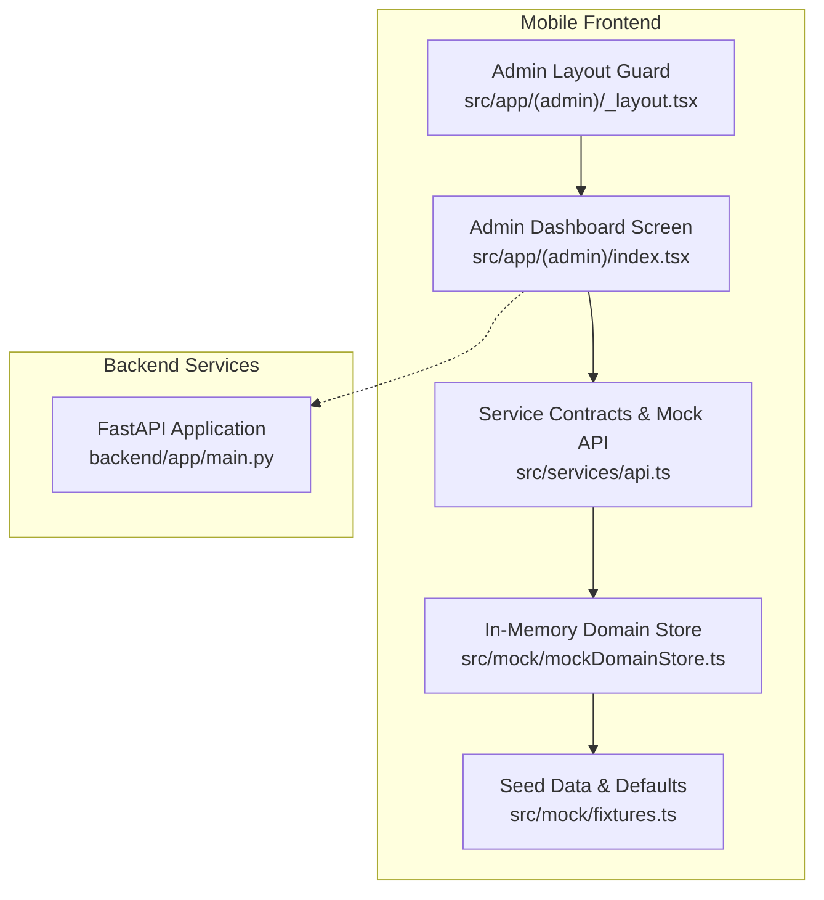
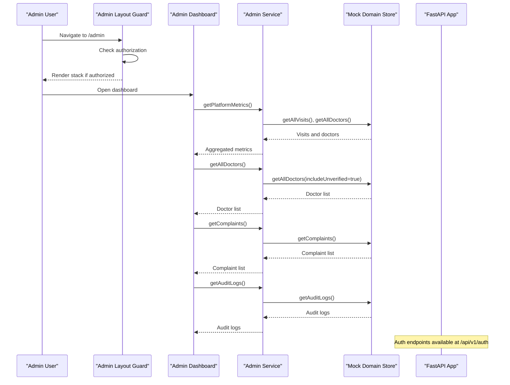
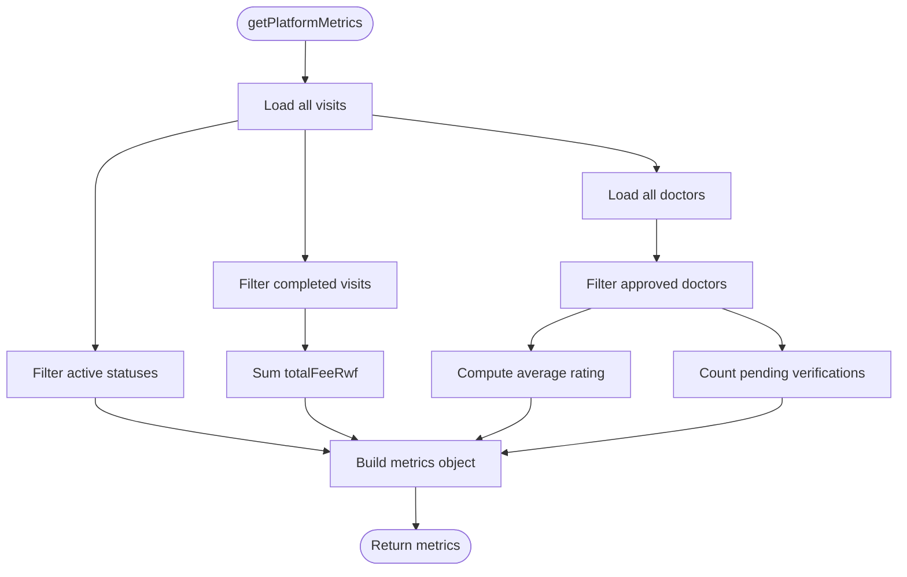
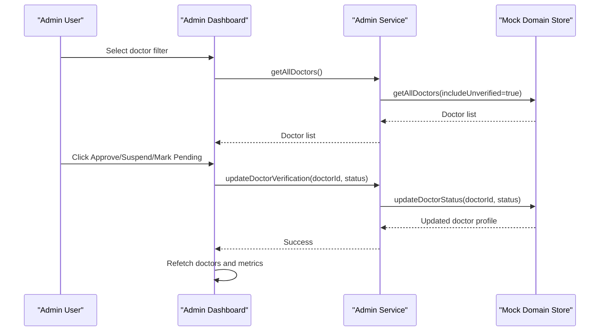
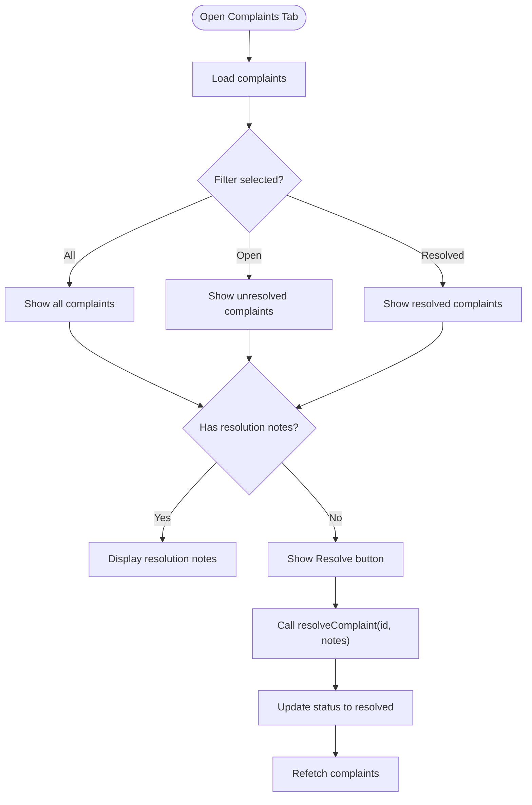
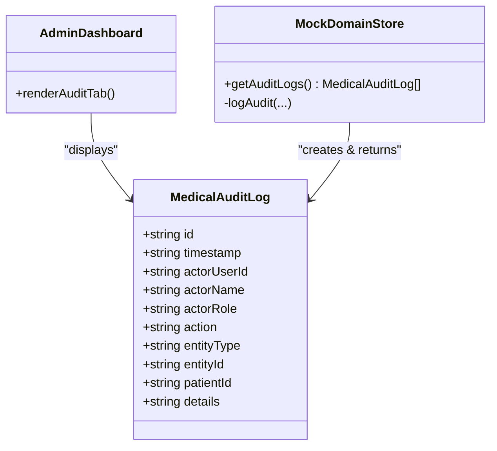
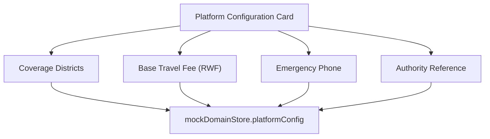
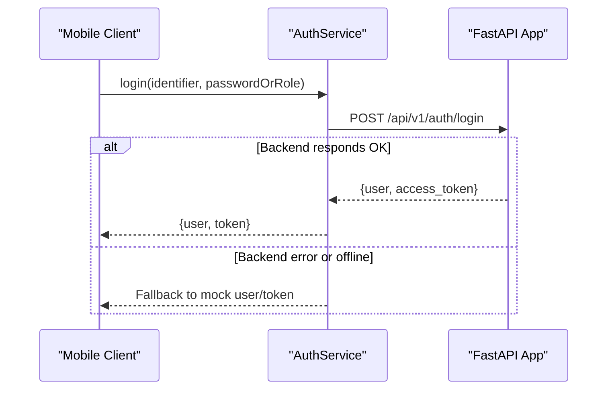
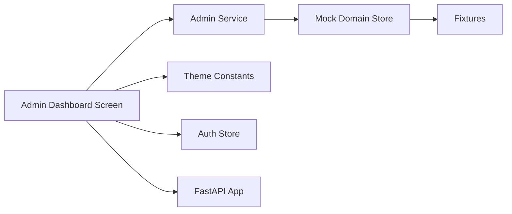

# Admin Features

<cite>
**Referenced Files in This Document**
- [index.tsx](file://src/app/(admin)/index.tsx)
- [_layout.tsx](file://src/app/(admin)/_layout.tsx)
- [api.ts](file://src/services/api.ts)
- [mockDomainStore.ts](file://src/mock/mockDomainStore.ts)
- [fixtures.ts](file://src/mock/fixtures.ts)
- [main.py](file://backend/app/main.py)
</cite>

## Table of Contents
1. [Introduction](#introduction)
2. [Project Structure](#project-structure)
3. [Core Components](#core-components)
4. [Architecture Overview](#architecture-overview)
5. [Detailed Component Analysis](#detailed-component-analysis)
6. [Dependency Analysis](#dependency-analysis)
7. [Performance Considerations](#performance-considerations)
8. [Troubleshooting Guide](#troubleshooting-guide)
9. [Conclusion](#conclusion)

## Introduction
This document describes the administrative features and platform management capabilities implemented in the HomeCare application. It focuses on:
- The admin dashboard with operational metrics such as consultation volume, gross revenue, active visits, average doctor ratings, and pending verification counts.
- Doctor verification workflow for approving, suspending, or marking clinicians as pending, including professional credentials and practice privileges.
- Complaint resolution system for triaging patient grievances with status tracking and resolution notes.
- Audit trail viewer for regulatory compliance, including immutable audit logs for clinical records and lab results.
- Platform configuration display and administrative oversight tools.
- System integration points between the mobile frontend and backend services.

## Project Structure
The administrative console is a protected route group under the app shell. It uses an Expo Router layout guard to enforce admin-only access, then renders a single-screen dashboard with tabs for metrics, doctors, complaints, and audit logs. Data is currently served through a mock domain store that simulates backend behavior, while the FastAPI backend provides authentication endpoints and health checks.

**Diagram sources**
- [_layout.tsx:8-29](file://src/app/(admin)/_layout.tsx#L8-L29)
- [index.tsx:60-85](file://src/app/(admin)/index.tsx#L60-L85)
- [api.ts:587-659](file://src/services/api.ts#L587-L659)
- [mockDomainStore.ts:35-66](file://src/mock/mockDomainStore.ts#L35-L66)
- [main.py:31-46](file://backend/app/main.py#L31-L46)

**Section sources**
- [_layout.tsx:1-40](file://src/app/(admin)/_layout.tsx#L1-L40)
- [index.tsx:1-120](file://src/app/(admin)/index.tsx#L1-L120)
- [api.ts:1-45](file://src/services/api.ts#L1-L45)
- [main.py:31-46](file://backend/app/main.py#L31-L46)

## Core Components
- Admin layout guard: Ensures only authorized users can access the admin routes and shows a loading state during authorization checks.
- Admin dashboard screen: Provides four primary tabs:
  - Metrics: Operational performance indicators including total consultations, completed visits, active visits, gross fees, average rating, and pending verifications.
  - Doctors: Verification management with filters for all, pending, approved, and suspended clinicians; includes license numbers, specialties, qualifications, coverage districts, and fee structures.
  - Complaints: Patient grievance list with open/resolved filtering and resolution actions.
  - Audit: Compliance-focused log viewer showing actor, action, entity type, timestamp, and verification indicators.
- Service layer: Defines admin service contracts and implements them against the mock domain store, computing aggregated metrics from visits and doctor profiles.
- Domain store: Maintains in-memory data for users, doctors, visits, consultations, lab samples, results, notifications, reviews, complaints, and audit logs. It also exposes platform configuration values used by the dashboard.

**Section sources**
- [_layout.tsx:8-29](file://src/app/(admin)/_layout.tsx#L8-L29)
- [index.tsx:60-120](file://src/app/(admin)/index.tsx#L60-L120)
- [api.ts:587-659](file://src/services/api.ts#L587-L659)
- [mockDomainStore.ts:35-66](file://src/mock/mockDomainStore.ts#L35-L66)

## Architecture Overview
The admin dashboard follows a layered architecture:
- Presentation layer (React Native screens) renders tabs and cards.
- Service layer abstracts data operations and computes metrics.
- Domain store holds state and business logic for entities like visits, doctors, complaints, and audit logs.
- Backend FastAPI app provides auth endpoints and health checks; CORS is enabled for cross-origin requests.

**Diagram sources**
- [_layout.tsx:8-29](file://src/app/(admin)/_layout.tsx#L8-L29)
- [index.tsx:67-85](file://src/app/(admin)/index.tsx#L67-L85)
- [api.ts:604-659](file://src/services/api.ts#L604-L659)
- [mockDomainStore.ts:175-192](file://src/mock/mockDomainStore.ts#L175-L192)
- [main.py:46-46](file://backend/app/main.py#L46-L46)

## Detailed Component Analysis

### Admin Dashboard Metrics
The metrics tab displays:
- Total consultations: Count of all visits.
- Completed visits: Visits with status completed.
- Active underway: Visits with statuses confirmed, on_the_way, arrived, or in_consultation.
- Gross fees (RWF): Sum of totalFeeRwf for completed visits.
- Average doctor rating: Mean rating across approved doctors.
- Pending verifications: Count of doctors with verificationStatus pending.

These values are computed by the admin service using the domain store’s visit and doctor collections.

**Diagram sources**
- [api.ts:635-659](file://src/services/api.ts#L635-L659)
- [mockDomainStore.ts:235-239](file://src/mock/mockDomainStore.ts#L235-L239)
- [mockDomainStore.ts:175-192](file://src/mock/mockDomainStore.ts#L175-L192)

**Section sources**
- [index.tsx:67-70](file://src/app/(admin)/index.tsx#L67-L70)
- [index.tsx:339-390](file://src/app/(admin)/index.tsx#L339-L390)
- [api.ts:635-659](file://src/services/api.ts#L635-L659)

### Doctor Verification Workflow
Administrators can:
- View all doctors with filters: All, Pending, Approved, Suspended.
- Approve, suspend, or mark as pending based on RMDC licensing and professional credentials.
- Inspect license numbers, specialties, qualifications, experience years, coverage districts, and fee structures.
- Update verification status triggers audit logging and refreshes metrics.

**Diagram sources**
- [index.tsx:93-105](file://src/app/(admin)/index.tsx#L93-L105)
- [api.ts:610-613](file://src/services/api.ts#L610-L613)
- [mockDomainStore.ts:185-192](file://src/mock/mockDomainStore.ts#L185-L192)

**Section sources**
- [index.tsx:123-130](file://src/app/(admin)/index.tsx#L123-L130)
- [index.tsx:442-587](file://src/app/(admin)/index.tsx#L442-L587)
- [api.ts:587-613](file://src/services/api.ts#L587-L613)
- [mockDomainStore.ts:175-192](file://src/mock/mockDomainStore.ts#L175-L192)

### Complaint Resolution System
Administrators can:
- View all complaints with filters: All, Open, Resolved.
- See complaint subject, details, visit reference, creation date, reporter role, and resolution notes.
- Resolve open complaints by adding resolution notes and updating status to resolved.

**Diagram sources**
- [index.tsx:107-115](file://src/app/(admin)/index.tsx#L107-L115)
- [index.tsx:590-680](file://src/app/(admin)/index.tsx#L590-L680)
- [api.ts:620-628](file://src/services/api.ts#L620-L628)
- [mockDomainStore.ts:502-520](file://src/mock/mockDomainStore.ts#L502-L520)

**Section sources**
- [index.tsx:132-139](file://src/app/(admin)/index.tsx#L132-L139)
- [index.tsx:590-680](file://src/app/(admin)/index.tsx#L590-L680)
- [api.ts:620-628](file://src/services/api.ts#L620-L628)
- [mockDomainStore.ts:502-520](file://src/mock/mockDomainStore.ts#L502-L520)
- [fixtures.ts:891-903](file://src/mock/fixtures.ts#L891-L903)

### Immutable Medical Record Audit Log Viewer
The audit tab presents:
- Mandatory compliance notice referencing Law No. 058/2021.
- Audit entries with action type (CREATE/PUBLISH/READ), entity type (consultation_record/result_document), actor name and role, timestamp, details, and a verified indicator.
- Entries are generated when consultation records are created/published and when result documents are published or read.

**Diagram sources**
- [index.tsx:683-734](file://src/app/(admin)/index.tsx#L683-L734)
- [mockDomainStore.ts:522-552](file://src/mock/mockDomainStore.ts#L522-L552)
- [fixtures.ts:839-889](file://src/mock/fixtures.ts#L839-L889)

**Section sources**
- [index.tsx:683-734](file://src/app/(admin)/index.tsx#L683-L734)
- [mockDomainStore.ts:522-552](file://src/mock/mockDomainStore.ts#L522-L552)
- [fixtures.ts:839-889](file://src/mock/fixtures.ts#L839-L889)

### Platform Configuration and Administrative Oversight
The metrics tab includes a platform configuration card displaying:
- Coverage districts.
- Base travel fee in RWF.
- Emergency phone number.
- Authority reference (RMDC · Law No. 058/2021).

These values come from the domain store’s platformConfig object.

**Diagram sources**
- [index.tsx:392-438](file://src/app/(admin)/index.tsx#L392-L438)
- [mockDomainStore.ts:50-66](file://src/mock/mockDomainStore.ts#L50-L66)

**Section sources**
- [index.tsx:392-438](file://src/app/(admin)/index.tsx#L392-L438)
- [mockDomainStore.ts:50-66](file://src/mock/mockDomainStore.ts#L50-L66)

### System Integration Points
- Authentication: The login flow attempts to call the backend FastAPI endpoint; on failure, it falls back to mock data.
- Health check: A root endpoint and health endpoint are exposed by the FastAPI app.
- CORS: Enabled to allow cross-origin requests from mobile/web clients.

**Diagram sources**
- [api.ts:46-104](file://src/services/api.ts#L46-L104)
- [main.py:46-60](file://backend/app/main.py#L46-L60)

**Section sources**
- [api.ts:46-104](file://src/services/api.ts#L46-L104)
- [main.py:46-60](file://backend/app/main.py#L46-L60)

## Dependency Analysis
The admin feature set depends on:
- React Native UI components and Expo Router navigation.
- TanStack Query for data fetching and refetching.
- Service contracts defining admin operations.
- Mock domain store providing in-memory persistence and business logic.
- Seed fixtures initializing default data.
- Backend FastAPI app for authentication and health checks.

**Diagram sources**
- [index.tsx:18-22](file://src/app/(admin)/index.tsx#L18-L22)
- [api.ts:587-659](file://src/services/api.ts#L587-L659)
- [mockDomainStore.ts:35-66](file://src/mock/mockDomainStore.ts#L35-L66)
- [main.py:31-46](file://backend/app/main.py#L31-L46)

**Section sources**
- [index.tsx:18-22](file://src/app/(admin)/index.tsx#L18-L22)
- [api.ts:587-659](file://src/services/api.ts#L587-L659)
- [mockDomainStore.ts:35-66](file://src/mock/mockDomainStore.ts#L35-L66)
- [main.py:31-46](file://backend/app/main.py#L31-L46)

## Performance Considerations
- Simulated latency: Service methods introduce artificial delays to mimic network calls; this affects perceived responsiveness but aids testing.
- Aggregation cost: Metrics computation iterates over visits and doctors; for large datasets, consider server-side aggregation or caching strategies.
- Filtering: Client-side filtering of doctors and complaints is efficient for small-to-medium lists; consider pagination or server-side queries for scale.
- Audit log sorting: Logs are sorted by timestamp in memory; ensure indexes or database-backed storage for production-scale auditing.

[No sources needed since this section provides general guidance]

## Troubleshooting Guide
Common issues and resolutions:
- Unauthorized access to admin routes: Ensure the user has admin role; the layout guard will show a loading state and redirect if not authorized.
- Metrics not updating: Use the pull-to-refresh action to refetch metrics, doctors, complaints, and audit logs concurrently.
- Doctor status updates failing: Verify doctor ID exists and status transitions are valid; errors are surfaced via alerts.
- Complaint resolution not persisting: Confirm the complaint exists and call resolveComplaint with appropriate notes; the store updates status and notes.
- Audit logs missing: Ensure consultation records and result documents are created/published; audit entries are generated by domain store methods.

**Section sources**
- [_layout.tsx:8-29](file://src/app/(admin)/_layout.tsx#L8-L29)
- [index.tsx:87-91](file://src/app/(admin)/index.tsx#L87-L91)
- [index.tsx:93-115](file://src/app/(admin)/index.tsx#L93-L115)
- [mockDomainStore.ts:185-192](file://src/mock/mockDomainStore.ts#L185-L192)
- [mockDomainStore.ts:513-520](file://src/mock/mockDomainStore.ts#L513-L520)
- [mockDomainStore.ts:393-406](file://src/mock/mockDomainStore.ts#L393-L406)
- [mockDomainStore.ts:436-464](file://src/mock/mockDomainStore.ts#L436-L464)

## Conclusion
The administrative console provides comprehensive platform management capabilities:
- Operational metrics for monitoring consultation volume, revenue, activity, ratings, and verification backlog.
- Doctor verification workflows supporting RMDC licensing and professional credential oversight.
- Complaint resolution processes enabling triage and resolution tracking.
- Audit trail viewer ensuring regulatory compliance with immutable logs for clinical records and lab results.
- Platform configuration visibility and administrative oversight tools.
- Integration points with backend authentication and health endpoints.

For production readiness, consider migrating mock data to a persistent database, implementing server-side metric aggregation, adding severity classification for complaints, and integrating cryptographic hash verification for audit immutability.

[No sources needed since this section summarizes without analyzing specific files]