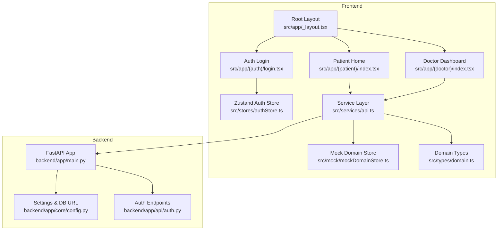
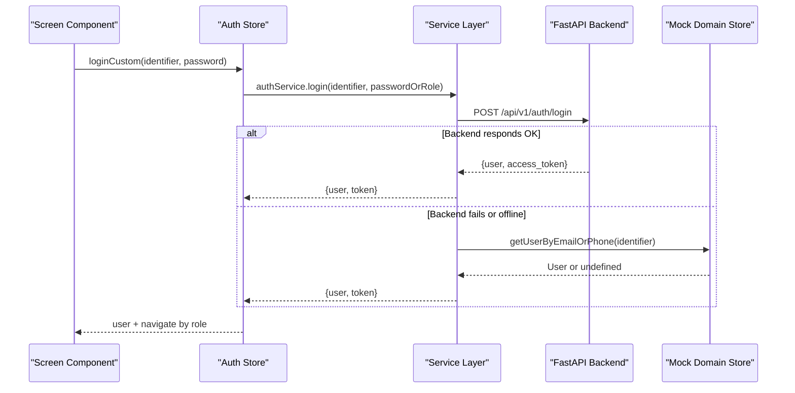
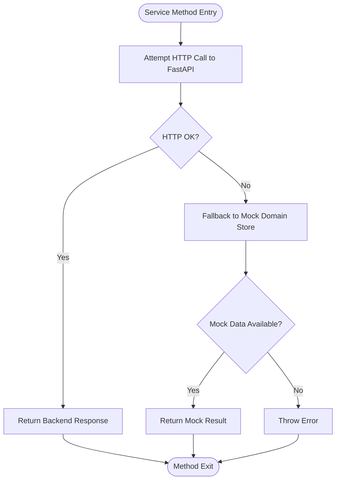
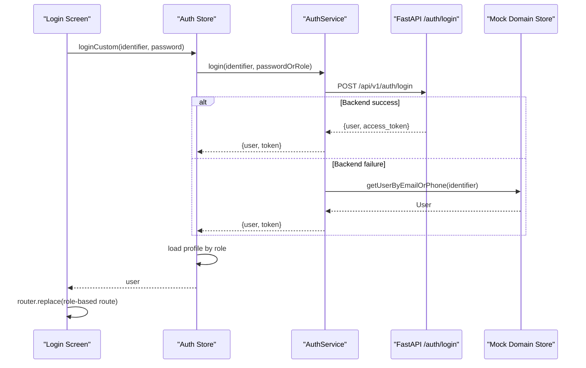
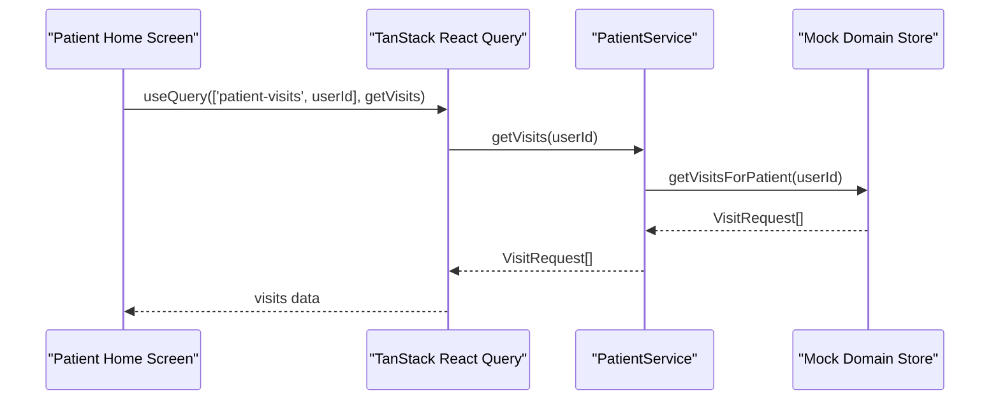
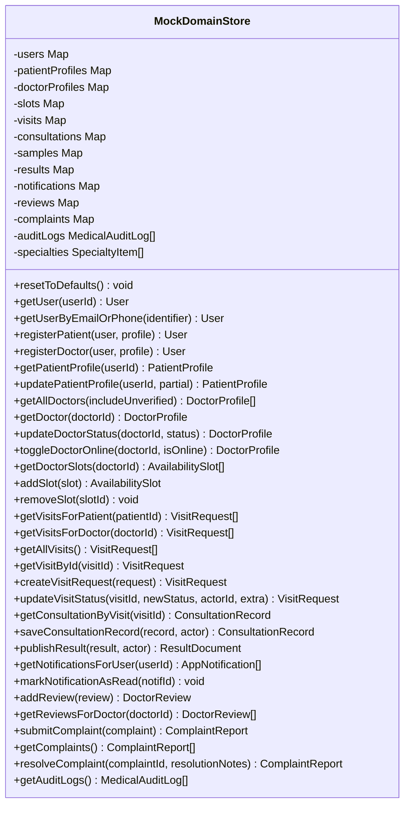
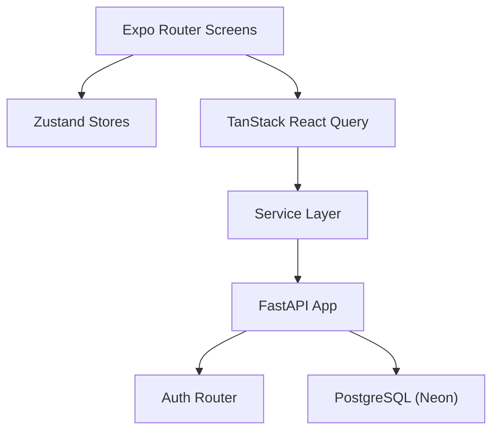
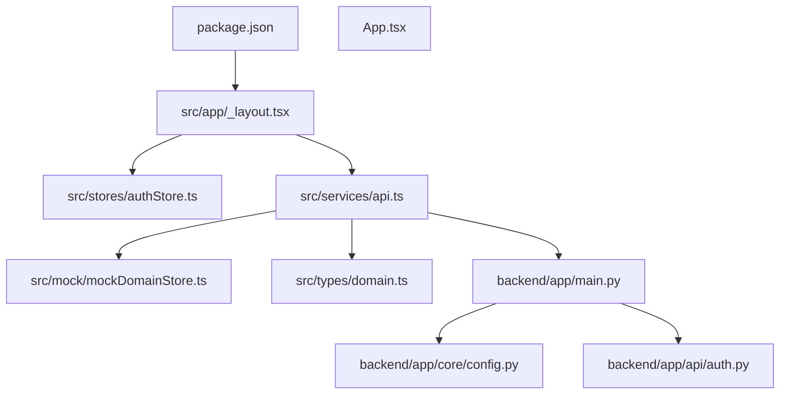

# Architecture Overview

<cite>
**Referenced Files in This Document**
- [README.md](file://README.md)
- [package.json](file://package.json)
- [App.tsx](file://App.tsx)
- [src/app/_layout.tsx](file://src/app/_layout.tsx)
- [src/app/(auth)/login.tsx](file://src/app/(auth)/login.tsx)
- [src/app/(patient)/index.tsx](file://src/app/(patient)/index.tsx)
- [src/app/(doctor)/index.tsx](file://src/app/(doctor)/index.tsx)
- [src/stores/authStore.ts](file://src/stores/authStore.ts)
- [src/services/api.ts](file://src/services/api.ts)
- [src/mock/mockDomainStore.ts](file://src/mock/mockDomainStore.ts)
- [src/types/domain.ts](file://src/types/domain.ts)
- [backend/app/main.py](file://backend/app/main.py)
- [backend/app/core/config.py](file://backend/app/core/config.py)
- [backend/app/api/auth.py](file://backend/app/api/auth.py)
</cite>

## Table of Contents
1. [Introduction](#introduction)
2. [Project Structure](#project-structure)
3. [Core Components](#core-components)
4. [Architecture Overview](#architecture-overview)
5. [Detailed Component Analysis](#detailed-component-analysis)
6. [Dependency Analysis](#dependency-analysis)
7. [Performance Considerations](#performance-considerations)
8. [Troubleshooting Guide](#troubleshooting-guide)
9. [Conclusion](#conclusion)

## Introduction
HomeCare is a mobile-first healthcare application for home-visit medical consultations, primarily targeting Rwanda with East African market support. The frontend uses Expo (React Native), TypeScript, Zustand for state management, and TanStack React Query for data fetching. The backend is implemented with FastAPI and PostgreSQL using async SQLAlchemy. A service layer abstraction allows seamless switching between a real backend API and a reactive in-memory mock domain store that provides account isolation, domain events, and realistic business rules such as double-booking prevention and visit lifecycle transitions.

The system supports three primary roles: patient, doctor, and admin. Patients discover specialists, book visits, track visit status, and access clinical records and lab results. Doctors manage availability, accept or propose alternative booking slots, execute visits, and publish consultation records and lab results. Admins verify doctors, manage complaints, and review platform metrics and audit logs.

## Project Structure
The project follows a feature-based structure under `src/app` with role-based route groups `(auth)`, `(patient)`, `(doctor)`, and `(admin)`. Shared UI components live under `src/components/ui`, while cross-cutting concerns are organized into `src/hooks`, `src/constants`, `src/types`, `src/stores`, and `src/services`. The backend resides under `backend/app` with FastAPI routers, core configuration, database session setup, models, schemas, and an auth API.

**Diagram sources**
- [src/app/_layout.tsx:57-85](file://src/app/_layout.tsx#L57-L85)
- [src/app/(auth)/login.tsx:17-46](file://src/app/(auth)/login.tsx#L17-L46)
- [src/app/(patient)/index.tsx:22-49](file://src/app/(patient)/index.tsx#L22-L49)
- [src/app/(doctor)/index.tsx:25-49](file://src/app/(doctor)/index.tsx#L25-L49)
- [src/stores/authStore.ts:23-56](file://src/stores/authStore.ts#L23-L56)
- [src/services/api.ts:46-104](file://src/services/api.ts#L46-L104)
- [src/mock/mockDomainStore.ts:35-70](file://src/mock/mockDomainStore.ts#L35-L70)
- [backend/app/main.py:31-46](file://backend/app/main.py#L31-L46)
- [backend/app/core/config.py:10-30](file://backend/app/core/config.py#L10-L30)
- [backend/app/api/auth.py:121-153](file://backend/app/api/auth.py#L121-L153)

**Section sources**
- [README.md:1-8](file://README.md#L1-L8)
- [package.json:1-21](file://package.json#L1-L21)
- [src/app/_layout.tsx:57-85](file://src/app/_layout.tsx#L57-L85)

## Core Components
- Frontend entry and layout: The root layout configures SafeAreaProvider, QueryClientProvider, and Expo Router stacks for role-based route groups. It also renders a demo session bar for quick logout and demo data reset.
- Authentication store: Zustand store manages current user, role-specific profiles, token, loading, and error states. It exposes loginDemo, loginCustom, logout, refreshProfile, and resetDemoData actions.
- Service layer: Typed interfaces define AuthService, PatientService, DoctorService, and AdminService. Methods attempt real HTTP calls to the FastAPI backend and gracefully fall back to the mock domain store when offline or during development.
- Mock domain store: In-memory reactive store initialized with fixtures, providing account isolation, domain events (notifications), audit logging, and business rules like double-booking prevention and visit lifecycle transitions.
- Domain types: Strongly typed entities for User, PatientProfile, DoctorProfile, VisitRequest, ConsultationRecord, ResultDocument, LabSample, AppNotification, DoctorReview, ComplaintReport, MedicalAuditLog, and related enums.

**Section sources**
- [src/app/_layout.tsx:57-85](file://src/app/_layout.tsx#L57-L85)
- [src/stores/authStore.ts:23-111](file://src/stores/authStore.ts#L23-L111)
- [src/services/api.ts:25-41](file://src/services/api.ts#L25-L41)
- [src/services/api.ts:46-104](file://src/services/api.ts#L46-L104)
- [src/mock/mockDomainStore.ts:35-70](file://src/mock/mockDomainStore.ts#L35-L70)
- [src/types/domain.ts:29-242](file://src/types/domain.ts#L29-L242)

## Architecture Overview
The system combines a React Native frontend with a FastAPI backend through a service layer abstraction. Screens call services; services attempt backend calls and fallback to the mock store. State is managed by Zustand stores, and data fetching is handled by TanStack React Query. Role-based navigation routes users to appropriate screens after authentication.

**Diagram sources**
- [src/app/(auth)/login.tsx:23-46](file://src/app/(auth)/login.tsx#L23-L46)
- [src/stores/authStore.ts:58-83](file://src/stores/authStore.ts#L58-L83)
- [src/services/api.ts:46-104](file://src/services/api.ts#L46-L104)
- [backend/app/api/auth.py:121-153](file://backend/app/api/auth.py#L121-L153)
- [src/mock/mockDomainStore.ts:134-142](file://src/mock/mockDomainStore.ts#L134-L142)

## Detailed Component Analysis

### Service Layer Abstraction Pattern
The service layer defines typed contracts for authentication, patient operations, doctor operations, and admin operations. Each method simulates latency and attempts a real HTTP request to the FastAPI backend. On failure, it falls back to the mock domain store, ensuring the app remains functional offline and during development.

**Diagram sources**
- [src/services/api.ts:46-104](file://src/services/api.ts#L46-L104)
- [src/services/api.ts:124-197](file://src/services/api.ts#L124-L197)
- [src/mock/mockDomainStore.ts:134-142](file://src/mock/mockDomainStore.ts#L134-L142)

**Section sources**
- [src/services/api.ts:25-41](file://src/services/api.ts#L25-L41)
- [src/services/api.ts:46-104](file://src/services/api.ts#L46-L104)
- [src/services/api.ts:247-430](file://src/services/api.ts#L247-L430)
- [src/services/api.ts:432-585](file://src/services/api.ts#L432-L585)
- [src/services/api.ts:587-659](file://src/services/api.ts#L587-L659)

### Authentication Flow and Role-Based Navigation
Authentication flow starts at the login screen, which validates inputs, calls the auth store, and navigates based on user role. The auth store invokes the service layer, which tries the backend and falls back to the mock store. After successful authentication, the store loads role-specific profiles and sets the session state.

**Diagram sources**
- [src/app/(auth)/login.tsx:23-46](file://src/app/(auth)/login.tsx#L23-L46)
- [src/stores/authStore.ts:58-83](file://src/stores/authStore.ts#L58-L83)
- [src/services/api.ts:46-104](file://src/services/api.ts#L46-L104)
- [backend/app/api/auth.py:121-153](file://backend/app/api/auth.py#L121-L153)
- [src/mock/mockDomainStore.ts:134-142](file://src/mock/mockDomainStore.ts#L134-L142)

**Section sources**
- [src/app/(auth)/login.tsx:17-46](file://src/app/(auth)/login.tsx#L17-L46)
- [src/stores/authStore.ts:23-83](file://src/stores/authStore.ts#L23-L83)
- [src/services/api.ts:46-104](file://src/services/api.ts#L46-L104)
- [backend/app/api/auth.py:121-153](file://backend/app/api/auth.py#L121-L153)

### Data Flow Patterns from UI to Services and Stores
Screens use TanStack React Query to fetch data via services. For example, the patient home screen queries visits, specialties, and recommended doctors. The doctor dashboard queries visits and toggles online status. These flows demonstrate how UI interactions propagate through services to either the backend or the mock store.

**Diagram sources**
- [src/app/(patient)/index.tsx:27-43](file://src/app/(patient)/index.tsx#L27-L43)
- [src/services/api.ts:347-350](file://src/services/api.ts#L347-L350)
- [src/mock/mockDomainStore.ts:223-227](file://src/mock/mockDomainStore.ts#L223-L227)

**Section sources**
- [src/app/(patient)/index.tsx:22-49](file://src/app/(patient)/index.tsx#L22-L49)
- [src/app/(doctor)/index.tsx:25-49](file://src/app/(doctor)/index.tsx#L25-L49)
- [src/services/api.ts:347-350](file://src/services/api.ts#L347-L350)
- [src/mock/mockDomainStore.ts:223-227](file://src/mock/mockDomainStore.ts#L223-L227)

### Mock Domain Store Architecture
The mock domain store acts as a reactive in-memory database with account isolation. It initializes with fixtures, maintains maps for users, profiles, slots, visits, consultations, samples, results, notifications, reviews, complaints, and audit logs. It enforces business rules such as preventing overlapping slot reservations and generating notifications on state changes.

**Diagram sources**
- [src/mock/mockDomainStore.ts:35-70](file://src/mock/mockDomainStore.ts#L35-L70)
- [src/mock/mockDomainStore.ts:134-142](file://src/mock/mockDomainStore.ts#L134-L142)
- [src/mock/mockDomainStore.ts:245-281](file://src/mock/mockDomainStore.ts#L245-L281)
- [src/mock/mockDomainStore.ts:283-380](file://src/mock/mockDomainStore.ts#L283-L380)
- [src/mock/mockDomainStore.ts:393-406](file://src/mock/mockDomainStore.ts#L393-L406)
- [src/mock/mockDomainStore.ts:436-464](file://src/mock/mockDomainStore.ts#L436-L464)
- [src/mock/mockDomainStore.ts:467-479](file://src/mock/mockDomainStore.ts#L467-L479)
- [src/mock/mockDomainStore.ts:482-520](file://src/mock/mockDomainStore.ts#L482-L520)
- [src/mock/mockDomainStore.ts:523-552](file://src/mock/mockDomainStore.ts#L523-L552)

**Section sources**
- [src/mock/mockDomainStore.ts:35-70](file://src/mock/mockDomainStore.ts#L35-L70)
- [src/mock/mockDomainStore.ts:245-281](file://src/mock/mockDomainStore.ts#L245-L281)
- [src/mock/mockDomainStore.ts:283-380](file://src/mock/mockDomainStore.ts#L283-L380)
- [src/mock/mockDomainStore.ts:436-464](file://src/mock/mockDomainStore.ts#L436-L464)
- [src/mock/mockDomainStore.ts:523-552](file://src/mock/mockDomainStore.ts#L523-L552)

### System Boundaries and Integration Points
- Frontend boundaries: Expo Router screens, Zustand stores, TanStack React Query, and shared UI components.
- Service integration points: HTTP calls to FastAPI endpoints for authentication and registration; fallback to mock domain store for all other operations.
- Backend boundaries: FastAPI app with CORS middleware, lifespan for database connection and table initialization, and auth router exposing register, login, OTP verification, and password reset endpoints.

**Diagram sources**
- [src/app/_layout.tsx:57-85](file://src/app/_layout.tsx#L57-L85)
- [src/stores/authStore.ts:23-56](file://src/stores/authStore.ts#L23-L56)
- [src/services/api.ts:46-104](file://src/services/api.ts#L46-L104)
- [backend/app/main.py:31-46](file://backend/app/main.py#L31-L46)
- [backend/app/api/auth.py:121-153](file://backend/app/api/auth.py#L121-L153)

**Section sources**
- [backend/app/main.py:31-46](file://backend/app/main.py#L31-L46)
- [backend/app/core/config.py:10-30](file://backend/app/core/config.py#L10-L30)
- [backend/app/api/auth.py:121-153](file://backend/app/api/auth.py#L121-L153)

### Separation of Concerns
- Screens focus on presentation and user interaction, delegating data fetching to React Query and mutations to services.
- Services encapsulate business logic and data source selection (backend vs mock).
- Stores manage global session state and provide actions for authentication and profile refresh.
- Domain types ensure consistent contracts across the application.

**Section sources**
- [src/app/(patient)/index.tsx:22-49](file://src/app/(patient)/index.tsx#L22-L49)
- [src/app/(doctor)/index.tsx:25-49](file://src/app/(doctor)/index.tsx#L25-L49)
- [src/stores/authStore.ts:23-83](file://src/stores/authStore.ts#L23-L83)
- [src/services/api.ts:25-41](file://src/services/api.ts#L25-L41)
- [src/types/domain.ts:29-242](file://src/types/domain.ts#L29-L242)

## Dependency Analysis
The frontend depends on Expo Router for navigation, Zustand for state, and React Query for caching. The service layer depends on domain types and the mock store, and optionally on the backend API. The backend depends on FastAPI, async SQLAlchemy, and PostgreSQL.

**Diagram sources**
- [package.json:1-21](file://package.json#L1-L21)
- [App.tsx:1-21](file://App.tsx#L1-L21)
- [src/app/_layout.tsx:57-85](file://src/app/_layout.tsx#L57-L85)
- [src/stores/authStore.ts:23-56](file://src/stores/authStore.ts#L23-L56)
- [src/services/api.ts:46-104](file://src/services/api.ts#L46-L104)
- [src/mock/mockDomainStore.ts:35-70](file://src/mock/mockDomainStore.ts#L35-L70)
- [backend/app/main.py:31-46](file://backend/app/main.py#L31-L46)
- [backend/app/core/config.py:10-30](file://backend/app/core/config.py#L10-L30)
- [backend/app/api/auth.py:121-153](file://backend/app/api/auth.py#L121-L153)

**Section sources**
- [package.json:1-21](file://package.json#L1-L21)
- [src/app/_layout.tsx:57-85](file://src/app/_layout.tsx#L57-L85)
- [src/services/api.ts:46-104](file://src/services/api.ts#L46-L104)
- [backend/app/main.py:31-46](file://backend/app/main.py#L31-L46)

## Performance Considerations
- Simulated latency in services improves UX realism and helps test loading states without relying on network performance.
- React Query caching reduces redundant requests and improves responsiveness.
- Mock domain store operations are in-memory, enabling fast iteration during development.
- Backend uses async SQLAlchemy for efficient database operations and includes health check endpoints for monitoring.

[No sources needed since this section provides general guidance]

## Troubleshooting Guide
- Authentication failures: Check credentials and backend connectivity. The service layer falls back to mock store if backend is unavailable.
- Demo data issues: Use the session bar’s reset action to restore default mock data.
- Backend startup: Ensure FastAPI server is running and database connection is configured correctly. Health endpoint can be used to verify service status.

**Section sources**
- [src/app/_layout.tsx:21-55](file://src/app/_layout.tsx#L21-L55)
- [src/services/api.ts:46-104](file://src/services/api.ts#L46-L104)
- [backend/app/main.py:49-61](file://backend/app/main.py#L49-L61)

## Conclusion
HomeCare’s architecture cleanly separates presentation, state, service abstraction, and data sources. The service layer enables switching between a real FastAPI backend and a robust mock domain store, supporting rapid development and testing. Role-based navigation, strong typing, and reactive state management provide a solid foundation for healthcare workflows, including visit lifecycle management, clinical record publishing, and compliance-oriented audit logging.

[No sources needed since this section summarizes without analyzing specific files]