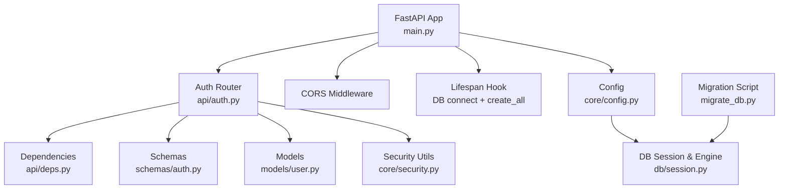
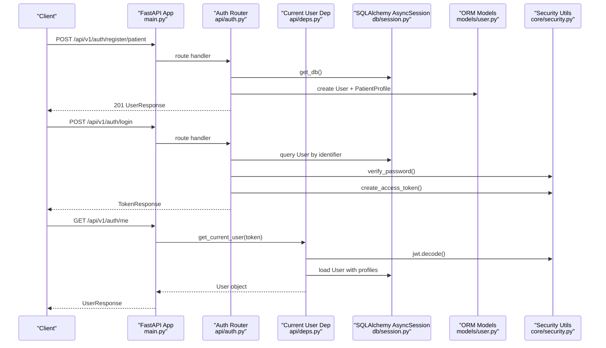
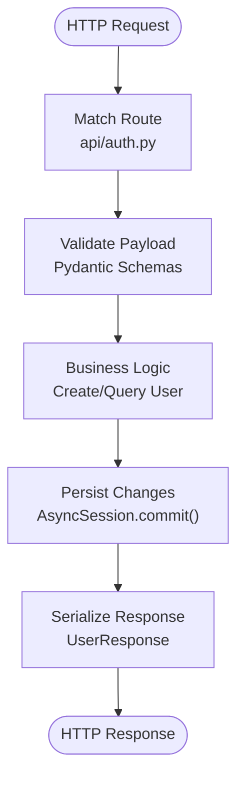
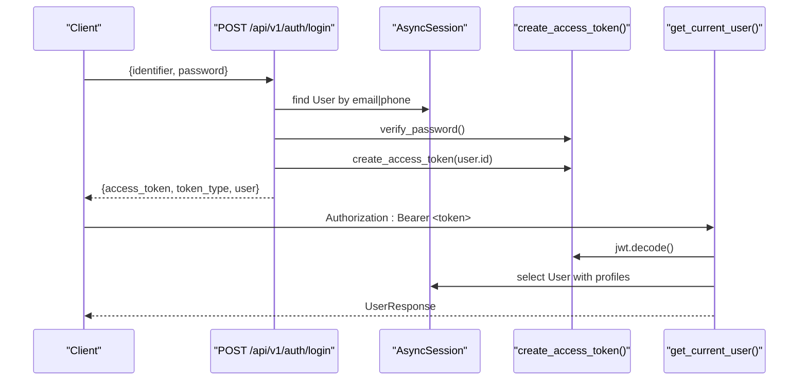
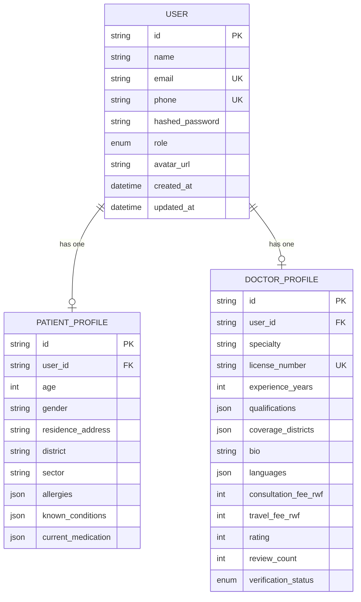
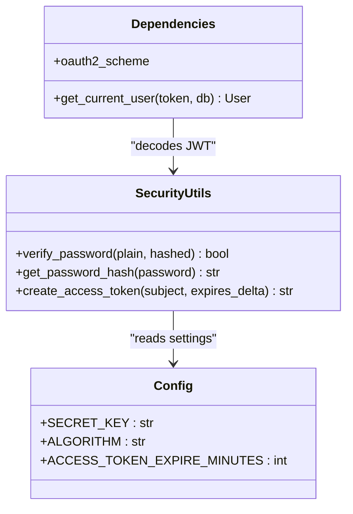
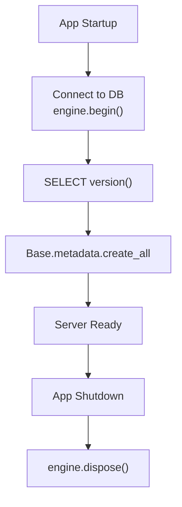
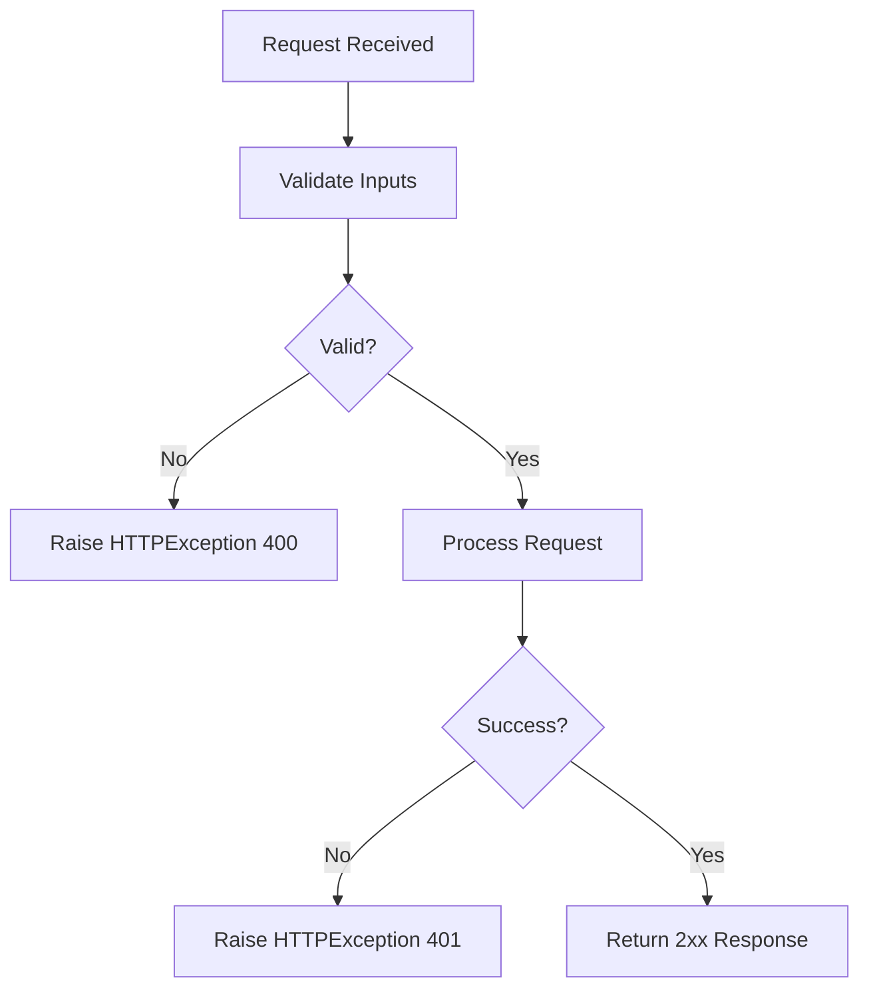
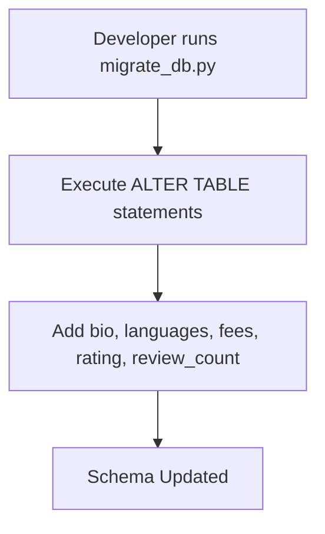
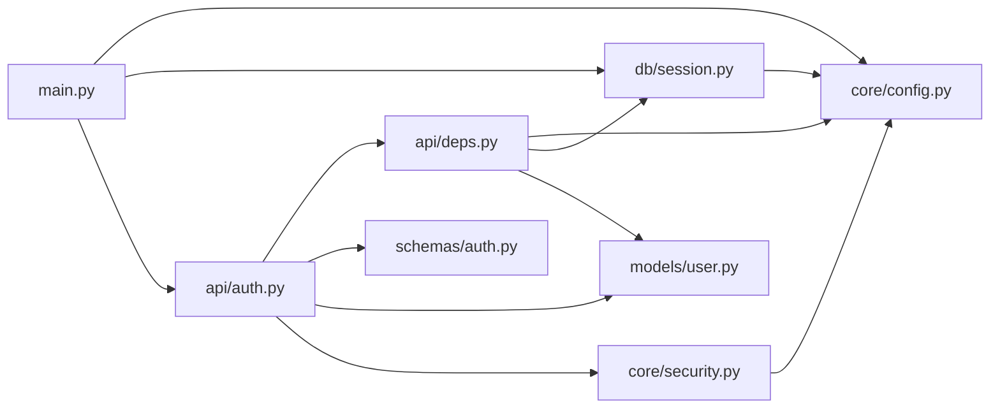

# Backend Architecture

<cite>
**Referenced Files in This Document**
- [main.py](file://backend/app/main.py)
- [auth.py](file://backend/app/api/auth.py)
- [deps.py](file://backend/app/api/deps.py)
- [config.py](file://backend/app/core/config.py)
- [security.py](file://backend/app/core/security.py)
- [session.py](file://backend/app/db/session.py)
- [user.py](file://backend/app/models/user.py)
- [auth_schemas.py](file://backend/app/schemas/auth.py)
- [migrate_db.py](file://backend/migrate_db.py)
</cite>

## Table of Contents
1. [Introduction](#introduction)
2. [Project Structure](#project-structure)
3. [Core Components](#core-components)
4. [Architecture Overview](#architecture-overview)
5. [Detailed Component Analysis](#detailed-component-analysis)
6. [Dependency Analysis](#dependency-analysis)
7. [Performance Considerations](#performance-considerations)
8. [Troubleshooting Guide](#troubleshooting-guide)
9. [Conclusion](#conclusion)

## Introduction
This document describes the FastAPI backend service architecture for the HomeCare application. It covers RESTful API design, authentication endpoints (login, OTP verification, user registration), database models using SQLAlchemy, session management, security implementation (JWT and password hashing), database connection management, migration strategy, API versioning, and error handling patterns. The goal is to provide a clear, code-mapped overview that helps both developers and stakeholders understand how the system works end-to-end.

## Project Structure
The backend follows a layered structure:
- Application entrypoint and middleware configuration
- API routers for domain features
- Core utilities for configuration and security
- Database layer with async engine and session management
- ORM models defining the schema
- Pydantic schemas for request/response validation
- Migration scripts for schema evolution

**Diagram sources**
- [main.py:11-46](file://backend/app/main.py#L11-L46)
- [auth.py:1-21](file://backend/app/api/auth.py#L1-L21)
- [deps.py:1-12](file://backend/app/api/deps.py#L1-L12)
- [config.py:10-30](file://backend/app/core/config.py#L10-L30)
- [session.py:23-48](file://backend/app/db/session.py#L23-L48)
- [migrate_db.py:6-19](file://backend/migrate_db.py#L6-L19)

**Section sources**
- [main.py:1-61](file://backend/app/main.py#L1-L61)
- [config.py:10-30](file://backend/app/core/config.py#L10-L30)

## Core Components
- FastAPI application with lifespan hooks for DB initialization and graceful shutdown
- Auth router exposing registration, login, OTP verification, reset password, and profile retrieval
- Dependency injection for current user via JWT
- Pydantic schemas for input validation and response serialization
- SQLAlchemy async models for users and profiles
- Async database engine and session factory configured for PostgreSQL/asyncpg
- Security utilities for password hashing and JWT creation
- Configuration loader for environment variables and settings
- Migration script for incremental schema changes

**Section sources**
- [main.py:11-46](file://backend/app/main.py#L11-L46)
- [auth.py:24-180](file://backend/app/api/auth.py#L24-L180)
- [deps.py:15-41](file://backend/app/api/deps.py#L15-L41)
- [auth_schemas.py:27-119](file://backend/app/schemas/auth.py#L27-L119)
- [user.py:26-80](file://backend/app/models/user.py#L26-L80)
- [session.py:23-48](file://backend/app/db/session.py#L23-L48)
- [security.py:10-26](file://backend/app/core/security.py#L10-L26)
- [config.py:10-30](file://backend/app/core/config.py#L10-L30)
- [migrate_db.py:6-19](file://backend/migrate_db.py#L6-L19)

## Architecture Overview
The backend exposes a versioned API under /api/v1. Authentication is handled via JWT bearer tokens. Registration creates a User and a role-specific profile. Login issues a JWT containing the user ID. Protected routes use a dependency that decodes the token and loads the user with eager-loaded profiles.

**Diagram sources**
- [main.py:31-46](file://backend/app/main.py#L31-L46)
- [auth.py:24-180](file://backend/app/api/auth.py#L24-L180)
- [deps.py:15-41](file://backend/app/api/deps.py#L15-L41)
- [session.py:43-48](file://backend/app/db/session.py#L43-L48)
- [user.py:26-80](file://backend/app/models/user.py#L26-L80)
- [security.py:10-26](file://backend/app/core/security.py#L10-L26)

## Detailed Component Analysis

### API Design and Endpoints
- Base path: /api/v1
- Auth endpoints:
  - POST /api/v1/auth/register/patient
  - POST /api/v1/auth/register/doctor
  - POST /api/v1/auth/login
  - POST /api/v1/auth/verify-otp
  - POST /api/v1/auth/reset-password
  - GET /api/v1/auth/me

Request/response contracts are defined by Pydantic schemas in auth_schemas.py. Responses include serialized User objects with optional nested profiles.

**Diagram sources**
- [auth.py:24-180](file://backend/app/api/auth.py#L24-L180)
- [auth_schemas.py:27-119](file://backend/app/schemas/auth.py#L27-L119)

**Section sources**
- [auth.py:24-180](file://backend/app/api/auth.py#L24-L180)
- [auth_schemas.py:27-119](file://backend/app/schemas/auth.py#L27-L119)

### Authentication Flow
- Login accepts an identifier (email or phone) and password.
- Passwords are verified using bcrypt via security utilities.
- On success, a JWT is created with the user ID as subject and expiration based on configuration.
- Protected endpoints require a Bearer token; the dependency decodes the token, validates it, and loads the user with eager-loaded profiles.

**Diagram sources**
- [auth.py:121-153](file://backend/app/api/auth.py#L121-L153)
- [deps.py:15-41](file://backend/app/api/deps.py#L15-L41)
- [security.py:18-26](file://backend/app/core/security.py#L18-L26)

**Section sources**
- [auth.py:121-153](file://backend/app/api/auth.py#L121-L153)
- [deps.py:15-41](file://backend/app/api/deps.py#L15-L41)
- [security.py:18-26](file://backend/app/core/security.py#L18-L26)

### Database Schema and Relationships
- User table stores core identity and role.
- PatientProfile and DoctorProfile are one-to-one relationships with User via foreign keys.
- Enums define roles and doctor verification status.
- JSON columns store lists for attributes like allergies, qualifications, coverage districts, languages, etc.

**Diagram sources**
- [user.py:26-80](file://backend/app/models/user.py#L26-L80)

**Section sources**
- [user.py:26-80](file://backend/app/models/user.py#L26-L80)

### Security Implementation
- Password hashing uses bcrypt through a CryptContext.
- JWT tokens are created with HS256 algorithm, secret key from configuration, and configurable expiration.
- Protected routes decode the token and fetch the user entity with related profiles.

**Diagram sources**
- [security.py:10-26](file://backend/app/core/security.py#L10-L26)
- [config.py:10-30](file://backend/app/core/config.py#L10-L30)
- [deps.py:15-41](file://backend/app/api/deps.py#L15-L41)

**Section sources**
- [security.py:10-26](file://backend/app/core/security.py#L10-L26)
- [deps.py:15-41](file://backend/app/api/deps.py#L15-L41)
- [config.py:10-30](file://backend/app/core/config.py#L10-L30)

### Database Connection Management and Lifecycle
- Async engine is created with asyncpg dialect and pool_pre_ping enabled.
- SSL is enabled when required by the connection URL or Neon host.
- Lifespan hook connects to the database at startup, prints version info, and ensures tables exist via metadata.create_all.
- Graceful shutdown disposes the engine.

**Diagram sources**
- [main.py:11-28](file://backend/app/main.py#L11-L28)
- [session.py:23-29](file://backend/app/db/session.py#L23-L29)

**Section sources**
- [main.py:11-28](file://backend/app/main.py#L11-L28)
- [session.py:23-29](file://backend/app/db/session.py#L23-L29)

### API Versioning Approach
- All public endpoints are mounted under /api/v1.
- OpenAPI schema is exposed at /api/v1/openapi.json.
- This allows future versions (e.g., /api/v2) without breaking existing clients.

**Section sources**
- [main.py:31-46](file://backend/app/main.py#L31-L46)
- [config.py:10-16](file://backend/app/core/config.py#L10-L16)

### Error Handling Patterns
- HTTPException is used for business errors such as duplicate registrations, invalid credentials, and invalid OTP codes.
- Consistent status codes:
  - 400 Bad Request for invalid inputs or conflicts
  - 401 Unauthorized for invalid credentials or missing/invalid tokens
- Protected routes return WWW-Authenticate header on unauthorized access.

**Diagram sources**
- [auth.py:24-180](file://backend/app/api/auth.py#L24-L180)
- [deps.py:15-41](file://backend/app/api/deps.py#L15-L41)

**Section sources**
- [auth.py:24-180](file://backend/app/api/auth.py#L24-L180)
- [deps.py:15-41](file://backend/app/api/deps.py#L15-L41)

### Migration Strategy
- Initial schema creation is handled by Base.metadata.create_all during app startup.
- Incremental migrations are performed via a dedicated script that executes raw SQL ALTER statements to add new columns to doctor_profiles.
- This approach is simple and suitable for early development; consider adopting Alembic for more robust migrations later.

**Diagram sources**
- [migrate_db.py:6-19](file://backend/migrate_db.py#L6-L19)

**Section sources**
- [migrate_db.py:6-19](file://backend/migrate_db.py#L6-L19)

## Dependency Analysis
The following diagram shows module-level dependencies across the backend components.

**Diagram sources**
- [main.py:1-46](file://backend/app/main.py#L1-L46)
- [auth.py:1-21](file://backend/app/api/auth.py#L1-L21)
- [deps.py:1-12](file://backend/app/api/deps.py#L1-L12)
- [config.py:10-30](file://backend/app/core/config.py#L10-L30)
- [session.py:1-48](file://backend/app/db/session.py#L1-L48)
- [security.py:1-26](file://backend/app/core/security.py#L1-L26)

**Section sources**
- [main.py:1-46](file://backend/app/main.py#L1-L46)
- [auth.py:1-21](file://backend/app/api/auth.py#L1-L21)
- [deps.py:1-12](file://backend/app/api/deps.py#L1-L12)
- [config.py:10-30](file://backend/app/core/config.py#L10-L30)
- [session.py:1-48](file://backend/app/db/session.py#L1-L48)
- [security.py:1-26](file://backend/app/core/security.py#L1-L26)

## Performance Considerations
- Use eager loading (selectinload) for profile data to avoid N+1 queries when returning User responses.
- Keep database connections asynchronous with asyncpg and enable pool_pre_ping for resilience.
- Avoid unnecessary commits; batch operations where possible.
- Consider adding pagination and field selection for large datasets.
- Cache frequently accessed read-only data (e.g., doctor listings) if needed.

[No sources needed since this section provides general guidance]

## Troubleshooting Guide
- Database connectivity issues:
  - Verify DATABASE_URL and SSL settings for Neon or local PostgreSQL.
  - Check that the engine is created with correct connect_args and pool settings.
- Authentication failures:
  - Ensure SECRET_KEY and ALGORITHM match between token creation and decoding.
  - Confirm that protected routes receive a valid Bearer token.
- Duplicate registration:
  - Check uniqueness constraints on email and phone fields.
- OTP verification:
  - The demo endpoint accepts a fixed code or any 6-digit code; adjust logic for production.

**Section sources**
- [session.py:15-29](file://backend/app/db/session.py#L15-L29)
- [deps.py:15-41](file://backend/app/api/deps.py#L15-L41)
- [auth.py:24-180](file://backend/app/api/auth.py#L24-L180)

## Conclusion
The FastAPI backend implements a clean, versioned REST API with strong separation of concerns. Authentication relies on JWT and bcrypt, while the database layer uses SQLAlchemy’s async engine and sessions. The schema centers around a User model with role-specific profiles. API versioning is achieved via a base path prefix, and error handling is consistent using HTTPException. For production readiness, consider formalizing migrations with Alembic, tightening CORS policies, and adding comprehensive logging and monitoring.