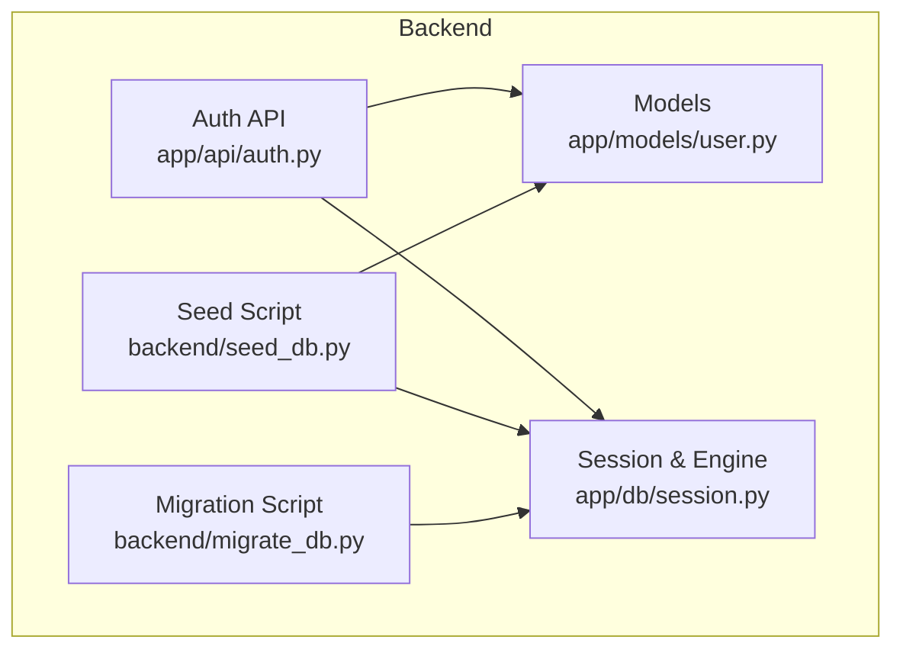
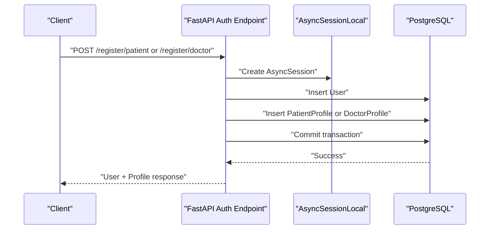
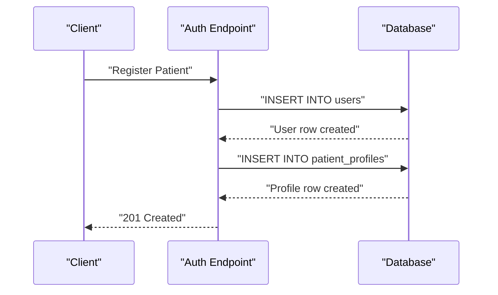
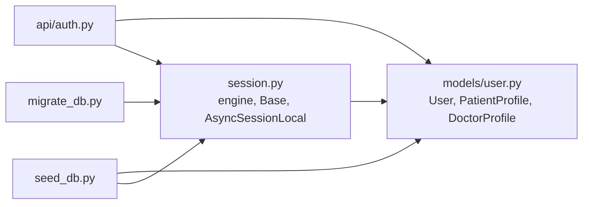

# Database Models

<cite>
**Referenced Files in This Document**
- [user.py](file://backend/app/models/user.py)
- [session.py](file://backend/app/db/session.py)
- [migrate_db.py](file://backend/migrate_db.py)
- [seed_db.py](file://backend/seed_db.py)
- [auth.py](file://backend/app/api/auth.py)
</cite>

## Table of Contents
1. [Introduction](#introduction)
2. [Project Structure](#project-structure)
3. [Core Components](#core-components)
4. [Architecture Overview](#architecture-overview)
5. [Detailed Component Analysis](#detailed-component-analysis)
6. [Dependency Analysis](#dependency-analysis)
7. [Performance Considerations](#performance-considerations)
8. [Troubleshooting Guide](#troubleshooting-guide)
9. [Conclusion](#conclusion)

## Introduction
This document provides comprehensive data model documentation for the PostgreSQL database schema used by the backend. It focuses on the entity relationships between User, PatientProfile, and DoctorProfile models; field definitions, data types, constraints, and validation rules; primary and foreign key relationships; indexes; migration strategy using SQLAlchemy Base.metadata.create_all; connection management with an async engine and session handling; and security considerations including access control patterns.

## Project Structure
The relevant backend components are organized under backend/app:
- Data models are defined in app/models/user.py.
- Database connection and session utilities are in app/db/session.py.
- Migration and seeding scripts are at migrate_db.py and seed_db.py.
- API endpoints that create users and profiles are in app/api/auth.py.



**Diagram sources**
- [user.py:1-82](file://backend/app/models/user.py#L1-L82)
- [session.py:1-49](file://backend/app/db/session.py#L1-L49)
- [auth.py:34-75](file://backend/app/api/auth.py#L34-L75)
- [migrate_db.py:1-20](file://backend/migrate_db.py#L1-L20)
- [seed_db.py:1-105](file://backend/seed_db.py#L1-L105)

**Section sources**
- [user.py:1-82](file://backend/app/models/user.py#L1-L82)
- [session.py:1-49](file://backend/app/db/session.py#L1-L49)
- [auth.py:34-75](file://backend/app/api/auth.py#L34-L75)
- [migrate_db.py:1-20](file://backend/migrate_db.py#L1-L20)
- [seed_db.py:1-105](file://backend/seed_db.py#L1-L105)

## Core Components
This section documents the core data entities and their relationships.

### Entities and Relationships
- User: Represents a system user with authentication and role information.
- PatientProfile: Extends User with patient-specific attributes.
- DoctorProfile: Extends User with doctor-specific attributes.

Relationships:
- One-to-one from User to PatientProfile (optional).
- One-to-one from User to DoctorProfile (optional).
- Both PatientProfile.user_id and DoctorProfile.user_id reference User.id with CASCADE delete.

```mermaid
erDiagram
USERS {
string id PK
string name
string email UK
string phone UK
string hashed_password
enum role
string avatar_url
timestamp created_at
timestamp updated_at
}
PATIENT_PROFILES {
string id PK
string user_id FK UK
integer age
string gender
string residence_address
string district
string sector
json allergies
json known_conditions
json current_medication
}
DOCTOR_PROFILES {
string id PK
string user_id FK UK
string specialty
string license_number UK
integer experience_years
json qualifications
json coverage_districts
string bio
json languages
integer consultation_fee_rwf
integer travel_fee_rwf
integer rating
integer review_count
enum verification_status
}
USERS ||--o| PATIENT_PROFILES : "one-to-one optional"
USERS ||--o| DOCTOR_PROFILES : "one-to-one optional"
```

**Diagram sources**
- [user.py:26-81](file://backend/app/models/user.py#L26-L81)

**Section sources**
- [user.py:26-81](file://backend/app/models/user.py#L26-L81)

## Architecture Overview
The application uses SQLAlchemy with an asynchronous engine backed by asyncpg against Neon PostgreSQL. The Base metadata is shared across models and used for table creation during seeding. Sessions are provided via dependency injection in FastAPI routes.



**Diagram sources**
- [auth.py:34-75](file://backend/app/api/auth.py#L34-L75)
- [session.py:23-48](file://backend/app/db/session.py#L23-L48)

## Detailed Component Analysis

### User Model
- Table: users
- Primary Key: id (String, UUID default, indexed)
- Fields:
  - name: String, required
  - email: String, unique, indexed, required
  - phone: String, unique, indexed, required
  - hashed_password: String, required
  - role: SQL Enum UserRole (patient, doctor, admin), default patient, required
  - avatar_url: String, optional
  - created_at: DateTime with timezone, auto-set on insert
  - updated_at: DateTime with timezone, auto-set on insert/update
- Indexes:
  - id (primary key, also explicitly indexed)
  - email (unique index)
  - phone (unique index)
- Constraints:
  - Unique constraints on email and phone
  - Not null constraints on name, email, phone, hashed_password, role, timestamps
- Relationships:
  - patient_profile: one-to-one to PatientProfile (uselist=False, cascade all, delete-orphan)
  - doctor_profile: one-to-one to DoctorProfile (uselist=False, cascade all, delete-orphan)

Validation Rules:
- Role values are restricted to UserRole enum.
- Email and phone must be unique across users.

Security Notes:
- Passwords are stored as hashes; never store plaintext passwords.

**Section sources**
- [user.py:10-43](file://backend/app/models/user.py#L10-L43)

### PatientProfile Model
- Table: patient_profiles
- Primary Key: id (String, UUID default)
- Foreign Keys:
  - user_id references users.id (unique, not null, ondelete=CASCADE)
- Fields:
  - age: Integer, optional
  - gender: String, optional
  - residence_address: String, optional
  - district: String, optional
  - sector: String, optional
  - allergies: JSON, default empty list
  - known_conditions: JSON, default empty list
  - current_medication: JSON, default empty list
- Relationships:
  - user: back-reference to User

Validation Rules:
- user_id must exist in users due to foreign key constraint.
- JSON fields should contain arrays of strings per seeding usage.

**Section sources**
- [user.py:45-59](file://backend/app/models/user.py#L45-L59)

### DoctorProfile Model
- Table: doctor_profiles
- Primary Key: id (String, UUID default)
- Foreign Keys:
  - user_id references users.id (unique, not null, ondelete=CASCADE)
- Fields:
  - specialty: String, required
  - license_number: String, unique, required
  - experience_years: Integer, default 0
  - qualifications: JSON, default empty list
  - coverage_districts: JSON, default empty list
  - bio: String, optional
  - languages: JSON, default empty list
  - consultation_fee_rwf: Integer, default 25000
  - travel_fee_rwf: Integer, default 5000
  - rating: Integer, default 5
  - review_count: Integer, default 0
  - verification_status: SQL Enum DoctorVerificationStatus (pending, approved, suspended), default pending, required
- Relationships:
  - user: back-reference to User

Validation Rules:
- license_number must be unique across doctors.
- verification_status values are restricted to DoctorVerificationStatus enum.

**Section sources**
- [user.py:62-81](file://backend/app/models/user.py#L62-L81)

### Enums and Defaults
- UserRole: patient, doctor, admin
- DoctorVerificationStatus: pending, approved, suspended
- UUID generation helper for primary keys
- Timestamp defaults ensure consistent audit fields

**Section sources**
- [user.py:10-24](file://backend/app/models/user.py#L10-L24)

### Relationship Flow During Registration
Registration endpoints create a User and then a corresponding profile.



**Diagram sources**
- [auth.py:34-57](file://backend/app/api/auth.py#L34-L57)

**Section sources**
- [auth.py:34-57](file://backend/app/api/auth.py#L34-L57)

## Dependency Analysis
- Models depend on Base from session.py.
- API endpoints depend on models and use AsyncSessionLocal for DB operations.
- Seed script depends on Base.metadata.create_all to initialize tables and inserts sample data.
- Migration script performs ad-hoc ALTER TABLE statements for doctor_profiles.



**Diagram sources**
- [session.py:1-49](file://backend/app/db/session.py#L1-L49)
- [user.py:1-82](file://backend/app/models/user.py#L1-L82)
- [auth.py:34-75](file://backend/app/api/auth.py#L34-L75)
- [seed_db.py:1-105](file://backend/seed_db.py#L1-L105)
- [migrate_db.py:1-20](file://backend/migrate_db.py#L1-L20)

**Section sources**
- [session.py:1-49](file://backend/app/db/session.py#L1-L49)
- [user.py:1-82](file://backend/app/models/user.py#L1-L82)
- [auth.py:34-75](file://backend/app/api/auth.py#L34-L75)
- [seed_db.py:1-105](file://backend/seed_db.py#L1-L105)
- [migrate_db.py:1-20](file://backend/migrate_db.py#L1-L20)

## Performance Considerations
- Indexes:
  - Primary key indexes on id columns.
  - Unique indexes on email and phone in users.
  - Unique index on license_number in doctor_profiles.
  - Unique indexes on user_id in both profiles enforce one-to-one semantics.
- Connection Pooling:
  - Engine configured with pool_pre_ping for resilient connections.
- Query Efficiency:
  - Use selectinload when fetching User with related profiles to avoid N+1 queries.
- JSON Fields:
  - JSON columns allow flexible storage but may require application-level validation to maintain structure.

[No sources needed since this section provides general guidance]

## Troubleshooting Guide
Common issues and resolutions:
- Missing Tables:
  - Ensure Base.metadata.create_all is executed before running the application or seeding data.
  - The seed script initializes tables automatically.
- Duplicate Keys:
  - Unique constraints on email, phone, license_number will raise errors if violated. Validate inputs at the API layer.
- Orphaned Profiles:
  - Deleting a User cascades to associated profiles due to ondelete="CASCADE".
- Async Session Usage:
  - Always use AsyncSessionLocal within async contexts and close sessions properly.
- SSL Configuration:
  - When connecting to Neon PostgreSQL, SSL is enabled via connect_args. Ensure DATABASE_URL is correctly formatted.

**Section sources**
- [seed_db.py:11-12](file://backend/seed_db.py#L11-L12)
- [session.py:15-29](file://backend/app/db/session.py#L15-L29)
- [user.py:49-66](file://backend/app/models/user.py#L49-L66)

## Conclusion
The database schema centers around a User entity extended by PatientProfile and DoctorProfile through one-to-one relationships. Strong constraints, indexes, and enums provide data integrity and clarity. The async engine and session management support high-concurrency workloads. Seeding and migration scripts facilitate environment setup and evolution. Security best practices include hashing passwords and leveraging role-based access control at the API layer.

[No sources needed since this section summarizes without analyzing specific files]