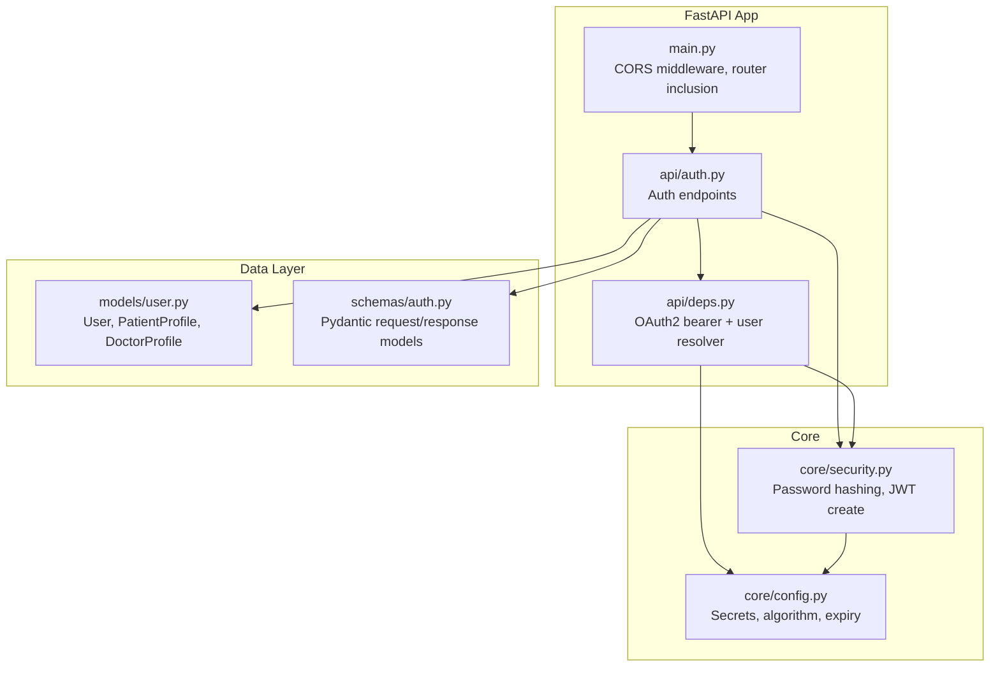
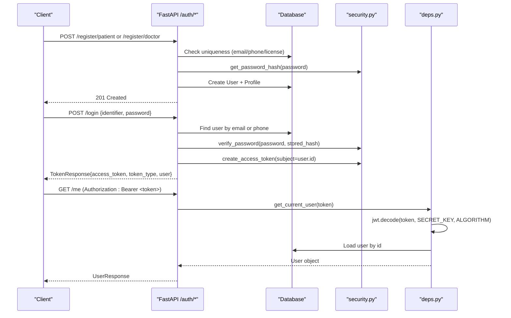
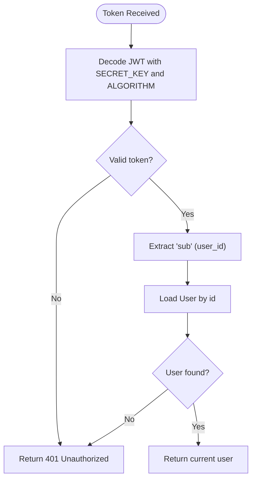
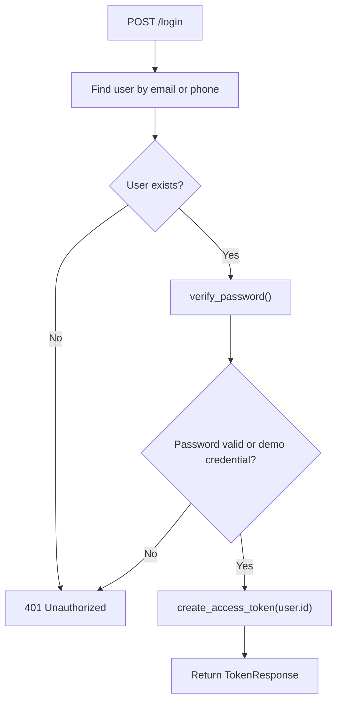
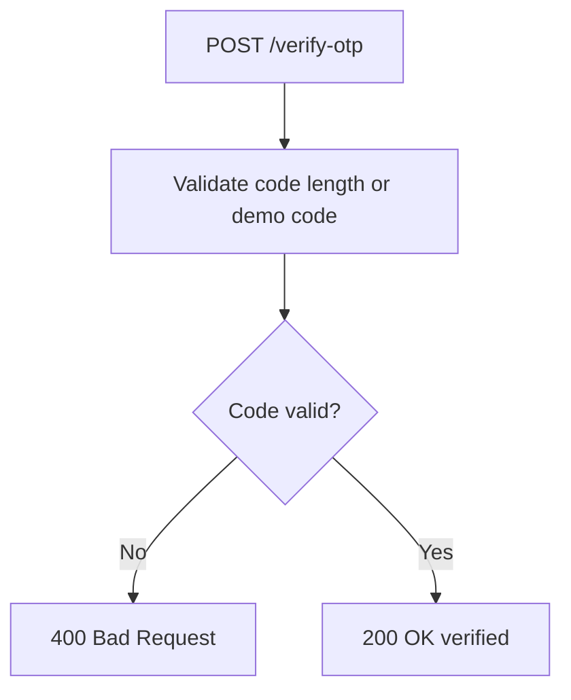
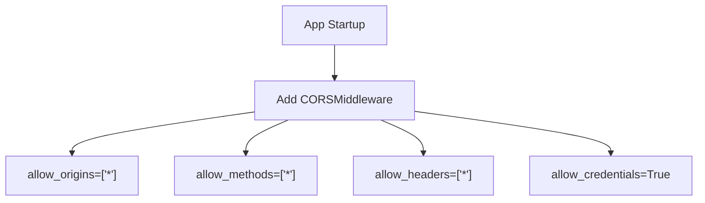
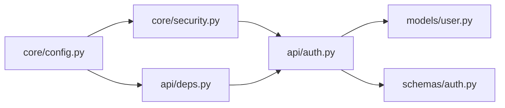

# Security Implementation

<cite>
**Referenced Files in This Document**
- [main.py](file://backend/app/main.py)
- [config.py](file://backend/app/core/config.py)
- [security.py](file://backend/app/core/security.py)
- [auth.py](file://backend/app/api/auth.py)
- [deps.py](file://backend/app/api/deps.py)
- [user.py](file://backend/app/models/user.py)
- [auth.py (schemas)](file://backend/app/schemas/auth.py)
</cite>

## Table of Contents
1. [Introduction](#introduction)
2. [Project Structure](#project-structure)
3. [Core Components](#core-components)
4. [Architecture Overview](#architecture-overview)
5. [Detailed Component Analysis](#detailed-component-analysis)
6. [Dependency Analysis](#dependency-analysis)
7. [Performance Considerations](#performance-considerations)
8. [Troubleshooting Guide](#troubleshooting-guide)
9. [Conclusion](#conclusion)

## Introduction
This document explains the security implementation of the FastAPI backend, focusing on:
- JWT token generation and validation
- Password hashing and secure storage
- OTP verification flow
- CORS configuration for cross-origin requests
- Input validation via Pydantic schemas
- Protection against common vulnerabilities such as SQL injection and XSS
- Security headers and best practices

The goal is to provide a clear, code-backed understanding of how authentication and authorization are implemented and where improvements can be made.

## Project Structure
Security-related components are organized under the backend application:
- Core security utilities: password hashing and JWT creation
- API endpoints: registration, login, OTP verification, password reset, and protected routes
- Dependency injection: OAuth2 bearer token extraction and user resolution
- Configuration: environment-based settings for secrets and token parameters
- Data models: user and profile entities with hashed passwords and roles
- Schemas: request/response validation models

**Diagram sources**
- [main.py:31-46](file://backend/app/main.py#L31-L46)
- [auth.py](file://backend/app/api/auth.py)
- [deps.py:12-41](file://backend/app/api/deps.py#L12-L41)
- [security.py:1-27](file://backend/app/core/security.py#L1-L27)
- [config.py:10-30](file://backend/app/core/config.py#L10-L30)
- [user.py:26-80](file://backend/app/models/user.py#L26-L80)
- [auth.py (schemas):27-119](file://backend/app/schemas/auth.py#L27-L119)

**Section sources**
- [main.py:31-46](file://backend/app/main.py#L31-L46)
- [config.py:10-30](file://backend/app/core/config.py#L10-L30)

## Core Components
- Password hashing and verification using bcrypt via passlib
- JWT access token creation with configurable secret, algorithm, and expiration
- OAuth2 Bearer token dependency for protecting routes
- Pydantic schemas enforcing input validation and type safety
- User model storing hashed_password and role enum

Key responsibilities:
- core/security.py: hashing and token creation
- api/deps.py: token decoding and current user retrieval
- api/auth.py: endpoint logic combining DB queries, hashing, and token issuance
- schemas/auth.py: validated request/response contracts
- models/user.py: persistent user data including hashed passwords

**Section sources**
- [security.py:1-27](file://backend/app/core/security.py#L1-L27)
- [deps.py:12-41](file://backend/app/api/deps.py#L12-L41)
- [auth.py:24-180](file://backend/app/api/auth.py#L24-L180)
- [auth.py (schemas):27-119](file://backend/app/schemas/auth.py#L27-L119)
- [user.py:26-80](file://backend/app/models/user.py#L26-L80)

## Architecture Overview
The authentication flow uses FastAPI’s OAuth2PasswordBearer scheme to extract tokens from the Authorization header, decodes them with the configured secret and algorithm, and resolves the current user from the database. Registration and login endpoints handle password hashing and token issuance.

**Diagram sources**
- [auth.py:24-180](file://backend/app/api/auth.py#L24-L180)
- [deps.py:12-41](file://backend/app/api/deps.py#L12-L41)
- [security.py:10-26](file://backend/app/core/security.py#L10-L26)

## Detailed Component Analysis

### JWT Token Generation and Validation
- Generation:
  - Access tokens are created with an expiration time based on settings and include the subject (user ID).
  - The algorithm and secret key are loaded from configuration.
- Validation:
  - The OAuth2 bearer dependency decodes the token using the same secret and algorithm.
  - It extracts the subject claim and loads the corresponding user from the database.
  - If decoding fails or the user is not found, a 401 Unauthorized response is returned.

**Diagram sources**
- [deps.py:15-41](file://backend/app/api/deps.py#L15-L41)
- [security.py:18-26](file://backend/app/core/security.py#L18-L26)
- [config.py:18-21](file://backend/app/core/config.py#L18-L21)

**Section sources**
- [security.py:18-26](file://backend/app/core/security.py#L18-L26)
- [deps.py:15-41](file://backend/app/api/deps.py#L15-L41)
- [config.py:18-21](file://backend/app/core/config.py#L18-L21)

### Password Hashing and Secure Storage
- Algorithm: bcrypt via passlib CryptContext.
- Storage: hashed_password column in the users table.
- Verification: compare plain text password against stored hash during login.

Best practices observed:
- Never store plain-text passwords.
- Use a strong, unique SECRET_KEY in production.
- Enforce minimum password length at the schema level.

**Section sources**
- [security.py:1-16](file://backend/app/core/security.py#L1-L16)
- [user.py:29-34](file://backend/app/models/user.py#L29-L34)
- [auth.py (schemas):27-44](file://backend/app/schemas/auth.py#L27-L44)

### Login Flow and Demo Credentials
- Login accepts either email or phone as identifier.
- Verifies password against stored hash.
- Includes demo credentials fallback that bypasses normal verification; this should be removed before production.

**Diagram sources**
- [auth.py:121-153](file://backend/app/api/auth.py#L121-L153)
- [security.py:10-15](file://backend/app/core/security.py#L10-L15)

**Section sources**
- [auth.py:121-153](file://backend/app/api/auth.py#L121-L153)

### OTP Verification System
- Endpoint accepts a code and optional user_id.
- Current implementation allows any 6-digit code or a specific demo code.
- Recommendation: integrate with a secure OTP provider or server-side session store, enforce rate limiting, and bind OTP to user identity and time-to-live.

**Diagram sources**
- [auth.py:156-164](file://backend/app/api/auth.py#L156-L164)

**Section sources**
- [auth.py:156-164](file://backend/app/api/auth.py#L156-L164)

### CORS Middleware Configuration
- CORS is enabled with allow_origins set to wildcard, allowing all origins.
- Credentials are allowed, and all methods and headers are permitted.
- Recommendation: restrict allow_origins to known domains in production and carefully review allow_credentials usage.

**Diagram sources**
- [main.py:37-44](file://backend/app/main.py#L37-L44)

**Section sources**
- [main.py:37-44](file://backend/app/main.py#L37-L44)

### Input Validation and Schema Contracts
- Pydantic models define strict types and constraints for registration, login, OTP verification, and responses.
- Password fields enforce minimum length.
- Enumerations constrain roles and verification statuses.

Benefits:
- Prevents malformed payloads early.
- Provides automatic OpenAPI documentation.
- Reduces risk of type-related bugs.

**Section sources**
- [auth.py (schemas):27-119](file://backend/app/schemas/auth.py#L27-L119)

### Protection Against Common Vulnerabilities
- SQL Injection:
  - Queries use SQLAlchemy ORM with parameterized constructs, mitigating SQL injection risks.
- XSS:
  - Backend returns structured JSON; frontend should sanitize outputs. No HTML rendering in backend responses.
- CSRF:
  - Not applicable for stateless JWT APIs; ensure proper token handling on the client side.
- Brute Force and Enumeration:
  - Login returns generic “Invalid credentials” messages.
  - OTP verification currently exposes partial validity hints; tighten error responses and add rate limiting.
- Secrets Management:
  - SECRET_KEY and other sensitive values are loaded from environment variables via pydantic-settings. Ensure .env is excluded from version control.

**Section sources**
- [auth.py:121-153](file://backend/app/api/auth.py#L121-L153)
- [auth.py:156-164](file://backend/app/api/auth.py#L156-L164)
- [config.py:10-30](file://backend/app/core/config.py#L10-L30)

## Dependency Analysis
The following diagram shows how security-critical modules depend on each other:

**Diagram sources**
- [config.py:10-30](file://backend/app/core/config.py#L10-L30)
- [security.py:1-27](file://backend/app/core/security.py#L1-L27)
- [deps.py:1-41](file://backend/app/api/deps.py#L1-L41)
- [auth.py:1-180](file://backend/app/api/auth.py#L1-L180)
- [user.py:26-80](file://backend/app/models/user.py#L26-L80)
- [auth.py (schemas):27-119](file://backend/app/schemas/auth.py#L27-L119)

**Section sources**
- [config.py:10-30](file://backend/app/core/config.py#L10-L30)
- [security.py:1-27](file://backend/app/core/security.py#L1-L27)
- [deps.py:1-41](file://backend/app/api/deps.py#L1-L41)
- [auth.py:1-180](file://backend/app/api/auth.py#L1-L180)
- [user.py:26-80](file://backend/app/models/user.py#L26-L80)
- [auth.py (schemas):27-119](file://backend/app/schemas/auth.py#L27-L119)

## Performance Considerations
- Password hashing:
  - bcrypt is intentionally slow to resist brute force attacks. Tune cost factor if needed.
- Database queries:
  - Use selectinload to eagerly load relationships when returning full user objects to avoid N+1 queries.
- Token operations:
  - JWT decode is lightweight; ensure minimal payload size.
- Rate limiting:
  - Add rate limiting on login and OTP endpoints to mitigate abuse.

[No sources needed since this section provides general guidance]

## Troubleshooting Guide
- Invalid credentials:
  - Occurs when user not found or password verification fails.
  - Verify correct identifier (email or phone) and password.
- Token validation errors:
  - Caused by invalid/expired tokens or mismatched secret/algorithm.
  - Confirm SECRET_KEY and ALGORITHM match between config and token issuer.
- CORS issues:
  - If clients cannot call the API, check browser console for CORS errors.
  - Ensure allow_origins includes the client origin in production.
- OTP failures:
  - Ensure the code matches expected format or provider output.
  - Review rate limits and TTL policies.

**Section sources**
- [auth.py:121-153](file://backend/app/api/auth.py#L121-L153)
- [deps.py:15-41](file://backend/app/api/deps.py#L15-L41)
- [main.py:37-44](file://backend/app/main.py#L37-L44)
- [auth.py:156-164](file://backend/app/api/auth.py#L156-L164)

## Conclusion
The backend implements a solid foundation for authentication and authorization:
- bcrypt password hashing and secure storage
- JWT access tokens with configurable secret and algorithm
- OAuth2 bearer dependency for protected routes
- Pydantic schemas for robust input validation
- CORS enabled for development flexibility

Recommended next steps:
- Remove demo credentials from login and harden OTP verification
- Restrict CORS to trusted origins in production
- Add refresh token support with short-lived access tokens
- Implement rate limiting and account lockout policies
- Add comprehensive security headers and content security policies
- Integrate external OTP providers and enforce time-bound codes

[No sources needed since this section summarizes without analyzing specific files]