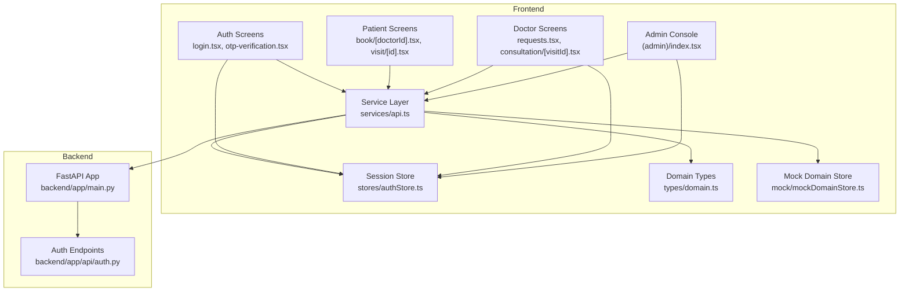
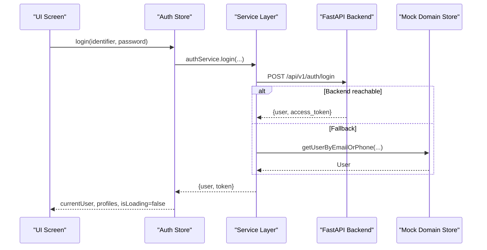
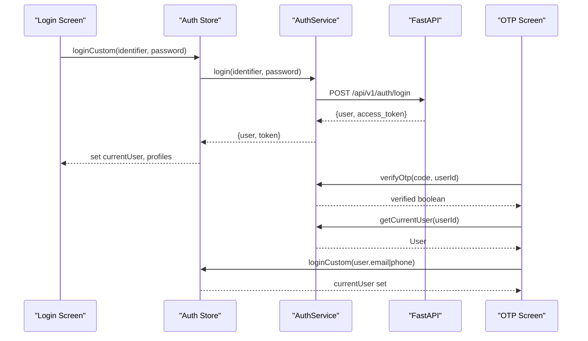
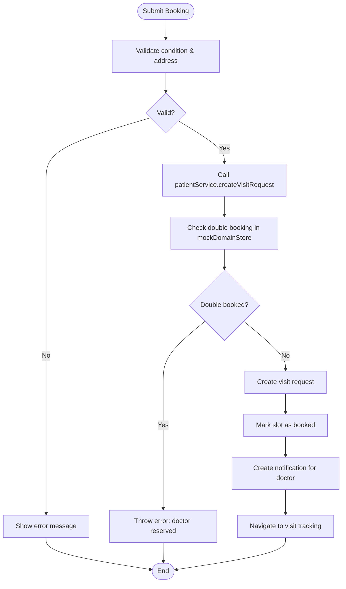
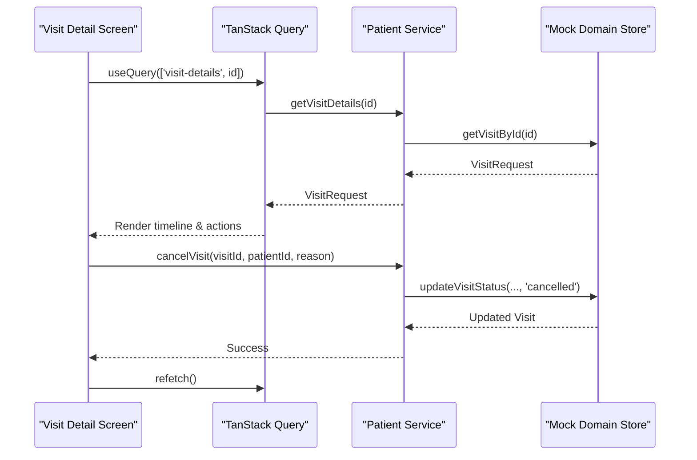
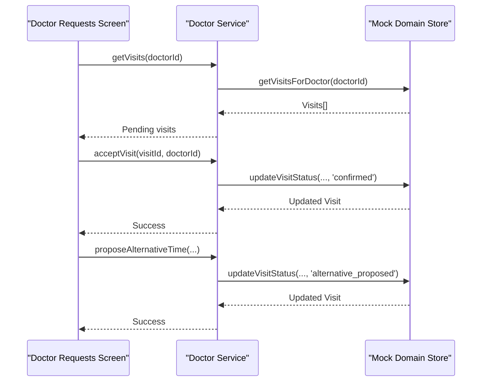
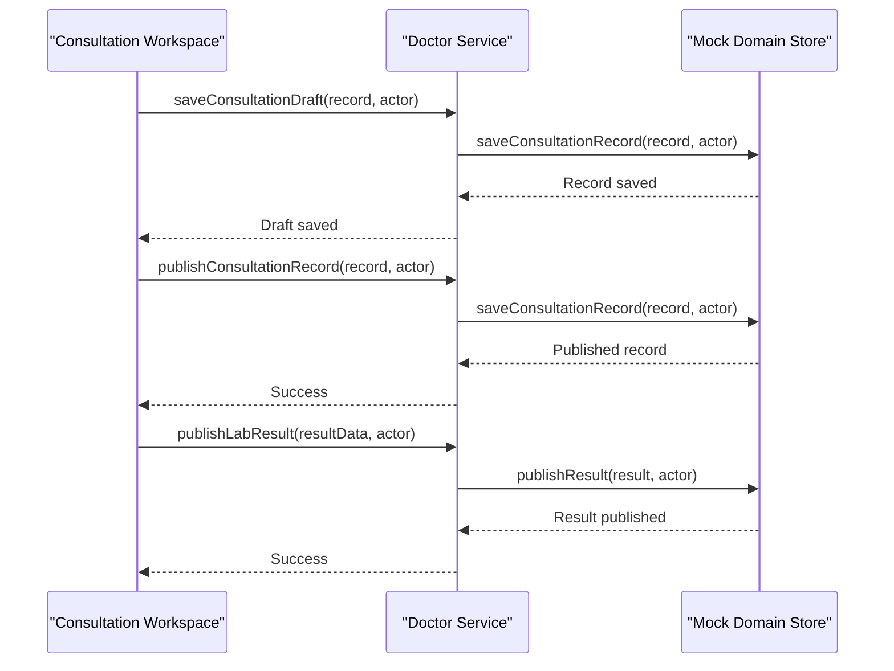
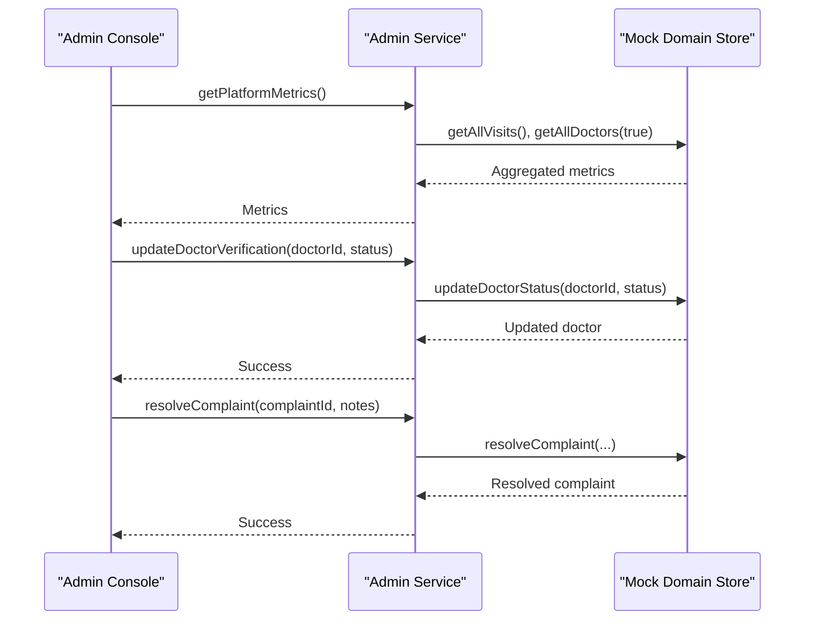
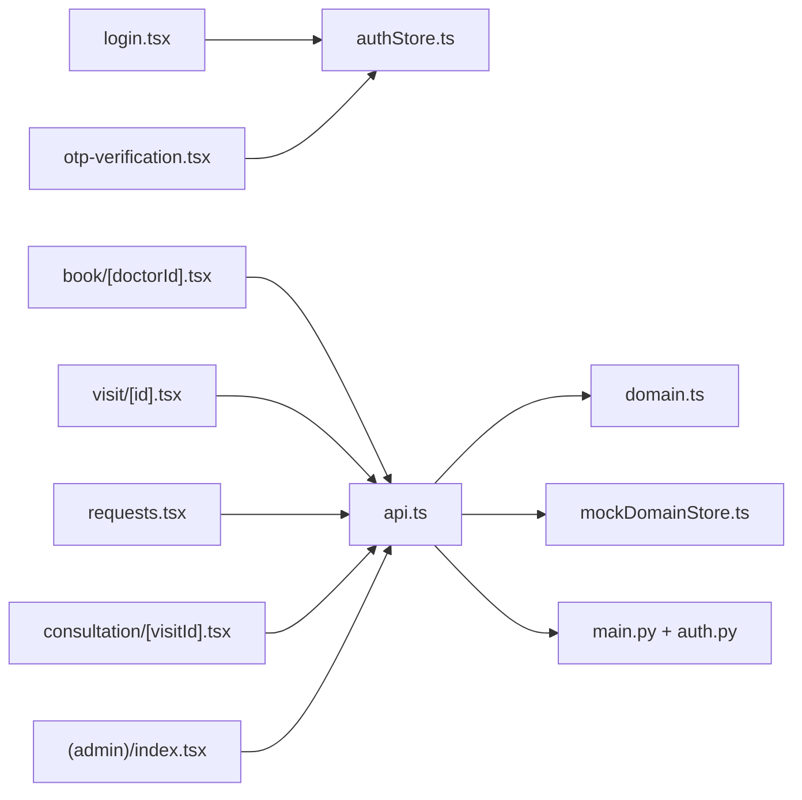

# Data Flow Patterns

<cite>
**Referenced Files in This Document**
- [README.md](file://README.md)
- [architecture.md](file://src/docs/architecture.md)
- [login.tsx](file://src/app/(auth)/login.tsx)
- [otp-verification.tsx](file://src/app/(auth)/otp-verification.tsx)
- [authStore.ts](file://src/stores/authStore.ts)
- [api.ts](file://src/services/api.ts)
- [main.py](file://backend/app/main.py)
- [auth.py](file://backend/app/api/auth.py)
- [book/[doctorId].tsx](file://src/app/(patient)/book/[doctorId].tsx)
- [visit/[id].tsx](file://src/app/(patient)/visit/[id].tsx)
- [requests.tsx](file://src/app/(doctor)/requests.tsx)
- [consultation/[visitId].tsx](file://src/app/(doctor)/consultation/[visitId].tsx)
- [index.tsx](file://src/app/(admin)/index.tsx)
- [mockDomainStore.ts](file://src/mock/mockDomainStore.ts)
- [domain.ts](file://src/types/domain.ts)
</cite>

## Table of Contents
1. [Introduction](#introduction)
2. [Project Structure](#project-structure)
3. [Core Components](#core-components)
4. [Architecture Overview](#architecture-overview)
5. [Detailed Component Analysis](#detailed-component-analysis)
6. [Dependency Analysis](#dependency-analysis)
7. [Performance Considerations](#performance-considerations)
8. [Troubleshooting Guide](#troubleshooting-guide)
9. [Conclusion](#conclusion)

## Introduction
This document explains the data flow patterns across the HomeCare application, focusing on unidirectional data flow from UI components through service layers to data sources. It covers authentication and OTP verification, patient-doctor visit booking and consultation workflows, administrative doctor verification and platform monitoring, error handling, loading states, optimistic updates, validation at each layer, and enforcement of business rules throughout the pipeline.

The frontend is a React Native Expo application using TypeScript, Zustand for session state, TanStack Query for data fetching, and a mock domain store that simulates backend persistence. The backend is a FastAPI Python application with PostgreSQL, exposing authentication endpoints used by the frontend when available.

**Section sources**
- [README.md:1-8](file://README.md#L1-L8)
- [architecture.md:1-33](file://src/docs/architecture.md#L1-L33)

## Project Structure
HomeCare organizes code by feature areas:
- Authentication screens under `(auth)`
- Patient flows under `(patient)`
- Doctor flows under `(doctor)`
- Admin console under `(admin)`
- Shared services, stores, types, and mock domain logic

**Diagram sources**
- [login.tsx:1-174](file://src/app/(auth)/login.tsx#L1-L174)
- [otp-verification.tsx:1-199](file://src/app/(auth)/otp-verification.tsx#L1-L199)
- [book/[doctorId].tsx:1-608](file://src/app/(patient)/book/[doctorId].tsx#L1-L608)
- [visit/[id].tsx:1-640](file://src/app/(patient)/visit/[id].tsx#L1-L640)
- [requests.tsx:1-433](file://src/app/(doctor)/requests.tsx#L1-L433)
- [consultation/[visitId].tsx:1-507](file://src/app/(doctor)/consultation/[visitId].tsx#L1-L507)
- [index.tsx:1-800](file://src/app/(admin)/index.tsx#L1-L800)
- [api.ts:1-660](file://src/services/api.ts#L1-L660)
- [authStore.ts:1-112](file://src/stores/authStore.ts#L1-L112)
- [mockDomainStore.ts:1-557](file://src/mock/mockDomainStore.ts#L1-L557)
- [domain.ts:1-242](file://src/types/domain.ts#L1-L242)
- [main.py:1-61](file://backend/app/main.py#L1-L61)
- [auth.py:1-182](file://backend/app/api/auth.py#L1-L182)

**Section sources**
- [README.md:117-199](file://README.md#L117-L199)
- [architecture.md:36-67](file://src/docs/architecture.md#L36-L67)

## Core Components
- Service layer (`services/api.ts`): Defines typed interfaces for auth, patient, doctor, and admin operations. It attempts live HTTP calls to the FastAPI backend and gracefully falls back to the mock domain store for demo/offline behavior.
- Session store (`stores/authStore.ts`): Manages current user, profiles, token, loading, and errors via Zustand. Provides login flows and profile refresh.
- Mock domain store (`mock/mockDomainStore.ts`): In-memory reactive database implementing account isolation, visit lifecycle, notifications, reviews, complaints, audit logs, and platform configuration.
- Domain types (`types/domain.ts`): Strongly typed entities for users, profiles, visits, results, consultations, samples, audits, and more.

Key responsibilities:
- Unidirectional data flow: UI triggers actions → services perform validation and side effects → stores update state → UI re-renders.
- Business rule enforcement: double-booking prevention, cancellation locks, doctor verification gates, status transitions, and audit logging.
- Error handling: consistent try/catch, user-facing messages, and fallbacks to mock data when backend is unavailable.

**Section sources**
- [api.ts:1-660](file://src/services/api.ts#L1-L660)
- [authStore.ts:1-112](file://src/stores/authStore.ts#L1-L112)
- [mockDomainStore.ts:1-557](file://src/mock/mockDomainStore.ts#L1-L557)
- [domain.ts:1-242](file://src/types/domain.ts#L1-L242)

## Architecture Overview
The system follows a layered architecture:
- UI screens (React Native components)
- State management (Zustand session store)
- Service layer (typed API contracts)
- Data source (mock domain store or FastAPI backend)

**Diagram sources**
- [login.tsx:17-46](file://src/app/(auth)/login.tsx#L17-L46)
- [authStore.ts:58-83](file://src/stores/authStore.ts#L58-L83)
- [api.ts:46-104](file://src/services/api.ts#L46-L104)
- [main.py:31-46](file://backend/app/main.py#L31-L46)
- [auth.py:121-153](file://backend/app/api/auth.py#L121-L153)

## Detailed Component Analysis

### Authentication Flow: Login and OTP Verification
Unidirectional flow:
- Login screen validates inputs, calls `useAuthStore.loginCustom`, which invokes `authService.login`.
- If backend is reachable, FastAPI authenticates and returns a JWT; otherwise, it falls back to mock store.
- OTP verification screen validates code length, calls `authService.verifyOtp`, then retrieves current user and completes login.

**Diagram sources**
- [login.tsx:23-46](file://src/app/(auth)/login.tsx#L23-L46)
- [otp-verification.tsx:28-66](file://src/app/(auth)/otp-verification.tsx#L28-L66)
- [authStore.ts:58-83](file://src/stores/authStore.ts#L58-L83)
- [api.ts:46-122](file://src/services/api.ts#L46-L122)
- [auth.py:121-164](file://backend/app/api/auth.py#L121-L164)

Validation and error handling:
- Login screen checks empty identifier/password and shows error messages.
- OTP screen enforces 6-digit code and displays verification failure messages.
- Service layer catches network errors and falls back to mock store for demo flows.

Business rules:
- Backend supports test credentials for demo environments.
- OTP accepts demo code or any 6-digit code for demonstration.

**Section sources**
- [login.tsx:23-46](file://src/app/(auth)/login.tsx#L23-L46)
- [otp-verification.tsx:28-66](file://src/app/(auth)/otp-verification.tsx#L28-L66)
- [api.ts:46-122](file://src/services/api.ts#L46-L122)
- [auth.py:121-164](file://backend/app/api/auth.py#L121-L164)

### Patient Booking Flow: Visit Request Creation
Flow:
- Patient selects doctor details and available slots.
- Form collects symptoms, address, and payment method.
- Submitting creates a visit request via `patientService.createVisitRequest`, which enforces business rules and marks slot booked.

**Diagram sources**
- [book/[doctorId].tsx:85-135](file://src/app/(patient)/book/[doctorId].tsx#L85-L135)
- [api.ts:334-345](file://src/services/api.ts#L334-L345)
- [mockDomainStore.ts:245-281](file://src/mock/mockDomainStore.ts#L245-L281)

Validation and business rules:
- UI validates required fields before submission.
- Service layer constructs visit payload and delegates to mock store.
- Mock store prevents overlapping bookings and marks selected slot as booked.
- Notification created for doctor upon successful booking.

Optimistic updates:
- After successful creation, the app navigates immediately to the visit tracking screen, providing responsive UX while background queries keep state synchronized.

**Section sources**
- [book/[doctorId].tsx:85-135](file://src/app/(patient)/book/[doctorId].tsx#L85-L135)
- [api.ts:334-345](file://src/services/api.ts#L334-L345)
- [mockDomainStore.ts:245-281](file://src/mock/mockDomainStore.ts#L245-L281)

### Patient Visit Tracking: Status Timeline and Actions
Flow:
- Visit detail screen polls visit details every few seconds.
- Displays timeline based on visit status.
- Supports cancel, accept/reject alternative time, rate review, and complaint submission.

**Diagram sources**
- [visit/[id].tsx:33-38](file://src/app/(patient)/visit/[id].tsx#L33-L38)
- [visit/[id].tsx:49-60](file://src/app/(patient)/visit/[id].tsx#L49-L60)
- [api.ts:359-368](file://src/services/api.ts#L359-L368)
- [mockDomainStore.ts:283-380](file://src/mock/mockDomainStore.ts#L283-L380)

Validation and business rules:
- Cancellation is locked once doctor is en route, arrived, or in consultation.
- Alternative time acceptance requires proposed alternative date/time.
- Rejection sets declined status with optional reason.
- Notifications are generated for relevant role recipients.

Loading states and error handling:
- Loading spinner during actions.
- Alerts for success/failure.
- Refetch ensures UI reflects latest state.

**Section sources**
- [visit/[id].tsx:49-88](file://src/app/(patient)/visit/[id].tsx#L49-L88)
- [api.ts:359-403](file://src/services/api.ts#L359-L403)
- [mockDomainStore.ts:283-380](file://src/mock/mockDomainStore.ts#L283-L380)

### Doctor Requests: Accept, Decline, Alternative Time Proposal
Flow:
- Doctor requests screen lists pending visits.
- Accept requires doctor verification status approved.
- Decline captures optional reason.
- Propose alternative time sets alternative date/time and note.

**Diagram sources**
- [requests.tsx:41-94](file://src/app/(doctor)/requests.tsx#L41-L94)
- [api.ts:508-529](file://src/services/api.ts#L508-L529)
- [mockDomainStore.ts:283-380](file://src/mock/mockDomainStore.ts#L283-L380)

Validation and business rules:
- Unverified/suspended doctors cannot accept visits.
- Alternative proposal includes date, time, and optional note.
- Status transitions enforced by service and mock store.

Error handling:
- Alerts for failures and success.
- Refetch updates list after actions.

**Section sources**
- [requests.tsx:41-94](file://src/app/(doctor)/requests.tsx#L41-L94)
- [api.ts:508-529](file://src/services/api.ts#L508-L529)
- [mockDomainStore.ts:283-380](file://src/mock/mockDomainStore.ts#L283-L380)

### Doctor Consultation Workspace: Records, Prescriptions, Lab Results
Flow:
- Doctor opens consultation workspace for a visit.
- Saves draft or publishes record.
- Optionally creates lab sample and publishes result document.

**Diagram sources**
- [consultation/[visitId].tsx:102-205](file://src/app/(doctor)/consultation/[visitId].tsx#L102-L205)
- [api.ts:545-584](file://src/services/api.ts#L545-L584)
- [mockDomainStore.ts:393-464](file://src/mock/mockDomainStore.ts#L393-L464)

Validation and business rules:
- Diagnosis required to publish record.
- Lab sample created only if tests required and collected.
- Audit logs recorded for create/publish actions.

Optimistic updates:
- Immediate feedback on save/publish actions.
- Navigation back to visit execution after publishing.

**Section sources**
- [consultation/[visitId].tsx:102-205](file://src/app/(doctor)/consultation/[visitId].tsx#L102-L205)
- [api.ts:545-584](file://src/services/api.ts#L545-L584)
- [mockDomainStore.ts:393-464](file://src/mock/mockDomainStore.ts#L393-L464)

### Administrative Data Flows: Doctor Verification and Platform Monitoring
Flow:
- Admin console fetches metrics, doctors, complaints, and audit logs.
- Updates doctor verification status (approve/suspend/pending).
- Resolves complaints and resets demo data.

**Diagram sources**
- [index.tsx:67-115](file://src/app/(admin)/index.tsx#L67-L115)
- [api.ts:604-658](file://src/services/api.ts#L604-L658)
- [mockDomainStore.ts:185-191](file://src/mock/mockDomainStore.ts#L185-L191)
- [mockDomainStore.ts:513-520](file://src/mock/mockDomainStore.ts#L513-L520)

Validation and business rules:
- Metrics computed from visits and doctors.
- Doctor status changes logged in audit trail.
- Complaint resolution updates status and notes.

Error handling:
- Alerts for success and failure.
- Refetch ensures dashboard reflects latest state.

**Section sources**
- [index.tsx:67-115](file://src/app/(admin)/index.tsx#L67-L115)
- [api.ts:604-658](file://src/services/api.ts#L604-L658)
- [mockDomainStore.ts:185-191](file://src/mock/mockDomainStore.ts#L185-L191)
- [mockDomainStore.ts:513-520](file://src/mock/mockDomainStore.ts#L513-L520)

## Dependency Analysis
High-level dependencies:
- UI screens depend on service layer for all data mutations and reads.
- Service layer depends on domain types for contracts and on mock domain store for persistence.
- Service layer optionally depends on FastAPI backend for authentication and future REST endpoints.
- Session store depends on service layer for login/profile operations.

**Diagram sources**
- [login.tsx:1-174](file://src/app/(auth)/login.tsx#L1-L174)
- [otp-verification.tsx:1-199](file://src/app/(auth)/otp-verification.tsx#L1-L199)
- [book/[doctorId].tsx:1-608](file://src/app/(patient)/book/[doctorId].tsx#L1-L608)
- [visit/[id].tsx:1-640](file://src/app/(patient)/visit/[id].tsx#L1-L640)
- [requests.tsx:1-433](file://src/app/(doctor)/requests.tsx#L1-L433)
- [consultation/[visitId].tsx:1-507](file://src/app/(doctor)/consultation/[visitId].tsx#L1-L507)
- [index.tsx:1-800](file://src/app/(admin)/index.tsx#L1-L800)
- [api.ts:1-660](file://src/services/api.ts#L1-L660)
- [domain.ts:1-242](file://src/types/domain.ts#L1-L242)
- [mockDomainStore.ts:1-557](file://src/mock/mockDomainStore.ts#L1-L557)
- [main.py:1-61](file://backend/app/main.py#L1-L61)
- [auth.py:1-182](file://backend/app/api/auth.py#L1-L182)

**Section sources**
- [api.ts:1-660](file://src/services/api.ts#L1-L660)
- [mockDomainStore.ts:1-557](file://src/mock/mockDomainStore.ts#L1-L557)
- [domain.ts:1-242](file://src/types/domain.ts#L1-L242)
- [main.py:1-61](file://backend/app/main.py#L1-L61)
- [auth.py:1-182](file://backend/app/api/auth.py#L1-L182)

## Performance Considerations
- Simulated latency: Service layer adds small delays to mimic network conditions, improving realism during development.
- Polling: Visit detail screen uses periodic refetch to reflect status transitions without websockets.
- Local caching: Mock domain store provides fast in-memory reads and writes, reducing backend load during demos.
- Optimistic navigation: Booking flow navigates immediately after successful mutation to improve perceived performance.

[No sources needed since this section provides general guidance]

## Troubleshooting Guide
Common issues and resolutions:
- Authentication failures:
  - Verify credentials match demo accounts or backend users.
  - Check backend availability; service layer falls back to mock store if unreachable.
- OTP verification errors:
  - Ensure 6-digit code; demo code accepted for testing.
- Booking conflicts:
  - Double-booking guard throws error if doctor already reserved; choose another slot.
- Cancellation restrictions:
  - Cancellation disabled once doctor is en route, arrived, or in consultation.
- Doctor verification gate:
  - Unverified/suspended doctors cannot accept visits; update status via admin console.
- Consultation publishing:
  - Diagnosis required; ensure required fields filled before publishing.

Error handling patterns:
- UI surfaces error messages via alerts or banners.
- Service layer catches exceptions and returns meaningful errors.
- Stores reset loading states and propagate errors to UI.

**Section sources**
- [login.tsx:23-46](file://src/app/(auth)/login.tsx#L23-L46)
- [otp-verification.tsx:28-66](file://src/app/(auth)/otp-verification.tsx#L28-L66)
- [api.ts:334-403](file://src/services/api.ts#L334-L403)
- [api.ts:508-538](file://src/services/api.ts#L508-L538)
- [consultation/[visitId].tsx:133-205](file://src/app/(doctor)/consultation/[visitId].tsx#L133-L205)

## Conclusion
HomeCare implements a clear unidirectional data flow from UI components through service layers to either a FastAPI backend or an in-memory mock domain store. Authentication, OTP verification, visit booking, consultation workflows, and administrative operations are consistently validated and governed by business rules enforced in services and the mock store. Error handling, loading states, and optimistic updates provide robust and responsive user experiences. The architecture supports future migration to a full backend REST API while maintaining strong typing and separation of concerns.

[No sources needed since this section summarizes without analyzing specific files]