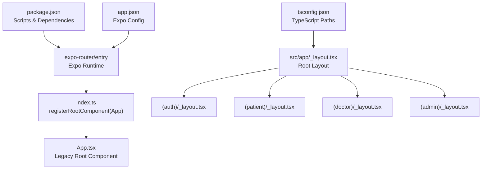
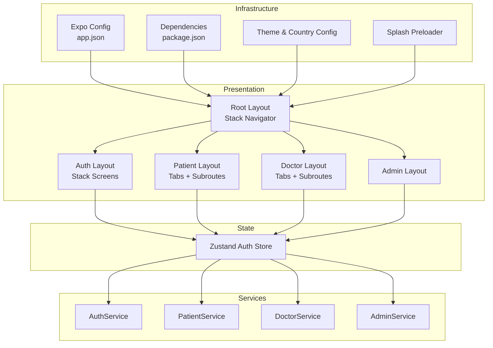
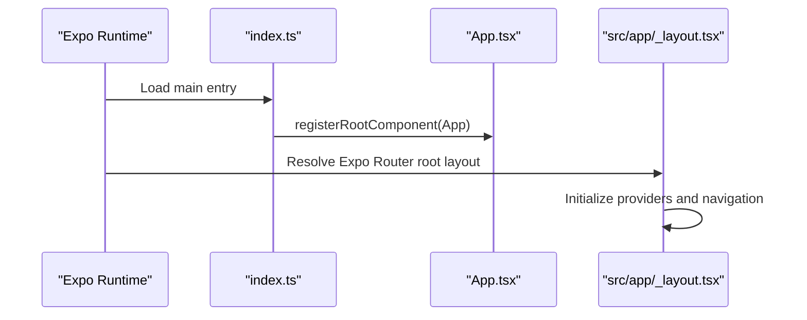
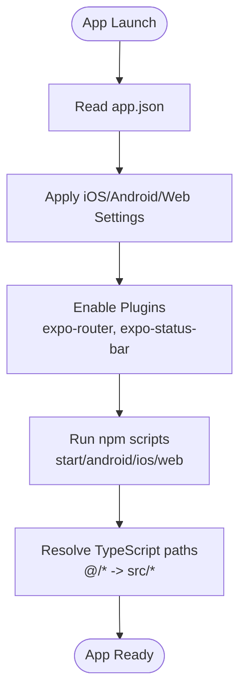
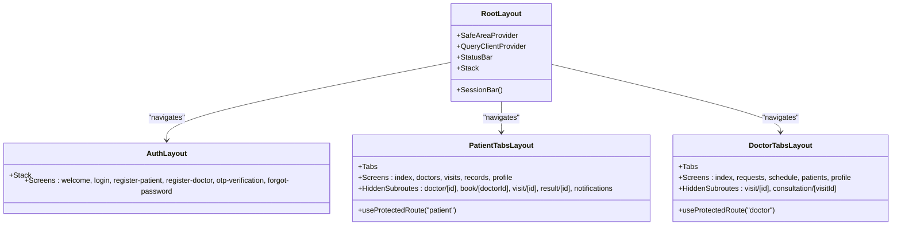
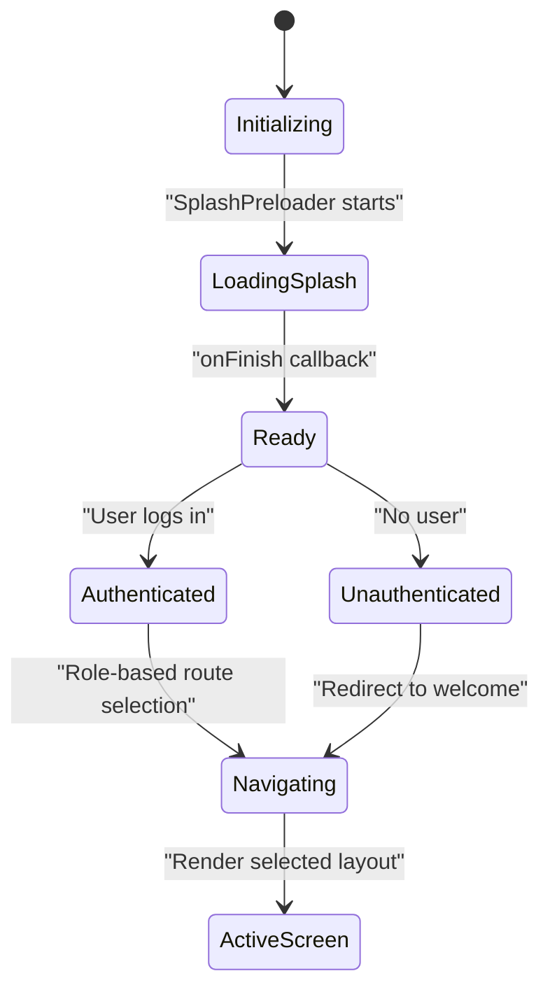
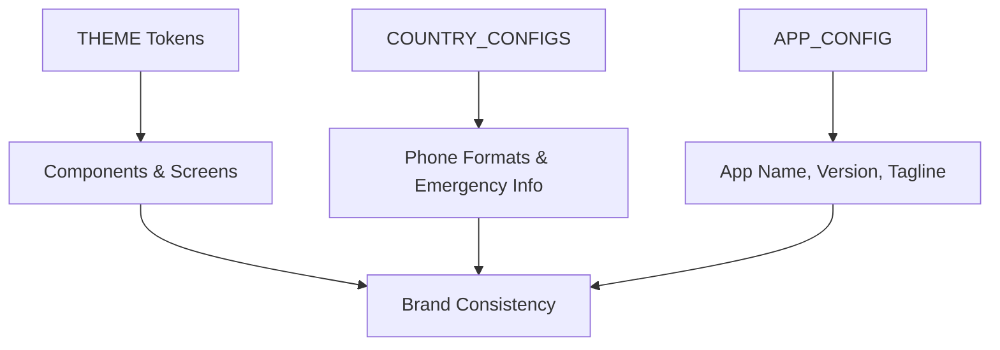
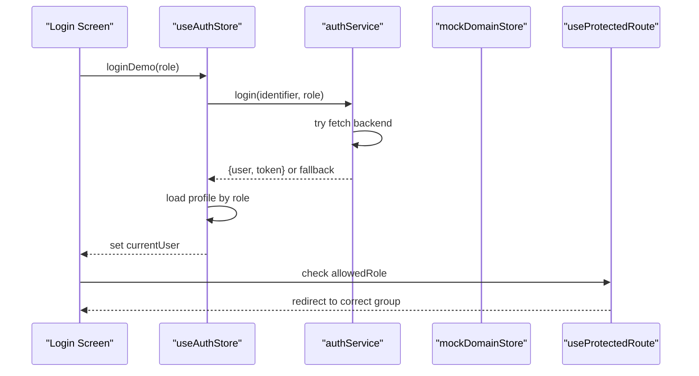
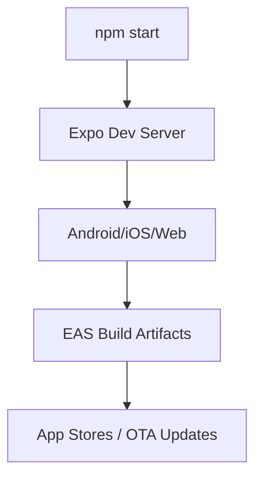
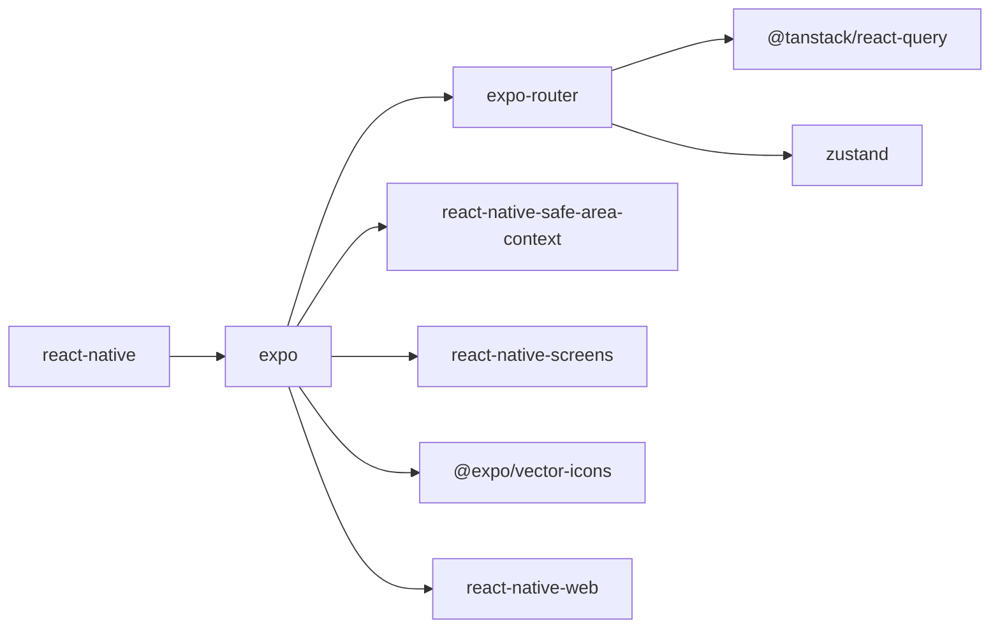

# App Architecture

<cite>
**Referenced Files in This Document**
- [package.json](file://package.json)
- [app.json](file://app.json)
- [index.ts](file://index.ts)
- [App.tsx](file://App.tsx)
- [tsconfig.json](file://tsconfig.json)
- [src/app/_layout.tsx](file://src/app/_layout.tsx)
- [src/app/(auth)/_layout.tsx](file://src/app/(auth)/_layout.tsx)
- [src/app/(patient)/_layout.tsx](file://src/app/(patient)/_layout.tsx)
- [src/app/(doctor)/_layout.tsx](file://src/app/(doctor)/_layout.tsx)
- [src/stores/authStore.ts](file://src/stores/authStore.ts)
- [src/hooks/useProtectedRoute.ts](file://src/hooks/useProtectedRoute.ts)
- [src/services/api.ts](file://src/services/api.ts)
- [src/constants/theme.ts](file://src/constants/theme.ts)
- [src/components/SplashPreloader.tsx](file://src/components/SplashPreloader.tsx)
</cite>

## Table of Contents
1. [Introduction](#introduction)
2. [Project Structure](#project-structure)
3. [Core Components](#core-components)
4. [Architecture Overview](#architecture-overview)
5. [Detailed Component Analysis](#detailed-component-analysis)
6. [Dependency Analysis](#dependency-analysis)
7. [Performance Considerations](#performance-considerations)
8. [Troubleshooting Guide](#troubleshooting-guide)
9. [Conclusion](#conclusion)

## Introduction
This document explains the overall architecture of the HomeCare mobile application. It covers entry points, initialization, configuration through app.json and package.json, high-level structure, React Native and Expo setup, native module integration, platform-specific configurations, app lifecycle, error boundaries, global configuration patterns, build processes, environment configuration, deployment considerations, performance optimization strategies, bundle size considerations, and best practices for maintaining a scalable mobile application structure.

## Project Structure
The project is an Expo Router-based React Native application with TypeScript. The root entry point registers the root component, while the actual application shell lives under src/app using file-based routing. Role-based groups (auth, patient, doctor, admin) are organized as nested route groups. Global providers such as SafeAreaProvider and QueryClientProvider wrap the navigation stack at the root layout.

**Diagram sources**
- [package.json:1-36](file://package.json#L1-L36)
- [app.json:1-34](file://app.json#L1-L34)
- [index.ts:1-9](file://index.ts#L1-L9)
- [App.tsx:1-21](file://App.tsx#L1-L21)
- [tsconfig.json:1-18](file://tsconfig.json#L1-L18)
- [src/app/_layout.tsx:1-133](file://src/app/_layout.tsx#L1-L133)
- [src/app/(auth)/_layout.tsx:1-26](file://src/app/(auth)/_layout.tsx#L1-L26)
- [src/app/(patient)/_layout.tsx:1-118](file://src/app/(patient)/_layout.tsx#L1-L118)
- [src/app/(doctor)/_layout.tsx:1-131](file://src/app/(doctor)/_layout.tsx#L1-L131)

**Section sources**
- [package.json:1-36](file://package.json#L1-L36)
- [app.json:1-34](file://app.json#L1-L34)
- [index.ts:1-9](file://index.ts#L1-L9)
- [App.tsx:1-21](file://App.tsx#L1-L21)
- [tsconfig.json:1-18](file://tsconfig.json#L1-L18)
- [src/app/_layout.tsx:1-133](file://src/app/_layout.tsx#L1-L133)

## Core Components
- Entry and runtime bootstrap: index.ts registers the root component; package.json defines the main entry as expo-router/entry; App.tsx is the legacy root component used by registerRootComponent.
- Application shell: src/app/_layout.tsx provides SafeAreaProvider, QueryClientProvider, StatusBar, session bar, and the top-level Stack navigator for all route groups.
- Route groups:
  - (auth): authentication flows including welcome, login, registration, OTP verification, and password reset.
  - (patient): patient dashboard with tabs for home, doctors, visits, records, profile, plus hidden subroutes for booking and results.
  - (doctor): doctor dashboard with tabs for dashboard, requests, schedule, patients, profile, plus hidden subroutes for visit details and consultations.
  - (admin): administrative routes defined in the root layout.
- State management: Zustand store for user session, profiles, token, loading, and error state.
- API layer: service interfaces for auth, patient, doctor, and admin operations with mock fallbacks and optional live backend calls.
- Routing protection: useProtectedRoute hook enforces role-based access before rendering protected layouts.
- Theming and configuration: centralized theme tokens, country configurations, and app metadata.
- Splash preloader: animated splash screen that runs during app startup.

**Section sources**
- [index.ts:1-9](file://index.ts#L1-L9)
- [App.tsx:1-21](file://App.tsx#L1-L21)
- [src/app/_layout.tsx:1-133](file://src/app/_layout.tsx#L1-L133)
- [src/app/(auth)/_layout.tsx:1-26](file://src/app/(auth)/_layout.tsx#L1-L26)
- [src/app/(patient)/_layout.tsx:1-118](file://src/app/(patient)/_layout.tsx#L1-L118)
- [src/app/(doctor)/_layout.tsx:1-131](file://src/app/(doctor)/_layout.tsx#L1-L131)
- [src/stores/authStore.ts:1-112](file://src/stores/authStore.ts#L1-L112)
- [src/hooks/useProtectedRoute.ts:1-40](file://src/hooks/useProtectedRoute.ts#L1-L40)
- [src/services/api.ts:1-660](file://src/services/api.ts#L1-L660)
- [src/constants/theme.ts:1-165](file://src/constants/theme.ts#L1-L165)
- [src/components/SplashPreloader.tsx:1-431](file://src/components/SplashPreloader.tsx#L1-L431)

## Architecture Overview
The app follows a layered architecture:
- Presentation layer: Expo Router screens and layouts, UI components, and tab/stack navigators.
- State layer: Zustand store for session and domain data.
- Service layer: API contracts for auth, patient, doctor, and admin domains with mock implementations and optional live backend integration.
- Infrastructure layer: Expo configuration, platform settings, theming, and global providers.

**Diagram sources**
- [src/app/_layout.tsx:1-133](file://src/app/_layout.tsx#L1-L133)
- [src/app/(auth)/_layout.tsx:1-26](file://src/app/(auth)/_layout.tsx#L1-L26)
- [src/app/(patient)/_layout.tsx:1-118](file://src/app/(patient)/_layout.tsx#L1-L118)
- [src/app/(doctor)/_layout.tsx:1-131](file://src/app/(doctor)/_layout.tsx#L1-L131)
- [src/stores/authStore.ts:1-112](file://src/stores/authStore.ts#L1-L112)
- [src/services/api.ts:1-660](file://src/services/api.ts#L1-L660)
- [app.json:1-34](file://app.json#L1-L34)
- [package.json:1-36](file://package.json#L1-L36)
- [src/constants/theme.ts:1-165](file://src/constants/theme.ts#L1-L165)
- [src/components/SplashPreloader.tsx:1-431](file://src/components/SplashPreloader.tsx#L1-L431)

## Detailed Component Analysis

### Entry Points and Initialization
- Expo runtime entry: package.json sets main to expo-router/entry, enabling Expo Router.
- Root component registration: index.ts uses registerRootComponent to mount App.tsx.
- Legacy root component: App.tsx renders a simple container and status bar; the real app shell is provided by src/app/_layout.tsx via Expo Router.

**Diagram sources**
- [package.json:1-36](file://package.json#L1-L36)
- [index.ts:1-9](file://index.ts#L1-L9)
- [App.tsx:1-21](file://App.tsx#L1-L21)
- [src/app/_layout.tsx:1-133](file://src/app/_layout.tsx#L1-L133)

**Section sources**
- [package.json:1-36](file://package.json#L1-L36)
- [index.ts:1-9](file://index.ts#L1-L9)
- [App.tsx:1-21](file://App.tsx#L1-L21)
- [src/app/_layout.tsx:1-133](file://src/app/_layout.tsx#L1-L133)

### Configuration Management
- Expo configuration (app.json):
  - App name, slug, scheme, version, orientation, icon, splash image, and background color.
  - Platform-specific settings: iOS tablet support, Android adaptive icon and predictive back gesture disabled, web favicon.
  - Plugins: expo-router and expo-status-bar.
- Package configuration (package.json):
  - Dependencies include React Native, Expo, Expo Router, React Query, Zustand, Safe Area Context, Screens, Vector Icons, and Web support.
  - Scripts for starting development server and launching on Android, iOS, or Web.
- TypeScript configuration (tsconfig.json):
  - Extends Expo base config, enables strict mode, sets baseUrl and path alias @/* to src/*.

**Diagram sources**
- [app.json:1-34](file://app.json#L1-L34)
- [package.json:1-36](file://package.json#L1-L36)
- [tsconfig.json:1-18](file://tsconfig.json#L1-L18)

**Section sources**
- [app.json:1-34](file://app.json#L1-L34)
- [package.json:1-36](file://package.json#L1-L36)
- [tsconfig.json:1-18](file://tsconfig.json#L1-L18)

### High-Level Application Structure
- Root layout:
  - Wraps app in SafeAreaProvider and QueryClientProvider.
  - Renders StatusBar and a SessionBar showing current user role and actions (reset demo data, sign out).
  - Defines top-level Stack with screens for index, (auth), (patient), (doctor), and (admin).
  - Displays SplashPreloader until initialization completes.
- Auth group:
  - Stack layout with header styling based on THEME.
  - Screens: welcome, login, register-patient, register-doctor, otp-verification, forgot-password.
- Patient group:
  - Tabs layout with icons and titles for Home, Find Doctor, Visits, Records, Profile.
  - Hidden subroutes for doctor detail, booking, visit detail, result detail, and notifications.
  - Protected by useProtectedRoute('patient').
- Doctor group:
  - Tabs layout with icons and titles for Dashboard, Requests, Schedule, Patients, Profile.
  - Hidden subroutes for visit detail and consultation detail.
  - Protected by useProtectedRoute('doctor').

**Diagram sources**
- [src/app/_layout.tsx:1-133](file://src/app/_layout.tsx#L1-L133)
- [src/app/(auth)/_layout.tsx:1-26](file://src/app/(auth)/_layout.tsx#L1-L26)
- [src/app/(patient)/_layout.tsx:1-118](file://src/app/(patient)/_layout.tsx#L1-L118)
- [src/app/(doctor)/_layout.tsx:1-131](file://src/app/(doctor)/_layout.tsx#L1-L131)

**Section sources**
- [src/app/_layout.tsx:1-133](file://src/app/_layout.tsx#L1-L133)
- [src/app/(auth)/_layout.tsx:1-26](file://src/app/(auth)/_layout.tsx#L1-L26)
- [src/app/(patient)/_layout.tsx:1-118](file://src/app/(patient)/_layout.tsx#L1-L118)
- [src/app/(doctor)/_layout.tsx:1-131](file://src/app/(doctor)/_layout.tsx#L1-L131)

### App Lifecycle and Error Boundaries
- Lifecycle:
  - SplashPreloader animates during startup and fades out when finished.
  - Root layout initializes providers and navigation, then renders the active route group.
  - SessionBar shows current user info and allows logout/reset.
- Error boundaries:
  - No explicit React ErrorBoundary components are present in the analyzed files.
  - Error handling is primarily within services and stores (e.g., catching fetch errors and setting error state).

**Diagram sources**
- [src/components/SplashPreloader.tsx:1-431](file://src/components/SplashPreloader.tsx#L1-L431)
- [src/app/_layout.tsx:1-133](file://src/app/_layout.tsx#L1-L133)
- [src/hooks/useProtectedRoute.ts:1-40](file://src/hooks/useProtectedRoute.ts#L1-L40)

**Section sources**
- [src/components/SplashPreloader.tsx:1-431](file://src/components/SplashPreloader.tsx#L1-L431)
- [src/app/_layout.tsx:1-133](file://src/app/_layout.tsx#L1-L133)
- [src/hooks/useProtectedRoute.ts:1-40](file://src/hooks/useProtectedRoute.ts#L1-L40)

### Global Configuration Patterns
- Theme and design tokens:
  - Centralized colors, typography, spacing, border radius, and shadows.
  - Supports consistent UI across screens and platforms.
- Country configuration:
  - Supported countries RW, KE, TZ with currency, emergency phone, regulatory body, example cities, and phone placeholders.
- App metadata:
  - App name, version, tagline, supported countries, support contact, demo OTP code, and emergency disclaimer.

**Diagram sources**
- [src/constants/theme.ts:1-165](file://src/constants/theme.ts#L1-L165)

**Section sources**
- [src/constants/theme.ts:1-165](file://src/constants/theme.ts#L1-L165)

### Data Flow and Services
- Auth flow:
  - useAuthStore triggers authService.login which attempts a live backend call and falls back to mock data if unavailable.
  - After successful login, it loads the appropriate profile (patient or doctor) via patientService.getProfile or doctorService.getProfile.
- Protected routes:
  - useProtectedRoute checks currentUser.role and redirects to the correct group layout if unauthorized.

**Diagram sources**
- [src/stores/authStore.ts:1-112](file://src/stores/authStore.ts#L1-L112)
- [src/services/api.ts:1-660](file://src/services/api.ts#L1-L660)
- [src/hooks/useProtectedRoute.ts:1-40](file://src/hooks/useProtectedRoute.ts#L1-L40)

**Section sources**
- [src/stores/authStore.ts:1-112](file://src/stores/authStore.ts#L1-L112)
- [src/services/api.ts:1-660](file://src/services/api.ts#L1-L660)
- [src/hooks/useProtectedRoute.ts:1-40](file://src/hooks/useProtectedRoute.ts#L1-L40)

### Build Processes, Environment Configuration, and Deployment
- Development:
  - npm start launches Expo dev server.
  - npm android/npm ios/npm web launch respective platforms.
- Environment:
  - API base URL is hardcoded to localhost:8000/api/v1 in services/api.ts.
  - For production, replace with a configurable environment variable or Expo config strategy.
- Deployment:
  - Use EAS Build for iOS and Android artifacts.
  - Configure app.json scheme for deep linking.
  - Ensure assets (icon, splash, favicon) are correctly referenced.

**Diagram sources**
- [package.json:1-36](file://package.json#L1-L36)
- [app.json:1-34](file://app.json#L1-L34)
- [src/services/api.ts:1-660](file://src/services/api.ts#L1-L660)

**Section sources**
- [package.json:1-36](file://package.json#L1-L36)
- [app.json:1-34](file://app.json#L1-L34)
- [src/services/api.ts:1-660](file://src/services/api.ts#L1-L660)

## Dependency Analysis
Key dependencies and their roles:
- expo, react-native, expo-router: core runtime and routing.
- @tanstack/react-query: data fetching and caching.
- zustand: lightweight global state.
- react-native-safe-area-context, react-native-screens: safe area and screen management.
- @expo/vector-icons, lucide-react-native: icons.
- eslint, typescript: tooling.

**Diagram sources**
- [package.json:1-36](file://package.json#L1-L36)

**Section sources**
- [package.json:1-36](file://package.json#L1-L36)

## Performance Considerations
- Navigation:
  - Use Expo Router’s lazy loading and avoid heavy computations in layout components.
  - Keep tab screens minimal; defer heavy work to services and memoize derived data.
- Data fetching:
  - Leverage React Query’s staleTime and retry options already configured in RootLayout.
  - Prefer pagination and incremental loading for large lists (doctors, visits, records).
- State:
  - Keep Zustand slices focused; avoid storing unnecessary payloads.
  - Use selectors to minimize re-renders.
- Assets:
  - Optimize images and fonts; ensure splash and icon assets are appropriately sized.
- Bundle size:
  - Remove unused dependencies and tree-shake where possible.
  - Avoid importing heavy libraries globally; import only where needed.
- Animations:
  - Use native driver animations where available; keep animation durations reasonable.

[No sources needed since this section provides general guidance]

## Troubleshooting Guide
- Authentication failures:
  - Check authService.login fallback behavior and error messages.
  - Verify credentials and backend availability; inspect network requests.
- Unauthorized access:
  - Confirm useProtectedRoute logic and currentUser.role.
  - Ensure router.replace targets the correct group layout.
- Profile loading issues:
  - Validate patientService.getProfile and doctorService.getProfile responses.
  - Inspect mockDomainStore consistency and data integrity.
- Navigation problems:
  - Verify Stack.Screen names match file routes.
  - Ensure hidden subroutes have href: false to prevent tab bar exposure.

**Section sources**
- [src/services/api.ts:1-660](file://src/services/api.ts#L1-L660)
- [src/hooks/useProtectedRoute.ts:1-40](file://src/hooks/useProtectedRoute.ts#L1-L40)
- [src/stores/authStore.ts:1-112](file://src/stores/authStore.ts#L1-L112)
- [src/app/(patient)/_layout.tsx:1-118](file://src/app/(patient)/_layout.tsx#L1-L118)
- [src/app/(doctor)/_layout.tsx:1-131](file://src/app/(doctor)/_layout.tsx#L1-L131)

## Conclusion
HomeCare’s mobile architecture combines Expo Router for navigation, Zustand for state, React Query for data, and a centralized theme system for consistent UI. The app bootstraps via index.ts and App.tsx, delegates the shell to src/app/_layout.tsx, and organizes features into role-based route groups. Services abstract backend interactions with robust mock fallbacks. Configuration is centralized in app.json and package.json, with TypeScript paths simplifying imports. To scale further, introduce environment variables for API endpoints, add explicit error boundaries, optimize assets and bundles, and adopt EAS for streamlined builds and deployments.

[No sources needed since this section summarizes without analyzing specific files]