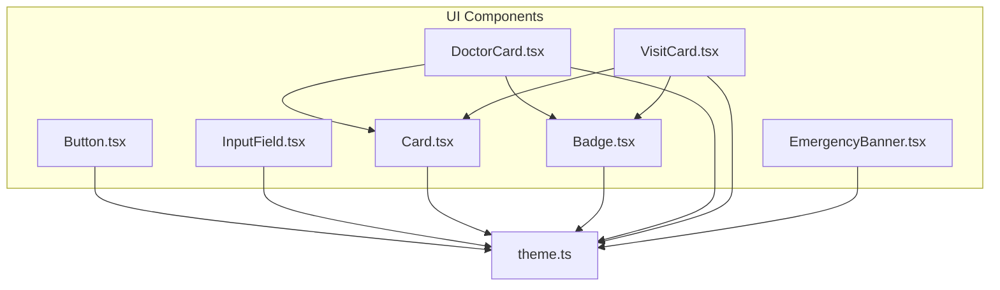
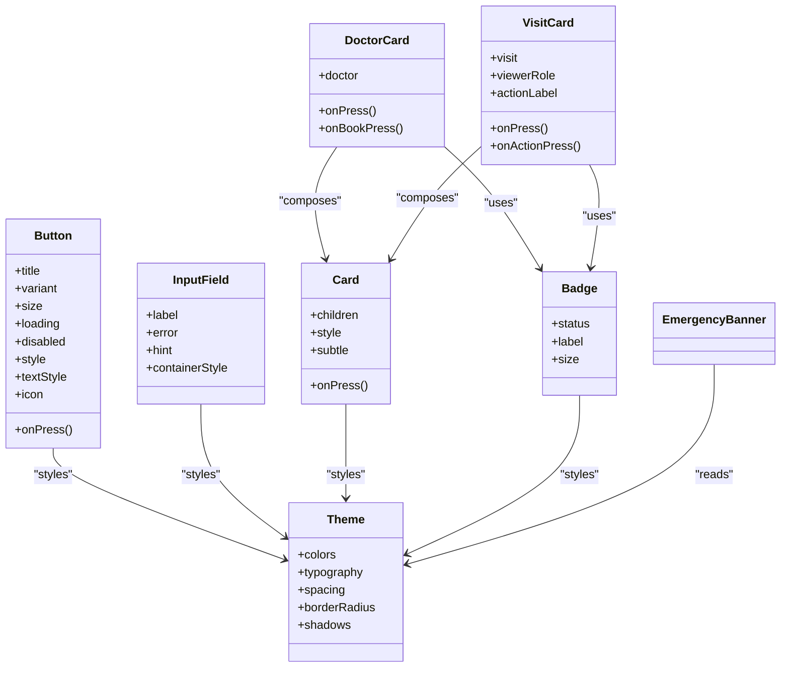
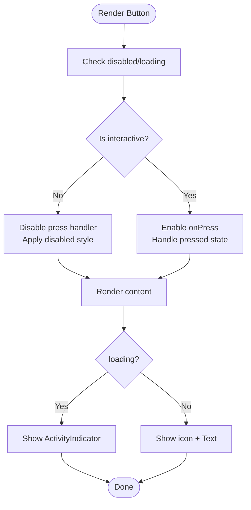
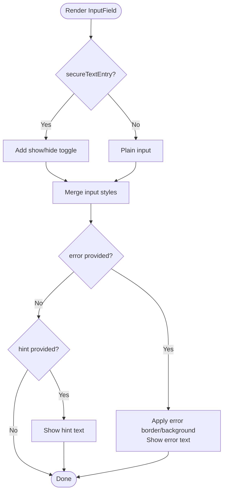
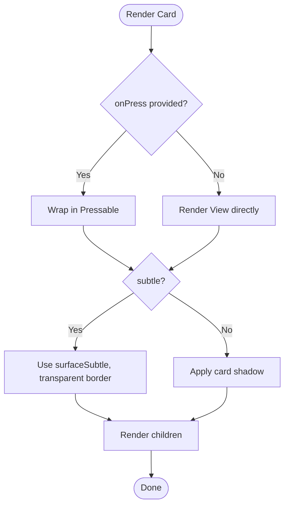
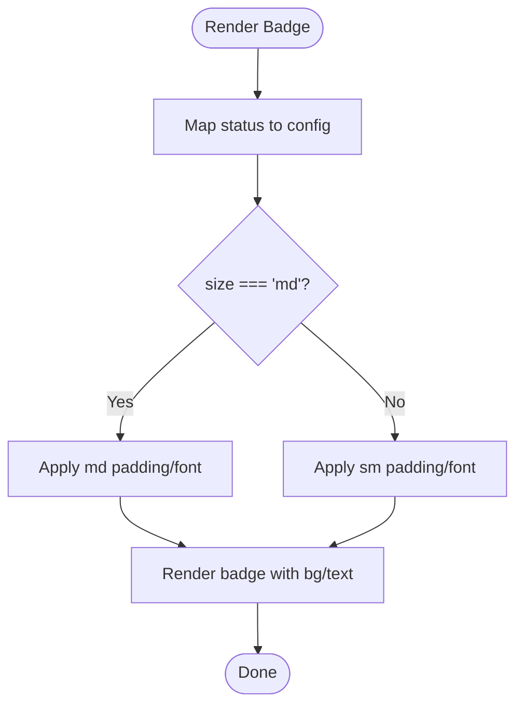
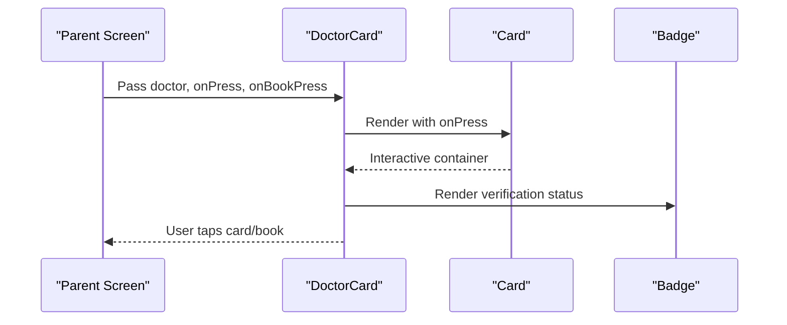
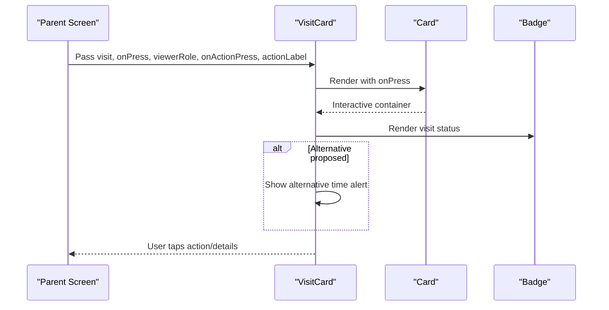
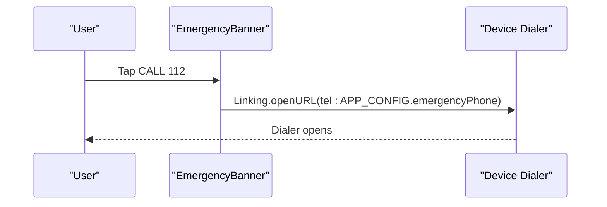
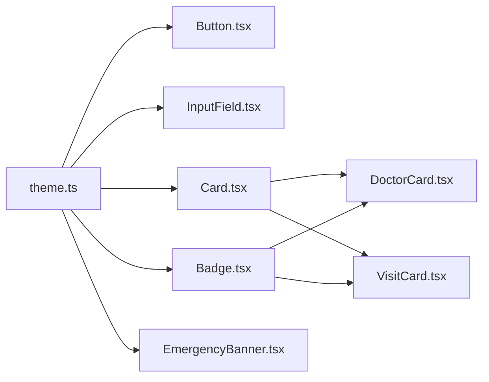

# Component Structure

<cite>
**Referenced Files in This Document**
- [Button.tsx](file://src/components/ui/Button.tsx)
- [InputField.tsx](file://src/components/ui/InputField.tsx)
- [Card.tsx](file://src/components/ui/Card.tsx)
- [DoctorCard.tsx](file://src/components/ui/DoctorCard.tsx)
- [VisitCard.tsx](file://src/components/ui/VisitCard.tsx)
- [Badge.tsx](file://src/components/ui/Badge.tsx)
- [EmergencyBanner.tsx](file://src/components/ui/EmergencyBanner.tsx)
- [theme.ts](file://src/constants/theme.ts)
</cite>

## Table of Contents
1. [Introduction](#introduction)
2. [Project Structure](#project-structure)
3. [Core Components](#core-components)
4. [Architecture Overview](#architecture-overview)
5. [Detailed Component Analysis](#detailed-component-analysis)
6. [Dependency Analysis](#dependency-analysis)
7. [Performance Considerations](#performance-considerations)
8. [Troubleshooting Guide](#troubleshooting-guide)
9. [Conclusion](#conclusion)
10. [Appendices](#appendices)

## Introduction
This document explains the component structure of the HomeCare mobile application with a focus on the reusable UI components under src/components/ui. It covers base components (Button, InputField, Card), specialized healthcare components (DoctorCard, VisitCard, Badge, EmergencyBanner), their prop interfaces, styling patterns, composition strategies, design system principles, and theme integration. The goal is to help developers understand how these components work together to build complex screens consistently and accessibly.

## Project Structure
The UI layer is organized by feature and responsibility:
- Base primitives: Button, InputField, Card
- Domain-specific cards: DoctorCard, VisitCard
- Status indicators: Badge
- Safety-critical banner: EmergencyBanner
- Design tokens and app configuration: theme.ts

**Diagram sources**
- [Button.tsx:1-150](file://src/components/ui/Button.tsx#L1-L150)
- [InputField.tsx:1-129](file://src/components/ui/InputField.tsx#L1-L129)
- [Card.tsx:1-56](file://src/components/ui/Card.tsx#L1-L56)
- [Badge.tsx:1-125](file://src/components/ui/Badge.tsx#L1-L125)
- [DoctorCard.tsx:1-213](file://src/components/ui/DoctorCard.tsx#L1-L213)
- [VisitCard.tsx:1-204](file://src/components/ui/VisitCard.tsx#L1-L204)
- [EmergencyBanner.tsx:1-75](file://src/components/ui/EmergencyBanner.tsx#L1-L75)
- [theme.ts:71-165](file://src/constants/theme.ts#L71-L165)

**Section sources**
- [Button.tsx:1-150](file://src/components/ui/Button.tsx#L1-L150)
- [InputField.tsx:1-129](file://src/components/ui/InputField.tsx#L1-L129)
- [Card.tsx:1-56](file://src/components/ui/Card.tsx#L1-L56)
- [Badge.tsx:1-125](file://src/components/ui/Badge.tsx#L1-L125)
- [DoctorCard.tsx:1-213](file://src/components/ui/DoctorCard.tsx#L1-L213)
- [VisitCard.tsx:1-204](file://src/components/ui/VisitCard.tsx#L1-L204)
- [EmergencyBanner.tsx:1-75](file://src/components/ui/EmergencyBanner.tsx#L1-L75)
- [theme.ts:1-165](file://src/constants/theme.ts#L1-L165)

## Core Components
This section summarizes each component’s purpose, props, behavior, and styling approach.

- Button
  - Purpose: Primary interactive control with variants, sizes, loading state, disabled state, optional icon, and accessible press feedback.
  - Key props: title, onPress, variant, size, loading, disabled, style, textStyle, icon.
  - Styling: Uses THEME for colors, typography sizes, border radius; supports pressed/disabled states via dynamic styles.
  - Accessibility: Exposes pressability through Pressable; text color adapts to variant.

- InputField
  - Purpose: Accessible form input with label, hint, error messaging, optional password visibility toggle, and multiline support.
  - Key props: label, error, hint, containerStyle, plus TextInputProps spread.
  - Styling: Uses THEME for surface, borders, spacing, and text colors; applies error state styling when error is present.
  - Behavior: Toggles secureTextEntry for passwords; autoCorrect and autoCapitalize are adjusted for password fields.

- Card
  - Purpose: Content container with optional shadow or subtle background, optional press interaction, and consistent padding/border.
  - Key props: children, style, onPress, subtle.
  - Styling: Uses THEME for surface, border, borderRadius, spacing, and shadows.

- Badge
  - Purpose: Semantic status indicator supporting visit and doctor verification statuses with default labels and two sizes.
  - Key props: status, label, size.
  - Styling: Maps status to predefined background/text colors from THEME; provides sm/md sizes.

- DoctorCard
  - Purpose: Composite card displaying doctor profile, rating, experience, coverage districts, fee, and booking action.
  - Composition: Built on Card and Badge; uses Ionicons for visual cues.
  - Key props: doctor, onPress, onBookPress.
  - Styling: Uses THEME for typography, spacing, colors, and radii; includes fallback avatar image.

- VisitCard
  - Purpose: Composite card showing visit details, date/time, status badge, person info, address, symptoms, alternative time proposal, and actions.
  - Composition: Built on Card and Badge; adapts content based on viewerRole (patient/doctor).
  - Key props: visit, onPress, viewerRole, onActionPress, actionLabel.
  - Styling: Uses THEME for layout, colors, and radii; highlights fees and status appropriately.

- EmergencyBanner
  - Purpose: Safety-critical banner that displays an emergency disclaimer and provides a one-tap call to the configured emergency number.
  - Behavior: Uses Linking to open the device dialer with APP_CONFIG.emergencyPhone.
  - Styling: Uses THEME for error palette, spacing, and radii; reads APP_CONFIG for disclaimer text and phone number.

**Section sources**
- [Button.tsx:13-74](file://src/components/ui/Button.tsx#L13-L74)
- [InputField.tsx:15-72](file://src/components/ui/InputField.tsx#L15-L72)
- [Card.tsx:6-38](file://src/components/ui/Card.tsx#L6-L38)
- [Badge.tsx:7-98](file://src/components/ui/Badge.tsx#L7-L98)
- [DoctorCard.tsx:9-86](file://src/components/ui/DoctorCard.tsx#L9-L86)
- [VisitCard.tsx:9-88](file://src/components/ui/VisitCard.tsx#L9-L88)
- [EmergencyBanner.tsx:6-24](file://src/components/ui/EmergencyBanner.tsx#L6-L24)

## Architecture Overview
The UI architecture follows a layered composition model:
- Base primitives provide consistent interactions, spacing, typography, and color usage.
- Domain cards compose primitives to represent healthcare entities (doctors, visits).
- A centralized theme defines tokens for colors, typography, spacing, radii, and shadows.
- App configuration centralizes environment-specific values like emergency numbers and disclaimers.

**Diagram sources**
- [Button.tsx:13-74](file://src/components/ui/Button.tsx#L13-L74)
- [InputField.tsx:15-72](file://src/components/ui/InputField.tsx#L15-L72)
- [Card.tsx:6-38](file://src/components/ui/Card.tsx#L6-L38)
- [Badge.tsx:7-98](file://src/components/ui/Badge.tsx#L7-L98)
- [DoctorCard.tsx:9-86](file://src/components/ui/DoctorCard.tsx#L9-L86)
- [VisitCard.tsx:9-88](file://src/components/ui/VisitCard.tsx#L9-L88)
- [EmergencyBanner.tsx:6-24](file://src/components/ui/EmergencyBanner.tsx#L6-L24)
- [theme.ts:71-165](file://src/constants/theme.ts#L71-L165)

## Detailed Component Analysis

### Button
- Interaction model: Uses Pressable with dynamic style merging for pressed/disabled/loading states.
- Variants: primary, secondary, outline, danger, ghost; each maps to distinct background/text colors.
- Sizes: sm, md, lg; controls padding and font size via THEME.typography.sizes.
- Loading: Renders ActivityIndicator with appropriate color based on variant.
- Customization: Accepts style and textStyle for overrides; optional icon slot with margin handling.

**Diagram sources**
- [Button.tsx:25-74](file://src/components/ui/Button.tsx#L25-L74)
- [Button.tsx:76-149](file://src/components/ui/Button.tsx#L76-L149)

**Section sources**
- [Button.tsx:13-74](file://src/components/ui/Button.tsx#L13-L74)
- [Button.tsx:76-149](file://src/components/ui/Button.tsx#L76-L149)

### InputField
- Form UX: Label above input; hint shown when no error; error message displayed below with red border and background.
- Password mode: When secureTextEntry is true, shows a toggle button to reveal/hide text; disables autoCorrect and sets autoCapitalize to none.
- Multiline: Applies minHeight and top-aligned text when multiline is set.
- Theming: Uses THEME for surface, border, text colors, and spacing.

**Diagram sources**
- [InputField.tsx:22-72](file://src/components/ui/InputField.tsx#L22-L72)
- [InputField.tsx:74-129](file://src/components/ui/InputField.tsx#L74-L129)

**Section sources**
- [InputField.tsx:15-72](file://src/components/ui/InputField.tsx#L15-L72)
- [InputField.tsx:74-129](file://src/components/ui/InputField.tsx#L74-L129)

### Card
- Layout: Provides consistent padding, border, and background; optional subtle variant removes border and uses surfaceSubtle.
- Interactivity: Wraps content in Pressable when onPress is provided, applying opacity change on press.
- Theming: Uses THEME for surface, border, borderRadius, spacing, and shadows.

**Diagram sources**
- [Card.tsx:13-38](file://src/components/ui/Card.tsx#L13-L38)
- [Card.tsx:40-56](file://src/components/ui/Card.tsx#L40-L56)

**Section sources**
- [Card.tsx:6-38](file://src/components/ui/Card.tsx#L6-L38)
- [Card.tsx:40-56](file://src/components/ui/Card.tsx#L40-L56)

### Badge
- Status mapping: Maps visit and verification statuses to semantic colors and default labels.
- Sizes: Supports sm and md with corresponding padding and font sizes.
- Fallback: Unknown statuses render neutral colors and display the raw status string.

**Diagram sources**
- [Badge.tsx:13-98](file://src/components/ui/Badge.tsx#L13-L98)
- [Badge.tsx:100-125](file://src/components/ui/Badge.tsx#L100-L125)

**Section sources**
- [Badge.tsx:7-98](file://src/components/ui/Badge.tsx#L7-L98)
- [Badge.tsx:100-125](file://src/components/ui/Badge.tsx#L100-L125)

### DoctorCard
- Composition: Wraps content in Card; uses Badge for verification status; renders doctor metadata including name, specialty, rating, reviews, experience, bio, coverage districts, and fee.
- Actions: Supports both general onPress and a dedicated onBookPress for booking flow.
- Theming: Uses THEME for typography, spacing, colors, and radii; includes fallback avatar image.

**Diagram sources**
- [DoctorCard.tsx:15-86](file://src/components/ui/DoctorCard.tsx#L15-L86)
- [Card.tsx:13-38](file://src/components/ui/Card.tsx#L13-L38)
- [Badge.tsx:13-98](file://src/components/ui/Badge.tsx#L13-L98)

**Section sources**
- [DoctorCard.tsx:9-86](file://src/components/ui/DoctorCard.tsx#L9-L86)
- [DoctorCard.tsx:88-213](file://src/components/ui/DoctorCard.tsx#L88-L213)

### VisitCard
- Composition: Wraps content in Card; uses Badge for visit status; adapts displayed person and metadata based on viewerRole.
- Conditional UI: Shows alternative time proposal alert when status indicates it; supports custom action button or default “View Details”.
- Theming: Uses THEME for layout, colors, and radii; highlights fees and status appropriately.

**Diagram sources**
- [VisitCard.tsx:17-88](file://src/components/ui/VisitCard.tsx#L17-L88)
- [Card.tsx:13-38](file://src/components/ui/Card.tsx#L13-L38)
- [Badge.tsx:13-98](file://src/components/ui/Badge.tsx#L13-L98)

**Section sources**
- [VisitCard.tsx:9-88](file://src/components/ui/VisitCard.tsx#L9-L88)
- [VisitCard.tsx:90-204](file://src/components/ui/VisitCard.tsx#L90-L204)

### EmergencyBanner
- Behavior: Opens device dialer with APP_CONFIG.emergencyPhone using Linking.openURL.
- Theming: Uses THEME.errorSoft/error for background and button; reads APP_CONFIG for disclaimer text and phone number.
- Accessibility: Clear CTA labeled “CALL 112” for quick emergency action.

**Diagram sources**
- [EmergencyBanner.tsx:6-24](file://src/components/ui/EmergencyBanner.tsx#L6-L24)
- [theme.ts:58-69](file://src/constants/theme.ts#L58-L69)

**Section sources**
- [EmergencyBanner.tsx:6-24](file://src/components/ui/EmergencyBanner.tsx#L6-L24)
- [EmergencyBanner.tsx:26-75](file://src/components/ui/EmergencyBanner.tsx#L26-L75)
- [theme.ts:58-69](file://src/constants/theme.ts#L58-L69)

## Dependency Analysis
Components follow clear dependency rules:
- Base components depend only on React Native and THEME.
- Domain cards depend on base components (Card, Badge) and THEME.
- EmergencyBanner depends on THEME and APP_CONFIG for safety-critical behavior.

**Diagram sources**
- [Button.tsx:11-11](file://src/components/ui/Button.tsx#L11-L11)
- [InputField.tsx:13-13](file://src/components/ui/InputField.tsx#L13-L13)
- [Card.tsx:4-4](file://src/components/ui/Card.tsx#L4-L4)
- [Badge.tsx:4-4](file://src/components/ui/Badge.tsx#L4-L4)
- [DoctorCard.tsx:4-7](file://src/components/ui/DoctorCard.tsx#L4-L7)
- [VisitCard.tsx:4-7](file://src/components/ui/VisitCard.tsx#L4-L7)
- [EmergencyBanner.tsx:4-4](file://src/components/ui/EmergencyBanner.tsx#L4-L4)
- [theme.ts:71-165](file://src/constants/theme.ts#L71-L165)

**Section sources**
- [Button.tsx:1-150](file://src/components/ui/Button.tsx#L1-L150)
- [InputField.tsx:1-129](file://src/components/ui/InputField.tsx#L1-L129)
- [Card.tsx:1-56](file://src/components/ui/Card.tsx#L1-L56)
- [Badge.tsx:1-125](file://src/components/ui/Badge.tsx#L1-L125)
- [DoctorCard.tsx:1-213](file://src/components/ui/DoctorCard.tsx#L1-L213)
- [VisitCard.tsx:1-204](file://src/components/ui/VisitCard.tsx#L1-L204)
- [EmergencyBanner.tsx:1-75](file://src/components/ui/EmergencyBanner.tsx#L1-L75)
- [theme.ts:71-165](file://src/constants/theme.ts#L71-L165)

## Performance Considerations
- Prefer memoization for expensive lists of DoctorCard/VisitCard items to avoid unnecessary re-renders.
- Use stable references for onPress handlers passed into cards to prevent child re-renders.
- Avoid heavy inline styles; rely on THEME tokens and StyleSheet.create where possible.
- For large datasets, consider virtualized lists and lazy image loading for avatars.

[No sources needed since this section provides general guidance]

## Troubleshooting Guide
- Button not responding
  - Ensure disabled or loading flags are not unintentionally set.
  - Verify onPress is provided and not overridden by disabled state.
  - Section sources
    - [Button.tsx:36-48](file://src/components/ui/Button.tsx#L36-L48)

- InputField password toggle not working
  - Confirm secureTextEntry is true for password inputs.
  - Check that the toggle Pressable is rendered and has proper hitSlop.
  - Section sources
    - [InputField.tsx:31-66](file://src/components/ui/InputField.tsx#L31-L66)

- Card not clickable
  - Ensure onPress is provided; without it, Card does not wrap in Pressable.
  - Section sources
    - [Card.tsx:26-37](file://src/components/ui/Card.tsx#L26-L37)

- Badge shows unexpected label
  - Verify status value matches expected enum; unknown statuses fall back to raw string.
  - Section sources
    - [Badge.tsx:14-74](file://src/components/ui/Badge.tsx#L14-L74)

- EmergencyBanner call fails
  - Check APP_CONFIG.emergencyPhone is correctly set for the target country.
  - Ensure Linking permissions are granted on the platform if required.
  - Section sources
    - [EmergencyBanner.tsx:7-9](file://src/components/ui/EmergencyBanner.tsx#L7-L9)
    - [theme.ts:58-69](file://src/constants/theme.ts#L58-L69)

## Conclusion
The HomeCare UI layer is built around a small set of well-defined base components and domain-specific cards that compose them. All components consistently consume THEME tokens for colors, typography, spacing, and radii, ensuring visual coherence and easy customization. Cards encapsulate complex healthcare data while preserving accessibility and interaction patterns. EmergencyBanner centralizes critical safety behavior using APP_CONFIG. Following the established composition and theming patterns will help maintain consistency and scalability as new screens and features are added.

[No sources needed since this section summarizes without analyzing specific files]

## Appendices

### Prop Interfaces Summary
- Button
  - title: string
  - onPress: () => void
  - variant: 'primary' | 'secondary' | 'outline' | 'danger' | 'ghost'
  - size: 'sm' | 'md' | 'lg'
  - loading: boolean
  - disabled: boolean
  - style: ViewStyle
  - textStyle: TextStyle
  - icon: React.ReactNode
  - Section sources
    - [Button.tsx:13-23](file://src/components/ui/Button.tsx#L13-L23)

- InputField
  - label: string
  - error?: string
  - hint?: string
  - containerStyle?: ViewStyle
  - Inherits TextInputProps
  - Section sources
    - [InputField.tsx:15-20](file://src/components/ui/InputField.tsx#L15-L20)

- Card
  - children: React.ReactNode
  - style?: StyleProp<ViewStyle>
  - onPress?: () => void
  - subtle?: boolean
  - Section sources
    - [Card.tsx:6-11](file://src/components/ui/Card.tsx#L6-L11)

- Badge
  - status: VisitStatus | DoctorVerificationStatus | string
  - label?: string
  - size?: 'sm' | 'md'
  - Section sources
    - [Badge.tsx:7-11](file://src/components/ui/Badge.tsx#L7-L11)

- DoctorCard
  - doctor: DoctorProfile
  - onPress: () => void
  - onBookPress?: () => void
  - Section sources
    - [DoctorCard.tsx:9-13](file://src/components/ui/DoctorCard.tsx#L9-L13)

- VisitCard
  - visit: VisitRequest
  - onPress: () => void
  - viewerRole: 'patient' | 'doctor'
  - onActionPress?: () => void
  - actionLabel?: string
  - Section sources
    - [VisitCard.tsx:9-15](file://src/components/ui/VisitCard.tsx#L9-L15)

### Design System Principles
- Consistent spacing and radii via THEME.spacing and THEME.borderRadius.
- Color semantics: primary, accent, success, warning, error, and neutral surfaces.
- Typography scale: xs through display sizes for hierarchy.
- Shadows: card and floating elevations for depth.
- Section sources
  - [theme.ts:71-165](file://src/constants/theme.ts#L71-L165)

### Best Practices for New Components
- Derive all visual tokens from THEME; avoid hard-coded colors or sizes.
- Compose base components (Card, Button, Badge) rather than duplicating layouts.
- Provide sensible defaults and allow overrides via style and variant props.
- Handle edge cases: empty data, long text truncation, disabled/loading states.
- Keep interactions accessible: use Pressable, expose accessibility labels where needed.
- Section sources
  - [Button.tsx:76-149](file://src/components/ui/Button.tsx#L76-L149)
  - [InputField.tsx:74-129](file://src/components/ui/InputField.tsx#L74-L129)
  - [Card.tsx:40-56](file://src/components/ui/Card.tsx#L40-L56)
  - [Badge.tsx:100-125](file://src/components/ui/Badge.tsx#L100-L125)