# Frontend Architecture

<cite>
**Referenced Files in This Document**
- [App.tsx](file://App.tsx)
- [index.ts](file://index.ts)
- [app.json](file://app.json)
- [_layout.tsx](file://src/app/_layout.tsx)
- [_layout.tsx](file://src/app/(auth)/_layout.tsx)
- [_layout.tsx](file://src/app/(patient)/_layout.tsx)
- [_layout.tsx](file://src/app/(doctor)/_layout.tsx)
- [_layout.tsx](file://src/app/(admin)/_layout.tsx)
- [welcome.tsx](file://src/app/(auth)/welcome.tsx)
- [login.tsx](file://src/app/(auth)/login.tsx)
- [index.tsx](file://src/app/(patient)/index.tsx)
- [index.tsx](file://src/app/(doctor)/index.tsx)
- [index.tsx](file://src/app/(admin)/index.tsx)
- [useProtectedRoute.ts](file://src/hooks/useProtectedRoute.ts)
- [theme.ts](file://src/constants/theme.ts)
- [Button.tsx](file://src/components/ui/Button.tsx)
- [InputField.tsx](file://src/components/ui/InputField.tsx)
- [Card.tsx](file://src/components/ui/Card.tsx)
- [DoctorCard.tsx](file://src/components/ui/DoctorCard.tsx)
- [VisitCard.tsx](file://src/components/ui/VisitCard.tsx)
- [Badge.tsx](file://src/components/ui/Badge.tsx)
- [EmergencyBanner.tsx](file://src/components/ui/EmergencyBanner.tsx)
- [SplashPreloader.tsx](file://src/components/SplashPreloader.tsx)
- [authStore.ts](file://src/stores/authStore.ts)
- [api.ts](file://src/services/api.ts)
</cite>

## Table of Contents
1. Introduction
2. Project Structure
3. Core Components
4. Architecture Overview
5. Detailed Component Analysis
6. Dependency Analysis
7. Performance Considerations
8. Troubleshooting Guide
9. Conclusion

## Introduction
This document explains the frontend architecture of the HomeCare mobile application built with React Native and Expo, using file-based routing via Expo Router. It covers:
- App entry points and root layout configuration
- Role-based screen organization under (auth), (patient), (doctor), and (admin) groups
- Navigation structure with protected routes and role-based access control
- Reusable UI components and theming system for consistent styling
- Separation of concerns between presentation screens and business logic through stores and services

## Project Structure
The app uses Expo Router’s file-based routing convention. Group folders prefixed with parentheses define route groups that are not part of the URL but can hold shared layouts and navigation. The root layout configures global providers, status bar, and top-level stacks. Each role group defines its own layout to enforce authorization and provide tab or stack navigation tailored to that role.

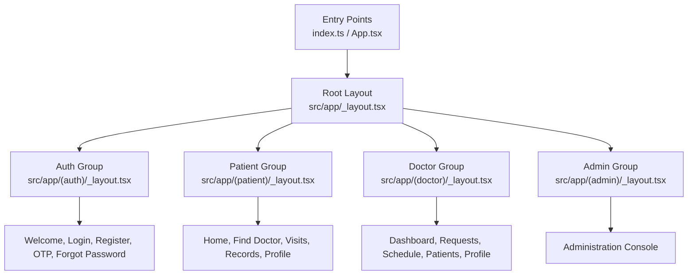

**Diagram sources**
- [_layout.tsx:57-84](file://src/app/_layout.tsx#L57-L84)
- [_layout.tsx:6-24](file://src/app/(auth)/_layout.tsx#L6-L24)
- [_layout.tsx:8-107](file://src/app/(patient)/_layout.tsx#L8-L107)
- [_layout.tsx:8-120](file://src/app/(doctor)/_layout.tsx#L8-L120)
- [_layout.tsx:8-30](file://src/app/(admin)/_layout.tsx#L8-L30)

**Section sources**
- [index.ts](file://index.ts)
- [App.tsx](file://App.tsx)
- [app.json](file://app.json)
- [_layout.tsx:57-84](file://src/app/_layout.tsx#L57-L84)

## Core Components
- Root layout provides SafeAreaProvider, QueryClientProvider, StatusBar, and a Stack navigator that registers all route groups. It also renders a session bar showing current user role and actions like reset demo data and sign out.
- Role layouts implement protection using useProtectedRoute and render either a loading indicator while redirect occurs or the appropriate navigation container (tabs or stack).
- Screens are organized by role:
  - (auth): welcome, login, register-patient, register-doctor, otp-verification, forgot-password
  - (patient): index (home), doctors, visits, records, profile, plus hidden subroutes for doctor details, booking, visit detail, results, and notifications
  - (doctor): index (dashboard), requests, schedule, patients, profile, plus hidden subroutes for visit detail and consultation
  - (admin): index (administration console)
- Reusable UI components live under src/components/ui and include Button, InputField, Card, Badge, DoctorCard, VisitCard, EmergencyBanner. A SplashPreloader is used at app start.
- Theming is centralized in src/constants/theme.ts with colors, typography, spacing, border radius, and shadows. All screens and components consume THEME tokens for consistent visuals.
- Business logic is separated from presentation:
  - State and auth flows are managed in src/stores/authStore.ts (Zustand)
  - API calls are encapsulated in src/services/api.ts
  - Data fetching uses @tanstack/react-query within screens

**Section sources**
- [_layout.tsx:1-84](file://src/app/_layout.tsx#L1-L84)
- [_layout.tsx:6-24](file://src/app/(auth)/_layout.tsx#L6-L24)
- [_layout.tsx:8-107](file://src/app/(patient)/_layout.tsx#L8-L107)
- [_layout.tsx:8-120](file://src/app/(doctor)/_layout.tsx#L8-L120)
- [_layout.tsx:8-30](file://src/app/(admin)/_layout.tsx#L8-L30)
- [theme.ts:71-165](file://src/constants/theme.ts#L71-L165)
- [authStore.ts:1-112](file://src/stores/authStore.ts#L1-L112)
- [Button.tsx:1-150](file://src/components/ui/Button.tsx#L1-L150)
- [InputField.tsx:1-129](file://src/components/ui/InputField.tsx#L1-L129)
- [Card.tsx:1-56](file://src/components/ui/Card.tsx#L1-L56)

## Architecture Overview
The frontend follows a layered architecture:
- Presentation layer: Screen components and reusable UI components
- Routing layer: Expo Router with grouped routes and role-specific layouts
- State layer: Zustand store for authentication and profiles
- Data layer: Services calling backend APIs, cached via react-query
- Theme layer: Centralized design tokens applied across components

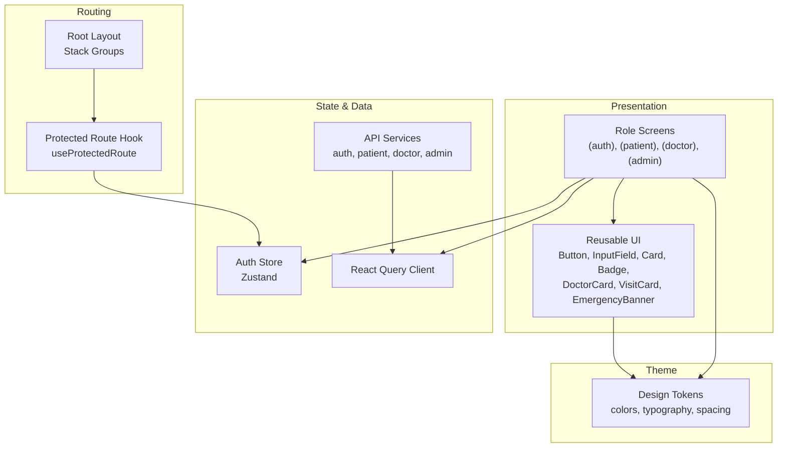

**Diagram sources**
- [_layout.tsx:57-84](file://src/app/_layout.tsx#L57-L84)
- [useProtectedRoute.ts:11-38](file://src/hooks/useProtectedRoute.ts#L11-L38)
- [authStore.ts:23-111](file://src/stores/authStore.ts#L23-L111)
- [theme.ts:71-165](file://src/constants/theme.ts#L71-L165)

## Detailed Component Analysis

### Root Layout and Global Configuration
- Provides SafeAreaProvider and QueryClientProvider
- Renders a SessionBar showing current user role and actions (reset demo data, sign out)
- Registers Stack.Screen entries for each route group: index, (auth), (patient), (doctor), (admin)
- Applies theme colors to content background and header styles

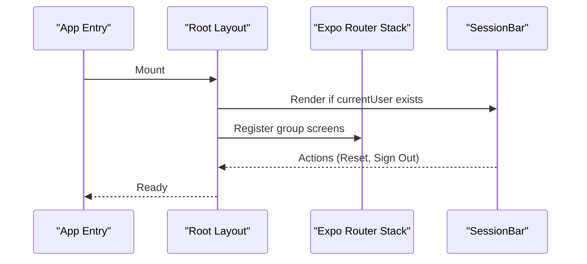

**Diagram sources**
- [_layout.tsx:21-55](file://src/app/_layout.tsx#L21-L55)
- [_layout.tsx:57-84](file://src/app/_layout.tsx#L57-L84)

**Section sources**
- [_layout.tsx:1-84](file://src/app/_layout.tsx#L1-L84)

### Authentication Flows and Screens
- Welcome screen introduces the app, shows emergency disclaimer, and navigates to registration or login
- Login screen validates input, calls auth store loginCustom, and redirects based on user role
- Auth group layout configures headers and registers auth screens

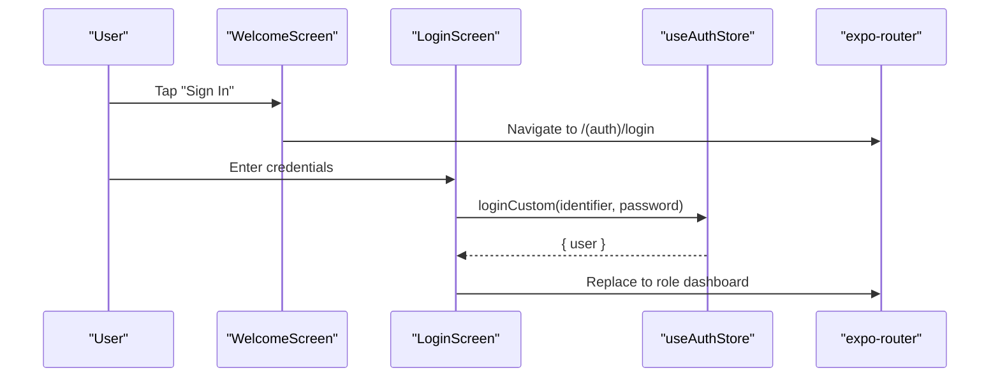

**Diagram sources**
- [welcome.tsx:18-85](file://src/app/(auth)/welcome.tsx#L18-L85)
- [login.tsx:17-46](file://src/app/(auth)/login.tsx#L17-L46)
- [_layout.tsx:6-24](file://src/app/(auth)/_layout.tsx#L6-L24)

**Section sources**
- [welcome.tsx:1-183](file://src/app/(auth)/welcome.tsx#L1-L183)
- [login.tsx:1-174](file://src/app/(auth)/login.tsx#L1-L174)
- [_layout.tsx:6-24](file://src/app/(auth)/_layout.tsx#L6-L24)

### Patient Role: Tabs and Home Screen
- Patient tabs layout enforces authorization and defines tab screens: Home, Find Doctor, Visits, Records, Profile
- Hidden subroutes for doctor detail, booking, visit detail, result detail, and notifications
- Patient home screen fetches visits, specialties, and recommended doctors; displays upcoming visit banner and quick actions

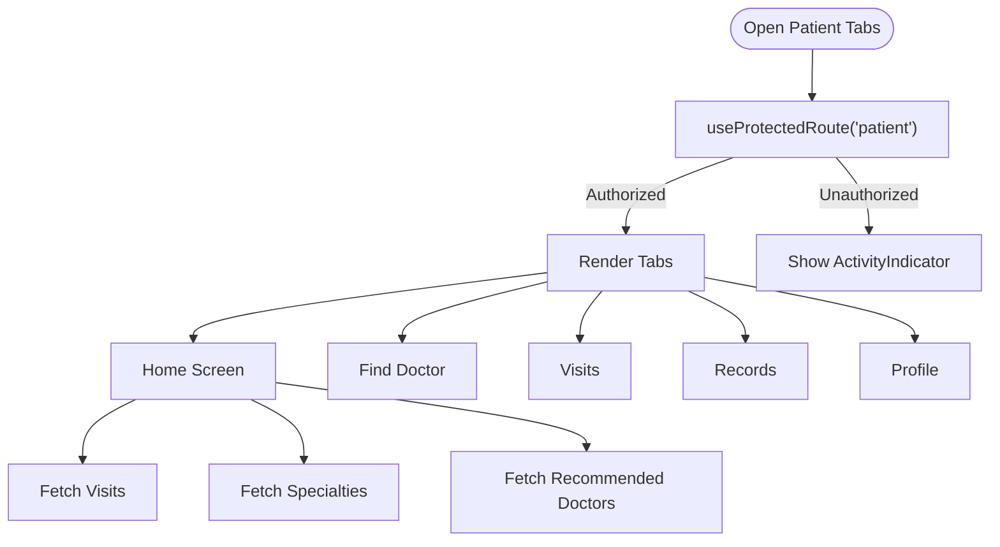

**Diagram sources**
- [_layout.tsx:8-107](file://src/app/(patient)/_layout.tsx#L8-L107)
- [index.tsx:22-49](file://src/app/(patient)/index.tsx#L22-L49)

**Section sources**
- [_layout.tsx:1-118](file://src/app/(patient)/_layout.tsx#L1-L118)
- [index.tsx:1-340](file://src/app/(patient)/index.tsx#L1-L340)

### Doctor Role: Dashboard and Workflow
- Doctor tabs layout enforces authorization and defines tabs: Dashboard, Requests, Schedule, Patients, Profile
- Dashboard screen fetches visits, computes metrics, toggles online status, and shows pending/active/completed sections

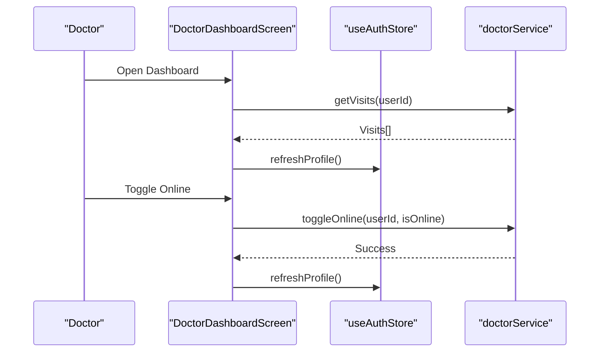

**Diagram sources**
- [_layout.tsx:8-120](file://src/app/(doctor)/_layout.tsx#L8-L120)
- [index.tsx:25-49](file://src/app/(doctor)/index.tsx#L25-L49)

**Section sources**
- [_layout.tsx:1-131](file://src/app/(doctor)/_layout.tsx#L1-L131)
- [index.tsx:1-329](file://src/app/(doctor)/index.tsx#L1-L329)

### Admin Role: Administration Console
- Admin layout enforces authorization and renders a stack with the administration console
- Console screen manages tabs for metrics, doctors, complaints, audit logs; supports filtering, updating doctor verification status, resolving complaints, and resetting demo data

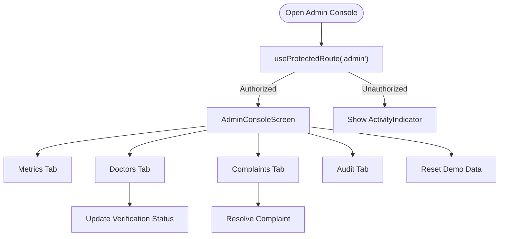

**Diagram sources**
- [_layout.tsx:8-30](file://src/app/(admin)/_layout.tsx#L8-L30)
- [index.tsx:60-121](file://src/app/(admin)/index.tsx#L60-L121)

**Section sources**
- [_layout.tsx:1-40](file://src/app/(admin)/_layout.tsx#L1-L40)
- [index.tsx:1-800](file://src/app/(admin)/index.tsx#L1-L800)

### Protected Routes and Role-Based Access Control
- useProtectedRoute checks currentUser and redirects:
  - If no user: to /(auth)/welcome
  - If wrong role: to the corresponding role dashboard
- Returns boolean indicating authorization so layouts can conditionally render UI or show a loading state

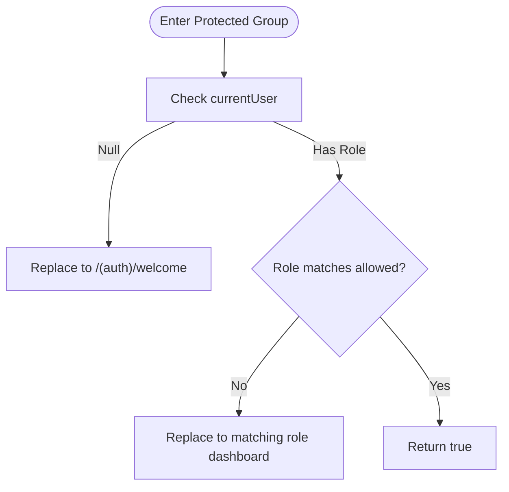

**Diagram sources**
- [useProtectedRoute.ts:11-38](file://src/hooks/useProtectedRoute.ts#L11-L38)

**Section sources**
- [useProtectedRoute.ts:1-40](file://src/hooks/useProtectedRoute.ts#L1-L40)

### Reusable UI Components
- Button: Supports variants (primary, secondary, outline, danger, ghost), sizes (sm, md, lg), loading state, disabled state, and icon support
- InputField: Label, hint, error display, password visibility toggle, multiline support, and theme-aware styling
- Card: Optional onPress, subtle variant, shadow and border styling via theme tokens
- Additional components: Badge, DoctorCard, VisitCard, EmergencyBanner

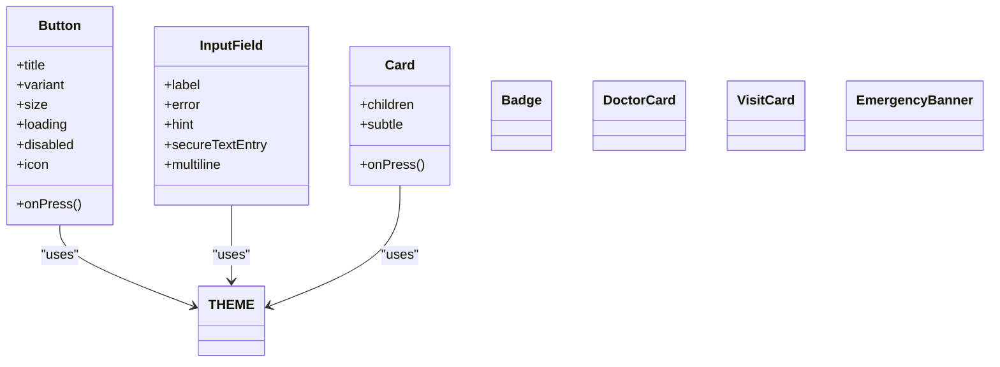

**Diagram sources**
- [Button.tsx:13-74](file://src/components/ui/Button.tsx#L13-L74)
- [InputField.tsx:15-72](file://src/components/ui/InputField.tsx#L15-L72)
- [Card.tsx:6-38](file://src/components/ui/Card.tsx#L6-L38)

**Section sources**
- [Button.tsx:1-150](file://src/components/ui/Button.tsx#L1-L150)
- [InputField.tsx:1-129](file://src/components/ui/InputField.tsx#L1-L129)
- [Card.tsx:1-56](file://src/components/ui/Card.tsx#L1-L56)
- [Badge.tsx](file://src/components/ui/Badge.tsx)
- [DoctorCard.tsx](file://src/components/ui/DoctorCard.tsx)
- [VisitCard.tsx](file://src/components/ui/VisitCard.tsx)
- [EmergencyBanner.tsx](file://src/components/ui/EmergencyBanner.tsx)

### Theming System
- Centralized design tokens include:
  - Colors: primary palette, accents, status colors, neutrals, badge colors
  - Typography: font families and sizes
  - Spacing: xs to xxl
  - Border radius: sm to full
  - Shadows: card and floating
- All screens and components consume THEME for consistent visual language

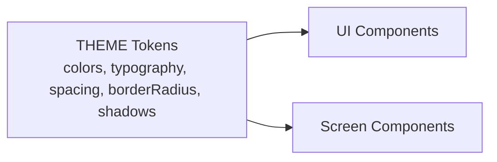

**Diagram sources**
- [theme.ts:71-165](file://src/constants/theme.ts#L71-L165)

**Section sources**
- [theme.ts:1-165](file://src/constants/theme.ts#L1-L165)

### Separation of Concerns: Presentation vs Business Logic
- Presentation:
  - Screen components handle UI composition and user interactions
  - Reusable UI components encapsulate visual patterns
- Business Logic:
  - authStore manages authentication state, login flows, profile refresh, and demo data reset
  - api.ts encapsulates service methods for auth, patient, doctor, and admin domains
  - react-query handles caching, refetching, and query lifecycle within screens

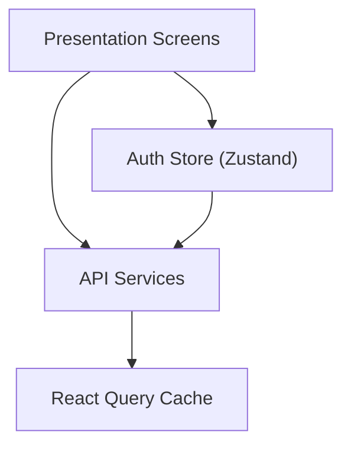

**Diagram sources**
- [authStore.ts:23-111](file://src/stores/authStore.ts#L23-L111)
- [api.ts](file://src/services/api.ts)

**Section sources**
- [authStore.ts:1-112](file://src/stores/authStore.ts#L1-L112)
- [api.ts](file://src/services/api.ts)

## Dependency Analysis
- Root layout depends on:
  - expo-router for navigation
  - react-native-safe-area-context for safe area handling
  - @tanstack/react-query for data fetching
  - authStore for current user and actions
  - theme for styling
- Role layouts depend on:
  - useProtectedRoute for authorization
  - theme for consistent styling
- Screens depend on:
  - authStore for user context
  - services for domain data
  - react-query for caching
  - UI components for presentation
- UI components depend on:
  - theme for design tokens

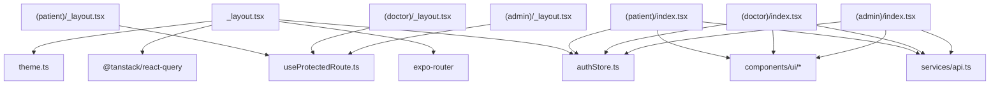

**Diagram sources**
- [_layout.tsx:57-84](file://src/app/_layout.tsx#L57-L84)
- [_layout.tsx:8-107](file://src/app/(patient)/_layout.tsx#L8-L107)
- [_layout.tsx:8-120](file://src/app/(doctor)/_layout.tsx#L8-L120)
- [_layout.tsx:8-30](file://src/app/(admin)/_layout.tsx#L8-L30)
- [useProtectedRoute.ts:11-38](file://src/hooks/useProtectedRoute.ts#L11-L38)
- [index.tsx:22-49](file://src/app/(patient)/index.tsx#L22-L49)
- [index.tsx:25-49](file://src/app/(doctor)/index.tsx#L25-L49)
- [index.tsx:60-121](file://src/app/(admin)/index.tsx#L60-L121)

**Section sources**
- [_layout.tsx:57-84](file://src/app/_layout.tsx#L57-L84)
- [_layout.tsx:8-107](file://src/app/(patient)/_layout.tsx#L8-L107)
- [_layout.tsx:8-120](file://src/app/(doctor)/_layout.tsx#L8-L120)
- [_layout.tsx:8-30](file://src/app/(admin)/_layout.tsx#L8-L30)
- [useProtectedRoute.ts:11-38](file://src/hooks/useProtectedRoute.ts#L11-L38)

## Performance Considerations
- Use react-query caching to minimize network requests; leverage staleTime and retry options configured in QueryClient
- Avoid unnecessary re-renders by keeping heavy computations out of render functions and memoizing derived data where possible
- Prefer lazy loading for large assets and images; ensure proper image sizing and compression
- Keep navigation transitions smooth by avoiding heavy work in layout components; offload to effects and services
- Use activity indicators during authorization checks to improve perceived performance

[No sources needed since this section provides general guidance]

## Troubleshooting Guide
- Unauthorized access to role groups:
  - Ensure useProtectedRoute is called in role layouts and that authStore.currentUser has the correct role
  - Verify router.replace targets are correct for each role
- Login redirection issues:
  - Confirm login flow sets currentUser and token correctly in authStore
  - Validate that role-based routing paths match the registered groups
- Data fetching errors:
  - Check service methods in api.ts and ensure endpoints are reachable
  - Inspect react-query cache and refetch triggers
- Styling inconsistencies:
  - Ensure components use THEME tokens consistently
  - Verify color and spacing values align with design specifications

**Section sources**
- [useProtectedRoute.ts:11-38](file://src/hooks/useProtectedRoute.ts#L11-L38)
- [authStore.ts:23-111](file://src/stores/authStore.ts#L23-L111)
- [theme.ts:71-165](file://src/constants/theme.ts#L71-L165)

## Conclusion
The HomeCare frontend leverages React Native and Expo Router to deliver a role-based, secure, and visually consistent experience. The architecture separates presentation from business logic, centralizes theming, and uses robust state management and data fetching strategies. Role-specific layouts enforce access control, while reusable UI components ensure a cohesive design system across the application.

[No sources needed since this section summarizes without analyzing specific files]