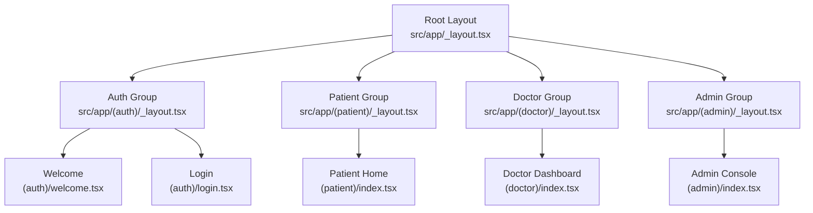
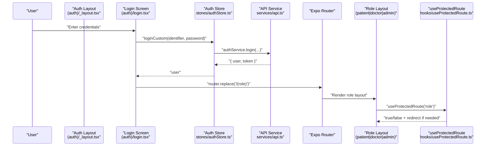
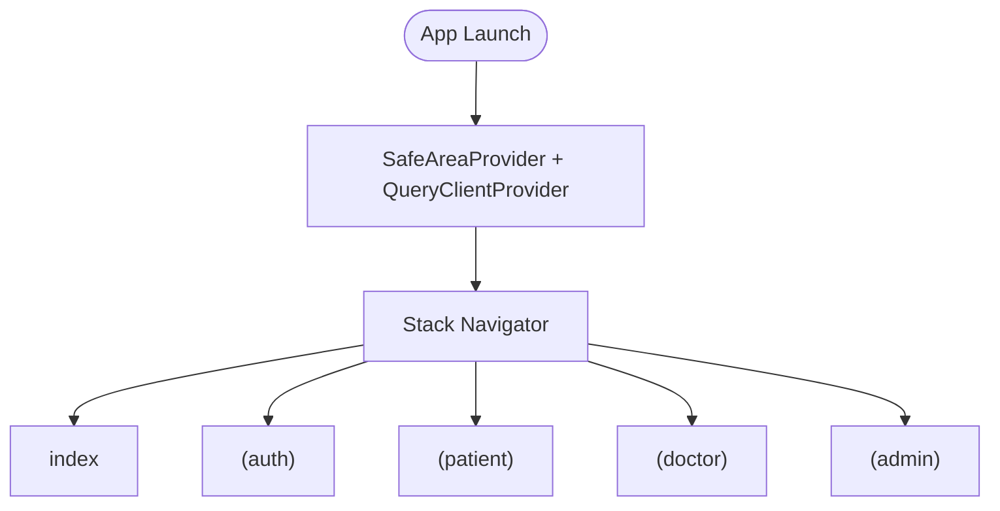
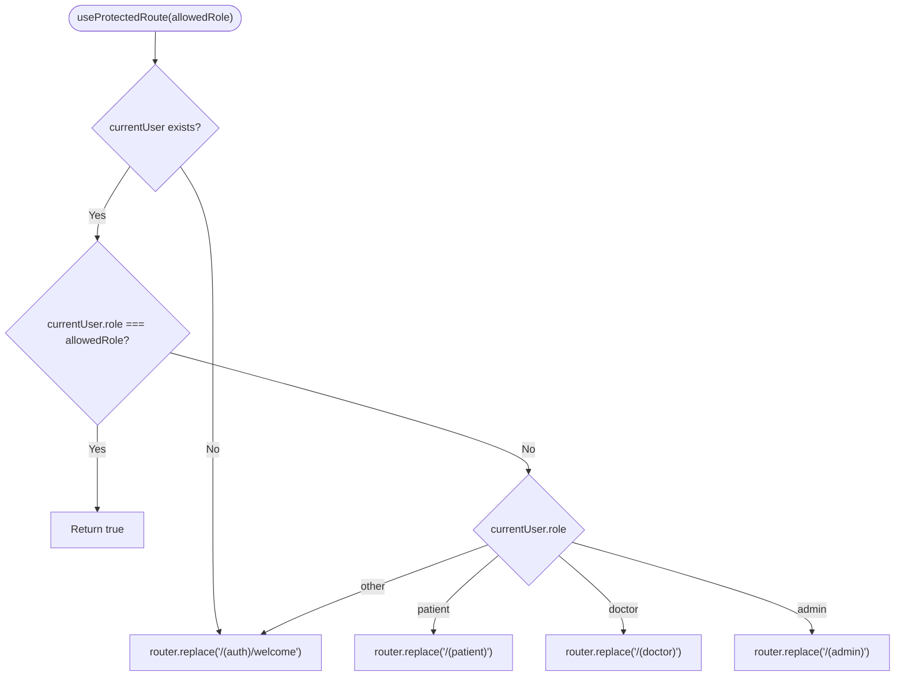
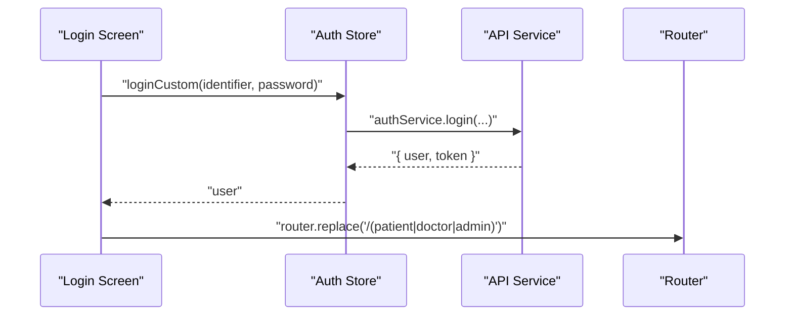
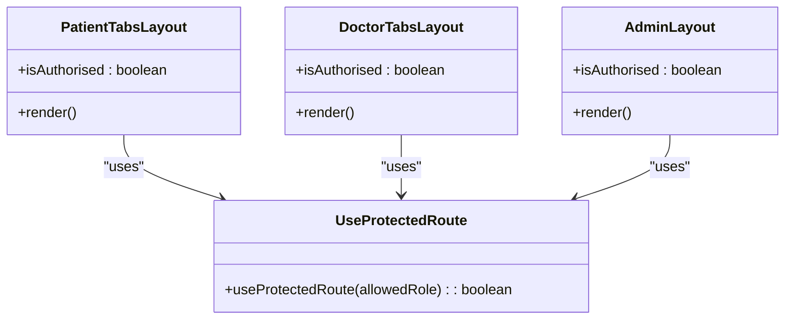
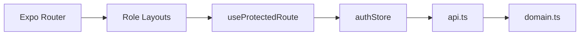

# Navigation System

<cite>
**Referenced Files in This Document**
- [src/app/_layout.tsx](file://src/app/_layout.tsx)
- [src/hooks/useProtectedRoute.ts](file://src/hooks/useProtectedRoute.ts)
- [src/stores/authStore.ts](file://src/stores/authStore.ts)
- [src/app/(auth)/_layout.tsx](file://src/app/(auth)/_layout.tsx)
- [src/app/(patient)/_layout.tsx](file://src/app/(patient)/_layout.tsx)
- [src/app/(doctor)/_layout.tsx](file://src/app/(doctor)/_layout.tsx)
- [src/app/(admin)/_layout.tsx](file://src/app/(admin)/_layout.tsx)
- [src/app/(auth)/welcome.tsx](file://src/app/(auth)/welcome.tsx)
- [src/app/(auth)/login.tsx](file://src/app/(auth)/login.tsx)
- [src/app/(patient)/index.tsx](file://src/app/(patient)/index.tsx)
- [src/app/(doctor)/index.tsx](file://src/app/(doctor)/index.tsx)
- [src/app/(admin)/index.tsx](file://src/app/(admin)/index.tsx)
- [src/types/domain.ts](file://src/types/domain.ts)
- [src/services/api.ts](file://src/services/api.ts)
</cite>

## Table of Contents
1. [Introduction](#introduction)
2. [Project Structure](#project-structure)
3. [Core Components](#core-components)
4. [Architecture Overview](#architecture-overview)
5. [Detailed Component Analysis](#detailed-component-analysis)
6. [Dependency Analysis](#dependency-analysis)
7. [Performance Considerations](#performance-considerations)
8. [Troubleshooting Guide](#troubleshooting-guide)
9. [Conclusion](#conclusion)

## Introduction
This document explains the navigation system for the HomeCare mobile application built with Expo Router. It covers file-based routing, role-based route groups (auth, patient, doctor, admin), protected routes via a custom hook, authentication flow integration, nested layouts, navigation guards, redirect logic, dynamic routing parameters, and deep linking considerations. The goal is to help both technical and non-technical readers understand how navigation works end-to-end and how it integrates with authentication and data services.

## Project Structure
The app uses Expo Router’s file-based routing with grouped folders for roles:
- Root layout defines global providers and registers top-level route groups.
- Role-specific layouts define tab or stack navigators per user role.
- Auth flows live under the auth group.
- Dynamic routes are implemented using bracketed filenames for parameters.

**Diagram sources**
- [src/app/_layout.tsx:57-84](file://src/app/_layout.tsx#L57-L84)
- [src/app/(auth)/_layout.tsx:6-25](file://src/app/(auth)/_layout.tsx#L6-L25)
- [src/app/(patient)/_layout.tsx:8-107](file://src/app/(patient)/_layout.tsx#L8-L107)
- [src/app/(doctor)/_layout.tsx:8-120](file://src/app/(doctor)/_layout.tsx#L8-L120)
- [src/app/(admin)/_layout.tsx:8-30](file://src/app/(admin)/_layout.tsx#L8-L30)

**Section sources**
- [src/app/_layout.tsx:57-84](file://src/app/_layout.tsx#L57-L84)
- [src/app/(auth)/_layout.tsx:6-25](file://src/app/(auth)/_layout.tsx#L6-L25)
- [src/app/(patient)/_layout.tsx:8-107](file://src/app/(patient)/_layout.tsx#L8-L107)
- [src/app/(doctor)/_layout.tsx:8-120](file://src/app/(doctor)/_layout.tsx#L8-L120)
- [src/app/(admin)/_layout.tsx:8-30](file://src/app/(admin)/_layout.tsx#L8-L30)

## Core Components
- Root layout: Provides SafeArea, QueryClientProvider, StatusBar, and registers all route groups as Stack screens. It also renders a session bar that shows the current user and supports sign-out.
- Protected route hook: Centralizes authorization checks by role and redirects unauthorized users to appropriate destinations.
- Role-based layouts: Each role has its own layout defining tabs or stacks and hiding subroutes from the tab bar when needed.
- Auth store: Manages user session state, login actions, profile refresh, and logout.
- Services: Provide API contracts and mock fallbacks for authentication and domain operations.

Key responsibilities:
- Routing: File-based routes map directly to folder structure; route groups isolate navigation per role.
- Protection: useProtectedRoute enforces role-based access at layout level.
- State: authStore holds currentUser and related profiles; components read this to personalize UI and navigate.

**Section sources**
- [src/app/_layout.tsx:1-84](file://src/app/_layout.tsx#L1-L84)
- [src/hooks/useProtectedRoute.ts:1-38](file://src/hooks/useProtectedRoute.ts#L1-L38)
- [src/stores/authStore.ts:1-112](file://src/stores/authStore.ts#L1-L112)
- [src/app/(patient)/_layout.tsx:8-107](file://src/app/(patient)/_layout.tsx#L8-L107)
- [src/app/(doctor)/_layout.tsx:8-120](file://src/app/(doctor)/_layout.tsx#L8-L120)
- [src/app/(admin)/_layout.tsx:8-30](file://src/app/(admin)/_layout.tsx#L8-L30)

## Architecture Overview
The navigation architecture combines Expo Router’s file-based routing with role-based route groups and a central protection hook. Authentication flows update the global store, which triggers navigation to the correct role group. Layouts render either tabs or stacks depending on the role.

**Diagram sources**
- [src/app/(auth)/login.tsx:23-46](file://src/app/(auth)/login.tsx#L23-L46)
- [src/stores/authStore.ts:58-83](file://src/stores/authStore.ts#L58-L83)
- [src/services/api.ts:46-104](file://src/services/api.ts#L46-L104)
- [src/hooks/useProtectedRoute.ts:11-37](file://src/hooks/useProtectedRoute.ts#L11-L37)
- [src/app/(patient)/_layout.tsx:8-17](file://src/app/(patient)/_layout.tsx#L8-L17)
- [src/app/(doctor)/_layout.tsx:8-17](file://src/app/(doctor)/_layout.tsx#L8-L17)
- [src/app/(admin)/_layout.tsx:8-18](file://src/app/(admin)/_layout.tsx#L8-L18)

## Detailed Component Analysis

### Root Layout and Route Groups
- Registers Stack screens for index and each role group.
- Wraps the app with SafeAreaProvider and QueryClientProvider.
- Displays a session bar showing current user role and name, with logout action navigating back to welcome.

**Diagram sources**
- [src/app/_layout.tsx:57-84](file://src/app/_layout.tsx#L57-L84)

**Section sources**
- [src/app/_layout.tsx:1-84](file://src/app/_layout.tsx#L1-L84)

### Protected Route Hook
- Reads current user from authStore.
- If no user exists, redirects to welcome.
- If user role does not match allowed role, redirects to the corresponding role dashboard.
- Returns boolean indicating authorization status for conditional rendering.

**Diagram sources**
- [src/hooks/useProtectedRoute.ts:11-37](file://src/hooks/useProtectedRoute.ts#L11-L37)

**Section sources**
- [src/hooks/useProtectedRoute.ts:1-38](file://src/hooks/useProtectedRoute.ts#L1-L38)

### Auth Flow Integration
- Login screen validates inputs, calls store login, then navigates based on user role.
- Store updates currentUser and associated profiles, returning the user object.
- After successful login, router replaces into the appropriate role group.

**Diagram sources**
- [src/app/(auth)/login.tsx:23-46](file://src/app/(auth)/login.tsx#L23-L46)
- [src/stores/authStore.ts:58-83](file://src/stores/authStore.ts#L58-L83)
- [src/services/api.ts:46-104](file://src/services/api.ts#L46-L104)

**Section sources**
- [src/app/(auth)/login.tsx:17-46](file://src/app/(auth)/login.tsx#L17-L46)
- [src/stores/authStore.ts:58-83](file://src/stores/authStore.ts#L58-L83)
- [src/services/api.ts:46-104](file://src/services/api.ts#L46-L104)

### Role-Based Layouts and Navigation Guards
- Patient layout: Uses Tabs with visible primary screens and hidden subroutes for details, booking, visits, and results. Guards render a loading indicator while redirection occurs.
- Doctor layout: Similar pattern with tabs for dashboard, requests, schedule, patients, profile, plus hidden subroutes for visit and consultation details.
- Admin layout: Uses Stack for administrative console; guard ensures only admins can access.

**Diagram sources**
- [src/app/(patient)/_layout.tsx:8-17](file://src/app/(patient)/_layout.tsx#L8-L17)
- [src/app/(doctor)/_layout.tsx:8-17](file://src/app/(doctor)/_layout.tsx#L8-L17)
- [src/app/(admin)/_layout.tsx:8-18](file://src/app/(admin)/_layout.tsx#L8-L18)
- [src/hooks/useProtectedRoute.ts:11-37](file://src/hooks/useProtectedRoute.ts#L11-L37)

**Section sources**
- [src/app/(patient)/_layout.tsx:8-107](file://src/app/(patient)/_layout.tsx#L8-L107)
- [src/app/(doctor)/_layout.tsx:8-120](file://src/app/(doctor)/_layout.tsx#L8-L120)
- [src/app/(admin)/_layout.tsx:8-30](file://src/app/(admin)/_layout.tsx#L8-L30)

### Dynamic Routing Parameters
- Patient routes include dynamic segments for doctor details, booking, visit details, and result documents.
- Doctor routes include dynamic segments for visit details and consultation details.
- These are declared as bracketed filenames within their respective role groups.

Examples:
- Patient: doctor/[id], book/[doctorId], visit/[id], result/[id]
- Doctor: visit/[id], consultation/[visitId]

These patterns enable deep links like /patient/doctor/abc123 or /doctor/consultation/xyz789.

**Section sources**
- [src/app/(patient)/_layout.tsx:100-105](file://src/app/(patient)/_layout.tsx#L100-L105)
- [src/app/(doctor)/_layout.tsx:116-118](file://src/app/(doctor)/_layout.tsx#L116-L118)

### Navigation Patterns and Examples
- Role-based redirects after login:
  - Login screen checks user.role and navigates to the matching route group.
- Session bar sign out:
  - Clears session and navigates to welcome.
- Deep linking examples:
  - Navigate to a specific doctor detail page: /patient/doctor/{id}
  - Open a visit cockpit: /doctor/visit/{id}
  - View a result document: /patient/result/{id}

**Section sources**
- [src/app/(auth)/login.tsx:33-42](file://src/app/(auth)/login.tsx#L33-L42)
- [src/app/_layout.tsx:44-51](file://src/app/_layout.tsx#L44-L51)
- [src/app/(patient)/index.tsx:111-117](file://src/app/(patient)/index.tsx#L111-L117)
- [src/app/(doctor)/index.tsx:170-178](file://src/app/(doctor)/index.tsx#L170-L178)

### Deep Linking Support
- Expo Router automatically maps URL paths to files; dynamic segments allow parameterized deep links.
- Ensure href values in Tabs.Screen for hidden subroutes are set to null to avoid exposing them in the tab bar while still supporting deep links.

**Section sources**
- [src/app/(patient)/_layout.tsx:100-105](file://src/app/(patient)/_layout.tsx#L100-L105)
- [src/app/(doctor)/_layout.tsx:116-118](file://src/app/(doctor)/_layout.tsx#L116-L118)

## Dependency Analysis
The navigation system depends on:
- Expo Router for file-based routing and programmatic navigation.
- Zustand store for user session state.
- API service layer for authentication and domain data.
- Domain types for consistent modeling across the app.

**Diagram sources**
- [src/app/(patient)/_layout.tsx:8-17](file://src/app/(patient)/_layout.tsx#L8-L17)
- [src/app/(doctor)/_layout.tsx:8-17](file://src/app/(doctor)/_layout.tsx#L8-L17)
- [src/app/(admin)/_layout.tsx:8-18](file://src/app/(admin)/_layout.tsx#L8-L18)
- [src/hooks/useProtectedRoute.ts:11-37](file://src/hooks/useProtectedRoute.ts#L11-L37)
- [src/stores/authStore.ts:1-112](file://src/stores/authStore.ts#L1-L112)
- [src/services/api.ts:1-20](file://src/services/api.ts#L1-L20)
- [src/types/domain.ts:1-37](file://src/types/domain.ts#L1-L37)

**Section sources**
- [src/hooks/useProtectedRoute.ts:1-38](file://src/hooks/useProtectedRoute.ts#L1-L38)
- [src/stores/authStore.ts:1-112](file://src/stores/authStore.ts#L1-L112)
- [src/services/api.ts:1-20](file://src/services/api.ts#L1-L20)
- [src/types/domain.ts:1-37](file://src/types/domain.ts#L1-L37)

## Performance Considerations
- Minimize re-renders in protected layouts by rendering a lightweight loading indicator during redirection.
- Avoid heavy computations inside layout components; defer data fetching to screens.
- Use query caching (already provided via QueryClientProvider) to reduce redundant network calls.
- Keep tab definitions minimal and hide unnecessary subroutes to prevent accidental navigation overhead.
- Prefer router.replace over router.push when transitioning post-login to avoid stacking history unnecessarily.

[No sources needed since this section provides general guidance]

## Troubleshooting Guide
Common issues and resolutions:
- Unauthorized redirect loops:
  - Ensure useProtectedRoute is called in every role layout and returns early when unauthorized.
  - Verify that login flow sets currentUser before navigating to role groups.
- Wrong role dashboard:
  - Confirm that login screen routes based on user.role correctly.
  - Check that useProtectedRoute redirects to the correct role path when roles mismatch.
- Hidden subroutes not accessible:
  - Ensure href is set to null for hidden subroutes in Tabs.Screen so they remain navigable but not shown in the tab bar.
- Session bar sign out not working:
  - Verify logout clears currentUser and navigates to welcome.

**Section sources**
- [src/hooks/useProtectedRoute.ts:11-37](file://src/hooks/useProtectedRoute.ts#L11-L37)
- [src/app/(auth)/login.tsx:33-42](file://src/app/(auth)/login.tsx#L33-L42)
- [src/app/(patient)/_layout.tsx:100-105](file://src/app/(patient)/_layout.tsx#L100-L105)
- [src/app/(doctor)/_layout.tsx:116-118](file://src/app/(doctor)/_layout.tsx#L116-L118)
- [src/app/_layout.tsx:44-51](file://src/app/_layout.tsx#L44-L51)

## Conclusion
The HomeCare navigation system leverages Expo Router’s file-based routing with role-based route groups and a centralized protection hook to enforce access control. Role-specific layouts provide tailored navigation experiences, while the auth store and API services integrate seamlessly to manage sessions and data. Dynamic routing enables deep linking for detailed views, and performance-conscious patterns ensure smooth user interactions. This architecture scales well for large applications by isolating concerns and keeping navigation logic predictable and maintainable.

[No sources needed since this section summarizes without analyzing specific files]