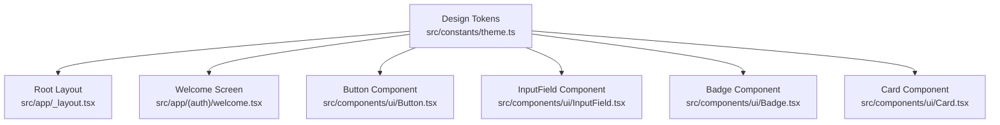
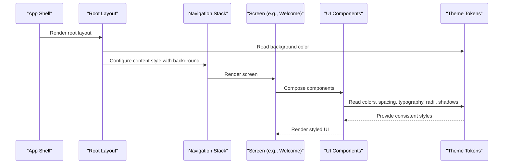
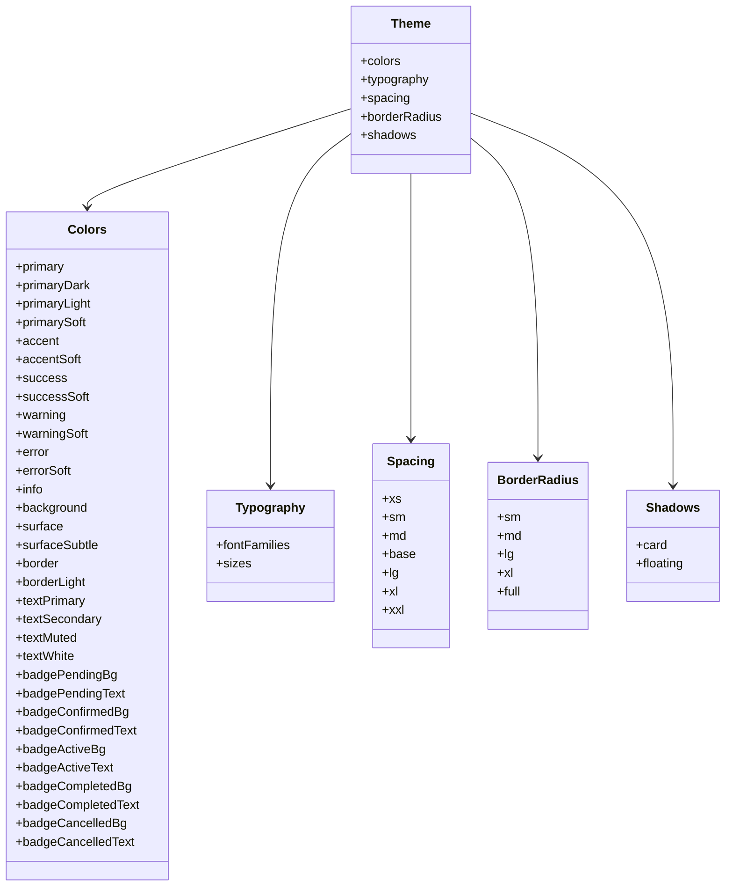
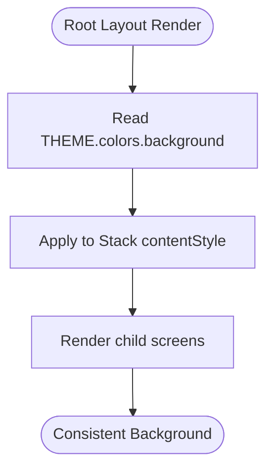
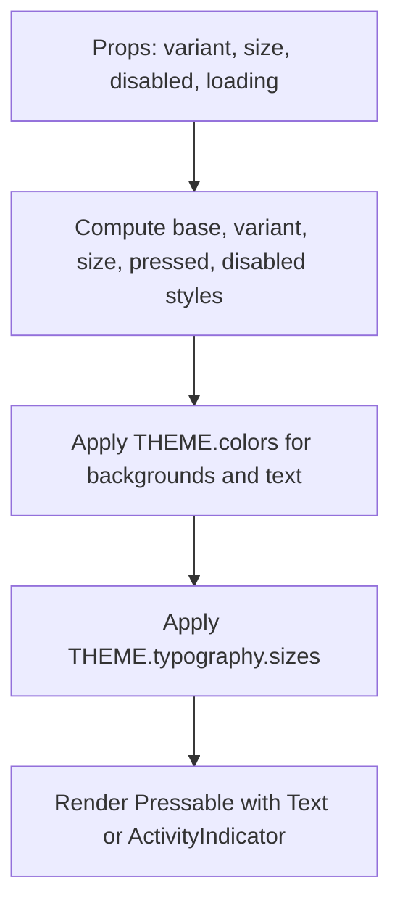
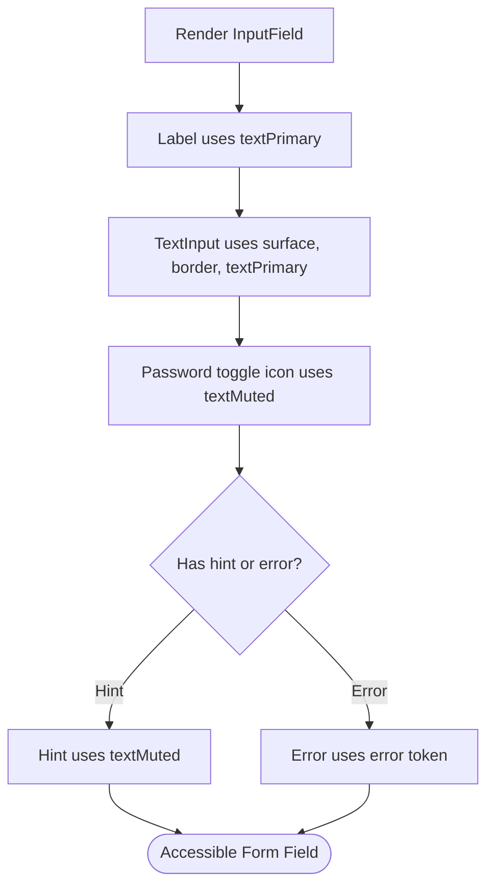
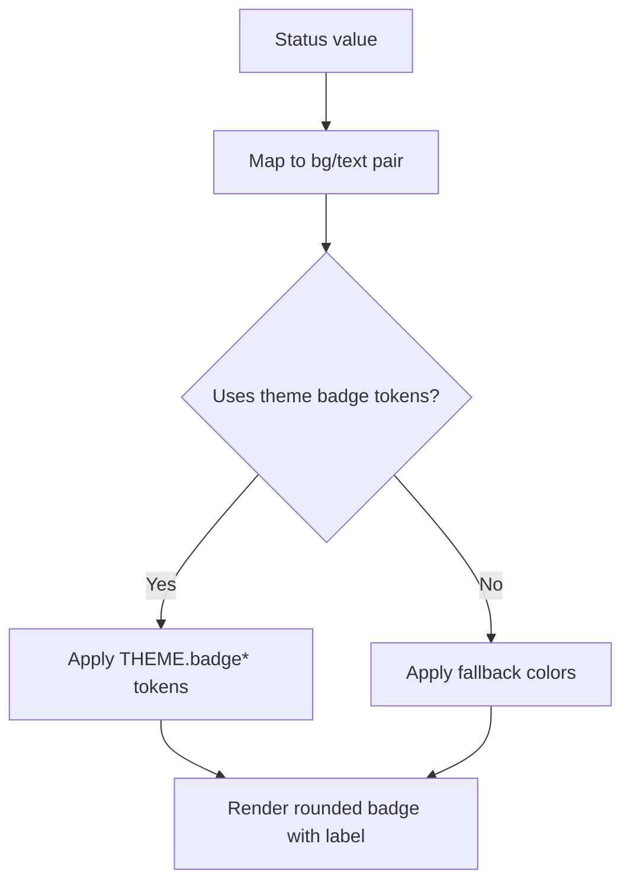
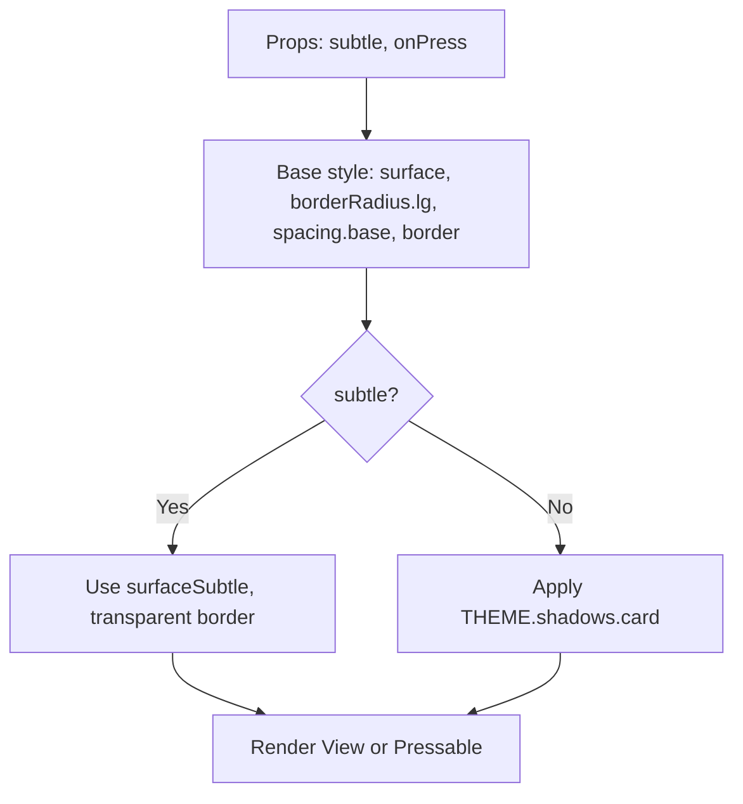
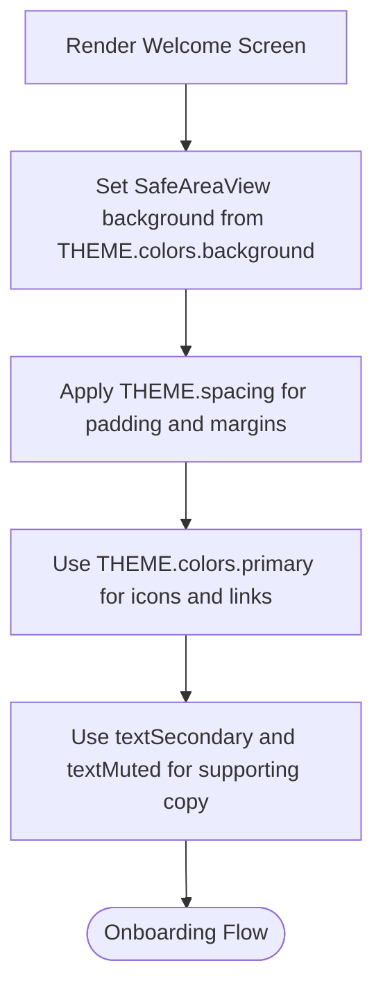
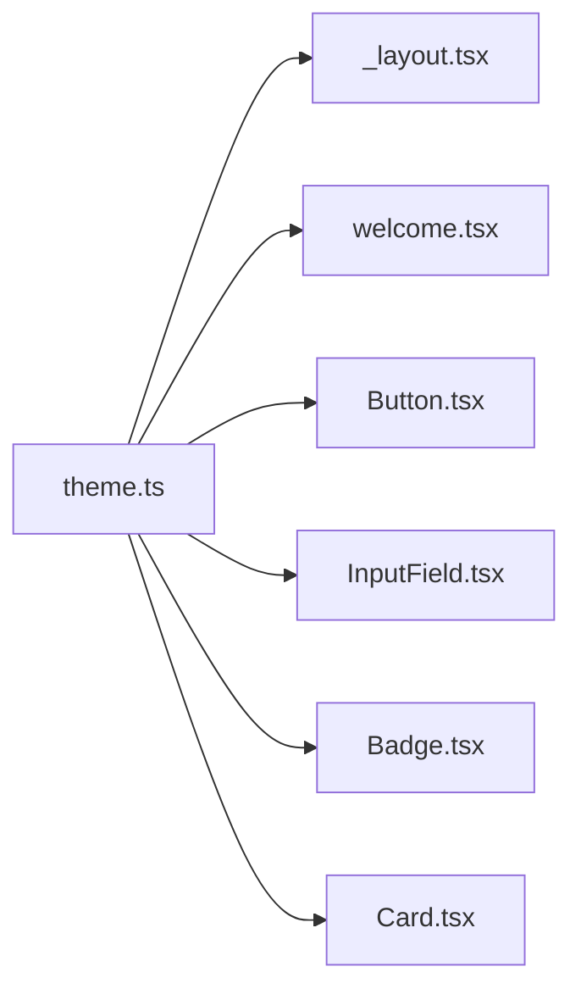

# Theming System

<cite>
**Referenced Files in This Document**
- [theme.ts](file://src/constants/theme.ts)
- [_layout.tsx](file://src/app/_layout.tsx)
- [welcome.tsx](file://src/app/(auth)/welcome.tsx)
- [Button.tsx](file://src/components/ui/Button.tsx)
- [InputField.tsx](file://src/components/ui/InputField.tsx)
- [Badge.tsx](file://src/components/ui/Badge.tsx)
- [Card.tsx](file://src/components/ui/Card.tsx)
</cite>

## Table of Contents
1. [Introduction](#introduction)
2. [Project Structure](#project-structure)
3. [Core Components](#core-components)
4. [Architecture Overview](#architecture-overview)
5. [Detailed Component Analysis](#detailed-component-analysis)
6. [Dependency Analysis](#dependency-analysis)
7. [Performance Considerations](#performance-considerations)
8. [Troubleshooting Guide](#troubleshooting-guide)
9. [Conclusion](#conclusion)
10. [Appendices](#appendices)

## Introduction
This document explains the theming system used across the HomeCare mobile application. It focuses on the centralized design token architecture, how tokens are consumed by screens and UI components, and how to extend or customize the theme safely. The goal is to help developers maintain visual consistency, accessibility, and responsiveness while building healthcare-focused interfaces.

## Project Structure
The theming system is centralized in a single configuration file and consumed consistently by layout files and reusable UI components:

- Design tokens live in `src/constants/theme.ts`.
- Root layout applies the background color from the theme.
- Screens import the theme for colors, spacing, typography, and radii.
- Reusable UI components encapsulate token usage so screens do not hardcode values.

**Diagram sources**
- [theme.ts:71-164](file://src/constants/theme.ts#L71-L164)
- [_layout.tsx:67-70](file://src/app/_layout.tsx#L67-L70)
- [welcome.tsx:14-15](file://src/app/(auth)/welcome.tsx#L14-L15)
- [Button.tsx:11-11](file://src/components/ui/Button.tsx#L11-L11)
- [InputField.tsx:13-13](file://src/components/ui/InputField.tsx#L13-L13)
- [Badge.tsx:4-4](file://src/components/ui/Badge.tsx#L4-L4)
- [Card.tsx:4-4](file://src/components/ui/Card.tsx#L4-L4)

**Section sources**
- [theme.ts:1-165](file://src/constants/theme.ts#L1-L165)
- [_layout.tsx:57-85](file://src/app/_layout.tsx#L57-L85)
- [welcome.tsx:18-85](file://src/app/(auth)/welcome.tsx#L18-L85)

## Core Components
The theme defines a cohesive set of design tokens:

- Colors
  - Primary palette with deep teal tones and soft variants.
  - Accent, success, warning, error, and info semantic colors.
  - Neutral backgrounds, surfaces, borders, and text roles.
  - Badge-specific background and text pairs for status indicators.
- Typography
  - Font families mapped to system fonts.
  - A scalable size scale from extra small to display.
- Spacing
  - Consistent spacing scale for margins, paddings, and gaps.
- Border Radius
  - Small to full radius tokens for consistent corner styling.
- Shadows
  - Card and floating elevation presets for depth.

These tokens are exported as a single object and imported wherever needed.

**Section sources**
- [theme.ts:71-164](file://src/constants/theme.ts#L71-L164)

## Architecture Overview
The theme is applied at two levels:

1. Application-level application
   - The root layout sets the app-wide background using the theme’s background token.
2. Component-level application
   - UI components consume tokens for colors, spacing, typography, and shadows.
   - Screens compose these components and may also directly use tokens for layout and color.

**Diagram sources**
- [_layout.tsx:67-70](file://src/app/_layout.tsx#L67-L70)
- [welcome.tsx:61-73](file://src/app/(auth)/welcome.tsx#L61-L73)
- [Button.tsx:76-149](file://src/components/ui/Button.tsx#L76-L149)
- [theme.ts:71-164](file://src/constants/theme.ts#L71-L164)

**Section sources**
- [_layout.tsx:57-85](file://src/app/_layout.tsx#L57-L85)
- [welcome.tsx:18-85](file://src/app/(auth)/welcome.tsx#L18-L85)

## Detailed Component Analysis

### Design Token Model
The theme exports a structured object that includes:

- Color tokens
  - Primary, primaryDark, primaryLight, primarySoft
  - Accent, accentSoft
  - Success, successSoft
  - Warning, warningSoft
  - Error, errorSoft
  - Info
  - Background, surface, surfaceSubtle
  - Border, borderLight
  - Text roles: textPrimary, textSecondary, textMuted, textWhite
  - Badge pairs: badgePendingBg/text, badgeConfirmedBg/text, badgeActiveBg/text, badgeCompletedBg/text, badgeCancelledBg/text
- Typography tokens
  - fontFamilies: regular, medium, bold
  - sizes: xs, sm, base, md, lg, xl, xxl, display
- Spacing tokens
  - xs, sm, md, base, lg, xl, xxl
- Border radius tokens
  - sm, md, lg, xl, full
- Shadow tokens
  - card, floating

**Diagram sources**
- [theme.ts:71-164](file://src/constants/theme.ts#L71-L164)

**Section sources**
- [theme.ts:71-164](file://src/constants/theme.ts#L71-L164)

### Root Layout Theme Application
The root layout configures the navigation stack’s content style using the theme’s background color. This ensures all screens inherit a consistent base background.

**Diagram sources**
- [_layout.tsx:67-70](file://src/app/_layout.tsx#L67-L70)

**Section sources**
- [_layout.tsx:57-85](file://src/app/_layout.tsx#L57-L85)

### Button Component Theme Usage
The Button component demonstrates how tokens are applied to interactive elements:

- Uses primary, accent, error, and neutral text tokens for variants.
- Applies typography sizes from the theme scale.
- Uses border radius tokens for consistent corners.
- Uses spacing indirectly via padding classes.

**Diagram sources**
- [Button.tsx:25-73](file://src/components/ui/Button.tsx#L25-L73)
- [Button.tsx:76-149](file://src/components/ui/Button.tsx#L76-L149)
- [theme.ts:71-164](file://src/constants/theme.ts#L71-L164)

**Section sources**
- [Button.tsx:1-150](file://src/components/ui/Button.tsx#L1-L150)

### InputField Component Theme Usage
The InputField component uses tokens for form fields:

- Background, border, and text colors come from the theme.
- Error state uses the error token.
- Placeholder and hint text use muted text tokens.
- Spacing between fields uses the theme spacing scale.

**Diagram sources**
- [InputField.tsx:22-71](file://src/components/ui/InputField.tsx#L22-L71)
- [InputField.tsx:74-128](file://src/components/ui/InputField.tsx#L74-L128)
- [theme.ts:71-164](file://src/constants/theme.ts#L71-L164)

**Section sources**
- [InputField.tsx:1-129](file://src/components/ui/InputField.tsx#L1-L129)

### Badge Component Theme Usage
The Badge component maps statuses to theme-defined badge colors where available and falls back to safe defaults otherwise:

- Pending, confirmed, completed, cancelled states map to theme badge pairs.
- Other states use fallback colors but still follow the same visual pattern.
- Uses full border radius and consistent sizing tokens.

**Diagram sources**
- [Badge.tsx:13-97](file://src/components/ui/Badge.tsx#L13-L97)
- [theme.ts:103-114](file://src/constants/theme.ts#L103-L114)

**Section sources**
- [Badge.tsx:1-125](file://src/components/ui/Badge.tsx#L1-L125)

### Card Component Theme Usage
The Card component composes theme tokens for container styling:

- Background and border use surface and border tokens.
- Border radius uses the theme radius scale.
- Padding uses the theme spacing scale.
- Optional shadow uses the theme shadow preset.

**Diagram sources**
- [Card.tsx:13-38](file://src/components/ui/Card.tsx#L13-L38)
- [Card.tsx:40-55](file://src/components/ui/Card.tsx#L40-L55)
- [theme.ts:71-164](file://src/constants/theme.ts#L71-L164)

**Section sources**
- [Card.tsx:1-55](file://src/components/ui/Card.tsx#L1-L55)

### Welcome Screen Theme Usage
The welcome screen demonstrates direct theme usage alongside component composition:

- Background color from theme.
- Spacing tokens for layout rhythm.
- Primary color for icons and links.
- Secondary and muted text tokens for supporting copy.

**Diagram sources**
- [welcome.tsx:18-85](file://src/app/(auth)/welcome.tsx#L18-L85)
- [welcome.tsx:88-182](file://src/app/(auth)/welcome.tsx#L88-L182)
- [theme.ts:71-164](file://src/constants/theme.ts#L71-L164)

**Section sources**
- [welcome.tsx:1-183](file://src/app/(auth)/welcome.tsx#L1-L183)

## Dependency Analysis
The theme is a leaf dependency: it has no internal dependencies and is consumed by multiple layers:

- Root layout depends on the theme for global background.
- Screens depend on the theme for colors, spacing, and typography.
- UI components depend on the theme for consistent styling.

**Diagram sources**
- [theme.ts:71-164](file://src/constants/theme.ts#L71-L164)
- [_layout.tsx:67-70](file://src/app/_layout.tsx#L67-L70)
- [welcome.tsx:14-15](file://src/app/(auth)/welcome.tsx#L14-L15)
- [Button.tsx:11-11](file://src/components/ui/Button.tsx#L11-L11)
- [InputField.tsx:13-13](file://src/components/ui/InputField.tsx#L13-L13)
- [Badge.tsx:4-4](file://src/components/ui/Badge.tsx#L4-L4)
- [Card.tsx:4-4](file://src/components/ui/Card.tsx#L4-L4)

**Section sources**
- [theme.ts:71-164](file://src/constants/theme.ts#L71-L164)
- [_layout.tsx:57-85](file://src/app/_layout.tsx#L57-L85)
- [welcome.tsx:18-85](file://src/app/(auth)/welcome.tsx#L18-L85)
- [Button.tsx:1-150](file://src/components/ui/Button.tsx#L1-L150)
- [InputField.tsx:1-129](file://src/components/ui/InputField.tsx#L1-L129)
- [Badge.tsx:1-125](file://src/components/ui/Badge.tsx#L1-L125)
- [Card.tsx:1-55](file://src/components/ui/Card.tsx#L1-L55)

## Performance Considerations
- Centralized tokens reduce repeated style calculations and improve readability.
- Using shared tokens prevents scattered magic numbers, making future updates faster and less error-prone.
- Prefer component-level token consumption to avoid unnecessary re-renders caused by inline computed styles.
- Keep the theme file lean; avoid heavy computations inside token definitions.

[No sources needed since this section provides general guidance]

## Troubleshooting Guide
Common issues and resolutions when working with the theme:

- Inconsistent colors across screens
  - Ensure you import and use `THEME.colors` instead of hardcoding hex values.
  - Verify the root layout applies the background token.
- Poor contrast ratios
  - Use textPrimary for main text on light backgrounds.
  - Avoid pairing low-contrast colors such as textMuted with white backgrounds.
  - For badges, prefer the provided badge pairs from the theme.
- Inconsistent spacing
  - Replace arbitrary pixel values with tokens from `THEME.spacing`.
- Inconsistent corner radii
  - Use `THEME.borderRadius.*` instead of ad-hoc values.
- Shadow inconsistencies
  - Use `THEME.shadows.card` or `THEME.shadows.floating` rather than custom shadow objects.

**Section sources**
- [_layout.tsx:67-70](file://src/app/_layout.tsx#L67-L70)
- [Button.tsx:76-149](file://src/components/ui/Button.tsx#L76-L149)
- [InputField.tsx:74-128](file://src/components/ui/InputField.tsx#L74-L128)
- [Badge.tsx:13-97](file://src/components/ui/Badge.tsx#L13-L97)
- [Card.tsx:40-55](file://src/components/ui/Card.tsx#L40-L55)

## Conclusion
The HomeCare theming system centralizes design decisions into a single token source. Screens and components consume these tokens to ensure visual consistency, accessibility, and maintainability. By following the patterns shown here—using tokens for colors, spacing, typography, radii, and shadows—you can extend the theme confidently and keep the application aligned with healthcare usability standards.

[No sources needed since this section summarizes without analyzing specific files]

## Appendices

### How to Customize or Extend the Theme
- Add new semantic colors
  - Extend the colors object with new keys such as brand or tertiary tokens.
  - Update components to use the new tokens where appropriate.
- Add new spacing steps
  - Add entries to the spacing object and use them in layouts and components.
- Add new typography scales
  - Add new size entries under typography.sizes and apply them in components.
- Add new radii
  - Add new entries under borderRadius and use them in cards, buttons, and inputs.
- Add new shadows
  - Add new shadow presets under shadows and apply them to elevated surfaces.

Best practices:
- Keep token names descriptive and semantic.
- Maintain contrast ratios suitable for healthcare accessibility.
- Prefer component-level overrides only when necessary; favor tokens first.
- Document new tokens in code comments to guide other developers.

[No sources needed since this section provides general guidance]

### Responsive Design Approach
- Use relative spacing tokens to adapt layouts across screen sizes.
- Scale typography using the defined size scale rather than fixed pixel values.
- Leverage flexible layouts and gaps to accommodate different device widths.
- Test on both iOS and Android to ensure consistent rendering of shadows and radii.

[No sources needed since this section provides general guidance]

### Accessibility Considerations in Theming
- Contrast
  - Ensure sufficient contrast between text and background colors.
  - Use textPrimary for body text and textSecondary for secondary information.
- Focus and Interaction
  - Provide clear visual feedback for pressed and disabled states.
  - Use accessible labels for interactive controls like password toggles.
- Color Semantics
  - Use semantic colors (success, warning, error) consistently.
  - Do not rely solely on color to convey meaning; include text or icons.

**Section sources**
- [InputField.tsx:52-66](file://src/components/ui/InputField.tsx#L52-L66)
- [Button.tsx:36-73](file://src/components/ui/Button.tsx#L36-L73)
- [Badge.tsx:13-97](file://src/components/ui/Badge.tsx#L13-L97)