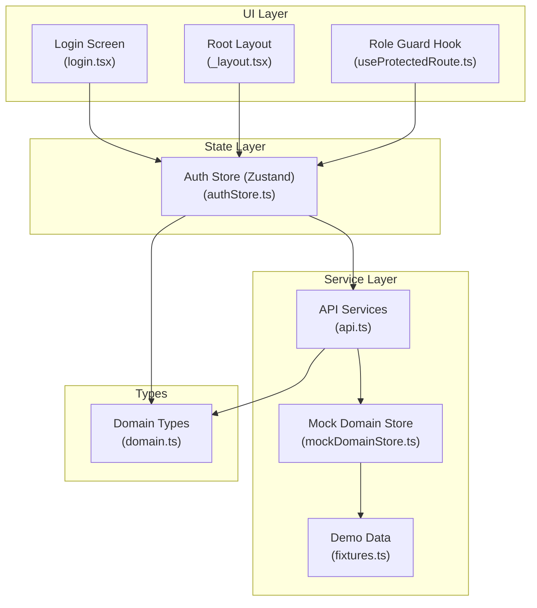
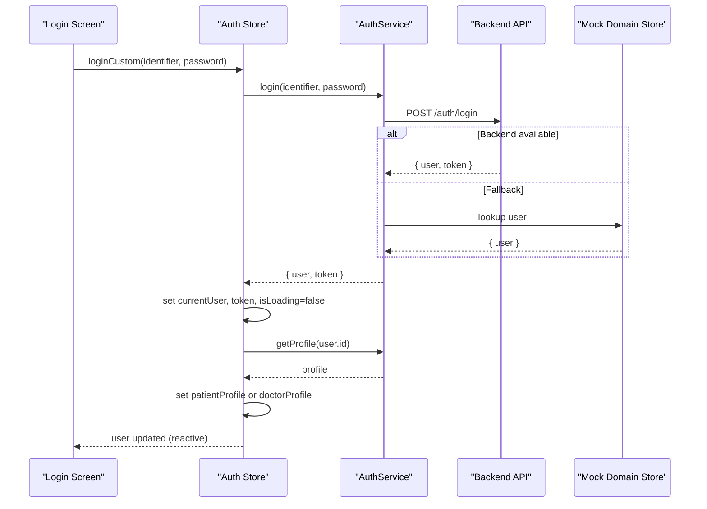
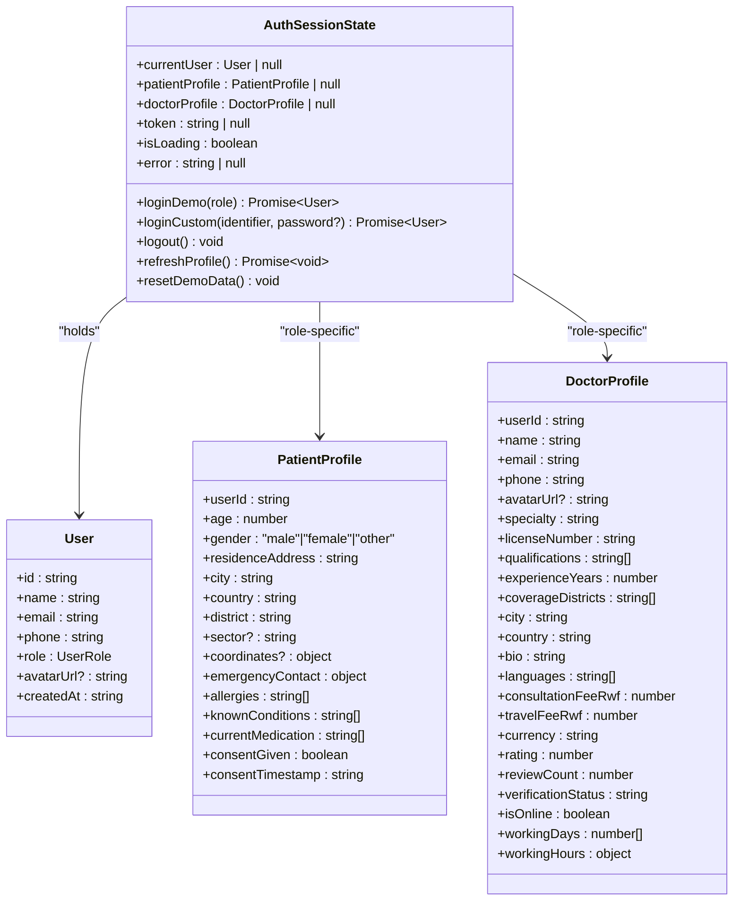
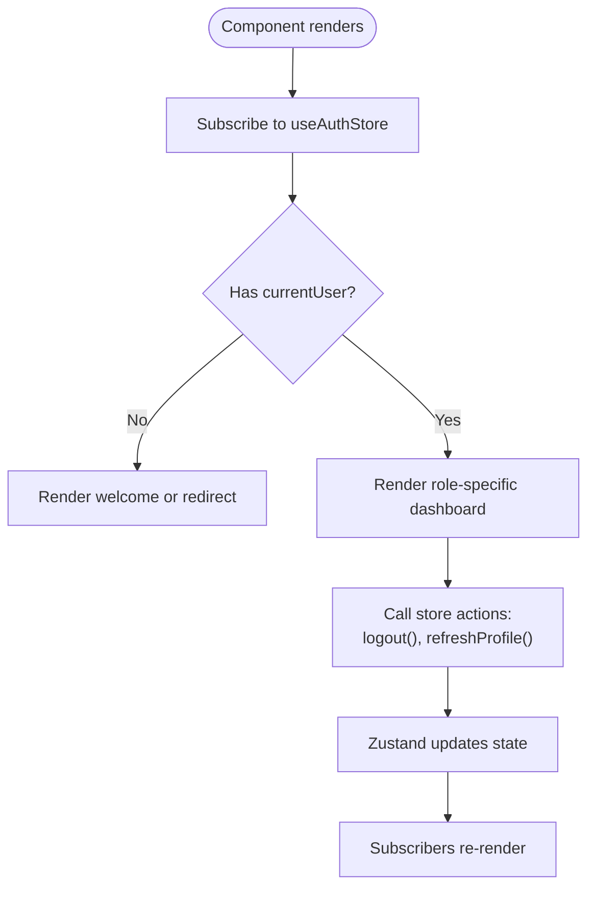
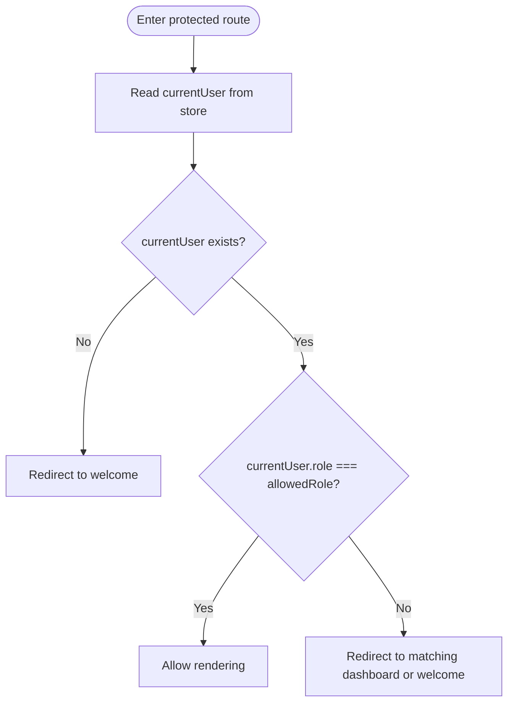
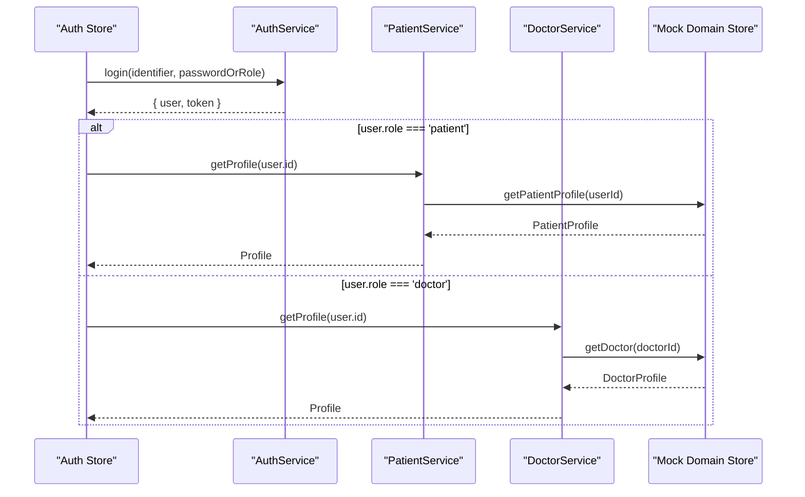
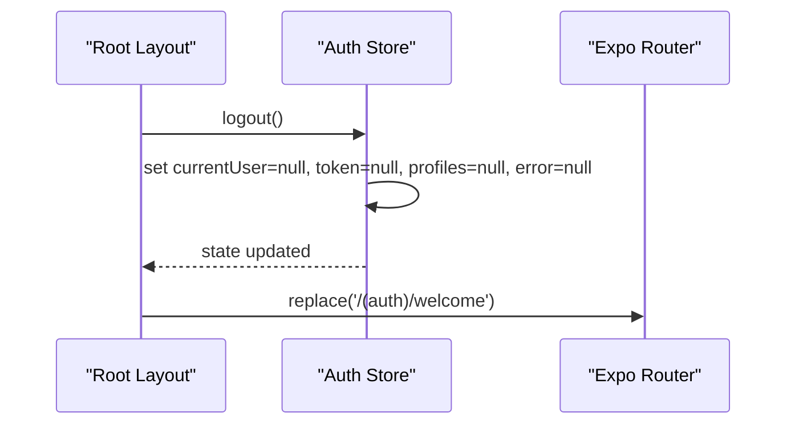
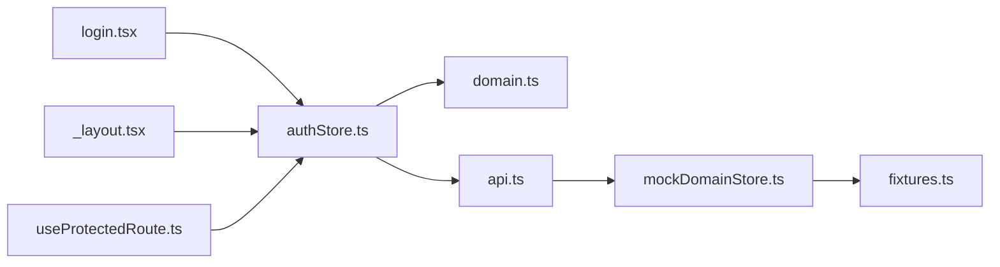

# Global State with Zustand

<cite>
**Referenced Files in This Document**
- [authStore.ts](file://src/stores/authStore.ts)
- [domain.ts](file://src/types/domain.ts)
- [api.ts](file://src/services/api.ts)
- [useProtectedRoute.ts](file://src/hooks/useProtectedRoute.ts)
- [login.tsx](file://src/app/(auth)/login.tsx)
- [_layout.tsx](file://src/app/_layout.tsx)
- [mockDomainStore.ts](file://src/mock/mockDomainStore.ts)
- [fixtures.ts](file://src/mock/fixtures.ts)
</cite>

## Table of Contents
1. [Introduction](#introduction)
2. [Project Structure](#project-structure)
3. [Core Components](#core-components)
4. [Architecture Overview](#architecture-overview)
5. [Detailed Component Analysis](#detailed-component-analysis)
6. [Dependency Analysis](#dependency-analysis)
7. [Performance Considerations](#performance-considerations)
8. [Troubleshooting Guide](#troubleshooting-guide)
9. [Conclusion](#conclusion)

## Introduction
This document explains the global state management implementation using Zustand for authentication, profile data, and role-based access control. It covers the auth store architecture, reactive state updates, service layer integration, session handling, and how components subscribe to changes. It also provides practical examples for accessing authenticated user data, checking roles, and handling logout scenarios.

## Project Structure
The global state is centered around a single auth store that holds the current user, token, loading state, error state, and role-specific profiles. The store interacts with a service layer that abstracts backend calls and mock data. Route protection hooks enforce role-based navigation, while UI components consume the store reactively.

**Diagram sources**
- [authStore.ts:1-112](file://src/stores/authStore.ts#L1-L112)
- [api.ts:1-660](file://src/services/api.ts#L1-L660)
- [mockDomainStore.ts:1-557](file://src/mock/mockDomainStore.ts#L1-L557)
- [fixtures.ts:1-904](file://src/mock/fixtures.ts#L1-L904)
- [domain.ts:1-242](file://src/types/domain.ts#L1-L242)
- [login.tsx:1-174](file://src/app/(auth)/login.tsx#L1-L174)
- [_layout.tsx:1-58](file://src/app/_layout.tsx#L1-L58)
- [useProtectedRoute.ts:1-40](file://src/hooks/useProtectedRoute.ts#L1-L40)

**Section sources**
- [authStore.ts:1-112](file://src/stores/authStore.ts#L1-L112)
- [api.ts:1-660](file://src/services/api.ts#L1-L660)
- [mockDomainStore.ts:1-557](file://src/mock/mockDomainStore.ts#L1-L557)
- [fixtures.ts:1-904](file://src/mock/fixtures.ts#L1-L904)
- [domain.ts:1-242](file://src/types/domain.ts#L1-L242)
- [login.tsx:1-174](file://src/app/(auth)/login.tsx#L1-L174)
- [_layout.tsx:1-58](file://src/app/_layout.tsx#L1-L58)
- [useProtectedRoute.ts:1-40](file://src/hooks/useProtectedRoute.ts#L1-L40)

## Core Components
- Auth Store (Zustand): Holds user session state and exposes actions for login, logout, profile refresh, and demo reset.
- Service Layer: Provides typed interfaces for authentication, patient, doctor, and admin operations. It attempts live API calls and gracefully falls back to mock data.
- Mock Domain Store: In-memory reactive store used by services when offline or during development.
- Domain Types: Strongly-typed models for users, profiles, visits, results, and other domain entities.
- Route Protection Hook: Enforces role-based navigation based on the current user from the auth store.
- UI Components: Consume the auth store reactively to render user info, handle sign-in flows, and trigger logout.

Key responsibilities:
- Manage authentication lifecycle and session state.
- Fetch and cache role-specific profiles after login.
- Provide reactive state updates to subscribed components.
- Enforce route-level authorization.

**Section sources**
- [authStore.ts:1-112](file://src/stores/authStore.ts#L1-L112)
- [api.ts:1-660](file://src/services/api.ts#L1-L660)
- [mockDomainStore.ts:1-557](file://src/mock/mockDomainStore.ts#L1-L557)
- [domain.ts:1-242](file://src/types/domain.ts#L1-L242)
- [useProtectedRoute.ts:1-40](file://src/hooks/useProtectedRoute.ts#L1-L40)
- [login.tsx:1-174](file://src/app/(auth)/login.tsx#L1-L174)

## Architecture Overview
The auth store is the central source of truth for authentication state. On successful login, it sets the current user, token, and loads the appropriate profile based on role. Components subscribe to this state via the Zustand hook and re-render automatically when state changes. The service layer encapsulates network requests and fallback logic, keeping the store focused on state transitions.

**Diagram sources**
- [authStore.ts:23-83](file://src/stores/authStore.ts#L23-L83)
- [api.ts:46-104](file://src/services/api.ts#L46-L104)
- [api.ts:274-278](file://src/services/api.ts#L274-L278)
- [api.ts:468-472](file://src/services/api.ts#L468-L472)

## Detailed Component Analysis

### Auth Store Architecture
The auth store defines a clear interface for session state and actions:
- State fields:
  - currentUser: User | null
  - patientProfile: PatientProfile | null
  - doctorProfile: DoctorProfile | null
  - token: string | null
  - isLoading: boolean
  - error: string | null
- Actions:
  - loginDemo(role): logs in with a predefined demo account and loads the corresponding profile.
  - loginCustom(identifier, password?): authenticates with credentials and loads the corresponding profile.
  - logout(): clears all session-related state.
  - refreshProfile(): refetches the profile for the current user based on role.
  - resetDemoData(): resets mock data and refreshes the profile.

Reactive updates:
- Each action uses Zustand’s set function to update state immutably.
- Subscribers (components and hooks) receive updates automatically.

Error handling:
- Errors are captured and stored in the error field; loading state is reset.
- Exceptions are rethrown so calling code can handle them.

Session persistence:
- The store does not persist state across app sessions by default.
- For production, integrate a persistence middleware (e.g., zustand/middleware with AsyncStorage or secure storage) to persist token and currentUser between app restarts.

**Diagram sources**
- [authStore.ts:7-21](file://src/stores/authStore.ts#L7-L21)
- [domain.ts:29-85](file://src/types/domain.ts#L29-L85)

**Section sources**
- [authStore.ts:1-112](file://src/stores/authStore.ts#L1-L112)
- [domain.ts:1-242](file://src/types/domain.ts#L1-L242)

### Reactive State Updates and Subscription Pattern
Components subscribe to the auth store using the Zustand hook. When state changes, subscribers re-render with the latest values. Examples:
- Login screen subscribes to isLoading and calls loginCustom on submit.
- Root layout subscribes to currentUser to display a session bar and provide logout/reset actions.
- Route guard hook subscribes to currentUser to enforce role-based navigation.

**Diagram sources**
- [login.tsx:17-46](file://src/app/(auth)/login.tsx#L17-L46)
- [_layout.tsx:21-55](file://src/app/_layout.tsx#L21-L55)
- [useProtectedRoute.ts:11-37](file://src/hooks/useProtectedRoute.ts#L11-L37)

**Section sources**
- [login.tsx:1-174](file://src/app/(auth)/login.tsx#L1-L174)
- [_layout.tsx:1-58](file://src/app/_layout.tsx#L1-L58)
- [useProtectedRoute.ts:1-40](file://src/hooks/useProtectedRoute.ts#L1-L40)

### Role-Based Access Control
The protected route hook enforces role-based access:
- If no user is present, navigate to the welcome screen.
- If the user’s role does not match the allowed role, redirect to the correct dashboard or welcome screen.
- Returns a boolean indicating whether the current user is authorized for the requested role.

**Diagram sources**
- [useProtectedRoute.ts:11-37](file://src/hooks/useProtectedRoute.ts#L11-L37)

**Section sources**
- [useProtectedRoute.ts:1-40](file://src/hooks/useProtectedRoute.ts#L1-L40)

### Service Layer Integration
The service layer provides typed APIs for authentication and domain operations:
- AuthService.login attempts a live HTTP request and falls back to mock data if unavailable.
- PatientService.getProfile and DoctorService.getProfile fetch role-specific profiles from the mock store.
- AdminService and other services manage platform-wide data and metrics.

**Diagram sources**
- [authStore.ts:31-83](file://src/stores/authStore.ts#L31-L83)
- [api.ts:46-104](file://src/services/api.ts#L46-L104)
- [api.ts:274-278](file://src/services/api.ts#L274-L278)
- [api.ts:468-472](file://src/services/api.ts#L468-L472)
- [mockDomainStore.ts:156-168](file://src/mock/mockDomainStore.ts#L156-L168)
- [mockDomainStore.ts:181-183](file://src/mock/mockDomainStore.ts#L181-L183)

**Section sources**
- [api.ts:1-660](file://src/services/api.ts#L1-L660)
- [mockDomainStore.ts:1-557](file://src/mock/mockDomainStore.ts#L1-L557)

### Session Management and Logout Flow
Logout clears the current user, token, profiles, and error state. UI components can call logout and then navigate to the welcome screen.

**Diagram sources**
- [authStore.ts:85-93](file://src/stores/authStore.ts#L85-L93)
- [_layout.tsx:43-51](file://src/app/_layout.tsx#L43-L51)

**Section sources**
- [authStore.ts:85-93](file://src/stores/authStore.ts#L85-L93)
- [_layout.tsx:21-55](file://src/app/_layout.tsx#L21-L55)

### Examples: Accessing Authenticated Data, Checking Roles, Handling Logout
- Accessing authenticated user data:
  - Use the currentUser field from the auth store to read name, email, phone, and role.
  - Example usage path: [login.tsx:35-42](file://src/app/(auth)/login.tsx#L35-L42), [_layout.tsx:28-32](file://src/app/_layout.tsx#L28-L32).
- Checking roles:
  - Compare currentUser.role against allowed roles to decide routing or UI visibility.
  - Example usage path: [useProtectedRoute.ts:21-32](file://src/hooks/useProtectedRoute.ts#L21-L32).
- Handling logout:
  - Call logout() from the store and navigate to the welcome screen.
  - Example usage path: [_layout.tsx:43-51](file://src/app/_layout.tsx#L43-L51).

**Section sources**
- [login.tsx:17-46](file://src/app/(auth)/login.tsx#L17-L46)
- [_layout.tsx:21-55](file://src/app/_layout.tsx#L21-L55)
- [useProtectedRoute.ts:11-37](file://src/hooks/useProtectedRoute.ts#L11-L37)

## Dependency Analysis
The following diagram shows the dependency relationships among core modules:

**Diagram sources**
- [authStore.ts:1-112](file://src/stores/authStore.ts#L1-L112)
- [domain.ts:1-242](file://src/types/domain.ts#L1-L242)
- [api.ts:1-660](file://src/services/api.ts#L1-L660)
- [mockDomainStore.ts:1-557](file://src/mock/mockDomainStore.ts#L1-L557)
- [fixtures.ts:1-904](file://src/mock/fixtures.ts#L1-L904)
- [login.tsx:1-174](file://src/app/(auth)/login.tsx#L1-L174)
- [_layout.tsx:1-58](file://src/app/_layout.tsx#L1-L58)
- [useProtectedRoute.ts:1-40](file://src/hooks/useProtectedRoute.ts#L1-L40)

**Section sources**
- [authStore.ts:1-112](file://src/stores/authStore.ts#L1-L112)
- [api.ts:1-660](file://src/services/api.ts#L1-L660)
- [mockDomainStore.ts:1-557](file://src/mock/mockDomainStore.ts#L1-L557)
- [fixtures.ts:1-904](file://src/mock/fixtures.ts#L1-L904)
- [login.tsx:1-174](file://src/app/(auth)/login.tsx#L1-L174)
- [_layout.tsx:1-58](file://src/app/_layout.tsx#L1-L58)
- [useProtectedRoute.ts:1-40](file://src/hooks/useProtectedRoute.ts#L1-L40)

## Performance Considerations
- Minimize unnecessary re-renders:
  - Select only the needed fields from the store in components (e.g., currentUser.role) to avoid full store subscriptions where possible.
- Debounce heavy operations:
  - If refreshing profiles frequently, consider debouncing refreshProfile calls.
- Avoid blocking the UI:
  - Keep async operations in the store and surface isLoading to prevent redundant submissions.
- Optimize service layer:
  - Cache responses at the service level if repeated reads occur within short time windows.

[No sources needed since this section provides general guidance]

## Troubleshooting Guide
Common issues and resolutions:
- Authentication fails:
  - Verify identifier/password format and ensure the backend is reachable.
  - Check error messages stored in the store’s error field.
  - Reference: [authStore.ts:52-55](file://src/stores/authStore.ts#L52-L55), [authStore.ts:79-82](file://src/stores/authStore.ts#L79-L82).
- Profile not loaded:
  - Ensure the user’s role matches the expected branch in login flow.
  - Confirm service methods return valid profiles.
  - Reference: [authStore.ts:38-42](file://src/stores/authStore.ts#L38-L42), [authStore.ts:65-69](file://src/stores/authStore.ts#L65-L69).
- Unauthorized route access:
  - Confirm the protected route hook is applied to the target route group.
  - Validate currentUser.role against allowed roles.
  - Reference: [useProtectedRoute.ts:14-32](file://src/hooks/useProtectedRoute.ts#L14-L32).
- Logout not clearing state:
  - Ensure logout() is called before navigation.
  - Reference: [authStore.ts:85-93](file://src/stores/authStore.ts#L85-L93), [_layout.tsx:43-51](file://src/app/_layout.tsx#L43-L51).

**Section sources**
- [authStore.ts:31-93](file://src/stores/authStore.ts#L31-L93)
- [useProtectedRoute.ts:11-37](file://src/hooks/useProtectedRoute.ts#L11-L37)
- [_layout.tsx:43-51](file://src/app/_layout.tsx#L43-L51)

## Conclusion
The Zustand-based auth store provides a clean, reactive foundation for managing authentication, profiles, and role-based access control. It integrates with a robust service layer that supports both live API calls and mock data fallbacks. Components subscribe to store updates to render context-aware UIs, while the protected route hook ensures secure navigation. For production, add persistence to maintain sessions across app restarts and consider caching strategies to optimize performance.

[No sources needed since this section summarizes without analyzing specific files]