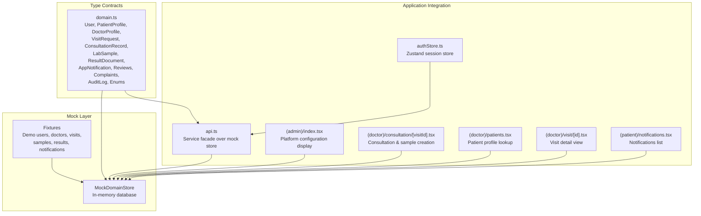
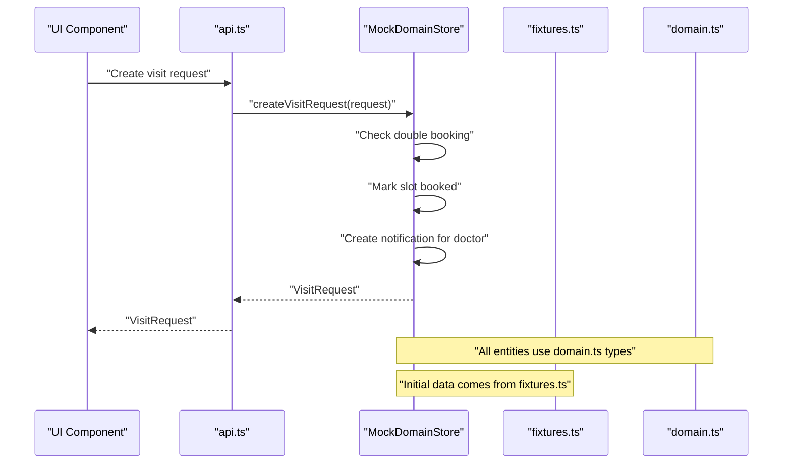
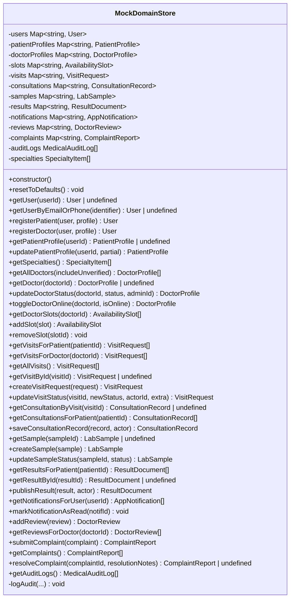
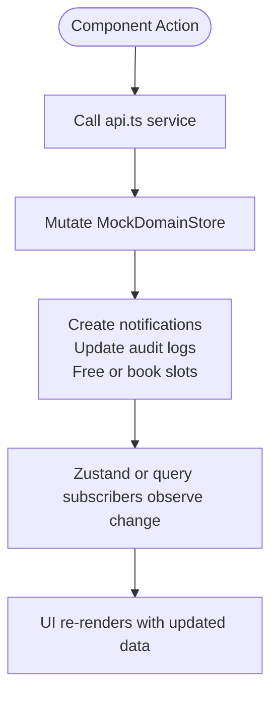
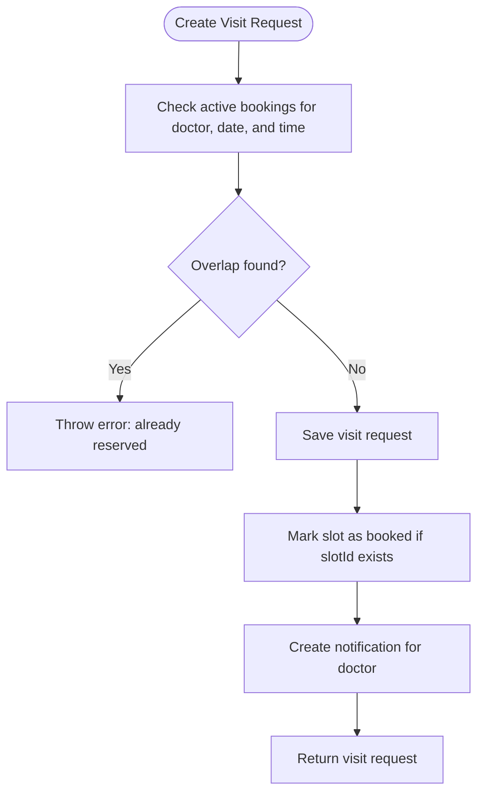
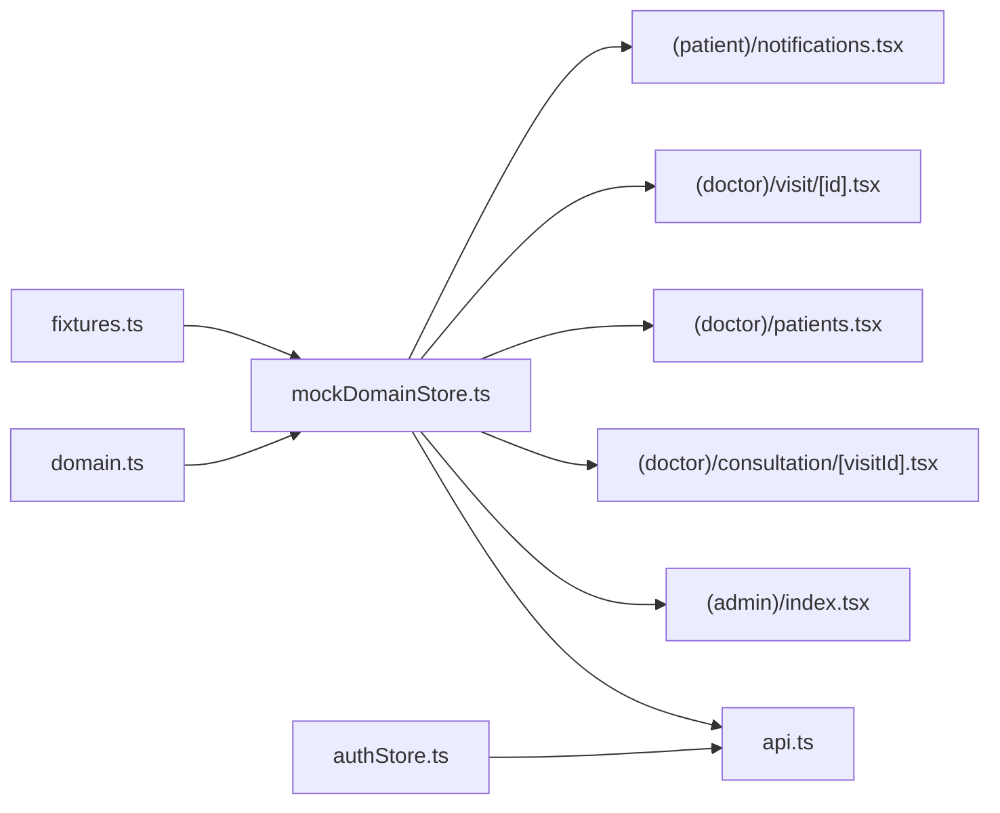

# Mock Domain Store

<cite>
**Referenced Files in This Document**
- [mockDomainStore.ts](file://src/mock/mockDomainStore.ts)
- [fixtures.ts](file://src/mock/fixtures.ts)
- [domain.ts](file://src/types/domain.ts)
- [authStore.ts](file://src/stores/authStore.ts)
- [api.ts](file://src/services/api.ts)
- [index.tsx](file://src/app/(admin)/index.tsx)
- [consultation/[visitId].tsx](file://src/app/(doctor)/consultation/[visitId].tsx)
- [patients.tsx](file://src/app/(doctor)/patients.tsx)
- [visit/[id].tsx](file://src/app/(doctor)/visit/[id].tsx)
- [notifications.tsx](file://src/app/(patient)/notifications.tsx)
</cite>

## Table of Contents
1. [Introduction](#introduction)
2. [Project Structure](#project-structure)
3. [Core Components](#core-components)
4. [Architecture Overview](#architecture-overview)
5. [Detailed Component Analysis](#detailed-component-analysis)
6. [Dependency Analysis](#dependency-analysis)
7. [Performance Considerations](#performance-considerations)
8. [Troubleshooting Guide](#troubleshooting-guide)
9. [Conclusion](#conclusion)
10. [Appendices](#appendices)

## Introduction
The mock domain store is an in-memory, reactive-capable data layer for the HomeCare mobile application. It simulates a multi-user healthcare environment with account isolation, realistic East African context, and end-to-end workflows such as visit booking, doctor availability, consultation records, lab samples, result publication, notifications, reviews, complaints, and audit logging.

It is designed to:
- Provide deterministic test data through fixtures.
- Enforce business rules during CRUD operations.
- Keep cross-entity state consistent (for example, freeing booked slots when visits are cancelled).
- Support realistic testing scenarios by mirroring backend-like behavior.
- Align closely with TypeScript domain interfaces so that UI components consume the same types as production services.

## Project Structure
The mock domain system lives under `src/mock` and integrates with the rest of the app through shared domain types and service layers.

**Diagram sources**
- [mockDomainStore.ts:35-556](file://src/mock/mockDomainStore.ts#L35-L556)
- [fixtures.ts:1-904](file://src/mock/fixtures.ts#L1-L904)
- [domain.ts:1-242](file://src/types/domain.ts#L1-L242)
- [api.ts:70-122](file://src/services/api.ts#L70-L122)
- [api.ts:370-659](file://src/services/api.ts#L370-L659)
- [authStore.ts:1-111](file://src/stores/authStore.ts#L1-L111)
- [index.tsx:407-429](file://src/app/(admin)/index.tsx#L407-L429)
- [consultation/[visitId].tsx:32-155](file://src/app/(doctor)/consultation/[visitId].tsx#L32-L155)
- [patients.tsx:31-32](file://src/app/(doctor)/patients.tsx#L31-L32)
- [visit/[id].tsx:35](file://src/app/(doctor)/visit/[id].tsx#L35)
- [notifications.tsx:23-28](file://src/app/(patient)/notifications.tsx#L23-L28)

**Section sources**
- [mockDomainStore.ts:1-70](file://src/mock/mockDomainStore.ts#L1-L70)
- [fixtures.ts:1-25](file://src/mock/fixtures.ts#L1-L25)
- [domain.ts:1-28](file://src/types/domain.ts#L1-L28)

## Core Components
The core component is the `MockDomainStore` class. It owns typed in-memory collections for all major healthcare entities and exposes methods for reading, writing, and mutating domain state.

Key responsibilities:
- Data initialization from fixtures.
- User and profile management.
- Doctor catalog and verification status control.
- Availability slot management with overlap prevention.
- Visit lifecycle management with cross-role notifications.
- Consultation record drafting and publishing.
- Lab sample and result document handling.
- Notification delivery simulation.
- Review aggregation and complaint resolution.
- Audit log recording.

**Section sources**
- [mockDomainStore.ts:35-127](file://src/mock/mockDomainStore.ts#L35-L127)
- [mockDomainStore.ts:129-220](file://src/mock/mockDomainStore.ts#L129-L220)
- [mockDomainStore.ts:222-380](file://src/mock/mockDomainStore.ts#L222-L380)
- [mockDomainStore.ts:382-464](file://src/mock/mockDomainStore.ts#L382-L464)
- [mockDomainStore.ts:466-552](file://src/mock/mockDomainStore.ts#L466-L552)

## Architecture Overview
The mock store is not directly responsible for UI reactivity. Instead, it provides a stable domain API that services and components can call. Reactivity in the app is typically achieved through Zustand stores or query libraries that subscribe to data changes. The mock store itself maintains consistency across related entities and emits side effects like notifications and audit logs.

**Diagram sources**
- [api.ts:344-344](file://src/services/api.ts#L344-L344)
- [mockDomainStore.ts:245-280](file://src/mock/mockDomainStore.ts#L245-L280)
- [domain.ts:97-129](file://src/types/domain.ts#L97-L129)
- [fixtures.ts:605-691](file://src/mock/fixtures.ts#L605-L691)

## Detailed Component Analysis

### MockDomainStore Class
The store uses `Map` collections for most entities and arrays for ordered lists like audit logs. It initializes its state through `resetToDefaults`, which copies fixture data into internal storage while preserving nested array immutability where needed.

Important behaviors:
- Account isolation is implicit: each entity references a user ID, and queries filter by patient, doctor, or admin roles.
- Business rules are enforced at mutation time, such as preventing duplicate bookings and freeing slots on cancellation.
- Notifications are created automatically for important events like new visit requests, status changes, and result publication.
- Audit logs capture actor identity, action type, entity type, and details.

**Diagram sources**
- [mockDomainStore.ts:35-556](file://src/mock/mockDomainStore.ts#L35-L556)

**Section sources**
- [mockDomainStore.ts:35-127](file://src/mock/mockDomainStore.ts#L35-L127)
- [mockDomainStore.ts:529-552](file://src/mock/mockDomainStore.ts#L529-L552)

### Data Seeding and Fixtures
Fixtures provide realistic demo data for:
- Specialties.
- Users across Rwanda, Kenya, and Tanzania.
- Patient profiles with emergency contacts, allergies, conditions, and medications.
- Doctors with specialties, qualifications, coverage districts, languages, fees, ratings, and working hours.
- Availability slots.
- Visits with multiple statuses.
- Consultation records with prescriptions and recommendations.
- Lab samples and published result documents.
- Notifications, reviews, complaints, and audit logs.

This allows tests and development flows to start from a known baseline and simulate multi-country healthcare operations.

**Section sources**
- [fixtures.ts:17-70](file://src/mock/fixtures.ts#L17-L70)
- [fixtures.ts:72-118](file://src/mock/fixtures.ts#L72-L118)
- [fixtures.ts:120-163](file://src/mock/fixtures.ts#L120-L163)
- [fixtures.ts:165-515](file://src/mock/fixtures.ts#L165-L515)
- [fixtures.ts:517-603](file://src/mock/fixtures.ts#L517-L603)
- [fixtures.ts:605-691](file://src/mock/fixtures.ts#L605-L691)
- [fixtures.ts:693-739](file://src/mock/fixtures.ts#L693-L739)
- [fixtures.ts:741-778](file://src/mock/fixtures.ts#L741-L778)
- [fixtures.ts:780-822](file://src/mock/fixtures.ts#L780-L822)
- [fixtures.ts:824-904](file://src/mock/fixtures.ts#L824-L904)

### Reactive Update System
The mock store itself does not implement a global event bus or automatic UI re-rendering. Instead, it provides a consistent domain API that application code can observe. In this project:
- Zustand is used for session state in `authStore.ts`.
- Services in `api.ts` wrap calls to `mockDomainStore`.
- UI components read from the store or services and update their local state or rely on query libraries to trigger re-renders.

Conceptually, the reactive flow is:
1. A component calls a service method.
2. The service mutates the mock store.
3. The store updates related entities and creates notifications or audit logs.
4. The component or store subscription observes the change and re-renders.

[No sources needed since this diagram shows conceptual workflow, not actual code structure]

**Section sources**
- [authStore.ts:1-21](file://src/stores/authStore.ts#L1-L21)
- [authStore.ts:107-111](file://src/stores/authStore.ts#L107-L111)
- [api.ts:70-122](file://src/services/api.ts#L70-L122)

### Account Isolation Mechanism
Account isolation is implemented through explicit user IDs and role-based data access:
- Users have roles: patient, doctor, admin.
- Patient profiles are keyed by patient user ID.
- Doctor profiles are keyed by doctor user ID.
- Visits link `patientId` and `doctorId`.
- Consultations, samples, results, and notifications reference relevant user IDs.
- Queries filter by the current user’s role and ID.

This design simulates multi-user environments without network boundaries, allowing developers to switch between demo accounts and verify that data is only visible to the intended user.

**Section sources**
- [domain.ts:5-37](file://src/types/domain.ts#L5-L37)
- [domain.ts:39-85](file://src/types/domain.ts#L39-L85)
- [domain.ts:97-129](file://src/types/domain.ts#L97-L129)
- [domain.ts:196-205](file://src/types/domain.ts#L196-L205)
- [mockDomainStore.ts:130-154](file://src/mock/mockDomainStore.ts#L130-L154)
- [mockDomainStore.ts:222-243](file://src/mock/mockDomainStore.ts#L222-L243)
- [mockDomainStore.ts:466-479](file://src/mock/mockDomainStore.ts#L466-L479)

### Domain Models and Type Alignment
The mock store imports and returns the exact TypeScript interfaces defined in `domain.ts`. This ensures:
- Compile-time safety between mock data and UI components.
- Consistency with backend contracts if the real API follows the same schema.
- Clear separation between data shape and implementation.

Key domain models include:
- `User`: base identity with role.
- `PatientProfile`: health and location data.
- `DoctorProfile`: credentials, availability, fees, and ratings.
- `AvailabilitySlot`: doctor time slots.
- `VisitRequest`: appointment lifecycle.
- `ConsultationRecord`: clinical notes, prescriptions, and follow-up.
- `LabSample` and `ResultDocument`: lab workflow.
- `AppNotification`: in-app messages.
- `DoctorReview`, `ComplaintReport`, `MedicalAuditLog`: quality and compliance data.

**Section sources**
- [domain.ts:1-242](file://src/types/domain.ts#L1-L242)
- [mockDomainStore.ts:1-17](file://src/mock/mockDomainStore.ts#L1-L17)

### CRUD Operations and Workflows

#### Users and Profiles
- Retrieve users by ID or email/phone.
- Register patients and doctors, linking user accounts to profiles.
- Update patient profiles with validation and audit logging.

**Section sources**
- [mockDomainStore.ts:129-168](file://src/mock/mockDomainStore.ts#L129-L168)

#### Doctors and Catalog
- List specialties.
- List verified or unverified doctors.
- Get a single doctor.
- Update verification status.
- Toggle online presence.

**Section sources**
- [mockDomainStore.ts:170-200](file://src/mock/mockDomainStore.ts#L170-L200)

#### Slots and Availability
- Get available slots for a doctor.
- Add slots with overlap checks.
- Remove slots.

**Section sources**
- [mockDomainStore.ts:202-220](file://src/mock/mockDomainStore.ts#L202-L220)

#### Visits
- Query visits by patient or doctor.
- Create visit requests with double-booking protection.
- Update visit status with cross-role notifications and slot management.

**Diagram sources**
- [mockDomainStore.ts:245-280](file://src/mock/mockDomainStore.ts#L245-L280)

**Section sources**
- [mockDomainStore.ts:222-280](file://src/mock/mockDomainStore.ts#L222-L280)

#### Consultations
- Retrieve consultation by visit or by patient.
- Save draft or published consultation records with audit logging.

**Section sources**
- [mockDomainStore.ts:382-406](file://src/mock/mockDomainStore.ts#L382-L406)

#### Lab Samples and Results
- Create and update lab samples.
- Retrieve results by patient or ID.
- Publish results with notifications and audit logs.

**Section sources**
- [mockDomainStore.ts:408-464](file://src/mock/mockDomainStore.ts#L408-L464)

#### Notifications
- Fetch notifications for a specific user.
- Mark notifications as read.

**Section sources**
- [mockDomainStore.ts:466-479](file://src/mock/mockDomainStore.ts#L466-L479)

#### Reviews and Complaints
- Add reviews and recalculate doctor averages.
- Submit and resolve complaints.

**Section sources**
- [mockDomainStore.ts:481-520](file://src/mock/mockDomainStore.ts#L481-L520)

#### Audit Logs
- Retrieve recent audit logs.
- Internal helper logs actions for consultations, results, and profiles.

**Section sources**
- [mockDomainStore.ts:522-552](file://src/mock/mockDomainStore.ts#L522-L552)

### Integration with Services and UI
The service layer wraps mock store calls and adds delays to simulate network latency. UI components then call these services or read directly from the store where appropriate.

Examples:
- Admin dashboard reads platform configuration from the store.
- Doctor consultation screen retrieves existing consultation records and creates lab samples.
- Doctor patient list looks up patient profiles and user data.
- Doctor visit detail screen loads patient profile from the store.
- Patient notifications screen fetches and marks notifications as read.

**Section sources**
- [index.tsx:407-429](file://src/app/(admin)/index.tsx#L407-L429)
- [consultation/[visitId].tsx:32-155](file://src/app/(doctor)/consultation/[visitId].tsx#L32-L155)
- [patients.tsx:31-32](file://src/app/(doctor)/patients.tsx#L31-L32)
- [visit/[id].tsx:35](file://src/app/(doctor)/visit/[id].tsx#L35)
- [notifications.tsx:23-28](file://src/app/(patient)/notifications.tsx#L23-L28)
- [api.ts:370-659](file://src/services/api.ts#L370-L659)

## Dependency Analysis
The mock store depends on domain types and fixtures. Application code depends on the store indirectly through services and directly in some UI screens.

**Diagram sources**
- [domain.ts:1-242](file://src/types/domain.ts#L1-L242)
- [fixtures.ts:1-904](file://src/mock/fixtures.ts#L1-L904)
- [mockDomainStore.ts:1-556](file://src/mock/mockDomainStore.ts#L1-L556)
- [api.ts:70-122](file://src/services/api.ts#L70-L122)
- [api.ts:370-659](file://src/services/api.ts#L370-L659)
- [authStore.ts:1-111](file://src/stores/authStore.ts#L1-L111)
- [index.tsx:407-429](file://src/app/(admin)/index.tsx#L407-L429)
- [consultation/[visitId].tsx:32-155](file://src/app/(doctor)/consultation/[visitId].tsx#L32-L155)
- [patients.tsx:31-32](file://src/app/(doctor)/patients.tsx#L31-L32)
- [visit/[id].tsx:35](file://src/app/(doctor)/visit/[id].tsx#L35)
- [notifications.tsx:23-28](file://src/app/(patient)/notifications.tsx#L23-L28)

**Section sources**
- [mockDomainStore.ts:1-33](file://src/mock/mockDomainStore.ts#L1-L33)
- [api.ts:99-104](file://src/services/api.ts#L99-L104)
- [api.ts:161-238](file://src/services/api.ts#L161-L238)
- [api.ts:277-344](file://src/services/api.ts#L277-L344)

## Performance Considerations
- In-memory maps provide fast lookups by ID.
- Sorting operations create new arrays and sort by timestamps; this is acceptable for demo-scale data but should be monitored if datasets grow large.
- Avoid unnecessary deep cloning in hot paths; the store clones nested arrays during reset to preserve fixture immutability.
- Use filtered views rather than recomputing derived data repeatedly in UI components.
- For larger datasets, consider indexing strategies or memoized selectors in Zustand.

[No sources needed since this section provides general guidance]

## Troubleshooting Guide
Common issues and how to address them:
- Double booking errors: Occur when creating a visit for a doctor who already has an active appointment at the same date and time. Resolve by choosing another slot or cancelling the conflicting visit.
- Slot conflicts: Adding a slot with the same date and time as an existing non-blocked slot throws an error. Ensure unique slot definitions per doctor.
- Missing entities: Methods throw errors when requested entities are not found. Verify IDs and ensure fixtures are loaded via `resetToDefaults`.
- Notification visibility: Notifications are scoped by recipient user ID. Confirm the correct user context when viewing notifications.
- Demo data drift: If tests mutate shared state, reset the store using the auth store’s demo reset function to restore baseline data.

**Section sources**
- [mockDomainStore.ts:207-215](file://src/mock/mockDomainStore.ts#L207-L215)
- [mockDomainStore.ts:245-256](file://src/mock/mockDomainStore.ts#L245-L256)
- [mockDomainStore.ts:161-167](file://src/mock/mockDomainStore.ts#L161-L167)
- [mockDomainStore.ts:185-191](file://src/mock/mockDomainStore.ts#L185-L191)
- [authStore.ts:107-111](file://src/stores/authStore.ts#L107-L111)

## Conclusion
The mock domain store provides a robust, type-safe, and realistic in-memory database for developing and testing the HomeCare application. It enforces business rules, maintains cross-entity consistency, and mirrors backend-like workflows. By aligning with TypeScript domain interfaces and exposing clear CRUD APIs, it enables reliable testing of multi-user healthcare scenarios while keeping the frontend architecture clean and predictable.

[No sources needed since this section summarizes without analyzing specific files]

## Appendices

### Example Usage Patterns

#### Resetting Demo Data
Use the auth store’s demo reset function to restore the mock store to its default state and refresh the current profile.

**Section sources**
- [authStore.ts:107-111](file://src/stores/authStore.ts#L107-L111)
- [mockDomainStore.ts:68-127](file://src/mock/mockDomainStore.ts#L68-L127)

#### Reading Platform Configuration
The admin interface reads platform configuration such as emergency phones, travel fees, and coverage districts directly from the store.

**Section sources**
- [index.tsx:407-429](file://src/app/(admin)/index.tsx#L407-L429)
- [mockDomainStore.ts:50-66](file://src/mock/mockDomainStore.ts#L50-L66)

#### Creating a Consultation and Sample
The doctor consultation screen retrieves an existing consultation record and creates a lab sample as part of the clinical workflow.

**Section sources**
- [consultation/[visitId].tsx:32-155](file://src/app/(doctor)/consultation/[visitId].tsx#L32-L155)
- [mockDomainStore.ts:382-416](file://src/mock/mockDomainStore.ts#L382-L416)

#### Viewing Patient Profile from Visit Detail
The doctor visit detail screen loads the patient profile associated with a visit.

**Section sources**
- [visit/[id].tsx:35](file://src/app/(doctor)/visit/[id].tsx#L35)
- [mockDomainStore.ts:157-168](file://src/mock/mockDomainStore.ts#L157-L168)

#### Managing Notifications
The patient notifications screen fetches notifications for the current user and marks them as read.

**Section sources**
- [notifications.tsx:23-28](file://src/app/(patient)/notifications.tsx#L23-L28)
- [mockDomainStore.ts:466-479](file://src/mock/mockDomainStore.ts#L466-L479)