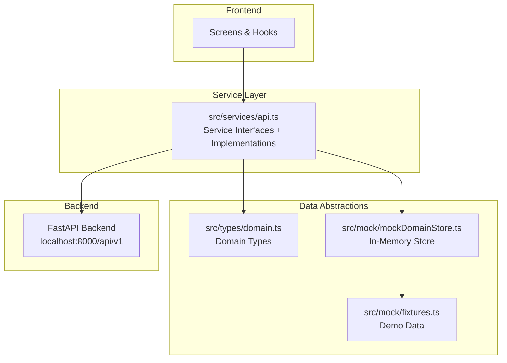
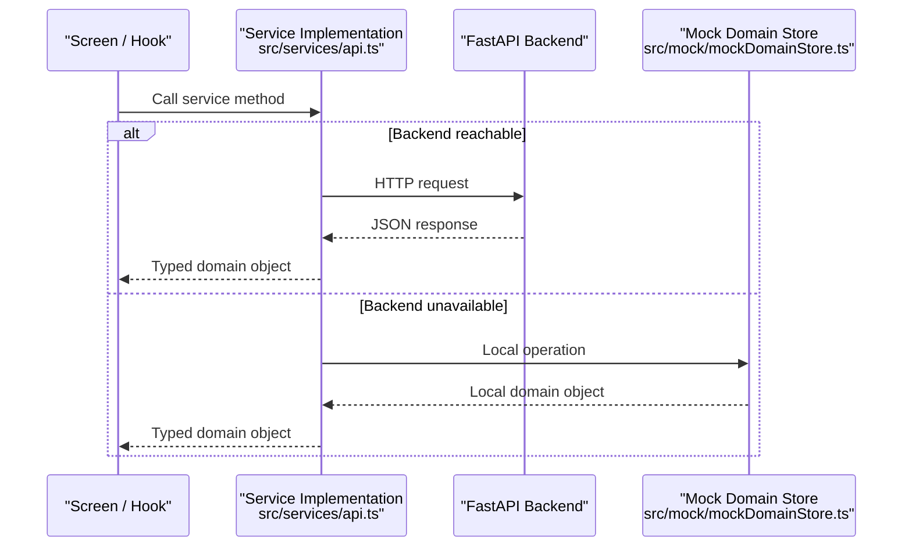
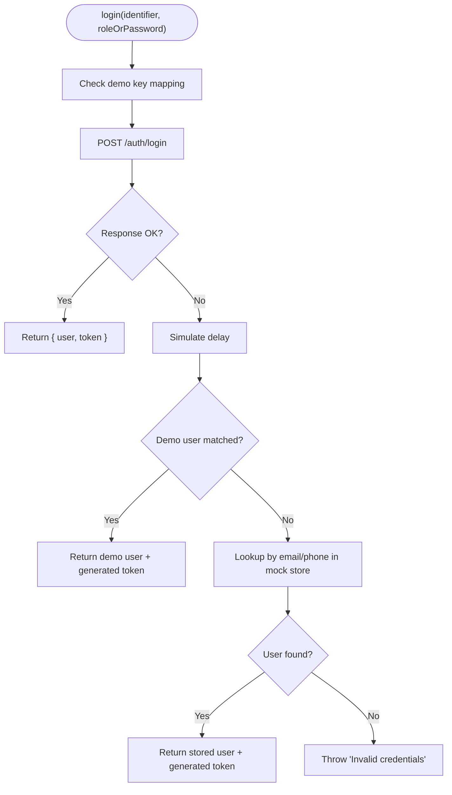
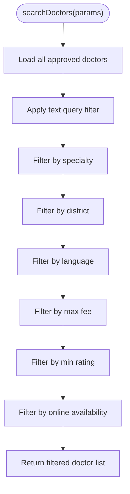
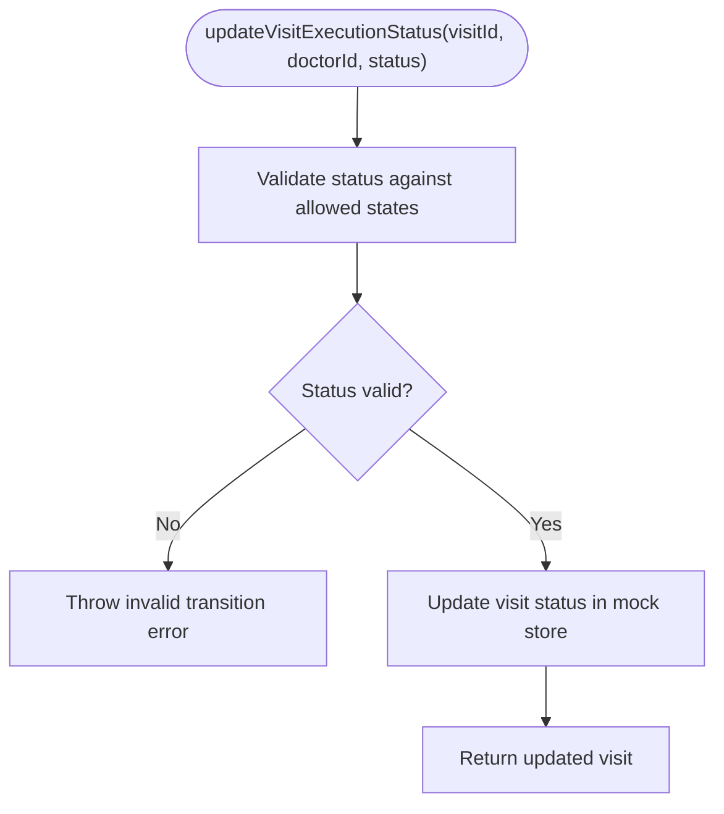
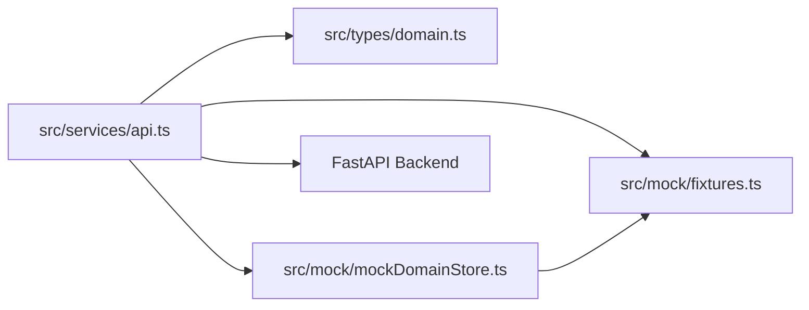

# Service Layer Abstraction

<cite>
**Referenced Files in This Document**
- [api.ts](file://src/services/api.ts)
- [domain.ts](file://src/types/domain.ts)
- [fixtures.ts](file://src/mock/fixtures.ts)
- [mockDomainStore.ts](file://src/mock/mockDomainStore.ts)
- [README.md](file://README.md)
</cite>

## Table of Contents
1. [Introduction](#introduction)
2. [Project Structure](#project-structure)
3. [Core Components](#core-components)
4. [Architecture Overview](#architecture-overview)
5. [Detailed Component Analysis](#detailed-component-analysis)
6. [Dependency Analysis](#dependency-analysis)
7. [Performance Considerations](#performance-considerations)
8. [Troubleshooting Guide](#troubleshooting-guide)
9. [Conclusion](#conclusion)

## Introduction
This document explains the service layer abstraction pattern used by the HomeCare application to provide unified interfaces for different data sources. The service layer defines stable TypeScript interfaces and concrete service implementations that abstract backend communication while supporting both mock and real backend behavior. It also documents method signatures, error handling strategies, parameter validation patterns, response processing, and how this design enables seamless switching between development (mock) and production (real backend) modes without changing business logic code.

The current implementation is intentionally designed as a bridge: it attempts real HTTP calls to a FastAPI backend when available, but gracefully falls back to an in-memory mock domain store so the app remains functional during development, offline testing, or backend unavailability.

## Project Structure
The service layer lives under `src/services`, with shared domain types under `src/types` and mock fixtures plus an in-memory store under `src/mock`. The README provides context about the frontend stack, backend endpoints, and demo workflows.

**Diagram sources**
- [api.ts:1-23](file://src/services/api.ts#L1-L23)
- [domain.ts:1-242](file://src/types/domain.ts#L1-L242)
- [mockDomainStore.ts:1-70](file://src/mock/mockDomainStore.ts#L1-L70)
- [fixtures.ts:1-33](file://src/mock/fixtures.ts#L1-L33)
- [README.md:202-235](file://README.md#L202-L235)

**Section sources**
- [api.ts:1-23](file://src/services/api.ts#L1-L23)
- [domain.ts:1-242](file://src/types/domain.ts#L1-L242)
- [mockDomainStore.ts:1-70](file://src/mock/mockDomainStore.ts#L1-L70)
- [fixtures.ts:1-33](file://src/mock/fixtures.ts#L1-L33)
- [README.md:202-235](file://README.md#L202-L235)

## Core Components
The service layer exposes four main service contracts:

- **AuthService**: Authentication, OTP verification, registration, current user retrieval, and password reset.
- **PatientService**: Patient profile management, doctor search, visit lifecycle, records, reviews, and complaints.
- **DoctorService**: Doctor availability, visit acceptance/decline/alternative proposals, execution status updates, consultation records, and result publishing.
- **AdminService**: Admin operations such as doctor verification, visit oversight, complaint resolution, audit logs, and platform metrics.

Each service is defined as a TypeScript interface and immediately implemented as a concrete object. This dual declaration enforces a stable contract while allowing flexible implementations.

Key responsibilities:
- Define clear method signatures and return types.
- Abstract network calls behind consistent async methods.
- Provide deterministic mock behavior for development.
- Preserve domain type safety across layers.

**Section sources**
- [api.ts:25-41](file://src/services/api.ts#L25-L41)
- [api.ts:247-272](file://src/services/api.ts#L247-L272)
- [api.ts:432-466](file://src/services/api.ts#L432-L466)
- [api.ts:587-602](file://src/services/api.ts#L587-L602)

## Architecture Overview
The service layer follows a layered abstraction pattern:

1. **Interface-first design**: Each service is declared as a TypeScript interface, ensuring consumers depend on contracts rather than implementations.
2. **Concrete service objects**: The same file exports service objects implementing those interfaces.
3. **Dual data source strategy**:
   - Real backend: Uses `fetch` against `http://localhost:8000/api/v1`.
   - Mock fallback: Uses `mockDomainStore` for local state, fixtures, and domain rules.
4. **Graceful degradation**: Network failures do not crash the app; they fall back to mock behavior.
5. **Type-driven consistency**: All requests and responses are typed using domain models from `src/types/domain.ts`.

**Diagram sources**
- [api.ts:43-44](file://src/services/api.ts#L43-L44)
- [api.ts:70-104](file://src/services/api.ts#L70-L104)
- [mockDomainStore.ts:35-70](file://src/mock/mockDomainStore.ts#L35-L70)

**Section sources**
- [api.ts:43-44](file://src/services/api.ts#L43-L44)
- [api.ts:70-104](file://src/services/api.ts#L70-L104)
- [mockDomainStore.ts:35-70](file://src/mock/mockDomainStore.ts#L35-L70)

## Detailed Component Analysis

### AuthService
The authentication service demonstrates the dual-backend pattern most clearly.

- **Login flow**:
  - Attempts a real login request to the backend.
  - If successful, returns a typed user and token.
  - On failure, simulates latency and falls back to demo users or the mock store.
  - Throws a descriptive error if no matching account exists.

- **OTP verification**:
  - Tries the backend endpoint.
  - Falls back to a simple mock rule for development.

- **Registration flows**:
  - Patient registration tries the backend and synchronizes the created user into the mock store for subsequent screens.
  - Doctor registration currently uses mock creation with realistic defaults.

- **Current user and password reset**:
  - Current user reads from the mock store.
  - Password reset simulates success.

**Diagram sources**
- [api.ts:46-104](file://src/services/api.ts#L46-L104)

**Section sources**
- [api.ts:25-41](file://src/services/api.ts#L25-L41)
- [api.ts:46-104](file://src/services/api.ts#L46-L104)
- [api.ts:106-122](file://src/services/api.ts#L106-L122)
- [api.ts:124-244](file://src/services/api.ts#L124-L244)

### PatientService
The patient service encapsulates patient-centric operations:

- Profile management: get and update patient profiles.
- Doctor discovery: specialties listing and filtered doctor search.
- Visit lifecycle: create, retrieve, cancel, reschedule, accept/reject alternative times.
- Records and results: consultations, lab results, and document retrieval.
- Feedback: submit reviews and complaints.

Parameter validation and business rules include:
- Filtering doctors by query, specialty, district, language, fee, rating, and availability.
- Preventing cancellation after the doctor has started traveling or arrived.
- Enforcing alternative time proposal constraints before acceptance.

**Diagram sources**
- [api.ts:290-323](file://src/services/api.ts#L290-L323)

**Section sources**
- [api.ts:247-272](file://src/services/api.ts#L247-L272)
- [api.ts:274-430](file://src/services/api.ts#L274-L430)

### DoctorService
The doctor service manages clinical workflow and operational state:

- Availability management: toggle online status, manage slots.
- Visit coordination: accept, decline, propose alternative times.
- Execution tracking: transition through valid visit statuses.
- Clinical documentation: save drafts, publish consultation records, and publish lab results.

Validation includes:
- Restricting visit status transitions to allowed states.
- Preventing unverified or suspended doctors from accepting visits.
- Generating structured result documents with metadata.

**Diagram sources**
- [api.ts:531-538](file://src/services/api.ts#L531-L538)

**Section sources**
- [api.ts:432-466](file://src/services/api.ts#L432-L466)
- [api.ts:468-585](file://src/services/api.ts#L468-L585)

### AdminService
The admin service provides platform governance capabilities:

- Doctor verification: approve, suspend, or mark pending.
- Oversight: view all visits and complaints.
- Compliance: resolve complaints and read immutable audit logs.
- Analytics: compute platform metrics including visit counts, revenue, ratings, and verification backlog.

Metrics computation aggregates data from visits and doctors, demonstrating how services can compose multiple store queries into derived business insights.

**Section sources**
- [api.ts:587-602](file://src/services/api.ts#L587-L602)
- [api.ts:604-659](file://src/services/api.ts#L604-L659)

### Domain Types
Domain types define the shape of entities exchanged between screens, services, mocks, and the future backend. They include:

- User roles and verification states.
- Visit lifecycle states.
- Payment methods and statuses.
- Patient and doctor profiles.
- Availability slots, visit requests, consultation records, lab samples, result documents, notifications, reviews, complaints, and audit logs.

These types ensure that service methods have strong contracts and that mock data aligns with expected runtime shapes.

**Section sources**
- [domain.ts:1-242](file://src/types/domain.ts#L1-L242)

### Mock Fixtures and Store
The mock layer provides:

- Static demo data: specialties, users, doctors, slots, visits, consultations, samples, results, notifications, reviews, complaints, and audit logs.
- An in-memory store class with initialization, CRUD operations, cross-entity side effects, and audit logging.
- A singleton instance consumed by service implementations.

The store enforces important business rules such as double-booking prevention, slot booking/unbooking, notification generation, and consistent state transitions.

**Section sources**
- [fixtures.ts:1-33](file://src/mock/fixtures.ts#L1-L33)
- [fixtures.ts:72-118](file://src/mock/fixtures.ts#L72-L118)
- [fixtures.ts:165-515](file://src/mock/fixtures.ts#L165-L515)
- [mockDomainStore.ts:35-70](file://src/mock/mockDomainStore.ts#L35-L70)
- [mockDomainStore.ts:245-281](file://src/mock/mockDomainStore.ts#L245-L281)
- [mockDomainStore.ts:283-380](file://src/mock/mockDomainStore.ts#L283-L380)
- [mockDomainStore.ts:522-552](file://src/mock/mockDomainStore.ts#L522-L552)

## Dependency Analysis
The service layer depends on:

- Domain types for strict typing.
- Mock fixtures for initial data.
- Mock domain store for local persistence and business rules.
- Optional backend endpoints for real integration.

**Diagram sources**
- [api.ts:1-23](file://src/services/api.ts#L1-L23)
- [domain.ts:1-242](file://src/types/domain.ts#L1-L242)
- [mockDomainStore.ts:1-33](file://src/mock/mockDomainStore.ts#L1-L33)
- [fixtures.ts:1-33](file://src/mock/fixtures.ts#L1-L33)
- [README.md:202-235](file://README.md#L202-L235)

**Section sources**
- [api.ts:1-23](file://src/services/api.ts#L1-L23)
- [domain.ts:1-242](file://src/types/domain.ts#L1-L242)
- [mockDomainStore.ts:1-33](file://src/mock/mockDomainStore.ts#L1-L33)
- [fixtures.ts:1-33](file://src/mock/fixtures.ts#L1-L33)
- [README.md:202-235](file://README.md#L202-L235)

## Performance Considerations
- Simulated latency: Services use small delays to mimic network timing, improving UX realism during development.
- In-memory operations: Mock store uses Maps and arrays, providing fast lookups and filtering for demo scenarios.
- Filtering cost: Doctor search applies multiple filters sequentially; for large datasets, consider server-side filtering once connected to the backend.
- Metrics aggregation: Admin metrics compute derived values from collections; caching may be beneficial for heavy analytics.

[No sources needed since this section provides general guidance]

## Troubleshooting Guide
Common issues and their likely causes:

- Login fails with invalid credentials:
  - Occurs when neither backend nor mock store finds a matching user.
  - Verify identifiers, demo keys, and mock store contents.

- Visit cancellation blocked:
  - Cancellation is prevented after doctor travel or arrival.
  - Ensure visit status is still cancellable.

- Rescheduling blocked:
  - Rescheduling is blocked after departure.
  - Confirm visit status allows rescheduling.

- Alternative time rejection:
  - Acceptance requires a proposed alternative time.
  - Declination should include a reason.

- Doctor cannot accept visits:
  - Unverified or suspended doctors are blocked.
  - Use admin service to adjust verification status.

- Invalid visit status transition:
  - Only allowed execution statuses are accepted.
  - Validate target status against permitted transitions.

**Section sources**
- [api.ts:99-103](file://src/services/api.ts#L99-L103)
- [api.ts:359-367](file://src/services/api.ts#L359-L367)
- [api.ts:370-382](file://src/services/api.ts#L370-L382)
- [api.ts:384-403](file://src/services/api.ts#L384-L403)
- [api.ts:508-515](file://src/services/api.ts#L508-L515)
- [api.ts:531-538](file://src/services/api.ts#L531-L538)

## Conclusion
The service layer abstraction in HomeCare provides a clean, type-safe boundary between UI code and data sources. By defining explicit service interfaces and implementing them with a dual-backend strategy, the application supports rapid development with mock data while remaining ready for production backend integration. Error handling, parameter validation, and response processing are centralized in the service layer, enabling consistent behavior and easier testing. This design makes switching between development and production modes straightforward without altering business logic screens.

[No sources needed since this section summarizes without analyzing specific files]