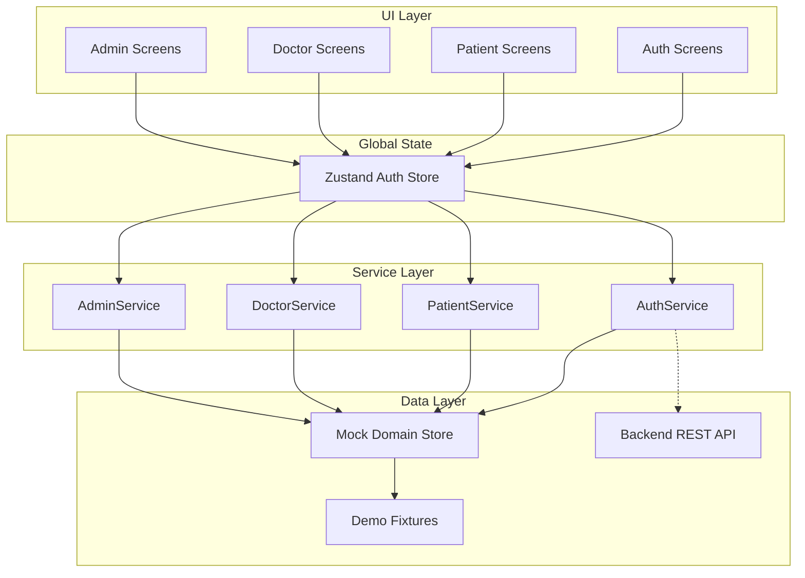
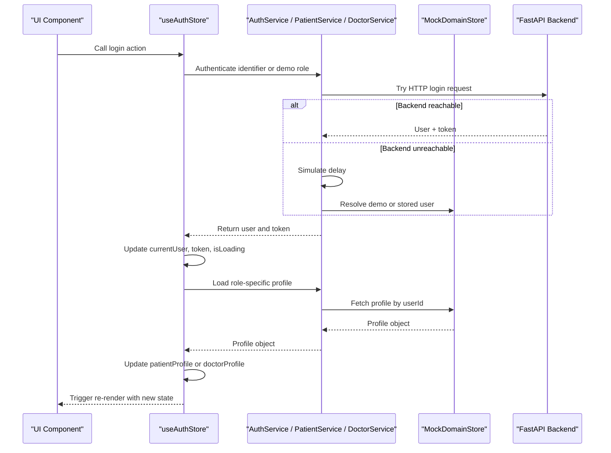
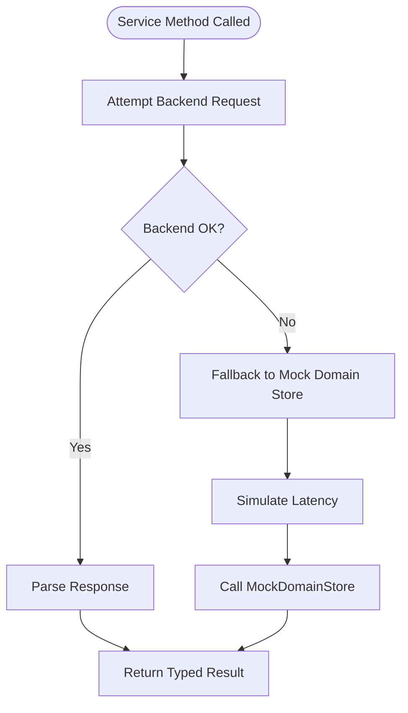
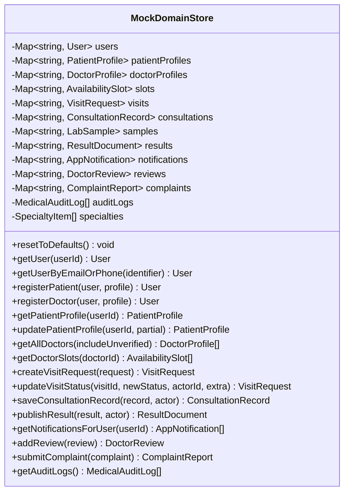
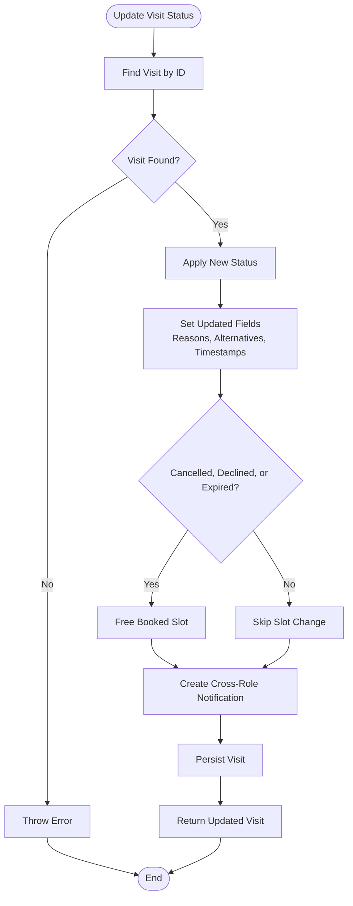
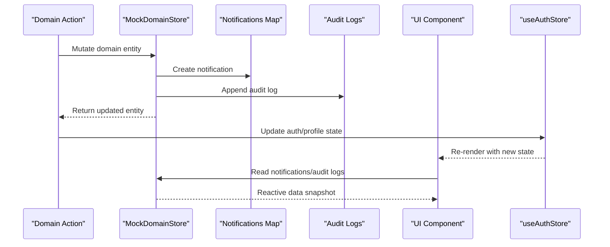
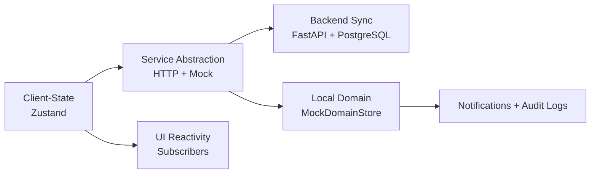
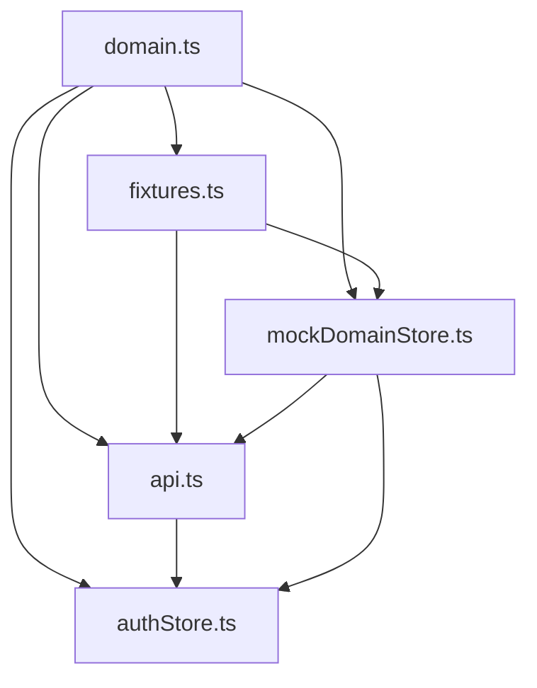

# State Management Architecture

<cite>
**Referenced Files in This Document**
- [authStore.ts](file://src/stores/authStore.ts)
- [api.ts](file://src/services/api.ts)
- [mockDomainStore.ts](file://src/mock/mockDomainStore.ts)
- [domain.ts](file://src/types/domain.ts)
- [fixtures.ts](file://src/mock/fixtures.ts)
- [README.md](file://README.md)
</cite>

## Table of Contents
1. [Introduction](#introduction)
2. [Project Structure](#project-structure)
3. [Core Components](#core-components)
4. [Architecture Overview](#architecture-overview)
5. [Detailed Component Analysis](#detailed-component-analysis)
6. [Dependency Analysis](#dependency-analysis)
7. [Performance Considerations](#performance-considerations)
8. [Troubleshooting Guide](#troubleshooting-guide)
9. [Conclusion](#conclusion)

## Introduction
This document explains the state management architecture that combines Zustand stores with a service layer abstraction and a reactive mock domain store. The system provides:

- Global authentication and profile state through a Zustand store.
- A service layer interface for authentication, patient operations, doctor operations, and admin operations.
- A mock domain store implementing an in-memory reactive database with account isolation.
- An observer-like pattern where domain mutations create notifications and audit logs, allowing UI components to react to changes.
- Clear separation between client-side state (Zustand) and server-side data synchronization patterns (service layer with backend fallback).

The frontend is built with Expo, React Native, TypeScript, Zustand, and TanStack React Query, while the backend uses Python FastAPI and PostgreSQL. The current implementation primarily uses the mock domain store for development and demonstration, with graceful fallbacks to real backend endpoints when available.

**Section sources**
- [README.md:1-10](file://README.md#L1-L10)

## Project Structure
The state-related code is organized into four main layers:

| Layer | Responsibility | Key Files |
|---|---|---|
| Domain Types | Strongly typed entities for users, profiles, visits, results, audits, and platform configuration | [domain.ts](file://src/types/domain.ts) |
| Mock Data Fixtures | Static demo data for East African users, doctors, slots, visits, consultations, samples, results, notifications, reviews, complaints, and specialties | [fixtures.ts](file://src/mock/fixtures.ts) |
| Mock Domain Store | Reactive in-memory database with account isolation, business rules, notifications, and audit logging | [mockDomainStore.ts](file://src/mock/mockDomainStore.ts) |
| Service Layer | Asynchronous API contracts that abstract data sources and can target either a real backend or the mock store | [api.ts](file://src/services/api.ts) |
| Global State Store | Zustand-based authentication session, profile loading, and demo reset coordination | [authStore.ts](file://src/stores/authStore.ts) |



**Diagram sources**
- [authStore.ts:1-112](file://src/stores/authStore.ts#L1-L112)
- [api.ts:1-660](file://src/services/api.ts#L1-L660)
- [mockDomainStore.ts:1-557](file://src/mock/mockDomainStore.ts#L1-L557)
- [fixtures.ts:1-800](file://src/mock/fixtures.ts#L1-L800)

**Section sources**
- [README.md:1-10](file://README.md#L1-L10)
- [domain.ts:1-242](file://src/types/domain.ts#L1-L242)

## Core Components
The core state management architecture consists of five interconnected parts:

1. **Domain Types**: Define the application’s data model, including roles, statuses, user profiles, visit lifecycle, lab samples, result documents, consultation records, notifications, reviews, complaints, and audit logs.
2. **Mock Data Fixtures**: Provide realistic East African demo data, including specialties, users, patient profiles, doctors, availability slots, visits, consultations, samples, results, notifications, and administrative metadata.
3. **Mock Domain Store**: Implements a singleton in-memory database with strict account isolation, validation, cross-entity updates, notification creation, and immutable audit logging.
4. **Service Layer**: Exposes asynchronous interfaces for authentication, patient operations, doctor operations, and admin operations. It simulates latency, attempts real backend calls, and falls back to the mock domain store.
5. **Zustand Auth Store**: Holds global authentication state, loads role-specific profiles, handles login/logout flows, refreshes profiles, and coordinates demo data resets.

These components together form a layered architecture where UI components subscribe to Zustand state, services encapsulate data access logic, and the mock domain store acts as the single source of truth during development and testing.

**Section sources**
- [domain.ts:1-242](file://src/types/domain.ts#L1-L242)
- [fixtures.ts:1-800](file://src/mock/fixtures.ts#L1-L800)
- [mockDomainStore.ts:1-557](file://src/mock/mockDomainStore.ts#L1-L557)
- [api.ts:1-660](file://src/services/api.ts#L1-L660)
- [authStore.ts:1-112](file://src/stores/authStore.ts#L1-L112)

## Architecture Overview
The state flow follows a clear separation of concerns:

- UI components consume global state via `useAuthStore`.
- Authentication actions call service-layer methods.
- Services attempt backend communication first, then fall back to the mock domain store.
- Domain mutations update the in-memory store and trigger side effects like notifications and audit logs.
- Zustand subscribers automatically re-render when authenticated user state changes.



**Diagram sources**
- [authStore.ts:31-83](file://src/stores/authStore.ts#L31-L83)
- [api.ts:46-104](file://src/services/api.ts#L46-L104)
- [api.ts:274-283](file://src/services/api.ts#L274-L283)
- [api.ts:468-472](file://src/services/api.ts#L468-L472)
- [mockDomainStore.ts:130-168](file://src/mock/mockDomainStore.ts#L130-L168)

## Detailed Component Analysis

### Zustand Authentication Store
The Zustand store manages the authenticated session and role-specific profile data. Its responsibilities include:

- Holding `currentUser`, `patientProfile`, `doctorProfile`, `token`, `isLoading`, and `error`.
- Providing `loginDemo` for quick role-based login using predefined demo keys.
- Providing `loginCustom` for identifier/password login.
- Handling logout by clearing all session fields.
- Refreshing the current user’s profile based on their role.
- Resetting demo data by calling the mock domain store and refreshing the profile.

```mermaid
classDiagram
class AuthSessionState {
+User currentUser
+PatientProfile patientProfile
+DoctorProfile doctorProfile
+string token
+boolean isLoading
+string error
+loginDemo(role) Promise~User~
+loginCustom(identifier, password) Promise~User~
+logout() void
+refreshProfile() Promise~void~
+resetDemoData() void
}
class AuthService {
+login(identifier, demoRole) Promise~{user, token}~
+verifyOtp(code, userId) Promise~boolean~
+registerPatient(data) Promise~User~
+registerDoctor(data) Promise~User~
+getCurrentUser(userId) Promise~User~
+resetPassword(email) Promise~boolean~
}
class PatientService {
+getProfile(patientId) Promise~PatientProfile~
+updateProfile(patientId, partial) Promise~PatientProfile~
+searchDoctors(params) Promise~DoctorProfile[]~
+createVisitRequest(data) Promise~VisitRequest~
+getVisits(patientId) Promise~VisitRequest[]~
}
class DoctorService {
+getProfile(doctorId) Promise~DoctorProfile~
+toggleOnline(doctorId, isOnline) Promise~DoctorProfile~
+acceptVisit(visitId, doctorId) Promise~VisitRequest~
+declineVisit(visitId, doctorId, reason) Promise~VisitRequest~
+publishConsultationRecord(record, actor) Promise~ConsultationRecord~
}
AuthSessionState --> AuthService : "uses"
AuthSessionState --> PatientService : "loads patient profile"
AuthSessionState --> DoctorService : "loads doctor profile"
```

**Diagram sources**
- [authStore.ts:7-21](file://src/stores/authStore.ts#L7-L21)
- [authStore.ts:23-111](file://src/stores/authStore.ts#L23-L111)
- [api.ts:25-41](file://src/services/api.ts#L25-L41)
- [api.ts:247-272](file://src/services/api.ts#L247-L272)
- [api.ts:432-466](file://src/services/api.ts#L432-L466)

Key behaviors:

- Login actions set loading state before network or mock calls.
- Errors are captured and exposed through the store’s `error` field.
- Role detection determines whether to load a patient or doctor profile.
- Demo reset clears the mock domain store and refreshes the current profile.

**Section sources**
- [authStore.ts:1-112](file://src/stores/authStore.ts#L1-L112)

### Service Layer Abstraction
The service layer defines strongly typed interfaces for each domain area:

- `AuthService`: Handles login, OTP verification, registration, current user lookup, and password reset.
- `PatientService`: Handles profile retrieval and updates, specialty listing, doctor search, visit requests, visit lifecycle, medical records, reviews, and complaints.
- `DoctorService`: Handles doctor profile retrieval, online status, visit management, slot management, consultation records, and result publishing.
- `AdminService`: Handles doctor verification, visit overview, complaints, audit logs, and platform metrics.

The service layer implements:

- Simulated latency to mimic network behavior.
- Real HTTP calls to the FastAPI backend when available.
- Graceful fallback to the mock domain store when the backend is unavailable.
- Creation of IDs, timestamps, and default values for mock entities.



**Diagram sources**
- [api.ts:46-104](file://src/services/api.ts#L46-L104)
- [api.ts:124-197](file://src/services/api.ts#L124-L197)
- [api.ts:274-430](file://src/services/api.ts#L274-L430)
- [api.ts:468-585](file://src/services/api.ts#L468-L585)
- [api.ts:604-659](file://src/services/api.ts#L604-L659)

Important design points:

- The service layer isolates UI components from data source details.
- Backend failures do not break the app because mock fallbacks are explicit.
- Registration flows write to both backend response handling and the mock domain store cache.
- Visit and result operations delegate business rules to the mock domain store.

**Section sources**
- [api.ts:1-660](file://src/services/api.ts#L1-L660)

### Mock Domain Store Architecture
The mock domain store is a singleton class that implements a reactive in-memory database with account isolation. It maintains multiple Maps and arrays for users, patient profiles, doctor profiles, slots, visits, consultations, samples, results, notifications, reviews, complaints, audit logs, and specialties.

Key architectural features:

- **Account Isolation**: Methods filter data by `userId`, `patientId`, or `doctorId`, ensuring patients and doctors only see their own data.
- **Business Rules**: Prevents overlapping slots, double bookings, unauthorized cancellations, invalid status transitions, and unverified doctor actions.
- **Cross-Entity Updates**: Creating or updating a visit can mark a slot as booked, free it on cancellation, and create notifications.
- **Notification System**: Creates `AppNotification` entries for visit status changes, result publication, and other domain events.
- **Audit Logging**: Records immutable audit entries for sensitive operations such as profile updates, consultation publishing, and result publication.
- **Platform Configuration**: Provides East Africa–specific emergency numbers, coverage districts, and fee defaults.



**Diagram sources**
- [mockDomainStore.ts:35-66](file://src/mock/mockDomainStore.ts#L35-L66)
- [mockDomainStore.ts:72-127](file://src/mock/mockDomainStore.ts#L72-L127)
- [mockDomainStore.ts:130-200](file://src/mock/mockDomainStore.ts#L130-L200)
- [mockDomainStore.ts:202-380](file://src/mock/mockDomainStore.ts#L202-L380)
- [mockDomainStore.ts:382-464](file://src/mock/mockDomainStore.ts#L382-L464)
- [mockDomainStore.ts:466-557](file://src/mock/mockDomainStore.ts#L466-L557)

#### Visit Status Transition Flow
The visit lifecycle demonstrates how domain mutations propagate state changes and side effects.



**Diagram sources**
- [mockDomainStore.ts:283-380](file://src/mock/mockDomainStore.ts#L283-L380)

**Section sources**
- [mockDomainStore.ts:1-557](file://src/mock/mockDomainStore.ts#L1-L557)

### Observer Pattern and Reactive Updates
Although the mock domain store does not implement a formal event emitter, it behaves like an observer-driven system through two mechanisms:

1. **Zustand Subscriptions**: Components subscribe to `useAuthStore`. When the store updates its state, subscribed components re-render automatically.
2. **Domain Events as Data**: The mock domain store creates `AppNotification` objects and audit logs whenever domain state changes. UI screens can read these collections to reflect reactive updates.



**Diagram sources**
- [mockDomainStore.ts:267-278](file://src/mock/mockDomainStore.ts#L267-L278)
- [mockDomainStore.ts:322-377](file://src/mock/mockDomainStore.ts#L322-L377)
- [mockDomainStore.ts:436-464](file://src/mock/mockDomainStore.ts#L436-L464)
- [mockDomainStore.ts:529-552](file://src/mock/mockDomainStore.ts#L529-L552)
- [authStore.ts:23-111](file://src/stores/authStore.ts#L23-L111)

This pattern keeps the UI decoupled from mutation details while still providing observable consequences through state snapshots and notification collections.

**Section sources**
- [mockDomainStore.ts:267-377](file://src/mock/mockDomainStore.ts#L267-L377)
- [mockDomainStore.ts:436-464](file://src/mock/mockDomainStore.ts#L436-L464)
- [authStore.ts:23-111](file://src/stores/authStore.ts#L23-L111)

### Separation Between Client-Side State and Server-Side Synchronization
The architecture separates three concerns:

| Concern | Implementation | Purpose |
|---|---|---|
| Client-Side State | Zustand `useAuthStore` | Manages UI-visible session state, loading indicators, errors, and profile caches. |
| Data Access Abstraction | Service layer interfaces | Encapsulates backend calls, mock fallbacks, latency simulation, and input/output transformation. |
| Persistent Domain State | Mock domain store | Acts as the authoritative in-memory database during development, enforcing business rules and generating side effects. |

Synchronization patterns include:

- **Optimistic UI with Fallback**: UI can proceed quickly while services simulate latency; if the backend fails, the mock store ensures functionality remains intact.
- **Profile Loading After Authentication**: The auth store loads role-specific profiles after successful login, keeping session state separate from detailed profile data.
- **Backend-First, Mock-Second Strategy**: Services try real HTTP requests first, then fall back to mock data, enabling smooth development without requiring a running backend.
- **Immutable Audit Trail**: Changes are logged for compliance and debugging, separating operational history from mutable business data.



**Diagram sources**
- [authStore.ts:31-111](file://src/stores/authStore.ts#L31-L111)
- [api.ts:46-104](file://src/services/api.ts#L46-L104)
- [api.ts:124-197](file://src/services/api.ts#L124-L197)
- [mockDomainStore.ts:529-552](file://src/mock/mockDomainStore.ts#L529-L552)

**Section sources**
- [authStore.ts:31-111](file://src/stores/authStore.ts#L31-L111)
- [api.ts:46-197](file://src/services/api.ts#L46-L197)
- [mockDomainStore.ts:529-552](file://src/mock/mockDomainStore.ts#L529-L552)

## Dependency Analysis
The dependencies follow a layered structure:

- UI components depend on `useAuthStore`.
- `useAuthStore` depends on domain types, service interfaces, and the mock domain store.
- Service interfaces depend on domain types, fixtures, and the mock domain store.
- The mock domain store depends on domain types and fixtures.
- Fixtures depend on domain types.



**Diagram sources**
- [domain.ts:1-242](file://src/types/domain.ts#L1-L242)
- [fixtures.ts:1-800](file://src/mock/fixtures.ts#L1-L800)
- [mockDomainStore.ts:1-557](file://src/mock/mockDomainStore.ts#L1-L557)
- [api.ts:1-660](file://src/services/api.ts#L1-L660)
- [authStore.ts:1-112](file://src/stores/authStore.ts#L1-L112)

Potential coupling risks:

- The auth store directly imports the mock domain store for demo reset, which mixes session state with domain persistence.
- Services import the mock domain store, making the service layer partially dependent on the mock implementation rather than a pure interface.
- These dependencies are acceptable for a development-focused prototype but should be refactored toward dependency injection or adapter patterns when moving to production.

**Section sources**
- [authStore.ts:1-112](file://src/stores/authStore.ts#L1-L112)
- [api.ts:1-660](file://src/services/api.ts#L1-L660)
- [mockDomainStore.ts:1-557](file://src/mock/mockDomainStore.ts#L1-L557)

## Performance Considerations
- **In-Memory Operations**: The mock domain store uses `Map` structures for O(1) lookups by ID, improving performance compared to array scans.
- **Filtered Queries**: Many queries iterate over collections and apply filters, which is acceptable for demo datasets but may require indexing or pagination at scale.
- **Simulated Latency**: Services add artificial delays to mimic network behavior; this improves UX realism but should be removed or configurable in production.
- **State Updates**: Zustand updates are shallow and efficient; however, large profile objects should be accessed selectively to avoid unnecessary re-renders.
- **Notification and Audit Growth**: Notifications and audit logs grow monotonically; consider limiting retention or paginating reads in larger deployments.

[No sources needed since this section provides general guidance]

## Troubleshooting Guide
Common issues and their likely causes:

| Symptom | Likely Cause | Resolution |
|---|---|---|
| Login succeeds but no profile loads | Backend unreachable or missing profile data | Verify backend availability or rely on mock fallback; ensure user exists in fixtures or mock store. |
| Double booking occurs | Overlap check bypassed or incorrect slot ID | Confirm slot existence and overlap validation in the domain store. |
| Visit cannot be cancelled | Visit already progressed past allowed cancellation point | Enforce status checks before allowing cancellation. |
| Doctor cannot accept visit | Doctor verification status is not approved | Require verified doctor status before accepting visits. |
| Notifications not visible | Notification collection not read by UI | Ensure UI subscribes to notification data from the domain store. |
| Audit logs missing | Mutation did not call audit logging path | Verify that domain mutations invoke audit logging for sensitive operations. |

Relevant implementation areas:

- Login fallback and credential resolution.
- Visit status validation and cancellation restrictions.
- Doctor verification enforcement.
- Notification creation during visit and result operations.
- Audit log recording for profile, consultation, and result mutations.

**Section sources**
- [api.ts:46-104](file://src/services/api.ts#L46-L104)
- [api.ts:359-403](file://src/services/api.ts#L359-L403)
- [api.ts:508-538](file://src/services/api.ts#L508-L538)
- [mockDomainStore.ts:245-280](file://src/mock/mockDomainStore.ts#L245-L280)
- [mockDomainStore.ts:283-380](file://src/mock/mockDomainStore.ts#L283-L380)
- [mockDomainStore.ts:436-464](file://src/mock/mockDomainStore.ts#L436-L464)
- [mockDomainStore.ts:529-552](file://src/mock/mockDomainStore.ts#L529-L552)

## Conclusion
The state management architecture combines Zustand for global client-side state, a service layer for data source abstraction, and a reactive mock domain store for domain logic and side effects. This design provides:

- Clear separation between UI state and domain data.
- Robust mock-first development with backend fallback.
- Account isolation and strong business rule enforcement.
- Observable domain events through notifications and audit logs.
- A foundation for future migration to a real backend without changing UI components.

For production readiness, consider introducing dependency injection for the service layer, adding caching strategies, implementing pagination and indexing for large datasets, and replacing direct mock store imports with adapters or repositories.

[No sources needed since this section summarizes without analyzing specific files]