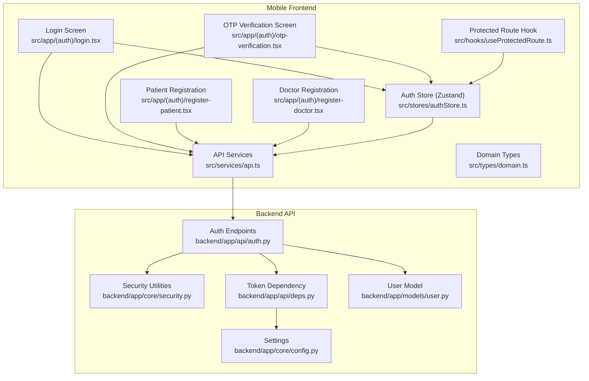
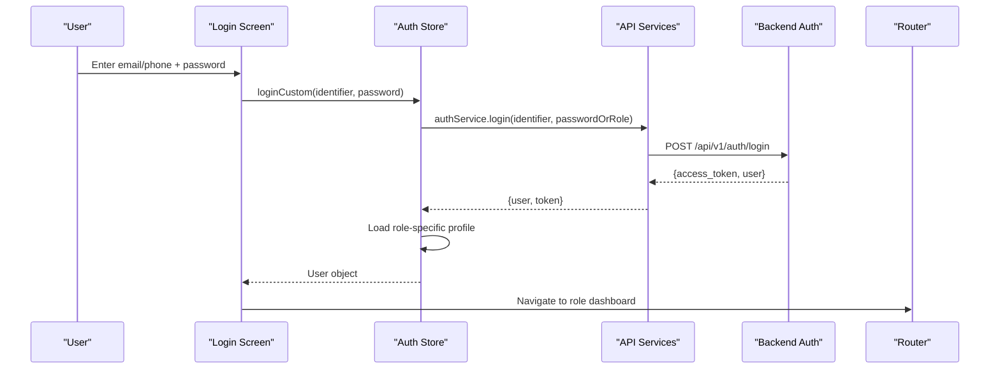
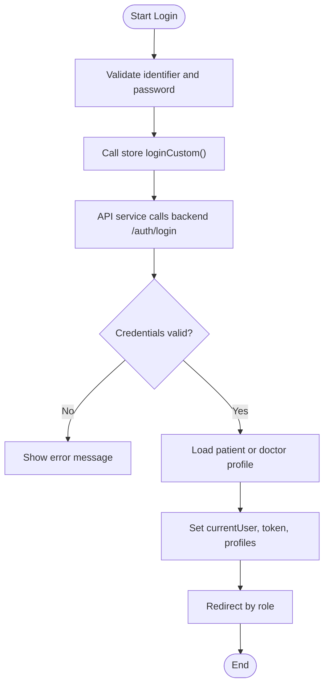
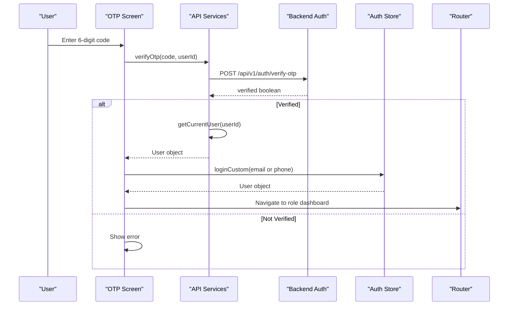
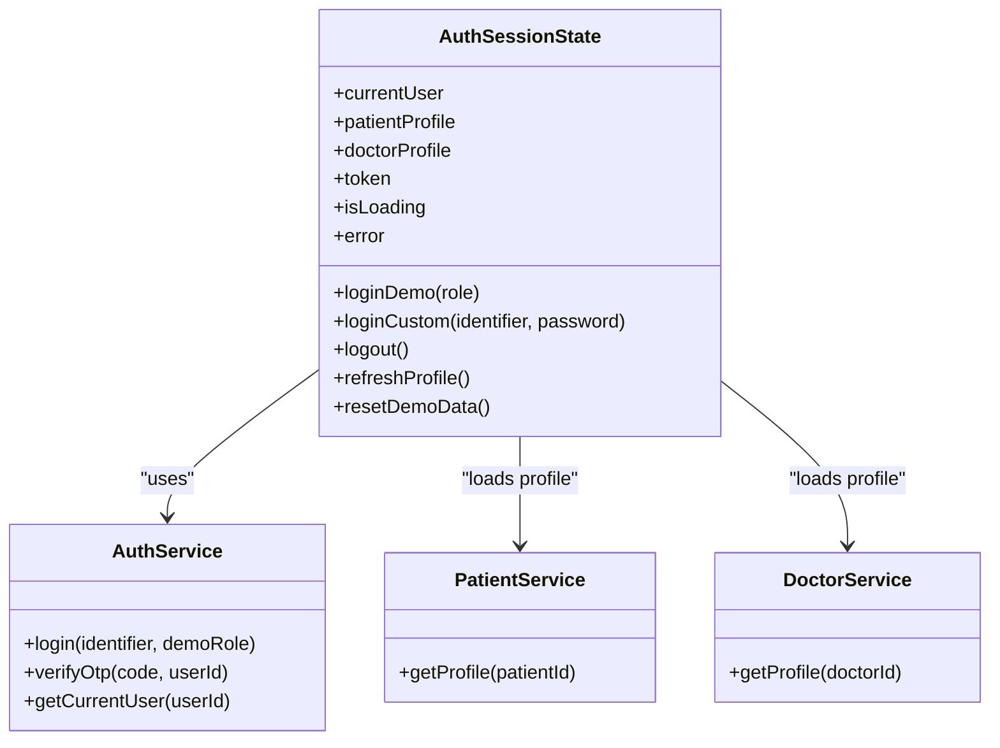
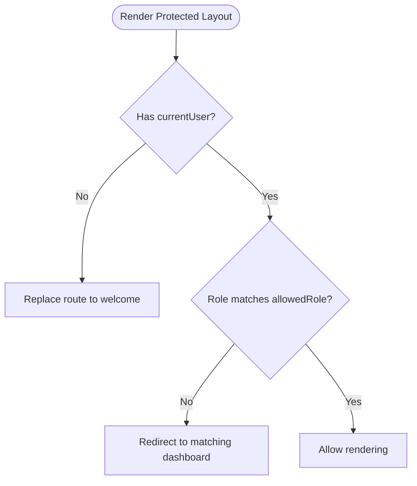
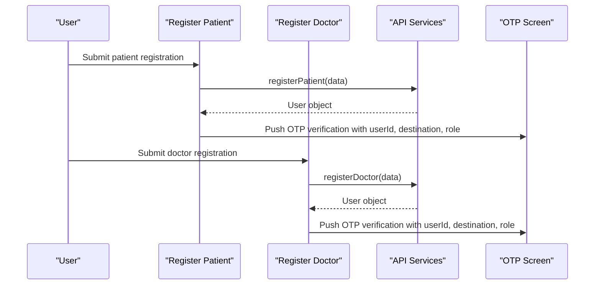
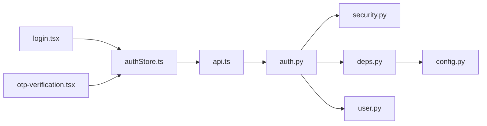

# Authentication & Authorization

<cite>
**Referenced Files in This Document**
- [authStore.ts](file://src/stores/authStore.ts)
- [useProtectedRoute.ts](file://src/hooks/useProtectedRoute.ts)
- [login.tsx](file://src/app/(auth)/login.tsx)
- [otp-verification.tsx](file://src/app/(auth)/otp-verification.tsx)
- [register-patient.tsx](file://src/app/(auth)/register-patient.tsx)
- [register-doctor.tsx](file://src/app/(auth)/register-doctor.tsx)
- [api.ts](file://src/services/api.ts)
- [domain.ts](file://src/types/domain.ts)
- [auth.py](file://backend/app/api/auth.py)
- [security.py](file://backend/app/core/security.py)
- [config.py](file://backend/app/core/config.py)
- [deps.py](file://backend/app/api/deps.py)
- [user.py](file://backend/app/models/user.py)
</cite>

## Table of Contents
1. [Introduction](#introduction)
2. [Project Structure](#project-structure)
3. [Core Components](#core-components)
4. [Architecture Overview](#architecture-overview)
5. [Detailed Component Analysis](#detailed-component-analysis)
6. [Dependency Analysis](#dependency-analysis)
7. [Performance Considerations](#performance-considerations)
8. [Troubleshooting Guide](#troubleshooting-guide)
9. [Conclusion](#conclusion)
10. [Appendices](#appendices)

## Introduction
This document explains the authentication and authorization system for a multi-role application supporting patients, doctors, and administrators. It covers:
- Multi-role login with email or phone identifiers
- OTP verification using six-digit codes
- Centralized session state management using Zustand
- Role-based access control through protected routes and navigation guards
- Demo mode with pre-configured test credentials and auto-fill behavior
- Security considerations including password hashing, JWT tokens, and backend dependency injection
- Guidance for extending roles and implementing custom authentication flows

The frontend is built with React Native and Expo Router, while the backend is a FastAPI service that issues JWTs and validates credentials.

## Project Structure
Authentication-related code is split between mobile screens, a centralized auth store, route protection hooks, API services, and backend endpoints.

**Diagram sources**
- [login.tsx:1-174](file://src/app/(auth)/login.tsx#L1-L174)
- [otp-verification.tsx:1-199](file://src/app/(auth)/otp-verification.tsx#L1-L199)
- [register-patient.tsx:1-234](file://src/app/(auth)/register-patient.tsx#L1-L234)
- [register-doctor.tsx:1-251](file://src/app/(auth)/register-doctor.tsx#L1-L251)
- [authStore.ts:1-112](file://src/stores/authStore.ts#L1-L112)
- [useProtectedRoute.ts:1-40](file://src/hooks/useProtectedRoute.ts#L1-L40)
- [api.ts:1-660](file://src/services/api.ts#L1-L660)
- [auth.py:1-182](file://backend/app/api/auth.py#L1-L182)
- [security.py:1-27](file://backend/app/core/security.py#L1-L27)
- [deps.py:1-42](file://backend/app/api/deps.py#L1-L42)
- [config.py:1-33](file://backend/app/core/config.py#L1-L33)
- [user.py:1-82](file://backend/app/models/user.py#L1-L82)

**Section sources**
- [login.tsx:1-174](file://src/app/(auth)/login.tsx#L1-L174)
- [otp-verification.tsx:1-199](file://src/app/(auth)/otp-verification.tsx#L1-L199)
- [authStore.ts:1-112](file://src/stores/authStore.ts#L1-L112)
- [useProtectedRoute.ts:1-40](file://src/hooks/useProtectedRoute.ts#L1-L40)
- [api.ts:1-660](file://src/services/api.ts#L1-L660)
- [auth.py:1-182](file://backend/app/api/auth.py#L1-L182)

## Core Components
- Auth Store (Zustand): Holds current user, token, role-specific profiles, loading state, and error messages. Provides actions for demo login, custom login, logout, profile refresh, and demo data reset.
- Protected Route Hook: Enforces role-based access by redirecting unauthenticated users to welcome and misrouted users to their correct dashboard.
- Login Screen: Accepts email or phone plus password, validates inputs, calls the store, and navigates based on role.
- OTP Verification Screen: Validates a six-digit code, verifies via backend or fallback, logs in the user, and redirects by role.
- API Services: Abstracts network calls to the backend and provides mock/fallback behavior for offline or local development.
- Backend Auth Endpoints: Handles registration, login with email/phone lookup, OTP verification, password reset, and authenticated user retrieval.
- Security Utilities: Password hashing and JWT creation.
- Token Dependency: Decodes JWTs and loads the current user from the database.

**Section sources**
- [authStore.ts:1-112](file://src/stores/authStore.ts#L1-L112)
- [useProtectedRoute.ts:1-40](file://src/hooks/useProtectedRoute.ts#L1-L40)
- [login.tsx:1-174](file://src/app/(auth)/login.tsx#L1-L174)
- [otp-verification.tsx:1-199](file://src/app/(auth)/otp-verification.tsx#L1-L199)
- [api.ts:1-660](file://src/services/api.ts#L1-L660)
- [auth.py:1-182](file://backend/app/api/auth.py#L1-L182)
- [security.py:1-27](file://backend/app/core/security.py#L1-L27)
- [deps.py:1-42](file://backend/app/api/deps.py#L1-L42)

## Architecture Overview
The authentication flow integrates UI screens, a centralized store, API services, and backend endpoints.

**Diagram sources**
- [login.tsx:23-46](file://src/app/(auth)/login.tsx#L23-L46)
- [authStore.ts:58-83](file://src/stores/authStore.ts#L58-L83)
- [api.ts:46-104](file://src/services/api.ts#L46-L104)
- [auth.py:121-153](file://backend/app/api/auth.py#L121-L153)

## Detailed Component Analysis

### Multi-Role Authentication Flow
Roles supported:
- Patient
- Doctor
- Admin

Login supports both email and phone identifiers. After successful authentication, the app loads the appropriate profile and navigates to the corresponding dashboard group.

**Diagram sources**
- [login.tsx:23-46](file://src/app/(auth)/login.tsx#L23-L46)
- [authStore.ts:58-83](file://src/stores/authStore.ts#L58-L83)
- [api.ts:46-104](file://src/services/api.ts#L46-L104)
- [auth.py:121-153](file://backend/app/api/auth.py#L121-L153)

**Section sources**
- [login.tsx:18-46](file://src/app/(auth)/login.tsx#L18-L46)
- [authStore.ts:23-83](file://src/stores/authStore.ts#L23-L83)
- [api.ts:46-104](file://src/services/api.ts#L46-L104)
- [auth.py:121-153](file://backend/app/api/auth.py#L121-L153)

### Email and Phone Validation
- The login screen requires an identifier (email or phone) and a password.
- Input validation ensures fields are not empty before calling the store.
- The backend accepts either email or phone in the login request and returns a token if credentials match.

Key behaviors:
- Frontend validation prevents submission without required fields.
- Backend query matches identifier against email or phone columns.
- Demo passwords are accepted for testing when configured.

**Section sources**
- [login.tsx:18-46](file://src/app/(auth)/login.tsx#L18-L46)
- [auth.py:121-153](file://backend/app/api/auth.py#L121-L153)

### OTP Verification System
The OTP screen enforces a six-digit code and verifies it via the backend or fallback logic. On success, it retrieves the current user and completes login.

Flow highlights:
- Input must be exactly six digits.
- Backend endpoint accepts a standard demo code or any six-digit code for simulation.
- Successful verification triggers login and role-based redirection.

**Diagram sources**
- [otp-verification.tsx:28-66](file://src/app/(auth)/otp-verification.tsx#L28-L66)
- [api.ts:106-122](file://src/services/api.ts#L106-L122)
- [auth.py:156-164](file://backend/app/api/auth.py#L156-L164)

**Section sources**
- [otp-verification.tsx:16-66](file://src/app/(auth)/otp-verification.tsx#L16-L66)
- [api.ts:106-122](file://src/services/api.ts#L106-L122)
- [auth.py:156-164](file://backend/app/api/auth.py#L156-L164)

### Session Management with Zustand
The auth store centralizes:
- Current user
- Role-specific profiles
- Access token
- Loading and error states
- Actions for login, logout, profile refresh, and demo data reset

Behavior details:
- Demo login uses predefined keys to map to test credentials and roles.
- Custom login accepts an identifier and optional password; the API service maps demo keys to real credentials when needed.
- Profile loading is role-aware: patient profiles for patients, doctor profiles for doctors.
- Logout clears all session state.

**Diagram sources**
- [authStore.ts:1-112](file://src/stores/authStore.ts#L1-L112)
- [api.ts:25-41](file://src/services/api.ts#L25-L41)
- [api.ts:247-278](file://src/services/api.ts#L247-L278)
- [api.ts:432-472](file://src/services/api.ts#L432-L472)

**Section sources**
- [authStore.ts:1-112](file://src/stores/authStore.ts#L1-L112)
- [api.ts:46-104](file://src/services/api.ts#L46-L104)

### Role-Based Access Control and Navigation Guards
The protected route hook enforces:
- Unauthenticated users are redirected to the welcome screen.
- Users with incorrect roles are redirected to their own dashboard.
- Authorized users can render protected content.

**Diagram sources**
- [useProtectedRoute.ts:11-38](file://src/hooks/useProtectedRoute.ts#L11-L38)

**Section sources**
- [useProtectedRoute.ts:1-40](file://src/hooks/useProtectedRoute.ts#L1-L40)

### Registration Flows and OTP Handoff
Both patient and doctor registration flows validate input, call the API service, and navigate to OTP verification with user context.

- Patient registration collects name, contact info, password, and consent checkboxes, then navigates to OTP verification.
- Doctor registration collects professional details, license number, qualifications, experience, coverage districts, and contact info, then navigates to OTP verification.

**Diagram sources**
- [register-patient.tsx:28-69](file://src/app/(auth)/register-patient.tsx#L28-L69)
- [register-doctor.tsx:37-65](file://src/app/(auth)/register-doctor.tsx#L37-L65)
- [api.ts:124-234](file://src/services/api.ts#L124-L234)

**Section sources**
- [register-patient.tsx:17-69](file://src/app/(auth)/register-patient.tsx#L17-L69)
- [register-doctor.tsx:17-65](file://src/app/(auth)/register-doctor.tsx#L17-L65)
- [api.ts:124-234](file://src/services/api.ts#L124-L234)

### Demo Mode Support
Demo mode enables quick testing with pre-configured credentials:
- Frontend API service maps demo keys to known emails and passwords.
- Backend accepts specific demo passwords for convenience during development.
- OTP verification includes a fast-fill option using a configured demo code.

Key points:
- Demo login keys include patient, doctor, and admin variants.
- Fallback behavior allows local testing even when the backend is unavailable.
- Demo OTP code is configurable and used for rapid verification.

**Section sources**
- [api.ts:46-104](file://src/services/api.ts#L46-L104)
- [auth.py:138-146](file://backend/app/api/auth.py#L138-L146)
- [otp-verification.tsx:68-70](file://src/app/(auth)/otp-verification.tsx#L68-L70)

### Security Considerations
- Password handling:
  - Backend hashes passwords using bcrypt before storage.
  - Verification compares plain input against stored hashes.
- Tokens:
  - JWTs are created with a secret key and algorithm configured in settings.
  - Token expiration is set via configuration.
- Dependency injection:
  - Protected endpoints use a dependency to decode tokens and load the current user.
- Demo shortcuts:
  - Demo passwords are accepted only for testing; remove or restrict them in production.

Recommendations:
- Never expose secrets in client code.
- Rotate JWT secrets regularly.
- Enforce strong password policies server-side.
- Remove demo password shortcuts in production builds.

**Section sources**
- [security.py:1-27](file://backend/app/core/security.py#L1-L27)
- [config.py:10-30](file://backend/app/core/config.py#L10-L30)
- [deps.py:12-42](file://backend/app/api/deps.py#L12-L42)
- [auth.py:138-146](file://backend/app/api/auth.py#L138-L146)

### Relationship Between Authentication State and Route Protection
- The auth store holds the current user and token after login.
- The protected route hook reads the current user and enforces role checks.
- Screens should rely on the hook to prevent unauthorized rendering and ensure safe navigation.

Best practices:
- Always wrap protected layouts with the hook.
- Avoid bypassing the hook to access sensitive routes.
- Use the store’s logout action to clear state and force re-authentication.

**Section sources**
- [authStore.ts:23-93](file://src/stores/authStore.ts#L23-L93)
- [useProtectedRoute.ts:11-38](file://src/hooks/useProtectedRoute.ts#L11-L38)

## Dependency Analysis
The authentication subsystem has clear boundaries:
- UI components depend on the auth store and API services.
- API services abstract backend endpoints and provide mock fallbacks.
- Backend endpoints depend on security utilities, configuration, and dependencies for token validation.

**Diagram sources**
- [login.tsx:1-174](file://src/app/(auth)/login.tsx#L1-L174)
- [otp-verification.tsx:1-199](file://src/app/(auth)/otp-verification.tsx#L1-L199)
- [authStore.ts:1-112](file://src/stores/authStore.ts#L1-L112)
- [api.ts:1-660](file://src/services/api.ts#L1-L660)
- [auth.py:1-182](file://backend/app/api/auth.py#L1-L182)
- [security.py:1-27](file://backend/app/core/security.py#L1-L27)
- [deps.py:1-42](file://backend/app/api/deps.py#L1-L42)
- [config.py:1-33](file://backend/app/core/config.py#L1-L33)
- [user.py:1-82](file://backend/app/models/user.py#L1-L82)

**Section sources**
- [api.ts:1-660](file://src/services/api.ts#L1-L660)
- [auth.py:1-182](file://backend/app/api/auth.py#L1-L182)

## Performance Considerations
- Minimize unnecessary profile loads: Only fetch patient or doctor profiles after successful login.
- Debounce repeated OTP attempts to reduce backend load.
- Cache tokens securely and avoid redundant network calls for the same user session.
- Use lazy loading for role-specific dashboards to improve initial render time.
- Keep demo fallbacks lightweight and disable them in production.

[No sources needed since this section provides general guidance]

## Troubleshooting Guide
Common issues and resolutions:
- Invalid credentials:
  - Verify email or phone exists and password matches.
  - Check backend demo password allowances during development.
- OTP verification failures:
  - Ensure the code is exactly six digits.
  - Confirm backend endpoint availability or fallback behavior.
- Unauthorized navigation:
  - Confirm the user’s role matches the target route.
  - Use the protected route hook to enforce redirection automatically.
- Profile not loaded:
  - Ensure the store’s profile refresh action is called after login.
  - Verify role-specific profile endpoints return expected data.

**Section sources**
- [login.tsx:23-46](file://src/app/(auth)/login.tsx#L23-L46)
- [otp-verification.tsx:28-66](file://src/app/(auth)/otp-verification.tsx#L28-L66)
- [useProtectedRoute.ts:11-38](file://src/hooks/useProtectedRoute.ts#L11-L38)
- [authStore.ts:95-110](file://src/stores/authStore.ts#L95-L110)

## Conclusion
The authentication and authorization system combines a robust backend with a structured frontend architecture:
- Multi-role support for patients, doctors, and admins
- Secure credential handling with hashed passwords and JWTs
- Centralized session state with Zustand
- Role-based route protection via hooks
- Demo mode for rapid testing
- Clear extension points for adding new roles and custom flows

Adhering to the documented patterns ensures secure, maintainable, and scalable authentication across the application.

[No sources needed since this section summarizes without analyzing specific files]

## Appendices

### Extending the Role System
To add a new role:
- Define the role in domain types and backend enums.
- Update login and OTP flows to handle the new role.
- Add role-specific profile loading in the auth store.
- Extend the protected route hook to allow the new role.
- Create or update dashboard groups and routes for the new role.

### Implementing Custom Authentication Flows
Examples:
- Social login integration:
  - Add a social provider service in API services.
  - Map provider responses to internal user objects.
  - Store tokens and profiles in the auth store.
- Two-factor authentication beyond OTP:
  - Extend OTP verification with additional factors like TOTP or email links.
  - Update backend endpoints to validate additional factors.
  - Modify UI flows to collect and submit additional factors.

[No sources needed since this section provides general guidance]