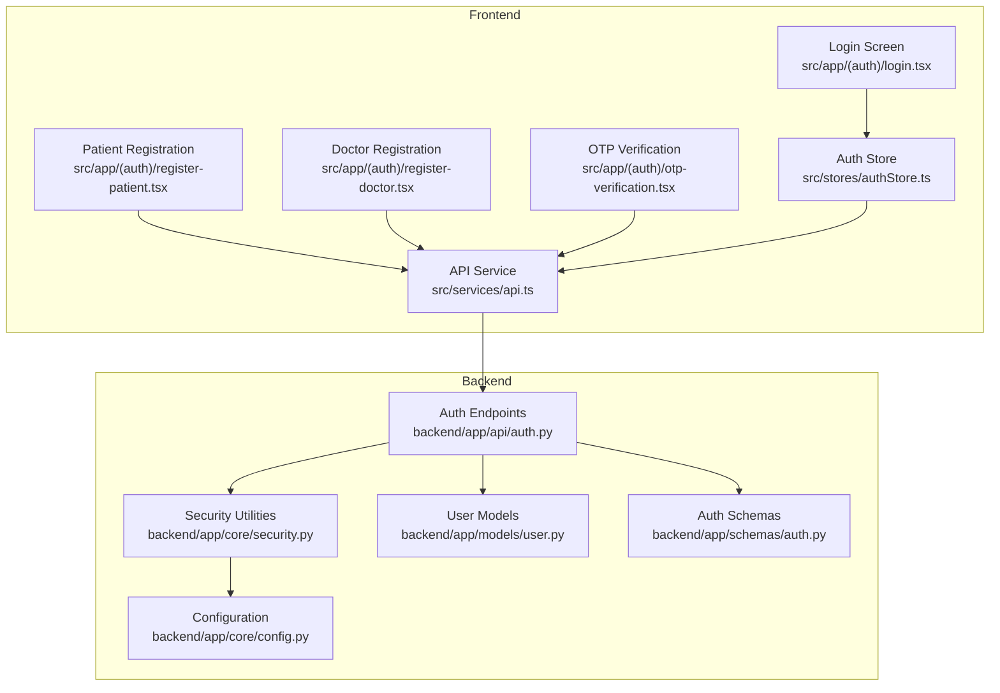
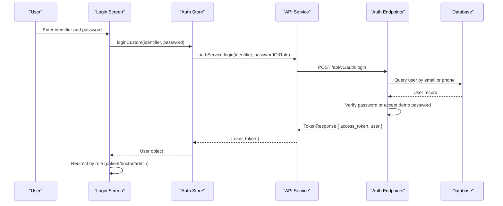
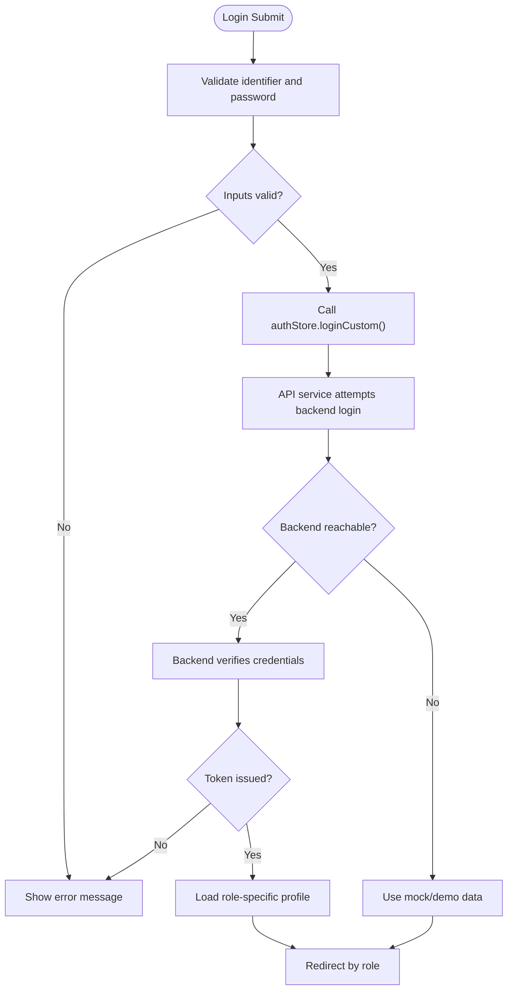
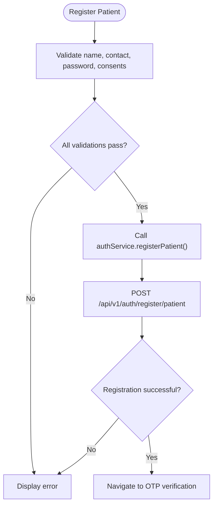
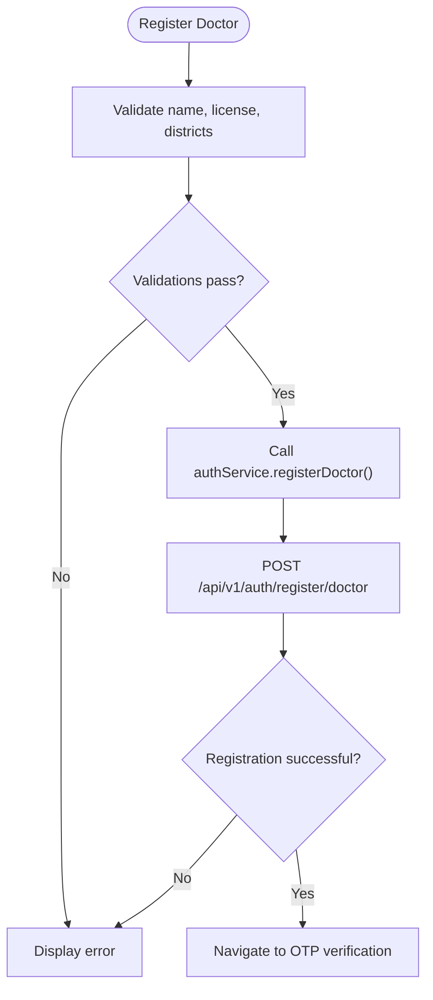
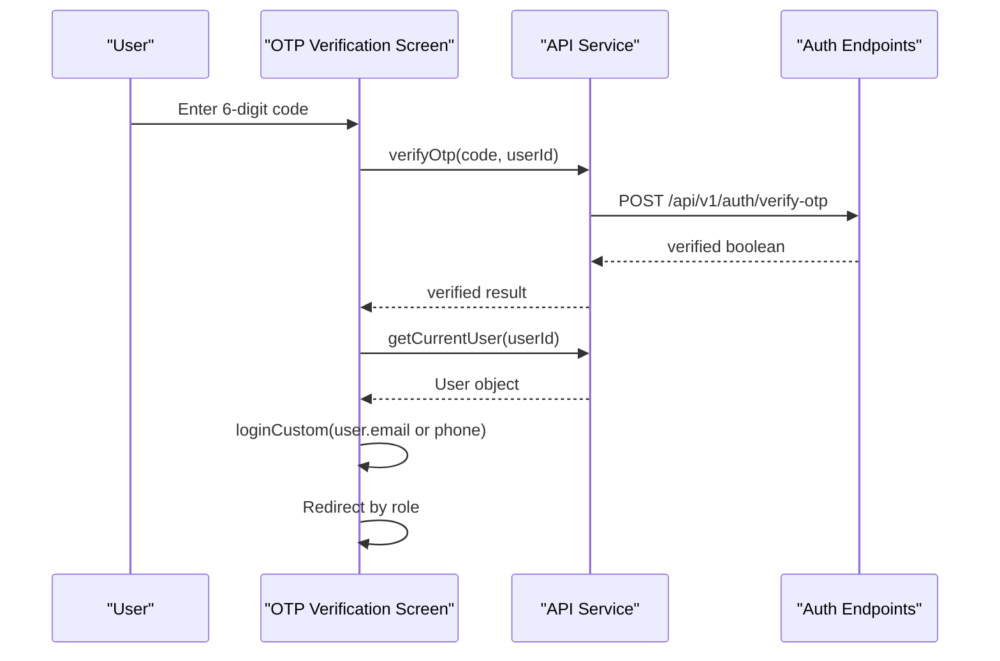
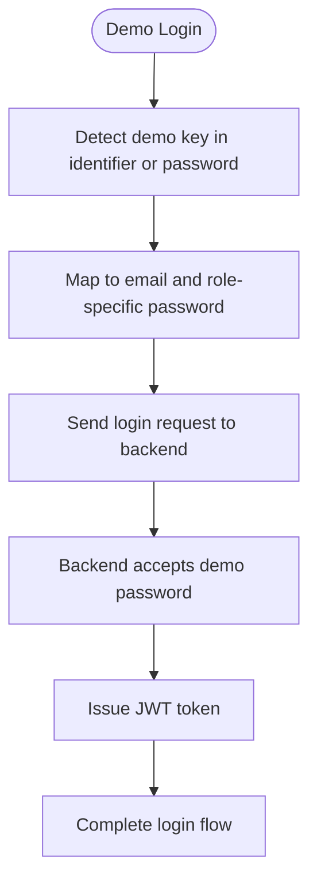
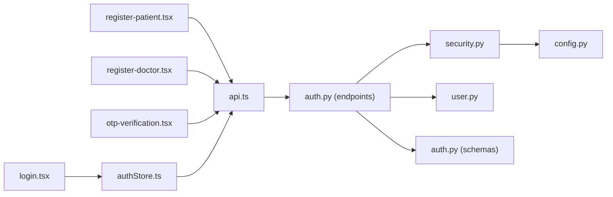

# Login Flows & Authentication Methods

<cite>
**Referenced Files in This Document**
- [login.tsx](file://src/app/(auth)/login.tsx)
- [register-patient.tsx](file://src/app/(auth)/register-patient.tsx)
- [register-doctor.tsx](file://src/app/(auth)/register-doctor.tsx)
- [otp-verification.tsx](file://src/app/(auth)/otp-verification.tsx)
- [authStore.ts](file://src/stores/authStore.ts)
- [api.ts](file://src/services/api.ts)
- [auth.py](file://backend/app/api/auth.py)
- [security.py](file://backend/app/core/security.py)
- [config.py](file://backend/app/core/config.py)
- [user.py](file://backend/app/models/user.py)
- [auth.py (schemas)](file://backend/app/schemas/auth.py)
- [seed_db.py](file://backend/seed_db.py)
</cite>

## Table of Contents
1. [Introduction](#introduction)
2. [Project Structure](#project-structure)
3. [Core Components](#core-components)
4. [Architecture Overview](#architecture-overview)
5. [Detailed Component Analysis](#detailed-component-analysis)
6. [Dependency Analysis](#dependency-analysis)
7. [Performance Considerations](#performance-considerations)
8. [Troubleshooting Guide](#troubleshooting-guide)
9. [Security Considerations](#security-considerations)
10. [Extending Authentication Providers](#extending-authentication-providers)
11. [Conclusion](#conclusion)

## Introduction
This document explains the login flows and authentication methods for the application, including:
- Multi-method authentication supporting demo mode with pre-configured credentials and custom authentication using email or phone.
- The login form implementation with input validation, error handling, and role-based redirection to patient, doctor, or admin sections.
- Registration flows for patients and doctors, including form validation and account creation processes.
- OTP verification as part of registration and login completion.
- Security considerations for password hashing, token issuance, and credential storage.
- Guidance on extending the system with custom authentication providers.

## Project Structure
The authentication logic spans both frontend screens and backend endpoints:
- Frontend screens handle user input, validation, and navigation.
- A state store manages sessions and profile loading.
- An API service layer abstracts calls to a FastAPI backend and provides mock fallbacks.
- Backend endpoints implement registration, login, OTP verification, and JWT token issuance.

**Diagram sources**
- [login.tsx:17-46](file://src/app/(auth)/login.tsx#L17-L46)
- [register-patient.tsx:28-69](file://src/app/(auth)/register-patient.tsx#L28-L69)
- [register-doctor.tsx:37-65](file://src/app/(auth)/register-doctor.tsx#L37-L65)
- [otp-verification.tsx:28-66](file://src/app/(auth)/otp-verification.tsx#L28-L66)
- [authStore.ts:23-83](file://src/stores/authStore.ts#L23-L83)
- [api.ts:46-104](file://src/services/api.ts#L46-L104)
- [auth.py:24-153](file://backend/app/api/auth.py#L24-L153)
- [security.py:10-26](file://backend/app/core/security.py#L10-L26)
- [config.py:10-30](file://backend/app/core/config.py#L10-L30)
- [user.py:26-43](file://backend/app/models/user.py#L26-L43)
- [auth.py (schemas):52-62](file://backend/app/schemas/auth.py#L52-L62)

**Section sources**
- [login.tsx:17-46](file://src/app/(auth)/login.tsx#L17-L46)
- [register-patient.tsx:28-69](file://src/app/(auth)/register-patient.tsx#L28-L69)
- [register-doctor.tsx:37-65](file://src/app/(auth)/register-doctor.tsx#L37-L65)
- [otp-verification.tsx:28-66](file://src/app/(auth)/otp-verification.tsx#L28-L66)
- [authStore.ts:23-83](file://src/stores/authStore.ts#L23-L83)
- [api.ts:46-104](file://src/services/api.ts#L46-L104)
- [auth.py:24-153](file://backend/app/api/auth.py#L24-L153)
- [security.py:10-26](file://backend/app/core/security.py#L10-L26)
- [config.py:10-30](file://backend/app/core/config.py#L10-L30)
- [user.py:26-43](file://backend/app/models/user.py#L26-L43)
- [auth.py (schemas):52-62](file://backend/app/schemas/auth.py#L52-L62)

## Core Components
- Login screen: Validates identifier and password, calls the auth store, and redirects based on user role.
- Registration screens: Validate required fields and consent, call the API service, and navigate to OTP verification.
- OTP verification: Validates code length, verifies via API or mock, then logs in and redirects by role.
- Auth store: Provides demo and custom login actions, loads profiles by role, and manages session state.
- API service: Abstracts backend calls, supports demo keys, and falls back to local mock data when needed.
- Backend auth endpoints: Implement registration, login with demo password support, OTP verification, and token issuance.
- Security utilities: Handle password hashing and JWT token creation.
- Configuration: Defines JWT settings and environment variables.
- Models and schemas: Define user roles, profiles, request/response structures.

**Section sources**
- [login.tsx:17-46](file://src/app/(auth)/login.tsx#L17-L46)
- [register-patient.tsx:28-69](file://src/app/(auth)/register-patient.tsx#L28-L69)
- [register-doctor.tsx:37-65](file://src/app/(auth)/register-doctor.tsx#L37-L65)
- [otp-verification.tsx:28-66](file://src/app/(auth)/otp-verification.tsx#L28-L66)
- [authStore.ts:23-83](file://src/stores/authStore.ts#L23-L83)
- [api.ts:46-104](file://src/services/api.ts#L46-L104)
- [auth.py:24-153](file://backend/app/api/auth.py#L24-L153)
- [security.py:10-26](file://backend/app/core/security.py#L10-L26)
- [config.py:10-30](file://backend/app/core/config.py#L10-L30)
- [user.py:26-43](file://backend/app/models/user.py#L26-L43)
- [auth.py (schemas):52-62](file://backend/app/schemas/auth.py#L52-L62)

## Architecture Overview
The authentication architecture combines frontend UI flows with backend services:
- Frontend screens collect inputs and validate them locally.
- The API service attempts real backend calls; if unavailable, it uses mock data and simulated latency.
- The backend validates credentials, optionally accepts demo passwords, issues JWT tokens, and returns user data.
- The auth store persists session state and fetches role-specific profiles.

**Diagram sources**
- [login.tsx:23-46](file://src/app/(auth)/login.tsx#L23-L46)
- [authStore.ts:58-83](file://src/stores/authStore.ts#L58-L83)
- [api.ts:46-104](file://src/services/api.ts#L46-L104)
- [auth.py:121-153](file://backend/app/api/auth.py#L121-L153)

## Detailed Component Analysis

### Login Flow
- Input validation: Ensures identifier and password are non-empty.
- Error handling: Displays user-friendly messages on failure.
- Role-based redirection: Navigates to patient, doctor, or admin routes after successful login.
- Demo mode: The API service recognizes demo keys and maps them to predefined credentials; the backend also accepts specific demo passwords for testing.

**Diagram sources**
- [login.tsx:23-46](file://src/app/(auth)/login.tsx#L23-L46)
- [authStore.ts:58-83](file://src/stores/authStore.ts#L58-L83)
- [api.ts:46-104](file://src/services/api.ts#L46-L104)
- [auth.py:121-153](file://backend/app/api/auth.py#L121-L153)

**Section sources**
- [login.tsx:23-46](file://src/app/(auth)/login.tsx#L23-L46)
- [authStore.ts:58-83](file://src/stores/authStore.ts#L58-L83)
- [api.ts:46-104](file://src/services/api.ts#L46-L104)
- [auth.py:121-153](file://backend/app/api/auth.py#L121-L153)

### Patient Registration Flow
- Form validation: Requires full name, at least one contact method (email or phone), minimum password length, and explicit consent checkboxes.
- Account creation: Calls the backend registration endpoint; on success, navigates to OTP verification with user details.
- Consent handling: Enforces legal consent for terms and health data processing before submission.

**Diagram sources**
- [register-patient.tsx:28-69](file://src/app/(auth)/register-patient.tsx#L28-L69)
- [api.ts:124-197](file://src/services/api.ts#L124-L197)
- [auth.py:24-65](file://backend/app/api/auth.py#L24-L65)

**Section sources**
- [register-patient.tsx:28-69](file://src/app/(auth)/register-patient.tsx#L28-L69)
- [api.ts:124-197](file://src/services/api.ts#L124-L197)
- [auth.py:24-65](file://backend/app/api/auth.py#L24-L65)

### Doctor Registration Flow
- Form validation: Requires doctor name, license number, and at least one coverage district; optional fields include specialty, qualifications, experience years, contact info.
- Account creation: Submits registration data; on success, navigates to OTP verification.
- Coverage districts: Uses configurable district list from theme configuration.

**Diagram sources**
- [register-doctor.tsx:37-65](file://src/app/(auth)/register-doctor.tsx#L37-L65)
- [api.ts:200-234](file://src/services/api.ts#L200-L234)
- [auth.py:68-118](file://backend/app/api/auth.py#L68-L118)

**Section sources**
- [register-doctor.tsx:37-65](file://src/app/(auth)/register-doctor.tsx#L37-L65)
- [api.ts:200-234](file://src/services/api.ts#L200-L234)
- [auth.py:68-118](file://backend/app/api/auth.py#L68-L118)

### OTP Verification Flow
- Code validation: Checks for a 6-digit code; supports demo fast-fill.
- Verification: Calls backend verify-otp endpoint; falls back to mock behavior if unreachable.
- Post-verification: Retrieves current user, performs login, and redirects by role.

**Diagram sources**
- [otp-verification.tsx:28-66](file://src/app/(auth)/otp-verification.tsx#L28-L66)
- [api.ts:106-122](file://src/services/api.ts#L106-L122)
- [auth.py:156-164](file://backend/app/api/auth.py#L156-L164)

**Section sources**
- [otp-verification.tsx:28-66](file://src/app/(auth)/otp-verification.tsx#L28-L66)
- [api.ts:106-122](file://src/services/api.ts#L106-L122)
- [auth.py:156-164](file://backend/app/api/auth.py#L156-L164)

### Demo Mode Credentials
- Frontend demo keys: Recognizes identifiers like patient1, patient2, doctor1, doctor2, admin and maps them to predefined emails and passwords.
- Backend demo passwords: Accepts specific test passwords alongside hashed password verification.
- Seeded accounts: Pre-seeds core users with hashed passwords for quick testing.

**Diagram sources**
- [api.ts:46-104](file://src/services/api.ts#L46-L104)
- [auth.py:138-146](file://backend/app/api/auth.py#L138-L146)
- [seed_db.py:27-99](file://backend/seed_db.py#L27-L99)

**Section sources**
- [api.ts:46-104](file://src/services/api.ts#L46-L104)
- [auth.py:138-146](file://backend/app/api/auth.py#L138-L146)
- [seed_db.py:27-99](file://backend/seed_db.py#L27-L99)

## Dependency Analysis
The authentication components have clear dependencies:
- Screens depend on the auth store for session management.
- Auth store depends on the API service for network operations.
- API service depends on backend endpoints and mock stores.
- Backend endpoints depend on security utilities, models, and schemas.
- Security utilities depend on configuration for JWT settings.

**Diagram sources**
- [login.tsx:17-46](file://src/app/(auth)/login.tsx#L17-L46)
- [register-patient.tsx:28-69](file://src/app/(auth)/register-patient.tsx#L28-L69)
- [register-doctor.tsx:37-65](file://src/app/(auth)/register-doctor.tsx#L37-L65)
- [otp-verification.tsx:28-66](file://src/app/(auth)/otp-verification.tsx#L28-L66)
- [authStore.ts:23-83](file://src/stores/authStore.ts#L23-L83)
- [api.ts:46-104](file://src/services/api.ts#L46-L104)
- [auth.py:24-153](file://backend/app/api/auth.py#L24-L153)
- [security.py:10-26](file://backend/app/core/security.py#L10-L26)
- [config.py:10-30](file://backend/app/core/config.py#L10-L30)
- [user.py:26-43](file://backend/app/models/user.py#L26-L43)
- [auth.py (schemas):52-62](file://backend/app/schemas/auth.py#L52-L62)

**Section sources**
- [login.tsx:17-46](file://src/app/(auth)/login.tsx#L17-L46)
- [register-patient.tsx:28-69](file://src/app/(auth)/register-patient.tsx#L28-L69)
- [register-doctor.tsx:37-65](file://src/app/(auth)/register-doctor.tsx#L37-L65)
- [otp-verification.tsx:28-66](file://src/app/(auth)/otp-verification.tsx#L28-L66)
- [authStore.ts:23-83](file://src/stores/authStore.ts#L23-L83)
- [api.ts:46-104](file://src/services/api.ts#L46-L104)
- [auth.py:24-153](file://backend/app/api/auth.py#L24-L153)
- [security.py:10-26](file://backend/app/core/security.py#L10-L26)
- [config.py:10-30](file://backend/app/core/config.py#L10-L30)
- [user.py:26-43](file://backend/app/models/user.py#L26-L43)
- [auth.py (schemas):52-62](file://backend/app/schemas/auth.py#L52-L62)

## Performance Considerations
- Simulated latency: The API service introduces delays to mimic network conditions; consider removing or reducing these in production.
- Profile loading: After login, role-specific profiles are fetched; ensure efficient queries and caching strategies.
- Database queries: Use eager loading for related profiles to avoid N+1 queries during login responses.
- Token expiration: Configure appropriate JWT expiry times to balance security and user convenience.

[No sources needed since this section provides general guidance]

## Troubleshooting Guide
Common issues and resolutions:
- Invalid credentials: Ensure the identifier matches an existing user’s email or phone; check backend error responses.
- Demo mode not working: Verify that demo keys are correctly mapped and backend accepts demo passwords.
- OTP verification failures: Confirm code length is six digits; check backend verify-otp response.
- Registration errors: Validate all required fields and consent checkboxes; check uniqueness constraints for email, phone, and license numbers.

**Section sources**
- [login.tsx:43-45](file://src/app/(auth)/login.tsx#L43-L45)
- [register-patient.tsx:28-69](file://src/app/(auth)/register-patient.tsx#L28-L69)
- [register-doctor.tsx:37-65](file://src/app/(auth)/register-doctor.tsx#L37-L65)
- [otp-verification.tsx:28-66](file://src/app/(auth)/otp-verification.tsx#L28-L66)
- [auth.py:24-153](file://backend/app/api/auth.py#L24-L153)

## Security Considerations
- Password handling:
  - Use bcrypt hashing for storing passwords securely.
  - Avoid logging or exposing sensitive data in client-side errors.
- Token issuance:
  - Generate JWTs with secure secret keys and appropriate algorithms.
  - Set reasonable token expiration times.
- Credential storage:
  - Never store plain-text passwords in the database.
  - Use environment variables for secrets and configuration.
- Demo mode risks:
  - Restrict demo password acceptance to development environments only.
  - Remove or disable demo shortcuts in production builds.

**Section sources**
- [security.py:10-26](file://backend/app/core/security.py#L10-L26)
- [config.py:10-30](file://backend/app/core/config.py#L10-L30)
- [auth.py:138-146](file://backend/app/api/auth.py#L138-L146)

## Extending Authentication Providers
To add new authentication methods:
- Frontend:
  - Extend the API service to support new provider login flows.
  - Update the auth store to handle provider-specific tokens and profiles.
  - Add UI elements for provider selection and input collection.
- Backend:
  - Create new endpoints or extend existing ones to handle additional providers.
  - Integrate third-party libraries for OAuth or other protocols.
  - Map external identities to internal user records and roles.
- Security:
  - Validate and sanitize all incoming credentials.
  - Use secure storage for provider tokens and secrets.
  - Implement rate limiting and account lockout policies.

[No sources needed since this section provides general guidance]

## Conclusion
The application implements a robust multi-method authentication system combining frontend validation, state management, and backend verification. It supports demo mode for rapid testing and custom authentication using email or phone. Registration flows enforce necessary validations and consent, while OTP verification adds an extra layer of security. Security best practices are applied for password hashing and token issuance. The architecture is extensible, allowing integration of additional authentication providers and customization of flows as requirements evolve.

[No sources needed since this section summarizes without analyzing specific files]