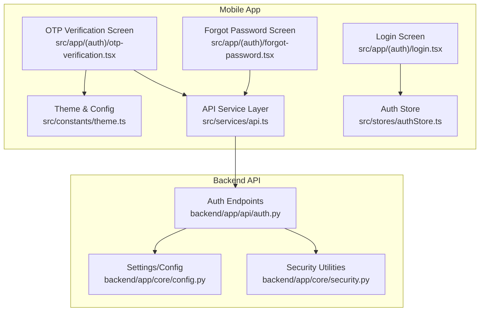
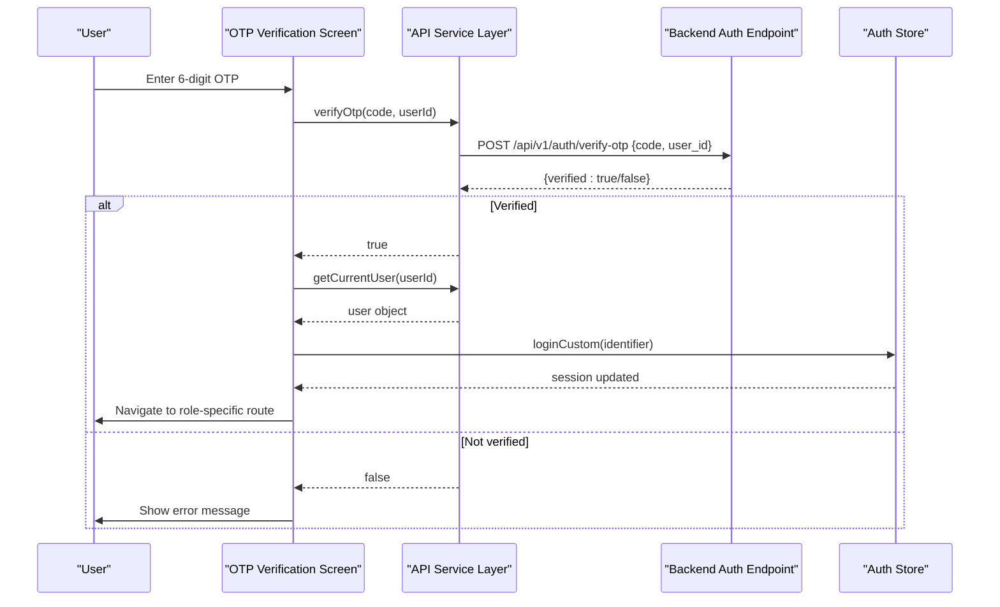
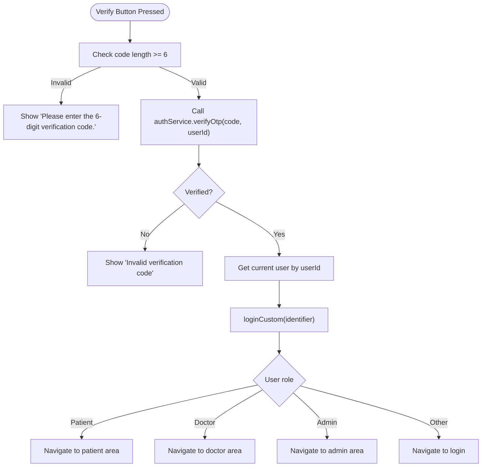
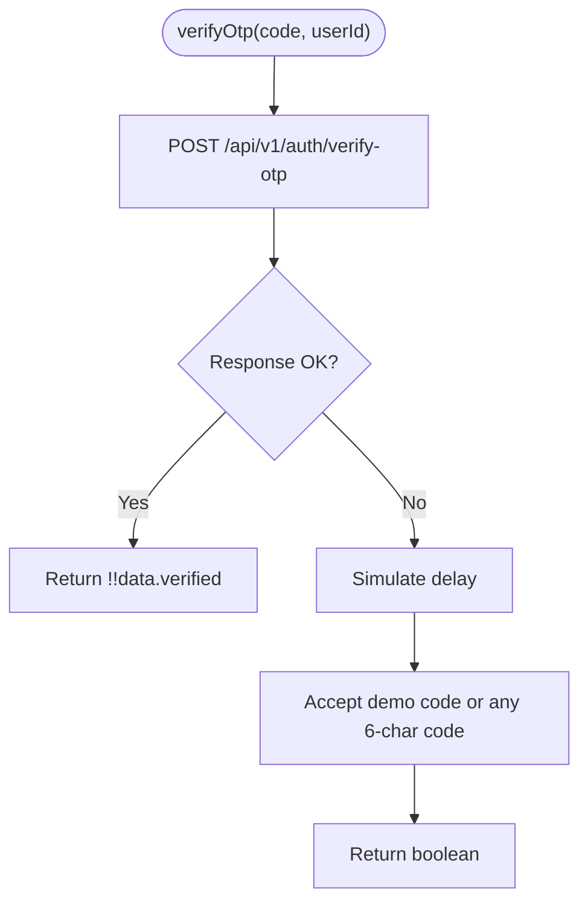
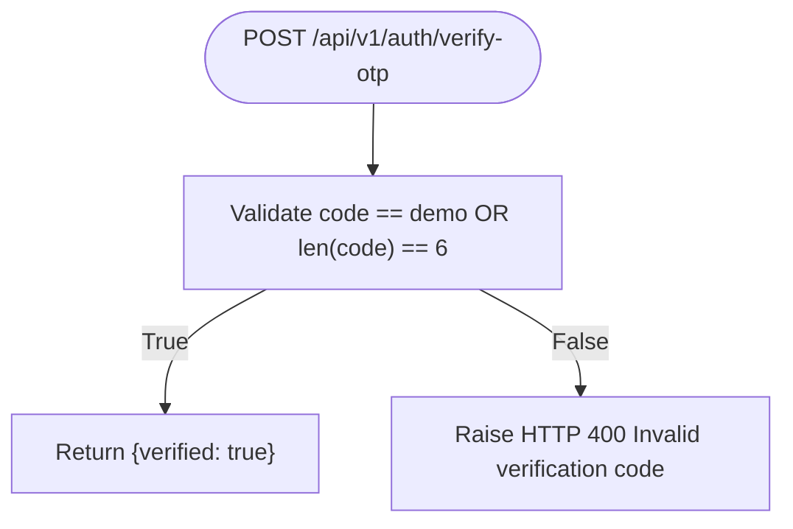
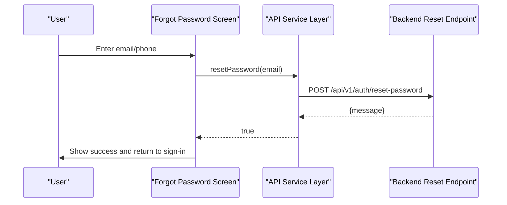
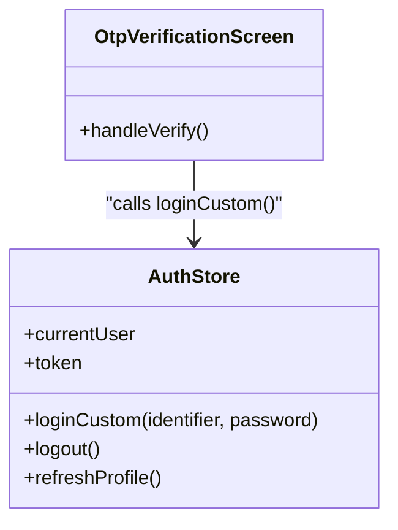
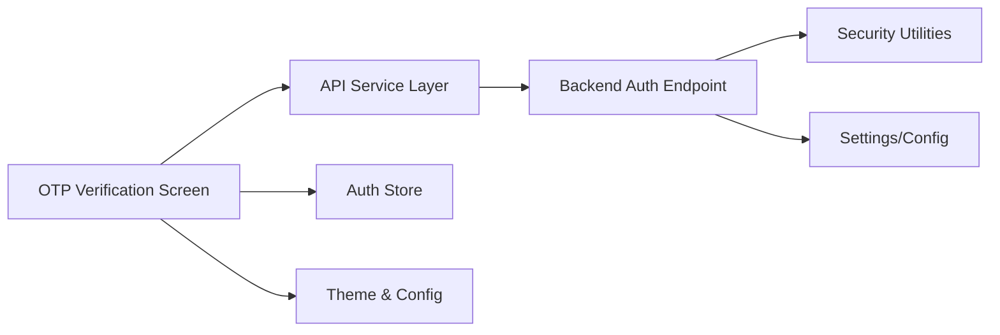

# OTP Verification System

<cite>
**Referenced Files in This Document**
- [otp-verification.tsx](file://src/app/(auth)/otp-verification.tsx)
- [forgot-password.tsx](file://src/app/(auth)/forgot-password.tsx)
- [login.tsx](file://src/app/(auth)/login.tsx)
- [api.ts](file://src/services/api.ts)
- [auth.py](file://backend/app/api/auth.py)
- [security.py](file://backend/app/core/security.py)
- [config.py](file://backend/app/core/config.py)
- [authStore.ts](file://src/stores/authStore.ts)
- [theme.ts](file://src/constants/theme.ts)
</cite>

## Table of Contents
1. [Introduction](#introduction)
2. [Project Structure](#project-structure)
3. [Core Components](#core-components)
4. [Architecture Overview](#architecture-overview)
5. [Detailed Component Analysis](#detailed-component-analysis)
6. [Dependency Analysis](#dependency-analysis)
7. [Performance Considerations](#performance-considerations)
8. [Troubleshooting Guide](#troubleshooting-guide)
9. [Conclusion](#conclusion)
10. [Appendices](#appendices)

## Introduction
This document explains the OTP verification system implemented across the mobile app and backend. It covers:
- 6-digit code generation and delivery (current implementation uses a simulated demo flow)
- Client-side verification workflow
- Backend verification endpoint behavior
- Expiration handling, retry logic, and brute-force protection considerations
- Integration with forgot password flows and account recovery
- Extensibility for custom OTP providers and enhanced workflows
- User experience guidance including auto-fill support and accessibility

## Project Structure
The OTP feature spans both frontend screens and backend endpoints:
- Frontend OTP screen handles input, validation, and navigation after successful verification
- Service layer abstracts API calls and provides fallback/demo behavior
- Backend exposes an OTP verification endpoint and supports password reset initiation
- Auth store manages session state post-verification

**Diagram sources**
- [otp-verification.tsx:16-66](file://src/app/(auth)/otp-verification.tsx#L16-L66)
- [api.ts:106-122](file://src/services/api.ts#L106-L122)
- [auth.py:156-164](file://backend/app/api/auth.py#L156-L164)
- [security.py:18-26](file://backend/app/core/security.py#L18-L26)
- [config.py:18-21](file://backend/app/core/config.py#L18-L21)

**Section sources**
- [otp-verification.tsx:16-66](file://src/app/(auth)/otp-verification.tsx#L16-L66)
- [api.ts:106-122](file://src/services/api.ts#L106-L122)
- [auth.py:156-164](file://backend/app/api/auth.py#L156-L164)

## Core Components
- OTP Verification Screen: Collects the 6-digit code, validates length, calls the service to verify, then logs in and routes by role.
- API Service Layer: Sends the OTP to the backend; if unavailable, falls back to a demo verification that accepts any 6-digit code or a specific demo code.
- Backend Auth Endpoint: Validates the OTP code; currently accepts a demo code or any 6-character string.
- Forgot Password Screen: Initiates password reset instructions via the service layer.
- Auth Store: Persists user session and profile data after login.
- Theme & Config: Provides UI tokens and a demo OTP code constant.

Key responsibilities:
- Input validation on the client side (length check)
- Network call abstraction and fallback behavior
- Role-based routing after successful verification
- Demo-friendly UX for development

**Section sources**
- [otp-verification.tsx:28-66](file://src/app/(auth)/otp-verification.tsx#L28-L66)
- [api.ts:106-122](file://src/services/api.ts#L106-L122)
- [auth.py:156-164](file://backend/app/api/auth.py#L156-L164)
- [forgot-password.tsx:15-21](file://src/app/(auth)/forgot-password.tsx#L15-L21)
- [authStore.ts:58-83](file://src/stores/authStore.ts#L58-L83)
- [theme.ts:58-69](file://src/constants/theme.ts#L58-L69)

## Architecture Overview
The OTP verification flow connects the mobile UI to the backend through a service layer. The current implementation is optimized for demo usage but can be extended to production-grade OTP providers.

**Diagram sources**
- [otp-verification.tsx:28-66](file://src/app/(auth)/otp-verification.tsx#L28-L66)
- [api.ts:106-122](file://src/services/api.ts#L106-L122)
- [auth.py:156-164](file://backend/app/api/auth.py#L156-L164)
- [authStore.ts:58-83](file://src/stores/authStore.ts#L58-L83)

## Detailed Component Analysis

### OTP Verification Screen
Responsibilities:
- Validate that the entered code has at least 6 digits
- Call the service to verify the OTP
- On success, fetch the user and log them in using the auth store
- Route based on user role (patient, doctor, admin)
- Provide resend functionality (currently simulated)

UX highlights:
- Numeric keypad and max length enforced
- Auto-focus on input
- Error messaging for invalid codes
- Resend link placeholder

**Diagram sources**
- [otp-verification.tsx:28-66](file://src/app/(auth)/otp-verification.tsx#L28-L66)

**Section sources**
- [otp-verification.tsx:28-66](file://src/app/(auth)/otp-verification.tsx#L28-L66)
- [otp-verification.tsx:88-97](file://src/app/(auth)/otp-verification.tsx#L88-L97)
- [otp-verification.tsx:109-114](file://src/app/(auth)/otp-verification.tsx#L109-L114)

### API Service Layer (OTP Verification)
Responsibilities:
- Send OTP to backend endpoint
- Return boolean indicating verification success
- Provide fallback/demo behavior when backend is unreachable

Behavior details:
- Attempts network call to `/api/v1/auth/verify-otp`
- If response is OK, returns `verified` flag from payload
- On failure, simulates latency and accepts either a specific demo code or any 6-character code

**Diagram sources**
- [api.ts:106-122](file://src/services/api.ts#L106-L122)

**Section sources**
- [api.ts:106-122](file://src/services/api.ts#L106-L122)

### Backend OTP Endpoint
Responsibilities:
- Accept OTP code and optional user ID
- Validate code length and/or demo code
- Return success or error

Current behavior:
- Accepts a specific demo code or any 6-character string
- Returns a structured response indicating verification status

**Diagram sources**
- [auth.py:156-164](file://backend/app/api/auth.py#L156-L164)

**Section sources**
- [auth.py:156-164](file://backend/app/api/auth.py#L156-L164)

### Forgot Password Flow
Responsibilities:
- Collect email or phone
- Trigger password reset instructions via the service layer
- Display confirmation that instructions were sent

Notes:
- The service method currently simulates a delay and returns success
- The backend endpoint exists but does not implement actual token dispatch in this snapshot

**Diagram sources**
- [forgot-password.tsx:15-21](file://src/app/(auth)/forgot-password.tsx#L15-L21)
- [api.ts:241-244](file://src/services/api.ts#L241-L244)
- [auth.py:167-175](file://backend/app/api/auth.py#L167-L175)

**Section sources**
- [forgot-password.tsx:15-21](file://src/app/(auth)/forgot-password.tsx#L15-L21)
- [api.ts:241-244](file://src/services/api.ts#L241-L244)
- [auth.py:167-175](file://backend/app/api/auth.py#L167-L175)

### Session Management After OTP Verification
Responsibilities:
- Authenticate user using identifier (email or phone)
- Load appropriate profile based on role
- Persist session state

**Diagram sources**
- [authStore.ts:58-83](file://src/stores/authStore.ts#L58-L83)
- [otp-verification.tsx:44-58](file://src/app/(auth)/otp-verification.tsx#L44-L58)

**Section sources**
- [authStore.ts:58-83](file://src/stores/authStore.ts#L58-L83)
- [otp-verification.tsx:44-58](file://src/app/(auth)/otp-verification.tsx#L44-L58)

## Dependency Analysis
- Frontend OTP screen depends on:
  - API service layer for verification and user retrieval
  - Auth store for session management
  - Theme constants for UI styling and demo OTP code
- API service layer depends on:
  - Backend endpoints for authentication and OTP verification
  - Mock store for offline/demo scenarios
- Backend auth endpoint depends on:
  - Security utilities for JWT creation and password hashing
  - Settings/config for token expiration and secrets

**Diagram sources**
- [otp-verification.tsx:11-14](file://src/app/(auth)/otp-verification.tsx#L11-L14)
- [api.ts:106-122](file://src/services/api.ts#L106-L122)
- [auth.py:156-164](file://backend/app/api/auth.py#L156-L164)
- [security.py:18-26](file://backend/app/core/security.py#L18-L26)
- [config.py:18-21](file://backend/app/core/config.py#L18-L21)

**Section sources**
- [otp-verification.tsx:11-14](file://src/app/(auth)/otp-verification.tsx#L11-L14)
- [api.ts:106-122](file://src/services/api.ts#L106-L122)
- [auth.py:156-164](file://backend/app/api/auth.py#L156-L164)
- [security.py:18-26](file://backend/app/core/security.py#L18-L26)
- [config.py:18-21](file://backend/app/core/config.py#L18-L21)

## Performance Considerations
- Network latency simulation: The service layer introduces small delays to mimic real-world conditions during development.
- Minimal client-side processing: OTP verification is lightweight; most logic resides in the backend.
- Avoid unnecessary re-renders: Keep OTP input state minimal and avoid heavy computations in the verification handler.

[No sources needed since this section provides general guidance]

## Troubleshooting Guide
Common issues and resolutions:
- Invalid OTP code: Ensure the code is exactly 6 characters; verify backend endpoint availability.
- Network errors: The service layer falls back to demo verification; confirm backend URL configuration.
- Resend not working: The resend action is currently simulated; integrate a proper resend endpoint later.
- Forgot password not sending: The backend endpoint returns a generic message; implement actual token dispatch and email/SMS provider integration.

Operational checks:
- Confirm backend server is running and reachable at the configured base URL.
- Validate that the OTP input enforces numeric-only and maximum length constraints.
- Review error messages displayed to users for clarity and security (avoid leaking sensitive details).

**Section sources**
- [otp-verification.tsx:28-66](file://src/app/(auth)/otp-verification.tsx#L28-L66)
- [api.ts:106-122](file://src/services/api.ts#L106-L122)
- [auth.py:156-164](file://backend/app/api/auth.py#L156-L164)
- [forgot-password.tsx:15-21](file://src/app/(auth)/forgot-password.tsx#L15-L21)

## Conclusion
The OTP verification system currently provides a demo-friendly flow suitable for development and testing. It validates a 6-digit code on both client and backend sides, with robust fallback behavior in the service layer. For production, extend the backend to securely generate, deliver, and expire OTPs, add rate limiting and brute-force protections, and integrate a reliable delivery mechanism (SMS/email). Enhance the UX with auto-fill support and accessibility features while maintaining clear error messaging and secure practices.

[No sources needed since this section summarizes without analyzing specific files]

## Appendices

### OTP Expiration Handling
- Current implementation: No explicit expiration logic is present in the provided files.
- Recommendation: Implement server-side TTL per OTP attempt, track attempts, and invalidate expired codes before verification.

[No sources needed since this section provides general guidance]

### Retry Logic and Brute Force Protection
- Current implementation: No explicit retry limits or cooldowns are present.
- Recommendation:
  - Enforce maximum attempts per OTP request
  - Apply exponential backoff or cooldown periods
  - Rate-limit verification endpoints by IP/user
  - Log suspicious activity and alert administrators

[No sources needed since this section provides general guidance]

### Custom OTP Provider Integration
To integrate a custom OTP provider:
- Replace the backend verification logic with provider-specific validation
- Add provider configuration via environment variables
- Extend the service layer to handle provider responses and errors
- Maintain demo fallback for local development

Implementation pointers:
- Update backend endpoint to validate against provider’s API
- Introduce provider settings in config
- Wrap provider calls with retries and timeouts in the service layer

[No sources needed since this section provides general guidance]

### Extending the Verification Workflow
Potential enhancements:
- Multi-step verification (e.g., secondary factor)
- In-app notification of OTP status
- Audit logging for verification attempts
- Secure storage of temporary verification state

[No sources needed since this section provides general guidance]

### User Experience: Auto-fill and Accessibility
Auto-fill support:
- Use platform-native SMS auto-fill where available
- Provide a “Paste” affordance for pasting codes
- Clearly indicate expected format (6 digits)

Accessibility:
- Ensure sufficient color contrast for error states
- Provide screen reader labels for inputs and buttons
- Support keyboard navigation and focus management

[No sources needed since this section provides general guidance]