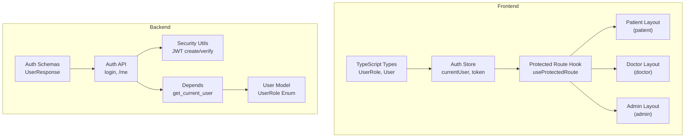
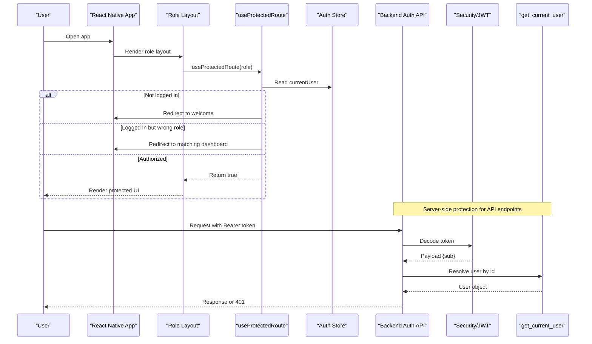
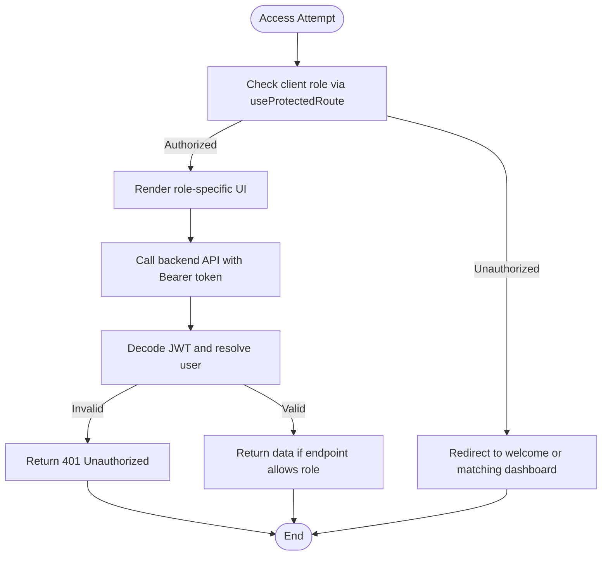
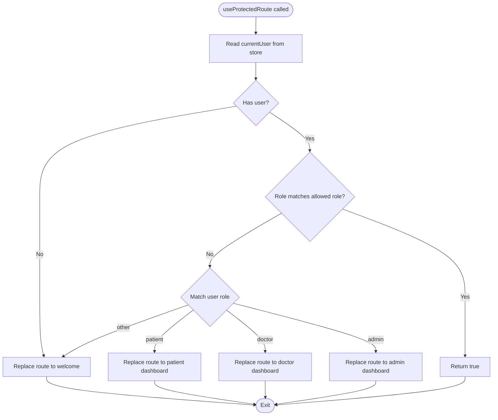
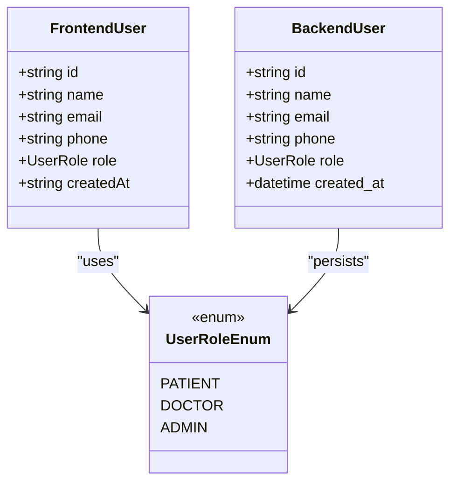
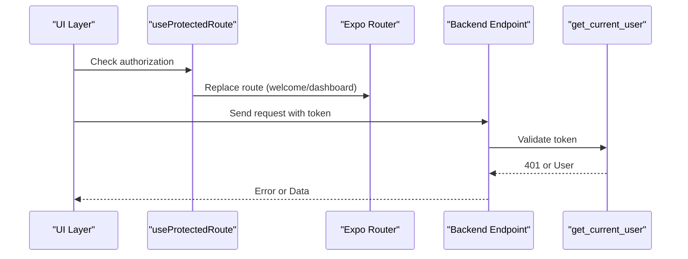
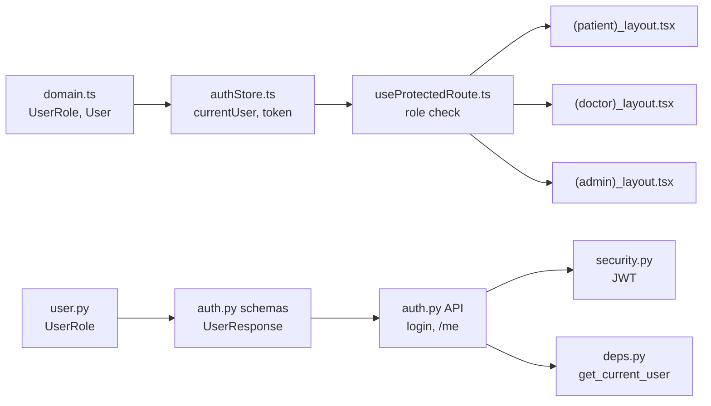

# Role-Based Access Control

<cite>
**Referenced Files in This Document**
- [useProtectedRoute.ts](file://src/hooks/useProtectedRoute.ts)
- [authStore.ts](file://src/stores/authStore.ts)
- [domain.ts](file://src/types/domain.ts)
- [_layout.tsx (patient)](file://src/app/(patient)/_layout.tsx)
- [_layout.tsx (doctor)](file://src/app/(doctor)/_layout.tsx)
- [_layout.tsx (admin)](file://src/app/(admin)/_layout.tsx)
- [user.py](file://backend/app/models/user.py)
- [auth.py (schemas)](file://backend/app/schemas/auth.py)
- [auth.py (API)](file://backend/app/api/auth.py)
- [deps.py](file://backend/app/api/deps.py)
- [security.py](file://backend/app/core/security.py)
</cite>

## Table of Contents
1. [Introduction](#introduction)
2. [Project Structure](#project-structure)
3. [Core Components](#core-components)
4. [Architecture Overview](#architecture-overview)
5. [Detailed Component Analysis](#detailed-component-analysis)
6. [Dependency Analysis](#dependency-analysis)
7. [Performance Considerations](#performance-considerations)
8. [Troubleshooting Guide](#troubleshooting-guide)
9. [Conclusion](#conclusion)
10. [Appendices](#appendices)

## Introduction
This document explains the role-based access control system for the application. It covers the three-tier role hierarchy, permission enforcement on protected routes, and how authorization is implemented both on the frontend and backend. You will learn how the `useProtectedRoute` hook guards navigation, how roles are represented across the stack, and how to extend the system with new permissions or custom protected routes. Security implications and best practices are also included.

## Project Structure
The role-based access control spans both the frontend and backend:

- Frontend
  - Role types and user model are defined in TypeScript.
  - The protected route hook enforces navigation guards and redirects unauthorized users.
  - Role-specific layouts render tabs or stacks only after authorization passes.
  - Authentication state is centralized in a store that holds the current user and token.

- Backend
  - User roles are modeled as an enum and persisted in the database.
  - Authentication endpoints issue JWT tokens containing the user identifier.
  - Dependency injection validates bearer tokens and resolves the current user.

**Diagram sources**
- [domain.ts:5-37](file://src/types/domain.ts#L5-L37)
- [authStore.ts:1-112](file://src/stores/authStore.ts#L1-L112)
- [useProtectedRoute.ts:1-40](file://src/hooks/useProtectedRoute.ts#L1-L40)
- [_layout.tsx (patient):1-118](file://src/app/(patient)/_layout.tsx#L1-L118)
- [_layout.tsx (doctor):1-131](file://src/app/(doctor)/_layout.tsx#L1-L131)
- [_layout.tsx (admin):1-40](file://src/app/(admin)/_layout.tsx#L1-L40)
- [user.py:10-43](file://backend/app/models/user.py#L10-L43)
- [auth.py (schemas):97-109](file://backend/app/schemas/auth.py#L97-L109)
- [auth.py (API):121-153](file://backend/app/api/auth.py#L121-L153)
- [security.py:18-26](file://backend/app/core/security.py#L18-L26)
- [deps.py:15-41](file://backend/app/api/deps.py#L15-L41)

**Section sources**
- [domain.ts:5-37](file://src/types/domain.ts#L5-L37)
- [authStore.ts:1-112](file://src/stores/authStore.ts#L1-L112)
- [useProtectedRoute.ts:1-40](file://src/hooks/useProtectedRoute.ts#L1-L40)
- [_layout.tsx (patient):1-118](file://src/app/(patient)/_layout.tsx#L1-L118)
- [_layout.tsx (doctor):1-131](file://src/app/(doctor)/_layout.tsx#L1-L131)
- [_layout.tsx (admin):1-40](file://src/app/(admin)/_layout.tsx#L1-L40)
- [user.py:10-43](file://backend/app/models/user.py#L10-L43)
- [auth.py (schemas):97-109](file://backend/app/schemas/auth.py#L97-L109)
- [auth.py (API):121-153](file://backend/app/api/auth.py#L121-L153)
- [security.py:18-26](file://backend/app/core/security.py#L18-L26)
- [deps.py:15-41](file://backend/app/api/deps.py#L15-L41)

## Core Components
This section summarizes the core building blocks of the role-based access control system.

- Role types and user model
  - The frontend defines a union type for roles and a user object including the role field.
  - The backend models roles using an enum and persists them in the database.

- Protected route hook
  - The hook checks whether a user exists and whether their role matches the required role.
  - If not authorized, it redirects to the appropriate dashboard or welcome screen.
  - It returns a boolean indicating authorization status so layouts can conditionally render UI.

- Role-specific layouts
  - Each role has its own layout group that calls the protected route hook with the corresponding allowed role.
  - Unauthorized users see a loading indicator while redirection occurs.

- Authentication store
  - Holds the current user, profiles, token, and loading/error states.
  - Provides login actions that fetch user data and profile information based on role.

- Backend authentication and dependency injection
  - Login endpoint issues a JWT token with the user identifier.
  - The dependency resolver decodes the token, loads the user from the database, and exposes it to protected endpoints.

**Section sources**
- [domain.ts:5-37](file://src/types/domain.ts#L5-L37)
- [user.py:10-43](file://backend/app/models/user.py#L10-L43)
- [useProtectedRoute.ts:1-40](file://src/hooks/useProtectedRoute.ts#L1-L40)
- [_layout.tsx (patient):1-118](file://src/app/(patient)/_layout.tsx#L1-L118)
- [_layout.tsx (doctor):1-131](file://src/app/(doctor)/_layout.tsx#L1-L131)
- [_layout.tsx (admin):1-40](file://src/app/(admin)/_layout.tsx#L1-L40)
- [authStore.ts:1-112](file://src/stores/authStore.ts#L1-L112)
- [auth.py (API):121-153](file://backend/app/api/auth.py#L121-L153)
- [deps.py:15-41](file://backend/app/api/deps.py#L15-L41)

## Architecture Overview
The authorization flow combines client-side navigation guards with server-side token validation.

**Diagram sources**
- [_layout.tsx (patient):1-118](file://src/app/(patient)/_layout.tsx#L1-L118)
- [_layout.tsx (doctor):1-131](file://src/app/(doctor)/_layout.tsx#L1-L131)
- [_layout.tsx (admin):1-40](file://src/app/(admin)/_layout.tsx#L1-L40)
- [useProtectedRoute.ts:1-40](file://src/hooks/useProtectedRoute.ts#L1-L40)
- [authStore.ts:1-112](file://src/stores/authStore.ts#L1-L112)
- [auth.py (API):121-153](file://backend/app/api/auth.py#L121-L153)
- [security.py:18-26](file://backend/app/core/security.py#L18-L26)
- [deps.py:15-41](file://backend/app/api/deps.py#L15-L41)

## Detailed Component Analysis

### Three-Tier Role Hierarchy and Permissions
The system uses three roles: patient, doctor, admin.

- Patient
  - Can access patient-only screens such as finding doctors, managing visits, viewing records, and editing profile.
  - Cannot access doctor or admin dashboards.

- Doctor
  - Can access doctor-only screens such as requests, schedule, assigned patients, and profile.
  - Cannot access patient or admin dashboards.

- Admin
  - Can access administration console screens.
  - Cannot access patient or doctor dashboards unless explicitly extended.

These roles are enforced at two layers:
- Client-side: Layouts call the protected route hook with the expected role.
- Server-side: Endpoints depend on the current user resolved from the JWT.

**Diagram sources**
- [useProtectedRoute.ts:1-40](file://src/hooks/useProtectedRoute.ts#L1-L40)
- [_layout.tsx (patient):1-118](file://src/app/(patient)/_layout.tsx#L1-L118)
- [_layout.tsx (doctor):1-131](file://src/app/(doctor)/_layout.tsx#L1-L131)
- [_layout.tsx (admin):1-40](file://src/app/(admin)/_layout.tsx#L1-L40)
- [auth.py (API):121-153](file://backend/app/api/auth.py#L121-L153)
- [deps.py:15-41](file://backend/app/api/deps.py#L15-L41)

**Section sources**
- [domain.ts:5-37](file://src/types/domain.ts#L5-L37)
- [user.py:10-43](file://backend/app/models/user.py#L10-L43)
- [auth.py (schemas):97-109](file://backend/app/schemas/auth.py#L97-L109)

### Protected Route Implementation with useProtectedRoute
The protected route hook performs the following:
- Reads the current user from the auth store.
- If no user is present, navigates to the welcome screen.
- If the user’s role does not match the required role, navigates to the dashboard matching their role.
- Returns a boolean indicating whether rendering should proceed.

Navigation guard behavior:
- Patient layout requires role patient.
- Doctor layout requires role doctor.
- Admin layout requires role admin.

Automatic redirection logic:
- Unauthenticated users are sent to the welcome screen.
- Misrouted users are redirected to their correct dashboard.

**Diagram sources**
- [useProtectedRoute.ts:1-40](file://src/hooks/useProtectedRoute.ts#L1-L40)

**Section sources**
- [useProtectedRoute.ts:1-40](file://src/hooks/useProtectedRoute.ts#L1-L40)
- [_layout.tsx (patient):1-118](file://src/app/(patient)/_layout.tsx#L1-L118)
- [_layout.tsx (doctor):1-131](file://src/app/(doctor)/_layout.tsx#L1-L131)
- [_layout.tsx (admin):1-40](file://src/app/(admin)/_layout.tsx#L1-L40)

### Role Checking Mechanisms and Permission Validation
- Client-side role checking
  - The hook compares the stored user role against the required role.
  - Layouts conditionally render UI based on the returned boolean.

- Server-side permission validation
  - The dependency resolver validates the bearer token and loads the current user.
  - Endpoints can further restrict access by inspecting the user’s role.

- Data model alignment
  - The frontend UserRole type aligns with the backend UserRole enum.
  - The UserResponse schema includes the role field used by clients.

**Diagram sources**
- [domain.ts:5-37](file://src/types/domain.ts#L5-L37)
- [user.py:10-43](file://backend/app/models/user.py#L10-L43)
- [auth.py (schemas):97-109](file://backend/app/schemas/auth.py#L97-L109)

**Section sources**
- [deps.py:15-41](file://backend/app/api/deps.py#L15-L41)
- [auth.py (schemas):97-109](file://backend/app/schemas/auth.py#L97-L109)
- [domain.ts:5-37](file://src/types/domain.ts#L5-L37)
- [user.py:10-43](file://backend/app/models/user.py#L10-L43)

### Access Denial Handling
- Frontend denial handling
  - When unauthorized, the hook triggers navigation to either the welcome screen or the user’s default dashboard.
  - Layouts show a loading indicator during redirection to avoid partial renders.

- Backend denial handling
  - Invalid or missing tokens result in a 401 Unauthorized response.
  - Missing or invalid user identifiers in the token payload cause credential exceptions.

**Diagram sources**
- [useProtectedRoute.ts:1-40](file://src/hooks/useProtectedRoute.ts#L1-L40)
- [deps.py:15-41](file://backend/app/api/deps.py#L15-L41)

**Section sources**
- [useProtectedRoute.ts:1-40](file://src/hooks/useProtectedRoute.ts#L1-L40)
- [deps.py:15-41](file://backend/app/api/deps.py#L15-L41)

### Creating Custom Protected Routes
To create a custom protected route:
- Create a new layout file under a new route group.
- Import the protected route hook.
- Call the hook with the required role.
- Conditionally render a loading indicator when unauthorized.
- Render your protected UI when authorized.

Example pattern:
- Define a new route group such as `(specialist)`.
- In its `_layout.tsx`, call `useProtectedRoute('doctor')` or another role.
- Add screens specific to that role or feature.

Best practices:
- Keep role checks close to the route boundary using layout files.
- Avoid duplicating role checks inside individual screens.
- Use consistent redirect destinations for unauthorized users.

**Section sources**
- [_layout.tsx (patient):1-118](file://src/app/(patient)/_layout.tsx#L1-L118)
- [_layout.tsx (doctor):1-131](file://src/app/(doctor)/_layout.tsx#L1-L131)
- [_layout.tsx (admin):1-40](file://src/app/(admin)/_layout.tsx#L1-L40)
- [useProtectedRoute.ts:1-40](file://src/hooks/useProtectedRoute.ts#L1-L40)

### Extending the Role System with New Permissions
To add a new role or permission:
- Update the frontend role type to include the new role.
- Update the backend role enum and migration if necessary.
- Extend the protected route hook to handle the new role in redirection logic.
- Add a new layout group guarded by the new role.
- Optionally, add fine-grained permissions beyond roles by introducing a permissions array or set on the user model and validating them in hooks and endpoints.

Considerations:
- Ensure all redirection branches cover the new role.
- Align schemas and responses to include new role values.
- Add tests for both client-side guards and server-side dependencies.

**Section sources**
- [domain.ts:5-37](file://src/types/domain.ts#L5-L37)
- [user.py:10-43](file://backend/app/models/user.py#L10-L43)
- [useProtectedRoute.ts:1-40](file://src/hooks/useProtectedRoute.ts#L1-L40)

## Dependency Analysis
The authorization system depends on several modules working together.

**Diagram sources**
- [domain.ts:5-37](file://src/types/domain.ts#L5-L37)
- [authStore.ts:1-112](file://src/stores/authStore.ts#L1-L112)
- [useProtectedRoute.ts:1-40](file://src/hooks/useProtectedRoute.ts#L1-L40)
- [_layout.tsx (patient):1-118](file://src/app/(patient)/_layout.tsx#L1-L118)
- [_layout.tsx (doctor):1-131](file://src/app/(doctor)/_layout.tsx#L1-L131)
- [_layout.tsx (admin):1-40](file://src/app/(admin)/_layout.tsx#L1-L40)
- [user.py:10-43](file://backend/app/models/user.py#L10-L43)
- [auth.py (schemas):97-109](file://backend/app/schemas/auth.py#L97-L109)
- [auth.py (API):121-153](file://backend/app/api/auth.py#L121-L153)
- [security.py:18-26](file://backend/app/core/security.py#L18-L26)
- [deps.py:15-41](file://backend/app/api/deps.py#L15-L41)

**Section sources**
- [domain.ts:5-37](file://src/types/domain.ts#L5-L37)
- [authStore.ts:1-112](file://src/stores/authStore.ts#L1-L112)
- [useProtectedRoute.ts:1-40](file://src/hooks/useProtectedRoute.ts#L1-L40)
- [_layout.tsx (patient):1-118](file://src/app/(patient)/_layout.tsx#L1-L118)
- [_layout.tsx (doctor):1-131](file://src/app/(doctor)/_layout.tsx#L1-L131)
- [_layout.tsx (admin):1-40](file://src/app/(admin)/_layout.tsx#L1-L40)
- [user.py:10-43](file://backend/app/models/user.py#L10-L43)
- [auth.py (schemas):97-109](file://backend/app/schemas/auth.py#L97-L109)
- [auth.py (API):121-153](file://backend/app/api/auth.py#L121-L153)
- [security.py:18-26](file://backend/app/core/security.py#L18-L26)
- [deps.py:15-41](file://backend/app/api/deps.py#L15-L41)

## Performance Considerations
- Minimize re-renders in protected layouts by keeping UI simple during authorization checks.
- Avoid heavy computations in the protected route hook; keep it focused on role checks and navigation.
- Cache user session data appropriately to reduce repeated network calls.
- On the backend, ensure JWT decoding and user resolution are efficient and indexed where needed.

[No sources needed since this section provides general guidance]

## Troubleshooting Guide
Common issues and resolutions:

- Unauthorized redirect loops
  - Cause: Incorrect allowed role passed to the hook or mismatched route groups.
  - Resolution: Verify the role argument matches the intended layout and that redirection targets exist.

- Token validation failures
  - Cause: Missing or invalid Authorization header, expired token, or misconfigured secret.
  - Resolution: Ensure the client sends a valid bearer token and the backend secret configuration is correct.

- Role mismatch between frontend and backend
  - Cause: Frontend UserRole type not aligned with backend UserRole enum.
  - Resolution: Keep both definitions synchronized and update migrations when adding roles.

- Profile loading errors after login
  - Cause: Service calls failing for patient or doctor profiles.
  - Resolution: Inspect service layer errors and ensure endpoints return expected profile data.

**Section sources**
- [useProtectedRoute.ts:1-40](file://src/hooks/useProtectedRoute.ts#L1-L40)
- [deps.py:15-41](file://backend/app/api/deps.py#L15-L41)
- [authStore.ts:1-112](file://src/stores/authStore.ts#L1-L112)

## Conclusion
The role-based access control system combines client-side navigation guards with server-side token validation to enforce a three-tier role hierarchy. The `useProtectedRoute` hook centralizes authorization logic for protected routes, while backend dependencies ensure secure API access. By aligning frontend and backend role definitions and following best practices, you can safely extend the system with new roles and permissions.

[No sources needed since this section summarizes without analyzing specific files]

## Appendices

### Security Implications and Best Practices
- Always validate tokens on the server and never trust client-side role checks alone.
- Use short-lived tokens and refresh strategies where appropriate.
- Restrict sensitive endpoints by role and audit access patterns.
- Avoid exposing internal role details in error messages.
- Implement rate limiting and logging around authentication endpoints.
- Regularly rotate secrets and monitor for token misuse.

[No sources needed since this section provides general guidance]