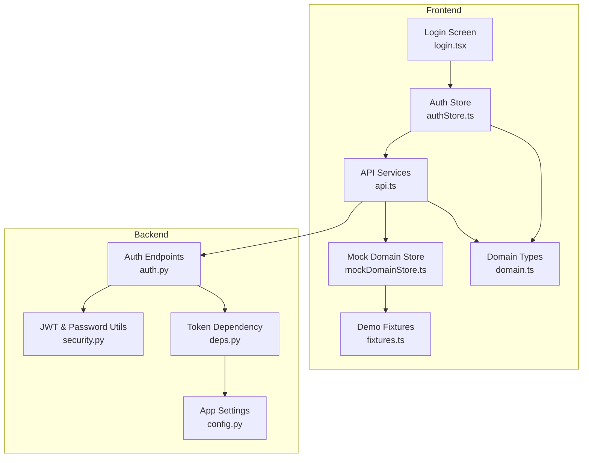
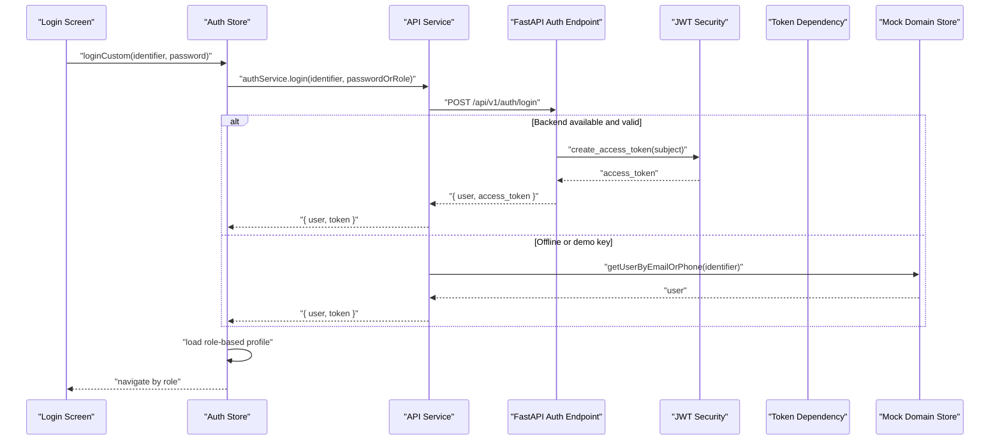
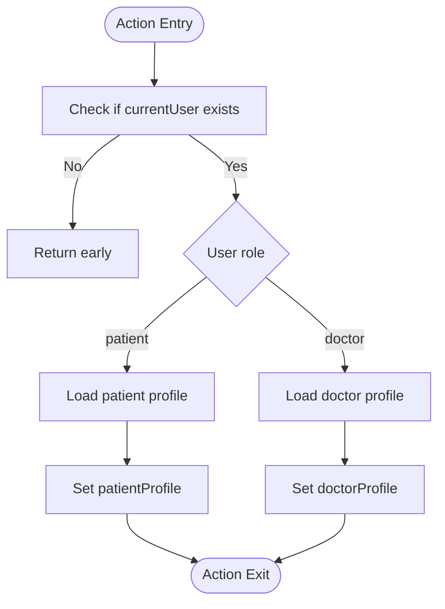
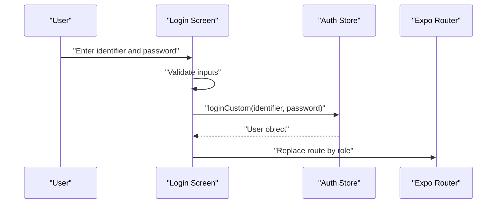
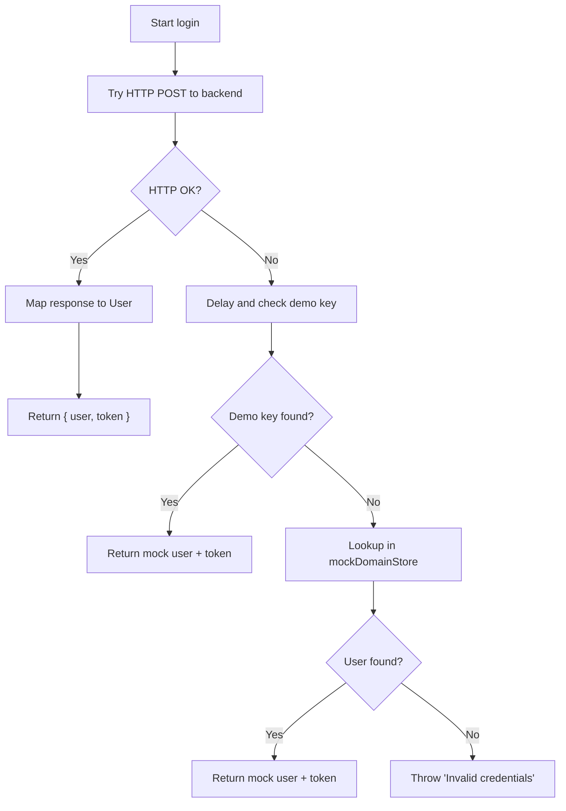
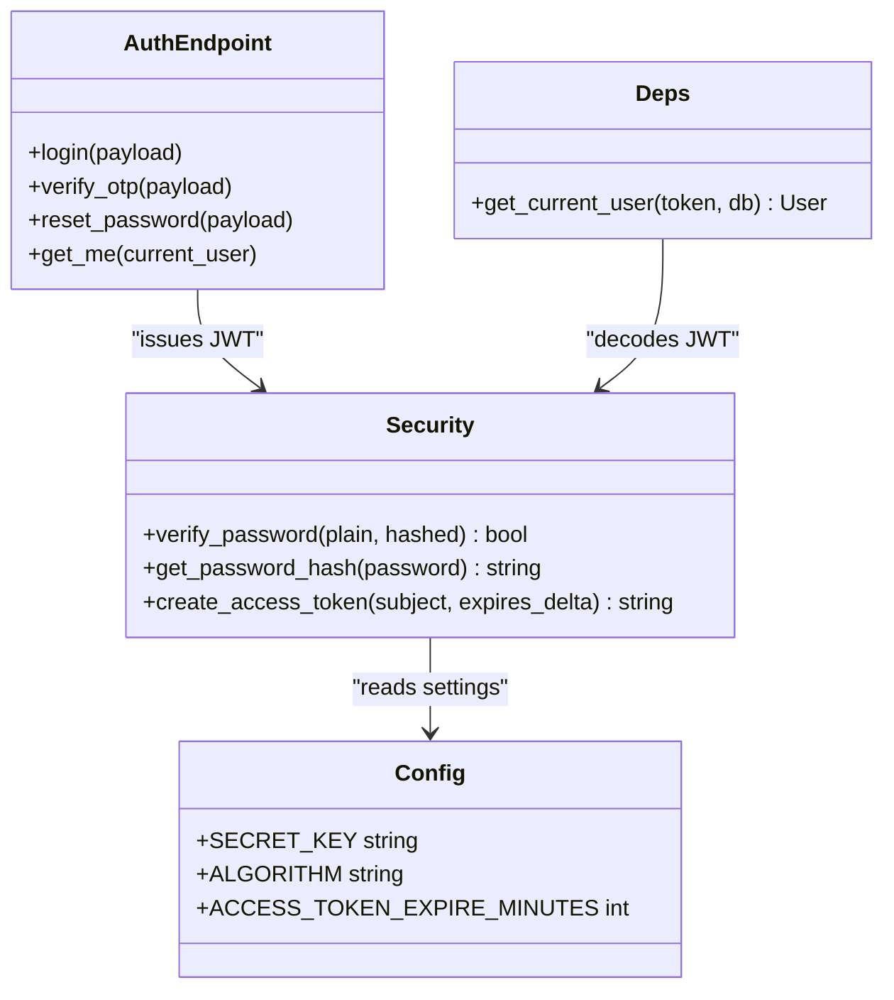
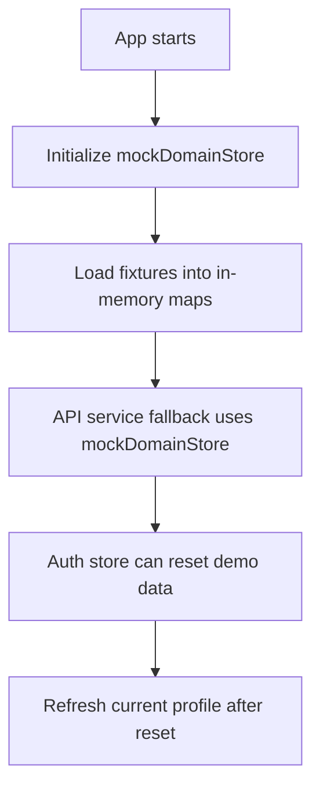
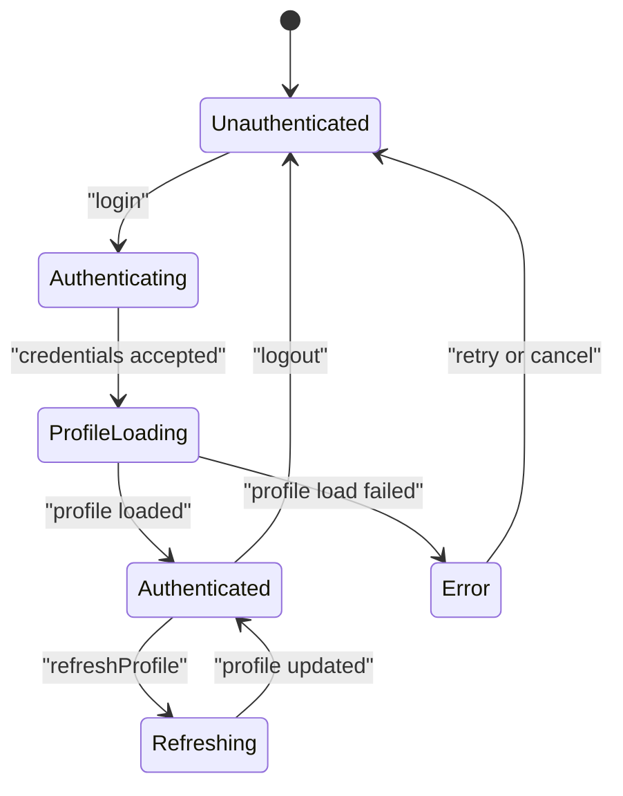
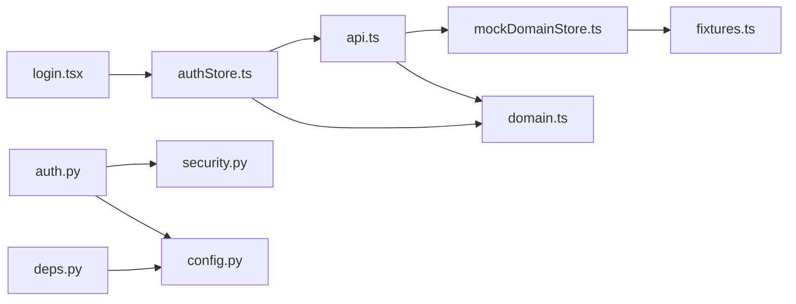

# Session Management & State Persistence

<cite>
**Referenced Files in This Document**
- [authStore.ts](file://src/stores/authStore.ts)
- [login.tsx](file://src/app/(auth)/login.tsx)
- [api.ts](file://src/services/api.ts)
- [fixtures.ts](file://src/mock/fixtures.ts)
- [mockDomainStore.ts](file://src/mock/mockDomainStore.ts)
- [domain.ts](file://src/types/domain.ts)
- [auth.py](file://backend/app/api/auth.py)
- [security.py](file://backend/app/core/security.py)
- [config.py](file://backend/app/core/config.py)
- [deps.py](file://backend/app/api/deps.py)
</cite>

## Table of Contents
1. [Introduction](#introduction)
2. [Project Structure](#project-structure)
3. [Core Components](#core-components)
4. [Architecture Overview](#architecture-overview)
5. [Detailed Component Analysis](#detailed-component-analysis)
6. [Dependency Analysis](#dependency-analysis)
7. [Performance Considerations](#performance-considerations)
8. [Troubleshooting Guide](#troubleshooting-guide)
9. [Security Considerations](#security-considerations)
10. [Extending Session Functionality](#extending-session-functionality)
11. [Conclusion](#conclusion)

## Introduction
This document explains how session management and state persistence work in the application. The frontend uses a Zustand store to centralize authentication state, including user identity, role-based profiles, access tokens, loading flags, and errors. Authentication can run against a FastAPI backend or fall back to an isolated in-memory mock domain store for demo mode. The system supports automatic profile loading after login based on user roles, manual profile refresh, and clean logout behavior.

The backend issues signed JWT access tokens with configurable expiration and validates them through a dependency that decodes tokens and loads the current user from the database. Demo credentials are supported for development, while production should rely on secure token handling and server-side validation.

## Project Structure
The session-related code spans three main layers:

- Frontend state layer: Zustand store holds session state and exposes actions for login, logout, profile refresh, and demo data reset.
- Frontend service layer: API services attempt real HTTP calls to the backend and gracefully fallback to mock data when offline or during development.
- Backend layer: FastAPI endpoints authenticate users, issue JWTs, verify OTPs, and protect routes by decoding tokens and loading users.

**Diagram sources**
- [login.tsx:17-46](file://src/app/(auth)/login.tsx#L17-L46)
- [authStore.ts:23-111](file://src/stores/authStore.ts#L23-L111)
- [api.ts:46-104](file://src/services/api.ts#L46-L104)
- [mockDomainStore.ts:35-127](file://src/mock/mockDomainStore.ts#L35-L127)
- [fixtures.ts:72-118](file://src/mock/fixtures.ts#L72-L118)
- [auth.py:121-153](file://backend/app/api/auth.py#L121-L153)
- [security.py:18-26](file://backend/app/core/security.py#L18-L26)
- [config.py:10-22](file://backend/app/core/config.py#L10-L22)
- [deps.py:15-41](file://backend/app/api/deps.py#L15-L41)

**Section sources**
- [login.tsx:17-46](file://src/app/(auth)/login.tsx#L17-L46)
- [authStore.ts:23-111](file://src/stores/authStore.ts#L23-L111)
- [api.ts:46-104](file://src/services/api.ts#L46-L104)
- [auth.py:121-153](file://backend/app/api/auth.py#L121-L153)
- [security.py:18-26](file://backend/app/core/security.py#L18-L26)
- [config.py:10-22](file://backend/app/core/config.py#L10-L22)
- [deps.py:15-41](file://backend/app/api/deps.py#L15-L41)

## Core Components
The core session components are:

- **Zustand auth store**: Holds `currentUser`, `patientProfile`, `doctorProfile`, `token`, `isLoading`, and `error`. It provides `loginDemo`, `loginCustom`, `logout`, `refreshProfile`, and `resetDemoData`.
- **API services**: Provide `authService.login`, `verifyOtp`, registration helpers, and domain services for patients and doctors. They try the live backend first and fallback to mock data.
- **Mock domain store**: An in-memory reactive store initialized with fixtures, supporting account isolation, visit lifecycle, notifications, audit logs, and doctor verification states.
- **Backend auth endpoint**: Accepts email/phone login, verifies passwords, supports test credentials, and returns a JWT.
- **Backend security utilities**: Hash passwords, verify passwords, and create signed JWTs with configurable expiration.
- **Backend dependency**: Decodes JWTs and loads the current user for protected routes.

Key responsibilities:
- Centralize authentication state in one place.
- Load role-specific profiles automatically after login.
- Allow manual profile refresh.
- Support demo mode with isolated test data.
- Provide clear transitions between mock and real backend sessions.

**Section sources**
- [authStore.ts:7-21](file://src/stores/authStore.ts#L7-L21)
- [authStore.ts:31-111](file://src/stores/authStore.ts#L31-L111)
- [api.ts:25-41](file://src/services/api.ts#L25-L41)
- [api.ts:46-104](file://src/services/api.ts#L46-L104)
- [mockDomainStore.ts:35-127](file://src/mock/mockDomainStore.ts#L35-L127)
- [auth.py:121-153](file://backend/app/api/auth.py#L121-L153)
- [security.py:10-26](file://backend/app/core/security.py#L10-L26)
- [deps.py:15-41](file://backend/app/api/deps.py#L15-L41)

## Architecture Overview
The session architecture follows a layered approach:

1. UI triggers login via the auth store.
2. Auth store calls the API service.
3. API service attempts a real HTTP login to the backend.
4. If the backend is unavailable or credentials match demo keys, the service falls back to mock data.
5. On success, the auth store sets user, token, and role-specific profile.
6. Protected routes use the backend dependency to validate tokens and load users.

**Diagram sources**
- [login.tsx:23-46](file://src/app/(auth)/login.tsx#L23-L46)
- [authStore.ts:31-83](file://src/stores/authStore.ts#L31-L83)
- [api.ts:46-104](file://src/services/api.ts#L46-L104)
- [auth.py:121-153](file://backend/app/api/auth.py#L121-L153)
- [security.py:18-26](file://backend/app/core/security.py#L18-L26)
- [mockDomainStore.ts:130-142](file://src/mock/mockDomainStore.ts#L130-L142)

## Detailed Component Analysis

### Zustand Auth Store
The auth store defines the session state shape and actions:

- **State fields**:
  - `currentUser`: authenticated user object.
  - `patientProfile` or `doctorProfile`: role-specific profile loaded after login.
  - `token`: access token string.
  - `isLoading`: indicates ongoing authentication or profile operations.
  - `error`: last error message.

- **Actions**:
  - `loginDemo(role)`: authenticates using a demo role and loads the corresponding profile.
  - `loginCustom(identifier, password)`: authenticates using identifier/password and loads the corresponding profile.
  - `logout()`: clears all session state.
  - `refreshProfile()`: reloads the role-specific profile for the current user.
  - `resetDemoData()`: resets the mock domain store and refreshes the current profile.

**Diagram sources**
- [authStore.ts:95-105](file://src/stores/authStore.ts#L95-L105)

**Section sources**
- [authStore.ts:7-21](file://src/stores/authStore.ts#L7-L21)
- [authStore.ts:31-111](file://src/stores/authStore.ts#L31-L111)

### Login Flow and Routing
The login screen validates inputs, calls the auth store, and navigates based on the user role:

- Validates email/phone and password presence.
- Calls `loginCustom`.
- Routes to `(patient)`, `(doctor)`, or `(admin)` groups depending on `user.role`.
- Displays error messages on failure.

**Diagram sources**
- [login.tsx:23-46](file://src/app/(auth)/login.tsx#L23-L46)

**Section sources**
- [login.tsx:17-46](file://src/app/(auth)/login.tsx#L17-L46)

### API Service Fallback Strategy
The API service implements a resilient login strategy:

- Attempts a real HTTP request to `/api/v1/auth/login`.
- If successful, maps backend response to frontend `User` and returns `{ user, token }`.
- If the request fails or credentials match a known demo key, it delays briefly and returns mock data.
- If no demo key matches, it looks up the user in the mock domain store; otherwise throws an error.

**Diagram sources**
- [api.ts:46-104](file://src/services/api.ts#L46-L104)

**Section sources**
- [api.ts:46-104](file://src/services/api.ts#L46-L104)

### Backend Authentication and Token Handling
The backend login endpoint:

- Accepts login requests with identifier (email or phone).
- Loads the user with eager-loaded profiles.
- Verifies password or accepts predefined test credentials.
- Issues a JWT access token with subject set to user ID.
- Returns token type and user object.

Protected routes decode the token using the dependency, which:

- Uses OAuth2 bearer scheme.
- Decodes the token with configured secret and algorithm.
- Loads the user from the database with eager-loaded profiles.
- Throws unauthorized errors for invalid or missing tokens.

**Diagram sources**
- [auth.py:121-153](file://backend/app/api/auth.py#L121-L153)
- [security.py:10-26](file://backend/app/core/security.py#L10-L26)
- [config.py:10-22](file://backend/app/core/config.py#L10-L22)
- [deps.py:15-41](file://backend/app/api/deps.py#L15-L41)

**Section sources**
- [auth.py:121-153](file://backend/app/api/auth.py#L121-L153)
- [security.py:10-26](file://backend/app/core/security.py#L10-L26)
- [config.py:10-22](file://backend/app/core/config.py#L10-L22)
- [deps.py:15-41](file://backend/app/api/deps.py#L15-L41)

### Demo Mode and Isolated Test Data
Demo mode is supported through:

- Predefined demo users in fixtures.
- API service fallback to mock data when backend is unavailable or demo keys are used.
- Mock domain store providing isolated in-memory data for patients, doctors, visits, slots, consultations, results, notifications, reviews, complaints, and audit logs.
- Reset functionality to restore default demo data and refresh the current profile.

**Diagram sources**
- [fixtures.ts:72-118](file://src/mock/fixtures.ts#L72-L118)
- [mockDomainStore.ts:35-127](file://src/mock/mockDomainStore.ts#L35-L127)
- [api.ts:93-104](file://src/services/api.ts#L93-L104)
- [authStore.ts:107-111](file://src/stores/authStore.ts#L107-L111)

**Section sources**
- [fixtures.ts:72-118](file://src/mock/fixtures.ts#L72-L118)
- [mockDomainStore.ts:35-127](file://src/mock/mockDomainStore.ts#L35-L127)
- [api.ts:93-104](file://src/services/api.ts#L93-L104)
- [authStore.ts:107-111](file://src/stores/authStore.ts#L107-L111)

### Session Lifecycle
The session lifecycle covers login, profile loading, refresh, and logout:

1. User submits credentials.
2. Auth store calls API service.
3. API service authenticates against backend or mock store.
4. Auth store sets user and token.
5. Auth store loads role-specific profile.
6. UI navigates to role-appropriate routes.
7. User can manually refresh profile.
8. Logout clears session state.

**Diagram sources**
- [authStore.ts:31-111](file://src/stores/authStore.ts#L31-L111)
- [login.tsx:23-46](file://src/app/(auth)/login.tsx#L23-L46)

**Section sources**
- [authStore.ts:31-111](file://src/stores/authStore.ts#L31-L111)
- [login.tsx:23-46](file://src/app/(auth)/login.tsx#L23-L46)

## Dependency Analysis
The session subsystem has clear dependencies:

- UI depends on the auth store for login/logout/profile operations.
- Auth store depends on API services and domain types.
- API services depend on mock domain store and fixtures for demo mode.
- Backend endpoints depend on security utilities and configuration.
- Protected route dependencies depend on JWT decoding and database access.

**Diagram sources**
- [login.tsx:17-46](file://src/app/(auth)/login.tsx#L17-L46)
- [authStore.ts:23-111](file://src/stores/authStore.ts#L23-L111)
- [api.ts:46-104](file://src/services/api.ts#L46-L104)
- [mockDomainStore.ts:35-127](file://src/mock/mockDomainStore.ts#L35-L127)
- [fixtures.ts:72-118](file://src/mock/fixtures.ts#L72-L118)
- [domain.ts:29-85](file://src/types/domain.ts#L29-L85)
- [auth.py:121-153](file://backend/app/api/auth.py#L121-L153)
- [security.py:10-26](file://backend/app/core/security.py#L10-L26)
- [config.py:10-22](file://backend/app/core/config.py#L10-L22)

**Section sources**
- [login.tsx:17-46](file://src/app/(auth)/login.tsx#L17-L46)
- [authStore.ts:23-111](file://src/stores/authStore.ts#L23-L111)
- [api.ts:46-104](file://src/services/api.ts#L46-L104)
- [mockDomainStore.ts:35-127](file://src/mock/mockDomainStore.ts#L35-L127)
- [fixtures.ts:72-118](file://src/mock/fixtures.ts#L72-L118)
- [domain.ts:29-85](file://src/types/domain.ts#L29-L85)
- [auth.py:121-153](file://backend/app/api/auth.py#L121-L153)
- [security.py:10-26](file://backend/app/core/security.py#L10-L26)
- [config.py:10-22](file://backend/app/core/config.py#L10-L22)

## Performance Considerations
- Simulated latency is introduced in API services to mimic network delays during development.
- Profile loading occurs only once per login unless explicitly refreshed.
- Mock domain store uses in-memory maps for fast lookups.
- Backend JWT expiration is configurable; longer expiration reduces re-authentication frequency but increases risk window.
- Avoid unnecessary profile refreshes; trigger refresh only when needed.

[No sources needed since this section provides general guidance]

## Troubleshooting Guide
Common issues and resolutions:

- **Login fails with invalid credentials**:
  - Verify identifier and password.
  - Check whether backend is reachable; if not, demo mode may return mock data only for known demo keys.
  - Confirm that the user exists in either backend or mock store.

- **Profile not loaded after login**:
  - Ensure user role is correctly set.
  - Call `refreshProfile` to reload the role-specific profile.

- **Demo data appears stale**:
  - Use `resetDemoData` to restore defaults and refresh the current profile.

- **Backend token validation fails**:
  - Ensure token is present and valid.
  - Check backend secret key and algorithm configuration.
  - Verify that the token issuer and subject match the expected user.

**Section sources**
- [api.ts:46-104](file://src/services/api.ts#L46-L104)
- [authStore.ts:95-111](file://src/stores/authStore.ts#L95-L111)
- [deps.py:15-41](file://backend/app/api/deps.py#L15-L41)

## Security Considerations
Token storage and session hijacking prevention:

- **Token storage**:
  - The current implementation stores the access token in memory within the Zustand store.
  - For production, prefer secure storage mechanisms such as platform-provided secure storage or encrypted local storage.
  - Avoid logging tokens or exposing them in error messages.

- **Token validation**:
  - Backend validates tokens using a strong secret key and algorithm.
  - Protected routes require a valid bearer token; invalid or missing tokens result in unauthorized responses.

- **Session hijacking prevention**:
  - Bind sessions to device fingerprints where possible.
  - Implement short-lived tokens with refresh tokens stored securely.
  - Invalidate tokens on logout and suspicious activity.
  - Enforce HTTPS for all API calls.
  - Validate token audience and issuer claims.

- **Demo credentials**:
  - Backend supports predefined test credentials for development.
  - Disable or restrict demo credential acceptance in production.

**Section sources**
- [security.py:10-26](file://backend/app/core/security.py#L10-L26)
- [config.py:10-22](file://backend/app/core/config.py#L10-L22)
- [deps.py:15-41](file://backend/app/api/deps.py#L15-L41)
- [auth.py:121-153](file://backend/app/api/auth.py#L121-L153)

## Extending Session Functionality
To extend session functionality:

- **Add custom session fields**:
  - Extend the Zustand state interface with new properties.
  - Update login and refresh actions to populate these fields.

- **Implement custom session strategies**:
  - Create a new service adapter that wraps API calls and applies custom retry, caching, or telemetry logic.
  - Integrate the adapter into the auth store actions.

- **Add token refresh mechanism**:
  - Add a `refreshToken` action in the auth store.
  - Intercept failed API calls and attempt token refresh before retrying.
  - Handle refresh failures by clearing session state and redirecting to login.

- **Integrate analytics and audit logging**:
  - Log session events such as login success/failure, profile refresh, and logout.
  - Correlate session events with user IDs and timestamps.

- **Support multiple environments**:
  - Configure environment-specific base URLs and feature flags.
  - Toggle between mock and real backend behavior using environment variables.

[No sources needed since this section provides general guidance]

## Conclusion
The session management system combines a centralized Zustand store, resilient API services, and a secure backend authentication layer. It supports both real backend sessions and isolated demo mode, enabling rapid development and testing. Automatic profile loading based on roles simplifies post-login setup, while manual refresh and clean logout provide predictable session control. For production, prioritize secure token storage, strict token validation, and robust anti-hijacking measures.

[No sources needed since this section summarizes without analyzing specific files]