# Authentication Endpoints

<cite>
**Referenced Files in This Document**
- [auth.py](file://backend/app/api/auth.py)
- [deps.py](file://backend/app/api/deps.py)
- [security.py](file://backend/app/core/security.py)
- [config.py](file://backend/app/core/config.py)
- [user.py](file://backend/app/models/user.py)
- [main.py](file://backend/app/main.py)
- [auth.py (schemas)](file://backend/app/schemas/auth.py)
- [api.ts](file://src/services/api.ts)
</cite>

## Table of Contents
1. [Introduction](#introduction)
2. [Project Structure](#project-structure)
3. [Core Components](#core-components)
4. [Architecture Overview](#architecture-overview)
5. [Detailed Component Analysis](#detailed-component-analysis)
6. [Dependency Analysis](#dependency-analysis)
7. [Performance Considerations](#performance-considerations)
8. [Troubleshooting Guide](#troubleshooting-guide)
9. [Conclusion](#conclusion)

## Introduction
This document provides detailed API documentation for authentication endpoints in the HomeCare backend. It covers user registration, login with optional OTP verification, password reset, and session management using JWT tokens. It also documents request/response schemas, security middleware, CORS configuration, input validation, and error handling patterns.

## Project Structure
The authentication functionality is implemented in a FastAPI backend under `backend/app`. The key files are:
- API routes for authentication: `backend/app/api/auth.py`
- Dependency injection for current user and token parsing: `backend/app/api/deps.py`
- Security utilities for password hashing and JWT creation: `backend/app/core/security.py`
- Application settings including JWT secrets and token expiry: `backend/app/core/config.py`
- Database models for users and profiles: `backend/app/models/user.py`
- Pydantic schemas for requests/responses: `backend/app/schemas/auth.py`
- Application entrypoint and CORS setup: `backend/app/main.py`
- Frontend service layer that calls the backend auth endpoints: `src/services/api.ts`

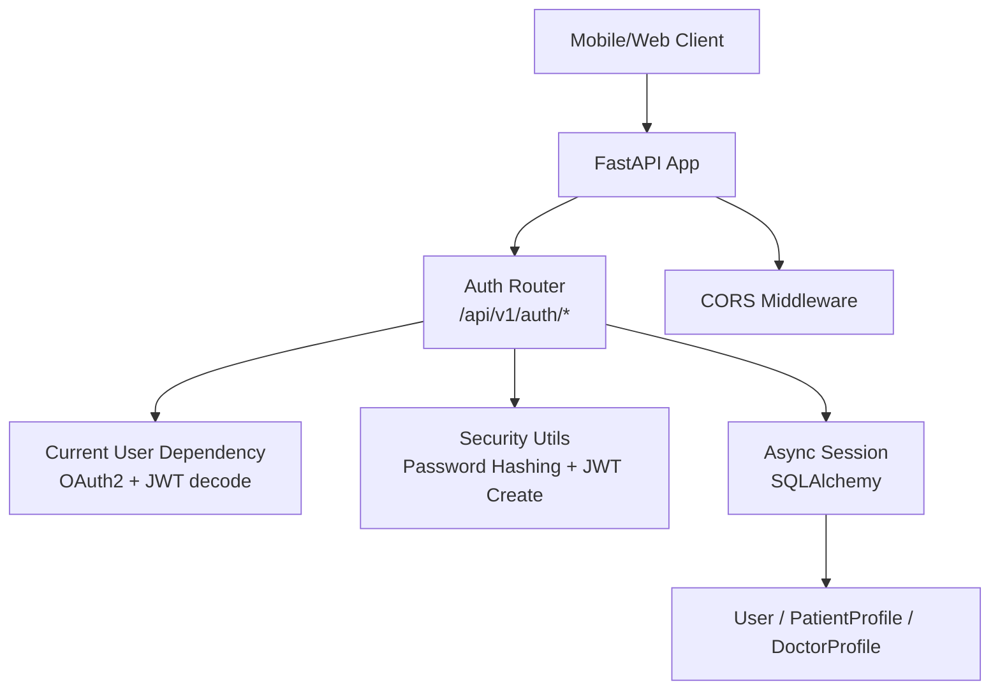

**Diagram sources**
- [main.py:31-46](file://backend/app/main.py#L31-L46)
- [auth.py:1-21](file://backend/app/api/auth.py#L1-L21)
- [deps.py:12-41](file://backend/app/api/deps.py#L12-L41)
- [security.py:1-27](file://backend/app/core/security.py#L1-L27)
- [user.py:26-80](file://backend/app/models/user.py#L26-L80)

**Section sources**
- [main.py:31-46](file://backend/app/main.py#L31-L46)
- [auth.py:1-21](file://backend/app/api/auth.py#L1-L21)
- [deps.py:12-41](file://backend/app/api/deps.py#L12-L41)
- [security.py:1-27](file://backend/app/core/security.py#L1-L27)
- [user.py:26-80](file://backend/app/models/user.py#L26-L80)

## Core Components
- Authentication router defines endpoints for patient registration, doctor registration, login, OTP verification, password reset, and current user retrieval.
- Current user dependency validates Bearer tokens via OAuth2 scheme and decodes JWT to retrieve the authenticated user from the database.
- Security module handles password hashing with bcrypt and creates signed JWT access tokens with configurable expiration.
- Configuration centralizes environment variables such as secret key, algorithm, token expiry, and base API path.
- Schemas define strict request/response structures for all authentication operations.
- Models define persistent entities for users and their role-specific profiles.

**Section sources**
- [auth.py:24-180](file://backend/app/api/auth.py#L24-L180)
- [deps.py:12-41](file://backend/app/api/deps.py#L12-L41)
- [security.py:10-26](file://backend/app/core/security.py#L10-L26)
- [config.py:10-30](file://backend/app/core/config.py#L10-L30)
- [auth.py (schemas):27-119](file://backend/app/schemas/auth.py#L27-L119)
- [user.py:26-80](file://backend/app/models/user.py#L26-L80)

## Architecture Overview
The authentication flow uses FastAPI routers, Pydantic validation, SQLAlchemy async sessions, and JWT-based authorization. Clients send JSON payloads; the server validates inputs, interacts with the database, and returns structured responses. Protected endpoints require a valid Bearer token.

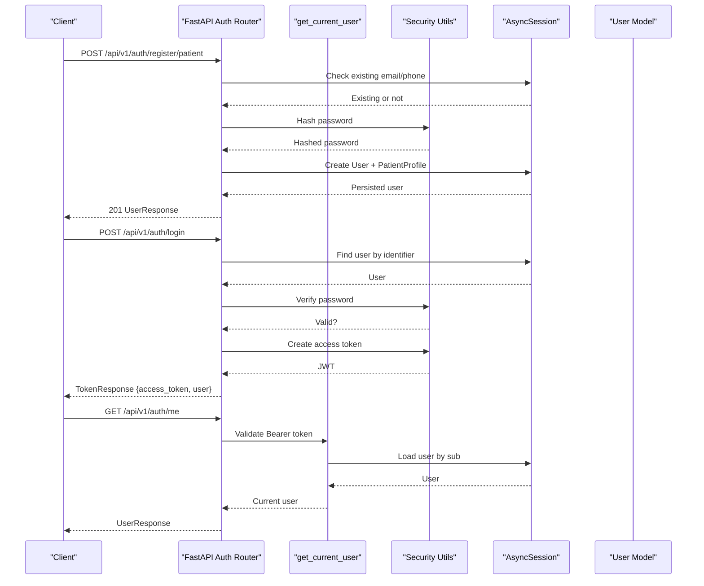

**Diagram sources**
- [auth.py:24-180](file://backend/app/api/auth.py#L24-L180)
- [deps.py:15-41](file://backend/app/api/deps.py#L15-L41)
- [security.py:18-26](file://backend/app/core/security.py#L18-L26)
- [user.py:26-43](file://backend/app/models/user.py#L26-L43)

## Detailed Component Analysis

### Registration Endpoints

#### Register Patient
- HTTP Method: POST
- URL Pattern: `/api/v1/auth/register/patient`
- Request Body Schema: `PatientRegisterRequest`
  - Required fields: name, email, phone, password (min length 6)
  - Optional fields: age, gender, residence_address, district, sector
- Response Schema: `UserResponse`
- Status Codes:
  - 201 Created on success
  - 400 Bad Request if email or phone already exists
- Authentication: None (public endpoint)
- Notes:
  - Password is hashed before storage.
  - A patient profile is created alongside the user.

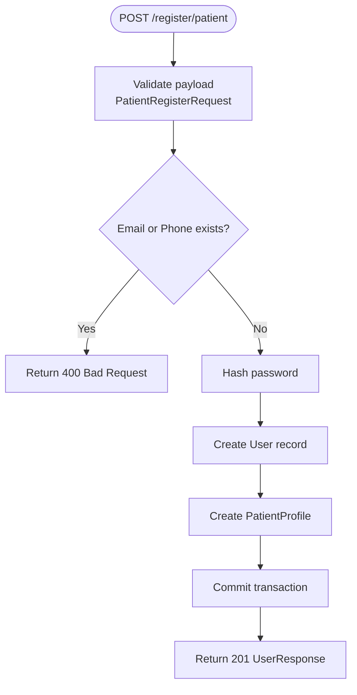

**Diagram sources**
- [auth.py:24-65](file://backend/app/api/auth.py#L24-L65)
- [auth.py (schemas):27-36](file://backend/app/schemas/auth.py#L27-L36)
- [security.py:14-15](file://backend/app/core/security.py#L14-L15)
- [user.py:26-43](file://backend/app/models/user.py#L26-L43)

**Section sources**
- [auth.py:24-65](file://backend/app/api/auth.py#L24-L65)
- [auth.py (schemas):27-36](file://backend/app/schemas/auth.py#L27-L36)
- [security.py:14-15](file://backend/app/core/security.py#L14-L15)
- [user.py:26-43](file://backend/app/models/user.py#L26-L43)

#### Register Doctor
- HTTP Method: POST
- URL Pattern: `/api/v1/auth/register/doctor`
- Request Body Schema: `DoctorRegisterRequest`
  - Required fields: name, email, phone, password (min length 6), specialty, license_number
  - Optional fields: experience_years (default 0), qualifications (list), coverage_districts (list)
- Response Schema: `UserResponse`
- Status Codes:
  - 201 Created on success
  - 400 Bad Request if email/phone already exists or license number already registered
- Authentication: None (public endpoint)
- Notes:
  - Doctor profile includes verification status set to pending.
  - Password is hashed before storage.

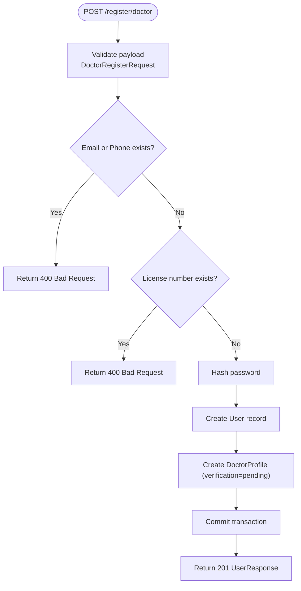

**Diagram sources**
- [auth.py:68-118](file://backend/app/api/auth.py#L68-L118)
- [auth.py (schemas):39-49](file://backend/app/schemas/auth.py#L39-L49)
- [security.py:14-15](file://backend/app/core/security.py#L14-L15)
- [user.py:62-80](file://backend/app/models/user.py#L62-L80)

**Section sources**
- [auth.py:68-118](file://backend/app/api/auth.py#L68-L118)
- [auth.py (schemas):39-49](file://backend/app/schemas/auth.py#L39-L49)
- [security.py:14-15](file://backend/app/core/security.py#L14-L15)
- [user.py:62-80](file://backend/app/models/user.py#L62-L80)

### Login Endpoint

#### Login
- HTTP Method: POST
- URL Pattern: `/api/v1/auth/login`
- Request Body Schema: `LoginRequest`
  - Fields: identifier (email or phone), password, demo_role (optional)
- Response Schema: `TokenResponse`
  - Fields: access_token (JWT), token_type ("bearer"), user (`UserResponse`)
- Status Codes:
  - 200 OK on success
  - 401 Unauthorized if credentials are invalid or account unregistered
- Authentication: None (public endpoint)
- Notes:
  - Supports lookup by email or phone.
  - Includes demo credential fallback for development/testing.
  - Returns a signed JWT access token configured via settings.

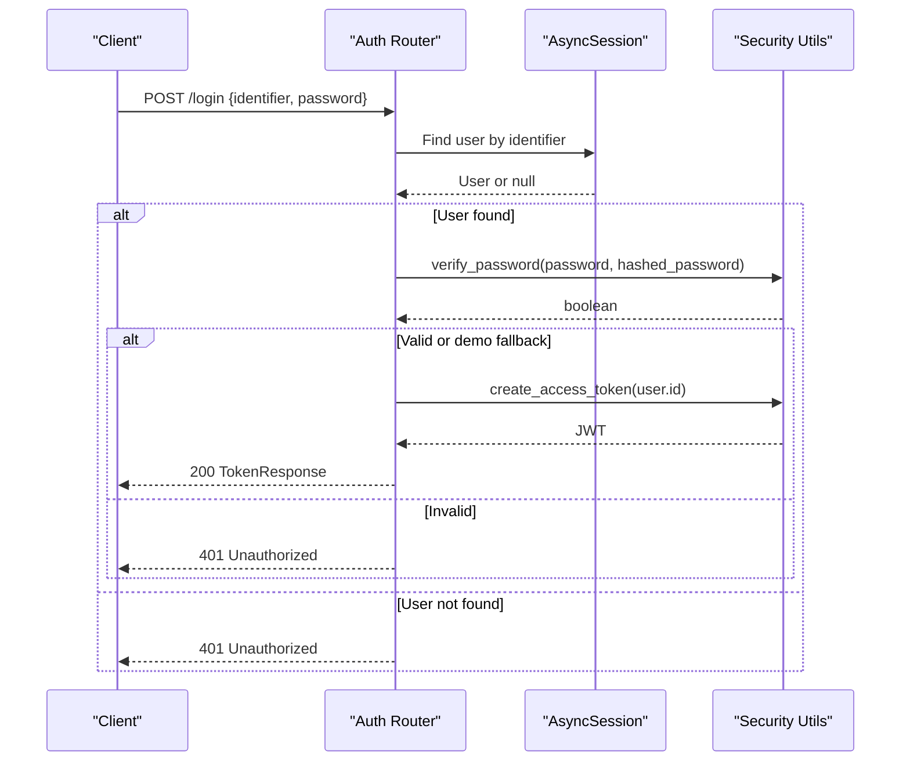

**Diagram sources**
- [auth.py:121-153](file://backend/app/api/auth.py#L121-L153)
- [security.py:10-26](file://backend/app/core/security.py#L10-L26)
- [auth.py (schemas):52-62](file://backend/app/schemas/auth.py#L52-L62)

**Section sources**
- [auth.py:121-153](file://backend/app/api/auth.py#L121-L153)
- [security.py:10-26](file://backend/app/core/security.py#L10-L26)
- [auth.py (schemas):52-62](file://backend/app/schemas/auth.py#L52-L62)

### OTP Verification Endpoint

#### Verify OTP
- HTTP Method: POST
- URL Pattern: `/api/v1/auth/verify-otp`
- Request Body Schema: `OtpVerifyRequest`
  - Fields: code (string), user_id (optional string)
- Response:
  - On success: `{ verified: true, message: "OTP verified successfully" }`
  - On failure: 400 Bad Request with detail "Invalid verification code"
- Authentication: None (public endpoint)
- Notes:
  - Demo implementation accepts a specific code or any 6-digit code.
  - Production should integrate with an external OTP provider and store ephemeral codes securely.

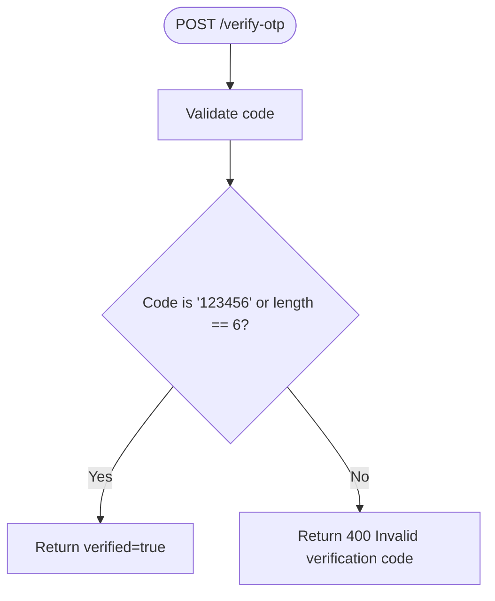

**Diagram sources**
- [auth.py:156-164](file://backend/app/api/auth.py#L156-L164)
- [auth.py (schemas):112-115](file://backend/app/schemas/auth.py#L112-L115)

**Section sources**
- [auth.py:156-164](file://backend/app/api/auth.py#L156-L164)
- [auth.py (schemas):112-115](file://backend/app/schemas/auth.py#L112-L115)

### Password Reset Endpoint

#### Reset Password
- HTTP Method: POST
- URL Pattern: `/api/v1/auth/reset-password`
- Request Body Schema: `ResetPasswordRequest`
  - Field: email (string)
- Response:
  - If email exists: `{ message: "Password reset instructions dispatched." }`
  - If email not found: `{ message: "If the email is registered, a password reset link has been dispatched." }`
- Status Codes:
  - 200 OK always (to prevent user enumeration)
- Authentication: None (public endpoint)
- Notes:
  - Implementation does not actually send emails or update passwords; it simulates dispatching reset instructions.
  - In production, implement secure token generation, email delivery, and time-limited reset links.

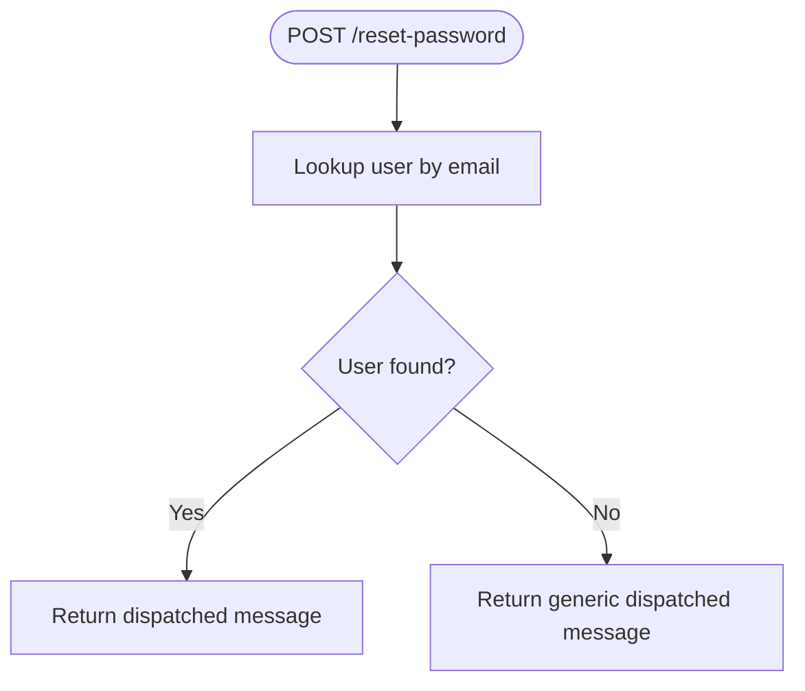

**Diagram sources**
- [auth.py:167-175](file://backend/app/api/auth.py#L167-L175)
- [auth.py (schemas):117-119](file://backend/app/schemas/auth.py#L117-L119)

**Section sources**
- [auth.py:167-175](file://backend/app/api/auth.py#L167-L175)
- [auth.py (schemas):117-119](file://backend/app/schemas/auth.py#L117-L119)

### Session Management and Protected Endpoints

#### Get Current User
- HTTP Method: GET
- URL Pattern: `/api/v1/auth/me`
- Response Schema: `UserResponse`
- Status Codes:
  - 200 OK on success
  - 401 Unauthorized if token is invalid or missing
- Authentication: Required (Bearer token via OAuth2 scheme)
- Notes:
  - Uses `get_current_user` dependency to decode JWT and fetch user from database.
  - Demonstrates protected endpoint pattern for other APIs.

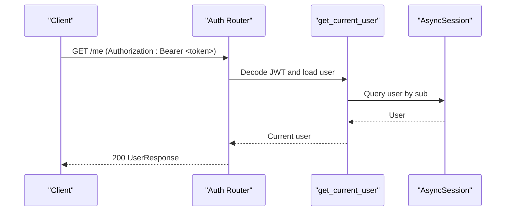

**Diagram sources**
- [auth.py:178-180](file://backend/app/api/auth.py#L178-L180)
- [deps.py:15-41](file://backend/app/api/deps.py#L15-L41)

**Section sources**
- [auth.py:178-180](file://backend/app/api/auth.py#L178-L180)
- [deps.py:15-41](file://backend/app/api/deps.py#L15-L41)

### Data Models and Relationships

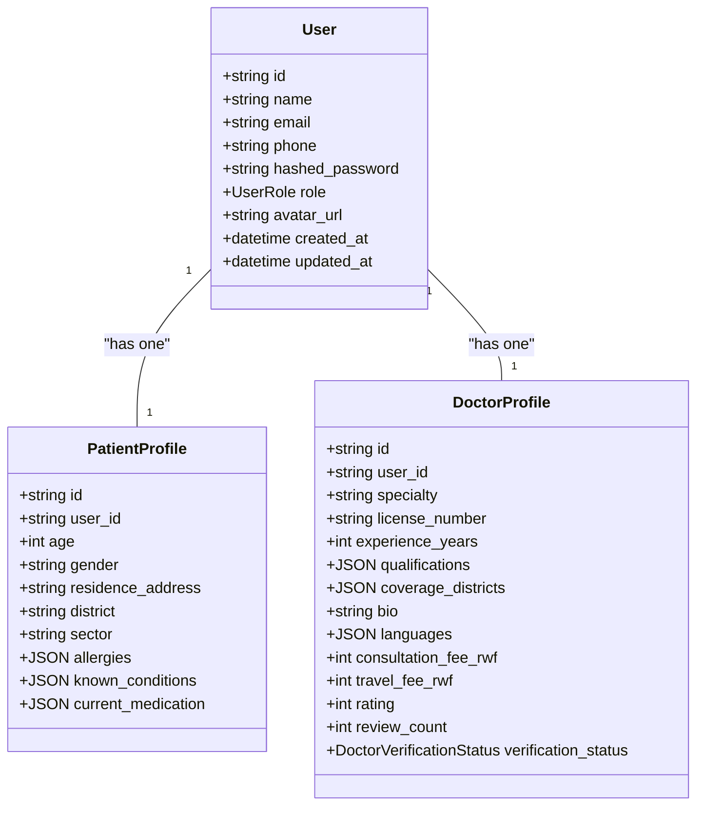

**Diagram sources**
- [user.py:26-80](file://backend/app/models/user.py#L26-L80)

**Section sources**
- [user.py:26-80](file://backend/app/models/user.py#L26-L80)

### Request/Response Schemas

- `PatientRegisterRequest`: name, email, phone, password (min_length=6), age, gender, residence_address, district, sector
- `DoctorRegisterRequest`: name, email, phone, password (min_length=6), specialty, license_number, experience_years (default 0), qualifications (list), coverage_districts (list)
- `LoginRequest`: identifier (email or phone), password, demo_role (optional)
- `TokenResponse`: access_token, token_type ("bearer"), user (`UserResponse`)
- `UserResponse`: id, name, email, phone, role, avatar_url, created_at, patient_profile (optional), doctor_profile (optional)
- `OtpVerifyRequest`: code, user_id (optional)
- `ResetPasswordRequest`: email

**Section sources**
- [auth.py (schemas):27-119](file://backend/app/schemas/auth.py#L27-L119)

### Security Middleware and CORS

- CORS is enabled globally allowing all origins, methods, and headers with credentials allowed.
- This configuration is suitable for development but should be restricted in production to specific domains.

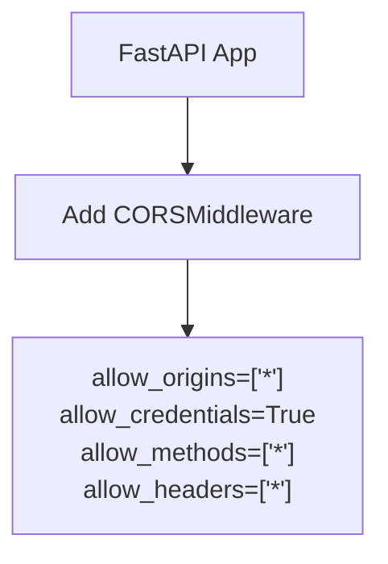

**Diagram sources**
- [main.py:37-44](file://backend/app/main.py#L37-L44)

**Section sources**
- [main.py:37-44](file://backend/app/main.py#L37-L44)

### JWT Token Handling

- Access tokens are created using HS256 algorithm with a secret key from settings.
- Default token expiration is 7 days unless overridden.
- Tokens include an expiration timestamp and subject (user ID).

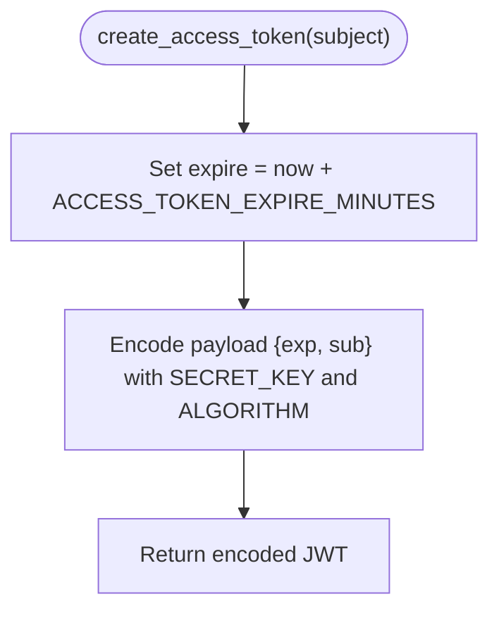

**Diagram sources**
- [security.py:18-26](file://backend/app/core/security.py#L18-L26)
- [config.py:18-21](file://backend/app/core/config.py#L18-L21)

**Section sources**
- [security.py:18-26](file://backend/app/core/security.py#L18-L26)
- [config.py:18-21](file://backend/app/core/config.py#L18-L21)

### Password Hashing Strategy

- Passwords are hashed using bcrypt via passlib CryptContext.
- Verification compares plain text against stored hash.

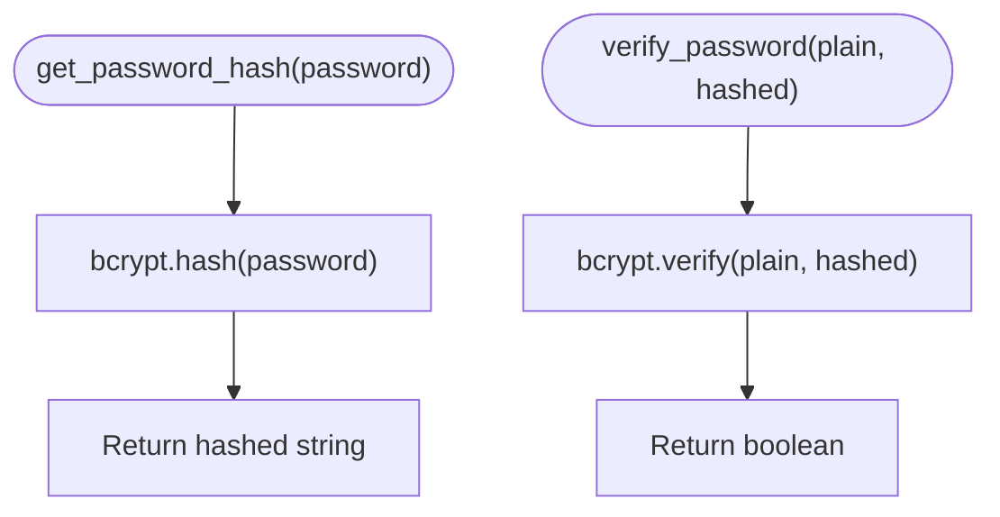

**Diagram sources**
- [security.py:1-15](file://backend/app/core/security.py#L1-L15)

**Section sources**
- [security.py:1-15](file://backend/app/core/security.py#L1-L15)

### Frontend Integration Examples

- The frontend service layer calls the backend auth endpoints:
  - Login sends `{ identifier, password }` to `/api/v1/auth/login` and stores the returned `access_token`.
  - OTP verification sends `{ code, user_id }` to `/api/v1/auth/verify-otp`.
  - Patient registration sends required fields to `/api/v1/auth/register/patient`.

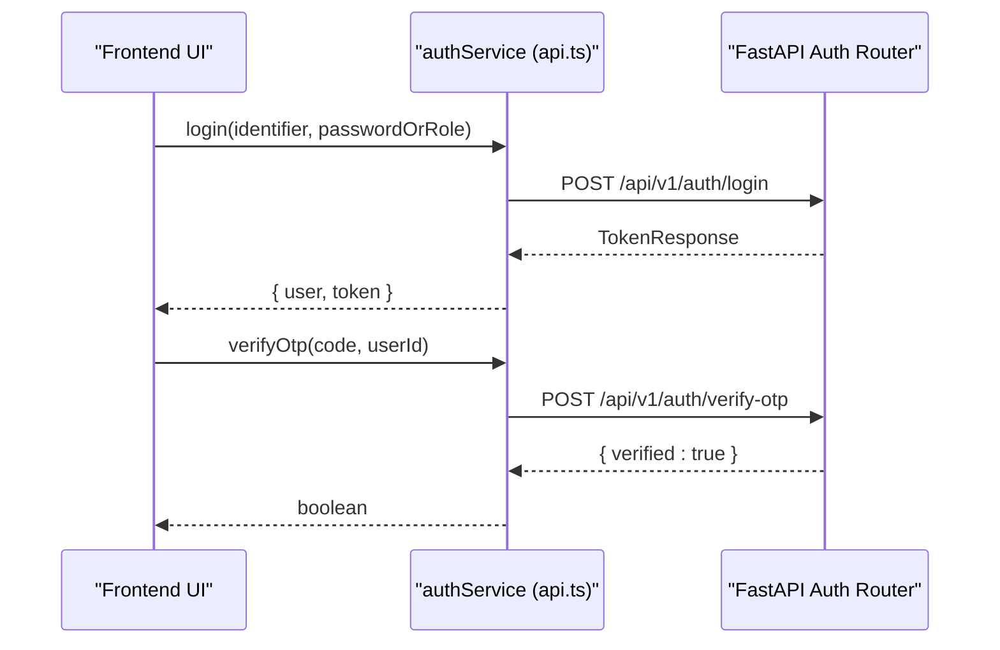

**Diagram sources**
- [api.ts:46-122](file://src/services/api.ts#L46-L122)
- [auth.py:121-164](file://backend/app/api/auth.py#L121-L164)

**Section sources**
- [api.ts:46-122](file://src/services/api.ts#L46-L122)
- [auth.py:121-164](file://backend/app/api/auth.py#L121-L164)

## Dependency Analysis

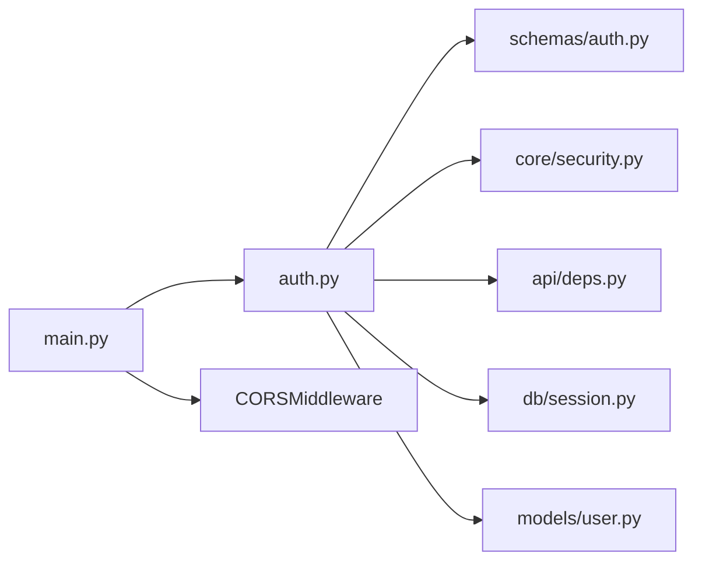

**Diagram sources**
- [auth.py:1-18](file://backend/app/api/auth.py#L1-L18)
- [main.py:31-46](file://backend/app/main.py#L31-L46)

**Section sources**
- [auth.py:1-18](file://backend/app/api/auth.py#L1-L18)
- [main.py:31-46](file://backend/app/main.py#L31-L46)

## Performance Considerations
- Use asynchronous database operations to avoid blocking I/O during authentication flows.
- Eager loading relationships reduces N+1 queries when returning user profiles.
- Avoid unnecessary re-queries after commit; reuse persisted objects where possible.
- Consider caching frequently accessed user data if needed, while ensuring cache invalidation on updates.
- Rate limiting should be added at the application level or reverse proxy to protect endpoints like login and OTP verification.

[No sources needed since this section provides general guidance]

## Troubleshooting Guide
- Invalid credentials: Ensure identifiers match stored email or phone and passwords are correct; check demo fallback behavior in login.
- OTP failures: Confirm code format and consider integrating a real OTP provider; the current implementation accepts specific demo codes.
- CORS errors: Verify client origin matches allowed origins; currently all origins are allowed, which may mask misconfiguration issues.
- JWT validation errors: Ensure secret key and algorithm match between token creation and decoding; verify token expiration settings.
- Database connection issues: Check DATABASE_URL and ensure PostgreSQL is reachable; the app initializes tables on startup.

**Section sources**
- [auth.py:121-175](file://backend/app/api/auth.py#L121-L175)
- [deps.py:15-41](file://backend/app/api/deps.py#L15-L41)
- [main.py:11-28](file://backend/app/main.py#L11-L28)

## Conclusion
The authentication system provides robust endpoints for user registration, login, OTP verification, password reset, and protected resource access via JWT. It leverages FastAPI’s dependency injection, Pydantic validation, SQLAlchemy async sessions, and bcrypt hashing. For production, restrict CORS, implement rate limiting, replace demo OTP logic with a secure provider, and enforce strong secret management and input validation policies.

[No sources needed since this section summarizes without analyzing specific files]