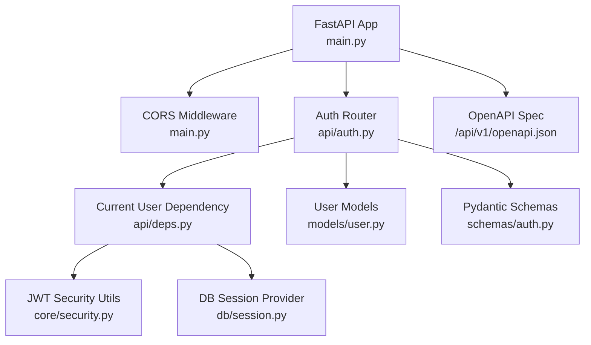
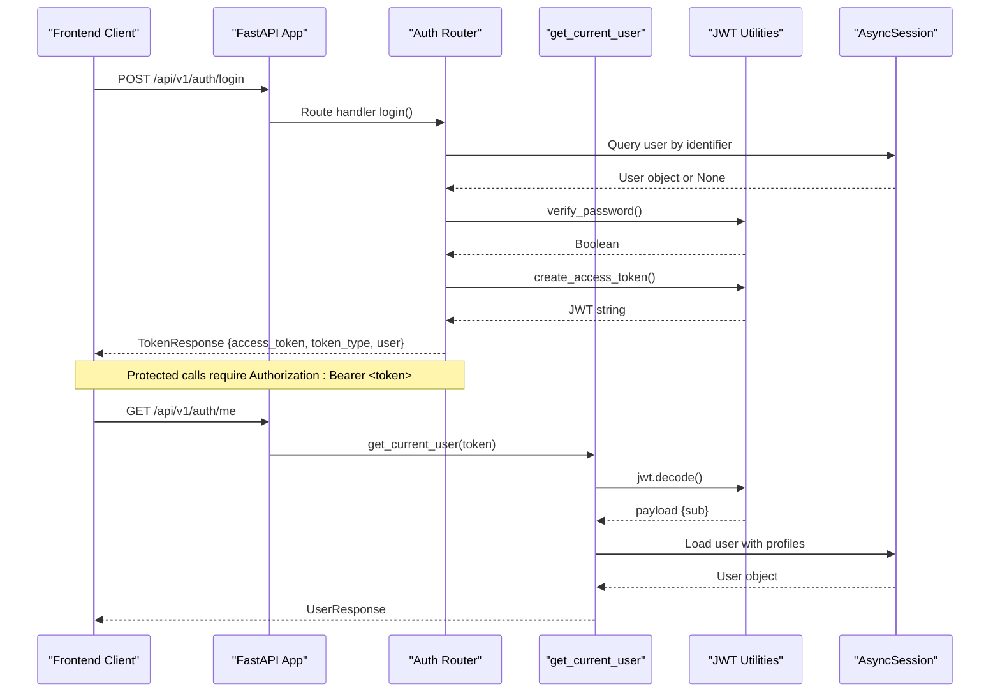
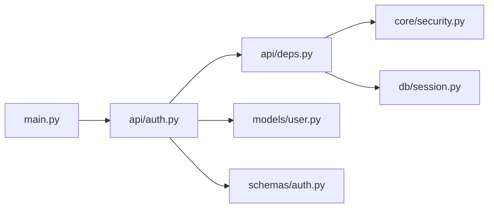

# Backend API

<cite>
**Referenced Files in This Document**
- [main.py](file://backend/app/main.py)
- [auth.py](file://backend/app/api/auth.py)
- [deps.py](file://backend/app/api/deps.py)
- [config.py](file://backend/app/core/config.py)
- [security.py](file://backend/app/core/security.py)
- [user.py](file://backend/app/models/user.py)
- [auth.py (schemas)](file://backend/app/schemas/auth.py)
- [session.py](file://backend/app/db/session.py)
- [api.ts](file://src/services/api.ts)
- [domain.ts](file://src/types/domain.ts)
</cite>

## Table of Contents
1. [Introduction](#introduction)
2. [Project Structure](#project-structure)
3. [Core Components](#core-components)
4. [Architecture Overview](#architecture-overview)
5. [Detailed Component Analysis](#detailed-component-analysis)
6. [Dependency Analysis](#dependency-analysis)
7. [Performance Considerations](#performance-considerations)
8. [Troubleshooting Guide](#troubleshooting-guide)
9. [Conclusion](#conclusion)
10. [Appendices](#appendices)

## Introduction
This document provides comprehensive API documentation for the FastAPI backend service powering the HomeCare application. It covers authentication endpoints, current user retrieval, database schema, security mechanisms, and integration guidance for frontend clients. The backend currently exposes a minimal but secure foundation with JWT-based authentication, CORS middleware, and an OpenAPI interface under versioned base path /api/v1.

## Project Structure
The backend is organized into modular components:
- Application entrypoint and middleware configuration
- Authentication router and dependencies
- Core configuration and security utilities
- Database session management
- Domain models and Pydantic schemas
- Frontend service contracts that define expected API behavior

**Diagram sources**
- [main.py:31-46](file://backend/app/main.py#L31-L46)
- [auth.py:1-21](file://backend/app/api/auth.py#L1-L21)
- [deps.py:1-12](file://backend/app/api/deps.py#L1-L12)
- [security.py:1-27](file://backend/app/core/security.py#L1-L27)
- [session.py:23-40](file://backend/app/db/session.py#L23-L40)
- [user.py:26-81](file://backend/app/models/user.py#L26-L81)
- [auth.py (schemas):1-120](file://backend/app/schemas/auth.py#L1-L120)

**Section sources**
- [main.py:31-46](file://backend/app/main.py#L31-L46)
- [config.py:10-30](file://backend/app/core/config.py#L10-L30)

## Core Components
- FastAPI application with lifespan hooks to initialize DB tables and verify connectivity
- CORS middleware allowing cross-origin requests from web/mobile clients
- Versioned API prefix /api/v1
- Authentication router with registration, login, OTP verification, password reset, and current user retrieval
- JWT-based authorization dependency for protected routes
- Async SQLAlchemy engine and session provider configured for PostgreSQL (including Neon compatibility)
- Domain models for users, patient profiles, and doctor profiles
- Pydantic request/response schemas for validation and serialization

Key behaviors:
- Base URL: http://localhost:8000/api/v1
- OpenAPI spec available at /api/v1/openapi.json
- Health check endpoint at /health
- Root endpoint returns app metadata and docs link

**Section sources**
- [main.py:11-35](file://backend/app/main.py#L11-L35)
- [main.py:49-60](file://backend/app/main.py#L49-L60)
- [session.py:23-40](file://backend/app/db/session.py#L23-L40)

## Architecture Overview
The backend follows a layered architecture:
- API Layer: FastAPI routers and dependencies
- Service Layer: Business logic within route handlers
- Data Access Layer: Async SQLAlchemy sessions and models
- Security Layer: Password hashing and JWT token handling
- Configuration Layer: Environment-driven settings

**Diagram sources**
- [auth.py:121-180](file://backend/app/api/auth.py#L121-L180)
- [deps.py:15-41](file://backend/app/api/deps.py#L15-L41)
- [security.py:18-26](file://backend/app/core/security.py#L18-L26)

## Detailed Component Analysis

### Authentication Endpoints
All authentication endpoints are mounted under /api/v1/auth.

- Register Patient
  - Method: POST
  - Path: /register/patient
  - Request Body: PatientRegisterRequest
  - Response: UserResponse (201 Created)
  - Validation Rules: name, email, phone required; password min length 6; optional profile fields
  - Error Responses: 400 Bad Request if email or phone already exists

- Register Doctor
  - Method: POST
  - Path: /register/doctor
  - Request Body: DoctorRegisterRequest
  - Response: UserResponse (201 Created)
  - Validation Rules: name, email, phone, specialty, license_number required; password min length 6; optional qualifications, coverage_districts
  - Error Responses: 400 Bad Request if email/phone or license_number already exists

- Login
  - Method: POST
  - Path: /login
  - Request Body: LoginRequest (identifier can be email or phone; password required)
  - Response: TokenResponse {access_token, token_type, user}
  - Authentication: None
  - Error Responses: 401 Unauthorized if credentials invalid

- Verify OTP
  - Method: POST
  - Path: /verify-otp
  - Request Body: OtpVerifyRequest {code, user_id?}
  - Response: {verified: boolean, message: string}
  - Authentication: None
  - Error Responses: 400 Bad Request if code invalid

- Reset Password
  - Method: POST
  -Path: /reset-password
  - Request Body: ResetPasswordRequest {email}
  - Response: {message: string}
  - Authentication: None
  - Notes: Safe response to avoid user enumeration

- Get Current User
  - Method: GET
  - Path: /me
  - Response: UserResponse
  - Authentication: Required (Bearer JWT)
  - Error Responses: 401 Unauthorized if token invalid or user not found

Authentication Requirements:
- Protected endpoints require Authorization header with Bearer token
- Token format: JWT encoded with HS256 using configured secret key
- Token expiration configurable via ACCESS_TOKEN_EXPIRE_MINUTES

Error Handling Patterns:
- HTTPException used consistently with descriptive detail messages
- Standard status codes: 201 Created, 400 Bad Request, 401 Unauthorized

Integration Guidelines:
- Frontend should store access_token and attach Authorization: Bearer <token> on subsequent requests
- Handle 401 responses by prompting re-login
- Use OpenAPI spec at /api/v1/openapi.json for client generation

**Section sources**
- [auth.py:24-65](file://backend/app/api/auth.py#L24-L65)
- [auth.py:68-118](file://backend/app/api/auth.py#L68-L118)
- [auth.py:121-180](file://backend/app/api/auth.py#L121-L180)
- [auth.py (schemas):27-56](file://backend/app/schemas/auth.py#L27-L56)
- [auth.py (schemas):58-120](file://backend/app/schemas/auth.py#L58-L120)

### Database Schema Documentation
Core entities and relationships:

- User
  - Fields: id (UUID), name, email (unique), phone (unique), hashed_password, role (enum), avatar_url, created_at, updated_at
  - Relationships: one-to-one with PatientProfile and DoctorProfile

- PatientProfile
  - Fields: id (UUID), user_id (FK unique), age, gender, residence_address, district, sector, allergies (JSON array), known_conditions (JSON array), current_medication (JSON array)
  - Relationship: belongs to User

- DoctorProfile
  - Fields: id (UUID), user_id (FK unique), specialty, license_number (unique), experience_years, qualifications (JSON array), coverage_districts (JSON array), bio, languages (JSON array), consultation_fee_rwf, travel_fee_rwf, rating, review_count, verification_status (enum)
  - Relationship: belongs to User

Relationship Mapping:
- User has one PatientProfile or DoctorProfile (mutually exclusive via business rules)
- Foreign keys enforce referential integrity with CASCADE delete

Migration Strategy:
- Tables are created automatically at startup via Base.metadata.create_all
- Engine configured with pool_pre_ping for connection health
- Async sessions used throughout for non-blocking operations

Data Types and Constraints:
- UUID primary keys for all entities
- Unique constraints on email, phone, license_number
- Enumerations for role and verification_status
- JSON columns for flexible arrays (allergies, qualifications, etc.)

**Section sources**
- [user.py:26-81](file://backend/app/models/user.py#L26-L81)
- [session.py:23-40](file://backend/app/db/session.py#L23-L40)

### Authentication Middleware and Security
- CORS Middleware: Allows all origins, methods, headers for development; restrict in production
- JWT Security:
  - Password hashing via bcrypt using passlib
  - Token creation with configurable expiration
  - Token decoding and validation in get_current_user dependency
- Secret Management:
  - SECRET_KEY and ALGORITHM loaded from environment via Settings
  - Default values provided for local development

Security Considerations:
- Enforce HTTPS in production
- Rotate SECRET_KEY regularly
- Validate and sanitize inputs using Pydantic schemas
- Avoid returning sensitive data in error responses
- Implement rate limiting for auth endpoints in production

**Section sources**
- [main.py:37-44](file://backend/app/main.py#L37-L44)
- [security.py:1-27](file://backend/app/core/security.py#L1-L27)
- [deps.py:15-41](file://backend/app/api/deps.py#L15-L41)
- [config.py:10-30](file://backend/app/core/config.py#L10-L30)

### Data Validation Rules
- Pydantic models enforce field types, lengths, and optionality
- Registration endpoints validate uniqueness of identifiers
- Login accepts either email or phone as identifier
- OTP verification supports demo codes and length checks

Validation Examples:
- PatientRegisterRequest requires name, email, phone, password (min_length=6)
- DoctorRegisterRequest requires specialty and license_number
- LoginRequest allows optional demo_role for backward compatibility

**Section sources**
- [auth.py (schemas):27-56](file://backend/app/schemas/auth.py#L27-L56)
- [auth.py:24-118](file://backend/app/api/auth.py#L24-L118)

### API Call Examples
- Register Patient
  - POST /api/v1/auth/register/patient
  - Body: {name, email, phone, password, ...optional profile fields}
  - Success: 201 with UserResponse
  - Error: 400 if email/phone exists

- Login
  - POST /api/v1/auth/login
  - Body: {identifier, password}
  - Success: 200 with TokenResponse
  - Error: 401 if invalid credentials

- Verify OTP
  - POST /api/v1/auth/verify-otp
  - Body: {code, user_id?}
  - Success: 200 with {verified: true/false}
  - Error: 400 if invalid code

- Get Current User
  - GET /api/v1/auth/me
  - Headers: Authorization: Bearer <token>
  - Success: 200 with UserResponse
  - Error: 401 if token invalid

**Section sources**
- [auth.py:24-180](file://backend/app/api/auth.py#L24-L180)

### Integration Guidelines for Frontend Consumption
- Base URL: http://localhost:8000/api/v1
- Store access_token securely after successful login
- Attach Authorization header to all protected requests
- Handle 401 responses by redirecting to login
- Use OpenAPI spec for client SDK generation
- Implement retry logic for transient network errors

Frontend Service Contracts:
- AuthService defines login, verifyOtp, registerPatient, registerDoctor, getCurrentUser, resetPassword
- Expected response shapes align with backend schemas

**Section sources**
- [api.ts:25-44](file://src/services/api.ts#L25-L44)
- [api.ts:46-122](file://src/services/api.ts#L46-L122)

## Dependency Analysis
The backend exhibits clear separation of concerns:
- main.py wires up middleware and includes routers
- api/auth.py implements authentication logic
- api/deps.py provides reusable authorization dependency
- core/security.py encapsulates cryptographic operations
- db/session.py manages async database connections
- models/user.py defines domain entities
- schemas/auth.py validates input/output payloads

**Diagram sources**
- [main.py:31-46](file://backend/app/main.py#L31-L46)
- [auth.py:1-21](file://backend/app/api/auth.py#L1-L21)
- [deps.py:1-12](file://backend/app/api/deps.py#L1-L12)
- [security.py:1-27](file://backend/app/core/security.py#L1-L27)
- [session.py:23-40](file://backend/app/db/session.py#L23-L40)
- [user.py:26-81](file://backend/app/models/user.py#L26-L81)
- [auth.py (schemas):1-120](file://backend/app/schemas/auth.py#L1-L120)

**Section sources**
- [main.py:31-46](file://backend/app/main.py#L31-L46)
- [auth.py:1-21](file://backend/app/api/auth.py#L1-L21)
- [deps.py:1-12](file://backend/app/api/deps.py#L1-L12)

## Performance Considerations
- Async database operations reduce blocking I/O
- Connection pooling enabled via pool_pre_ping
- Eager loading with selectinload avoids N+1 queries in auth flows
- JWT decoding is lightweight; consider caching user profiles if needed
- Rate limiting should be implemented for auth endpoints to prevent brute force attacks
- Consider adding request logging and metrics collection for observability

[No sources needed since this section provides general guidance]

## Troubleshooting Guide
Common Issues:
- Database Connection Failures
  - Check DATABASE_URL and SSL settings for Neon PostgreSQL
  - Ensure engine initialization succeeds during lifespan
- Authentication Errors
  - Verify SECRET_KEY matches between token creation and decoding
  - Confirm Authorization header format is correct
- CORS Errors
  - Ensure allow_origins includes frontend origin in production
- Validation Errors
  - Inspect Pydantic error details for missing or invalid fields

Debugging Tips:
- Use /health endpoint to verify service availability
- Enable debug logging in development
- Review OpenAPI UI at /docs for endpoint specifications

**Section sources**
- [main.py:11-28](file://backend/app/main.py#L11-L28)
- [deps.py:15-41](file://backend/app/api/deps.py#L15-L41)
- [session.py:23-40](file://backend/app/db/session.py#L23-L40)

## Conclusion
The FastAPI backend provides a secure, versioned foundation for the HomeCare application with robust authentication, clear data models, and extensible architecture. Future enhancements should include additional resource endpoints for visits, consultations, results, and admin operations, along with production-grade security measures such as rate limiting, HTTPS enforcement, and audit logging.

[No sources needed since this section summarizes without analyzing specific files]

## Appendices

### API Evolution and Versioning
- Current API version: v1 under /api/v1
- Strategy: Maintain backward compatibility within major versions; introduce breaking changes in new versions (e.g., /api/v2)
- Deprecation: Use headers or response fields to indicate deprecation timelines

### Rate Limiting Recommendations
- Implement per-IP and per-user rate limits on auth endpoints
- Use Redis-backed throttling for distributed deployments
- Return 429 Too Many Requests with retry-after hints

### Security Checklist
- Enforce HTTPS in production
- Rotate secrets regularly
- Validate and sanitize all inputs
- Log security events without sensitive data
- Restrict CORS to trusted origins

[No sources needed since this section provides general guidance]