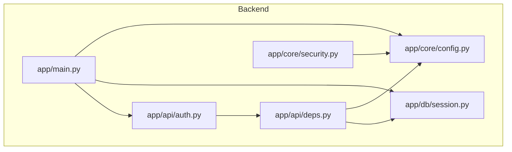
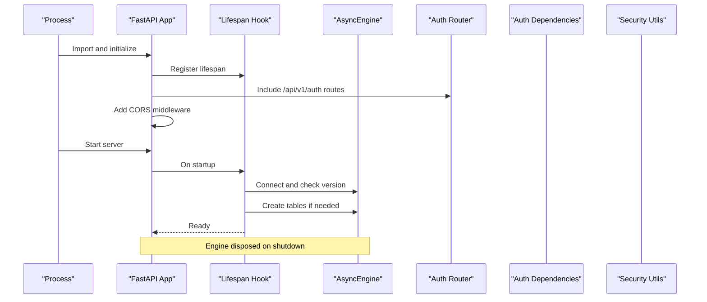
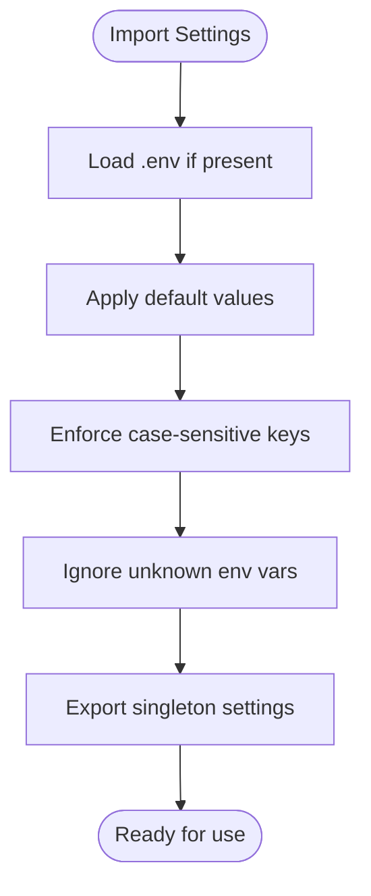
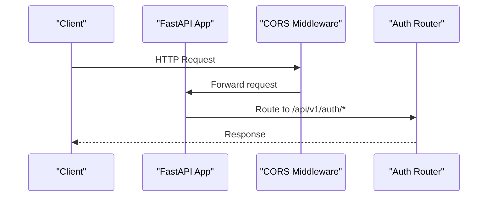
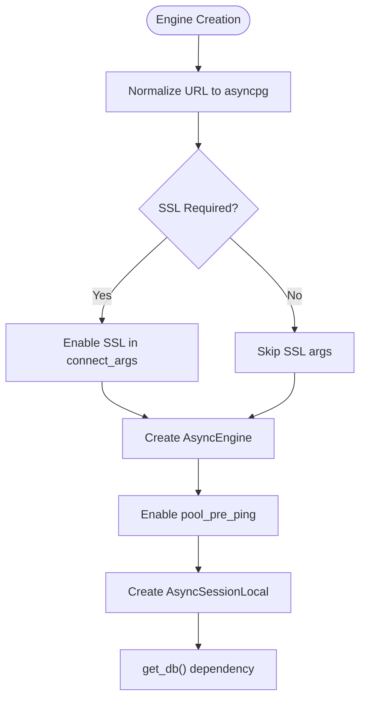
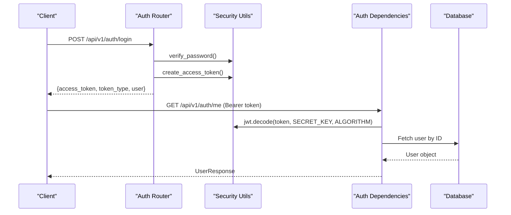
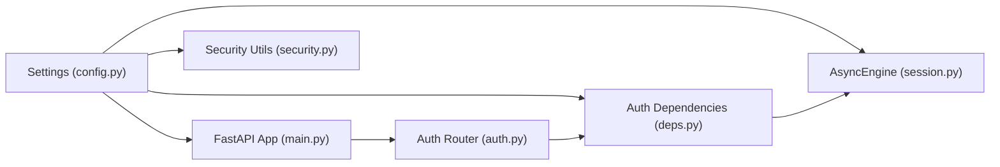

# Core Configuration

<cite>
**Referenced Files in This Document**
- [config.py](file://backend/app/core/config.py)
- [main.py](file://backend/app/main.py)
- [session.py](file://backend/app/db/session.py)
- [security.py](file://backend/app/core/security.py)
- [deps.py](file://backend/app/api/deps.py)
- [auth.py](file://backend/app/api/auth.py)
</cite>

## Table of Contents
1. [Introduction](#introduction)
2. [Project Structure](#project-structure)
3. [Core Components](#core-components)
4. [Architecture Overview](#architecture-overview)
5. [Detailed Component Analysis](#detailed-component-analysis)
6. [Dependency Analysis](#dependency-analysis)
7. [Performance Considerations](#performance-considerations)
8. [Troubleshooting Guide](#troubleshooting-guide)
9. [Conclusion](#conclusion)

## Introduction
This document explains the core configuration system for the FastAPI backend, including environment variables, application settings, and configuration management patterns. It also covers FastAPI application initialization, middleware setup, CORS configuration, lifespan management, database connection pooling, startup procedures, security configurations, logging considerations, and monitoring integration points.

## Project Structure
The backend is organized into focused modules:
- Configuration and settings are centralized under the core module.
- Database engine and session management live under db.
- Security utilities (password hashing and JWT) are under core.
- API routes and dependencies are under api.
- The FastAPI application entry point wires everything together.

**Diagram sources**
- [main.py:1-60](file://backend/app/main.py#L1-L60)
- [config.py:1-33](file://backend/app/core/config.py#L1-L33)
- [session.py:1-49](file://backend/app/db/session.py#L1-L49)
- [security.py:1-27](file://backend/app/core/security.py#L1-L27)
- [deps.py:1-41](file://backend/app/api/deps.py#L1-L41)
- [auth.py:1-181](file://backend/app/api/auth.py#L1-L181)

**Section sources**
- [main.py:1-60](file://backend/app/main.py#L1-L60)
- [config.py:1-33](file://backend/app/core/config.py#L1-L33)

## Core Components
- Settings and environment loading: Centralized via a Pydantic-based settings class that reads from an environment file and supports case-sensitive keys.
- Application initialization: FastAPI app created with title, OpenAPI URL, and lifespan hooks.
- Middleware and CORS: Global CORS middleware configured to allow cross-origin requests from any origin for development convenience.
- Database layer: Async SQLAlchemy engine and session factory configured with connection pre-ping and SSL handling for Neon PostgreSQL.
- Security utilities: Password hashing and JWT token creation using bcrypt and pyjwt, driven by configuration values.
- Authentication dependency: Decodes JWT tokens and resolves current user from the database.

Key responsibilities:
- Environment-driven configuration with defaults and overrides.
- Secure credential handling and token lifecycle.
- Robust database connectivity and session management.
- Clear API routing and health endpoints.

**Section sources**
- [config.py:10-30](file://backend/app/core/config.py#L10-L30)
- [main.py:31-46](file://backend/app/main.py#L31-L46)
- [session.py:6-40](file://backend/app/db/session.py#L6-L40)
- [security.py:7-26](file://backend/app/core/security.py#L7-L26)
- [deps.py:12-41](file://backend/app/api/deps.py#L12-L41)

## Architecture Overview
The configuration system drives the entire application lifecycle:
- Settings are loaded at import time and used across modules.
- The FastAPI app initializes lifespan hooks to connect to the database and ensure tables exist.
- CORS middleware is applied globally.
- Routes are mounted under a versioned prefix.
- Security utilities and dependencies rely on shared settings.

**Diagram sources**
- [main.py:11-35](file://backend/app/main.py#L11-L35)
- [main.py:37-46](file://backend/app/main.py#L37-L46)
- [session.py:23-29](file://backend/app/db/session.py#L23-L29)

**Section sources**
- [main.py:11-46](file://backend/app/main.py#L11-L46)
- [session.py:23-29](file://backend/app/db/session.py#L23-L29)

## Detailed Component Analysis

### Configuration Management (Settings and Environment Variables)
- Uses a Pydantic BaseSettings class with explicit defaults for project name, API version prefix, database URL, JWT secret key, algorithm, and token expiration.
- Reads from an environment file located at the repository root; falls back to .env if not found.
- Case-sensitive environment variable names are enforced.
- Unknown environment variables are ignored to avoid runtime errors.

Environment variables supported:
- PROJECT_NAME: Application display name.
- API_V1_STR: Base path for API routes.
- DATABASE_URL: Full async PostgreSQL connection string.
- SECRET_KEY: Secret used for signing JWT tokens.
- ALGORITHM: JWT signing algorithm.
- ACCESS_TOKEN_EXPIRE_MINUTES: Token lifetime in minutes.

Configuration loading pattern:
- Settings instance is created once and imported across modules.
- Defaults provide local development readiness.
- Production deployments should override via environment variables or external secret managers.

**Diagram sources**
- [config.py:10-30](file://backend/app/core/config.py#L10-L30)

**Section sources**
- [config.py:1-33](file://backend/app/core/config.py#L1-33)

### FastAPI Application Initialization and Middleware
- The FastAPI app is initialized with a dynamic title and OpenAPI URL derived from settings.
- Lifespan hook performs database connectivity checks and table initialization on startup.
- CORS middleware is added globally to allow all origins, methods, and headers for development.
- Auth router is included under the versioned API prefix.

CORS configuration details:
- Allow all origins: suitable for local development but should be restricted in production.
- Credentials allowed: enables cookies and authorization headers across domains.
- Methods and headers wildcard: simplifies client integrations during development.

Startup behavior:
- Prints connection status and database version.
- Ensures required tables exist before serving requests.
- Disposes engine connections on shutdown.

**Diagram sources**
- [main.py:31-46](file://backend/app/main.py#L31-L46)

**Section sources**
- [main.py:31-46](file://backend/app/main.py#L31-L46)

### Database Connection Pooling and Startup Procedures
- The async engine is created with connection pre-ping enabled to detect stale connections.
- Standard PostgreSQL URLs are converted to asyncpg-compatible URLs automatically.
- SSL is enabled when the URL indicates secure mode or targets Neon infrastructure.
- Session factory configures asynchronous sessions with appropriate commit/flush behaviors.
- Dependency function yields a session per request and ensures cleanup.

Startup procedure:
- On app startup, lifespan connects to the database and verifies version.
- Creates all mapped tables if they do not exist.
- Logs success or error messages for operational visibility.

**Diagram sources**
- [session.py:6-40](file://backend/app/db/session.py#L6-L40)
- [main.py:11-28](file://backend/app/main.py#L11-L28)

**Section sources**
- [session.py:6-40](file://backend/app/db/session.py#L6-L40)
- [main.py:11-28](file://backend/app/main.py#L11-L28)

### Security Configurations and JWT Flow
- Password hashing uses bcrypt via passlib context.
- JWT access tokens are created with configurable expiration and algorithm.
- Authentication dependency decodes tokens using the configured secret and algorithm, then retrieves the user from the database.

JWT flow overview:
- Login endpoint authenticates credentials and returns a signed JWT.
- Protected endpoints require a bearer token validated by the dependency.
- Token payload includes subject identifier and expiration timestamp.

**Diagram sources**
- [auth.py:148-153](file://backend/app/api/auth.py#L148-L153)
- [security.py:18-26](file://backend/app/core/security.py#L18-L26)
- [deps.py:15-41](file://backend/app/api/deps.py#L15-L41)

**Section sources**
- [security.py:1-27](file://backend/app/core/security.py#L1-L27)
- [deps.py:1-41](file://backend/app/api/deps.py#L1-L41)
- [auth.py:148-153](file://backend/app/api/auth.py#L148-L153)

### Logging Setup and Monitoring Integration Points
- Logging is currently implemented via print statements within the lifespan hook for database connectivity and table initialization.
- No structured logging framework is configured in the analyzed files.
- Health endpoint provides a simple status response suitable for basic monitoring probes.

Recommendations:
- Introduce a structured logging library (e.g., Python logging or structlog) to capture application events, errors, and performance metrics.
- Expose additional health and readiness endpoints for liveness and readiness probes.
- Integrate metrics collection (e.g., Prometheus) and tracing libraries where appropriate.

**Section sources**
- [main.py:11-28](file://backend/app/main.py#L11-L28)
- [main.py:58-60](file://backend/app/main.py#L58-L60)

## Dependency Analysis
The following diagram shows how configuration flows through the application components:

**Diagram sources**
- [config.py:10-30](file://backend/app/core/config.py#L10-L30)
- [main.py:31-46](file://backend/app/main.py#L31-L46)
- [session.py:23-40](file://backend/app/db/session.py#L23-L40)
- [security.py:18-26](file://backend/app/core/security.py#L18-L26)
- [deps.py:12-41](file://backend/app/api/deps.py#L12-L41)
- [auth.py:1-181](file://backend/app/api/auth.py#L1-L181)

**Section sources**
- [config.py:10-30](file://backend/app/core/config.py#L10-L30)
- [main.py:31-46](file://backend/app/main.py#L31-L46)
- [session.py:23-40](file://backend/app/db/session.py#L23-L40)
- [security.py:18-26](file://backend/app/core/security.py#L18-L26)
- [deps.py:12-41](file://backend/app/api/deps.py#L12-L41)
- [auth.py:1-181](file://backend/app/api/auth.py#L1-L181)

## Performance Considerations
- Database connection pooling: Enabled via SQLAlchemy’s async engine with pre-ping to maintain healthy connections.
- SSL handling: Automatically enabled for secure environments like Neon PostgreSQL to reduce latency and improve security.
- CORS overhead: Wildcard CORS allows broad cross-origin access; restrict origins in production to minimize unnecessary processing.
- Token validation: JWT decoding is lightweight; consider caching user profiles if repeated lookups occur frequently.

[No sources needed since this section provides general guidance]

## Troubleshooting Guide
Common issues and resolutions:
- Database connection failures:
  - Verify DATABASE_URL format and credentials.
  - Ensure SSL parameters are handled correctly for cloud providers.
  - Check logs printed during lifespan startup for detailed error messages.
- CORS errors:
  - Confirm that the client origin matches allowed origins in production.
  - Ensure credentials are properly sent and accepted by the server.
- Authentication failures:
  - Validate SECRET_KEY and ALGORITHM match between token generation and verification.
  - Ensure token expiration aligns with expected user sessions.

Operational tips:
- Use the health endpoint to verify service availability.
- Monitor lifespan logs for database connectivity and table initialization status.
- Restrict CORS origins and enable structured logging for better observability.

**Section sources**
- [main.py:11-28](file://backend/app/main.py#L11-L28)
- [main.py:37-46](file://backend/app/main.py#L37-L46)
- [session.py:6-29](file://backend/app/db/session.py#L6-L29)
- [deps.py:15-41](file://backend/app/api/deps.py#L15-L41)

## Conclusion
The core configuration system centralizes environment-driven settings, enabling consistent behavior across development and production. FastAPI initialization integrates lifespan hooks for robust database connectivity and table management, while global CORS middleware simplifies client integrations during development. Security utilities and authentication dependencies leverage configuration values to manage credentials and tokens securely. For production readiness, restrict CORS origins, introduce structured logging, and enhance monitoring with health and metrics endpoints.

[No sources needed since this section summarizes without analyzing specific files]