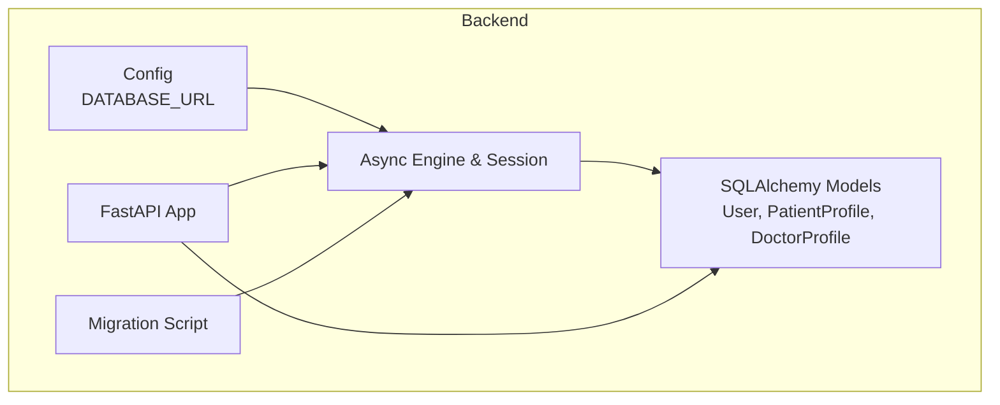
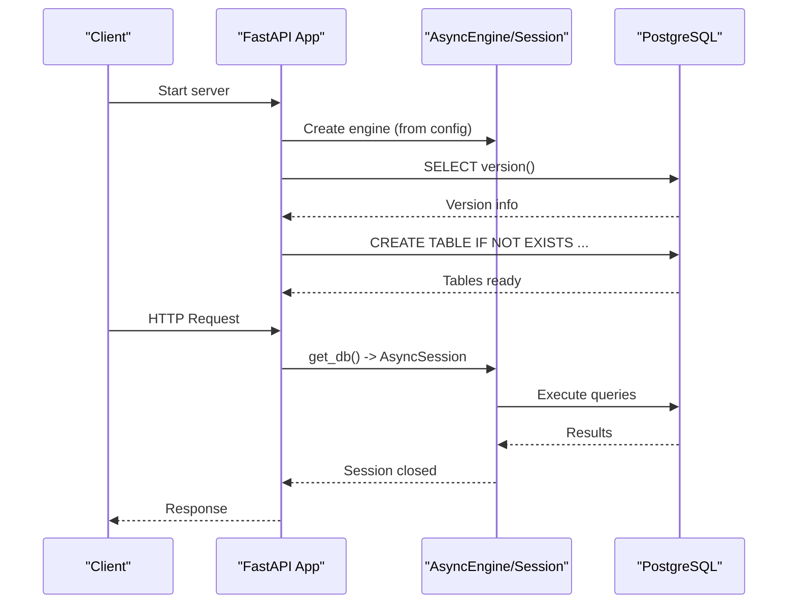
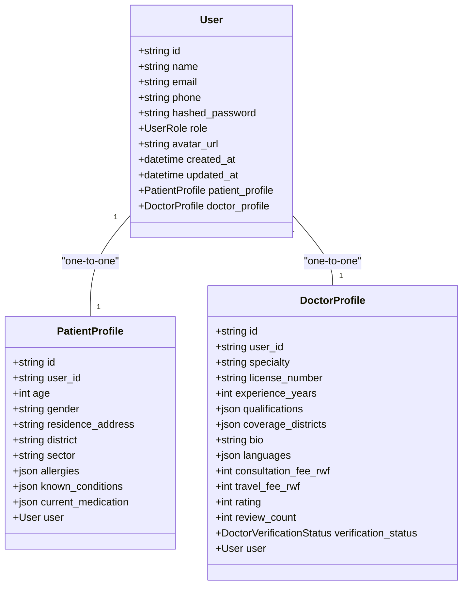
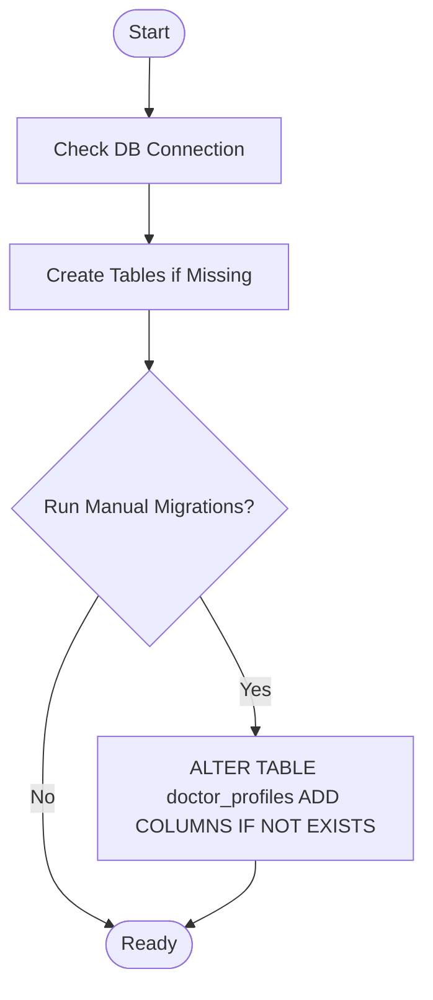
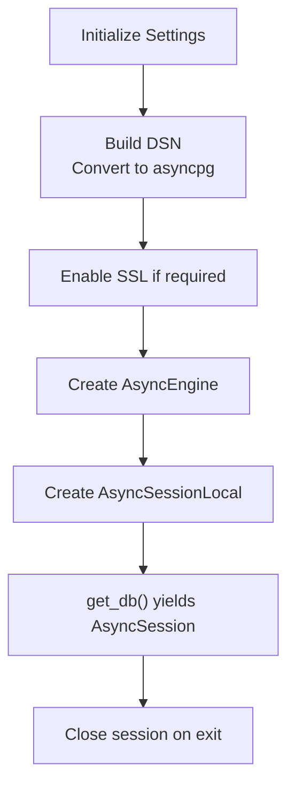
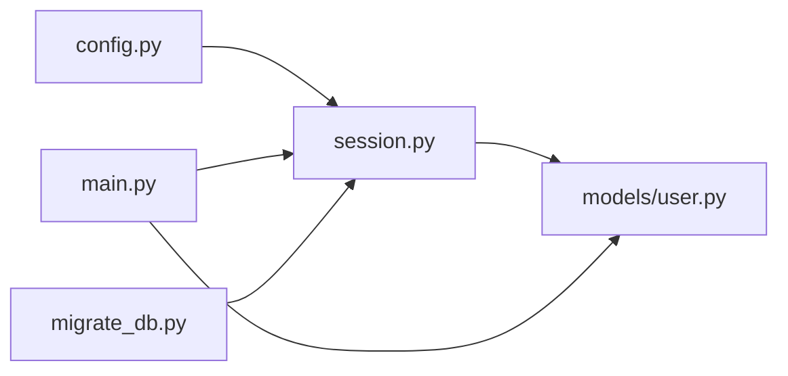

# Database Schema

<cite>
**Referenced Files in This Document**
- [user.py](file://backend/app/models/user.py)
- [session.py](file://backend/app/db/session.py)
- [config.py](file://backend/app/core/config.py)
- [main.py](file://backend/app/main.py)
- [migrate_db.py](file://backend/migrate_db.py)
- [auth.py](file://backend/app/schemas/auth.py)
</cite>

## Table of Contents
1. [Introduction](#introduction)
2. [Project Structure](#project-structure)
3. [Core Components](#core-components)
4. [Architecture Overview](#architecture-overview)
5. [Detailed Component Analysis](#detailed-component-analysis)
6. [Dependency Analysis](#dependency-analysis)
7. [Performance Considerations](#performance-considerations)
8. [Troubleshooting Guide](#troubleshooting-guide)
9. [Conclusion](#conclusion)
10. [Appendices](#appendices)

## Introduction
This document describes the PostgreSQL database schema and its integration with the application’s SQLAlchemy ORM layer. It focuses on the User, PatientProfile, and DoctorProfile models, including field definitions, data types, constraints, indexes, relationships, migration strategy, connection setup, session management, transaction handling, validation rules, and common query patterns.

## Project Structure
The backend uses FastAPI with SQLAlchemy async engine and Pydantic schemas for request/response validation. The database configuration is centralized, and the application initializes tables at startup.



**Diagram sources**
- [config.py:10-30](file://backend/app/core/config.py#L10-L30)
- [session.py:1-49](file://backend/app/db/session.py#L1-L49)
- [user.py:1-82](file://backend/app/models/user.py#L1-L82)
- [main.py:11-28](file://backend/app/main.py#L11-L28)
- [migrate_db.py:1-20](file://backend/migrate_db.py#L1-L20)

**Section sources**
- [config.py:10-30](file://backend/app/core/config.py#L10-L30)
- [session.py:1-49](file://backend/app/db/session.py#L1-L49)
- [main.py:11-28](file://backend/app/main.py#L11-L28)

## Core Components
- User model: core identity and role information; one-to-one relationships to PatientProfile and DoctorProfile.
- PatientProfile: patient-specific attributes and JSON fields for lists.
- DoctorProfile: doctor-specific attributes, verification status, fees, ratings, and JSON fields for lists.

Key implementation details are defined in the models file and validated by Pydantic schemas used by API endpoints.

**Section sources**
- [user.py:10-82](file://backend/app/models/user.py#L10-L82)
- [auth.py:27-90](file://backend/app/schemas/auth.py#L27-L90)

## Architecture Overview
The application connects to PostgreSQL using an asynchronous SQLAlchemy engine configured via environment variables. At application startup, it verifies connectivity and creates all mapped tables. Sessions are provided per request through a dependency that yields an AsyncSession and ensures cleanup.



**Diagram sources**
- [main.py:11-28](file://backend/app/main.py#L11-L28)
- [session.py:23-48](file://backend/app/db/session.py#L23-L48)
- [config.py:14-16](file://backend/app/core/config.py#L14-L16)

## Detailed Component Analysis

### Entity Relationship Model
The following diagram maps the three primary entities and their relationships.

```mermaid
erDiagram
USERS {
string id PK
string name
string email UK
string phone UK
string hashed_password
enum role
string avatar_url
timestamp created_at
timestamp updated_at
}
PATIENT_PROFILES {
string id PK
string user_id FK UK
int age
string gender
string residence_address
string district
string sector
json allergies
json known_conditions
json current_medication
}
DOCTOR_PROFILES {
string id PK
string user_id FK UK
string specialty
string license_number UK
int experience_years
json qualifications
json coverage_districts
string bio
json languages
int consultation_fee_rwf
int travel_fee_rwf
int rating
int review_count
enum verification_status
}
USERS ||--o| PATIENT_PROFILES : "one-to-one"
USERS ||--o| DOCTOR_PROFILES : "one-to-one"
```

**Diagram sources**
- [user.py:26-82](file://backend/app/models/user.py#L26-L82)

#### Users Table
- Primary key: id (string, UUID).
- Unique indexes: email, phone.
- Role constraint: enumerated values (patient, doctor, admin).
- Timestamps: created_at, updated_at with timezone-aware defaults.
- Relationships:
  - One-to-one with PatientProfile (delete-orphan cascade).
  - One-to-one with DoctorProfile (delete-orphan cascade).

Indexes and constraints:
- Primary key index on id.
- Unique indexes on email and phone.
- Enum constraints enforced by SQLAlchemy on role and verification_status.

Data types:
- String for identifiers and text fields.
- Integer for numeric fields.
- DateTime(timezone=True) for timestamps.
- JSON for list-like fields (allergies, known_conditions, current_medication, qualifications, coverage_districts, languages).

Relationships:
- User.patient_profile: back_populates to PatientProfile.user.
- User.doctor_profile: back_populates to DoctorProfile.user.

**Section sources**
- [user.py:26-43](file://backend/app/models/user.py#L26-L43)
- [user.py:45-60](file://backend/app/models/user.py#L45-L60)
- [user.py:62-82](file://backend/app/models/user.py#L62-L82)

#### PatientProfiles Table
- Primary key: id (string, UUID).
- Foreign key: user_id references users.id with CASCADE delete; unique constraint enforces one profile per user.
- Optional fields: age, gender, residence_address, district, sector.
- JSON arrays: allergies, known_conditions, current_medication with default empty lists.
- Relationship:
  - PatientProfile.user: back_populates to User.patient_profile.

Validation notes:
- Pydantic schemas define optional fields and default empty lists for response serialization.

**Section sources**
- [user.py:45-60](file://backend/app/models/user.py#L45-L60)
- [auth.py:64-76](file://backend/app/schemas/auth.py#L64-L76)

#### DoctorProfiles Table
- Primary key: id (string, UUID).
- Foreign key: user_id references users.id with CASCADE delete; unique constraint enforces one profile per user.
- Required fields: specialty, license_number (unique).
- Optional/default fields:
  - experience_years (default 0),
  - qualifications (JSON array default []),
  - coverage_districts (JSON array default []),
  - bio (nullable string),
  - languages (JSON array default []),
  - consultation_fee_rwf (default 25000),
  - travel_fee_rwf (default 5000),
  - rating (default 5),
  - review_count (default 0),
  - verification_status (enum: pending, approved, suspended).
- Relationship:
  - DoctorProfile.user: back_populates to User.doctor_profile.

Migration notes:
- Migration script adds several columns to doctor_profiles if missing, ensuring backward compatibility.

**Section sources**
- [user.py:62-82](file://backend/app/models/user.py#L62-L82)
- [migrate_db.py:6-15](file://backend/migrate_db.py#L6-L15)
- [auth.py:78-90](file://backend/app/schemas/auth.py#L78-L90)

### SQLAlchemy Model Definitions and Mappings
- Base class: declarative_base from session module.
- Enums: UserRole and DoctorVerificationStatus map to SQL enums.
- Relationships:
  - uselist=False ensures one-to-one semantics.
  - cascade="all, delete-orphan" ensures child profiles are removed when the parent user is deleted.



**Diagram sources**
- [user.py:26-82](file://backend/app/models/user.py#L26-L82)

### Data Validation Rules and Business Constraints
- Identity uniqueness: email and phone must be unique across users.
- Profile uniqueness: each user can have at most one patient or doctor profile due to unique foreign keys.
- Role enforcement: only allowed roles via enum.
- Doctor verification: status constrained to pending/approved/suspended.
- Defaults:
  - JSON arrays default to empty lists.
  - Fees and ratings have sensible defaults.
- Pydantic schemas enforce input/output contracts for registration and responses.

**Section sources**
- [user.py:26-82](file://backend/app/models/user.py#L26-L82)
- [auth.py:27-90](file://backend/app/schemas/auth.py#L27-L90)

### Migration Strategy
- Startup initialization:
  - Application checks database connectivity and runs Base.metadata.create_all to ensure tables exist.
- Manual migrations:
  - A dedicated script adds new columns to doctor_profiles with safe “IF NOT EXISTS” statements.



**Diagram sources**
- [main.py:11-28](file://backend/app/main.py#L11-L28)
- [migrate_db.py:6-15](file://backend/migrate_db.py#L6-L15)

**Section sources**
- [main.py:11-28](file://backend/app/main.py#L11-L28)
- [migrate_db.py:1-20](file://backend/migrate_db.py#L1-L20)

### Database Connection Setup, Session Management, and Transactions
- Connection URL:
  - Configured via settings.DATABASE_URL.
  - Automatically converted to postgresql+asyncpg:// scheme.
  - SSL enabled for Neon or when ssl parameters are present.
- Engine:
  - Asynchronous engine with pool_pre_ping enabled.
- Session:
  - AsyncSessionLocal factory configured with autocommit=False, autoflush=False, expire_on_commit=False.
  - Dependency get_db provides a session per request and closes it afterward.
- Transactions:
  - Use engine.begin() for explicit transactions in scripts and lifecycle hooks.



**Diagram sources**
- [session.py:1-49](file://backend/app/db/session.py#L1-L49)
- [config.py:14-16](file://backend/app/core/config.py#L14-L16)

**Section sources**
- [session.py:1-49](file://backend/app/db/session.py#L1-L49)
- [config.py:10-30](file://backend/app/core/config.py#L10-L30)
- [main.py:11-28](file://backend/app/main.py#L11-L28)

### Common Queries and Data Access Patterns
Below are representative query patterns aligned with the schema. Replace placeholders with actual values when executing.

- Create a new user with a patient profile:
  - Insert into users, then insert into patient_profiles referencing users.id.
- Create a new user with a doctor profile:
  - Insert into users, then insert into doctor_profiles referencing users.id.
- Retrieve a user with their profile:
  - Join users with either patient_profiles or doctor_profiles based on role.
- Update patient profile fields:
  - Update patient_profiles where user_id matches the authenticated user.
- Update doctor profile fields:
  - Update doctor_profiles where user_id matches the authenticated user.
- Search doctors by specialty, district, language, fee, rating:
  - Filter doctor_profiles by specialty, membership in coverage_districts, presence in languages, fee thresholds, and rating.

Example SQL templates:

- Create user and patient profile:
  - INSERT INTO users (id, name, email, phone, hashed_password, role) VALUES (:id, :name, :email, :phone, :hashed_password, 'patient');
  - INSERT INTO patient_profiles (id, user_id, age, gender, residence_address, district, sector, allergies, known_conditions, current_medication) VALUES (:pid, :uid, :age, :gender, :address, :district, :sector, :allergies, :conditions, :medications);

- Create user and doctor profile:
  - INSERT INTO users (id, name, email, phone, hashed_password, role) VALUES (:id, :name, :email, :phone, :hashed_password, 'doctor');
  - INSERT INTO doctor_profiles (id, user_id, specialty, license_number, experience_years, qualifications, coverage_districts, bio, languages, consultation_fee_rwf, travel_fee_rwf, rating, review_count, verification_status) VALUES (:did, :uid, :specialty, :license, :exp, :quals, :cov, :bio, :langs, :consult_fee, :travel_fee, :rating, :reviews, 'pending');

- Select user with profile:
  - SELECT u.*, pp.* FROM users u LEFT JOIN patient_profiles pp ON u.id = pp.user_id WHERE u.email = :email;
  - SELECT u.*, dp.* FROM users u LEFT JOIN doctor_profiles dp ON u.id = dp.user_id WHERE u.email = :email;

- Update patient profile:
  - UPDATE patient_profiles SET age = :age, gender = :gender, residence_address = :address, district = :district, sector = :sector, allergies = :allergies, known_conditions = :conditions, current_medication = :medications WHERE user_id = :uid;

- Update doctor profile:
  - UPDATE doctor_profiles SET specialty = :specialty, license_number = :license, experience_years = :exp, qualifications = :quals, coverage_districts = :cov, bio = :bio, languages = :langs, consultation_fee_rwf = :consult_fee, travel_fee_rwf = :travel_fee, rating = :rating, review_count = :reviews, verification_status = :status WHERE user_id = :uid;

- Search doctors:
  - SELECT * FROM doctor_profiles WHERE specialty = :specialty AND :district = ANY(coverage_districts) AND :language = ANY(languages) AND consultation_fee_rwf <= :max_fee AND rating >= :min_rating;

**Section sources**
- [user.py:26-82](file://backend/app/models/user.py#L26-L82)

## Dependency Analysis
The models depend on the session base and enums. The application wiring depends on configuration and session utilities.



**Diagram sources**
- [config.py:10-30](file://backend/app/core/config.py#L10-L30)
- [session.py:1-49](file://backend/app/db/session.py#L1-L49)
- [user.py:1-82](file://backend/app/models/user.py#L1-L82)
- [main.py:1-28](file://backend/app/main.py#L1-L28)
- [migrate_db.py:1-20](file://backend/migrate_db.py#L1-L20)

**Section sources**
- [config.py:10-30](file://backend/app/core/config.py#L10-L30)
- [session.py:1-49](file://backend/app/db/session.py#L1-L49)
- [user.py:1-82](file://backend/app/models/user.py#L1-L82)
- [main.py:1-28](file://backend/app/main.py#L1-L28)
- [migrate_db.py:1-20](file://backend/migrate_db.py#L1-L20)

## Performance Considerations
- Indexes:
  - Primary keys on all tables provide efficient lookups.
  - Unique indexes on users.email and users.phone prevent duplicates and support fast lookups by identifier.
- JSON fields:
  - Storing arrays as JSON avoids extra join tables but may require application-level validation.
- Connection pooling:
  - Engine uses pool_pre_ping to keep connections healthy.
- Asynchronous operations:
  - Async engine and sessions improve concurrency for I/O-bound workloads.

[No sources needed since this section provides general guidance]

## Troubleshooting Guide
- Connection failures:
  - Verify DATABASE_URL format and credentials.
  - Ensure SSL parameters are correctly handled for Neon or other providers.
- Table creation issues:
  - Confirm Base.metadata.create_all runs successfully during startup.
- Migration errors:
  - Re-run migrate_db.py to add missing columns safely.
- Constraint violations:
  - Duplicate email/phone or duplicate user_id in profiles will raise integrity errors.

**Section sources**
- [main.py:11-28](file://backend/app/main.py#L11-L28)
- [migrate_db.py:6-15](file://backend/migrate_db.py#L6-L15)
- [session.py:23-48](file://backend/app/db/session.py#L23-L48)

## Conclusion
The database schema centers around a single User entity with one-to-one relationships to PatientProfile and DoctorProfile. Constraints and indexes ensure data integrity and performance. The application uses an asynchronous SQLAlchemy engine with robust session management and clear migration practices. Pydantic schemas complement the ORM models to enforce validation at the API boundary.

[No sources needed since this section summarizes without analyzing specific files]

## Appendices

### Field Reference Summary

- users
  - id: string (PK, UUID)
  - name: string (not null)
  - email: string (unique, indexed, not null)
  - phone: string (unique, indexed, not null)
  - hashed_password: string (not null)
  - role: enum (patient, doctor, admin)
  - avatar_url: string (nullable)
  - created_at: datetime with timezone (not null)
  - updated_at: datetime with timezone (not null)

- patient_profiles
  - id: string (PK, UUID)
  - user_id: string (FK to users.id, unique, not null)
  - age: integer (nullable)
  - gender: string (nullable)
  - residence_address: string (nullable)
  - district: string (nullable)
  - sector: string (nullable)
  - allergies: json (default [])
  - known_conditions: json (default [])
  - current_medication: json (default [])

- doctor_profiles
  - id: string (PK, UUID)
  - user_id: string (FK to users.id, unique, not null)
  - specialty: string (not null)
  - license_number: string (unique, not null)
  - experience_years: integer (default 0)
  - qualifications: json (default [])
  - coverage_districts: json (default [])
  - bio: string (nullable)
  - languages: json (default [])
  - consultation_fee_rwf: integer (default 25000)
  - travel_fee_rwf: integer (default 5000)
  - rating: integer (default 5)
  - review_count: integer (default 0)
  - verification_status: enum (pending, approved, suspended)

**Section sources**
- [user.py:26-82](file://backend/app/models/user.py#L26-L82)