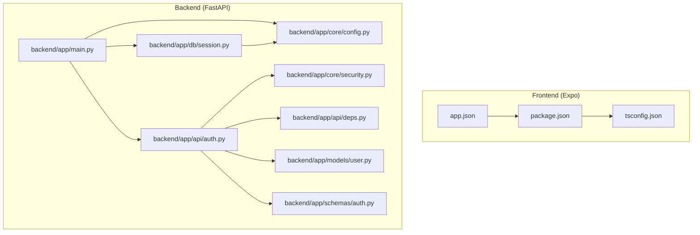
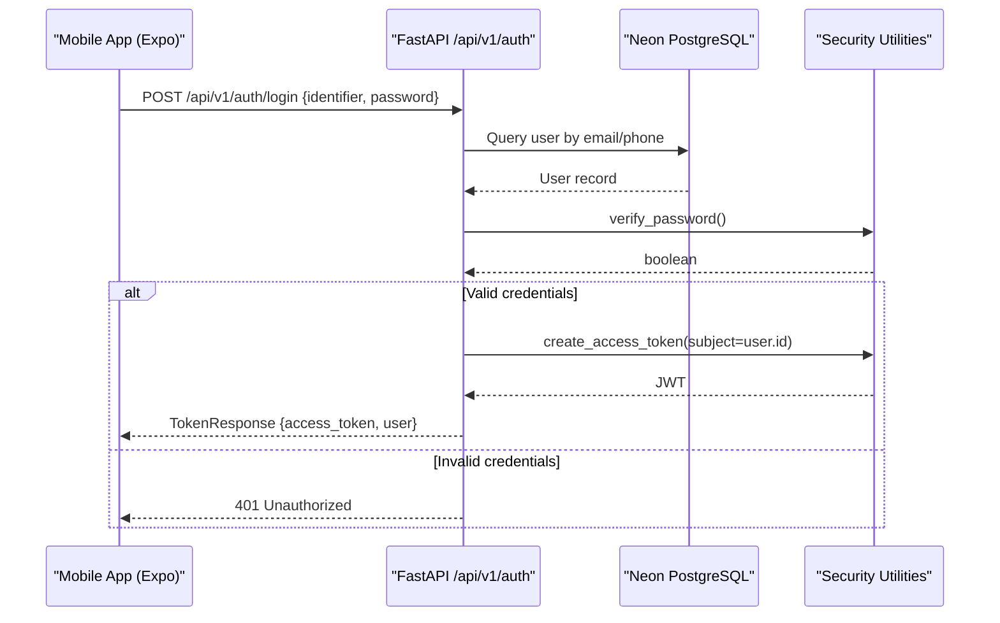
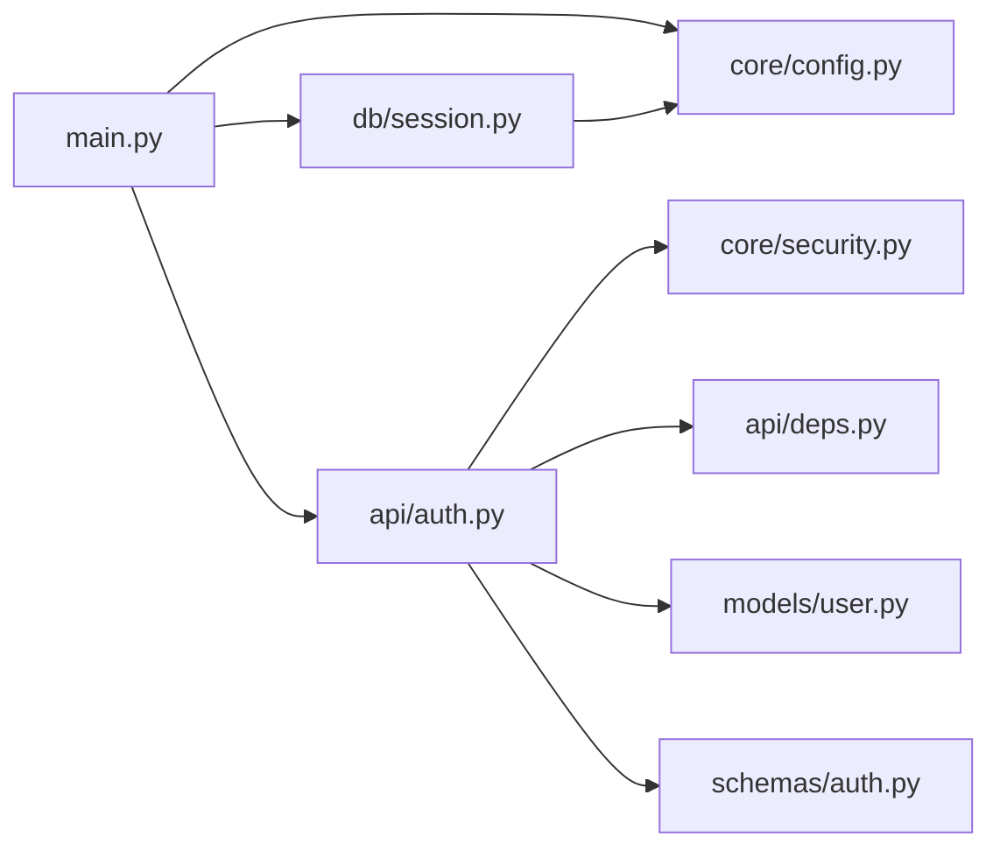

# Deployment & Production

<cite>
**Referenced Files in This Document**
- [app.json](file://app.json)
- [package.json](file://package.json)
- [README.md](file://README.md)
- [tsconfig.json](file://tsconfig.json)
- [.gitignore](file://.gitignore)
- [backend/app/main.py](file://backend/app/main.py)
- [backend/app/core/config.py](file://backend/app/core/config.py)
- [backend/app/core/security.py](file://backend/app/core/security.py)
- [backend/app/api/auth.py](file://backend/app/api/auth.py)
- [backend/app/api/deps.py](file://backend/app/api/deps.py)
- [backend/app/db/session.py](file://backend/app/db/session.py)
- [backend/app/models/user.py](file://backend/app/models/user.py)
- [backend/app/schemas/auth.py](file://backend/app/schemas/auth.py)
</cite>

## Table of Contents
1. Introduction
2. Project Structure
3. Core Components
4. Architecture Overview
5. Detailed Component Analysis
6. Dependency Analysis
7. Performance Considerations
8. Troubleshooting Guide
9. Conclusion

## Introduction
This document provides production-grade deployment and operational guidance for the HomeCare application, covering:
- Expo build configuration and environment management
- Mobile app store release process (versioning, signing, distribution)
- Backend deployment for FastAPI with Neon Serverless PostgreSQL
- Monitoring, logging, and error tracking strategies
- Security hardening and healthcare compliance considerations
- Performance optimization and bundle size reduction
- Deployment checklists and troubleshooting

## Project Structure
The repository is organized into a frontend mobile app built with Expo/React Native and a Python FastAPI backend. Key areas relevant to deployment include:
- Frontend configuration: app.json, package.json, tsconfig.json
- Backend configuration and runtime: FastAPI app, settings, database session, security utilities
- Environment variables and secrets: .env handling and .gitignore rules

**Diagram sources**
- [app.json:1-34](file://app.json#L1-L34)
- [package.json:1-36](file://package.json#L1-L36)
- [tsconfig.json:1-17](file://tsconfig.json#L1-L17)
- [backend/app/main.py:1-61](file://backend/app/main.py#L1-L61)
- [backend/app/core/config.py:1-33](file://backend/app/core/config.py#L1-L33)
- [backend/app/core/security.py:1-27](file://backend/app/core/security.py#L1-L27)
- [backend/app/api/auth.py:1-182](file://backend/app/api/auth.py#L1-L182)
- [backend/app/api/deps.py:1-41](file://backend/app/api/deps.py#L1-L41)
- [backend/app/db/session.py:1-49](file://backend/app/db/session.py#L1-L49)
- [backend/app/models/user.py:1-82](file://backend/app/models/user.py#L1-L82)
- [backend/app/schemas/auth.py:1-120](file://backend/app/schemas/auth.py#L1-L120)

**Section sources**
- [app.json:1-34](file://app.json#L1-L34)
- [package.json:1-36](file://package.json#L1-L36)
- [tsconfig.json:1-17](file://tsconfig.json#L1-L17)
- [backend/app/main.py:1-61](file://backend/app/main.py#L1-L61)
- [backend/app/core/config.py:1-33](file://backend/app/core/config.py#L1-L33)
- [backend/app/db/session.py:1-49](file://backend/app/db/session.py#L1-L49)

## Core Components
- Expo app metadata and platform-specific settings are defined in app.json. It includes name, slug, scheme, version, orientation, splash, icons, and plugins.
- Frontend scripts and dependencies are declared in package.json, including Expo SDK, React Native, and TypeScript tooling.
- Backend FastAPI application initializes lifespan hooks for database connectivity and table creation, registers CORS middleware, and mounts API routers.
- Configuration is centralized via pydantic-settings in core/config.py, reading from .env files.
- Database connection uses async SQLAlchemy engine configured for Neon PostgreSQL with SSL and pool pre-ping.
- Security utilities implement password hashing and JWT token generation.

**Section sources**
- [app.json:1-34](file://app.json#L1-L34)
- [package.json:1-36](file://package.json#L1-L36)
- [backend/app/main.py:1-61](file://backend/app/main.py#L1-L61)
- [backend/app/core/config.py:1-33](file://backend/app/core/config.py#L1-L33)
- [backend/app/db/session.py:1-49](file://backend/app/db/session.py#L1-L49)
- [backend/app/core/security.py:1-27](file://backend/app/core/security.py#L1-L27)

## Architecture Overview
The system comprises an Expo-based mobile client and a FastAPI backend connected to Neon Serverless PostgreSQL. The backend exposes authentication endpoints and returns JWT tokens used by the client to access protected resources.

**Diagram sources**
- [backend/app/api/auth.py:121-153](file://backend/app/api/auth.py#L121-L153)
- [backend/app/core/security.py:18-26](file://backend/app/core/security.py#L18-L26)
- [backend/app/db/session.py:23-38](file://backend/app/db/session.py#L23-L38)

## Detailed Component Analysis

### Expo Build Configuration and Environment Management
- app.json defines:
  - Application identity: name, slug, scheme, version
  - UI defaults: orientation, userInterfaceStyle
  - Splash screen assets and background color
  - Platform options: iOS tablet support, Android adaptive icon and predictive back gesture
  - Web favicon
  - Plugins: expo-router, expo-status-bar
- package.json defines:
  - Entry point for Expo Router
  - Dependencies for Expo, React Native, React Query, Zustand, and web support
  - Scripts for starting development servers across platforms
- tsconfig.json extends Expo base config with strict mode and path aliases

Environment variables:
- Backend reads settings from .env using pydantic-settings; ensure DATABASE_URL, SECRET_KEY, ALGORITHM, ACCESS_TOKEN_EXPIRE_MINUTES are set in production.
- .gitignore excludes .env files and sensitive artifacts (keystores, provisioning profiles).

Operational notes:
- Use EAS Build for managed builds and EAS Submit for publishing to stores.
- For custom native modules or platform-specific configurations, use EAS Config or prebuild workflows.

**Section sources**
- [app.json:1-34](file://app.json#L1-L34)
- [package.json:1-36](file://package.json#L1-L36)
- [tsconfig.json:1-17](file://tsconfig.json#L1-L17)
- [.gitignore:14-36](file://.gitignore#L14-L36)

### Backend Deployment Considerations (FastAPI + Neon Serverless PostgreSQL)
- FastAPI app initialization:
  - Lifespan hook connects to PostgreSQL, prints version info, and ensures tables exist on startup.
  - CORS middleware is enabled for all origins (tighten in production).
  - Health and root endpoints are exposed for readiness checks.
- Database session:
  - Uses asyncpg driver with SSL enabled when connecting to Neon.
  - Connection URL normalization supports postgresql:// and postgres:// prefixes.
  - Pool pre-ping improves resilience against idle connections.
- Configuration:
  - Settings loaded from .env; defaults provided for local development.
  - Ensure DATABASE_URL points to Neon endpoint with ssl=require.
- Security:
  - Passwords hashed with bcrypt via passlib.
  - JWT tokens created with HS256 using a strong SECRET_KEY.
  - Authorization dependency decodes JWT and loads user context.

Production recommendations:
- Replace wildcard CORS with explicit allowed origins.
- Pin SECRET_KEY and algorithm in secure secret management.
- Enable structured logging and health checks at the container/orchestrator level.
- Configure connection pooling and timeouts appropriate for serverless databases.

**Section sources**
- [backend/app/main.py:11-46](file://backend/app/main.py#L11-L46)
- [backend/app/db/session.py:6-38](file://backend/app/db/session.py#L6-L38)
- [backend/app/core/config.py:10-30](file://backend/app/core/config.py#L10-L30)
- [backend/app/core/security.py:7-26](file://backend/app/core/security.py#L7-L26)
- [backend/app/api/deps.py:12-41](file://backend/app/api/deps.py#L12-L41)

### Release Process for Mobile App Stores
Version management:
- Maintain a single source of truth for app version in app.json and package.json.
- Align semantic versioning across frontend and backend versions where applicable.

Signing certificates and provisioning:
- Generate and securely store iOS signing certificates (.p12/.p8) and Android keystores (.jks).
- Never commit secrets; use CI/CD secret managers (e.g., GitHub Actions Secrets, AWS Secrets Manager).

Distribution channels:
- Internal testing: EAS TestFlight (iOS), EAS Internal Distribution (Android).
- Public releases: Apple App Store Connect and Google Play Console.
- Use EAS Submit to automate uploads and metadata.

Release checklist highlights:
- Validate app.json scheme and deep links.
- Confirm splash and icon assets meet platform requirements.
- Run typechecks and linting before build.
- Perform smoke tests on staging backend.
- Verify health endpoint and database connectivity.

**Section sources**
- [app.json:1-34](file://app.json#L1-L34)
- [package.json:28-33](file://package.json#L28-L33)
- [.gitignore:27-36](file://.gitignore#L27-L36)

### Backend Deployment Checklist
- Environment variables:
  - DATABASE_URL pointing to Neon Serverless PostgreSQL with ssl=require
  - SECRET_KEY with minimum length and high entropy
  - ALGORITHM (HS256) and ACCESS_TOKEN_EXPIRE_MINUTES
- Runtime:
  - Uvicorn/Gunicorn worker count tuned for CPU cores
  - Reverse proxy (Nginx/Traefik) with TLS termination
  - Health/readiness probes exposing /health
- Database:
  - Migrations applied prior to deployment
  - Backups and retention policies configured
- Security:
  - Restrict CORS to known domains
  - Rate limiting and request validation
  - Audit logging for sensitive operations

**Section sources**
- [backend/app/core/config.py:10-30](file://backend/app/core/config.py#L10-L30)
- [backend/app/main.py:37-46](file://backend/app/main.py#L37-L46)
- [backend/app/main.py:49-60](file://backend/app/main.py#L49-L60)

### Monitoring, Logging, and Error Tracking
- Logging:
  - Centralize logs from FastAPI and reverse proxy
  - Include correlation IDs per request
  - Redact PII and secrets in log output
- Monitoring:
  - Track latency, error rates, and throughput for /api/v1/auth endpoints
  - Alert on health endpoint failures and database connection errors
- Error tracking:
  - Integrate error reporting (e.g., Sentry) for both frontend and backend
  - Capture stack traces and contextual metadata without sensitive data

[No sources needed since this section provides general guidance]

### Performance Optimization Techniques
- Frontend:
  - Tree-shaking and code splitting via Expo/Routing
  - Optimize images and fonts; preload critical assets
  - Minimize bundle size by removing unused dependencies
- Backend:
  - Use async I/O and connection pooling
  - Cache frequent read queries where appropriate
  - Compress responses and enable HTTP caching headers

[No sources needed since this section provides general guidance]

### Security Considerations and Healthcare Compliance
- Authentication and authorization:
  - Enforce strong SECRET_KEY and short-lived tokens
  - Validate and sanitize all inputs
  - Implement role-based access control aligned with user roles
- Data protection:
  - Encrypt data in transit (TLS) and at rest (database encryption)
  - Avoid logging sensitive fields; mask identifiers
- Compliance:
  - Follow healthcare regulations (e.g., HIPAA-equivalent standards)
  - Maintain audit trails for clinical records and specimen results
  - Provide consent capture and data export capabilities

**Section sources**
- [backend/app/core/security.py:7-26](file://backend/app/core/security.py#L7-L26)
- [backend/app/models/user.py:10-19](file://backend/app/models/user.py#L10-L19)
- [backend/app/schemas/auth.py:7-16](file://backend/app/schemas/auth.py#L7-L16)

## Dependency Analysis
The backend components have clear separation of concerns:
- main.py orchestrates application lifecycle and routes
- core/config.py centralizes environment-driven configuration
- db/session.py manages asynchronous database connections
- api/auth.py implements registration, login, OTP verification, and profile retrieval
- api/deps.py handles JWT decoding and current user resolution
- core/security.py provides cryptographic primitives
- models and schemas define data contracts

**Diagram sources**
- [backend/app/main.py:1-61](file://backend/app/main.py#L1-L61)
- [backend/app/core/config.py:1-33](file://backend/app/core/config.py#L1-L33)
- [backend/app/db/session.py:1-49](file://backend/app/db/session.py#L1-L49)
- [backend/app/api/auth.py:1-182](file://backend/app/api/auth.py#L1-L182)
- [backend/app/api/deps.py:1-41](file://backend/app/api/deps.py#L1-L41)
- [backend/app/core/security.py:1-27](file://backend/app/core/security.py#L1-L27)
- [backend/app/models/user.py:1-82](file://backend/app/models/user.py#L1-L82)
- [backend/app/schemas/auth.py:1-120](file://backend/app/schemas/auth.py#L1-L120)

**Section sources**
- [backend/app/main.py:1-61](file://backend/app/main.py#L1-L61)
- [backend/app/api/auth.py:1-182](file://backend/app/api/auth.py#L1-L182)
- [backend/app/api/deps.py:1-41](file://backend/app/api/deps.py#L1-L41)

## Performance Considerations
- Frontend performance:
  - Leverage Expo’s optimized bundling and asset pipeline
  - Use lazy loading for heavy screens and libraries
  - Keep third-party packages minimal and up-to-date
- Backend performance:
  - Tune async engine pool size and timeouts for Neon
  - Use connection pre-ping to avoid stale connections
  - Profile endpoints and add indexes where necessary

[No sources needed since this section provides general guidance]

## Troubleshooting Guide
Common issues and resolutions:
- Expo build fails due to missing native modules:
  - Ensure required plugins are listed in app.json
  - Re-run prebuild if modifying native capabilities
- Backend cannot connect to Neon PostgreSQL:
  - Verify DATABASE_URL format and ssl=require
  - Check network egress and firewall rules
  - Confirm credentials and endpoint availability
- CORS errors from mobile/web clients:
  - Restrict allow_origins to known domains in production
  - Ensure credentials header is handled correctly
- Authentication failures:
  - Validate SECRET_KEY and ALGORITHM consistency
  - Inspect JWT payload and expiration settings
- Health checks failing:
  - Confirm /health endpoint responds with status ok
  - Review database connection logs during startup

**Section sources**
- [app.json:28-31](file://app.json#L28-L31)
- [backend/app/db/session.py:6-28](file://backend/app/db/session.py#L6-L28)
- [backend/app/main.py:37-46](file://backend/app/main.py#L37-L46)
- [backend/app/main.py:58-60](file://backend/app/main.py#L58-L60)
- [backend/app/core/security.py:18-26](file://backend/app/core/security.py#L18-L26)

## Conclusion
This guide consolidates production-ready practices for deploying the HomeCare application. By aligning Expo configuration, securing backend services, and implementing robust monitoring and compliance measures, you can deliver a reliable and secure healthcare platform. Adopt the provided checklists and troubleshooting steps to streamline deployments and maintain operational excellence.