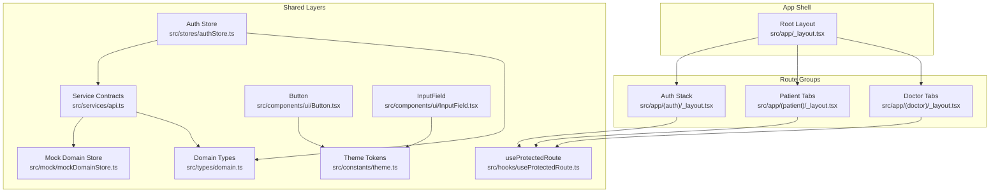
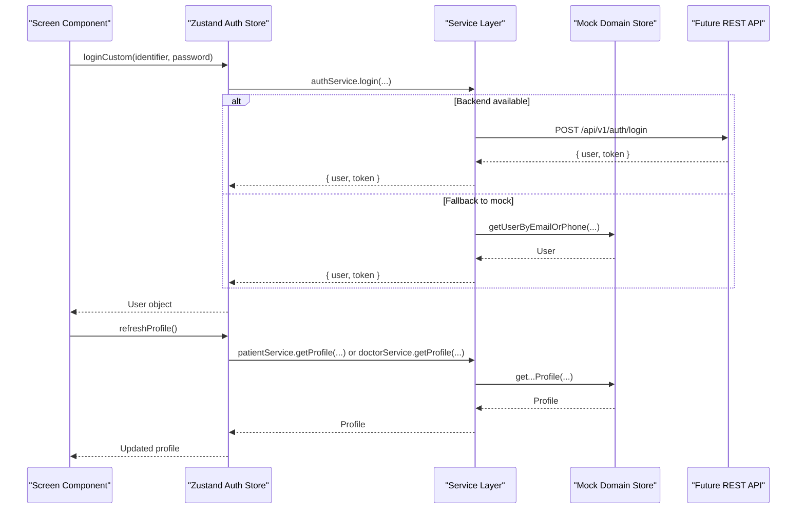
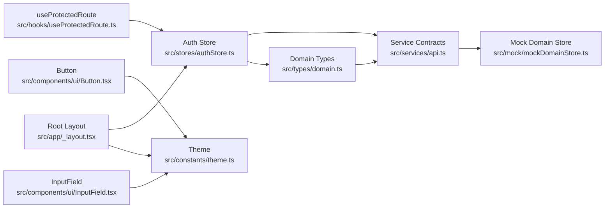

# Developer Guidelines

<cite>
**Referenced Files in This Document**
- [README.md](file://README.md)
- [package.json](file://package.json)
- [tsconfig.json](file://tsconfig.json)
- [AGENTS.md](file://AGENTS.md)
- [src/types/domain.ts](file://src/types/domain.ts)
- [src/docs/architecture.md](file://src/docs/architecture.md)
- [src/app/_layout.tsx](file://src/app/_layout.tsx)
- [src/app/(auth)/_layout.tsx](file://src/app/(auth)/_layout.tsx)
- [src/app/(patient)/_layout.tsx](file://src/app/(patient)/_layout.tsx)
- [src/app/(doctor)/_layout.tsx](file://src/app/(doctor)/_layout.tsx)
- [src/hooks/useProtectedRoute.ts](file://src/hooks/useProtectedRoute.ts)
- [src/stores/authStore.ts](file://src/stores/authStore.ts)
- [src/services/api.ts](file://src/services/api.ts)
- [src/mock/mockDomainStore.ts](file://src/mock/mockDomainStore.ts)
- [src/constants/theme.ts](file://src/constants/theme.ts)
- [src/components/ui/Button.tsx](file://src/components/ui/Button.tsx)
- [src/components/ui/InputField.tsx](file://src/components/ui/InputField.tsx)
- [src/app/(auth)/login.tsx](file://src/app/(auth)/login.tsx)
- [src/app/(patient)/index.tsx](file://src/app/(patient)/index.tsx)
- [src/app/(doctor)/index.tsx](file://src/app/(doctor)/index.tsx)
</cite>

## Table of Contents
1. Introduction
2. Project Structure
3. Core Components
4. Architecture Overview
5. Detailed Component Analysis
6. Dependency Analysis
7. Performance Considerations
8. Troubleshooting Guide
9. Conclusion

## Introduction
This document provides developer guidelines for the HomeCare mobile application. It covers code standards, contribution processes, development best practices, TypeScript conventions, component structure patterns, naming conventions, and organization principles. It also documents the type system architecture, domain model definitions, interface contracts, type safety patterns, healthcare domain modeling guidance, code quality standards, linting rules, formatting conventions, static analysis configuration, performance optimization, memory management considerations, mobile-specific patterns, error handling, and testing approaches.

The project is a mobile-first digital healthcare platform built with Expo (React Native), Expo Router, TypeScript, Zustand, and TanStack React Query. The backend is implemented with Python FastAPI and PostgreSQL, while the frontend uses a mock domain store to simulate data and business logic during development.

## Project Structure
The repository follows an Expo Router-based file-system routing layout under src/app, with shared components under src/components, global state under src/stores, services under src/services, types under src/types, hooks under src/hooks, constants under src/constants, and documentation under src/docs.

Key structural principles:
- Route files live under src/app; non-route code lives outside src/app.
- Role-based route groups are organized as (auth), (patient), (doctor), and (admin).
- Shared UI primitives live under src/components/ui.
- Domain models and interfaces live under src/types.
- Services define typed API contracts and delegate to a mock domain store or future REST endpoints.
- Global app shell wraps navigation, safe area, status bar, and query client.

**Diagram sources**
- [src/app/_layout.tsx:1-85](file://src/app/_layout.tsx#L1-L85)
- [src/app/(auth)/_layout.tsx:1-26](file://src/app/(auth)/_layout.tsx#L1-L26)
- [src/app/(patient)/_layout.tsx:1-108](file://src/app/(patient)/_layout.tsx#L1-L108)
- [src/app/(doctor)/_layout.tsx:1-121](file://src/app/(doctor)/_layout.tsx#L1-L121)
- [src/types/domain.ts:1-242](file://src/types/domain.ts#L1-L242)
- [src/constants/theme.ts:1-165](file://src/constants/theme.ts#L1-L165)
- [src/hooks/useProtectedRoute.ts:1-40](file://src/hooks/useProtectedRoute.ts#L1-L40)
- [src/stores/authStore.ts:1-112](file://src/stores/authStore.ts#L1-L112)
- [src/services/api.ts:1-660](file://src/services/api.ts#L1-L660)
- [src/mock/mockDomainStore.ts:1-557](file://src/mock/mockDomainStore.ts#L1-L557)
- [src/components/ui/Button.tsx:1-150](file://src/components/ui/Button.tsx#L1-L150)
- [src/components/ui/InputField.tsx:1-129](file://src/components/ui/InputField.tsx#L1-L129)

**Section sources**
- [README.md:1-245](file://README.md#L1-L245)
- [src/docs/architecture.md:1-68](file://src/docs/architecture.md#L1-L68)
- [AGENTS.md:1-42](file://AGENTS.md#L1-L42)

## Core Components
This section outlines the core building blocks and their responsibilities.

- App shell and navigation
  - Root layout configures SafeAreaProvider, QueryClientProvider, StatusBar, and Expo Router stacks for role-based route groups.
  - Session bar displays current user role and actions like reset demo data and sign out.

- Authentication and authorization
  - useProtectedRoute enforces role-based access by redirecting unauthorized users to appropriate screens.
  - authStore manages session state, login flows, profile refresh, and demo data reset.

- Service layer and domain store
  - api.ts defines typed service interfaces for auth, patient, doctor, and admin operations.
  - mockDomainStore implements in-memory persistence, account isolation, visit lifecycle, notifications, reviews, complaints, and audit logs.

- UI primitives
  - Button and InputField provide consistent styling via THEME tokens and support variants, sizes, loading states, and accessibility.

- Theming and configuration
  - theme.ts centralizes colors, typography, spacing, border radius, shadows, and country-specific configurations.

**Section sources**
- [src/app/_layout.tsx:1-85](file://src/app/_layout.tsx#L1-L85)
- [src/hooks/useProtectedRoute.ts:1-40](file://src/hooks/useProtectedRoute.ts#L1-L40)
- [src/stores/authStore.ts:1-112](file://src/stores/authStore.ts#L1-L112)
- [src/services/api.ts:1-660](file://src/services/api.ts#L1-L660)
- [src/mock/mockDomainStore.ts:1-557](file://src/mock/mockDomainStore.ts#L1-L557)
- [src/components/ui/Button.tsx:1-150](file://src/components/ui/Button.tsx#L1-L150)
- [src/components/ui/InputField.tsx:1-129](file://src/components/ui/InputField.tsx#L1-L129)
- [src/constants/theme.ts:1-165](file://src/constants/theme.ts#L1-L165)

## Architecture Overview
The application follows a layered architecture:
- Presentation layer: Screens and layouts using Expo Router.
- State layer: Zustand store for session state and TanStack React Query for data fetching.
- Service layer: Typed API contracts that abstract data sources (mock store or future REST endpoints).
- Domain layer: Strict TypeScript types defining entities, enums, and relationships.

**Diagram sources**
- [src/stores/authStore.ts:23-111](file://src/stores/authStore.ts#L23-L111)
- [src/services/api.ts:46-245](file://src/services/api.ts#L46-L245)
- [src/mock/mockDomainStore.ts:130-154](file://src/mock/mockDomainStore.ts#L130-L154)

## Detailed Component Analysis

### TypeScript Conventions and Type System Architecture
- Strict mode enabled in tsconfig.json ensures comprehensive type checking.
- Path aliases configured for cleaner imports from src.
- Domain types are centralized in src/types/domain.ts and include:
  - Enums for roles, statuses, payment methods, and sample statuses.
  - Entities such as User, PatientProfile, DoctorProfile, VisitRequest, ConsultationRecord, ResultDocument, LabSample, ComplaintReport, MedicalAuditLog, and more.
- Interface contracts in src/services/api.ts enforce strongly-typed method signatures for auth, patient, doctor, and admin operations.

Guidelines:
- Prefer union types and literal types over strings/numbers for domain values.
- Use optional fields sparingly; prefer explicit nullability where required.
- Keep service interfaces aligned with domain types to ensure end-to-end type safety.
- Avoid any; use unknown when necessary and narrow types explicitly.

**Section sources**
- [tsconfig.json:1-18](file://tsconfig.json#L1-L18)
- [src/types/domain.ts:1-242](file://src/types/domain.ts#L1-L242)
- [src/services/api.ts:25-41](file://src/services/api.ts#L25-L41)
- [src/services/api.ts:247-272](file://src/services/api.ts#L247-L272)
- [src/services/api.ts:432-466](file://src/services/api.ts#L432-L466)
- [src/services/api.ts:587-602](file://src/services/api.ts#L587-L602)

### Component Structure Patterns and Naming Conventions
- File names follow kebab-case for route files and PascalCase for components.
- Components are colocated near their usage but shared primitives go under src/components/ui.
- Props should be explicitly typed; avoid implicit any.
- Styles should reference THEME tokens for consistency.

Examples:
- Button.tsx demonstrates variant, size, loading, disabled, icon, and style composition.
- InputField.tsx shows label, hint, error, secure text entry toggle, and multiline support.

Best practices:
- Keep components small and focused on a single responsibility.
- Extract reusable UI elements into src/components/ui.
- Use THEME consistently for colors, typography, spacing, and radii.

**Section sources**
- [src/components/ui/Button.tsx:1-150](file://src/components/ui/Button.tsx#L1-L150)
- [src/components/ui/InputField.tsx:1-129](file://src/components/ui/InputField.tsx#L1-L129)
- [src/constants/theme.ts:71-165](file://src/constants/theme.ts#L71-L165)

### Code Organization Principles
- Route groups isolate role-based experiences: (auth), (patient), (doctor), (admin).
- Layouts configure navigation and guard routes.
- Hooks encapsulate cross-cutting concerns like protected routing.
- Stores manage global session state; services abstract data access.

Guidelines:
- Place screen-level logic in the screen file; extract complex logic into hooks or stores.
- Keep services free of UI concerns; they should only handle data operations.
- Centralize configuration and theming in constants.

**Section sources**
- [src/app/(auth)/_layout.tsx:1-26](file://src/app/(auth)/_layout.tsx#L1-L26)
- [src/app/(patient)/_layout.tsx:1-108](file://src/app/(patient)/_layout.tsx#L1-L108)
- [src/app/(doctor)/_layout.tsx:1-121](file://src/app/(doctor)/_layout.tsx#L1-L121)
- [src/hooks/useProtectedRoute.ts:1-40](file://src/hooks/useProtectedRoute.ts#L1-L40)

### Development Workflow and Contribution Processes
- Commands:
  - Start dev server: npm start or npx expo start.
  - Run web: npm run web.
  - Android/iOS: npm run android / npm run ios.
  - Typecheck: npx tsc --noEmit.
  - Lint: npx expo lint.
  - Diagnose: npx expo-doctor.
- Branch strategy:
  - Use feature branches named feature/<short-description>.
  - Keep main stable; create release branches for versioned releases.
  - Merge via pull requests with descriptive titles and summaries.
- Pull request process:
  - Ensure typecheck passes.
  - Ensure lint passes.
  - Include screenshots or short videos for UI changes.
  - Link related issues or requirements.
- Code review standards:
  - Reviewers check type safety, error handling, accessibility, and performance.
  - Verify adherence to domain modeling and healthcare compliance notes.

**Section sources**
- [README.md:76-84](file://README.md#L76-L84)
- [AGENTS.md:11-24](file://AGENTS.md#L11-L24)

### Healthcare Domain Modeling Best Practices
- Represent clinical entities with strict types: VisitStatus, SampleStatus, PatientResultStatus, PrescriptionItem, ConsultationRecord, ResultDocument.
- Enforce constraints at the service layer:
  - Prevent double booking of slots.
  - Restrict cancellation/reschedule based on visit status.
  - Validate doctor verification status before accepting visits.
- Audit critical actions:
  - Log updates to patient profiles, consultation records, and result publications.
- Support East African markets:
  - Country configs for emergency numbers, currencies, and regulatory bodies.

Guidelines:
- Model workflows as state machines using VisitStatus transitions.
- Separate read-only views from write operations.
- Always validate inputs and enforce business rules in services.

**Section sources**
- [src/types/domain.ts:9-28](file://src/types/domain.ts#L9-L28)
- [src/types/domain.ts:97-129](file://src/types/domain.ts#L97-L129)
- [src/types/domain.ts:131-194](file://src/types/domain.ts#L131-L194)
- [src/types/domain.ts:196-241](file://src/types/domain.ts#L196-L241)
- [src/mock/mockDomainStore.ts:207-216](file://src/mock/mockDomainStore.ts#L207-L216)
- [src/mock/mockDomainStore.ts:245-281](file://src/mock/mockDomainStore.ts#L245-L281)
- [src/mock/mockDomainStore.ts:283-380](file://src/mock/mockDomainStore.ts#L283-L380)
- [src/mock/mockDomainStore.ts:393-406](file://src/mock/mockDomainStore.ts#L393-L406)
- [src/mock/mockDomainStore.ts:436-464](file://src/mock/mockDomainStore.ts#L436-L464)
- [src/mock/mockDomainStore.ts:529-552](file://src/mock/mockDomainStore.ts#L529-L552)
- [src/constants/theme.ts:19-56](file://src/constants/theme.ts#L19-L56)

### Adding New Features
Steps:
1. Define or extend domain types in src/types/domain.ts.
2. Add service methods in src/services/api.ts with proper typing.
3. Implement business logic in src/mock/mockDomainStore.ts if needed.
4. Create or update screens under src/app with role-based grouping.
5. Wire up state via Zustand store and TanStack React Query where applicable.
6. Add tests and verify typecheck and lint pass.

Example flow for adding a new visit action:
- Extend VisitStatus if necessary.
- Add service method to update visit status.
- Implement validation and side effects (notifications, audit logs).
- Update relevant screens to call the service and display updated state.

**Section sources**
- [src/types/domain.ts:9-28](file://src/types/domain.ts#L9-L28)
- [src/services/api.ts:432-466](file://src/services/api.ts#L432-L466)
- [src/mock/mockDomainStore.ts:283-380](file://src/mock/mockDomainStore.ts#L283-L380)

### Error Handling Patterns
- Service layer throws typed errors for invalid states or unauthorized actions.
- Screens catch errors and display user-friendly messages.
- Demo fallbacks gracefully degrade to mock store when backend is unavailable.

Patterns:
- Validate inputs early in handlers.
- Wrap async calls in try/catch and surface meaningful errors.
- Use loading and error states in UI to reflect operation progress.

**Section sources**
- [src/services/api.ts:70-104](file://src/services/api.ts#L70-L104)
- [src/services/api.ts:359-368](file://src/services/api.ts#L359-L368)
- [src/app/(auth)/login.tsx:23-46](file://src/app/(auth)/login.tsx#L23-L46)

### Testing Approaches
- Unit tests for services and domain store methods.
- Integration tests for login flows and visit lifecycle transitions.
- Snapshot tests for UI components where appropriate.
- End-to-end tests for critical user journeys (booking, visit execution, result publication).

Recommendations:
- Test both success and failure paths.
- Mock network calls and rely on mockDomainStore for deterministic tests.
- Validate type safety with tsc --noEmit in CI.

[No sources needed since this section provides general guidance]

## Dependency Analysis
The following diagram illustrates key dependencies between layers and modules.

**Diagram sources**
- [src/types/domain.ts:1-242](file://src/types/domain.ts#L1-L242)
- [src/services/api.ts:1-660](file://src/services/api.ts#L1-L660)
- [src/mock/mockDomainStore.ts:1-557](file://src/mock/mockDomainStore.ts#L1-L557)
- [src/stores/authStore.ts:1-112](file://src/stores/authStore.ts#L1-L112)
- [src/hooks/useProtectedRoute.ts:1-40](file://src/hooks/useProtectedRoute.ts#L1-L40)
- [src/components/ui/Button.tsx:1-150](file://src/components/ui/Button.tsx#L1-L150)
- [src/components/ui/InputField.tsx:1-129](file://src/components/ui/InputField.tsx#L1-L129)
- [src/app/_layout.tsx:1-85](file://src/app/_layout.tsx#L1-L85)
- [src/constants/theme.ts:1-165](file://src/constants/theme.ts#L1-L165)

**Section sources**
- [package.json:1-36](file://package.json#L1-L36)
- [src/services/api.ts:1-660](file://src/services/api.ts#L1-L660)
- [src/mock/mockDomainStore.ts:1-557](file://src/mock/mockDomainStore.ts#L1-L557)

## Performance Considerations
- Data fetching
  - Use TanStack React Query with sensible staleTime and retry settings.
  - Refetch only when necessary; batch refetches with Promise.all.
- Rendering
  - Minimize re-renders by memoizing expensive computations and avoiding unnecessary state updates.
  - Use flat lists for large datasets and virtualization where possible.
- Memory management
  - Avoid retaining large objects in global state; keep only what is needed.
  - Release resources when navigating away from heavy screens.
- Mobile-specific patterns
  - Prefer native modules recommended by Expo.
  - Generate native builds when adding native libraries; avoid editing generated directories manually.
  - Use EAS for cloud builds and OTA updates.

**Section sources**
- [src/app/_layout.tsx:12-19](file://src/app/_layout.tsx#L12-L19)
- [src/app/(patient)/index.tsx:27-49](file://src/app/(patient)/index.tsx#L27-L49)
- [AGENTS.md:32-42](file://AGENTS.md#L32-L42)

## Troubleshooting Guide
Common issues and resolutions:
- Navigation redirects not working
  - Ensure useProtectedRoute is used within protected layouts.
  - Verify currentUser role matches allowedRole.
- Login failures
  - Check backend availability; fallback to mock store may occur.
  - Validate credentials and demo keys.
- Double booking prevention
  - Ensure slot creation and visit creation validate overlaps.
- Cancellation restrictions
  - Disallow cancellation after doctor has started traveling or arrived.
- Doctor verification gating
  - Unverified or suspended doctors cannot accept visits.

Checklist:
- Run typecheck: npx tsc --noEmit.
- Run lint: npx expo lint.
- Verify environment variables and API base URL.
- Inspect console logs for thrown errors in services.

**Section sources**
- [src/hooks/useProtectedRoute.ts:11-38](file://src/hooks/useProtectedRoute.ts#L11-L38)
- [src/services/api.ts:70-104](file://src/services/api.ts#L70-L104)
- [src/mock/mockDomainStore.ts:207-216](file://src/mock/mockDomainStore.ts#L207-L216)
- [src/mock/mockDomainStore.ts:245-281](file://src/mock/mockDomainStore.ts#L245-L281)
- [src/mock/mockDomainStore.ts:283-380](file://src/mock/mockDomainStore.ts#L283-L380)

## Conclusion
This guide consolidates the development standards, architectural patterns, and best practices for the HomeCare application. By adhering to the TypeScript conventions, component structure patterns, naming conventions, and organization principles outlined here, teams can maintain high code quality, ensure type safety, and deliver robust healthcare features. Following the documented workflow, error handling patterns, and performance guidelines will help maintain a smooth development experience and reliable production behavior.

[No sources needed since this section summarizes without analyzing specific files]