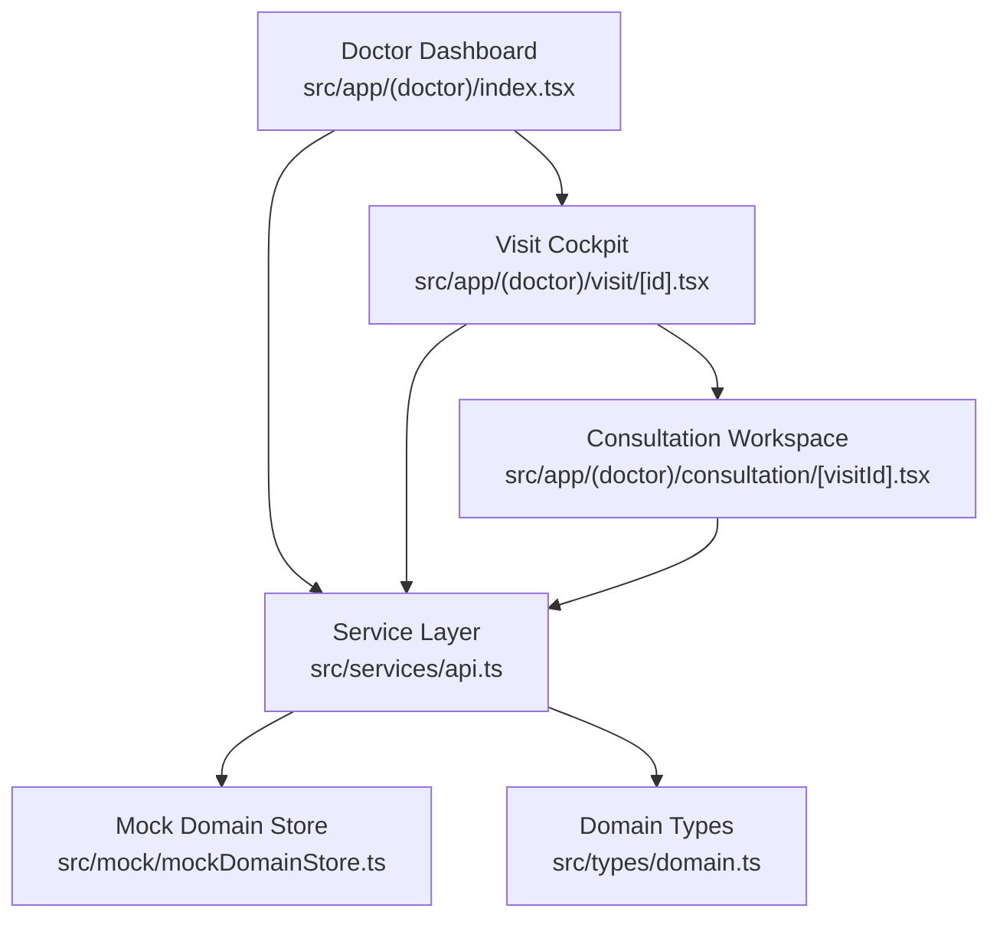
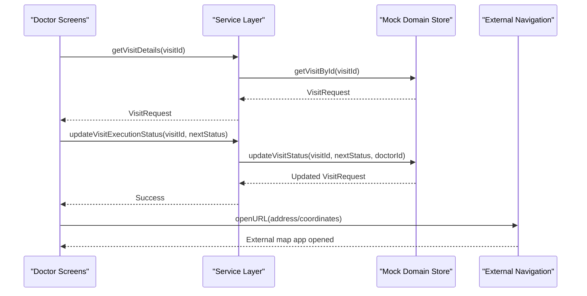
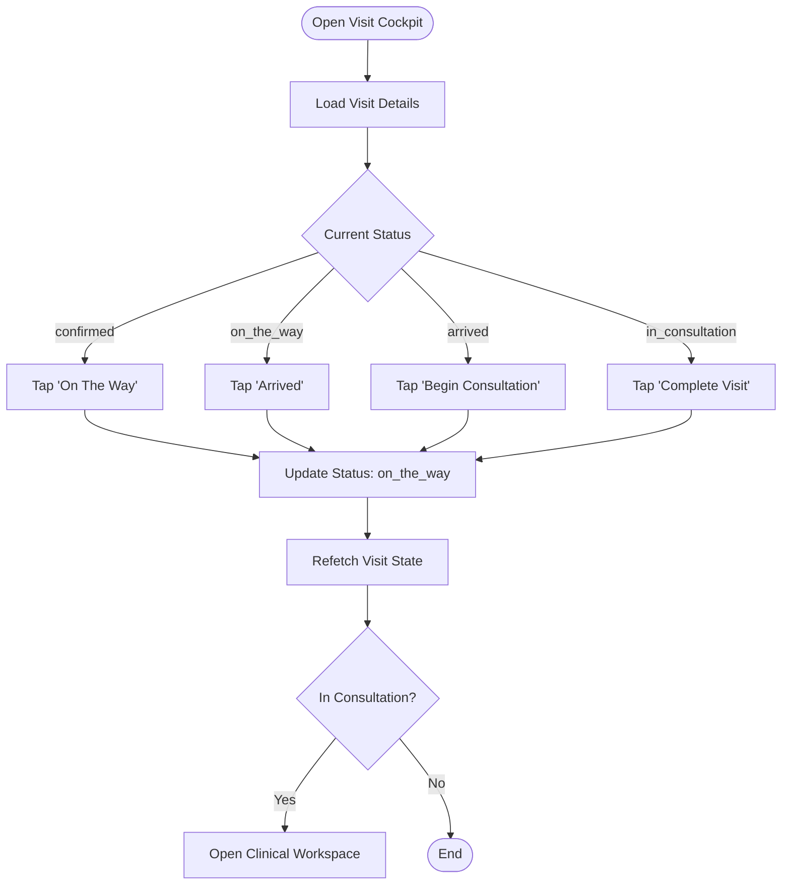
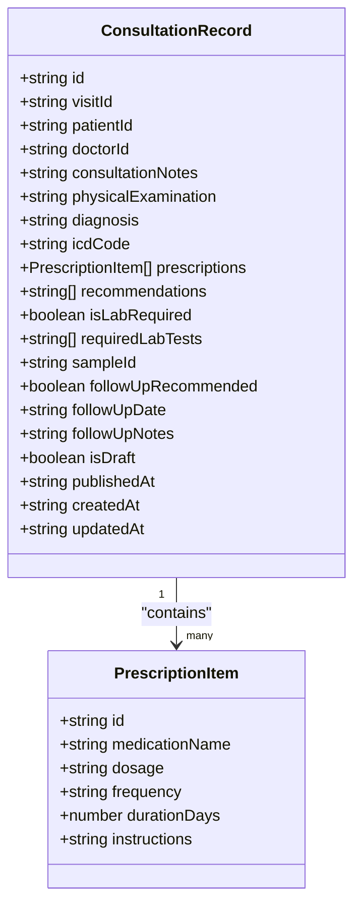
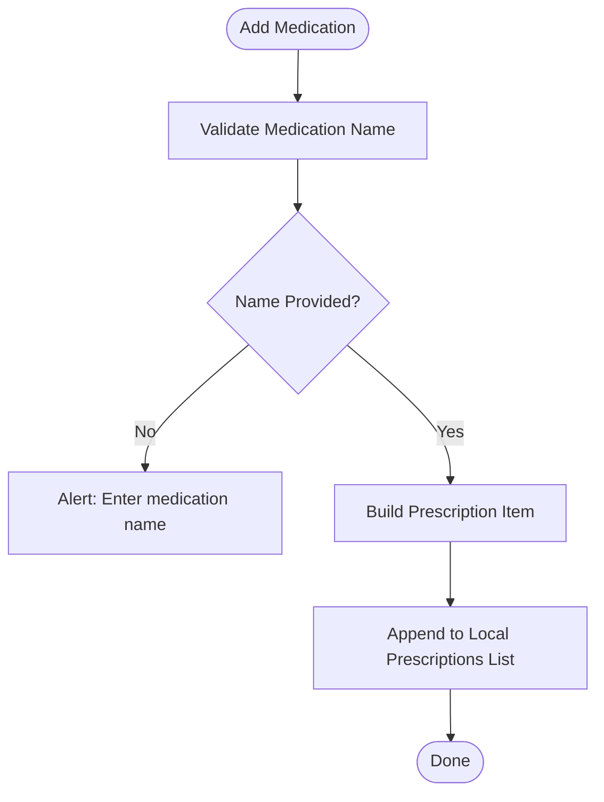
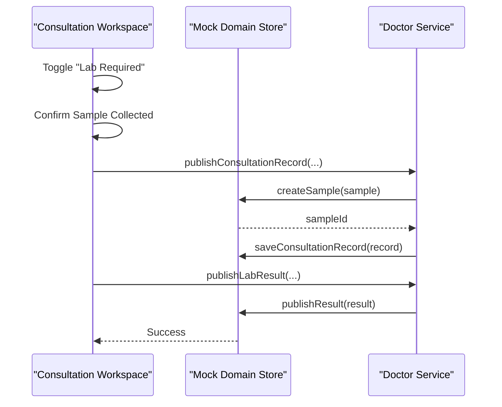
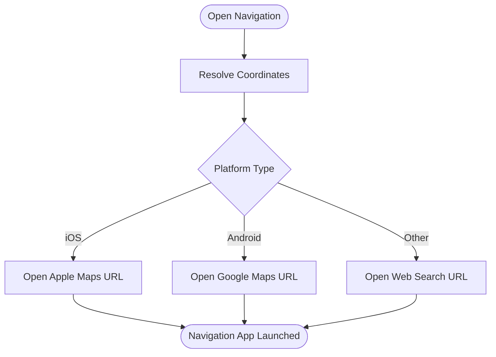
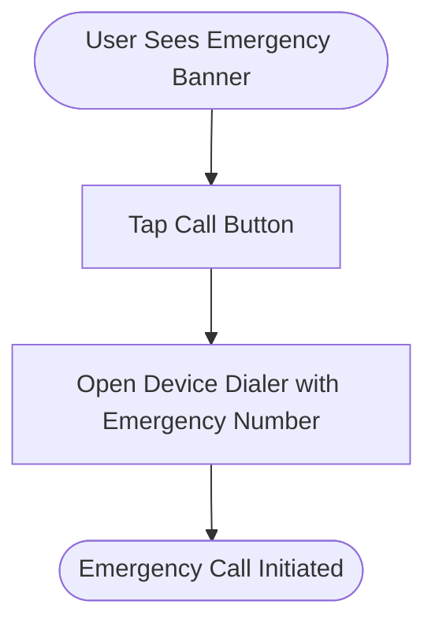
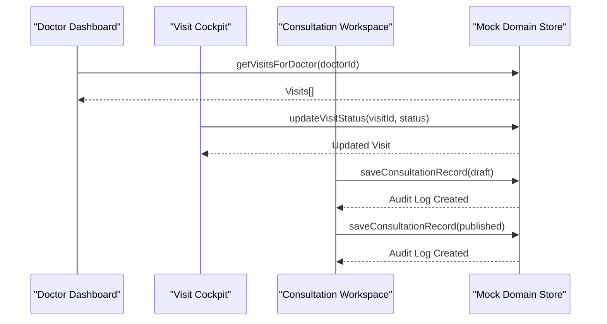
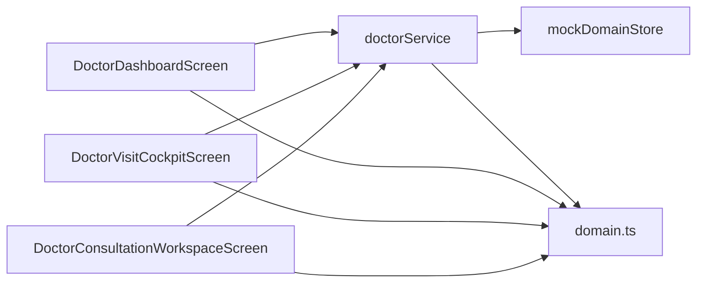

# Consultation Execution

<cite>
**Referenced Files in This Document**
- [README.md](file://README.md)
- [domain.ts](file://src/types/domain.ts)
- [api.ts](file://src/services/api.ts)
- [mockDomainStore.ts](file://src/mock/mockDomainStore.ts)
- [theme.ts](file://src/constants/theme.ts)
- [DoctorDashboardScreen](file://src/app/(doctor)/index.tsx)
- [DoctorVisitCockpitScreen](file://src/app/(doctor)/visit/[id].tsx)
- [DoctorConsultationWorkspaceScreen](file://src/app/(doctor)/consultation/[visitId].tsx)
- [EmergencyBanner](file://src/components/ui/EmergencyBanner.tsx)
</cite>

## Table of Contents
1. [Introduction](#introduction)
2. [Project Structure](#project-structure)
3. [Core Components](#core-components)
4. [Architecture Overview](#architecture-overview)
5. [Detailed Component Analysis](#detailed-component-analysis)
6. [Dependency Analysis](#dependency-analysis)
7. [Performance Considerations](#performance-considerations)
8. [Troubleshooting Guide](#troubleshooting-guide)
9. [Conclusion](#conclusion)

## Introduction
This document explains the consultation execution cockpit for home-visit medical consultations. It focuses on how doctors move a visit from arrival to completion, how clinical documentation is captured, how electronic prescriptions and lab orders are handled, how navigation and emergency escalation work, and how data validation and offline persistence are implemented through the current mock service layer.

The system is designed as a mobile-first frontend with a staged doctor workflow:
- Doctor dashboard shows pending requests and active visits.
- Visit cockpit provides one-tap status advancement and external navigation.
- Consultation workspace captures vital signs, diagnosis, ICD-10 code, clinical notes, prescriptions, lab orders, and result publication.
- A mock domain store persists state in memory, simulating backend behavior and enabling offline-friendly demonstration flows.

**Section sources**
- [README.md:1-10](file://README.md#L1-L10)
- [README.md:139-147](file://README.md#L139-L147)

## Project Structure
The consultation execution flow spans three main doctor screens and shared services:
- Doctor dashboard: overview, online/offline toggle, and entry points into active visits.
- Visit cockpit: lifecycle progression, patient summary, residence address, and navigation integration.
- Consultation workspace: clinical documentation, Rx writing, lab ordering, and result publishing.
- Services and types: API contracts, domain models, and mock persistence.

**Diagram sources**
- [DoctorDashboardScreen:25-56](file://src/app/(doctor)/index.tsx#L25-L56)
- [DoctorVisitCockpitScreen:23-57](file://src/app/(doctor)/visit/[id].tsx#L23-L57)
- [DoctorConsultationWorkspaceScreen:22-83](file://src/app/(doctor)/consultation/[visitId].tsx#L22-L83)
- [api.ts:468-585](file://src/services/api.ts#L468-L585)
- [mockDomainStore.ts:382-464](file://src/mock/mockDomainStore.ts#L382-L464)
- [domain.ts:97-194](file://src/types/domain.ts#L97-L194)

**Section sources**
- [README.md:139-147](file://README.md#L139-L147)
- [DoctorDashboardScreen:25-56](file://src/app/(doctor)/index.tsx#L25-L56)
- [DoctorVisitCockpitScreen:23-57](file://src/app/(doctor)/visit/[id].tsx#L23-L57)
- [DoctorConsultationWorkspaceScreen:22-83](file://src/app/(doctor)/consultation/[visitId].tsx#L22-L83)

## Core Components
- Doctor dashboard: displays pending requests, active visits, completed counts, and an online/offline toggle. Active visits open the visit cockpit.
- Visit cockpit: shows visit metadata, patient health summary, residence destination, and step-by-step status buttons. It also opens external maps for turn-by-turn directions.
- Consultation workspace: collects physical examination findings, diagnosis, ICD-10 code, clinical notes, recommendations, electronic prescriptions, lab test requirements, sample collection confirmation, and immediate result publication.
- Service layer: exposes typed methods for authentication, patient operations, doctor operations, and admin operations. Doctor operations include visit status transitions, consultation draft/publish, and lab result publishing.
- Mock domain store: in-memory reactive store that implements account isolation, visit lifecycle transitions, consultation record storage, lab sample tracking, result publishing, notifications, reviews, complaints, and audit logs.
- Domain types: strongly typed entities for users, profiles, visits, prescriptions, samples, results, consultation records, notifications, reviews, complaints, and audit logs.
- Theme and configuration: centralized design tokens, country-specific emergency phone numbers, and app-wide configuration.

**Section sources**
- [DoctorDashboardScreen:25-56](file://src/app/(doctor)/index.tsx#L25-L56)
- [DoctorVisitCockpitScreen:23-57](file://src/app/(doctor)/visit/[id].tsx#L23-L57)
- [DoctorConsultationWorkspaceScreen:22-83](file://src/app/(doctor)/consultation/[visitId].tsx#L22-L83)
- [api.ts:468-585](file://src/services/api.ts#L468-L585)
- [mockDomainStore.ts:382-464](file://src/mock/mockDomainStore.ts#L382-L464)
- [domain.ts:97-194](file://src/types/domain.ts#L97-L194)
- [theme.ts:58-69](file://src/constants/theme.ts#L58-L69)

## Architecture Overview
The consultation execution architecture follows a layered approach:
- UI layer: React Native screens for dashboard, visit cockpit, and consultation workspace.
- Service layer: Typed APIs abstracting backend calls and falling back to mock store when needed.
- Persistence layer: In-memory mock store with domain events, notifications, and audit logging.
- Data model: Strict TypeScript types ensuring consistent shapes across screens and services.

**Diagram sources**
- [DoctorVisitCockpitScreen:28-57](file://src/app/(doctor)/visit/[id].tsx#L28-L57)
- [DoctorVisitCockpitScreen:59-71](file://src/app/(doctor)/visit/[id].tsx#L59-L71)
- [api.ts:531-538](file://src/services/api.ts#L531-L538)
- [mockDomainStore.ts:283-380](file://src/mock/mockDomainStore.ts#L283-L380)

**Section sources**
- [DoctorVisitCockpitScreen:23-71](file://src/app/(doctor)/visit/[id].tsx#L23-L71)
- [api.ts:531-538](file://src/services/api.ts#L531-L538)
- [mockDomainStore.ts:283-380](file://src/mock/mockDomainStore.ts#L283-L380)

## Detailed Component Analysis

### One-Tap Status Advancement System
The visit cockpit guides doctors through a strict sequence:
- From confirmed: “I Am On The Way” transitions to on_the_way.
- From on_the_way: “I Have Arrived At Gate / Residence” transitions to arrived.
- From arrived: “Begin Home Medical Consultation” transitions to in_consultation.
- From in_consultation: “Mark Home Visit Completed” transitions to completed.
- After entering in_consultation, the screen offers a large button to open the clinical consultation workspace.

Each transition calls the service method which validates allowed states and updates the mock store. The store emits cross-role notifications and updates timestamps.

**Diagram sources**
- [DoctorVisitCockpitScreen:131-182](file://src/app/(doctor)/visit/[id].tsx#L131-L182)
- [api.ts:531-538](file://src/services/api.ts#L531-L538)
- [mockDomainStore.ts:283-380](file://src/mock/mockDomainStore.ts#L283-L380)

**Section sources**
- [DoctorVisitCockpitScreen:131-182](file://src/app/(doctor)/visit/[id].tsx#L131-L182)
- [api.ts:531-538](file://src/services/api.ts#L531-L538)
- [mockDomainStore.ts:283-380](file://src/mock/mockDomainStore.ts#L283-L380)

### Clinical Documentation Interface
The consultation workspace supports:
- Vital signs and physical examination capture via a multiline text field.
- Diagnosis recording with a required primary diagnosis field.
- ICD-10 coding support through a dedicated input field.
- Clinical notes capture for detailed observations and history.
- Recommendations and lifestyle guidance entered line by line.

Draft saving and publishing are supported:
- Save draft stores a partial record marked as draft.
- Publish requires a non-empty diagnosis and writes a published record with timestamps.

**Diagram sources**
- [domain.ts:131-194](file://src/types/domain.ts#L131-L194)

**Section sources**
- [DoctorConsultationWorkspaceScreen:34-83](file://src/app/(doctor)/consultation/[visitId].tsx#L34-L83)
- [DoctorConsultationWorkspaceScreen:102-131](file://src/app/(doctor)/consultation/[visitId].tsx#L102-L131)
- [DoctorConsultationWorkspaceScreen:133-205](file://src/app/(doctor)/consultation/[visitId].tsx#L133-L205)
- [domain.ts:131-194](file://src/types/domain.ts#L131-L194)

### Electronic Prescription Writing System
The prescription section allows adding medications with:
- Medication name (required).
- Dosage string.
- Frequency string.
- Duration in days (numeric).
- Instructions string.

There is no integrated medication database lookup or automated dosage calculation in the current implementation; entries are validated at minimum for presence of a medication name before being added to the local list. Prescriptions are persisted as part of the consultation record when saved or published.

**Diagram sources**
- [DoctorConsultationWorkspaceScreen:84-100](file://src/app/(doctor)/consultation/[visitId].tsx#L84-L100)

**Section sources**
- [DoctorConsultationWorkspaceScreen:84-100](file://src/app/(doctor)/consultation/[visitId].tsx#L84-L100)
- [DoctorConsultationWorkspaceScreen:250-304](file://src/app/(doctor)/consultation/[visitId].tsx#L250-L304)
- [domain.ts:131-138](file://src/types/domain.ts#L131-L138)

### Lab Result Ordering and Viewing
Within the consultation workspace:
- Doctors can mark laboratory specimen tests as required.
- They can specify comma-separated test names.
- They can confirm whether blood/swab specimens were collected on-site.
- When publishing, if lab tests are required and sample collection is confirmed, a lab sample tracking record is created with a generated sample code, collection time, destination lab, and initial status.
- Doctors can optionally publish a laboratory result immediately, providing a diagnostic summary for the PDF report.

The service layer creates a result document with a fictional PDF URL and filename, then publishes it through the mock store.

**Diagram sources**
- [DoctorConsultationWorkspaceScreen:133-205](file://src/app/(doctor)/consultation/[visitId].tsx#L133-L205)
- [api.ts:557-584](file://src/services/api.ts#L557-L584)
- [mockDomainStore.ts:413-464](file://src/mock/mockDomainStore.ts#L413-L464)

**Section sources**
- [DoctorConsultationWorkspaceScreen:70-83](file://src/app/(doctor)/consultation/[visitId].tsx#L70-L83)
- [DoctorConsultationWorkspaceScreen:306-366](file://src/app/(doctor)/consultation/[visitId].tsx#L306-L366)
- [DoctorConsultationWorkspaceScreen:133-205](file://src/app/(doctor)/consultation/[visitId].tsx#L133-L205)
- [api.ts:557-584](file://src/services/api.ts#L557-L584)
- [mockDomainStore.ts:413-464](file://src/mock/mockDomainStore.ts#L413-L464)

### Integration with External Navigation Systems
The visit cockpit integrates with platform-native navigation:
- Uses device coordinates or defaults to Kigali coordinates.
- Opens Apple Maps on iOS, Google Maps on Android, or a web search fallback on other platforms.
- Displays the patient’s residence address, district, and access instructions.

**Diagram sources**
- [DoctorVisitCockpitScreen:59-71](file://src/app/(doctor)/visit/[id].tsx#L59-L71)

**Section sources**
- [DoctorVisitCockpitScreen:59-71](file://src/app/(doctor)/visit/[id].tsx#L59-L71)
- [DoctorVisitCockpitScreen:90-108](file://src/app/(doctor)/visit/[id].tsx#L90-L108)

### Emergency Contact Escalation Process
The emergency banner component provides:
- An emergency notice badge and disclaimer text.
- A call-to-action button that dials the configured emergency number using the device’s dialer.
- Configuration sourced from theme constants, defaulting to Rwanda’s emergency number.

This is a safety feature visible across relevant screens and ensures quick access to emergency services.

**Diagram sources**
- [EmergencyBanner:6-23](file://src/components/ui/EmergencyBanner.tsx#L6-L23)
- [theme.ts:58-69](file://src/constants/theme.ts#L58-L69)

**Section sources**
- [EmergencyBanner:6-23](file://src/components/ui/EmergencyBanner.tsx#L6-L23)
- [theme.ts:58-69](file://src/constants/theme.ts#L58-L69)

### Consultation Timeline Tracking and Automatic Documentation Generation
Timeline tracking:
- The visit cockpit refetches visit details every few seconds to reflect real-time status changes.
- The dashboard filters visits into pending, active, and completed categories.

Automatic documentation generation:
- Saving a draft creates a consultation record with draft flags and timestamps.
- Publishing generates a full consultation record with publication timestamp and optional lab sample/result linkage.
- The mock store logs audit entries for CREATE/PUBLISH actions and notifies relevant parties.

**Diagram sources**
- [DoctorDashboardScreen:29-56](file://src/app/(doctor)/index.tsx#L29-L56)
- [DoctorVisitCockpitScreen:28-57](file://src/app/(doctor)/visit/[id].tsx#L28-L57)
- [DoctorConsultationWorkspaceScreen:102-131](file://src/app/(doctor)/consultation/[visitId].tsx#L102-L131)
- [DoctorConsultationWorkspaceScreen:133-205](file://src/app/(doctor)/consultation/[visitId].tsx#L133-L205)
- [mockDomainStore.ts:393-406](file://src/mock/mockDomainStore.ts#L393-L406)

**Section sources**
- [DoctorDashboardScreen:29-56](file://src/app/(doctor)/index.tsx#L29-L56)
- [DoctorVisitCockpitScreen:28-57](file://src/app/(doctor)/visit/[id].tsx#L28-L57)
- [DoctorConsultationWorkspaceScreen:102-131](file://src/app/(doctor)/consultation/[visitId].tsx#L102-L131)
- [DoctorConsultationWorkspaceScreen:133-205](file://src/app/(doctor)/consultation/[visitId].tsx#L133-L205)
- [mockDomainStore.ts:393-406](file://src/mock/mockDomainStore.ts#L393-L406)

### Data Validation for Medical Entries
Validation rules currently enforced:
- Diagnosis is required before publishing a consultation record.
- Medication name is required before adding a prescription item.
- Visit status transitions are validated against allowed states.
- Cancellation/reschedule restrictions prevent modifications after certain statuses.

These validations occur both in UI handlers and service/store layers to ensure consistency.

**Section sources**
- [DoctorConsultationWorkspaceScreen:133-136](file://src/app/(doctor)/consultation/[visitId].tsx#L133-L136)
- [DoctorConsultationWorkspaceScreen:84-86](file://src/app/(doctor)/consultation/[visitId].tsx#L84-L86)
- [api.ts:531-538](file://src/services/api.ts#L531-L538)
- [api.ts:359-382](file://src/services/api.ts#L359-L382)

### Offline Data Persistence Strategy
The current implementation uses:
- A mock domain store that persists all domain entities in memory during runtime.
- Service methods that attempt live HTTP calls first and gracefully fall back to mock store behavior when the backend is unavailable.
- Simulated latency to mimic network delays.
- Account isolation ensuring each user sees only their own data.

This strategy enables demonstration and testing without a running backend while preserving realistic workflows.

**Section sources**
- [api.ts:46-104](file://src/services/api.ts#L46-L104)
- [api.ts:106-122](file://src/services/api.ts#L106-L122)
- [api.ts:274-430](file://src/services/api.ts#L274-L430)
- [api.ts:468-585](file://src/services/api.ts#L468-L585)
- [mockDomainStore.ts:35-70](file://src/mock/mockDomainStore.ts#L35-L70)

## Dependency Analysis
The following diagram shows key dependencies between screens, services, and the mock store:

**Diagram sources**
- [DoctorDashboardScreen:17-23](file://src/app/(doctor)/index.tsx#L17-L23)
- [DoctorVisitCockpitScreen:14-21](file://src/app/(doctor)/visit/[id].tsx#L14-L21)
- [DoctorConsultationWorkspaceScreen:12-20](file://src/app/(doctor)/consultation/[visitId].tsx#L12-L20)
- [api.ts:468-585](file://src/services/api.ts#L468-L585)
- [domain.ts:97-194](file://src/types/domain.ts#L97-L194)

**Section sources**
- [DoctorDashboardScreen:17-23](file://src/app/(doctor)/index.tsx#L17-L23)
- [DoctorVisitCockpitScreen:14-21](file://src/app/(doctor)/visit/[id].tsx#L14-L21)
- [DoctorConsultationWorkspaceScreen:12-20](file://src/app/(doctor)/consultation/[visitId].tsx#L12-L20)
- [api.ts:468-585](file://src/services/api.ts#L468-L585)
- [domain.ts:97-194](file://src/types/domain.ts#L97-L194)

## Performance Considerations
- Query refetch interval: The visit cockpit refetches visit details every few seconds to keep the UI synchronized with status changes.
- Simulated latency: Service methods add small delays to simulate network conditions.
- In-memory store: All reads/writes are O(1) map operations, minimizing CPU overhead.
- Filtering lists: Dashboard and store filter visits by status; consider pagination for large datasets.
- Avoid unnecessary re-renders: Keep form state local where possible and avoid heavy computations inside render loops.

[No sources needed since this section provides general guidance]

## Troubleshooting Guide
Common issues and resolutions:
- Status transition fails: Ensure the current visit status allows the requested transition; check error messages from the service layer.
- Cannot cancel/reschedule visit: Cancellation/rescheduling is blocked once the doctor has started traveling or arrived; wait until earlier stages.
- Draft save errors: Verify the current user and visit context exist; check network fallback behavior.
- Publication blocked: Ensure diagnosis is provided; verify lab sample collection toggles if lab tests are required.
- Navigation not opening: Confirm device permissions and platform URL schemes; check address and coordinates availability.

**Section sources**
- [api.ts:531-538](file://src/services/api.ts#L531-L538)
- [api.ts:359-382](file://src/services/api.ts#L359-L382)
- [DoctorConsultationWorkspaceScreen:102-131](file://src/app/(doctor)/consultation/[visitId].tsx#L102-L131)
- [DoctorConsultationWorkspaceScreen:133-205](file://src/app/(doctor)/consultation/[visitId].tsx#L133-L205)
- [DoctorVisitCockpitScreen:59-71](file://src/app/(doctor)/visit/[id].tsx#L59-L71)

## Conclusion
The consultation execution cockpit provides a structured, one-tap workflow for home-visit doctors, from arrival to completion. It integrates clinical documentation, electronic prescriptions, lab ordering, and result publishing within a cohesive interface. External navigation and emergency escalation features enhance operational safety and efficiency. The service layer and mock store provide robust validation, offline-friendly persistence, and auditability, making the system suitable for demonstration and future backend integration.

[No sources needed since this section summarizes without analyzing specific files]