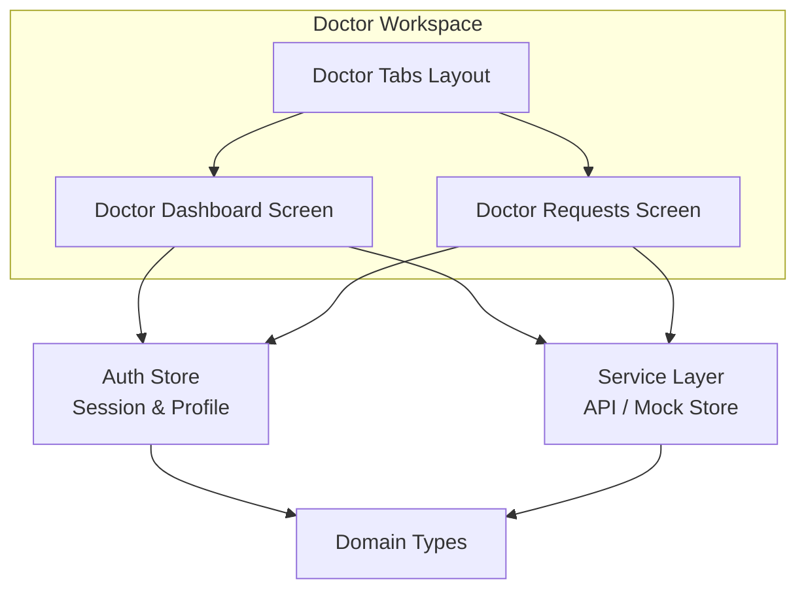
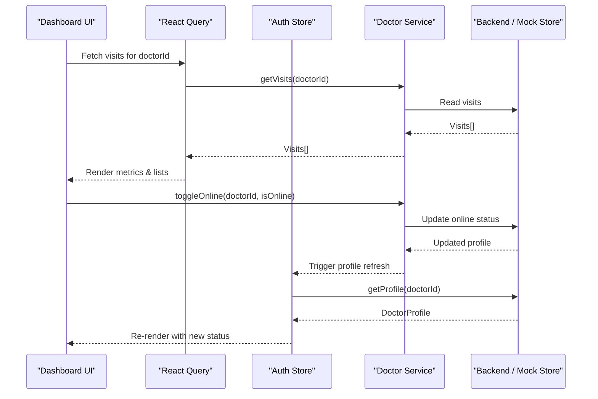
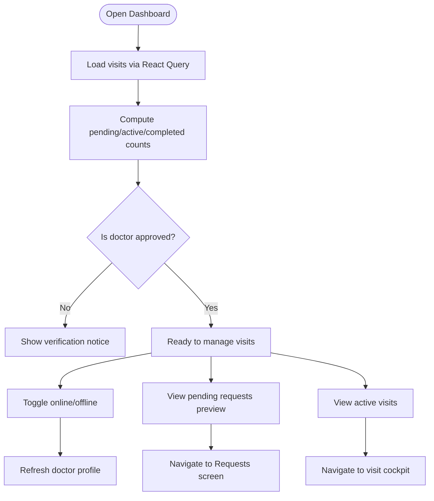
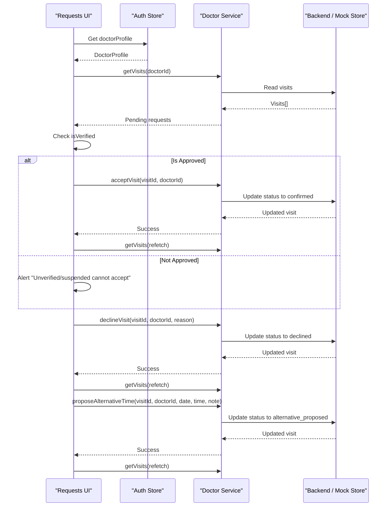
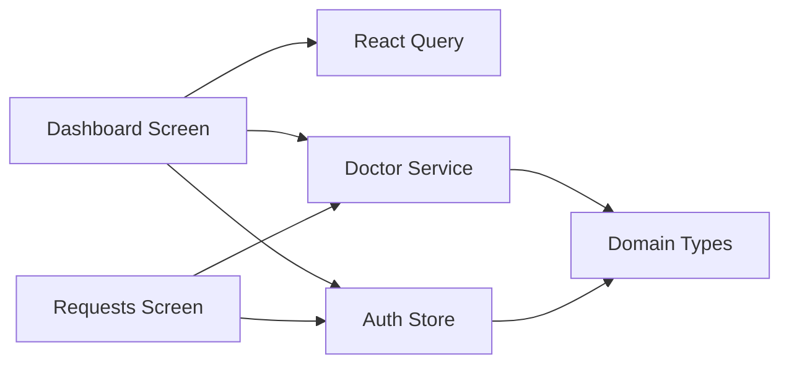

# Doctor Dashboard

<cite>
**Referenced Files in This Document**
- [index.tsx](file://src/app/(doctor)/index.tsx)
- [requests.tsx](file://src/app/(doctor)/requests.tsx)
- [_layout.tsx](file://src/app/(doctor)/_layout.tsx)
- [domain.ts](file://src/types/domain.ts)
- [authStore.ts](file://src/stores/authStore.ts)
- [api.ts](file://src/services/api.ts)
</cite>

## Table of Contents
1. [Introduction](#introduction)
2. [Project Structure](#project-structure)
3. [Core Components](#core-components)
4. [Architecture Overview](#architecture-overview)
5. [Detailed Component Analysis](#detailed-component-analysis)
6. [Dependency Analysis](#dependency-analysis)
7. [Performance Considerations](#performance-considerations)
8. [Troubleshooting Guide](#troubleshooting-guide)
9. [Conclusion](#conclusion)

## Introduction
This document explains the Doctor Dashboard screen and its supporting flows for home consultation management. It covers:
- The main dashboard interface that shows consultation metrics, pending request alerts, and online/offline status.
- The verification status system that prevents unapproved doctors from accepting visits.
- Quick metrics for pending requests, active visits, and completed consultations.
- Online/offline toggle behavior and how it affects patient booking visibility.
- Visit filtering logic by status.
- Refresh and data synchronization with the backend or mock store.
- User experience considerations for busy healthcare professionals.

## Project Structure
The doctor dashboard is part of a tabbed doctor workspace. The dashboard screen is the default tab, while the Requests screen provides detailed visit request handling.



**Diagram sources**
- [_layout.tsx:20-119](file://src/app/(doctor)/_layout.tsx#L20-L119)
- [index.tsx:25-184](file://src/app/(doctor)/index.tsx#L25-L184)
- [requests.tsx:22-267](file://src/app/(doctor)/requests.tsx#L22-L267)
- [authStore.ts:23-111](file://src/stores/authStore.ts#L23-L111)
- [api.ts:468-585](file://src/services/api.ts#L468-L585)
- [domain.ts:61-129](file://src/types/domain.ts#L61-L129)

**Section sources**
- [_layout.tsx:20-119](file://src/app/(doctor)/_layout.tsx#L20-L119)
- [index.tsx:25-184](file://src/app/(doctor)/index.tsx#L25-L184)

## Core Components
- Doctor Dashboard Screen: Displays greeting, verification badge, online/offline toggle, quick metrics, pending requests preview, and active visits list.
- Doctor Requests Screen: Lists pending visit requests and supports accept, decline, and propose alternative time actions.
- Auth Store: Manages current user, doctor profile, token, and profile refresh.
- Service Layer: Provides typed methods for doctor operations (profile, visits, availability, visit lifecycle).
- Domain Types: Defines entities such as DoctorProfile, VisitRequest, VisitStatus, and related types.

Key responsibilities:
- Dashboard aggregates visit data and presents actionable summaries.
- Requests screen enforces verification checks before allowing acceptance.
- Services abstract backend calls and mock store interactions.
- Types ensure consistent data contracts across screens and services.

**Section sources**
- [index.tsx:25-184](file://src/app/(doctor)/index.tsx#L25-L184)
- [requests.tsx:22-267](file://src/app/(doctor)/requests.tsx#L22-L267)
- [authStore.ts:23-111](file://src/stores/authStore.ts#L23-L111)
- [api.ts:468-585](file://src/services/api.ts#L468-L585)
- [domain.ts:61-129](file://src/types/domain.ts#L61-L129)

## Architecture Overview
The dashboard uses React Query to fetch visits, Zustand for session/profile state, and service methods to interact with either a live backend or a mock store.



**Diagram sources**
- [index.tsx:29-49](file://src/app/(doctor)/index.tsx#L29-L49)
- [api.ts:468-585](file://src/services/api.ts#L468-L585)
- [authStore.ts:95-104](file://src/stores/authStore.ts#L95-L104)

## Detailed Component Analysis

### Doctor Dashboard Screen
The dashboard screen:
- Loads visits via React Query using the current doctor’s ID.
- Computes quick metrics by filtering visits into pending, active, and completed categories.
- Shows a verification warning when the doctor is not approved.
- Provides an online/offline toggle that updates the doctor’s availability and refreshes the profile.
- Presents up to two pending request previews and links to the full requests screen.
- Renders active visits with navigation to the visit cockpit.

Verification status system:
- Unapproved doctors see a credential review notice.
- The online/offline toggle is disabled until approval.
- Accepting visits is blocked for unapproved or suspended doctors on the requests screen.

Quick metrics:
- Pending Requests: count of visits with status pending.
- Active Visits: count of visits with statuses confirmed, on_the_way, arrived, or in_consultation.
- Completed: count of visits with status completed.

Online/offline toggle:
- Updates the doctor’s online status through the service layer.
- Refreshes the doctor profile to reflect changes immediately.
- When offline, patients cannot book urgent visits; when online, the doctor becomes visible in specialist search.

Visit filtering logic:
- Pending: status equals pending.
- Active: status is one of confirmed, on_the_way, arrived, in_consultation.
- Completed: status equals completed.

Refresh mechanism:
- Pull-to-refresh triggers refetch of visits and refresh of the doctor profile concurrently.
- Uses React Query’s refetch and auth store’s refreshProfile.

User experience considerations:
- High-level greeting and specialty/license info at the top.
- Clear visual distinction between verified and pending verification states.
- Prominent metrics for immediate situational awareness.
- Compact preview cards for pending requests with direct navigation.
- Empty states for sections with no data to reduce confusion.



**Diagram sources**
- [index.tsx:29-59](file://src/app/(doctor)/index.tsx#L29-L59)
- [index.tsx:85-121](file://src/app/(doctor)/index.tsx#L85-L121)
- [index.tsx:123-181](file://src/app/(doctor)/index.tsx#L123-L181)

**Section sources**
- [index.tsx:25-184](file://src/app/(doctor)/index.tsx#L25-L184)

### Doctor Requests Screen
The requests screen:
- Lists all pending visit requests for the current doctor.
- Enforces verification checks before allowing acceptance.
- Supports three actions:
  - Accept: transitions the visit to confirmed if the doctor is approved.
  - Decline: marks the visit as declined with an optional reason.
  - Propose Alternative Time: proposes a different date/time with a note.
- Refetches visits after each action to keep the UI synchronized.

Verification enforcement:
- If the doctor is not approved, attempting to accept a visit displays an alert and aborts the operation.
- The service layer also validates verification status before updating visit status.

Action flow:
- Accept: calls acceptVisit, then refetches visits.
- Decline: opens a modal to optionally enter a reason, then calls declineVisit and refetches.
- Propose Alternative Time: opens a modal to set alternative date/time and note, then calls proposeAlternativeTime and refetches.



**Diagram sources**
- [requests.tsx:41-94](file://src/app/(doctor)/requests.tsx#L41-L94)
- [api.ts:508-529](file://src/services/api.ts#L508-L529)

**Section sources**
- [requests.tsx:22-267](file://src/app/(doctor)/requests.tsx#L22-L267)
- [api.ts:508-529](file://src/services/api.ts#L508-L529)

### Data Models and Status System
Domain types define the core entities and statuses used throughout the dashboard and requests flows.

Key types:
- DoctorProfile: includes verificationStatus and isOnline fields.
- VisitRequest: includes status, scheduling details, symptoms, location, fees, and payment information.
- VisitStatus: enumerates possible states including pending, alternative_proposed, confirmed, declined, expired, cancelled, on_the_way, arrived, in_consultation, completed.

Complexity analysis:
- Filtering visits by status is O(n) per filter operation.
- Metrics computation involves three filters over the same dataset, resulting in O(n) overall with small constant factors.
- Sorting or pagination is not implemented in these components; future optimization could introduce virtualized lists for large datasets.

```mermaid
classDiagram
class DoctorProfile {
+string userId
+string name
+string email
+string phone
+string specialty
+string licenseNumber
+string[] qualifications
+number experienceYears
+string[] coverageDistricts
+string city
+string country
+string bio
+string[] languages
+number consultationFeeRwf
+number travelFeeRwf
+string currency
+number rating
+number reviewCount
+DoctorVerificationStatus verificationStatus
+boolean isOnline
+number[] workingDays
+object workingHours
}
class VisitRequest {
+string id
+string patientId
+string patientName
+string patientPhone
+string doctorId
+string doctorName
+string doctorSpecialty
+string slotId
+string scheduledDate
+string scheduledTime
+string alternativeDate
+string alternativeTime
+string alternativeProposalNote
+VisitStatus status
+string conditionDescription
+string[] commonSymptoms
+string[] attachmentUrls
+string visitAddress
+string district
+string accessInstructions
+object coordinates
+number consultationFeeRwf
+number travelFeeRwf
+number labFeeRwf
+number totalFeeRwf
+PaymentMethod paymentMethod
+PaymentStatus paymentStatus
+string cancellationReason
+string declineReason
+string createdAt
+string updatedAt
}
class VisitStatus {
<<enumeration>>
"pending"
"alternative_proposed"
"confirmed"
"declined"
"expired"
"cancelled"
"on_the_way"
"arrived"
"in_consultation"
"completed"
}
DoctorProfile --> VisitStatus : "used by services"
VisitRequest --> VisitStatus : "has"
```

**Diagram sources**
- [domain.ts:61-129](file://src/types/domain.ts#L61-L129)
- [domain.ts:9-19](file://src/types/domain.ts#L9-L19)

**Section sources**
- [domain.ts:61-129](file://src/types/domain.ts#L61-L129)
- [domain.ts:9-19](file://src/types/domain.ts#L9-L19)

## Dependency Analysis
The dashboard depends on:
- React Query for data fetching and caching.
- Auth Store for current user and doctor profile.
- Doctor Service for API/mocks.
- Domain Types for type safety.

Coupling and cohesion:
- Dashboard is loosely coupled to the service layer via typed interfaces.
- Requests screen reuses the same service methods and domain types, promoting cohesion.
- Auth Store centralizes session and profile state, reducing duplication.

Potential circular dependencies:
- None observed; screens depend on stores and services, which do not import screens.

External integration points:
- Live backend endpoints are attempted first in the service layer, with fallback to mock store for development/testing.



**Diagram sources**
- [index.tsx:25-49](file://src/app/(doctor)/index.tsx#L25-L49)
- [requests.tsx:22-36](file://src/app/(doctor)/requests.tsx#L22-L36)
- [api.ts:468-585](file://src/services/api.ts#L468-L585)
- [authStore.ts:23-111](file://src/stores/authStore.ts#L23-L111)
- [domain.ts:61-129](file://src/types/domain.ts#L61-L129)

**Section sources**
- [index.tsx:25-49](file://src/app/(doctor)/index.tsx#L25-L49)
- [requests.tsx:22-36](file://src/app/(doctor)/requests.tsx#L22-L36)
- [api.ts:468-585](file://src/services/api.ts#L468-L585)
- [authStore.ts:23-111](file://src/stores/authStore.ts#L23-L111)
- [domain.ts:61-129](file://src/types/domain.ts#L61-L129)

## Performance Considerations
- Use React Query’s query key to cache visits per doctor; avoid unnecessary refetches.
- Debounce pull-to-refresh if frequent manual refreshes are expected.
- Consider virtualizing long lists of visits if the dataset grows significantly.
- Minimize re-renders by memoizing computed metrics where appropriate.
- Keep service-layer latency simulation minimal in production builds.

[No sources needed since this section provides general guidance]

## Troubleshooting Guide
Common issues and resolutions:
- Unverified doctor cannot accept visits:
  - Symptom: Attempting to accept shows an alert and does not update the visit.
  - Cause: Doctor verification status is not approved.
  - Resolution: Wait for administrative approval; the service layer enforces this check.

- Online/offline toggle does nothing:
  - Symptom: Switch remains unchanged or shows error.
  - Cause: Network failure or backend error; or doctor not approved.
  - Resolution: Verify network connectivity; ensure doctor is approved; check error messages displayed by the component.

- Visits not refreshing:
  - Symptom: Metrics or lists remain stale after actions.
  - Cause: Refetch not triggered or query key mismatch.
  - Resolution: Ensure refetch is called after mutations; verify query key includes doctorId.

- Empty states appear unexpectedly:
  - Symptom: No pending or active visits shown.
  - Cause: No matching visits for current doctor or incorrect filtering.
  - Resolution: Confirm visits exist for the doctor and statuses match expected values.

**Section sources**
- [requests.tsx:41-56](file://src/app/(doctor)/requests.tsx#L41-L56)
- [index.tsx:41-49](file://src/app/(doctor)/index.tsx#L41-L49)
- [api.ts:508-529](file://src/services/api.ts#L508-L529)

## Conclusion
The Doctor Dashboard provides a focused, efficient interface for managing home consultations. It emphasizes clarity through quick metrics, clear verification warnings, and actionable controls. The verification system protects platform integrity by preventing unapproved doctors from accepting visits. The online/offline toggle directly impacts patient booking visibility, ensuring accurate availability signaling. With robust filtering, refresh mechanisms, and well-defined data models, the dashboard supports busy healthcare professionals in making timely decisions and maintaining operational efficiency.

[No sources needed since this section summarizes without analyzing specific files]