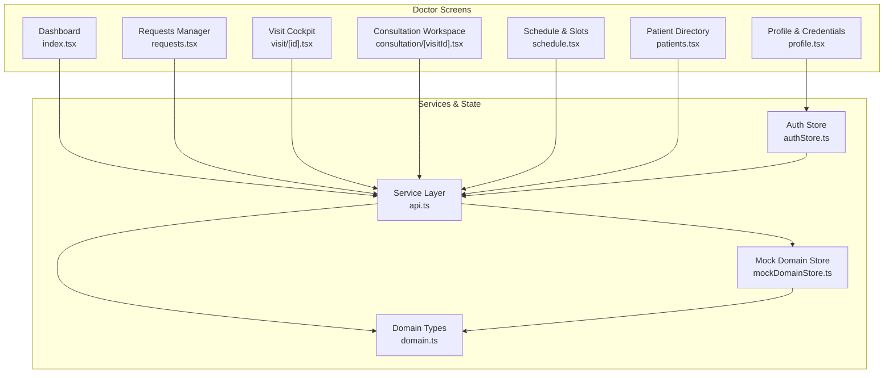
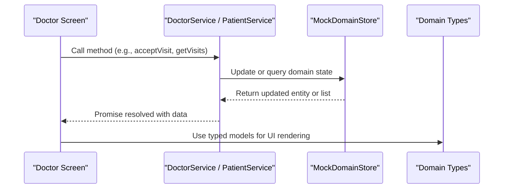
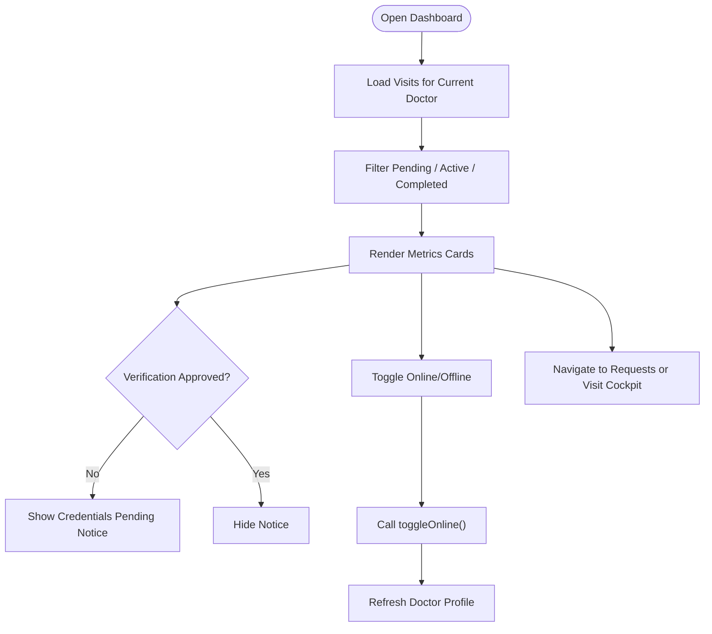
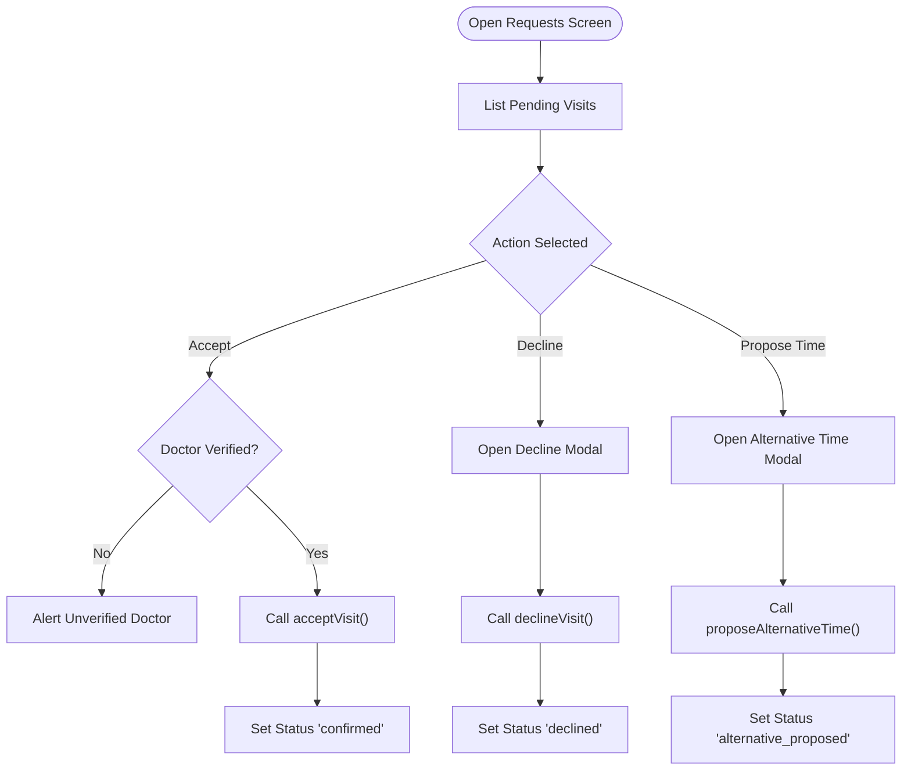
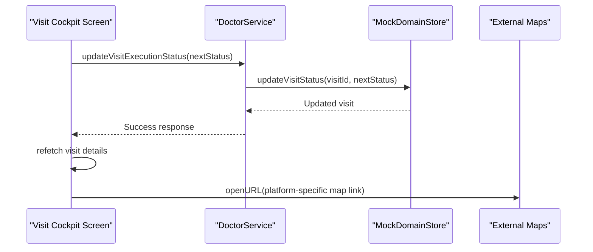
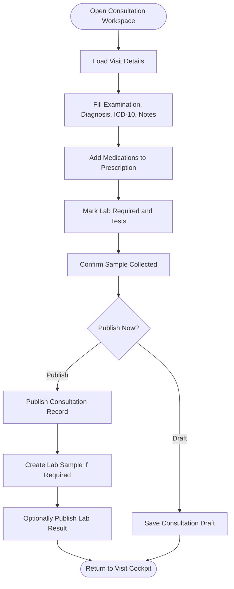
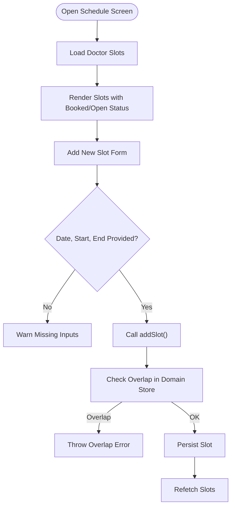
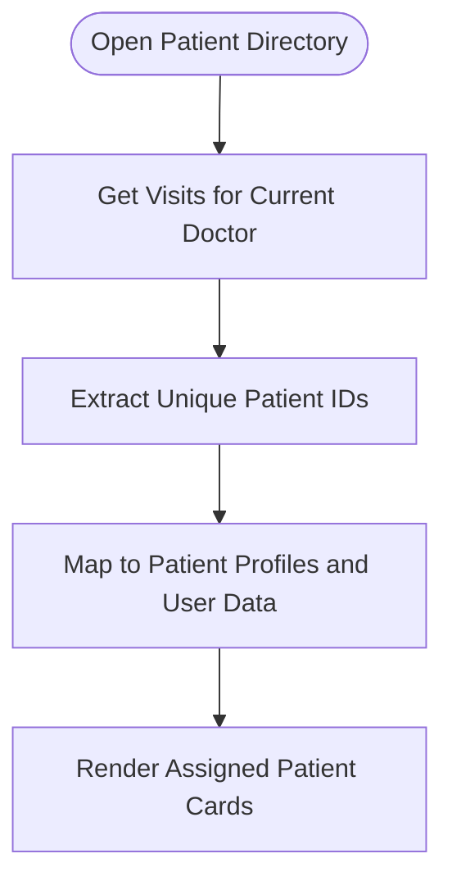
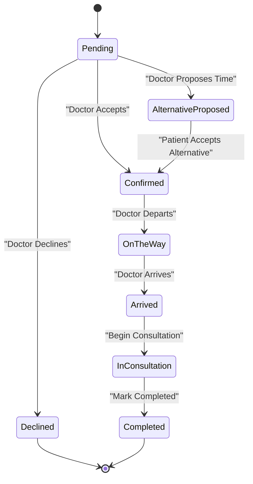
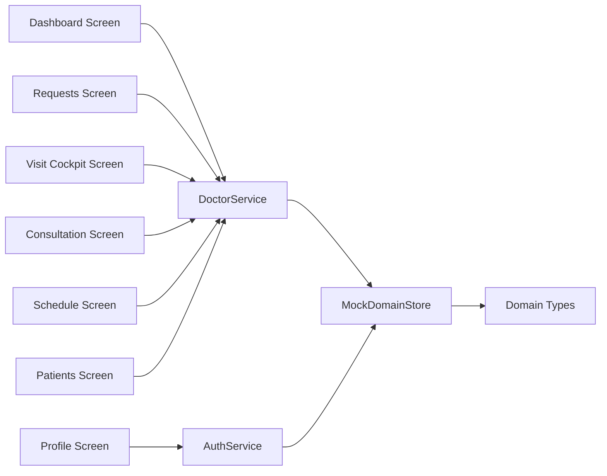

# Doctor Features

<cite>
**Referenced Files in This Document**
- [index.tsx](file://src/app/(doctor)/index.tsx)
- [requests.tsx](file://src/app/(doctor)/requests.tsx)
- [visit/[id].tsx](file://src/app/(doctor)/visit/[id].tsx)
- [consultation/[visitId].tsx](file://src/app/(doctor)/consultation/[visitId].tsx)
- [schedule.tsx](file://src/app/(doctor)/schedule.tsx)
- [patients.tsx](file://src/app/(doctor)/patients.tsx)
- [profile.tsx](file://src/app/(doctor)/profile.tsx)
- [domain.ts](file://src/types/domain.ts)
- [api.ts](file://src/services/api.ts)
- [authStore.ts](file://src/stores/authStore.ts)
- [mockDomainStore.ts](file://src/mock/mockDomainStore.ts)
</cite>

## Table of Contents
1. [Introduction](#introduction)
2. [Project Structure](#project-structure)
3. [Core Components](#core-components)
4. [Architecture Overview](#architecture-overview)
5. [Detailed Component Analysis](#detailed-component-analysis)
6. [Dependency Analysis](#dependency-analysis)
7. [Performance Considerations](#performance-considerations)
8. [Troubleshooting Guide](#troubleshooting-guide)
9. [Conclusion](#conclusion)

## Introduction
This document explains the doctor-facing features and clinical workflow management implemented in the mobile application. It covers the doctor dashboard, visit request triage, execution cockpit, consultation workspace, schedule management, patient directory with access control, and profile configuration. The implementation uses React Native screens, a service layer for domain operations, a mock domain store for state and business rules, and shared type definitions.

## Project Structure
The doctor feature set is organized under the `(doctor)` route group:
- Dashboard: `src/app/(doctor)/index.tsx`
- Visit requests: `src/app/(doctor)/requests.tsx`
- Visit execution cockpit: `src/app/(doctor)/visit/[id].tsx`
- Consultation workspace: `src/app/(doctor)/consultation/[visitId].tsx`
- Schedule and availability: `src/app/(doctor)/schedule.tsx`
- Patient directory: `src/app/(doctor)/patients.tsx`
- Profile and credentials: `src/app/(doctor)/profile.tsx`

Shared infrastructure:
- Domain types: `src/types/domain.ts`
- Service contracts and mock implementations: `src/services/api.ts`
- Auth session and profile refresh: `src/stores/authStore.ts`
- In-memory domain store with business rules: `src/mock/mockDomainStore.ts`

**Diagram sources**
- [index.tsx:25-184](file://src/app/(doctor)/index.tsx#L25-L184)
- [requests.tsx:22-267](file://src/app/(doctor)/requests.tsx#L22-L267)
- [visit/[id].tsx:23-186](file://src/app/(doctor)/visit/[id].tsx#L23-L186)
- [consultation/[visitId].tsx:22-395](file://src/app/(doctor)/consultation/[visitId].tsx#L22-L395)
- [schedule.tsx:21-160](file://src/app/(doctor)/schedule.tsx#L21-L160)
- [patients.tsx:18-100](file://src/app/(doctor)/patients.tsx#L18-L100)
- [profile.tsx:17-105](file://src/app/(doctor)/profile.tsx#L17-L105)
- [api.ts:468-585](file://src/services/api.ts#L468-L585)
- [mockDomainStore.ts:35-557](file://src/mock/mockDomainStore.ts#L35-L557)
- [domain.ts:5-242](file://src/types/domain.ts#L5-L242)
- [authStore.ts:23-111](file://src/stores/authStore.ts#L23-L111)

**Section sources**
- [index.tsx:1-329](file://src/app/(doctor)/index.tsx#L1-L329)
- [requests.tsx:1-433](file://src/app/(doctor)/requests.tsx#L1-L433)
- [visit/[id].tsx:1-298](file://src/app/(doctor)/visit/[id].tsx#L1-L298)
- [consultation/[visitId].tsx:1-507](file://src/app/(doctor)/consultation/[visitId].tsx#L1-L507)
- [schedule.tsx:1-286](file://src/app/(doctor)/schedule.tsx#L1-L286)
- [patients.tsx:1-213](file://src/app/(doctor)/patients.tsx#L1-L213)
- [profile.tsx:1-193](file://src/app/(doctor)/profile.tsx#L1-L193)
- [domain.ts:1-242](file://src/types/domain.ts#L1-L242)
- [api.ts:1-660](file://src/services/api.ts#L1-L660)
- [authStore.ts:1-112](file://src/stores/authStore.ts#L1-L112)
- [mockDomainStore.ts:1-557](file://src/mock/mockDomainStore.ts#L1-L557)

## Core Components
- Doctor dashboard: displays pending requests, active visits, completed counts, verification status, and online/offline toggle.
- Visit request manager: accepts, declines, or proposes alternative times; shows symptoms, location, and scheduling details.
- Visit execution cockpit: one-tap status progression from confirmed to completed, external navigation integration, and health summary.
- Consultation workspace: vital signs, diagnosis, ICD-10 coding, clinical notes, electronic prescriptions, lab specimen tracking, and result publication.
- Schedule management: weekly working days, open slots, add/remove slots, and booked slot indicators.
- Patient directory: role-based access limited to assigned patients, showing health info and visit count.
- Profile management: licensing, qualifications, fees, coverage districts, sign-out, and demo data reset.

**Section sources**
- [index.tsx:25-184](file://src/app/(doctor)/index.tsx#L25-L184)
- [requests.tsx:22-267](file://src/app/(doctor)/requests.tsx#L22-L267)
- [visit/[id].tsx:23-186](file://src/app/(doctor)/visit/[id].tsx#L23-L186)
- [consultation/[visitId].tsx:22-395](file://src/app/(doctor)/consultation/[visitId].tsx#L22-L395)
- [schedule.tsx:21-160](file://src/app/(doctor)/schedule.tsx#L21-L160)
- [patients.tsx:18-100](file://src/app/(doctor)/patients.tsx#L18-L100)
- [profile.tsx:17-105](file://src/app/(doctor)/profile.tsx#L17-L105)

## Architecture Overview
The doctor features follow a layered architecture:
- Presentation layer: React Native screens for each doctor workflow.
- Service layer: `api.ts` exposes typed methods for auth, patient, doctor, and admin operations.
- Domain store: `mockDomainStore.ts` implements business logic, validation, notifications, and audit logging.
- Type system: `domain.ts` defines entities such as users, profiles, visits, prescriptions, samples, results, and audit logs.
- Session state: `authStore.ts` manages current user, profiles, token, and profile refresh.

**Diagram sources**
- [api.ts:468-585](file://src/services/api.ts#L468-L585)
- [mockDomainStore.ts:202-380](file://src/mock/mockDomainStore.ts#L202-L380)
- [domain.ts:97-194](file://src/types/domain.ts#L97-L194)

**Section sources**
- [api.ts:1-660](file://src/services/api.ts#L1-L660)
- [mockDomainStore.ts:1-557](file://src/mock/mockDomainStore.ts#L1-L557)
- [domain.ts:1-242](file://src/types/domain.ts#L1-L242)
- [authStore.ts:1-112](file://src/stores/authStore.ts#L1-L112)

## Detailed Component Analysis

### Doctor Dashboard
The dashboard provides:
- Metrics: pending requests, active visits, completed visits.
- Verification notice: warns unapproved doctors that they cannot receive visits until approved.
- Online/offline toggle: updates doctor availability visible to patients.
- Quick links: navigate to requests and active visit cockpits.

Key behaviors:
- Fetches visits via `doctorService.getVisits`.
- Filters visits into pending, active, and completed categories.
- Calls `doctorService.toggleOnline` and refreshes profile on change.

**Diagram sources**
- [index.tsx:25-184](file://src/app/(doctor)/index.tsx#L25-L184)
- [api.ts:468-477](file://src/services/api.ts#L468-L477)

**Section sources**
- [index.tsx:25-184](file://src/app/(doctor)/index.tsx#L25-L184)
- [api.ts:468-477](file://src/services/api.ts#L468-L477)

### Visit Request Management
The request manager supports:
- Accepting visits only if the doctor is verified.
- Declining visits with optional reason.
- Proposing alternative appointment times with date, time, and note.
- Displaying patient-reported symptoms, address, district, and access instructions.

Business rules:
- Unverified or suspended doctors cannot accept visits.
- Alternative proposals update visit status to `alternative_proposed`.
- Declines update status to `declined` and may free up booked slots.

**Diagram sources**
- [requests.tsx:41-94](file://src/app/(doctor)/requests.tsx#L41-L94)
- [api.ts:508-529](file://src/services/api.ts#L508-L529)
- [mockDomainStore.ts:283-380](file://src/mock/mockDomainStore.ts#L283-L380)

**Section sources**
- [requests.tsx:22-267](file://src/app/(doctor)/requests.tsx#L22-L267)
- [api.ts:508-529](file://src/services/api.ts#L508-L529)
- [mockDomainStore.ts:283-380](file://src/mock/mockDomainStore.ts#L283-L380)

### Visit Execution Cockpit
The cockpit enables:
- One-tap status advancement: confirmed → on_the_way → arrived → in_consultation → completed.
- External navigation to the patient’s residence using platform-specific map URLs.
- Health summary including allergies, chronic conditions, and current medications.

Implementation highlights:
- Uses `doctorService.updateVisitExecutionStatus` with validated states.
- Refetches visit details periodically to reflect real-time changes.
- Navigates to consultation workspace when appropriate.

**Diagram sources**
- [visit/[id].tsx:46-71](file://src/app/(doctor)/visit/[id].tsx#L46-L71)
- [api.ts:531-538](file://src/services/api.ts#L531-L538)
- [mockDomainStore.ts:283-380](file://src/mock/mockDomainStore.ts#L283-L380)

**Section sources**
- [visit/[id].tsx:23-186](file://src/app/(doctor)/visit/[id].tsx#L23-L186)
- [api.ts:531-538](file://src/services/api.ts#L531-L538)

### Consultation Execution Workspace
The consultation workspace supports:
- Vital signs and physical examination documentation.
- Diagnosis and ICD-10 code entry.
- Clinical notes and recommendations.
- Electronic prescription writing with medication name, dosage, frequency, duration, and instructions.
- Laboratory testing flags, required tests, sample collection confirmation.
- Immediate publication of laboratory results with diagnostic summary.
- Draft saving and final publishing of consultation records.

Data model usage:
- `PrescriptionItem`, `LabSample`, `ConsultationRecord`, `ResultDocument`.

**Diagram sources**
- [consultation/[visitId].tsx:102-205](file://src/app/(doctor)/consultation/[visitId].tsx#L102-L205)
- [api.ts:545-584](file://src/services/api.ts#L545-L584)
- [domain.ts:131-194](file://src/types/domain.ts#L131-L194)

**Section sources**
- [consultation/[visitId].tsx:22-395](file://src/app/(doctor)/consultation/[visitId].tsx#L22-L395)
- [api.ts:545-584](file://src/services/api.ts#L545-L584)
- [domain.ts:131-194](file://src/types/domain.ts#L131-L194)

### Schedule Management System
The schedule screen allows:
- Viewing default weekly working days and hours.
- Listing active open time slots with booked/open status.
- Adding new availability slots with date and time range.
- Removing open slots (booked slots are protected).

Overlap prevention:
- The domain store prevents adding duplicate slots at the same date and start time.

**Diagram sources**
- [schedule.tsx:34-49](file://src/app/(doctor)/schedule.tsx#L34-L49)
- [api.ts:489-506](file://src/services/api.ts#L489-L506)
- [mockDomainStore.ts:207-216](file://src/mock/mockDomainStore.ts#L207-L216)

**Section sources**
- [schedule.tsx:21-160](file://src/app/(doctor)/schedule.tsx#L21-L160)
- [api.ts:489-506](file://src/services/api.ts#L489-L506)
- [mockDomainStore.ts:207-216](file://src/mock/mockDomainStore.ts#L207-L216)

### Patient Directory with Role-Based Access Control
The patient directory:
- Shows only patients assigned to the current doctor through visit history.
- Displays contact information, age, gender, allergies, known conditions, current medications, and residence.
- Enforces access control by filtering unique patient IDs from the doctor’s visits.

Access control behavior:
- Derived from `doctorService.getVisits` and local mapping to patient profiles.
- Aligns with NFR-2.3 access control requirements.

**Diagram sources**
- [patients.tsx:21-36](file://src/app/(doctor)/patients.tsx#L21-L36)
- [api.ts:479-482](file://src/services/api.ts#L479-L482)

**Section sources**
- [patients.tsx:18-100](file://src/app/(doctor)/patients.tsx#L18-L100)
- [api.ts:479-482](file://src/services/api.ts#L479-L482)

### Complete Clinical Workflow from Request to Completion
End-to-end flow:
1. Patient books a visit; request appears as pending.
2. Doctor reviews request and accepts, declines, or proposes alternative time.
3. Accepted visits move to confirmed; doctor navigates to cockpit.
4. Doctor advances status: on_the_way → arrived → in_consultation.
5. During consultation, doctor documents vitals, diagnosis, ICD-10, notes, and prescriptions.
6. Doctor publishes consultation record; optionally publishes lab results.
7. Visit marked completed; patient receives notifications and can view records.

**Diagram sources**
- [requests.tsx:41-94](file://src/app/(doctor)/requests.tsx#L41-L94)
- [visit/[id].tsx:138-182](file://src/app/(doctor)/visit/[id].tsx#L138-L182)
- [consultation/[visitId].tsx:133-205](file://src/app/(doctor)/consultation/[visitId].tsx#L133-L205)
- [domain.ts:9-19](file://src/types/domain.ts#L9-L19)

**Section sources**
- [requests.tsx:22-267](file://src/app/(doctor)/requests.tsx#L22-L267)
- [visit/[id].tsx:23-186](file://src/app/(doctor)/visit/[id].tsx#L23-L186)
- [consultation/[visitId].tsx:22-395](file://src/app/(doctor)/consultation/[visitId].tsx#L22-L395)
- [domain.ts:9-19](file://src/types/domain.ts#L9-L19)

### Doctor Profile Management, Licensing, and Fees
The profile screen shows:
- Name, specialty, email, phone, verification badge.
- Medical council license number, experience years, rating, review count.
- Qualifications list.
- Consultation fee, travel allowance, coverage districts.
- Actions to reset demo data and sign out.

Configuration fields:
- `licenseNumber`, `qualifications`, `experienceYears`, `rating`, `reviewCount`, `coverageDistricts`, `consultationFeeRwf`, `travelFeeRwf`.

**Section sources**
- [profile.tsx:17-105](file://src/app/(doctor)/profile.tsx#L17-L105)
- [domain.ts:61-85](file://src/types/domain.ts#L61-L85)

## Dependency Analysis
Key dependencies:
- Screens depend on services for data operations and state updates.
- Services depend on the mock domain store for persistence and business rules.
- Domain types define shared contracts across screens and services.
- Auth store manages session and profile refresh.

**Diagram sources**
- [index.tsx:25-184](file://src/app/(doctor)/index.tsx#L25-L184)
- [requests.tsx:22-267](file://src/app/(doctor)/requests.tsx#L22-L267)
- [visit/[id].tsx:23-186](file://src/app/(doctor)/visit/[id].tsx#L23-L186)
- [consultation/[visitId].tsx:22-395](file://src/app/(doctor)/consultation/[visitId].tsx#L22-L395)
- [schedule.tsx:21-160](file://src/app/(doctor)/schedule.tsx#L21-L160)
- [patients.tsx:18-100](file://src/app/(doctor)/patients.tsx#L18-L100)
- [profile.tsx:17-105](file://src/app/(doctor)/profile.tsx#L17-L105)
- [api.ts:468-585](file://src/services/api.ts#L468-L585)
- [mockDomainStore.ts:35-557](file://src/mock/mockDomainStore.ts#L35-L557)
- [domain.ts:1-242](file://src/types/domain.ts#L1-L242)

**Section sources**
- [api.ts:1-660](file://src/services/api.ts#L1-L660)
- [mockDomainStore.ts:1-557](file://src/mock/mockDomainStore.ts#L1-L557)
- [domain.ts:1-242](file://src/types/domain.ts#L1-L242)
- [authStore.ts:1-112](file://src/stores/authStore.ts#L1-L112)

## Performance Considerations
- Query caching: Screens use `useQuery` with stable keys to avoid unnecessary re-fetches.
- Simulated latency: Service layer adds small delays to mimic network calls; consider removing or reducing latency in production.
- Periodic polling: Visit cockpit refetches every few seconds; tune interval based on expected update frequency.
- Local filtering: Dashboard filters visits locally after fetching; ensure datasets remain manageable.
- Avoid redundant API calls: Reuse queries where possible and rely on store updates for immediate feedback.

[No sources needed since this section provides general guidance]

## Troubleshooting Guide
Common issues and resolutions:
- Unverified doctor cannot accept visits: Ensure doctor verification status is approved before accepting requests.
- Slot overlap error: Prevent adding duplicate slots at the same date and start time; remove conflicting slots first.
- Invalid execution status transition: Only allowed transitions are on_the_way, arrived, in_consultation, completed.
- Visit not found errors: Confirm visit ID and that the visit exists in the domain store.
- Profile refresh failures: Ensure current user is present and role matches expected profile type.

Operational checks:
- Verify service method parameters match domain expectations.
- Confirm that mock store mutations return updated entities.
- Review alert messages for actionable feedback.

**Section sources**
- [api.ts:508-538](file://src/services/api.ts#L508-L538)
- [mockDomainStore.ts:207-216](file://src/mock/mockDomainStore.ts#L207-L216)
- [requests.tsx:41-94](file://src/app/(doctor)/requests.tsx#L41-L94)
- [visit/[id].tsx:46-57](file://src/app/(doctor)/visit/[id].tsx#L46-L57)

## Conclusion
The doctor features provide a comprehensive clinical workflow from request triage through visit execution and consultation documentation. The architecture cleanly separates presentation, services, domain logic, and types, enabling maintainability and extensibility. Key capabilities include verification-gated workflows, robust visit lifecycle management, structured clinical documentation, schedule controls with overlap prevention, and role-based patient access. Future enhancements can integrate real backend APIs, advanced scheduling algorithms, and richer clinical decision support while preserving the current modular design.

[No sources needed since this section summarizes without analyzing specific files]