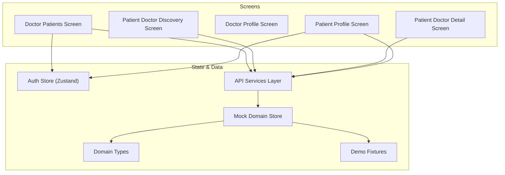
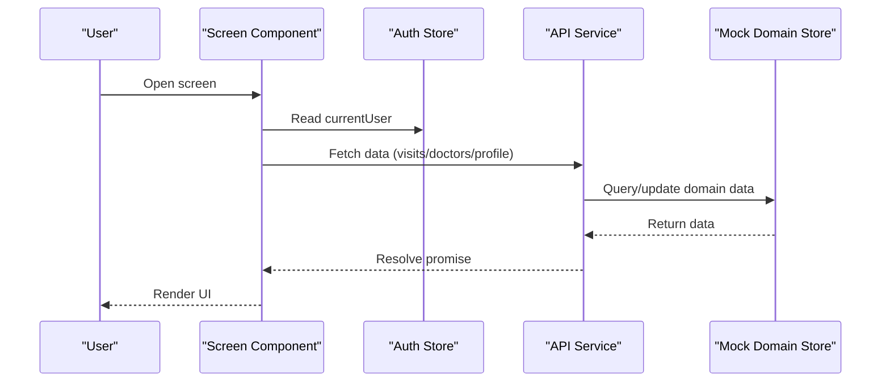
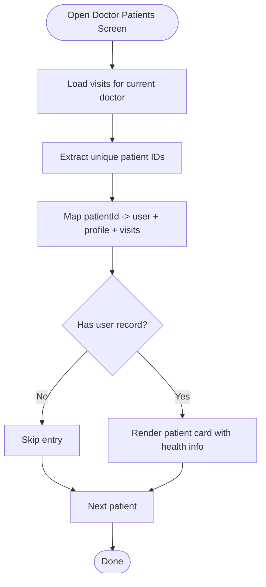
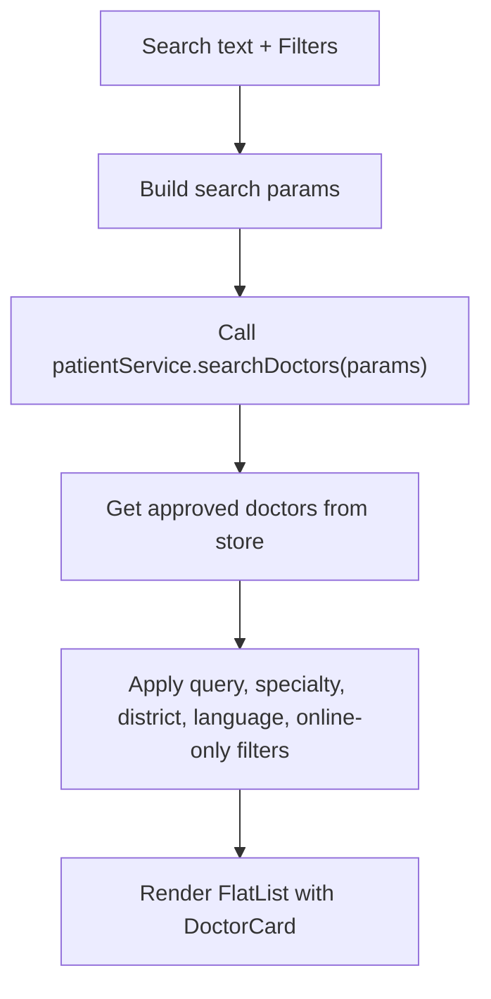
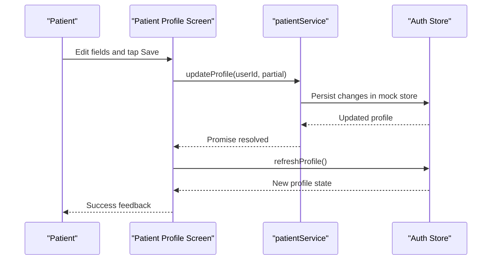
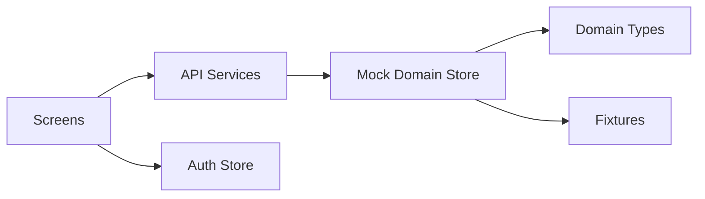

# Patient Directory & Profile Management

<cite>
**Referenced Files in This Document**
- [patients.tsx](file://src/app/(doctor)/patients.tsx)
- [doctors.tsx](file://src/app/(patient)/doctors.tsx)
- [profile.tsx (Doctor)](file://src/app/(doctor)/profile.tsx)
- [profile.tsx (Patient)](file://src/app/(patient)/profile.tsx)
- [domain.ts](file://src/types/domain.ts)
- [mockDomainStore.ts](file://src/mock/mockDomainStore.ts)
- [api.ts](file://src/services/api.ts)
- [authStore.ts](file://src/stores/authStore.ts)
- [fixtures.ts](file://src/mock/fixtures.ts)
- [DoctorCard.tsx](file://src/components/ui/DoctorCard.tsx)
- [doctor/[id].tsx](file://src/app/(patient)/doctor/[id].tsx)
</cite>

## Table of Contents
1. [Introduction](#introduction)
2. [Project Structure](#project-structure)
3. [Core Components](#core-components)
4. [Architecture Overview](#architecture-overview)
5. [Detailed Component Analysis](#detailed-component-analysis)
6. [Dependency Analysis](#dependency-analysis)
7. [Performance Considerations](#performance-considerations)
8. [Troubleshooting Guide](#troubleshooting-guide)
9. [Conclusion](#conclusion)

## Introduction
This document explains the patient directory and profile management features for a home-care platform. It focuses on:
- Role-based access control that limits doctor visibility to patients with active or completed visits.
- Patient search and filtering across specialties, districts, languages, availability, and fees.
- Patient profile editing for medical history, allergies, chronic conditions, and current medications.
- Doctor profile management including licensing credentials, specialty selection, fee configuration, coverage districts, and professional biography.
- Privacy controls and consent management aligned with data protection requirements.
- The mock domain store and service layer that simulate backend behavior for development and testing.

The system is implemented as a React Native application using Expo Router, Zustand for state, and TanStack Query for data fetching. Data is currently served by an in-memory mock store but designed to transition to a REST API.

## Project Structure
The relevant code for this feature set spans screens, services, stores, types, and mock fixtures:
- Screens under `src/app/(doctor)` and `src/app/(patient)` implement role-specific UIs.
- Services under `src/services/api.ts` define contracts for authentication, patient operations, doctor operations, and admin operations.
- The mock store under `src/mock/mockDomainStore.ts` provides reactive in-memory data and audit logging.
- Domain types under `src/types/domain.ts` define entities such as users, patient profiles, doctor profiles, visits, consultations, results, and audit logs.
- Mock fixtures under `src/mock/fixtures.ts` provide demo users, doctors, visits, slots, and clinical records.
- Shared UI components like `DoctorCard` are used across discovery and detail flows.

**Diagram sources**
- [patients.tsx:18-36](file://src/app/(doctor)/patients.tsx#L18-L36)
- [doctors.tsx:19-54](file://src/app/(patient)/doctors.tsx#L19-L54)
- [profile.tsx (Doctor):17-35](file://src/app/(doctor)/profile.tsx#L17-L35)
- [profile.tsx (Patient):19-47](file://src/app/(patient)/profile.tsx#L19-L47)
- [api.ts:247-430](file://src/services/api.ts#L247-L430)
- [mockDomainStore.ts:35-127](file://src/mock/mockDomainStore.ts#L35-L127)
- [domain.ts:29-85](file://src/types/domain.ts#L29-L85)
- [fixtures.ts:72-163](file://src/mock/fixtures.ts#L72-L163)

**Section sources**
- [patients.tsx:1-213](file://src/app/(doctor)/patients.tsx#L1-L213)
- [doctors.tsx:1-426](file://src/app/(patient)/doctors.tsx#L1-L426)
- [profile.tsx (Doctor):1-193](file://src/app/(doctor)/profile.tsx#L1-L193)
- [profile.tsx (Patient):1-282](file://src/app/(patient)/profile.tsx#L1-L282)
- [api.ts:1-660](file://src/services/api.ts#L1-L660)
- [mockDomainStore.ts:1-557](file://src/mock/mockDomainStore.ts#L1-L557)
- [domain.ts:1-242](file://src/types/domain.ts#L1-L242)
- [fixtures.ts:1-904](file://src/mock/fixtures.ts#L1-L904)
- [DoctorCard.tsx:1-213](file://src/components/ui/DoctorCard.tsx#L1-L213)
- [doctor/[id].tsx:1-374](file://src/app/(patient)/doctor/[id].tsx#L1-L374)

## Core Components
- Doctor Assigned Patients Directory: Displays only patients assigned to the logged-in doctor through visit history. Shows basic demographics, allergies, known conditions, current medications, residence, and visit count.
- Patient Doctor Discovery: Allows patients to search and filter doctors by name/symptom, specialty, district, language, online availability, and optionally fee/rating.
- Doctor Profile Screen: Shows the logged-in doctor’s identity, verification status, license number, experience, rating, qualifications, consultation/travel fees, coverage districts, and actions like sign out and demo reset.
- Patient Profile Screen: Lets patients edit residence address, district, allergies, known conditions, and current medications; displays emergency contact; includes privacy notices and export/delete options.
- Doctor Detail Screen: Presents verified doctor information, fees, bio, qualifications, coverage districts, languages, reviews, and booking action.

Key responsibilities:
- Access control: Doctors see only patients linked to their visits.
- Search/filter: Patients can refine doctor discovery by multiple criteria.
- Profile editing: Patients update health-related fields; doctors view their own credentials and fees.
- Privacy: Patient profile mentions data protection compliance and export/deletion rights.

**Section sources**
- [patients.tsx:18-99](file://src/app/(doctor)/patients.tsx#L18-L99)
- [doctors.tsx:19-224](file://src/app/(patient)/doctors.tsx#L19-L224)
- [profile.tsx (Doctor):17-105](file://src/app/(doctor)/profile.tsx#L17-L105)
- [profile.tsx (Patient):19-182](file://src/app/(patient)/profile.tsx#L19-L182)
- [doctor/[id].tsx:19-153](file://src/app/(patient)/doctor/[id].tsx#L19-L153)

## Architecture Overview
The architecture separates UI screens from business logic via services, which delegate to a mock domain store. State is managed centrally with Zustand.

**Diagram sources**
- [authStore.ts:31-83](file://src/stores/authStore.ts#L31-L83)
- [api.ts:274-430](file://src/services/api.ts#L274-L430)
- [mockDomainStore.ts:156-192](file://src/mock/mockDomainStore.ts#L156-L192)

## Detailed Component Analysis

### Doctor Assigned Patients Directory
Purpose:
- Provide doctors with a list of patients they have visited or are visiting.
- Enforce isolation so doctors cannot see unrelated patients.

Behavior:
- Retrieves visits for the current doctor via `doctorService.getVisits`.
- Extracts unique patient IDs and maps them to user and profile data using the mock store.
- Displays key health info: allergies, known conditions, current medications, residence, and visit count.

Access Control:
- Only patients associated with the doctor’s visits are shown, satisfying the requirement that doctors have access only to patients with active or completed appointments.

**Diagram sources**
- [patients.tsx:21-36](file://src/app/(doctor)/patients.tsx#L21-L36)
- [api.ts:468-482](file://src/services/api.ts#L468-L482)
- [mockDomainStore.ts:229-233](file://src/mock/mockDomainStore.ts#L229-L233)

**Section sources**
- [patients.tsx:18-99](file://src/app/(doctor)/patients.tsx#L18-L99)
- [api.ts:468-482](file://src/services/api.ts#L468-L482)
- [mockDomainStore.ts:229-233](file://src/mock/mockDomainStore.ts#L229-L233)

### Patient Doctor Discovery and Filtering
Purpose:
- Enable patients to find specialists based on symptoms, specialty, district, language, and availability.

Capabilities:
- Text search across doctor name, specialty, and bio.
- Specialty pill carousel for quick filtering.
- Expanded filters for Kigali coverage district, consultation language, and “online now” toggle.
- Results rendered via reusable `DoctorCard`.

Data Flow:
- Uses `patientService.searchDoctors` with query parameters derived from UI state.
- Service applies filters over approved doctors from the mock store.

**Diagram sources**
- [doctors.tsx:19-54](file://src/app/(patient)/doctors.tsx#L19-L54)
- [api.ts:290-323](file://src/services/api.ts#L290-L323)
- [DoctorCard.tsx:15-86](file://src/components/ui/DoctorCard.tsx#L15-L86)

**Section sources**
- [doctors.tsx:19-224](file://src/app/(patient)/doctors.tsx#L19-L224)
- [api.ts:290-323](file://src/services/api.ts#L290-L323)
- [DoctorCard.tsx:15-86](file://src/components/ui/DoctorCard.tsx#L15-L86)

### Patient Profile Editing and Privacy Controls
Purpose:
- Allow patients to manage their medical and residence details.
- Provide privacy controls and regulatory notices.

Editing Capabilities:
- Editable fields: residence address, district, allergies, known conditions, current medications.
- Save operation calls `patientService.updateProfile`, then refreshes the profile via auth store.

Privacy Controls:
- Legal notice referencing Rwandan data protection law.
- Actions for exporting health data and requesting account deletion.

**Diagram sources**
- [profile.tsx (Patient):29-47](file://src/app/(patient)/profile.tsx#L29-L47)
- [api.ts:280-283](file://src/services/api.ts#L280-L283)
- [authStore.ts:95-105](file://src/stores/authStore.ts#L95-L105)

**Section sources**
- [profile.tsx (Patient):19-182](file://src/app/(patient)/profile.tsx#L19-L182)
- [api.ts:280-283](file://src/services/api.ts#L280-L283)
- [authStore.ts:95-105](file://src/stores/authStore.ts#L95-L105)

### Doctor Profile and Credentials Display
Purpose:
- Show the logged-in doctor’s identity, verification status, license, experience, ratings, qualifications, fees, and coverage districts.

Features:
- Displays verification badge and rating metrics.
- Lists qualifications and coverage districts.
- Provides actions to reset demo data and sign out.

Note:
- In the current implementation, the doctor profile screen is primarily read-only for credentials and fees. Editing capabilities for licenses, specialty, fees, and biography are not present in this file.

**Section sources**
- [profile.tsx (Doctor):17-105](file://src/app/(doctor)/profile.tsx#L17-L105)

### Doctor Details View for Patients
Purpose:
- Present comprehensive information about a specific doctor to enable informed booking decisions.

Displayed Information:
- Verified status, specialty, license number, rating, experience.
- Consultation and travel fees.
- Bio, qualifications, coverage districts, languages.
- Reviews and a prominent booking button.

**Section sources**
- [doctor/[id].tsx:19-153](file://src/app/(patient)/doctor/[id].tsx#L19-L153)

## Dependency Analysis
High-level dependencies between layers:
- Screens depend on services for data operations.
- Services wrap mock store methods and simulate latency.
- Mock store manages domain entities and audit logs.
- Types define the contract for all entities.
- Fixtures seed initial data.

**Diagram sources**
- [api.ts:247-430](file://src/services/api.ts#L247-L430)
- [mockDomainStore.ts:35-127](file://src/mock/mockDomainStore.ts#L35-L127)
- [domain.ts:29-85](file://src/types/domain.ts#L29-L85)
- [fixtures.ts:72-163](file://src/mock/fixtures.ts#L72-L163)
- [authStore.ts:31-83](file://src/stores/authStore.ts#L31-L83)

**Section sources**
- [api.ts:247-430](file://src/services/api.ts#L247-L430)
- [mockDomainStore.ts:35-127](file://src/mock/mockDomainStore.ts#L35-L127)
- [domain.ts:29-85](file://src/types/domain.ts#L29-L85)
- [fixtures.ts:72-163](file://src/mock/fixtures.ts#L72-L163)
- [authStore.ts:31-83](file://src/stores/authStore.ts#L31-L83)

## Performance Considerations
- Use TanStack Query caching for repeated searches and profile loads to reduce redundant calls.
- Debounce search input to avoid excessive re-renders and service calls.
- Paginate or limit doctor search results if the dataset grows beyond demo size.
- Avoid unnecessary re-mapping of patient lists by memoizing computed arrays where possible.
- Keep mock latency realistic but configurable to speed up tests.

[No sources needed since this section provides general guidance]

## Troubleshooting Guide
Common issues and resolutions:
- No patients listed for a doctor: Ensure the doctor has at least one visit in the mock data. Check `getVisitsForDoctor` returns entries.
- Doctor search returns empty: Verify filters (specialty, district, language, online-only) match fixture data. Reset filters to default.
- Profile updates not reflected: Confirm `refreshProfile` is called after save and that the mock store updated the profile.
- Unauthorized errors when canceling/rescheduling visits: Ensure the visit belongs to the current patient and is not in a terminal execution state.

Relevant error handling paths:
- Visit cancellation/rescheduling guards against invalid states.
- Doctor verification checks prevent unverified or suspended doctors from accepting visits.

**Section sources**
- [api.ts:359-403](file://src/services/api.ts#L359-L403)
- [api.ts:508-515](file://src/services/api.ts#L508-L515)

## Conclusion
The patient directory and profile management features provide:
- Strict access control ensuring doctors see only related patients.
- Robust doctor discovery with multi-criteria filtering.
- Patient-controlled medical profile editing and privacy options.
- A clear doctor profile and credential display for transparency.
- A service layer designed for future backend integration while leveraging a robust mock store for development.

To extend the system:
- Add doctor profile editing endpoints for licenses, specialty, fees, and biography.
- Implement document upload and verification workflows for licenses and certifications.
- Introduce explicit consent toggles and granular sharing permissions per doctor relationship.
- Enhance audit logging for all profile edits and data exports.

[No sources needed since this section summarizes without analyzing specific files]