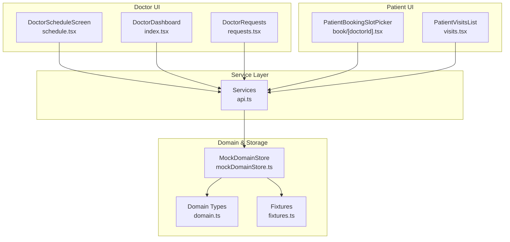
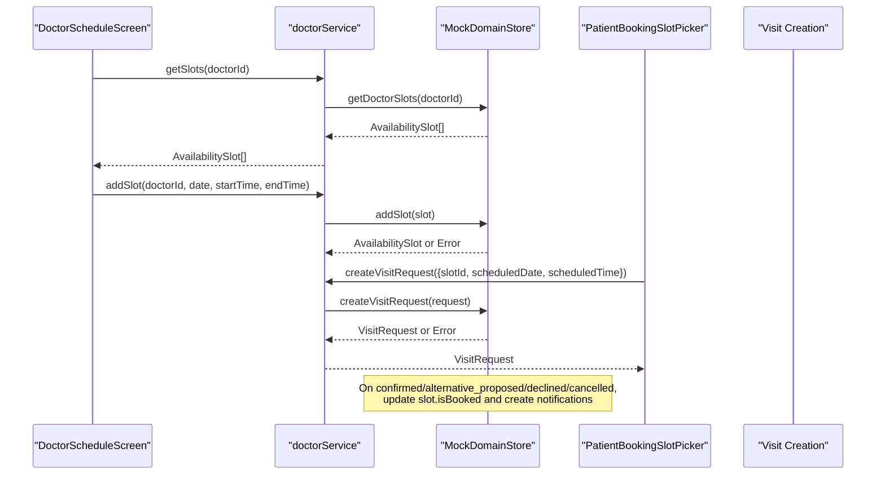
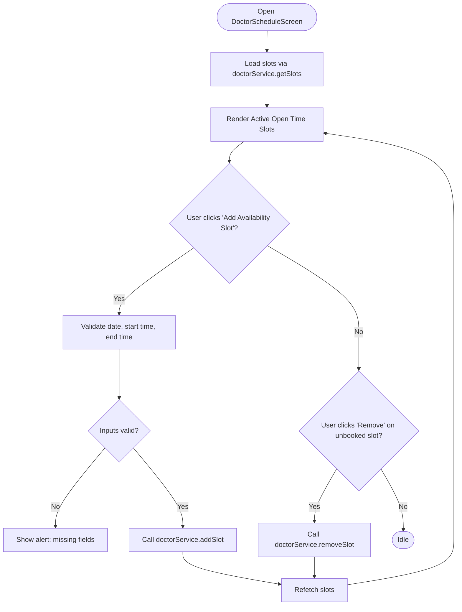
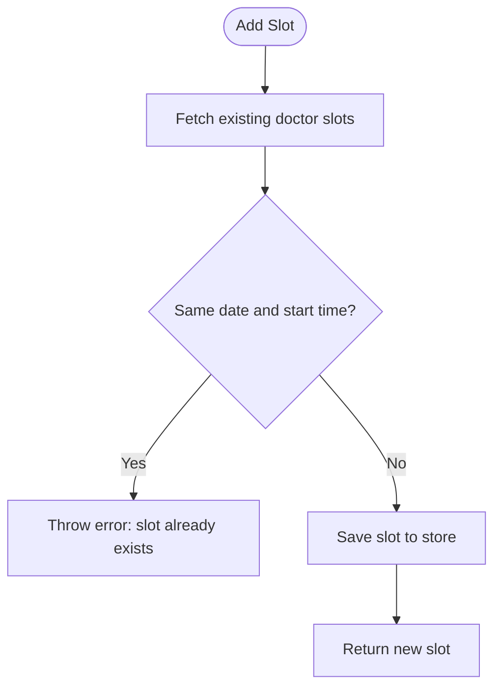
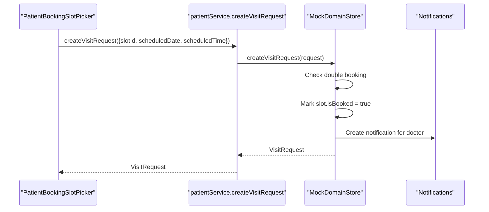
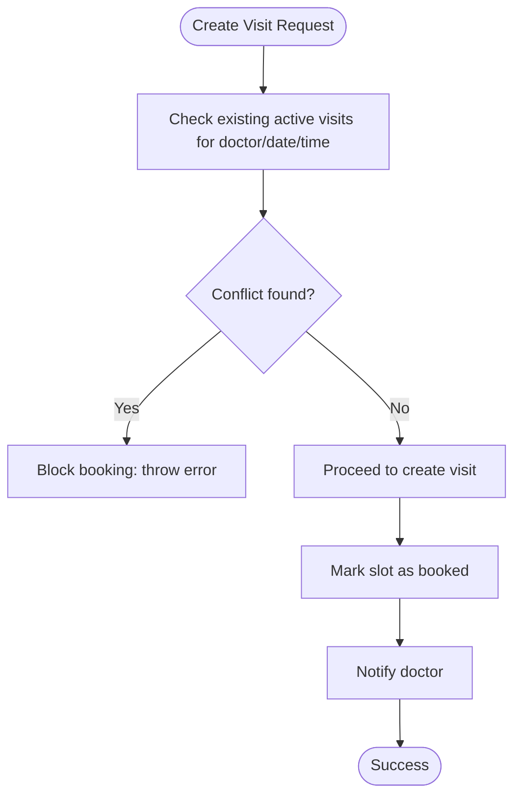
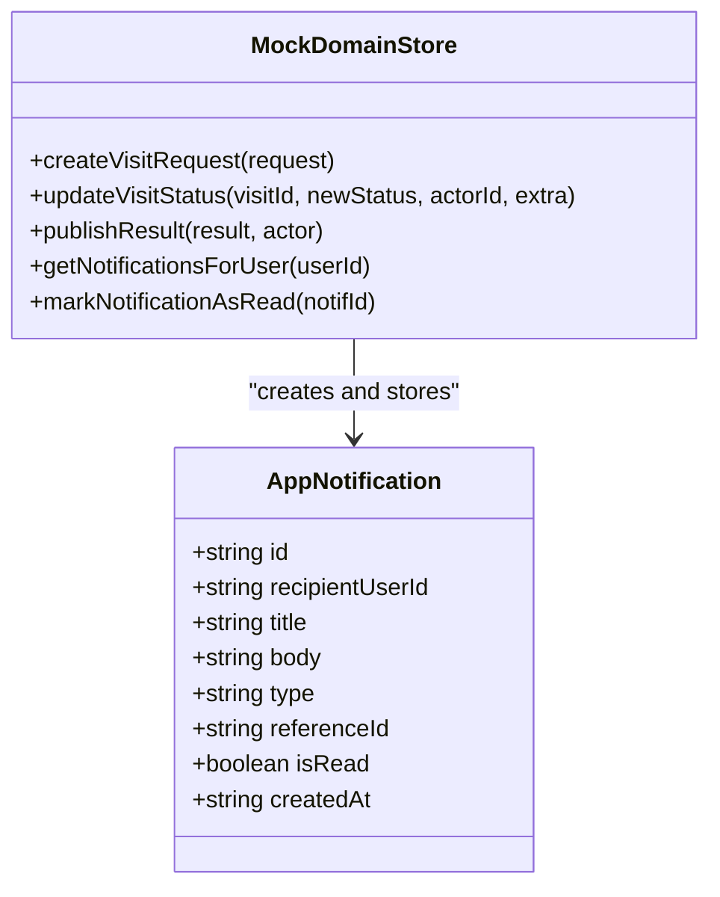
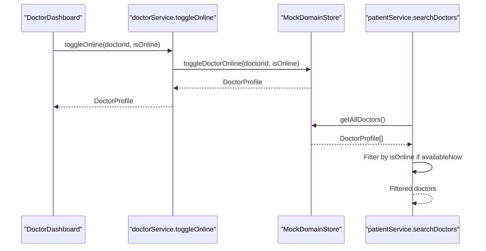
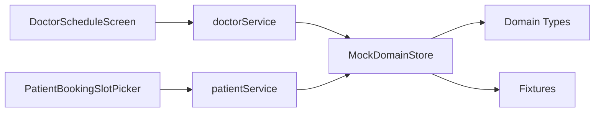

# Schedule Management

<cite>
**Referenced Files in This Document**
- [schedule.tsx](file://src/app/(doctor)/schedule.tsx)
- [api.ts](file://src/services/api.ts)
- [domain.ts](file://src/types/domain.ts)
- [mockDomainStore.ts](file://src/mock/mockDomainStore.ts)
- [fixtures.ts](file://src/mock/fixtures.ts)
- [requests.tsx](file://src/app/(doctor)/requests.tsx)
- [index.tsx (Doctor Dashboard)](file://src/app/(doctor)/index.tsx)
- [visits.tsx (Patient Visits)](file://src/app/(patient)/visits.tsx)
- [book/[doctorId].tsx](file://src/app/(patient)/book/[doctorId].tsx)
</cite>

## Table of Contents
1. [Introduction](#introduction)
2. [Project Structure](#project-structure)
3. [Core Components](#core-components)
4. [Architecture Overview](#architecture-overview)
5. [Detailed Component Analysis](#detailed-component-analysis)
6. [Dependency Analysis](#dependency-analysis)
7. [Performance Considerations](#performance-considerations)
8. [Troubleshooting Guide](#troubleshooting-guide)
9. [Conclusion](#conclusion)

## Introduction
This document explains the doctor schedule management system for the HomeCare application. It covers how doctors configure working hours and availability, how time slots are created and managed, how bookings interact with schedules, and how conflict resolution and notifications work. It also documents the integration between online/offline status, patient search visibility, timezone considerations, and the current state of recurring templates and export/import features.

The system is implemented as a React Native frontend backed by an API service layer that currently uses an in-memory mock domain store. The design supports future migration to a real backend REST API while providing a complete scheduling workflow for demonstration and testing.

## Project Structure
The schedule management feature spans several layers:
- Doctor-facing UI for managing availability and viewing booked slots
- Service layer defining contracts for slot operations and visit lifecycle
- Domain types defining schedule entities such as availability slots and visits
- Mock domain store implementing overlap prevention, booking updates, and notifications
- Patient-facing flows that consume available slots and update visit states

**Diagram sources**
- [schedule.tsx:1-161](file://src/app/(doctor)/schedule.tsx#L1-L161)
- [api.ts:432-585](file://src/services/api.ts#L432-L585)
- [domain.ts:87-129](file://src/types/domain.ts#L87-L129)
- [mockDomainStore.ts:202-220](file://src/mock/mockDomainStore.ts#L202-L220)
- [fixtures.ts:517-603](file://src/mock/fixtures.ts#L517-L603)
- [requests.tsx:74-94](file://src/app/(doctor)/requests.tsx#L74-L94)
- [index.tsx (Doctor Dashboard):95-121](file://src/app/(doctor)/index.tsx#L95-L121)
- [visits.tsx (Patient Visits):1-41](file://src/app/(patient)/visits.tsx#L1-L41)
- [book/[doctorId].tsx:163-197](file://src/app/(patient)/book/[doctorId].tsx#L163-L197)

**Section sources**
- [schedule.tsx:1-161](file://src/app/(doctor)/schedule.tsx#L1-L161)
- [api.ts:432-585](file://src/services/api.ts#L432-L585)
- [domain.ts:87-129](file://src/types/domain.ts#L87-L129)
- [mockDomainStore.ts:202-220](file://src/mock/mockDomainStore.ts#L202-L220)
- [fixtures.ts:517-603](file://src/mock/fixtures.ts#L517-L603)

## Core Components
- Doctor Schedule Screen: Allows doctors to view default weekly working days and hours, list active open slots, add new availability slots, and remove unbooked slots.
- Service Layer: Defines methods for getting/adding/removing slots, toggling online status, and managing visit requests and statuses.
- Domain Types: Define AvailabilitySlot, VisitRequest, DoctorProfile, and related entities.
- Mock Domain Store: Implements overlap checks when adding slots, prevents double booking during visit creation, marks slots as booked or free based on visit lifecycle, and generates notifications.

Key responsibilities:
- Working hours configuration interface: Displayed via DoctorProfile fields like workingDays and workingHours.
- Slot management: Add/remove slots; prevent overlapping slots; mark slots as booked/unbooked.
- Conflict resolution: Prevent double booking; handle alternative proposals and rescheduling.
- Notification system: Create and store notifications for visit events.
- Online/offline integration: Toggle doctor availability and filter search results accordingly.

**Section sources**
- [schedule.tsx:21-161](file://src/app/(doctor)/schedule.tsx#L21-L161)
- [api.ts:432-585](file://src/services/api.ts#L432-L585)
- [domain.ts:61-129](file://src/types/domain.ts#L61-L129)
- [mockDomainStore.ts:202-220](file://src/mock/mockDomainStore.ts#L202-L220)

## Architecture Overview
The schedule management architecture connects UI components to services and storage:
- DoctorScheduleScreen queries slots via doctorService.getSlots and renders them.
- Adding/removing slots calls doctorService.addSlot/removeSlot which delegate to mockDomainStore.
- Patient booking flow selects from non-booked slots and creates visit requests.
- Visit lifecycle transitions trigger slot updates and notifications.

**Diagram sources**
- [schedule.tsx:28-58](file://src/app/(doctor)/schedule.tsx#L28-L58)
- [api.ts:484-506](file://src/services/api.ts#L484-L506)
- [mockDomainStore.ts:207-216](file://src/mock/mockDomainStore.ts#L207-L216)
- [api.ts:334-345](file://src/services/api.ts#L334-L345)
- [mockDomainStore.ts:245-281](file://src/mock/mockDomainStore.ts#L245-L281)

## Detailed Component Analysis

### Doctor Schedule Screen
The DoctorScheduleScreen provides:
- A display of default weekly working days and hours derived from DoctorProfile.
- A list of active open time slots fetched via doctorService.getSlots.
- An “Add Open Consultation Slot” form that validates inputs and calls doctorService.addSlot.
- Removal of unbooked slots via doctorService.removeSlot.

Behavioral highlights:
- Slots are displayed with date, start/end times, and status (Open for Booking vs Booked by Patient).
- Only unbooked slots can be removed.
- Adding a slot triggers a refetch to refresh the list.

**Diagram sources**
- [schedule.tsx:28-58](file://src/app/(doctor)/schedule.tsx#L28-L58)
- [schedule.tsx:129-158](file://src/app/(doctor)/schedule.tsx#L129-L158)

**Section sources**
- [schedule.tsx:21-161](file://src/app/(doctor)/schedule.tsx#L21-L161)

### Slot Management System
The slot management system ensures:
- Overlap prevention when adding slots: duplicate date/time combinations are rejected.
- Non-booked slots are visible to patients; booked slots are hidden from selection.
- Removing a slot deletes it from storage.

Implementation details:
- addSlot checks existing slots for overlaps and throws an error if a conflict exists.
- getDoctorSlots filters out blocked slots and returns only active ones.
- removeSlot deletes the specified slot.

**Diagram sources**
- [mockDomainStore.ts:207-216](file://src/mock/mockDomainStore.ts#L207-L216)

**Section sources**
- [mockDomainStore.ts:202-220](file://src/mock/mockDomainStore.ts#L202-L220)
- [api.ts:484-506](file://src/services/api.ts#L484-L506)

### Calendar Integration and Booking Flow
Calendar integration is represented through:
- Date-based availability slots (YYYY-MM-DD) with HH:mm start/end times.
- Patient booking UI selecting from non-booked slots.
- Visit creation updating slot.isBooked and generating notifications.

Sequence of events:
- Patient selects a slot from the booking screen.
- Visit request is created with slotId, scheduledDate, and scheduledTime.
- Store prevents double booking and marks the slot as booked.
- Notifications are generated for the doctor and later for the patient depending on visit status.

**Diagram sources**
- [book/[doctorId].tsx:163-197](file://src/app/(patient)/book/[doctorId].tsx#L163-L197)
- [api.ts:334-345](file://src/services/api.ts#L334-L345)
- [mockDomainStore.ts:245-281](file://src/mock/mockDomainStore.ts#L245-L281)

**Section sources**
- [book/[doctorId].tsx:163-197](file://src/app/(patient)/book/[doctorId].tsx#L163-L197)
- [api.ts:334-345](file://src/services/api.ts#L334-L345)
- [mockDomainStore.ts:245-281](file://src/mock/mockDomainStore.ts#L245-L281)

### Recurring Schedule Templates and Ad-hoc Adjustments
Current implementation:
- Default weekly working days and hours are stored in DoctorProfile.workingDays and DoctorProfile.workingHours.
- Specific ad-hoc availability slots are added per day using the DoctorScheduleScreen.

Limitations:
- No explicit recurring template engine is present in the codebase.
- Doctors must manually add individual slots for each desired date/time window.

Recommendations:
- Introduce a template model with recurrence rules (e.g., every Monday 09:00–12:00).
- Provide bulk generation of slots from templates.
- Allow overriding specific dates within a recurring pattern.

**Section sources**
- [domain.ts:61-85](file://src/types/domain.ts#L61-L85)
- [schedule.tsx:67-87](file://src/app/(doctor)/schedule.tsx#L67-L87)

### Conflict Resolution System
Conflict handling includes:
- Overlap prevention when adding slots: duplicate date/time combinations are rejected.
- Double booking prevention during visit creation: existing active visits block new bookings at the same time.
- Alternative proposal workflow: doctors can propose alternative times; patients can accept or reject.
- Rescheduling constraints: visits cannot be rescheduled after certain execution statuses.

**Diagram sources**
- [mockDomainStore.ts:245-281](file://src/mock/mockDomainStore.ts#L245-L281)
- [api.ts:370-398](file://src/services/api.ts#L370-L398)

**Section sources**
- [mockDomainStore.ts:245-281](file://src/mock/mockDomainStore.ts#L245-L281)
- [api.ts:370-398](file://src/services/api.ts#L370-L398)
- [requests.tsx:74-94](file://src/app/(doctor)/requests.tsx#L74-L94)

### Notification System for Schedule Changes
The notification system:
- Creates notifications when a visit request is created, accepted, declined, rescheduled, or completed.
- Stores notifications in the mock domain store with recipientUserId, title, body, type, referenceId, and timestamps.
- Supports marking notifications as read.

Relevant behaviors:
- New visit request notifies the doctor.
- Status changes notify the patient with appropriate titles and bodies.
- Result publication notifies the patient.

**Diagram sources**
- [domain.ts:196-205](file://src/types/domain.ts#L196-L205)
- [mockDomainStore.ts:267-278](file://src/mock/mockDomainStore.ts#L267-L278)
- [mockDomainStore.ts:322-377](file://src/mock/mockDomainStore.ts#L322-L377)
- [mockDomainStore.ts:436-450](file://src/mock/mockDomainStore.ts#L436-L450)
- [mockDomainStore.ts:466-479](file://src/mock/mockDomainStore.ts#L466-L479)

**Section sources**
- [mockDomainStore.ts:267-278](file://src/mock/mockDomainStore.ts#L267-L278)
- [mockDomainStore.ts:322-377](file://src/mock/mockDomainStore.ts#L322-L377)
- [mockDomainStore.ts:436-450](file://src/mock/mockDomainStore.ts#L436-L450)
- [mockDomainStore.ts:466-479](file://src/mock/mockDomainStore.ts#L466-L479)

### Online/Offline Status and Patient Search Visibility
Integration points:
- Doctor dashboard includes an online/offline toggle that updates DoctorProfile.isOnline.
- Patient search filters doctors by isOnline when availableNow is set.
- When offline, patients cannot book urgent visits; the UI indicates unavailability.

**Diagram sources**
- [index.tsx (Doctor Dashboard):95-121](file://src/app/(doctor)/index.tsx#L95-L121)
- [api.ts:474-477](file://src/services/api.ts#L474-L477)
- [mockDomainStore.ts:194-200](file://src/mock/mockDomainStore.ts#L194-L200)
- [api.ts:290-323](file://src/services/api.ts#L290-L323)

**Section sources**
- [index.tsx (Doctor Dashboard):95-121](file://src/app/(doctor)/index.tsx#L95-L121)
- [api.ts:290-323](file://src/services/api.ts#L290-L323)
- [mockDomainStore.ts:194-200](file://src/mock/mockDomainStore.ts#L194-L200)

### Timezone Handling for Multi-region Operations
Current state:
- Dates and times are stored as strings (YYYY-MM-DD and HH:mm).
- No explicit timezone conversion logic is present in the codebase.
- Platform configuration includes country-specific settings but not timezone offsets.

Implications:
- Schedules are implicitly treated in local time without conversion.
- For multi-region operations, timezone normalization should be introduced at the service layer before persistence.

Recommendations:
- Normalize all incoming times to UTC for storage.
- Convert to local time for display based on user/device timezone.
- Include timezone metadata in domain models where necessary.

**Section sources**
- [domain.ts:87-95](file://src/types/domain.ts#L87-L95)
- [constants/theme.ts:1-56](file://src/constants/theme.ts#L1-L56)

### Export/Import Functionality for Schedule Templates
Current state:
- No explicit export/import functionality for schedule templates is implemented.
- Fixtures provide initial data for development and testing.

Recommendations:
- Implement export of recurring templates as structured JSON.
- Support import of templates with validation and conflict resolution.
- Provide admin tools to manage platform-wide templates.

**Section sources**
- [fixtures.ts:517-603](file://src/mock/fixtures.ts#L517-L603)

## Dependency Analysis
The schedule management system has clear dependencies:
- DoctorScheduleScreen depends on doctorService for slot operations.
- doctorService depends on MockDomainStore for data mutations and queries.
- MockDomainStore depends on domain types and fixtures for schema and initial data.
- Patient booking flow depends on patientService and MockDomainStore for visit creation and slot updates.

**Diagram sources**
- [schedule.tsx:28-58](file://src/app/(doctor)/schedule.tsx#L28-L58)
- [api.ts:484-506](file://src/services/api.ts#L484-L506)
- [mockDomainStore.ts:202-220](file://src/mock/mockDomainStore.ts#L202-L220)
- [domain.ts:87-129](file://src/types/domain.ts#L87-L129)
- [fixtures.ts:517-603](file://src/mock/fixtures.ts#L517-L603)

**Section sources**
- [schedule.tsx:28-58](file://src/app/(doctor)/schedule.tsx#L28-L58)
- [api.ts:484-506](file://src/services/api.ts#L484-L506)
- [mockDomainStore.ts:202-220](file://src/mock/mockDomainStore.ts#L202-L220)

## Performance Considerations
- In-memory store operations are fast but not persistent across sessions.
- Query keys in DoctorScheduleScreen ensure cache invalidation on slot changes.
- Avoid excessive re-renders by minimizing state updates and leveraging refetch only when necessary.
- For large datasets, consider pagination and server-side filtering once migrated to a real backend.

[No sources needed since this section provides general guidance]

## Troubleshooting Guide
Common issues and resolutions:
- Cannot add slot due to overlap: Ensure the selected date and start time do not match an existing slot.
- Double booking prevented: Verify no active visit exists for the doctor at the requested date/time.
- Cannot reschedule after departure: Rescheduling is blocked once the visit reaches certain execution statuses.
- Notifications not appearing: Check recipientUserId and notification creation paths in the store.

Actionable steps:
- Validate inputs before calling service methods.
- Inspect errors thrown by addSlot and createVisitRequest.
- Review visit status transitions and their effects on slot.isBooked.
- Use audit logs and notifications to trace actions.

**Section sources**
- [mockDomainStore.ts:207-216](file://src/mock/mockDomainStore.ts#L207-L216)
- [mockDomainStore.ts:245-281](file://src/mock/mockDomainStore.ts#L245-L281)
- [api.ts:370-398](file://src/services/api.ts#L370-L398)

## Conclusion
The schedule management system provides a robust foundation for doctor availability configuration, slot management, and booking workflows. It includes overlap prevention, double booking protection, and a notification system tied to visit lifecycle events. While recurring templates and export/import features are not yet implemented, the current structure supports future enhancements. Timezone handling requires additional logic for multi-region support. The system’s modular design facilitates migration to a real backend while maintaining consistent behavior across UI and storage layers.

[No sources needed since this section summarizes without analyzing specific files]