# Visit Request Management

<cite>
**Referenced Files in This Document**
- [README.md](file://README.md)
- [requests.tsx](file://src/app/(doctor)/requests.tsx)
- [book/[doctorId].tsx](file://src/app/(patient)/book/[doctorId].tsx)
- [api.ts](file://src/services/api.ts)
- [domain.ts](file://src/types/domain.ts)
- [mockDomainStore.ts](file://src/mock/mockDomainStore.ts)
- [visits.tsx](file://src/app/(patient)/visits.tsx)
- [index.tsx](file://src/app/(doctor)/index.tsx)
- [main.py](file://backend/app/main.py)
</cite>

## Table of Contents
1. [Introduction](#introduction)
2. [Project Structure](#project-structure)
3. [Core Components](#core-components)
4. [Architecture Overview](#architecture-overview)
5. [Detailed Component Analysis](#detailed-component-analysis)
6. [Dependency Analysis](#dependency-analysis)
7. [Performance Considerations](#performance-considerations)
8. [Troubleshooting Guide](#troubleshooting-guide)
9. [Conclusion](#conclusion)

## Introduction
This document explains the visit request management system for HomeCare, a home-visit medical consultation application. It focuses on how patients submit visit requests, how doctors receive and triage those requests, and how accepted requests flow into the active visits pipeline. It also documents alternative time proposals, filtering and sorting behavior, notification triggers, error handling, offline fallbacks, and audit trail capabilities.

The system is implemented as a React Native frontend with a mock domain store that simulates backend persistence. A FastAPI backend currently exposes authentication endpoints and database initialization; future REST contracts are defined for visit request operations.

**Section sources**
- [README.md:1-10](file://README.md#L1-L10)
- [README.md:139-146](file://README.md#L139-L146)

## Project Structure
The visit request lifecycle spans patient booking, doctor request review, service-layer state transitions, and mock persistence.

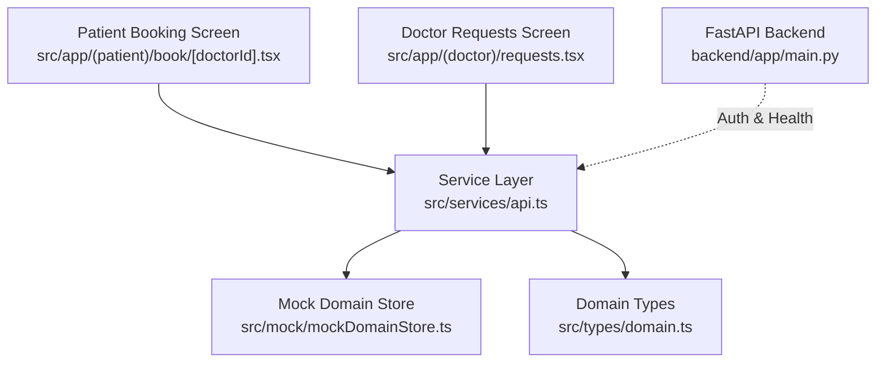

**Diagram sources**
- [book/[doctorId].tsx:85-135](file://src/app/(patient)/book/[doctorId].tsx#L85-L135)
- [requests.tsx:32-94](file://src/app/(doctor)/requests.tsx#L32-L94)
- [api.ts:334-345](file://src/services/api.ts#L334-L345)
- [api.ts:508-529](file://src/services/api.ts#L508-L529)
- [mockDomainStore.ts:245-281](file://src/mock/mockDomainStore.ts#L245-L281)
- [domain.ts:97-129](file://src/types/domain.ts#L97-L129)
- [main.py:31-46](file://backend/app/main.py#L31-L46)

**Section sources**
- [README.md:117-146](file://README.md#L117-L146)
- [main.py:31-46](file://backend/app/main.py#L31-L46)

## Core Components
- **Patient Booking Flow**: Collects doctor, slot, symptoms, address, fees, and payment method, then creates a pending visit request.
- **Doctor Requests Cockpit**: Displays pending requests and supports Accept, Decline (with reason), and Propose Alternative Time.
- **Service Layer**: Provides typed interfaces for patient and doctor operations, with simulated latency and mock persistence.
- **Mock Domain Store**: Implements double-booking prevention, visit status transitions, notifications, and audit logging.
- **Domain Types**: Defines visit states, roles, profiles, slots, and related entities.

Key responsibilities:
- Create and manage `VisitRequest` objects.
- Enforce doctor verification before acceptance.
- Generate cross-role notifications for status changes.
- Provide filtering and sorting for upcoming/past visits.

**Section sources**
- [book/[doctorId].tsx:85-135](file://src/app/(patient)/book/[doctorId].tsx#L85-L135)
- [requests.tsx:22-94](file://src/app/(doctor)/requests.tsx#L22-L94)
- [api.ts:247-430](file://src/services/api.ts#L247-L430)
- [api.ts:432-585](file://src/services/api.ts#L432-L585)
- [mockDomainStore.ts:222-380](file://src/mock/mockDomainStore.ts#L222-L380)
- [domain.ts:9-19](file://src/types/domain.ts#L9-L19)
- [domain.ts:97-129](file://src/types/domain.ts#L97-L129)

## Architecture Overview
The visit request architecture follows a layered approach: UI screens call service methods, which mutate the mock domain store. Notifications and audit logs are generated during state transitions. The backend currently provides auth and health endpoints; visit request APIs are planned.

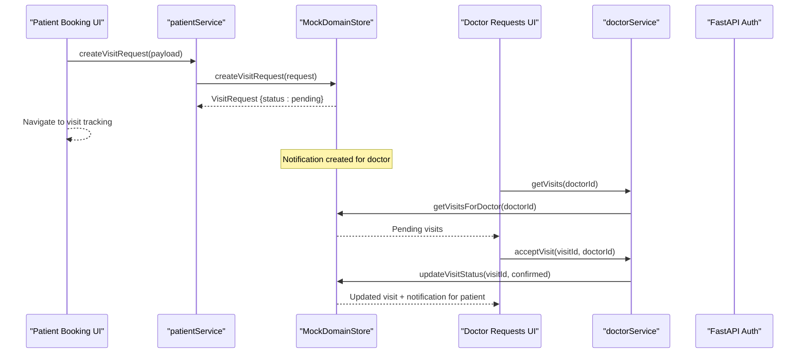

**Diagram sources**
- [book/[doctorId].tsx:102-129](file://src/app/(patient)/book/[doctorId].tsx#L102-L129)
- [api.ts:334-345](file://src/services/api.ts#L334-L345)
- [mockDomainStore.ts:245-281](file://src/mock/mockDomainStore.ts#L245-L281)
- [requests.tsx:32-50](file://src/app/(doctor)/requests.tsx#L32-L50)
- [api.ts:508-515](file://src/services/api.ts#L508-L515)
- [mockDomainStore.ts:283-380](file://src/mock/mockDomainStore.ts#L283-L380)
- [main.py:46-46](file://backend/app/main.py#L46-L46)

## Detailed Component Analysis

### Patient Booking and Request Creation
The patient booking screen collects required information and submits a visit request. It validates symptoms and address, computes fee totals, selects a payment method, and navigates to the visit tracking screen after successful submission.

- Input validation: condition description and address are mandatory.
- Fee calculation: consultation fee plus travel fee equals total.
- Payment options: mobile money or cash on visit.
- Error handling: displays user-friendly error messages when submission fails.

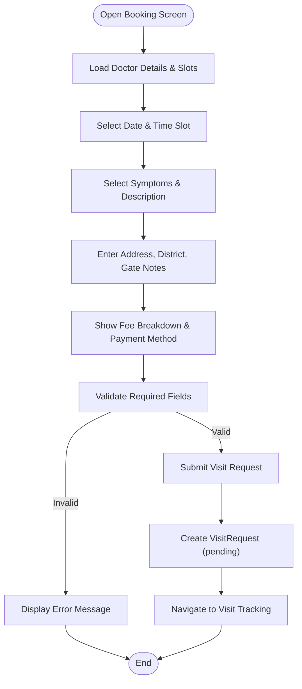

**Diagram sources**
- [book/[doctorId].tsx:85-135](file://src/app/(patient)/book/[doctorId].tsx#L85-L135)
- [api.ts:334-345](file://src/services/api.ts#L334-L345)

**Section sources**
- [book/[doctorId].tsx:85-135](file://src/app/(patient)/book/[doctorId].tsx#L85-L135)
- [book/[doctorId].tsx:297-375](file://src/app/(patient)/book/[doctorId].tsx#L297-L375)
- [api.ts:334-345](file://src/services/api.ts#L334-L345)

### Doctor Request Triage Workflow
Doctors view incoming requests and can accept, decline, or propose an alternative time.

- Acceptance requires verified doctor status.
- Decline includes optional reason capture.
- Alternative proposal sets proposed date/time and note fields.
- After each action, the list refreshes to reflect updated state.

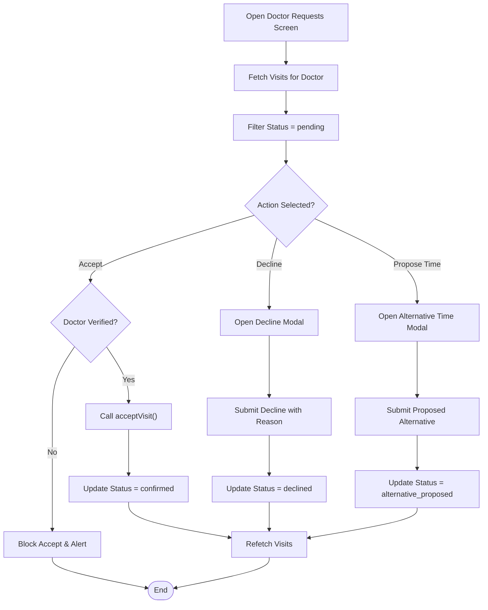

**Diagram sources**
- [requests.tsx:32-94](file://src/app/(doctor)/requests.tsx#L32-L94)
- [api.ts:508-529](file://src/services/api.ts#L508-L529)
- [mockDomainStore.ts:283-380](file://src/mock/mockDomainStore.ts#L283-L380)

**Section sources**
- [requests.tsx:22-94](file://src/app/(doctor)/requests.tsx#L22-L94)
- [requests.tsx:158-188](file://src/app/(doctor)/requests.tsx#L158-L188)
- [requests.tsx:193-265](file://src/app/(doctor)/requests.tsx#L193-L265)
- [api.ts:508-529](file://src/services/api.ts#L508-L529)

### Request Filtering and Sorting
- Doctor dashboard filters pending requests and active visits for quick prioritization.
- Patient visits screen supports Upcoming/Active, Past/Completed, and All tabs.
- Mock store sorts visits by creation timestamp descending.

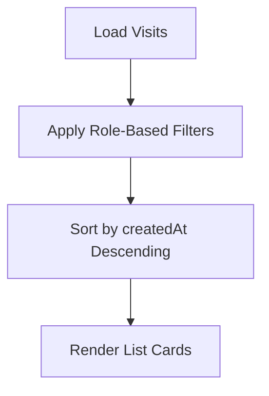

**Diagram sources**
- [index.tsx:51-56](file://src/app/(doctor)/index.tsx#L51-L56)
- [visits.tsx:28-41](file://src/app/(patient)/visits.tsx#L28-L41)
- [mockDomainStore.ts:223-239](file://src/mock/mockDomainStore.ts#L223-L239)

**Section sources**
- [index.tsx:51-56](file://src/app/(doctor)/index.tsx#L51-L56)
- [visits.tsx:28-41](file://src/app/(patient)/visits.tsx#L28-L41)
- [mockDomainStore.ts:223-239](file://src/mock/mockDomainStore.ts#L223-L239)

### Integration with Consultation Scheduling System
- Doctor availability slots are modeled and displayed during booking.
- When a visit request is created, the selected slot is marked booked.
- If a request is cancelled or declined, the slot is freed.
- Accepted requests transition to confirmed and later execution statuses.

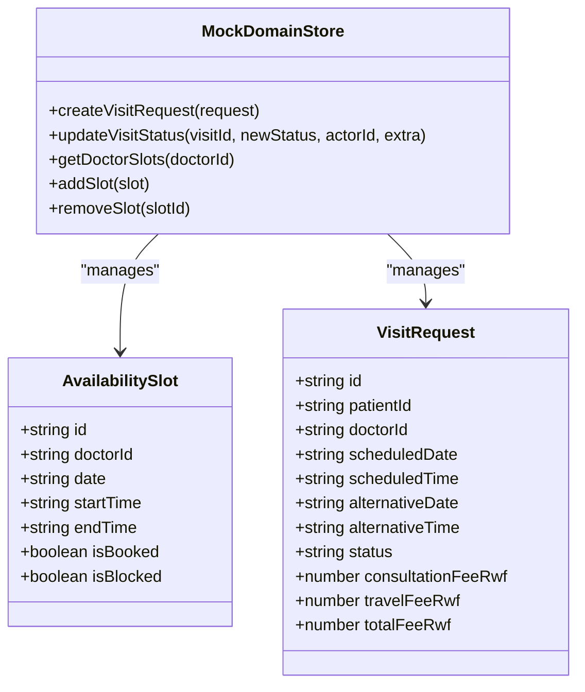

**Diagram sources**
- [domain.ts:87-95](file://src/types/domain.ts#L87-L95)
- [domain.ts:97-129](file://src/types/domain.ts#L97-L129)
- [mockDomainStore.ts:202-220](file://src/mock/mockDomainStore.ts#L202-L220)
- [mockDomainStore.ts:245-281](file://src/mock/mockDomainStore.ts#L245-L281)
- [mockDomainStore.ts:283-380](file://src/mock/mockDomainStore.ts#L283-L380)

**Section sources**
- [mockDomainStore.ts:202-220](file://src/mock/mockDomainStore.ts#L202-L220)
- [mockDomainStore.ts:245-281](file://src/mock/mockDomainStore.ts#L245-L281)
- [mockDomainStore.ts:283-380](file://src/mock/mockDomainStore.ts#L283-L380)

### Active Visits Pipeline
After acceptance, visits move through execution statuses: confirmed, on_the_way, arrived, in_consultation, completed. The doctor dashboard highlights active visits and provides navigation to the visit cockpit.

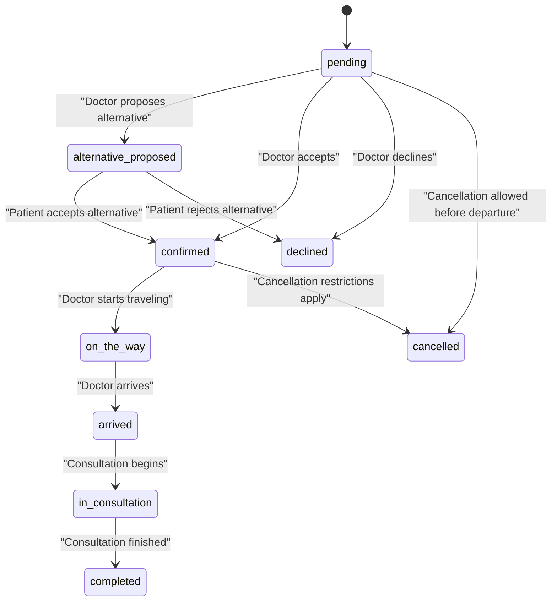

**Diagram sources**
- [domain.ts:9-19](file://src/types/domain.ts#L9-L19)
- [api.ts:531-538](file://src/services/api.ts#L531-L538)
- [mockDomainStore.ts:283-380](file://src/mock/mockDomainStore.ts#L283-L380)

**Section sources**
- [index.tsx:51-56](file://src/app/(doctor)/index.tsx#L51-L56)
- [api.ts:531-538](file://src/services/api.ts#L531-L538)
- [mockDomainStore.ts:283-380](file://src/mock/mockDomainStore.ts#L283-L380)

### Notification System
Notifications are generated for:
- New visit requests (doctor).
- Confirmation, alternative proposal, decline, cancellation (patient).
- Execution milestones: on_the_way, arrived, completed.
- Result publication (patient).

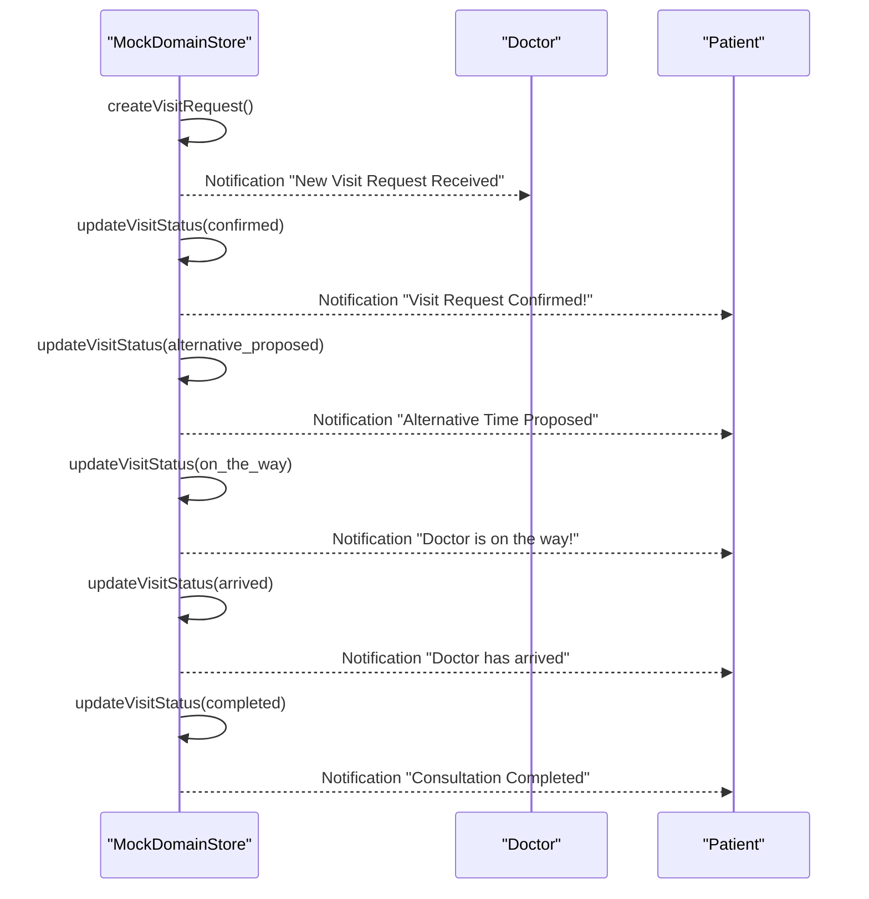

**Diagram sources**
- [mockDomainStore.ts:267-279](file://src/mock/mockDomainStore.ts#L267-L279)
- [mockDomainStore.ts:322-377](file://src/mock/mockDomainStore.ts#L322-L377)

**Section sources**
- [mockDomainStore.ts:267-279](file://src/mock/mockDomainStore.ts#L267-L279)
- [mockDomainStore.ts:322-377](file://src/mock/mockDomainStore.ts#L322-L377)

### Real-Time Updates for Patient Modifications
- Patients can reschedule or cancel within constraints.
- Rescheduling resets status to pending, requiring doctor re-confirmation.
- Cancellation is blocked once the doctor has started traveling or arrived.

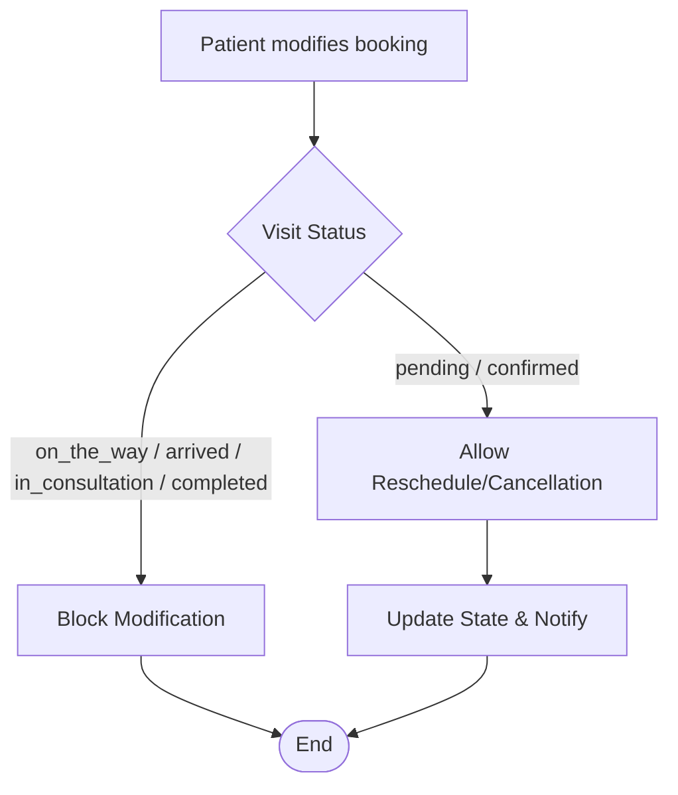

**Diagram sources**
- [api.ts:359-382](file://src/services/api.ts#L359-L382)
- [mockDomainStore.ts:283-380](file://src/mock/mockDomainStore.ts#L283-L380)

**Section sources**
- [api.ts:359-382](file://src/services/api.ts#L359-L382)

### Offline Scenarios and Error Handling
- Service layer attempts real API calls first; if unavailable, it falls back to mock store.
- Errors are surfaced via alerts or error banners.
- Double-booking guard prevents overlapping reservations.
- Doctor verification check blocks unverified/suspended doctors from accepting visits.

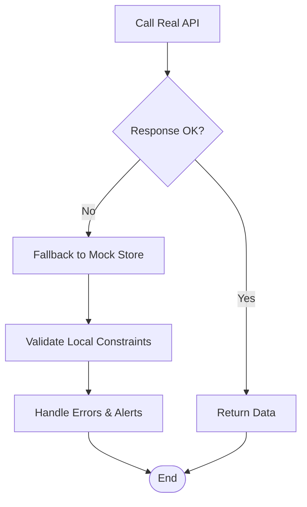

**Diagram sources**
- [api.ts:46-104](file://src/services/api.ts#L46-L104)
- [api.ts:334-345](file://src/services/api.ts#L334-L345)
- [api.ts:508-515](file://src/services/api.ts#L508-L515)
- [mockDomainStore.ts:245-256](file://src/mock/mockDomainStore.ts#L245-L256)

**Section sources**
- [api.ts:46-104](file://src/services/api.ts#L46-L104)
- [api.ts:334-345](file://src/services/api.ts#L334-L345)
- [api.ts:508-515](file://src/services/api.ts#L508-L515)
- [mockDomainStore.ts:245-256](file://src/mock/mockDomainStore.ts#L245-L256)

### Audit Trail and Compliance
- Audit logs record actions such as profile updates, consultation record drafts/publishing, and result publications.
- Logs include actor identity, role, action type, entity type, entity ID, patient ID, and details.
- Admin console can access audit logs for compliance review.

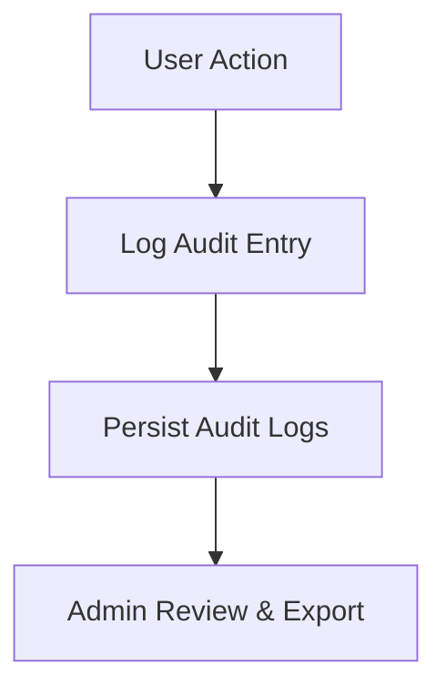

**Diagram sources**
- [mockDomainStore.ts:522-552](file://src/mock/mockDomainStore.ts#L522-L552)
- [domain.ts:230-241](file://src/types/domain.ts#L230-L241)

**Section sources**
- [mockDomainStore.ts:522-552](file://src/mock/mockDomainStore.ts#L522-L552)
- [domain.ts:230-241](file://src/types/domain.ts#L230-L241)

## Dependency Analysis
The following diagram shows key dependencies among components involved in visit request management.

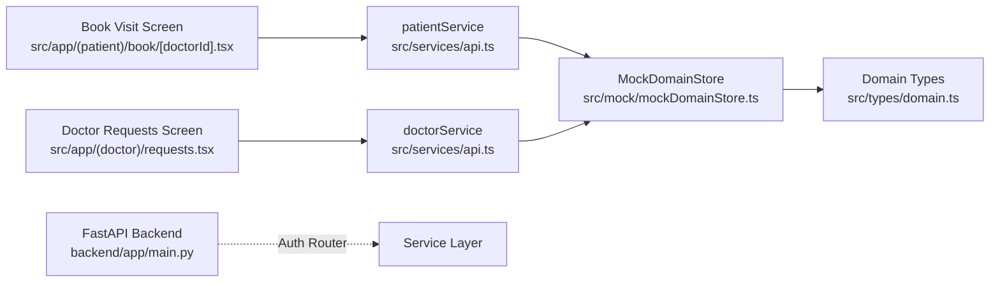

**Diagram sources**
- [book/[doctorId].tsx:85-135](file://src/app/(patient)/book/[doctorId].tsx#L85-L135)
- [requests.tsx:32-94](file://src/app/(doctor)/requests.tsx#L32-L94)
- [api.ts:247-430](file://src/services/api.ts#L247-L430)
- [api.ts:432-585](file://src/services/api.ts#L432-L585)
- [mockDomainStore.ts:245-380](file://src/mock/mockDomainStore.ts#L245-L380)
- [domain.ts:97-129](file://src/types/domain.ts#L97-L129)
- [main.py:46-46](file://backend/app/main.py#L46-L46)

**Section sources**
- [api.ts:247-430](file://src/services/api.ts#L247-L430)
- [api.ts:432-585](file://src/services/api.ts#L432-L585)
- [mockDomainStore.ts:245-380](file://src/mock/mockDomainStore.ts#L245-L380)

## Performance Considerations
- Simulated latency improves perceived realism but may mask performance issues; consider caching strategies for doctor details and visits.
- Sorting by timestamp is efficient for small datasets; for large lists, implement server-side pagination and indexing.
- Avoid redundant refetches by leveraging query keys and conditional fetching based on user presence.
- Batch notifications and audit log writes where possible to reduce overhead.

[No sources needed since this section provides general guidance]

## Troubleshooting Guide
Common issues and resolutions:
- Unverified doctor cannot accept visits: ensure admin approval before accepting.
- Double-booking errors: verify no overlapping slots exist for the same doctor/date/time.
- Cancellation/reschedule failures: confirm visit status allows modification.
- Offline mode: service layer falls back to mock store; verify local constraints and retry after connectivity returns.
- Notification not received: check recipientUserId mapping and notification generation logic.

**Section sources**
- [api.ts:508-515](file://src/services/api.ts#L508-L515)
- [mockDomainStore.ts:245-256](file://src/mock/mockDomainStore.ts#L245-L256)
- [api.ts:359-382](file://src/services/api.ts#L359-L382)
- [mockDomainStore.ts:267-279](file://src/mock/mockDomainStore.ts#L267-L279)

## Conclusion
The visit request management system integrates patient booking, doctor triage, scheduling, and execution workflows through a clear service-layer abstraction and a robust mock domain store. It enforces critical business rules such as doctor verification, double-booking prevention, and controlled cancellations. Notifications and audit trails support transparency and compliance. Future backend integration will replace mock persistence while preserving these contracts and behaviors.

[No sources needed since this section summarizes without analyzing specific files]