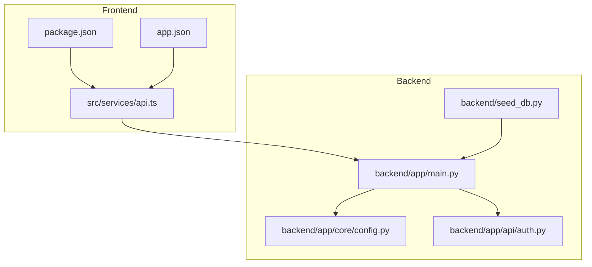
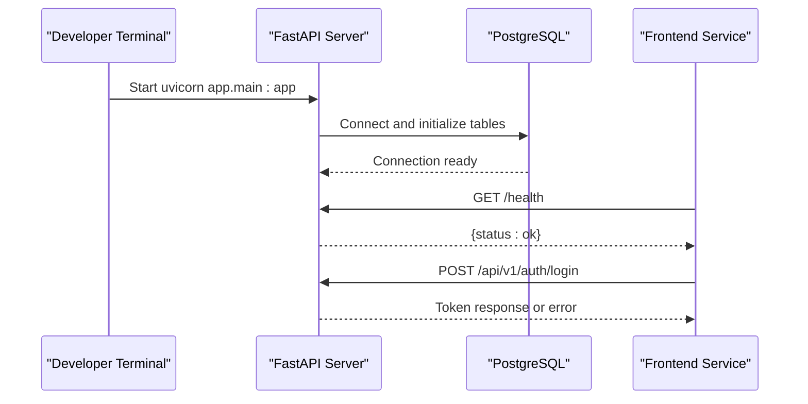
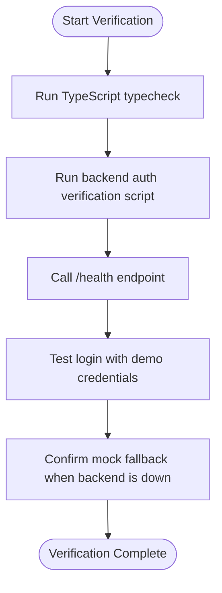
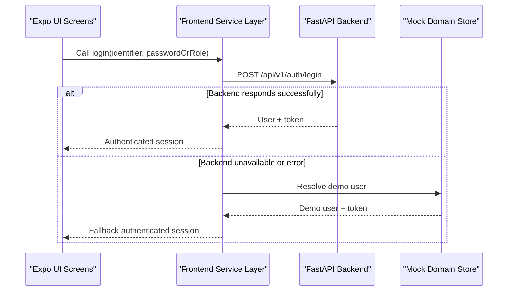

# Getting Started

<cite>
**Referenced Files in This Document**   
- [README.md](file://README.md)
- [package.json](file://package.json)
- [app.json](file://app.json)
- [src/services/api.ts](file://src/services/api.ts)
- [backend/app/main.py](file://backend/app/main.py)
- [backend/app/core/config.py](file://backend/app/core/config.py)
- [backend/app/api/auth.py](file://backend/app/api/auth.py)
- [backend/seed_db.py](file://backend/seed_db.py)
- [backend/verify_auth.py](file://backend/verify_auth.py)
</cite>

## Table of Contents
1. [Introduction](#introduction)
2. [Project Structure](#project-structure)
3. [Prerequisites](#prerequisites)
4. [Installation](#installation)
5. [Starting the Application](#starting-the-application)
6. [Backend Setup](#backend-setup)
7. [Testing Credentials Matrix](#testing-credentials-matrix)
8. [Verification Steps](#verification-steps)
9. [Troubleshooting Guide](#troubleshooting-guide)
10. [Architecture Overview](#architecture-overview)
11. [Conclusion](#conclusion)

## Introduction
HomeCare is a mobile-first home-visit medical consultation application with three main roles: patient, doctor, and admin. The frontend runs on Expo (React Native + TypeScript), while the backend is implemented with FastAPI and PostgreSQL. The repository includes demo data, mock services for offline development, and optional live backend integration for authentication and user registration.

This guide explains how to install dependencies, start the app on web or mobile devices, set up the Python backend, verify installation, and test all roles using provided demo accounts.

## Project Structure
At a high level:
- Frontend: Expo-based React Native app under `src`, configuration in `app.json` and `package.json`.
- Backend: FastAPI application under `backend/app`, with database models, API routes, security utilities, and seed scripts.
- Services: Frontend service layer that can call the live backend or fall back to mock data.

**Diagram sources**
- [package.json:1-36](file://package.json#L1-L36)
- [app.json:1-34](file://app.json#L1-L34)
- [src/services/api.ts:1-660](file://src/services/api.ts#L1-L660)
- [backend/app/main.py:1-61](file://backend/app/main.py#L1-L61)
- [backend/app/core/config.py:1-33](file://backend/app/core/config.py#L1-L33)
- [backend/app/api/auth.py:1-182](file://backend/app/api/auth.py#L1-L182)
- [backend/seed_db.py:1-105](file://backend/seed_db.py#L1-L105)

**Section sources**
- [README.md:1-10](file://README.md#L1-L10)
- [package.json:1-36](file://package.json#L1-L36)
- [app.json:1-34](file://app.json#L1-L34)

## Prerequisites
Ensure your machine meets these requirements before installing:

- Node.js v18 or later (Node 20+ recommended)
- npm or bun
- Python 3.10 or later
- Expo Go app installed on iOS or Android for physical device testing
- macOS required for iOS Simulator; Windows/Linux supported for Android Emulator and Web

Optional but helpful:
- A running PostgreSQL instance compatible with async SQLAlchemy
- An IDE with TypeScript and Python support

**Section sources**
- [README.md:11-18](file://README.md#L11-L18)

## Installation
Follow these steps to prepare the project:

1. Open a terminal at the project root directory.
2. Install frontend dependencies:
   - Using npm: run `npm install`
   - Or using bun: run `bun install`
3. Verify that Expo CLI is available:
   - Run `npx expo --version` to confirm it is installed.

The project defines convenient scripts for starting the app in different environments. These are declared in the package manifest.

**Section sources**
- [README.md:21-28](file://README.md#L21-L28)
- [package.json:28-33](file://package.json#L28-L33)

## Starting the Application
You can run the HomeCare frontend in multiple environments:

- Start the interactive Expo Metro server:
  - `npm start`
  - Or `npx expo start`
- Run directly in the web browser:
  - `npm run web`
  - Or `npx expo start --web`
- Run on an Android emulator or connected USB device:
  - `npm run android`
  - Or `npx expo start --android`
- Run on iOS Simulator (macOS only):
  - `npm run ios`
  - Or `npx expo start --ios`

### Testing on a Physical Mobile Device
1. Install **Expo Go** from Google Play Store or Apple App Store.
2. Run `npm start`.
3. Scan the QR code shown in the terminal with your phone camera (iOS) or the Expo Go app (Android).
4. Ensure your phone and computer are on the same Wi-Fi network. If needed, press `s` in the terminal to switch to Expo tunnel mode.

### Environment Configuration
The Expo app metadata is defined in `app.json`. It sets the app name, slug, scheme, orientation, splash screen, platform-specific settings, and plugins such as `expo-router` and `expo-status-bar`.

**Section sources**
- [README.md:32-59](file://README.md#L32-L59)
- [app.json:1-34](file://app.json#L1-L34)

## Backend Setup
The backend is a FastAPI application with CORS enabled, health endpoints, and an authentication router. It uses asynchronous SQLAlchemy and reads configuration from environment variables or a `.env` file.

### Step-by-Step Backend Startup
1. Navigate to the backend directory:
   - `cd backend`
2. Create and activate a Python virtual environment:
   - On Windows PowerShell:
     - `.\venv\Scripts\Activate.ps1`
   - On macOS/Linux:
     - `python3 -m venv venv`
     - `source venv/bin/activate`
3. Install backend dependencies if you have a requirements file or Poetry/Pipenv setup. The README demonstrates running the server directly with `uvicorn`.
4. Start the FastAPI server:
   - `uvicorn app.main:app --reload --port 8000`

### Backend Endpoints
Once running, you can access:
- Interactive Swagger documentation: `http://localhost:8000/docs`
- ReDoc documentation: `http://localhost:8000/redoc`
- Health check: `http://localhost:8000/health`

### Database and Configuration
- The default database URL points to a local PostgreSQL instance unless overridden by environment variables.
- The application initializes tables during startup through the lifespan hook.
- Authentication routes include login, OTP verification, password reset, and profile retrieval.

**Diagram sources**
- [backend/app/main.py:11-46](file://backend/app/main.py#L11-L46)
- [backend/app/api/auth.py:121-180](file://backend/app/api/auth.py#L121-L180)

**Section sources**
- [README.md:62-73](file://README.md#L62-L73)
- [backend/app/main.py:1-61](file://backend/app/main.py#L1-L61)
- [backend/app/core/config.py:1-33](file://backend/app/core/config.py#L1-L33)
- [backend/app/api/auth.py:1-182](file://backend/app/api/auth.py#L1-L182)

## Testing Credentials Matrix
Use these demo accounts to evaluate the full flow across roles. The frontend supports quick-fill helpers and role-based navigation.

| Role | Name | Email (Identifier) | Phone | Test Password | Target Screen | Key Scenarios |
|---|---|---|---|---|---|---|
| Admin | Platform Compliance Admin | `admin@homecare.rw` | `+250 788 000 111` / `+250788999000` | `AdminHomeCare2026!` or `Password123!` | `/(admin)` | Doctor verification, complaints triage, audit logs, analytics |
| Doctor 1 | Dr. Eric Kayitare | `dr.eric@homecare.rw` | `+250 788 331 445` | `Doctor123!` or `Password123!` | `/(doctor)` | Active visit, status transitions, clinical notes, prescriptions, lab orders |
| Doctor 2 | Dr. Aline Mukeshimana | `dr.aline@homecare.rw` | `+250 788 902 334` | `Doctor123!` or `Password123!` | `/(doctor)` | Pending request, accept/decline, propose alternative slot |
| Patient 1 | Diane Uwase | `diane.uwase@example.rw` | `+250 788 412 901` | `Password123!` | `/(patient)` | Specialist search, booking, rating, complaint filing, records |
| Patient 2 | Jean-Paul Mugisha | `jp.mugisha@example.rw` | `+250 783 552 119` | `Password123!` | `/(patient)` | Alternative time proposal review and cancellation |

Additional notes:
- Simulated 2FA / SMS OTP code: `123456`
- Quick-fill options exist on the login screen and welcome screen for fast role switching.

**Section sources**
- [README.md:89-107](file://README.md#L89-L107)
- [backend/verify_auth.py:18-43](file://backend/verify_auth.py#L18-L43)

## Verification Steps
Run these checks to confirm your installation is working correctly:

1. Frontend typecheck:
   - `npx tsc --noEmit`
2. Backend auth verification script:
   - Set the Python path and run the verification script:
     - `$env:PYTHONPATH="backend"; .\backend\venv\Scripts\python.exe backend/verify_auth.py`
3. Health endpoint:
   - Visit `http://localhost:8000/health` and expect a successful status response.
4. Login flow:
   - Use one of the demo credentials above to log in via the frontend or the backend `/api/v1/auth/login` endpoint.
5. Mock fallback behavior:
   - If the backend is unavailable, the frontend service falls back to mock data so you can still explore screens and flows.

**Diagram sources**
- [README.md:76-84](file://README.md#L76-L84)
- [src/services/api.ts:43-104](file://src/services/api.ts#L43-L104)

**Section sources**
- [README.md:76-84](file://README.md#L76-L84)
- [backend/verify_auth.py:45-83](file://backend/verify_auth.py#L45-L83)
- [src/services/api.ts:43-104](file://src/services/api.ts#L43-L104)

## Troubleshooting Guide
Common setup issues and resolutions:

- Expo CLI not found:
  - Use `npx expo start` instead of relying on a global installation.
- Cannot connect to backend:
  - Ensure the FastAPI server is running on port `8000`.
  - Check that CORS allows requests from your frontend origin.
  - Confirm the database URL in configuration matches your running PostgreSQL instance.
- Physical device cannot scan QR code:
  - Make sure your phone and computer are on the same Wi-Fi network.
  - Press `s` in the terminal to switch to Expo tunnel mode.
- iOS build errors:
  - iOS Simulator requires macOS and compatible Xcode toolchains.
  - Expo SDK 58 targets iOS 15.1+ and Android 8.0+ (API 26).
- Backend database connection fails:
  - Verify PostgreSQL is running and accessible at the configured address.
  - Review the startup logs printed by the FastAPI lifespan hook for connection details.
- Authentication failures:
  - Use the exact demo credentials listed in the matrix.
  - For OTP verification, use `123456`.
  - The backend accepts both hashed passwords and specific test passwords for development.

**Section sources**
- [README.md:54-59](file://README.md#L54-L59)
- [README.md:238-245](file://README.md#L238-L245)
- [backend/app/main.py:11-28](file://backend/app/main.py#L11-L28)
- [backend/app/api/auth.py:138-164](file://backend/app/api/auth.py#L138-L164)

## Architecture Overview
The frontend service layer attempts to call the live backend first and gracefully falls back to mock data when the backend is unavailable. This design lets beginners explore the UI without requiring a fully configured backend, while experienced developers can integrate real authentication and data persistence.

**Diagram sources**
- [src/services/api.ts:46-104](file://src/services/api.ts#L46-L104)
- [backend/app/api/auth.py:121-153](file://backend/app/api/auth.py#L121-L153)

**Section sources**
- [src/services/api.ts:1-660](file://src/services/api.ts#L1-L660)
- [backend/app/api/auth.py:1-182](file://backend/app/api/auth.py#L1-L182)

## Conclusion
You now have everything needed to install, start, and test HomeCare across web and mobile platforms. Use the provided demo accounts to validate the patient, doctor, and admin flows. When ready, configure the backend database and rely on the frontend’s automatic fallback to mock data for rapid iteration. If you encounter issues, consult the troubleshooting section and verify each step against the commands and endpoints documented here.