# File-Based Routing System

<cite>
**Referenced Files in This Document**
- [index.ts](file://index.ts)
- [App.tsx](file://App.tsx)
- [src/app/_layout.tsx](file://src/app/_layout.tsx)
- [src/app/index.tsx](file://src/app/index.tsx)
- [src/app/(auth)/_layout.tsx](file://src/app/(auth)/_layout.tsx)
- [src/app/(auth)/login.tsx](file://src/app/(auth)/login.tsx)
- [src/app/(patient)/_layout.tsx](file://src/app/(patient)/_layout.tsx)
- [src/app/(patient)/index.tsx](file://src/app/(patient)/index.tsx)
- [src/app/(doctor)/_layout.tsx](file://src/app/(doctor)/_layout.tsx)
- [src/app/(doctor)/index.tsx](file://src/app/(doctor)/index.tsx)
- [src/app/(admin)/_layout.tsx](file://src/app/(admin)/_layout.tsx)
- [src/app/(admin)/index.tsx](file://src/app/(admin)/index.tsx)
- [src/hooks/useProtectedRoute.ts](file://src/hooks/useProtectedRoute.ts)
- [src/stores/authStore.ts](file://src/stores/authStore.ts)
</cite>

## Table of Contents
1. [Introduction](#introduction)
2. [Project Structure](#project-structure)
3. [Core Components](#core-components)
4. [Architecture Overview](#architecture-overview)
5. [Detailed Component Analysis](#detailed-component-analysis)
6. [Dependency Analysis](#dependency-analysis)
7. [Performance Considerations](#performance-considerations)
8. [Troubleshooting Guide](#troubleshooting-guide)
9. [Conclusion](#conclusion)

## Introduction
This document explains the file-based routing system implemented with Expo Router in this mobile application. It focuses on:
- Route organization using role-specific route groups: (auth), (patient), (doctor), and (admin).
- Nested routing patterns, including dynamic parameters such as [id], [doctorId], and [visitId].
- Layouts per role, navigation stacks, tab navigation, and screen transitions.
- Deep linking considerations, query string handling, and navigation state management.
- Route parameter handling, navigation history strategies, and practical examples for adding routes and implementing guards.
- Performance considerations for large applications and navigation optimization strategies.

The goal is to help developers understand how routing works end-to-end and how to extend it safely and efficiently.

## Project Structure
The routing structure follows Expo Router conventions under src/app. Role-based route groups isolate authentication flows from authenticated dashboards. Each group has its own layout that defines shared UI, navigation containers, and access control.

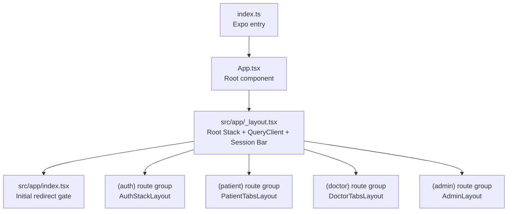

**Diagram sources**
- [index.ts:1-9](file://index.ts#L1-L9)
- [App.tsx:1-21](file://App.tsx#L1-L21)
- [src/app/_layout.tsx:1-85](file://src/app/_layout.tsx#L1-L85)
- [src/app/index.tsx:1-42](file://src/app/index.tsx#L1-L42)
- [src/app/(auth)/_layout.tsx:1-26](file://src/app/(auth)/_layout.tsx#L1-L26)
- [src/app/(patient)/_layout.tsx:1-118](file://src/app/(patient)/_layout.tsx#L1-L118)
- [src/app/(doctor)/_layout.tsx:1-131](file://src/app/(doctor)/_layout.tsx#L1-L131)
- [src/app/(admin)/_layout.tsx:1-40](file://src/app/(admin)/_layout.tsx#L1-L40)

Key observations:
- The app entry registers the root component.
- The root layout mounts a global Stack navigator and declares top-level screens for each route group.
- The root index screen performs an initial redirect based on the current user’s role.
- Authenticated roles use either Tabs or Stack layouts depending on the role.

**Section sources**
- [index.ts:1-9](file://index.ts#L1-L9)
- [App.tsx:1-21](file://App.tsx#L1-L21)
- [src/app/_layout.tsx:1-85](file://src/app/_layout.tsx#L1-L85)
- [src/app/index.tsx:1-42](file://src/app/index.tsx#L1-L42)

## Core Components
- Root layout: Provides SafeAreaProvider, QueryClientProvider, StatusBar, and a root Stack containing all route groups. It also renders a session bar showing the current user and sign-out actions.
- Initial redirect: Routes unauthenticated users to the auth welcome screen and authenticated users to their role dashboard.
- Role layouts:
  - (auth): Stack layout for onboarding and authentication screens.
  - (patient): Tab layout with hidden subroutes for detail views.
  - (doctor): Tab layout with hidden subroutes for visit details and consultations.
  - (admin): Stack layout for the admin console.
- Route protection: A hook enforces role-based access by redirecting unauthorized users to appropriate destinations.

Examples of navigation usage:
- Login flow navigates to role-specific dashboards after successful authentication.
- Patient home uses router.push with both pathname and params for deep links and query-like behavior.

**Section sources**
- [src/app/_layout.tsx:1-85](file://src/app/_layout.tsx#L1-L85)
- [src/app/index.tsx:1-42](file://src/app/index.tsx#L1-L42)
- [src/app/(auth)/_layout.tsx:1-26](file://src/app/(auth)/_layout.tsx#L1-L26)
- [src/app/(patient)/_layout.tsx:1-118](file://src/app/(patient)/_layout.tsx#L1-L118)
- [src/app/(doctor)/_layout.tsx:1-131](file://src/app/(doctor)/_layout.tsx#L1-L131)
- [src/app/(admin)/_layout.tsx:1-40](file://src/app/(admin)/_layout.tsx#L1-L40)
- [src/hooks/useProtectedRoute.ts:1-40](file://src/hooks/useProtectedRoute.ts#L1-L40)
- [src/app/(auth)/login.tsx:1-174](file://src/app/(auth)/login.tsx#L1-L174)
- [src/app/(patient)/index.tsx:1-340](file://src/app/(patient)/index.tsx#L1-L340)

## Architecture Overview
The routing architecture centers around Expo Router’s file-based conventions:
- Route groups define isolated navigation contexts per role.
- Layout files provide shared UI and navigation containers.
- Screens implement business logic and navigate using the router API.

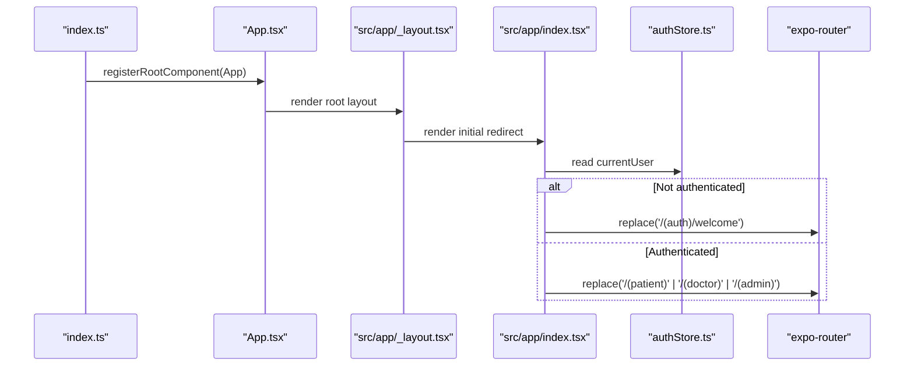

**Diagram sources**
- [index.ts:1-9](file://index.ts#L1-L9)
- [App.tsx:1-21](file://App.tsx#L1-L21)
- [src/app/_layout.tsx:1-85](file://src/app/_layout.tsx#L1-L85)
- [src/app/index.tsx:1-42](file://src/app/index.tsx#L1-L42)
- [src/stores/authStore.ts:1-112](file://src/stores/authStore.ts#L1-L112)

## Detailed Component Analysis

### Root Layout and Global Navigation
Responsibilities:
- Wraps the app in SafeAreaProvider and QueryClientProvider.
- Renders a session bar with user info and sign-out action.
- Declares a root Stack with screens for index and each route group.

Navigation behaviors:
- Sign out triggers logout and replaces the route to the auth welcome screen.
- The root stack exposes route groups as top-level screens.

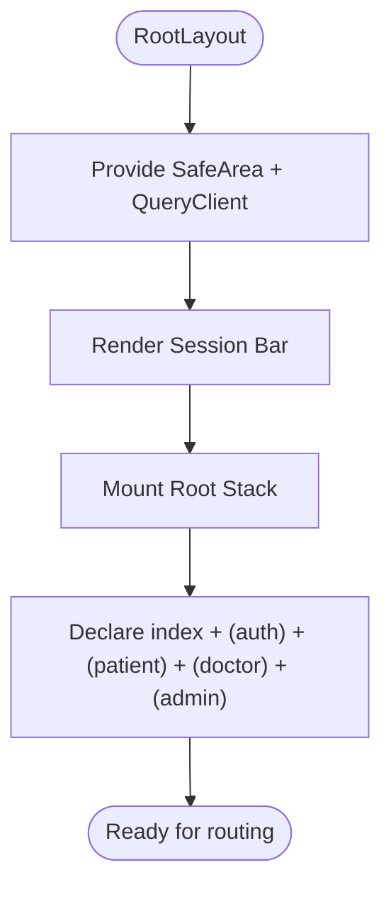

**Diagram sources**
- [src/app/_layout.tsx:1-85](file://src/app/_layout.tsx#L1-L85)

**Section sources**
- [src/app/_layout.tsx:1-85](file://src/app/_layout.tsx#L1-L85)

### Initial Redirect Gate
Responsibilities:
- Reads the current user from the store.
- Redirects unauthenticated users to the auth welcome screen.
- Redirects authenticated users to their role dashboard.

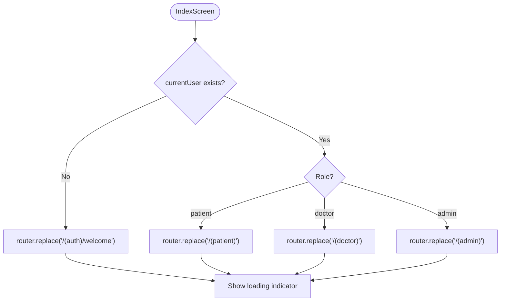

**Diagram sources**
- [src/app/index.tsx:1-42](file://src/app/index.tsx#L1-L42)

**Section sources**
- [src/app/index.tsx:1-42](file://src/app/index.tsx#L1-L42)

### Auth Route Group
Structure:
- Stack layout defines header styling and screens: welcome, login, register-patient, register-doctor, otp-verification, forgot-password.
- Login screen handles credentials, calls the store, and navigates to the correct dashboard based on role.

Navigation patterns:
- Uses router.push for internal navigation within the auth group.
- After login, uses router.replace to avoid stacking multiple auth screens.

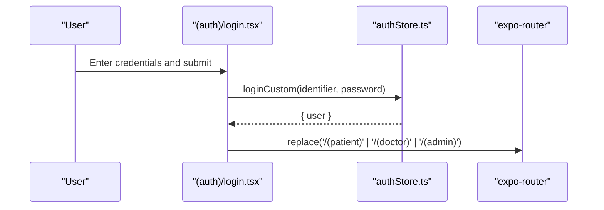

**Diagram sources**
- [src/app/(auth)/_layout.tsx:1-26](file://src/app/(auth)/_layout.tsx#L1-L26)
- [src/app/(auth)/login.tsx:1-174](file://src/app/(auth)/login.tsx#L1-L174)
- [src/stores/authStore.ts:1-112](file://src/stores/authStore.ts#L1-L112)

**Section sources**
- [src/app/(auth)/_layout.tsx:1-26](file://src/app/(auth)/_layout.tsx#L1-L26)
- [src/app/(auth)/login.tsx:1-174](file://src/app/(auth)/login.tsx#L1-L174)

### Patient Route Group
Structure:
- Tab layout defines primary tabs: Home, Find Doctor, Visits, Records, Profile.
- Hidden subroutes include doctor/[id], book/[doctorId], visit/[id], result/[id], notifications.
- Protected via useProtectedRoute('patient').

Navigation patterns:
- Uses router.push with pathname and params for query-like behavior (e.g., initialSpecialty).
- Navigates to dynamic routes like visit/[id] and book/[doctorId].

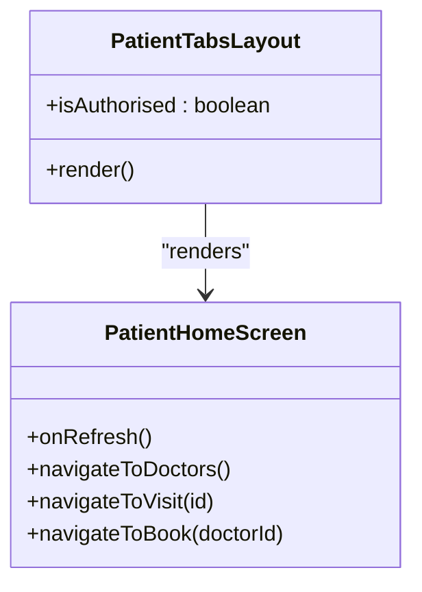

**Diagram sources**
- [src/app/(patient)/_layout.tsx:1-118](file://src/app/(patient)/_layout.tsx#L1-L118)
- [src/app/(patient)/index.tsx:1-340](file://src/app/(patient)/index.tsx#L1-L340)

**Section sources**
- [src/app/(patient)/_layout.tsx:1-118](file://src/app/(patient)/_layout.tsx#L1-L118)
- [src/app/(patient)/index.tsx:1-340](file://src/app/(patient)/index.tsx#L1-L340)

### Doctor Route Group
Structure:
- Tab layout defines primary tabs: Dashboard, Requests, Schedule, Patients, Profile.
- Hidden subroutes include visit/[id] and consultation/[visitId].
- Protected via useProtectedRoute('doctor').

Navigation patterns:
- Navigates to visit/[id] from dashboard cards.
- Uses router.push for requests and other sections.

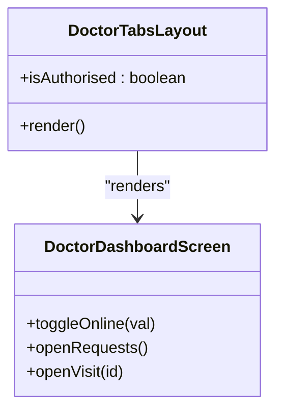

**Diagram sources**
- [src/app/(doctor)/_layout.tsx:1-131](file://src/app/(doctor)/_layout.tsx#L1-L131)
- [src/app/(doctor)/index.tsx:1-329](file://src/app/(doctor)/index.tsx#L1-L329)

**Section sources**
- [src/app/(doctor)/_layout.tsx:1-131](file://src/app/(doctor)/_layout.tsx#L1-L131)
- [src/app/(doctor)/index.tsx:1-329](file://src/app/(doctor)/index.tsx#L1-L329)

### Admin Route Group
Structure:
- Stack layout for the admin console.
- Protected via useProtectedRoute('admin').
- Admin console includes metrics, doctors management, complaints, and audit logs.

Navigation patterns:
- Uses router.replace to return to auth welcome on logout.

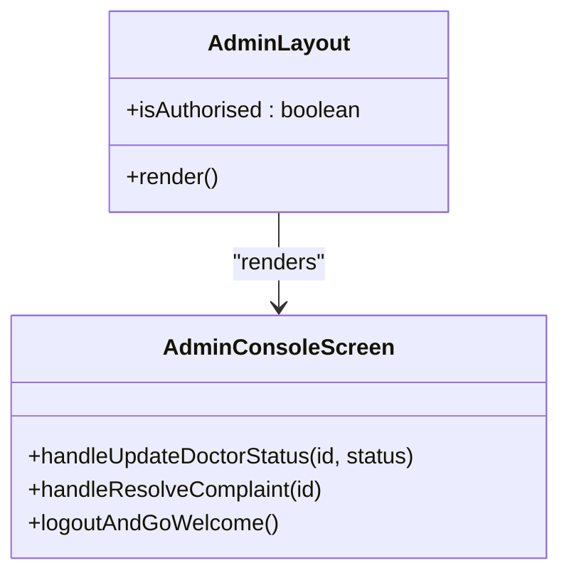

**Diagram sources**
- [src/app/(admin)/_layout.tsx:1-40](file://src/app/(admin)/_layout.tsx#L1-L40)
- [src/app/(admin)/index.tsx:1-800](file://src/app/(admin)/index.tsx#L1-L800)

**Section sources**
- [src/app/(admin)/_layout.tsx:1-40](file://src/app/(admin)/_layout.tsx#L1-L40)
- [src/app/(admin)/index.tsx:1-800](file://src/app/(admin)/index.tsx#L1-L800)

### Route Guards and Protected Routes
The protected route hook enforces role-based access:
- If no user is present, redirects to the auth welcome screen.
- If the user’s role does not match the allowed role, redirects to the corresponding dashboard.
- Returns a boolean indicating authorization to prevent rendering sensitive UI before redirection.

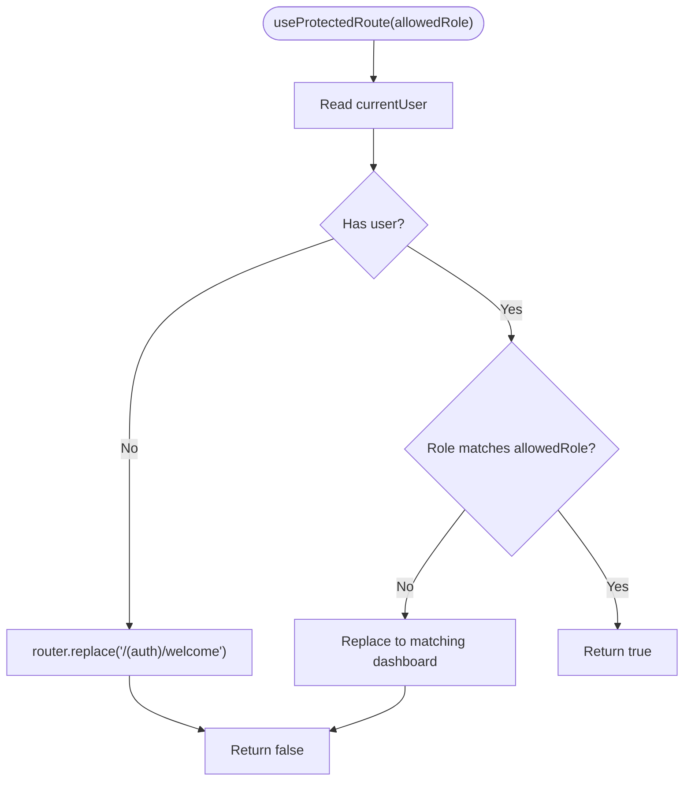

**Diagram sources**
- [src/hooks/useProtectedRoute.ts:1-40](file://src/hooks/useProtectedRoute.ts#L1-L40)

**Section sources**
- [src/hooks/useProtectedRoute.ts:1-40](file://src/hooks/useProtectedRoute.ts#L1-L40)

### Dynamic Route Parameters and Nested Routing
Dynamic segments are used extensively:
- Patient: doctor/[id], book/[doctorId], visit/[id], result/[id].
- Doctor: visit/[id], consultation/[visitId].

These are declared as nested routes inside their respective group layouts and hidden from the tab bar where necessary.

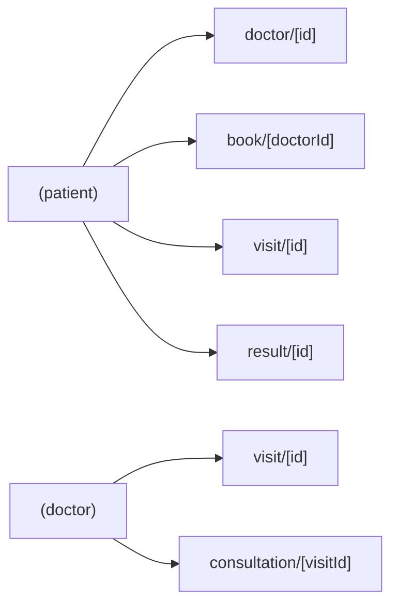

**Diagram sources**
- [src/app/(patient)/_layout.tsx:100-106](file://src/app/(patient)/_layout.tsx#L100-L106)
- [src/app/(doctor)/_layout.tsx:116-119](file://src/app/(doctor)/_layout.tsx#L116-L119)

**Section sources**
- [src/app/(patient)/_layout.tsx:100-106](file://src/app/(patient)/_layout.tsx#L100-L106)
- [src/app/(doctor)/_layout.tsx:116-119](file://src/app/(doctor)/_layout.tsx#L116-L119)

### Query String Processing and Navigation State
Query-like data is passed using the params object in router.push:
- Example: navigating to doctors with initialSpecialty param.

Navigation history management:
- Use router.replace when you want to avoid stacking screens (e.g., after login or logout).
- Use router.push when you want to maintain back navigation.

Best practices:
- Prefer replace for final destinations (dashboards, auth welcome).
- Keep params minimal and structured; avoid passing large objects.

**Section sources**
- [src/app/(patient)/index.tsx:130-140](file://src/app/(patient)/index.tsx#L130-L140)
- [src/app/(auth)/login.tsx:33-46](file://src/app/(auth)/login.tsx#L33-L46)
- [src/app/_layout.tsx:43-51](file://src/app/_layout.tsx#L43-L51)

### Deep Linking
Deep linking is supported through Expo Router’s file-based routes:
- External links can target any route path, including dynamic segments.
- Ensure that route paths are stable and descriptive.
- For query-like data, pass params in the link payload.

Considerations:
- Validate incoming params on the destination screen.
- Handle missing or invalid IDs gracefully.

[No sources needed since this section provides general guidance]

### Practical Examples

#### Creating a New Route
Steps:
1. Create a new file under the appropriate route group (e.g., src/app/(patient)/new-feature.tsx).
2. Add the route to the parent layout if it should be part of the navigation container.
3. Navigate to the route using router.push or router.replace.

Example references:
- Adding a new patient tab or screen: see [src/app/(patient)/_layout.tsx](file://src/app/(patient)/_layout.tsx#L1-L118).
- Navigating to a new feature: see [src/app/(patient)/index.tsx](file://src/app/(patient)/index.tsx#L1-L340).

**Section sources**
- [src/app/(patient)/_layout.tsx:1-118](file://src/app/(patient)/_layout.tsx#L1-L118)
- [src/app/(patient)/index.tsx:1-340](file://src/app/(patient)/index.tsx#L1-L340)

#### Implementing Nested Navigation
Patterns:
- Use nested folders for related features (e.g., (patient)/book, (patient)/doctor).
- Hide non-tab routes from the tab bar by declaring them with href: null in the parent layout.

References:
- Hidden subroutes in patient layout: [src/app/(patient)/_layout.tsx:100-106](file://src/app/(patient)/_layout.tsx#L100-L106).
- Hidden subroutes in doctor layout: [src/app/(doctor)/_layout.tsx:116-119](file://src/app/(doctor)/_layout.tsx#L116-L119).

**Section sources**
- [src/app/(patient)/_layout.tsx:100-106](file://src/app/(patient)/_layout.tsx#L100-L106)
- [src/app/(doctor)/_layout.tsx:116-119](file://src/app/(doctor)/_layout.tsx#L116-L119)

#### Handling Route Guards
Implementation:
- Wrap protected screens or entire route groups with useProtectedRoute.
- Return early with a loading indicator while redirection occurs.

References:
- Hook implementation: [src/hooks/useProtectedRoute.ts:1-40](file://src/hooks/useProtectedRoute.ts#L1-L40).
- Usage in patient layout: [src/app/(patient)/_layout.tsx:8-17](file://src/app/(patient)/_layout.tsx#L8-L17).
- Usage in doctor layout: [src/app/(doctor)/_layout.tsx:8-17](file://src/app/(doctor)/_layout.tsx#L8-L17).
- Usage in admin layout: [src/app/(admin)/_layout.tsx:8-18](file://src/app/(admin)/_layout.tsx#L8-L18).

**Section sources**
- [src/hooks/useProtectedRoute.ts:1-40](file://src/hooks/useProtectedRoute.ts#L1-L40)
- [src/app/(patient)/_layout.tsx:8-17](file://src/app/(patient)/_layout.tsx#L8-L17)
- [src/app/(doctor)/_layout.tsx:8-17](file://src/app/(doctor)/_layout.tsx#L8-L17)
- [src/app/(admin)/_layout.tsx:8-18](file://src/app/(admin)/_layout.tsx#L8-L18)

## Dependency Analysis
Routing depends on:
- expo-router for file-based routing and navigation APIs.
- Zustand store for user session and profile data.
- React Query for data fetching and caching.

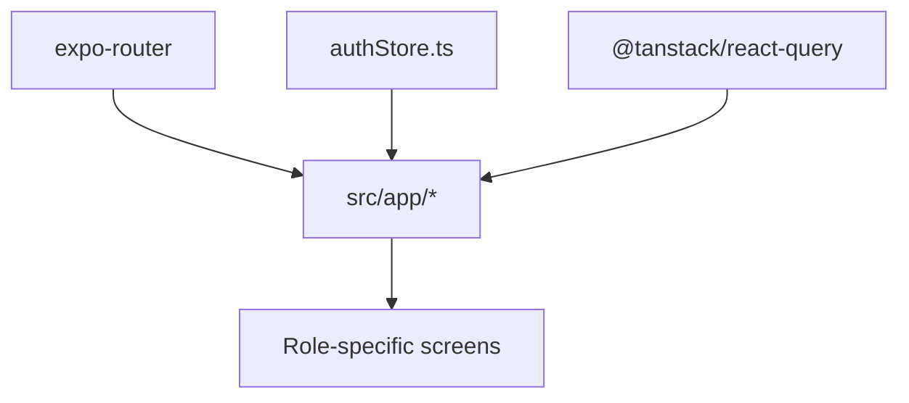

**Diagram sources**
- [src/app/_layout.tsx:1-85](file://src/app/_layout.tsx#L1-L85)
- [src/stores/authStore.ts:1-112](file://src/stores/authStore.ts#L1-L112)

**Section sources**
- [src/app/_layout.tsx:1-85](file://src/app/_layout.tsx#L1-L85)
- [src/stores/authStore.ts:1-112](file://src/stores/authStore.ts#L1-L112)

## Performance Considerations
- Minimize re-renders in layouts by keeping guard logic lightweight and avoiding heavy computations during render.
- Use router.replace for final navigation targets to reduce navigation stack growth.
- Defer heavy work in screens until they are mounted; leverage React Query caching to avoid redundant network calls.
- Avoid passing large objects via params; prefer IDs and fetch data on the destination screen.
- Keep tab layouts lean; hide unnecessary subroutes from the tab bar to reduce UI overhead.
- Consider lazy loading for large screens or complex features if needed.

[No sources needed since this section provides general guidance]

## Troubleshooting Guide
Common issues and resolutions:
- Unauthorized access loops: Ensure useProtectedRoute redirects correctly and returns false while redirecting.
- Missing dynamic params: Validate params on destination screens and handle undefined values.
- Navigation stack bloat: Replace instead of push for final destinations (e.g., after login/logout).
- Deep links not working: Verify route paths and ensure params are correctly structured.

References:
- Guard hook: [src/hooks/useProtectedRoute.ts:1-40](file://src/hooks/useProtectedRoute.ts#L1-L40).
- Initial redirect: [src/app/index.tsx:1-42](file://src/app/index.tsx#L1-L42).
- Login navigation: [src/app/(auth)/login.tsx:33-46](file://src/app/(auth)/login.tsx#L33-L46).

**Section sources**
- [src/hooks/useProtectedRoute.ts:1-40](file://src/hooks/useProtectedRoute.ts#L1-L40)
- [src/app/index.tsx:1-42](file://src/app/index.tsx#L1-L42)
- [src/app/(auth)/login.tsx:33-46](file://src/app/(auth)/login.tsx#L33-L46)

## Conclusion
This routing system leverages Expo Router’s file-based conventions to organize routes by role, providing clear separation between authentication flows and authenticated dashboards. Layouts encapsulate shared UI and navigation containers, while hooks enforce role-based access. Dynamic parameters and nested routing support complex workflows. By following best practices for navigation, parameter handling, and performance, the application remains scalable and maintainable as it grows.