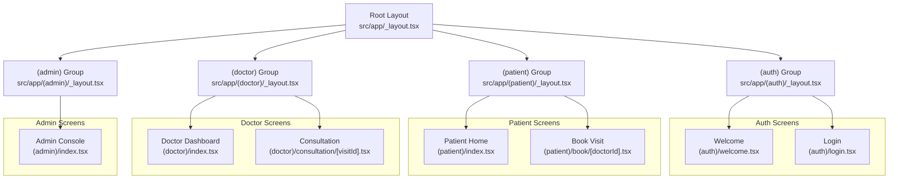
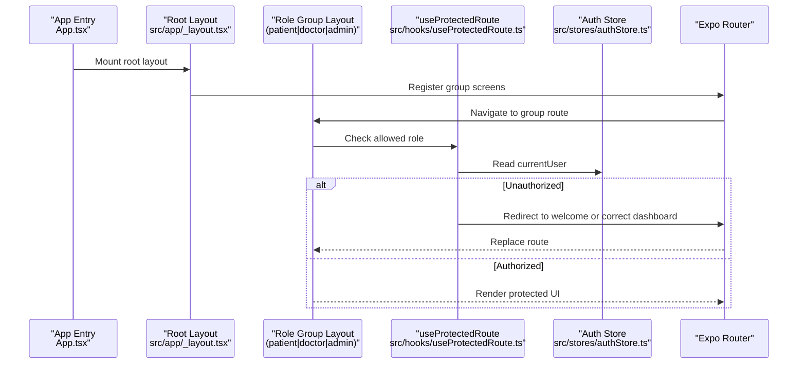
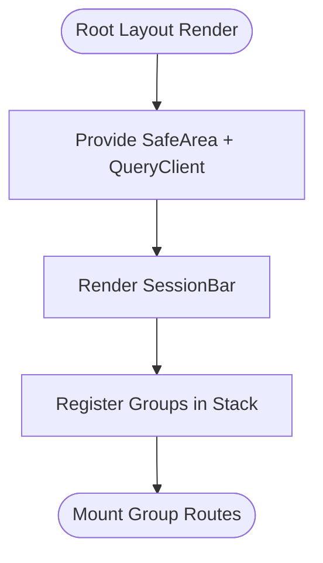
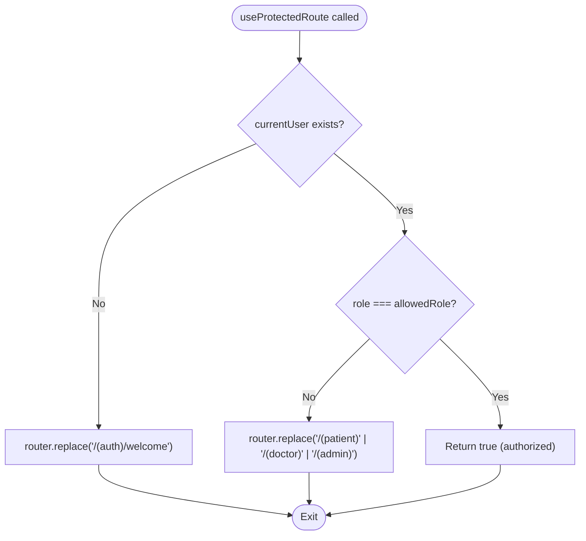
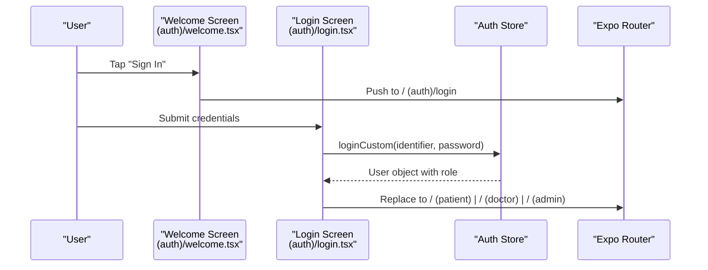
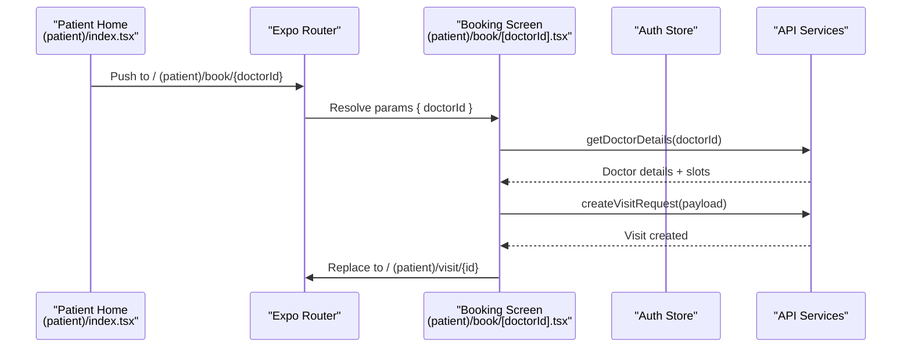
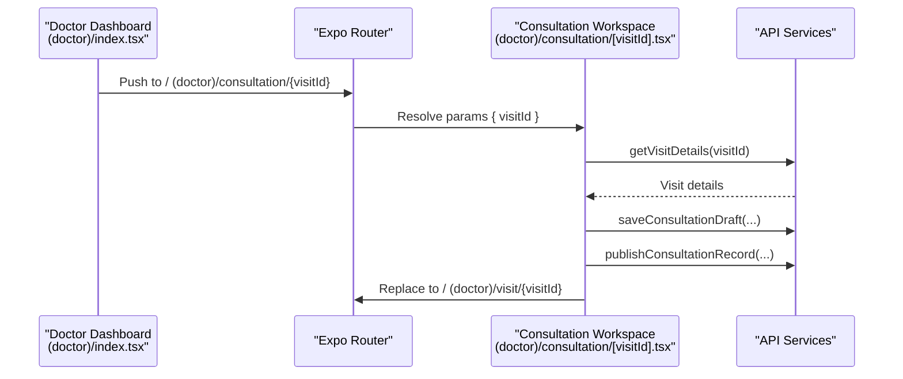
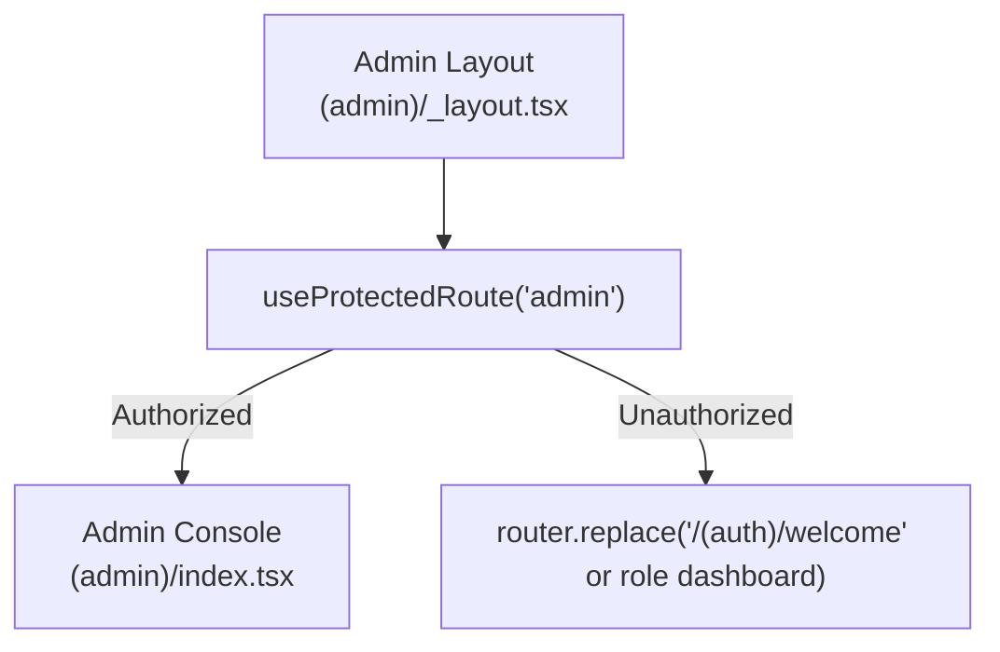
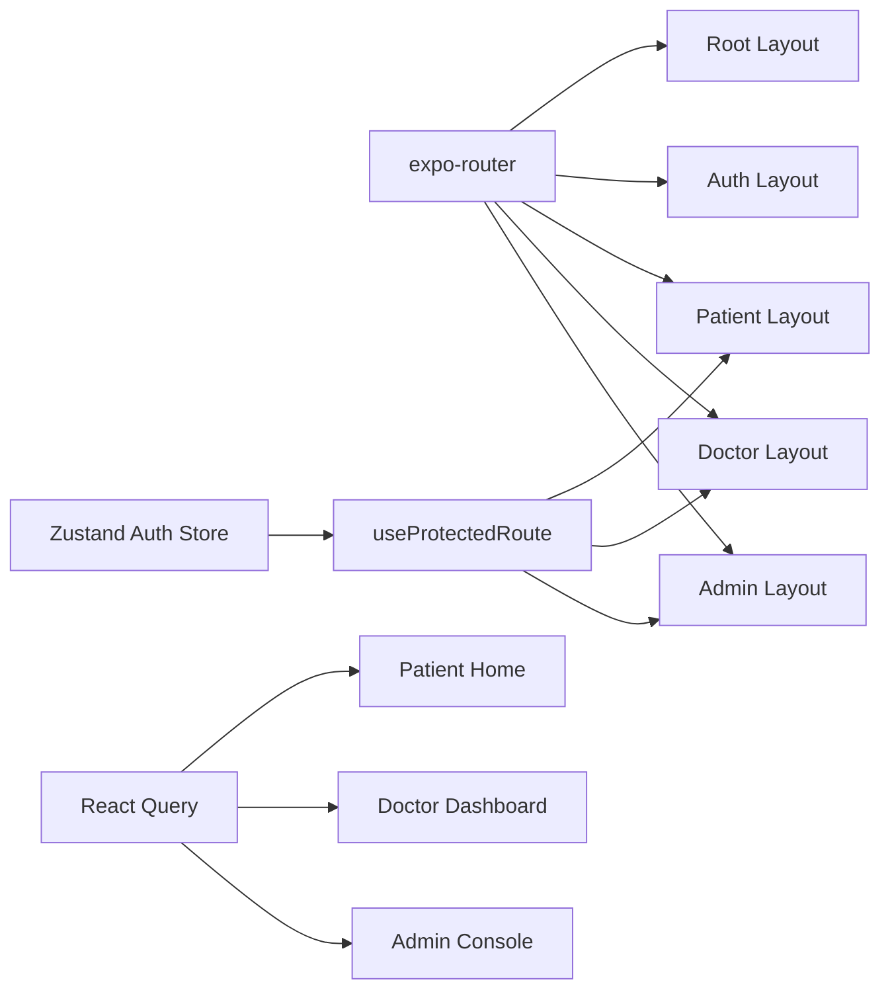

# Navigation & Routing

<cite>
**Referenced Files in This Document**
- [package.json](file://package.json)
- [App.tsx](file://App.tsx)
- [src/app/_layout.tsx](file://src/app/_layout.tsx)
- [src/hooks/useProtectedRoute.ts](file://src/hooks/useProtectedRoute.ts)
- [src/stores/authStore.ts](file://src/stores/authStore.ts)
- [src/app/(auth)/_layout.tsx](file://src/app/(auth)/_layout.tsx)
- [src/app/(auth)/welcome.tsx](file://src/app/(auth)/welcome.tsx)
- [src/app/(auth)/login.tsx](file://src/app/(auth)/login.tsx)
- [src/app/(patient)/_layout.tsx](file://src/app/(patient)/_layout.tsx)
- [src/app/(patient)/index.tsx](file://src/app/(patient)/index.tsx)
- [src/app/(patient)/book/[doctorId].tsx](file://src/app/(patient)/book/[doctorId].tsx)
- [src/app/(doctor)/_layout.tsx](file://src/app/(doctor)/_layout.tsx)
- [src/app/(doctor)/index.tsx](file://src/app/(doctor)/index.tsx)
- [src/app/(doctor)/consultation/[visitId].tsx](file://src/app/(doctor)/consultation/[visitId].tsx)
- [src/app/(admin)/_layout.tsx](file://src/app/(admin)/_layout.tsx)
- [src/app/(admin)/index.tsx](file://src/app/(admin)/index.tsx)
</cite>

## Table of Contents
1. [Introduction](#introduction)
2. [Project Structure](#project-structure)
3. [Core Components](#core-components)
4. [Architecture Overview](#architecture-overview)
5. [Detailed Component Analysis](#detailed-component-analysis)
6. [Dependency Analysis](#dependency-analysis)
7. [Performance Considerations](#performance-considerations)
8. [Troubleshooting Guide](#troubleshooting-guide)
9. [Conclusion](#conclusion)

## Introduction
This document explains the file-based routing system built with Expo Router and role-based navigation patterns for a multi-role healthcare application. It covers:
- Route organization by role using grouped directories: (auth), (patient), (doctor), (admin).
- Nested routing patterns and dynamic route parameters.
- Protected routes via a custom hook that enforces role-based access control, redirects unauthorized users, and prevents rendering of sensitive UI during redirection.
- Layouts per role, including tab stacks and screen transitions.
- Examples of implementing custom navigation guards, handling deep linking, and managing navigation state.
- Route parameter handling, query string processing, and navigation history management.
- Performance considerations and optimization strategies for large applications.

## Project Structure
The app uses Expo Router’s file-system routing convention. Grouped folders act as isolated route groups:
- (auth): Authentication flows and onboarding screens.
- (patient): Patient dashboard and features.
- (doctor): Doctor dashboard and clinical workflows.
- (admin): Administration console.

At the root layout, a global Stack is configured to register each group as a top-level route. Each group defines its own layout with either a Stack or Tabs navigator.

**Diagram sources**
- [src/app/_layout.tsx:57-85](file://src/app/_layout.tsx#L57-L85)
- [src/app/(auth)/_layout.tsx:6-25](file://src/app/(auth)/_layout.tsx#L6-L25)
- [src/app/(patient)/_layout.tsx:8-107](file://src/app/(patient)/_layout.tsx#L8-L107)
- [src/app/(doctor)/_layout.tsx:8-120](file://src/app/(doctor)/_layout.tsx#L8-L120)
- [src/app/(admin)/_layout.tsx:8-30](file://src/app/(admin)/_layout.tsx#L8-L30)

**Section sources**
- [src/app/_layout.tsx:1-85](file://src/app/_layout.tsx#L1-L85)
- [package.json:1-36](file://package.json#L1-L36)

## Core Components
- Root layout: Provides SafeAreaProvider, QueryClientProvider, StatusBar, and a global Stack that registers all route groups. It also renders a session bar showing current user info and sign-out actions.
- Role layouts:
  - (auth): Stack layout for authentication screens.
  - (patient): Tabs layout for patient features; includes hidden subroutes for detail flows.
  - (doctor): Tabs layout for doctor features; includes hidden subroutes for visit details and consultation workspace.
  - (admin): Stack layout for admin console.
- Protected route hook: useProtectedRoute ensures only authorized roles render protected content and redirects others automatically.

Key responsibilities:
- Global providers and navigation container at the root.
- Per-group navigation containers (Stack/Tabs) with consistent styling.
- Authorization checks before rendering role-specific UI.

**Section sources**
- [src/app/_layout.tsx:1-85](file://src/app/_layout.tsx#L1-L85)
- [src/app/(auth)/_layout.tsx:1-26](file://src/app/(auth)/_layout.tsx#L1-L26)
- [src/app/(patient)/_layout.tsx:1-118](file://src/app/(patient)/_layout.tsx#L1-L118)
- [src/app/(doctor)/_layout.tsx:1-131](file://src/app/(doctor)/_layout.tsx#L1-L131)
- [src/app/(admin)/_layout.tsx:1-40](file://src/app/(admin)/_layout.tsx#L1-L40)
- [src/hooks/useProtectedRoute.ts:1-40](file://src/hooks/useProtectedRoute.ts#L1-L40)

## Architecture Overview
The navigation architecture centers around:
- File-based routes mapped to grouped directories.
- A root Stack that mounts each group.
- Group-level layouts that define their own navigators (Stack or Tabs).
- A shared authorization hook that runs inside protected layouts to enforce role-based access.

**Diagram sources**
- [App.tsx:1-21](file://App.tsx#L1-L21)
- [src/app/_layout.tsx:57-85](file://src/app/_layout.tsx#L57-L85)
- [src/app/(patient)/_layout.tsx:8-107](file://src/app/(patient)/_layout.tsx#L8-L107)
- [src/app/(doctor)/_layout.tsx:8-120](file://src/app/(doctor)/_layout.tsx#L8-L120)
- [src/app/(admin)/_layout.tsx:8-30](file://src/app/(admin)/_layout.tsx#L8-L30)
- [src/hooks/useProtectedRoute.ts:11-38](file://src/hooks/useProtectedRoute.ts#L11-L38)
- [src/stores/authStore.ts:1-112](file://src/stores/authStore.ts#L1-L112)

## Detailed Component Analysis

### Root Layout and Global Providers
- Provides SafeAreaProvider and QueryClientProvider.
- Renders a demo SessionBar with user badge and logout action that replaces route to auth welcome.
- Registers all route groups in a single Stack.

**Diagram sources**
- [src/app/_layout.tsx:12-19](file://src/app/_layout.tsx#L12-L19)
- [src/app/_layout.tsx:21-55](file://src/app/_layout.tsx#L21-L55)
- [src/app/_layout.tsx:57-85](file://src/app/_layout.tsx#L57-L85)

**Section sources**
- [src/app/_layout.tsx:1-85](file://src/app/_layout.tsx#L1-L85)

### Role-Based Navigation Guards
- useProtectedRoute reads currentUser from the auth store.
- If no user exists, it redirects to the auth welcome screen.
- If the user has a different role, it redirects to the appropriate dashboard based on role.
- Returns a boolean indicating authorization status so layouts can conditionally render loading states instead of sensitive UI.

**Diagram sources**
- [src/hooks/useProtectedRoute.ts:11-38](file://src/hooks/useProtectedRoute.ts#L11-L38)
- [src/stores/authStore.ts:1-112](file://src/stores/authStore.ts#L1-L112)

**Section sources**
- [src/hooks/useProtectedRoute.ts:1-40](file://src/hooks/useProtectedRoute.ts#L1-L40)
- [src/stores/authStore.ts:1-112](file://src/stores/authStore.ts#L1-L112)

### Auth Group Layout and Screens
- The auth layout configures a Stack with header styles and registers screens like welcome, login, registration, OTP verification, and password reset.
- Welcome screen provides primary actions to register or sign in.
- Login screen validates input, calls the auth store, and navigates to the correct role dashboard upon success.

**Diagram sources**
- [src/app/(auth)/_layout.tsx:6-25](file://src/app/(auth)/_layout.tsx#L6-L25)
- [src/app/(auth)/welcome.tsx:18-86](file://src/app/(auth)/welcome.tsx#L18-L86)
- [src/app/(auth)/login.tsx:17-46](file://src/app/(auth)/login.tsx#L17-L46)

**Section sources**
- [src/app/(auth)/_layout.tsx:1-26](file://src/app/(auth)/_layout.tsx#L1-L26)
- [src/app/(auth)/welcome.tsx:1-183](file://src/app/(auth)/welcome.tsx#L1-L183)
- [src/app/(auth)/login.tsx:1-174](file://src/app/(auth)/login.tsx#L1-L174)

### Patient Group Layout and Screens
- Patient layout uses Tabs for main sections and hides subroutes (doctor details, booking, visit details, results, notifications).
- Patient home screen queries visits, specialties, and recommended doctors, and navigates to related screens.
- Booking flow uses dynamic route parameter doctorId to fetch doctor details and submit a visit request, then navigates to the visit tracking screen.

**Diagram sources**
- [src/app/(patient)/_layout.tsx:8-107](file://src/app/(patient)/_layout.tsx#L8-L107)
- [src/app/(patient)/index.tsx:22-179](file://src/app/(patient)/index.tsx#L22-L179)
- [src/app/(patient)/book/[doctorId].tsx:32-135](file://src/app/(patient)/book/[doctorId].tsx#L32-L135)

**Section sources**
- [src/app/(patient)/_layout.tsx:1-118](file://src/app/(patient)/_layout.tsx#L1-L118)
- [src/app/(patient)/index.tsx:1-340](file://src/app/(patient)/index.tsx#L1-L340)
- [src/app/(patient)/book/[doctorId].tsx:1-608](file://src/app/(patient)/book/[doctorId].tsx#L1-L608)

### Doctor Group Layout and Screens
- Doctor layout uses Tabs for dashboard, requests, schedule, patients, profile, and hides subroutes for visit details and consultation workspace.
- Doctor dashboard queries visits, filters pending/active/completed, and navigates to relevant screens.
- Consultation workspace uses dynamic route parameter visitId to load visit details, manage prescriptions, lab tests, and publish records.

**Diagram sources**
- [src/app/(doctor)/_layout.tsx:8-120](file://src/app/(doctor)/_layout.tsx#L8-L120)
- [src/app/(doctor)/index.tsx:25-185](file://src/app/(doctor)/index.tsx#L25-L185)
- [src/app/(doctor)/consultation/[visitId].tsx:22-205](file://src/app/(doctor)/consultation/[visitId].tsx#L22-L205)

**Section sources**
- [src/app/(doctor)/_layout.tsx:1-131](file://src/app/(doctor)/_layout.tsx#L1-L131)
- [src/app/(doctor)/index.tsx:1-329](file://src/app/(doctor)/index.tsx#L1-L329)
- [src/app/(doctor)/consultation/[visitId].tsx:1-507](file://src/app/(doctor)/consultation/[visitId].tsx#L1-L507)

### Admin Group Layout and Screens
- Admin layout uses a Stack and protects the route with useProtectedRoute('admin').
- Admin console screen manages metrics, doctor verification, complaints, and audit logs. It supports resetting demo data and logging out.

**Diagram sources**
- [src/app/(admin)/_layout.tsx:8-30](file://src/app/(admin)/_layout.tsx#L8-L30)
- [src/app/(admin)/index.tsx:60-121](file://src/app/(admin)/index.tsx#L60-L121)

**Section sources**
- [src/app/(admin)/_layout.tsx:1-40](file://src/app/(admin)/_layout.tsx#L1-L40)
- [src/app/(admin)/index.tsx:1-800](file://src/app/(admin)/index.tsx#L1-L800)

## Dependency Analysis
The navigation system depends on:
- Expo Router for file-based routing, programmatic navigation, and deep linking.
- Zustand for centralized auth state (currentUser, profiles, token).
- React Query for data fetching and caching within screens.
- Theme constants for consistent UI across layouts.

**Diagram sources**
- [package.json:1-36](file://package.json#L1-L36)
- [src/app/_layout.tsx:57-85](file://src/app/_layout.tsx#L57-L85)
- [src/app/(auth)/_layout.tsx:6-25](file://src/app/(auth)/_layout.tsx#L6-L25)
- [src/app/(patient)/_layout.tsx:8-107](file://src/app/(patient)/_layout.tsx#L8-L107)
- [src/app/(doctor)/_layout.tsx:8-120](file://src/app/(doctor)/_layout.tsx#L8-L120)
- [src/app/(admin)/_layout.tsx:8-30](file://src/app/(admin)/_layout.tsx#L8-L30)
- [src/hooks/useProtectedRoute.ts:11-38](file://src/hooks/useProtectedRoute.ts#L11-L38)
- [src/stores/authStore.ts:1-112](file://src/stores/authStore.ts#L1-L112)

**Section sources**
- [package.json:1-36](file://package.json#L1-L36)
- [src/hooks/useProtectedRoute.ts:1-40](file://src/hooks/useProtectedRoute.ts#L1-L40)
- [src/stores/authStore.ts:1-112](file://src/stores/authStore.ts#L1-L112)

## Performance Considerations
- Use lazy loading for heavy screens and avoid mounting unnecessary components by leveraging route groups and nested layouts.
- Prefer router.replace over router.push when navigating after authentication to prevent stacking unnecessary history entries.
- Keep navigation state minimal; rely on global stores for user/session data and avoid duplicating state in multiple screens.
- Optimize data fetching with React Query caching and refetch policies tuned to your domain (e.g., longer staleTime for static configuration).
- Avoid re-rendering entire layouts by splitting into smaller components and memoizing expensive computations.
- For large lists (doctors, complaints, audit logs), implement pagination or virtualization where applicable.
- Minimize image sizes and use efficient asset loading strategies.

[No sources needed since this section provides general guidance]

## Troubleshooting Guide
Common issues and resolutions:
- Unauthorized redirect loops: Ensure useProtectedRoute is used consistently in all protected layouts and that login flows replace routes correctly.
- Incorrect role dashboards: Verify login logic maps roles to the correct route paths and that the hook’s allowedRole matches the layout’s expectation.
- Deep linking not working: Confirm expo-linking is configured and that dynamic routes are correctly defined with brackets (e.g., [doctorId], [visitId]).
- Navigation state inconsistencies: Use router.replace for post-login navigation to avoid back-stack anomalies.
- Data not refreshing: Ensure refetch functions are called after mutations (e.g., after creating a visit or publishing a record).

**Section sources**
- [src/hooks/useProtectedRoute.ts:11-38](file://src/hooks/useProtectedRoute.ts#L11-L38)
- [src/app/(auth)/login.tsx:23-46](file://src/app/(auth)/login.tsx#L23-L46)
- [src/app/(patient)/book/[doctorId].tsx:85-135](file://src/app/(patient)/book/[doctorId].tsx#L85-L135)
- [src/app/(doctor)/consultation/[visitId].tsx:102-205](file://src/app/(doctor)/consultation/[visitId].tsx#L102-L205)

## Conclusion
The application implements a robust, scalable routing architecture using Expo Router with role-based route groups and protected layouts. The custom useProtectedRoute hook centralizes authorization logic, ensuring secure access to role-specific features while maintaining clean separation between navigation concerns and business logic. Dynamic routes and nested layouts support complex workflows such as booking visits and managing consultations. With careful attention to performance and navigation state management, the system scales well for larger applications and maintains a consistent user experience across roles.

[No sources needed since this section summarizes without analyzing specific files]