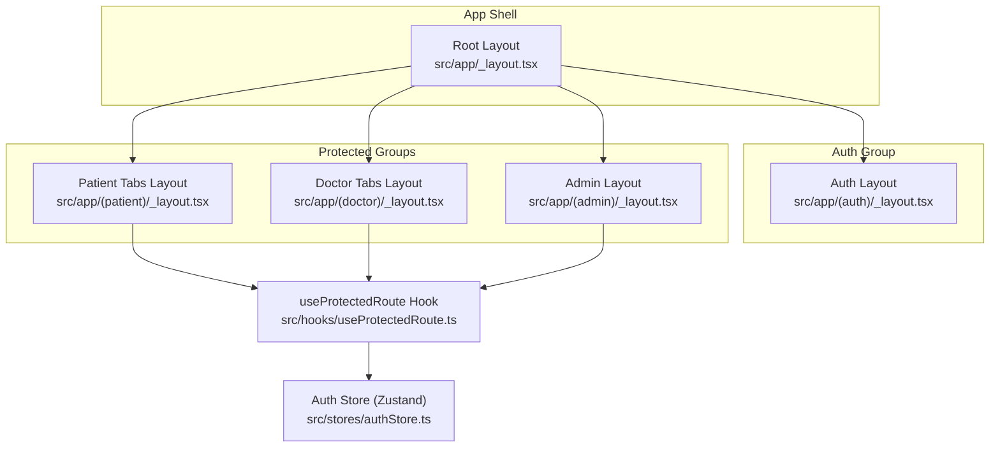
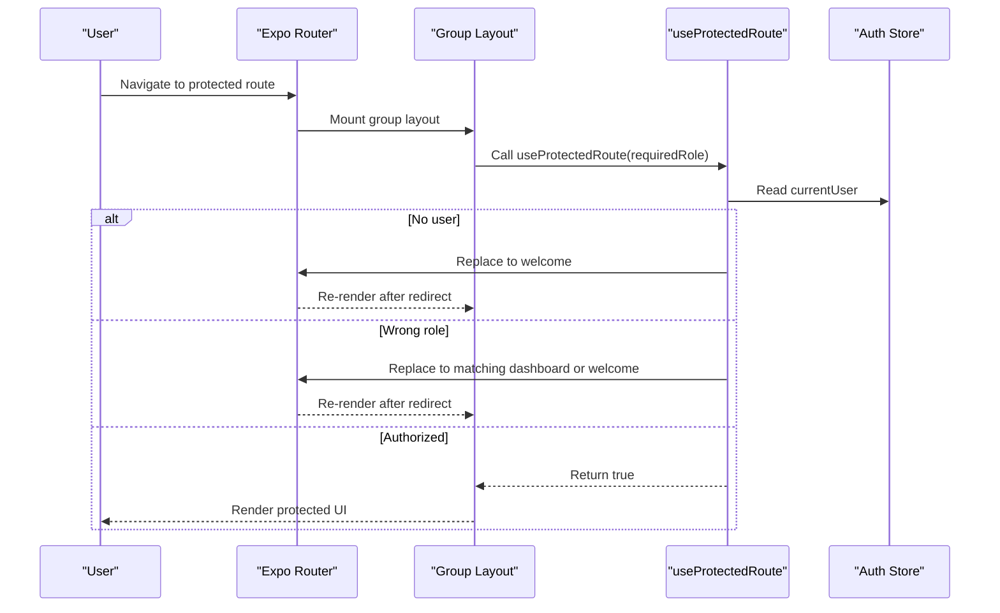
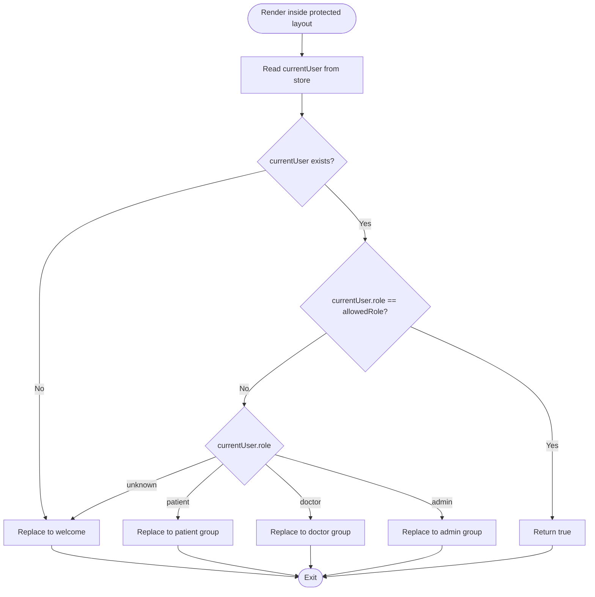
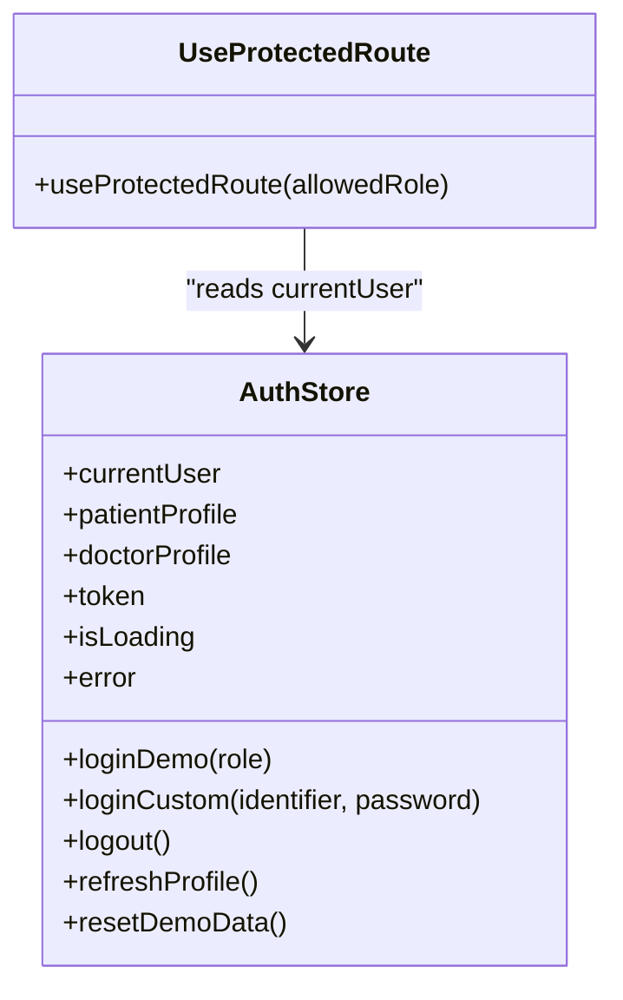
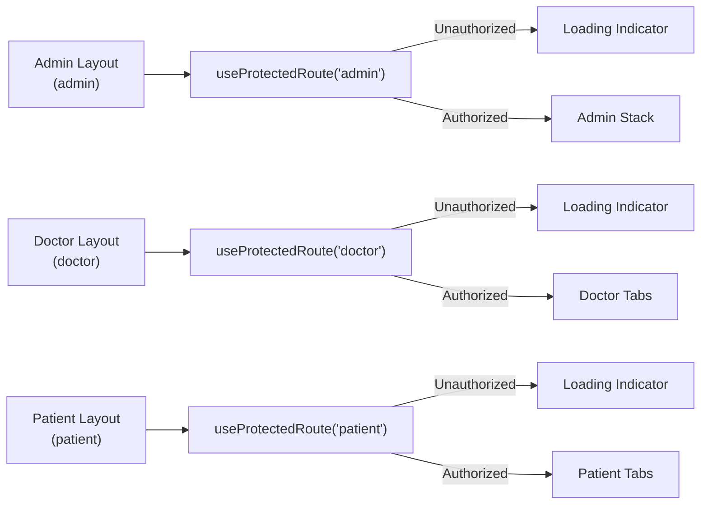
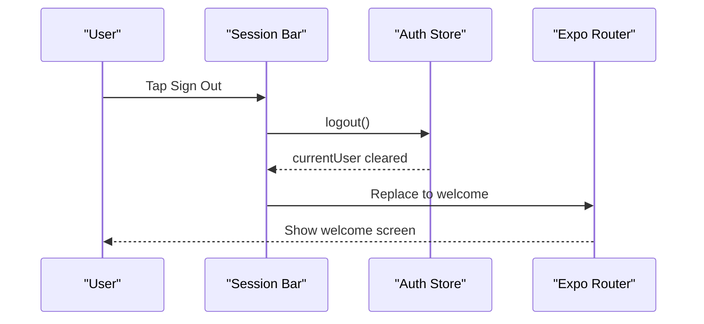
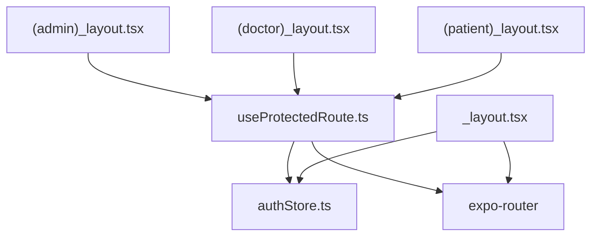

# Protected Routes & Navigation Guards

<cite>
**Referenced Files in This Document**
- [useProtectedRoute.ts](file://src/hooks/useProtectedRoute.ts)
- [authStore.ts](file://src/stores/authStore.ts)
- [_layout.tsx](file://src/app/_layout.tsx)
- [_layout.tsx](file://src/app/(auth)/_layout.tsx)
- [_layout.tsx](file://src/app/(admin)/_layout.tsx)
- [_layout.tsx](file://src/app/(doctor)/_layout.tsx)
- [_layout.tsx](file://src/app/(patient)/_layout.tsx)
</cite>

## Table of Contents
1. [Introduction](#introduction)
2. [Project Structure](#project-structure)
3. [Core Components](#core-components)
4. [Architecture Overview](#architecture-overview)
5. [Detailed Component Analysis](#detailed-component-analysis)
6. [Dependency Analysis](#dependency-analysis)
7. [Performance Considerations](#performance-considerations)
8. [Troubleshooting Guide](#troubleshooting-guide)
9. [Conclusion](#conclusion)

## Introduction
This document explains the protected routes and navigation guards system used to enforce role-based access control across the application. It focuses on:
- How the useProtectedRoute hook checks authentication state before allowing route access
- Role-based authorization logic for patient, doctor, and admin roles
- Automatic redirect behavior for unauthorized users
- Integration with the global auth store
- Fallback behavior when a user is not authenticated or has an unexpected role
- Practical examples from the codebase showing how to implement custom guards and manage redirects
- Common issues such as infinite redirect loops, error handling, and performance optimization

## Project Structure
The protection mechanism is implemented at two layers:
- A reusable hook that centralizes authorization logic
- Group layouts that gate access to feature-specific route groups

**Diagram sources**
- [_layout.tsx](file://src/app/_layout.tsx)
- [_layout.tsx](file://src/app/(auth)/_layout.tsx)
- [_layout.tsx](file://src/app/(patient)/_layout.tsx)
- [_layout.tsx](file://src/app/(doctor)/_layout.tsx)
- [_layout.tsx](file://src/app/(admin)/_layout.tsx)
- [useProtectedRoute.ts](file://src/hooks/useProtectedRoute.ts)
- [authStore.ts](file://src/stores/authStore.ts)

**Section sources**
- [_layout.tsx](file://src/app/_layout.tsx)
- [_layout.tsx](file://src/app/(auth)/_layout.tsx)
- [_layout.tsx](file://src/app/(patient)/_layout.tsx)
- [_layout.tsx](file://src/app/(doctor)/_layout.tsx)
- [_layout.tsx](file://src/app/(admin)/_layout.tsx)

## Core Components
- useProtectedRoute hook: Centralized guard that reads the current user from the auth store and enforces role-based access. It also performs automatic redirects using expo-router.
- Auth store: Global Zustand store holding currentUser, profiles, token, loading, and error state. It exposes login, logout, profile refresh, and demo helpers.
- Group layouts: Each protected group layout calls useProtectedRoute with its required role and conditionally renders either a loading indicator or the actual route stack/tabs.

Key responsibilities:
- Authentication check: If no user exists, redirect to the welcome screen.
- Authorization check: If the user’s role does not match the allowed role, redirect to the appropriate dashboard or back to welcome.
- Render gating: Return a boolean indicating whether the current user is authorized so layouts can avoid rendering sensitive UI during redirection.

**Section sources**
- [useProtectedRoute.ts](file://src/hooks/useProtectedRoute.ts)
- [authStore.ts](file://src/stores/authStore.ts)
- [_layout.tsx](file://src/app/(admin)/_layout.tsx)
- [_layout.tsx](file://src/app/(doctor)/_layout.tsx)
- [_layout.tsx](file://src/app/(patient)/_layout.tsx)

## Architecture Overview
The navigation flow uses Expo Router stacks and tabs grouped by role. The root layout declares all top-level groups. Protected group layouts integrate the useProtectedRoute hook to ensure only authorized users can render their content.

**Diagram sources**
- [useProtectedRoute.ts](file://src/hooks/useProtectedRoute.ts)
- [_layout.tsx](file://src/app/(admin)/_layout.tsx)
- [_layout.tsx](file://src/app/(doctor)/_layout.tsx)
- [_layout.tsx](file://src/app/(patient)/_layout.tsx)
- [_layout.tsx](file://src/app/_layout.tsx)

## Detailed Component Analysis

### useProtectedRoute Hook
Responsibilities:
- Reads the current user from the auth store
- Redirects unauthenticated users to the welcome screen
- Redirects misrouted users to their correct dashboard based on role
- Returns a boolean to allow layouts to avoid rendering protected UI while redirecting

Behavior summary:
- If currentUser is null: replace route to welcome
- If currentUser.role differs from allowedRole:
  - patient → replace to patient group
  - doctor → replace to doctor group
  - admin → replace to admin group
  - unknown role → replace to welcome
- Return true only if currentUser.role equals allowedRole

**Diagram sources**
- [useProtectedRoute.ts](file://src/hooks/useProtectedRoute.ts)

**Section sources**
- [useProtectedRoute.ts](file://src/hooks/useProtectedRoute.ts)

### Auth Store Integration
The hook depends on the auth store to obtain the current user. The store manages:
- currentUser: The active user object including role
- Profiles: Role-specific profiles loaded after login
- Token: Authentication token
- Loading and error states
- Actions: loginDemo, loginCustom, logout, refreshProfile, resetDemoData

Integration points:
- The hook subscribes to currentUser via the store selector
- Login actions set currentUser and associated profiles
- Logout clears currentUser and related data
- Profile refresh updates role-specific profile data without changing currentUser

**Diagram sources**
- [authStore.ts](file://src/stores/authStore.ts)
- [useProtectedRoute.ts](file://src/hooks/useProtectedRoute.ts)

**Section sources**
- [authStore.ts](file://src/stores/authStore.ts)
- [useProtectedRoute.ts](file://src/hooks/useProtectedRoute.ts)

### Group Layouts and Guard Usage
Each protected group layout integrates the hook to enforce access:

- Admin layout: Calls useProtectedRoute('admin'). Renders a loading indicator while unauthorized; otherwise renders the admin stack.
- Doctor layout: Calls useProtectedRoute('doctor'). Renders a loading indicator while unauthorized; otherwise renders the doctor tabs and nested screens.
- Patient layout: Calls useProtectedRoute('patient'). Renders a loading indicator while unauthorized; otherwise renders the patient tabs and nested screens.

**Diagram sources**
- [_layout.tsx](file://src/app/(admin)/_layout.tsx)
- [_layout.tsx](file://src/app/(doctor)/_layout.tsx)
- [_layout.tsx](file://src/app/(patient)/_layout.tsx)
- [useProtectedRoute.ts](file://src/hooks/useProtectedRoute.ts)

**Section sources**
- [_layout.tsx](file://src/app/(admin)/_layout.tsx)
- [_layout.tsx](file://src/app/(doctor)/_layout.tsx)
- [_layout.tsx](file://src/app/(patient)/_layout.tsx)

### Root Layout and Session Bar
The root layout defines the top-level stacks for all route groups and includes a session bar that displays the current user and provides sign-out functionality. Signing out clears the store and navigates to the welcome screen.

**Diagram sources**
- [_layout.tsx](file://src/app/_layout.tsx)
- [authStore.ts](file://src/stores/authStore.ts)

**Section sources**
- [_layout.tsx](file://src/app/_layout.tsx)
- [authStore.ts](file://src/stores/authStore.ts)

## Dependency Analysis
The protection system relies on a small set of dependencies:
- useProtectedRoute depends on:
  - React useEffect for side effects
  - expo-router router for programmatic navigation
  - auth store for currentUser
- Group layouts depend on:
  - useProtectedRoute for authorization
  - expo-router Stack/Tabs for navigation structure
- Root layout depends on:
  - auth store for session display and sign-out
  - expo-router for declaring route groups

**Diagram sources**
- [useProtectedRoute.ts](file://src/hooks/useProtectedRoute.ts)
- [authStore.ts](file://src/stores/authStore.ts)
- [_layout.tsx](file://src/app/_layout.tsx)
- [_layout.tsx](file://src/app/(admin)/_layout.tsx)
- [_layout.tsx](file://src/app/(doctor)/_layout.tsx)
- [_layout.tsx](file://src/app/(patient)/_layout.tsx)

**Section sources**
- [useProtectedRoute.ts](file://src/hooks/useProtectedRoute.ts)
- [authStore.ts](file://src/stores/authStore.ts)
- [_layout.tsx](file://src/app/_layout.tsx)
- [_layout.tsx](file://src/app/(admin)/_layout.tsx)
- [_layout.tsx](file://src/app/(doctor)/_layout.tsx)
- [_layout.tsx](file://src/app/(patient)/_layout.tsx)

## Performance Considerations
- Minimize re-renders:
  - The hook returns a simple boolean derived from currentUser.role and allowedRole. Keep component logic minimal to avoid unnecessary work during redirects.
- Avoid heavy operations in effect:
  - The redirect logic runs once per render cycle when dependencies change. Do not add network requests or expensive computations inside the effect.
- Prefer early return:
  - Group layouts should return a lightweight loading indicator when unauthorized to prevent rendering complex trees until the redirect completes.
- Route grouping:
  - Using route groups ensures guards run at the group level, reducing repeated checks for every child screen.

[No sources needed since this section provides general guidance]

## Troubleshooting Guide

Common issues and resolutions:

- Infinite redirect loop
  - Cause: A layout or page triggers another redirect before the first one resolves, or the wrong target route is used.
  - Resolution: Ensure the hook’s redirect targets are mutually exclusive and do not re-enter the same protected group. Verify that the welcome route is outside protected groups.

- Unauthorized user sees blank or flickering UI
  - Cause: Sensitive UI renders before the redirect takes effect.
  - Resolution: Return a loading indicator when the hook reports unauthorized, as shown in the group layouts.

- Unexpected role fallback
  - Cause: A user has an unknown role value.
  - Resolution: The hook redirects unknown roles to the welcome screen. Validate roles on the backend and ensure consistent role values.

- Sign-out does not navigate correctly
  - Cause: Sign-out action does not clear the store or navigate to the welcome route.
  - Resolution: Confirm that the session bar calls logout and then replaces the route to welcome.

- Error handling during login
  - Cause: Login failures leave the app in a loading state or show generic errors.
  - Resolution: The store sets isLoading to false and populates error messages. Surface these errors in the UI and guide users to retry or contact support.

**Section sources**
- [useProtectedRoute.ts](file://src/hooks/useProtectedRoute.ts)
- [_layout.tsx](file://src/app/(admin)/_layout.tsx)
- [_layout.tsx](file://src/app/(doctor)/_layout.tsx)
- [_layout.tsx](file://src/app/(patient)/_layout.tsx)
- [_layout.tsx](file://src/app/_layout.tsx)
- [authStore.ts](file://src/stores/authStore.ts)

## Conclusion
The protected routes and navigation guards system centers around a single hook that enforces role-based access and performs automatic redirects. Group layouts gate access by rendering a loading indicator while unauthorized and the actual UI when authorized. The global auth store provides the authentication state consumed by the hook and the root session bar. By following the patterns demonstrated in the admin, doctor, and patient layouts, you can implement custom guards, handle different roles, and manage navigation redirects reliably. For robustness, validate roles consistently, avoid heavy logic in guards, and ensure redirects target stable routes to prevent infinite loops.

[No sources needed since this section summarizes without analyzing specific files]