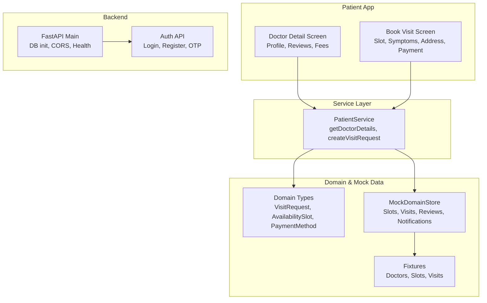
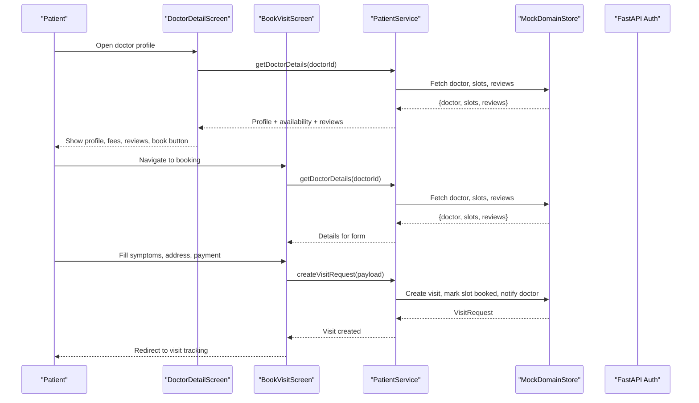
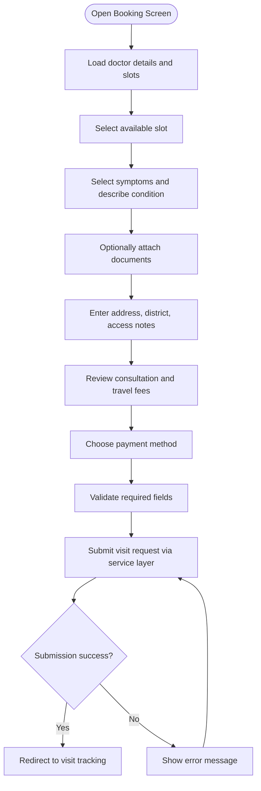
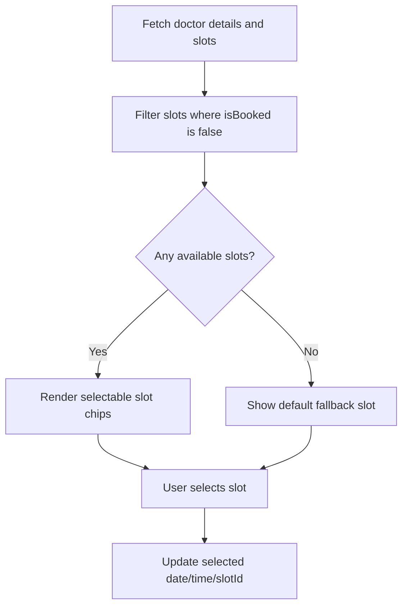
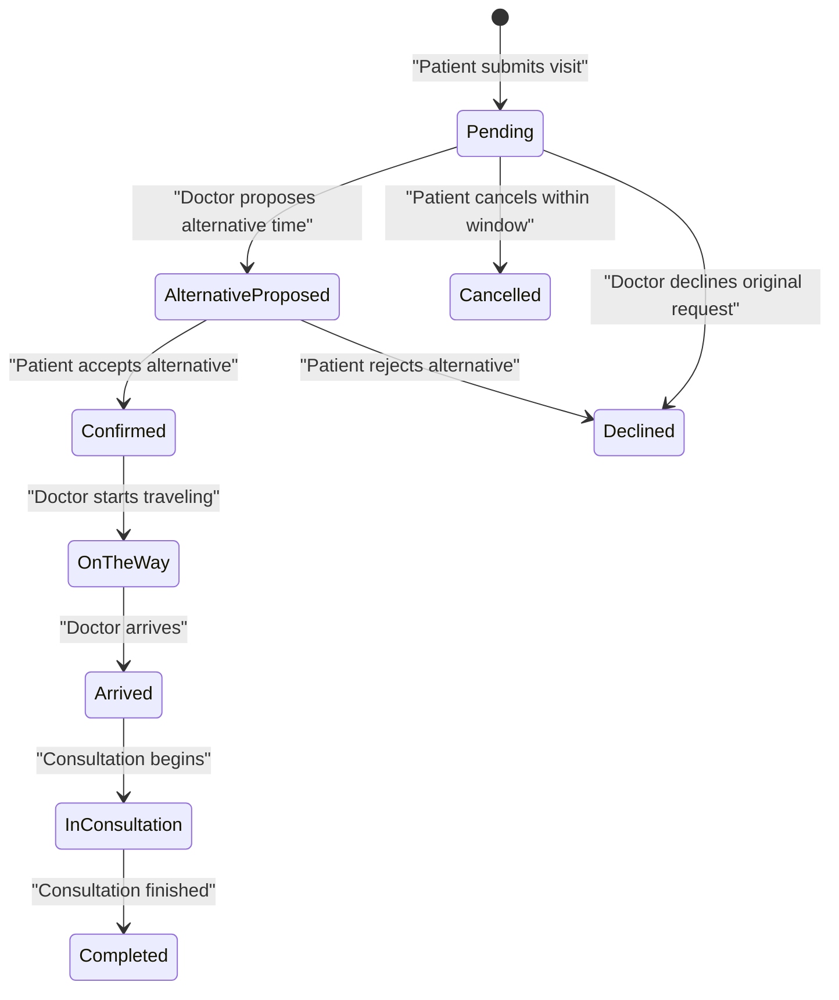
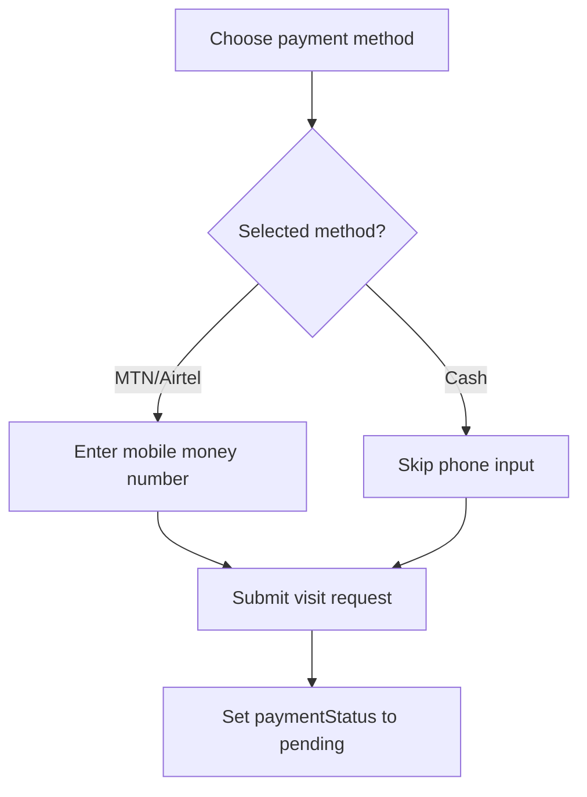
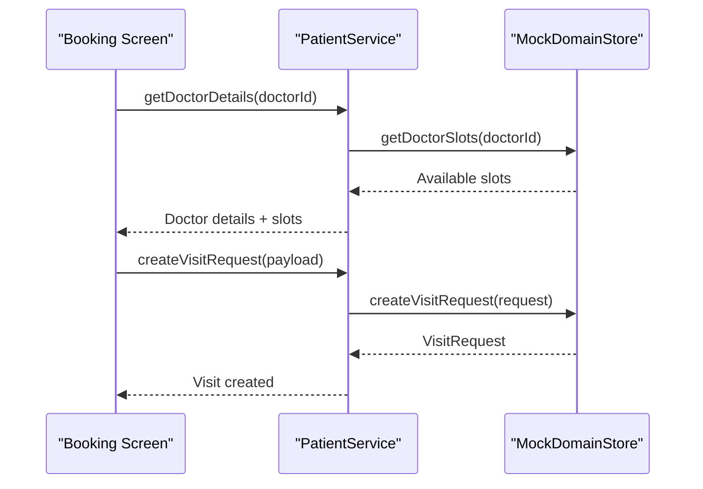
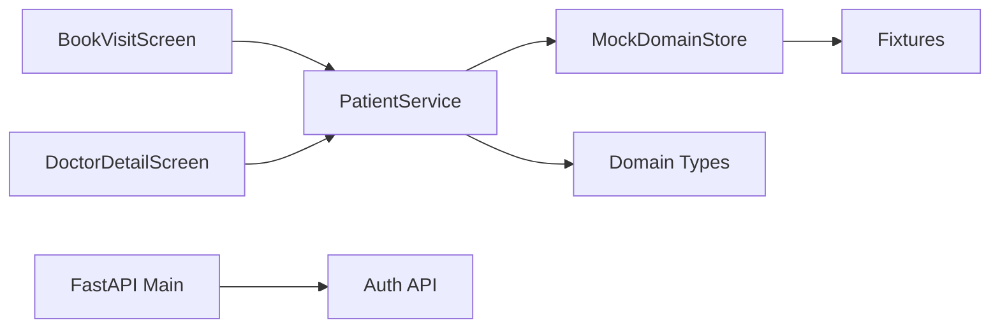

# Booking Workflow

<cite>
**Referenced Files in This Document**
- [BookVisitScreen](file://src/app/(patient)/book/[doctorId].tsx)
- [DoctorDetailScreen](file://src/app/(patient)/doctor/[id].tsx)
- [API Service Layer](file://src/services/api.ts)
- [Domain Types](file://src/types/domain.ts)
- [Mock Domain Store](file://src/mock/mockDomainStore.ts)
- [Demo Fixtures](file://src/mock/fixtures.ts)
- [Backend FastAPI Entry](file://backend/app/main.py)
- [Backend Auth API](file://backend/app/api/auth.py)
</cite>

## Table of Contents
1. [Introduction](#introduction)
2. [Project Structure](#project-structure)
3. [Core Components](#core-components)
4. [Architecture Overview](#architecture-overview)
5. [Detailed Component Analysis](#detailed-component-analysis)
6. [Dependency Analysis](#dependency-analysis)
7. [Performance Considerations](#performance-considerations)
8. [Troubleshooting Guide](#troubleshooting-guide)
9. [Conclusion](#conclusion)

## Introduction
This document explains the 9-step home visit booking workflow from slot selection through payment confirmation, including:
- Slot selection with availability filtering
- Symptom description and optional attachment input
- Home visit address collection with GPS pin simulation
- Alternative time proposal handling when preferred slots are unavailable
- Payment method selection for East African mobile money providers
- Booking state management, validation rules, and error handling
- Doctor profile viewing with credential verification, review aggregation, and availability integration

The implementation uses a React Native patient-facing screen for booking, a doctor detail screen for profile inspection, a service layer that currently simulates backend behavior, an in-memory mock store for domain data, and a FastAPI backend entry point for authentication endpoints.

## Project Structure
The booking workflow spans several layers:
- Patient UI screens for doctor details and booking
- A service layer exposing typed contracts for patients, doctors, and admin operations
- Domain types defining entities such as visits, slots, reviews, and payments
- Mock fixtures and an in-memory store providing realistic demo data and lifecycle logic
- Backend FastAPI application exposing auth routes and database initialization

**Diagram sources**
- [BookVisitScreen:32-135](file://src/app/(patient)/book/[doctorId].tsx#L32-L135)
- [DoctorDetailScreen:19-152](file://src/app/(patient)/doctor/[id].tsx#L19-L152)
- [API Service Layer:274-345](file://src/services/api.ts#L274-L345)
- [Domain Types:97-129](file://src/types/domain.ts#L97-L129)
- [Mock Domain Store:202-380](file://src/mock/mockDomainStore.ts#L202-L380)
- [Demo Fixtures:517-603](file://src/mock/fixtures.ts#L517-L603)
- [Backend FastAPI Entry:31-46](file://backend/app/main.py#L31-L46)
- [Backend Auth API:121-153](file://backend/app/api/auth.py#L121-L153)

**Section sources**
- [BookVisitScreen:32-135](file://src/app/(patient)/book/[doctorId].tsx#L32-L135)
- [DoctorDetailScreen:19-152](file://src/app/(patient)/doctor/[id].tsx#L19-L152)
- [API Service Layer:274-345](file://src/services/api.ts#L274-L345)
- [Domain Types:97-129](file://src/types/domain.ts#L97-L129)
- [Mock Domain Store:202-380](file://src/mock/mockDomainStore.ts#L202-L380)
- [Demo Fixtures:517-603](file://src/mock/fixtures.ts#L517-L603)
- [Backend FastAPI Entry:31-46](file://backend/app/main.py#L31-L46)
- [Backend Auth API:121-153](file://backend/app/api/auth.py#L121-L153)

## Core Components
- Book Visit Screen: Implements the 9-step booking flow, collects symptoms, address, and payment preferences, validates required fields, and submits a visit request.
- Doctor Detail Screen: Displays verified credentials, fees, coverage, languages, and aggregated reviews; navigates to booking.
- PatientService: Provides typed methods for fetching doctor details, slots, reviews, and creating visit requests.
- MockDomainStore: Maintains slots, visits, reviews, notifications, and enforces business rules like double-booking prevention and alternative time proposals.
- Domain Types: Define visit states, payment methods, slots, and related entities.
- Backend: FastAPI app initializes the database and exposes auth endpoints used by the frontend service layer.

**Section sources**
- [BookVisitScreen:32-135](file://src/app/(patient)/book/[doctorId].tsx#L32-L135)
- [DoctorDetailScreen:19-152](file://src/app/(patient)/doctor/[id].tsx#L19-L152)
- [API Service Layer:274-345](file://src/services/api.ts#L274-L345)
- [Mock Domain Store:202-380](file://src/mock/mockDomainStore.ts#L202-L380)
- [Domain Types:97-129](file://src/types/domain.ts#L97-L129)
- [Backend FastAPI Entry:31-46](file://backend/app/main.py#L31-L46)
- [Backend Auth API:121-153](file://backend/app/api/auth.py#L121-L153)

## Architecture Overview
The booking workflow integrates UI components with a service layer and mock domain store. The backend is present for authentication and future expansion.

**Diagram sources**
- [DoctorDetailScreen:22-36](file://src/app/(patient)/doctor/[id].tsx#L22-L36)
- [BookVisitScreen:36-43](file://src/app/(patient)/book/[doctorId].tsx#L36-L43)
- [API Service Layer:325-345](file://src/services/api.ts#L325-L345)
- [Mock Domain Store:245-280](file://src/mock/mockDomainStore.ts#L245-L280)
- [Backend FastAPI Entry:31-46](file://backend/app/main.py#L31-L46)
- [Backend Auth API:121-153](file://backend/app/api/auth.py#L121-L153)

## Detailed Component Analysis

### 9-Step Booking Workflow
The booking screen implements a structured flow:
1. Select date and available time slot
2. Provide reason for visit and select common symptoms
3. Enter detailed condition description
4. Optionally attach prior prescription or lab report
5. Enter residence address and district
6. Add access instructions (gate code, landmarks)
7. Review fee breakdown and choose payment method
8. Confirm and submit visit request
9. Redirect to visit tracking after successful submission

Key behaviors:
- Slot selection filters out booked slots and allows default fallback if none available.
- Symptom selection supports multiple chips; detailed description is required.
- Address and district are required; access notes are optional but recommended.
- Payment options include MTN Mobile Money, Airtel Money, and Cash on Visit.
- Submission validates required fields, computes total fees, and calls the service layer.

**Diagram sources**
- [BookVisitScreen:72-135](file://src/app/(patient)/book/[doctorId].tsx#L72-L135)
- [API Service Layer:334-345](file://src/services/api.ts#L334-L345)
- [Mock Domain Store:245-280](file://src/mock/mockDomainStore.ts#L245-L280)

**Section sources**
- [BookVisitScreen:72-135](file://src/app/(patient)/book/[doctorId].tsx#L72-L135)

### Slot Selection Interface and Time Availability Checking
- The booking screen fetches doctor details including slots via the service layer.
- Available slots are filtered by `isBooked` status before rendering.
- If no slots exist, a default fallback slot is presented.
- Selecting a slot updates selected date and time state.

Real-time availability checking:
- The current implementation relies on mock data and simulated latency.
- For production, replace mock queries with real-time backend checks to ensure slot availability at submission time.

**Diagram sources**
- [BookVisitScreen:36-43](file://src/app/(patient)/book/[doctorId].tsx#L36-L43)
- [BookVisitScreen:163-196](file://src/app/(patient)/book/[doctorId].tsx#L163-L196)
- [API Service Layer:325-331](file://src/services/api.ts#L325-L331)

**Section sources**
- [BookVisitScreen:36-43](file://src/app/(patient)/book/[doctorId].tsx#L36-L43)
- [BookVisitScreen:163-196](file://src/app/(patient)/book/[doctorId].tsx#L163-L196)
- [API Service Layer:325-331](file://src/services/api.ts#L325-L331)

### Symptom Description Input Form
- Common symptoms are presented as selectable chips.
- Users can toggle multiple symptoms.
- A multiline text field captures detailed condition description.
- Optional attachment toggle simulates attaching a prior prescription photo.

Validation:
- Condition description must be non-empty before submission.
- Errors are surfaced via an error box at the top of the form.

**Section sources**
- [BookVisitScreen:21-30](file://src/app/(patient)/book/[doctorId].tsx#L21-L30)
- [BookVisitScreen:64-70](file://src/app/(patient)/book/[doctorId].tsx#L64-L70)
- [BookVisitScreen:199-263](file://src/app/(patient)/book/[doctorId].tsx#L199-L263)
- [BookVisitScreen:85-95](file://src/app/(patient)/book/[doctorId].tsx#L85-L95)

### Address Collection for Home Visits
- Street address and district are required fields.
- Access instructions are optional but encouraged for gate codes and landmarks.
- A GPS pin simulation sets a sample Kigali address and district.

Validation:
- Address must be non-empty before submission.
- Errors are displayed inline.

**Section sources**
- [BookVisitScreen:78-83](file://src/app/(patient)/book/[doctorId].tsx#L78-L83)
- [BookVisitScreen:265-295](file://src/app/(patient)/book/[doctorId].tsx#L265-L295)
- [BookVisitScreen:90-93](file://src/app/(patient)/book/[doctorId].tsx#L90-L93)

### Alternative Time Proposal Handling
When preferred slots are unavailable or conflicts arise:
- The doctor can propose an alternative time using the service layer.
- The visit status transitions to `alternative_proposed`, storing alternative date, time, and note.
- Patients can accept or reject the proposed time:
  - Accept: schedule moves to the alternative time and status becomes `confirmed`.
  - Reject: status becomes `declined` with a reason.

**Diagram sources**
- [Domain Types:9-19](file://src/types/domain.ts#L9-L19)
- [API Service Layer:384-403](file://src/services/api.ts#L384-L403)
- [Mock Domain Store:283-380](file://src/mock/mockDomainStore.ts#L283-L380)

**Section sources**
- [API Service Layer:384-403](file://src/services/api.ts#L384-L403)
- [Mock Domain Store:283-380](file://src/mock/mockDomainStore.ts#L283-L380)
- [Domain Types:9-19](file://src/types/domain.ts#L9-L19)

### Payment Method Selection and Mobile Money Integration
Payment options:
- MTN Mobile Money
- Airtel Money
- Cash on Visit

For mobile money:
- A phone number input is shown for simulated mobile money integration.
- The selected payment method is included in the visit request payload.
- Payment status is initially set to pending.

East African market considerations:
- Domain types support multiple mobile money providers across Rwanda, Kenya, and Tanzania.
- Future integration should route payments to provider APIs based on selected method.

**Diagram sources**
- [BookVisitScreen:324-362](file://src/app/(patient)/book/[doctorId].tsx#L324-L362)
- [BookVisitScreen:102-126](file://src/app/(patient)/book/[doctorId].tsx#L102-L126)
- [Domain Types:25-27](file://src/types/domain.ts#L25-L27)

**Section sources**
- [BookVisitScreen:324-362](file://src/app/(patient)/book/[doctorId].tsx#L324-L362)
- [BookVisitScreen:102-126](file://src/app/(patient)/book/[doctorId].tsx#L102-L126)
- [Domain Types:25-27](file://src/types/domain.ts#L25-L27)

### Booking State Management and Validation Rules
State variables:
- Selected slot ID, date, and time
- Symptoms list and detailed description
- Address, district, access notes
- Payment method and mobile money number
- Submission loading and error messages

Validation rules:
- Condition description is required.
- Address is required.
- Errors are cleared before submission and updated on failure.

Submission process:
- Computes consultation and travel fees.
- Calls service layer to create visit request.
- Redirects to visit tracking on success.
- Catches errors and displays user-friendly messages.

**Section sources**
- [BookVisitScreen:45-62](file://src/app/(patient)/book/[doctorId].tsx#L45-L62)
- [BookVisitScreen:85-135](file://src/app/(patient)/book/[doctorId].tsx#L85-L135)

### Service Layer Integration for Real-Time Availability Checks
Current behavior:
- `getDoctorDetails` returns doctor, slots, and reviews from mock store with simulated latency.
- `createVisitRequest` creates a visit, marks the slot as booked, and triggers notifications.

Integration points:
- Replace mock store calls with backend API endpoints for real-time availability and booking persistence.
- Ensure idempotency and concurrency controls to prevent double bookings.

**Diagram sources**
- [API Service Layer:325-345](file://src/services/api.ts#L325-L345)
- [Mock Domain Store:245-280](file://src/mock/mockDomainStore.ts#L245-L280)

**Section sources**
- [API Service Layer:325-345](file://src/services/api.ts#L325-L345)
- [Mock Domain Store:245-280](file://src/mock/mockDomainStore.ts#L245-L280)

### Doctor Profile Viewing System
The doctor detail screen provides:
- Verified credentials display (license number, qualifications)
- Rating and review count
- Fees breakdown
- Coverage districts and languages
- Aggregated patient reviews
- Direct navigation to booking

Credential verification:
- Verification status is shown with a checkmark when approved.
- Only approved doctors appear in search results unless explicitly including unverified profiles.

Availability calendar integration:
- Slots fetched alongside doctor details allow patients to see available windows.
- Reviews are aggregated and displayed per doctor.

**Section sources**
- [DoctorDetailScreen:19-152](file://src/app/(patient)/doctor/[id].tsx#L19-L152)
- [API Service Layer:325-331](file://src/services/api.ts#L325-L331)
- [Demo Fixtures:166-385](file://src/mock/fixtures.ts#L166-L385)

## Dependency Analysis
The booking workflow depends on:
- UI components for inputs and buttons
- Service layer for data access and mutation
- Mock store for domain logic and state
- Domain types for consistent data structures
- Backend for authentication and future expansion

**Diagram sources**
- [BookVisitScreen:32-135](file://src/app/(patient)/book/[doctorId].tsx#L32-L135)
- [DoctorDetailScreen:19-152](file://src/app/(patient)/doctor/[id].tsx#L19-L152)
- [API Service Layer:274-345](file://src/services/api.ts#L274-L345)
- [Mock Domain Store:202-380](file://src/mock/mockDomainStore.ts#L202-L380)
- [Backend FastAPI Entry:31-46](file://backend/app/main.py#L31-L46)
- [Backend Auth API:121-153](file://backend/app/api/auth.py#L121-L153)

**Section sources**
- [BookVisitScreen:32-135](file://src/app/(patient)/book/[doctorId].tsx#L32-L135)
- [DoctorDetailScreen:19-152](file://src/app/(patient)/doctor/[id].tsx#L19-L152)
- [API Service Layer:274-345](file://src/services/api.ts#L274-L345)
- [Mock Domain Store:202-380](file://src/mock/mockDomainStore.ts#L202-L380)
- [Backend FastAPI Entry:31-46](file://backend/app/main.py#L31-L46)
- [Backend Auth API:121-153](file://backend/app/api/auth.py#L121-L153)

## Performance Considerations
- Simulated latency adds realism but should be removed or minimized in production.
- Avoid re-fetching doctor details unnecessarily; cache results where appropriate.
- Defer heavy computations (fee totals) to client-side only when safe.
- Use pagination for reviews if the dataset grows large.
- Optimize slot rendering by filtering server-side instead of client-side when possible.

[No sources needed since this section provides general guidance]

## Troubleshooting Guide
Common issues and resolutions:
- No available slots:
  - Check mock slot data and doctor working days/hours.
  - Implement fallback suggestions for nearby doctors or later dates.
- Double booking prevention:
  - Ensure backend enforces uniqueness constraints on doctor, date, and time.
  - Handle concurrent submissions with optimistic locking or queueing.
- Validation errors:
  - Surface clear messages for missing condition description and address.
  - Provide inline field validation feedback.
- Payment failures:
  - Integrate provider SDKs for MTN/Airtel with proper error handling and retries.
  - Log transaction IDs and provide customer support links.
- Alternative time conflicts:
  - Validate proposed times against doctor availability before accepting.
  - Notify both parties of changes promptly.

**Section sources**
- [BookVisitScreen:85-135](file://src/app/(patient)/book/[doctorId].tsx#L85-L135)
- [API Service Layer:334-345](file://src/services/api.ts#L334-L345)
- [Mock Domain Store:245-280](file://src/mock/mockDomainStore.ts#L245-L280)

## Conclusion
The 9-step booking workflow integrates patient-facing UI, a typed service layer, and a robust mock domain store to simulate real-world home visit scheduling. It supports slot selection, symptom capture, address collection, alternative time proposals, and East African mobile money payment options. To move toward production, replace mock data with real-time backend services, enforce strict validation and concurrency controls, and integrate provider-specific payment flows while maintaining clear error handling and user feedback.

[No sources needed since this section summarizes without analyzing specific files]