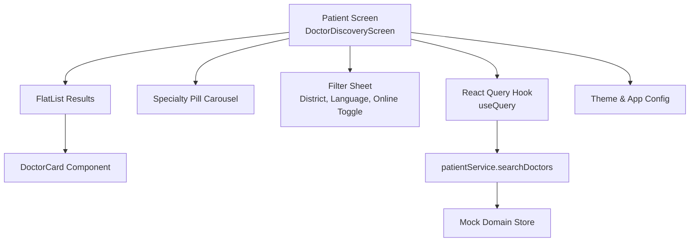
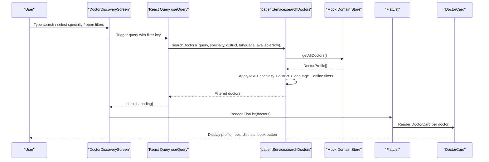
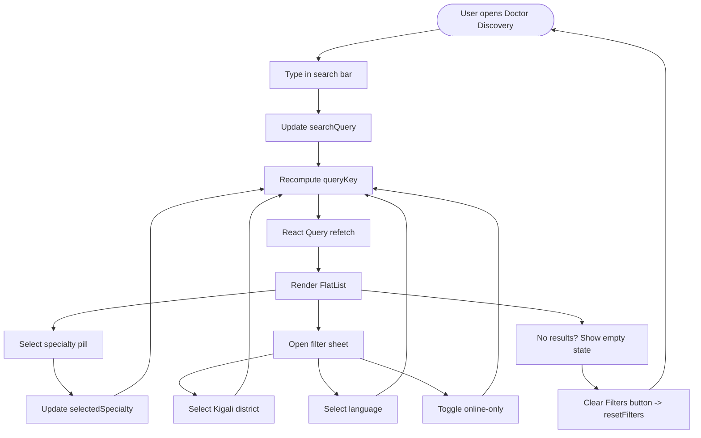
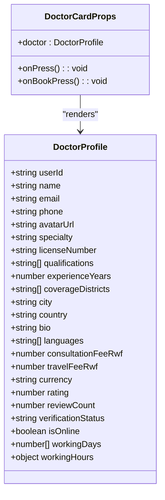
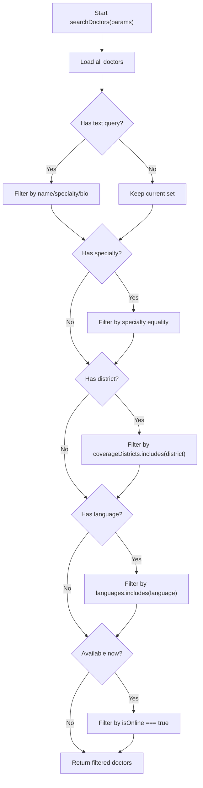
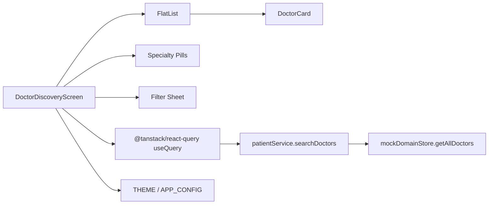

# Doctor Discovery & Search

<cite>
**Referenced Files in This Document**
- [doctors.tsx](file://src/app/(patient)/doctors.tsx)
- [DoctorCard.tsx](file://src/components/ui/DoctorCard.tsx)
- [api.ts](file://src/services/api.ts)
- [domain.ts](file://src/types/domain.ts)
- [theme.ts](file://src/constants/theme.ts)
- [fixtures.ts](file://src/mock/fixtures.ts)
</cite>

## Table of Contents
1. [Introduction](#introduction)
2. [Project Structure](#project-structure)
3. [Core Components](#core-components)
4. [Architecture Overview](#architecture-overview)
5. [Detailed Component Analysis](#detailed-component-analysis)
6. [Dependency Analysis](#dependency-analysis)
7. [Performance Considerations](#performance-considerations)
8. [Troubleshooting Guide](#troubleshooting-guide)
9. [Conclusion](#conclusion)

## Introduction
This document explains the doctor discovery and search functionality for the patient experience. It covers:
- Multi-factor search by doctor name, symptom, or condition
- Specialty filtering through a pill carousel
- District-based location filtering for Kigali coverage areas
- Language preference selection including Kinyarwanda, English, and French
- Online-only availability toggle
- React Query integration for caching and automatic refetching
- Filter state management with reset behavior
- The DoctorCard display component
- Examples of query construction, filter combinations, and performance strategies for large datasets

## Project Structure
The doctor discovery feature is implemented as a patient-facing screen that composes UI controls, local filter state, React Query data fetching, and a reusable card component.

**Diagram sources**
- [doctors.tsx:19-54](file://src/app/(patient)/doctors.tsx#L19-L54)
- [doctors.tsx:107-189](file://src/app/(patient)/doctors.tsx#L107-L189)
- [doctors.tsx:192-221](file://src/app/(patient)/doctors.tsx#L192-L221)
- [api.ts:247-323](file://src/services/api.ts#L247-L323)
- [theme.ts:58-69](file://src/constants/theme.ts#L58-L69)

**Section sources**
- [doctors.tsx:19-54](file://src/app/(patient)/doctors.tsx#L19-L54)
- [api.ts:247-323](file://src/services/api.ts#L247-L323)

## Core Components
- DoctorDiscoveryScreen: Manages search input, specialty pills, expanded filters (district, language, online-only), and renders results.
- DoctorCard: Displays doctor profile summary, rating, experience, coverage districts, fee, and booking action.
- patientService.searchDoctors: Applies multi-factor filtering over mock data and returns matching doctors.
- React Query useQuery: Caches results keyed by all active filters and triggers refetch on change.

Key responsibilities:
- State: searchQuery, selectedSpecialty, selectedDistrict, selectedLanguage, onlineOnly, showFilters.
- Data: specialties list and filtered doctors list.
- Navigation: route to doctor detail and booking pages.

**Section sources**
- [doctors.tsx:19-69](file://src/app/(patient)/doctors.tsx#L19-L69)
- [DoctorCard.tsx:9-86](file://src/components/ui/DoctorCard.tsx#L9-L86)
- [api.ts:247-323](file://src/services/api.ts#L247-L323)

## Architecture Overview
The discovery flow integrates UI state, React Query, and service-layer filtering.

**Diagram sources**
- [doctors.tsx:31-54](file://src/app/(patient)/doctors.tsx#L31-L54)
- [doctors.tsx:192-221](file://src/app/(patient)/doctors.tsx#L192-L221)
- [api.ts:290-323](file://src/services/api.ts#L290-L323)

## Detailed Component Analysis

### DoctorDiscoveryScreen
Responsibilities:
- Text search by doctor name, specialty, or bio content.
- Specialty filtering via horizontal pill carousel.
- Expanded filter sheet for:
  - Kigali coverage districts from app configuration.
  - Consultation language options: All, Kinyarwanda, English, French.
  - Online-only toggle for currently available doctors.
- Reset filters to default values.
- Render result list using FlatList and DoctorCard.

Filter state model:
- searchQuery: string
- selectedSpecialty: string (default 'All')
- selectedDistrict: string (default 'All')
- selectedLanguage: string (default 'All')
- onlineOnly: boolean (default false)
- showFilters: boolean (UI toggle)

React Query integration:
- Specialties are fetched once and cached under ['specialties'].
- Doctors search uses a composite query key including all filter parameters.
- Changing any filter recomputes the key and triggers a new fetch.
- Loading state is exposed for UX feedback.

Search query construction:
- When calling the service, undefined values are passed for non-selected filters:
  - specialty: undefined if 'All'
  - district: undefined if 'All'
  - language: undefined if 'All'
  - availableNow: true only when onlineOnly is enabled

Reset behavior:
- Clears search text, resets specialty/district/language to 'All', disables online-only.

Navigation:
- Tapping a card navigates to the doctor detail page.
- Booking button navigates to the booking page for the selected doctor.

**Diagram sources**
- [doctors.tsx:21-69](file://src/app/(patient)/doctors.tsx#L21-L69)
- [doctors.tsx:71-221](file://src/app/(patient)/doctors.tsx#L71-L221)

**Section sources**
- [doctors.tsx:19-69](file://src/app/(patient)/doctors.tsx#L19-L69)
- [doctors.tsx:71-221](file://src/app/(patient)/doctors.tsx#L71-L221)

### DoctorCard
Responsibilities:
- Display avatar, verified badge, name, specialty, rating, review count, experience years.
- Show short bio and coverage districts as chips.
- Display consultation fee and a “Book Visit” action.
- Support navigation to doctor details and booking flows.

Data contract:
- Accepts a DoctorProfile object and callback props for press actions.

Visual elements:
- Uses theme tokens for colors, typography, spacing, and border radius.
- Renders badges and icons for verification and ratings.

**Diagram sources**
- [DoctorCard.tsx:9-86](file://src/components/ui/DoctorCard.tsx#L9-L86)
- [domain.ts:61-85](file://src/types/domain.ts#L61-L85)

**Section sources**
- [DoctorCard.tsx:9-86](file://src/components/ui/DoctorCard.tsx#L9-L86)
- [domain.ts:61-85](file://src/types/domain.ts#L61-L85)

### Search Filtering Logic
The service layer applies filters sequentially:
- Text search matches against name, specialty, and bio fields.
- Specialty filter matches exact specialty names.
- District filter checks if the doctor’s coverageDistricts include the selected district.
- Language filter checks if the doctor’s languages include the selected language.
- Online-only filter restricts to doctors marked as currently online.

**Diagram sources**
- [api.ts:290-323](file://src/services/api.ts#L290-L323)

**Section sources**
- [api.ts:290-323](file://src/services/api.ts#L290-L323)

### Kigali Coverage Districts
The filter sheet enumerates Kigali coverage districts from application configuration. The UI adds an “All” option alongside configured districts.

- Configuration source: APP_CONFIG.coverageDistricts
- Default selection: “All”
- Behavior: Passing “All” translates to undefined in the search query, disabling district filtering.

Note: If coverageDistricts is not explicitly defined in the configuration file, the UI will render no additional district options beyond “All”. Ensure the configuration includes Kigali districts such as Gasabo, Kicukiro, and Nyarugenge for meaningful filtering.

**Section sources**
- [doctors.tsx:142-158](file://src/app/(patient)/doctors.tsx#L142-L158)
- [theme.ts:58-69](file://src/constants/theme.ts#L58-L69)

### Language Preferences
Supported options:
- All
- Kinyarwanda
- English
- French

Behavior:
- Selecting a specific language passes it to the service; selecting “All” passes undefined to disable language filtering.
- Matching is based on the doctor.languages array.

**Section sources**
- [doctors.tsx:160-176](file://src/app/(patient)/doctors.tsx#L160-L176)
- [api.ts:309-311](file://src/services/api.ts#L309-L311)

### Online-Only Availability
Behavior:
- Toggle enables availableNow=true in the search query.
- Service filters doctors where isOnline is true.

Use case:
- Patients who want immediate virtual consultations can enable this to see only currently available specialists.

**Section sources**
- [doctors.tsx:178-187](file://src/app/(patient)/doctors.tsx#L178-L187)
- [api.ts:318-320](file://src/services/api.ts#L318-L320)

## Dependency Analysis
The following diagram shows how components and services depend on each other during discovery and search.

**Diagram sources**
- [doctors.tsx:11-17](file://src/app/(patient)/doctors.tsx#L11-L17)
- [doctors.tsx:31-54](file://src/app/(patient)/doctors.tsx#L31-L54)
- [api.ts:290-323](file://src/services/api.ts#L290-L323)

**Section sources**
- [doctors.tsx:11-17](file://src/app/(patient)/doctors.tsx#L11-L17)
- [api.ts:290-323](file://src/services/api.ts#L290-L323)

## Performance Considerations
For large doctor datasets, consider these strategies:

- Debounce text input:
  - Delay triggering the search query until the user stops typing for a short period (e.g., 300–500ms).
  - Reduces unnecessary refetches while typing long queries.

- Optimize query keys:
  - Keep the query key stable and minimal; avoid storing heavy objects.
  - Current implementation already uses primitive filter values, which is efficient.

- Pagination or virtualization:
  - Use FlatList with appropriate windowSize and removeClippedSubviews for smoother scrolling.
  - For very large lists, implement server-side pagination or infinite loading.

- Server-side filtering:
  - Move filtering logic to the backend API to reduce client-side processing.
  - Expose dedicated endpoints for search with query parameters.

- Memoization:
  - Wrap expensive computations with useMemo where needed.
  - Avoid re-rendering cards by memoizing DoctorCard or using React.memo.

- Image optimization:
  - Use appropriately sized avatars and lazy loading.
  - Cache images locally if possible.

- Stale-while-revalidate:
  - Configure React Query staleTime and gcTime to balance freshness and performance.
  - Enable background refetching to keep results fresh without blocking UI.

[No sources needed since this section provides general guidance]

## Troubleshooting Guide
Common issues and resolutions:

- No results appear after applying filters:
  - Verify selected district exists in doctor.coverageDistricts.
  - Confirm selected language exists in doctor.languages.
  - Check online-only toggle; it may exclude many doctors.
  - Use “Clear Filters” to reset to defaults.

- Specialty pills do not load:
  - Ensure getSpecialties returns data.
  - Inspect the specialties query cache and network calls.

- District filter has no effect:
  - Confirm APP_CONFIG.coverageDistricts contains expected Kigali districts.
  - Validate that doctors have coverageDistricts populated.

- Language filter does not match:
  - Ensure doctor.languages includes the selected language exactly.
  - Case sensitivity should be consistent; service performs exact inclusion checks.

- Performance degradation with many doctors:
  - Implement debounced search input.
  - Consider server-side pagination and indexing.
  - Optimize FlatList rendering and image loading.

**Section sources**
- [doctors.tsx:56-69](file://src/app/(patient)/doctors.tsx#L56-L69)
- [doctors.tsx:142-187](file://src/app/(patient)/doctors.tsx#L142-L187)
- [api.ts:290-323](file://src/services/api.ts#L290-L323)

## Conclusion
The doctor discovery and search system combines intuitive UI controls with robust filtering logic and React Query caching. Users can search by text, narrow by specialty, filter by Kigali districts, choose consultation languages, and restrict to online-only doctors. The DoctorCard presents essential information and supports direct navigation to booking. For production-scale datasets, adopt debouncing, server-side filtering, pagination, and rendering optimizations to maintain responsiveness and reliability.

[No sources needed since this section summarizes without analyzing specific files]