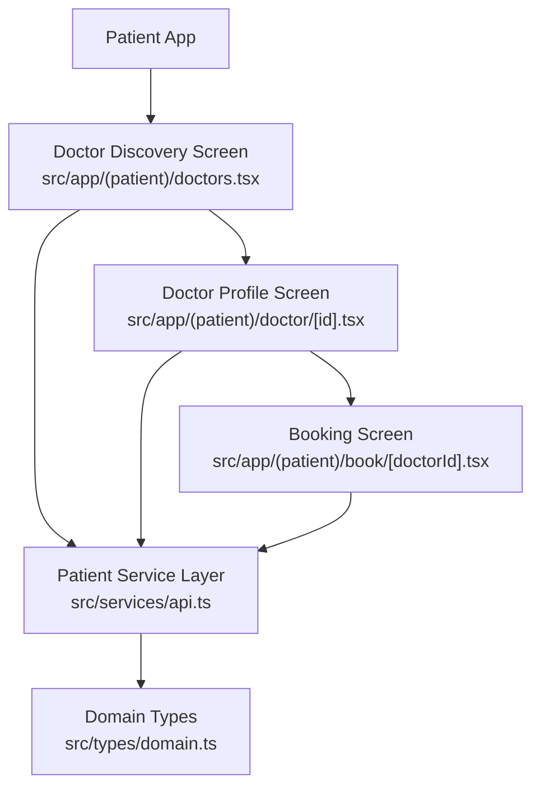
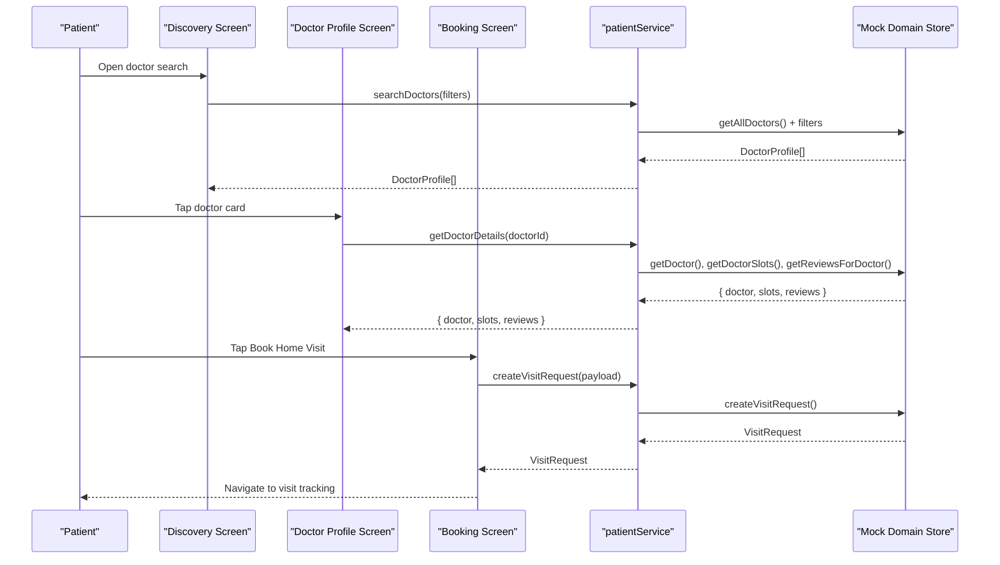
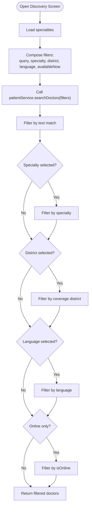
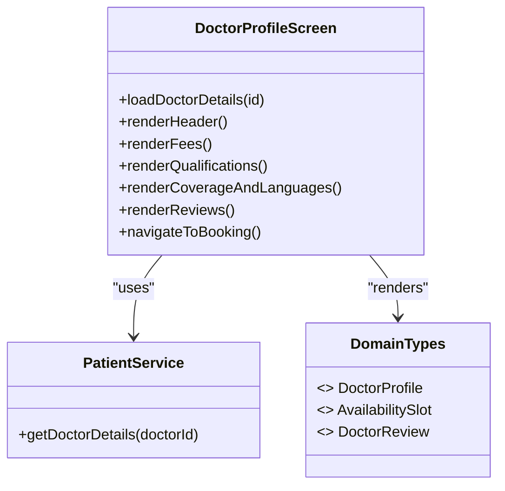
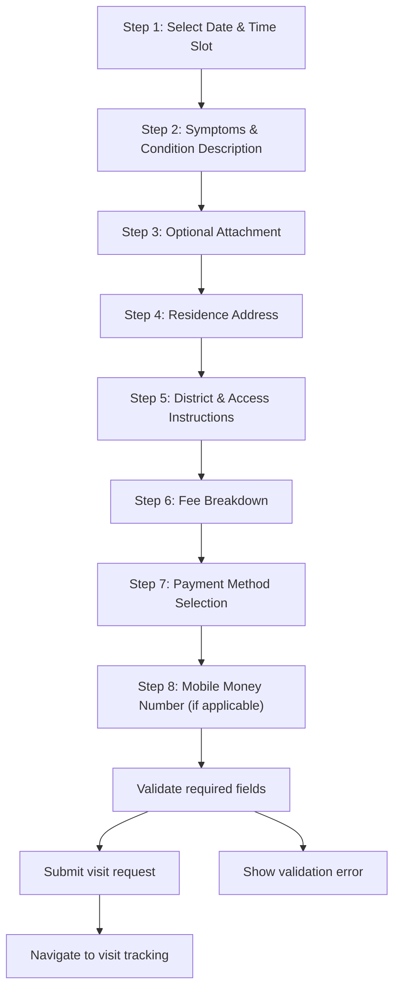
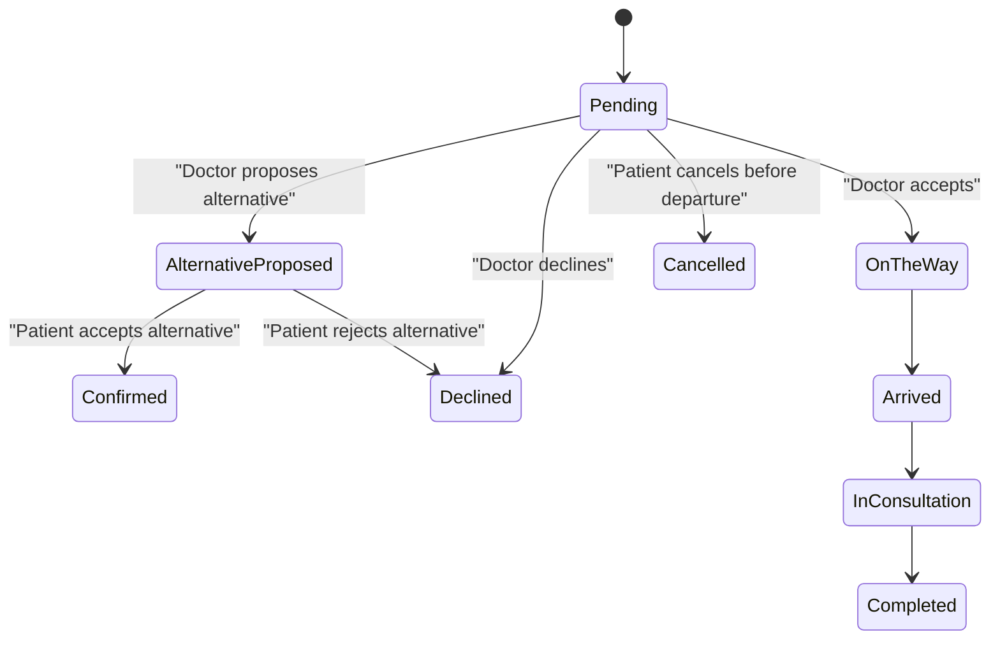
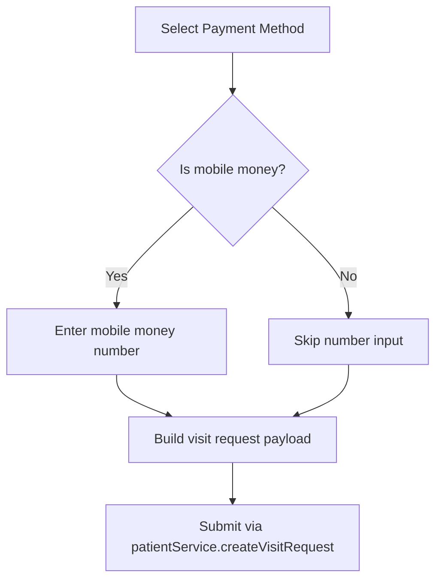
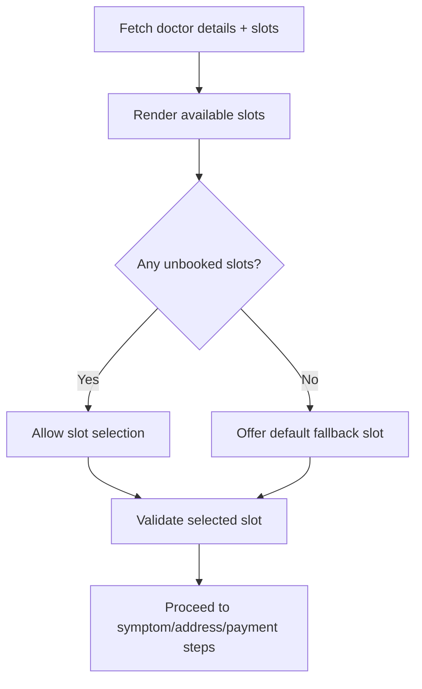
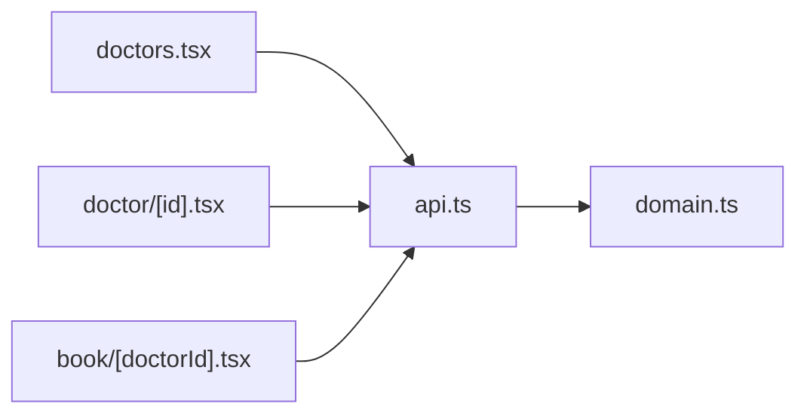

# Doctor Search & Booking

<cite>
**Referenced Files in This Document**   
- [doctors.tsx](file://src/app/(patient)/doctors.tsx)
- [doctor/[id].tsx](file://src/app/(patient)/doctor/[id].tsx)
- [book/[doctorId].tsx](file://src/app/(patient)/book/[doctorId].tsx)
- [api.ts](file://src/services/api.ts)
- [domain.ts](file://src/types/domain.ts)
- [README.md](file://README.md)
</cite>

## Table of Contents
1. [Introduction](#introduction)
2. [Project Structure](#project-structure)
3. [Core Components](#core-components)
4. [Architecture Overview](#architecture-overview)
5. [Detailed Component Analysis](#detailed-component-analysis)
6. [Dependency Analysis](#dependency-analysis)
7. [Performance Considerations](#performance-considerations)
8. [Troubleshooting Guide](#troubleshooting-guide)
9. [Conclusion](#conclusion)

## Introduction
This document explains the patient-facing doctor discovery and booking workflow. It covers:
- Multi-factor doctor search with specialty, district, language, availability, and rating filters.
- The 9-step booking process from slot selection through payment confirmation.
- Symptom description input, address collection, alternative time proposal handling, and mobile money integration.
- Doctor profile viewing with credentials verification, review aggregation, and availability display.
- Booking state management, error handling for unavailable slots, and service-layer integration for real-time availability checks.

The implementation is a React Native / Expo Router frontend using TanStack Query and a TypeScript service layer backed by a mock domain store.

**Section sources**
- [README.md:1-10](file://README.md#L1-L10)
- [README.md:127-137](file://README.md#L127-L137)

## Project Structure
The relevant patient workflow spans three screens and one service layer:
- Doctor discovery screen: multi-filter search and result list.
- Doctor detail screen: verified profile, fees, coverage, languages, reviews, and booking entry point.
- Booking screen: 9-step flow including slot selection, symptoms, address, fee breakdown, payment method, and submission.
- Service layer: typed contracts and mock-backed implementations for searching doctors, fetching details, and creating visit requests.

**Diagram sources**
- [doctors.tsx:19-54](file://src/app/(patient)/doctors.tsx#L19-L54)
- [doctor/[id].tsx:19-36](file://src/app/(patient)/doctor/[id].tsx#L19-L36)
- [book/[doctorId].tsx:32-62](file://src/app/(patient)/book/[doctorId].tsx#L32-L62)
- [api.ts:247-332](file://src/services/api.ts#L247-L332)
- [domain.ts:61-129](file://src/types/domain.ts#L61-L129)

**Section sources**
- [README.md:127-137](file://README.md#L127-L137)

## Core Components
- Doctor discovery screen: provides text search, specialty pills, Kigali district chips, language chips, and an online-only toggle. It composes these into a query passed to `patientService.searchDoctors`.
- Doctor profile screen: loads doctor details, available slots, and reviews; shows verification status, license number, fees, coverage districts, languages, and aggregated reviews.
- Booking screen: implements the 9-step flow, collects symptoms, optional attachments, residence address, district, access notes, fee breakdown, and payment method; submits a visit request via `patientService.createVisitRequest`.
- Service layer: exposes typed interfaces for patient operations and implements them against a mock domain store with simulated latency.

Key responsibilities:
- UI state composition and validation on screens.
- Data fetching and caching via TanStack Query.
- Domain modeling and cross-cutting business rules in the service layer.

**Section sources**
- [doctors.tsx:19-54](file://src/app/(patient)/doctors.tsx#L19-L54)
- [doctor/[id].tsx:19-36](file://src/app/(patient)/doctor/[id].tsx#L19-L36)
- [book/[doctorId].tsx:32-62](file://src/app/(patient)/book/[doctorId].tsx#L32-L62)
- [api.ts:247-332](file://src/services/api.ts#L247-L332)

## Architecture Overview
The patient journey flows through screens that call a single service layer. The service layer currently uses a mock domain store but is designed for future REST API integration.

**Diagram sources**
- [doctors.tsx:31-54](file://src/app/(patient)/doctors.tsx#L31-L54)
- [doctor/[id].tsx:22-36](file://src/app/(patient)/doctor/[id].tsx#L22-L36)
- [book/[doctorId].tsx:36-43](file://src/app/(patient)/book/[doctorId].tsx#L36-L43)
- [book/[doctorId].tsx:85-134](file://src/app/(patient)/book/[doctorId].tsx#L85-L134)
- [api.ts:290-332](file://src/services/api.ts#L290-L332)
- [api.ts:334-345](file://src/services/api.ts#L334-L345)

## Detailed Component Analysis

### Doctor Discovery Workflow
The discovery screen supports:
- Text search across doctor name, specialty, and bio.
- Specialty filtering via horizontal pill carousel.
- District filtering over Kigali coverage districts.
- Language filtering among predefined options.
- Online-only availability toggle.

Search parameters are composed into a single query key and passed to `patientService.searchDoctors`, which applies filters in order: text match, specialty, district, language, max fee, min rating, and online-only.

**Diagram sources**
- [doctors.tsx:31-54](file://src/app/(patient)/doctors.tsx#L31-L54)
- [api.ts:290-323](file://src/services/api.ts#L290-L323)

**Section sources**
- [doctors.tsx:19-54](file://src/app/(patient)/doctors.tsx#L19-L54)
- [api.ts:290-323](file://src/services/api.ts#L290-L323)

### Doctor Profile Viewing System
The profile screen:
- Loads doctor details, slots, and reviews.
- Displays verification status (approved badge), license number, specialty, experience, ratings, and review count.
- Shows consultation and travel fees, bio, qualifications, coverage districts, and languages.
- Aggregates verified patient reviews with star ratings and dates.
- Provides a fixed “Book Home Visit” action navigating to the booking screen.

**Diagram sources**
- [doctor/[id].tsx:19-36](file://src/app/(patient)/doctor/[id].tsx#L19-L36)
- [doctor/[id].tsx:40-151](file://src/app/(patient)/doctor/[id].tsx#L40-L151)
- [api.ts:325-332](file://src/services/api.ts#L325-L332)
- [domain.ts:61-95](file://src/types/domain.ts#L61-L95)
- [domain.ts:207-216](file://src/types/domain.ts#L207-L216)

**Section sources**
- [doctor/[id].tsx:19-151](file://src/app/(patient)/doctor/[id].tsx#L19-L151)
- [api.ts:325-332](file://src/services/api.ts#L325-L332)
- [domain.ts:61-95](file://src/types/domain.ts#L61-L95)
- [domain.ts:207-216](file://src/types/domain.ts#L207-L216)

### 9-Step Booking Process
The booking screen implements a comprehensive flow:
1. Select date and available time slot from doctor’s open windows or default.
2. Choose common symptoms and provide a detailed condition description.
3. Optionally attach prior prescriptions or lab photos.
4. Enter residence address and Kigali district.
5. Provide gate and landmark access instructions.
6. Review fee breakdown (consultation fee, travel fee, estimated total).
7. Select payment method: MTN Mobile Money, Airtel Money, or Cash on Visit.
8. For mobile money, enter phone number (simulated).
9. Confirm and submit the visit request; navigate to visit tracking.

**Diagram sources**
- [book/[doctorId].tsx:156-197](file://src/app/(patient)/book/[doctorId].tsx#L156-L197)
- [book/[doctorId].tsx:199-263](file://src/app/(patient)/book/[doctorId].tsx#L199-L263)
- [book/[doctorId].tsx:265-295](file://src/app/(patient)/book/[doctorId].tsx#L265-L295)
- [book/[doctorId].tsx:297-363](file://src/app/(patient)/book/[doctorId].tsx#L297-L363)
- [book/[doctorId].tsx:365-376](file://src/app/(patient)/book/[doctorId].tsx#L365-L376)
- [book/[doctorId].tsx:85-134](file://src/app/(patient)/book/[doctorId].tsx#L85-L134)

**Section sources**
- [book/[doctorId].tsx:32-62](file://src/app/(patient)/book/[doctorId].tsx#L32-L62)
- [book/[doctorId].tsx:156-376](file://src/app/(patient)/book/[doctorId].tsx#L156-L376)

### Alternative Time Proposal Handling
Alternative time proposals are part of the broader booking state machine:
- Doctors can propose an alternative date/time with a note.
- Patients can accept or reject the proposed alternative.
- Accepting updates the scheduled date/time and confirms the visit.
- Rejecting transitions the visit to declined.

**Diagram sources**
- [domain.ts:9-19](file://src/types/domain.ts#L9-L19)
- [api.ts:384-403](file://src/services/api.ts#L384-L403)
- [api.ts:522-529](file://src/services/api.ts#L522-L529)

**Section sources**
- [domain.ts:9-19](file://src/types/domain.ts#L9-L19)
- [api.ts:384-403](file://src/services/api.ts#L384-L403)
- [api.ts:522-529](file://src/services/api.ts#L522-L529)

### Payment Method Selection and Mobile Money Integration
The booking screen presents three payment methods:
- MTN Mobile Money
- Airtel Money
- Cash on Visit

When a mobile money option is selected, the user enters a phone number (simulated). The selected payment method is included in the visit request payload with a pending payment status.

**Diagram sources**
- [book/[doctorId].tsx:297-363](file://src/app/(patient)/book/[doctorId].tsx#L297-L363)
- [book/[doctorId].tsx:102-126](file://src/app/(patient)/book/[doctorId].tsx#L102-L126)
- [domain.ts:25-27](file://src/types/domain.ts#L25-L27)

**Section sources**
- [book/[doctorId].tsx:297-363](file://src/app/(patient)/book/[doctorId].tsx#L297-L363)
- [domain.ts:25-27](file://src/types/domain.ts#L25-L27)

### Real-Time Availability Checks and Unavailable Slot Handling
- The discovery screen supports an “online only” filter that maps to `isOnline` on doctor profiles.
- The profile screen displays available slots returned by the service layer.
- The booking screen filters out booked slots when rendering selectable options.
- If no slots are available, the booking screen offers a default fallback slot.

**Diagram sources**
- [doctors.tsx:31-54](file://src/app/(patient)/doctors.tsx#L31-L54)
- [doctor/[id].tsx:22-36](file://src/app/(patient)/doctor/[id].tsx#L22-L36)
- [book/[doctorId].tsx:156-197](file://src/app/(patient)/book/[doctorId].tsx#L156-L197)
- [api.ts:325-332](file://src/services/api.ts#L325-L332)

**Section sources**
- [doctors.tsx:31-54](file://src/app/(patient)/doctors.tsx#L31-L54)
- [doctor/[id].tsx:22-36](file://src/app/(patient)/doctor/[id].tsx#L22-L36)
- [book/[doctorId].tsx:156-197](file://src/app/(patient)/book/[doctorId].tsx#L156-L197)
- [api.ts:325-332](file://src/services/api.ts#L325-L332)

## Dependency Analysis
The following diagram shows how screens depend on the service layer and domain types.

**Diagram sources**
- [doctors.tsx:15-16](file://src/app/(patient)/doctors.tsx#L15-L16)
- [doctor/[id].tsx:15-17](file://src/app/(patient)/doctor/[id].tsx#L15-L17)
- [book/[doctorId].tsx:14-19](file://src/app/(patient)/book/[doctorId].tsx#L14-L19)
- [api.ts:3-19](file://src/services/api.ts#L3-L19)
- [domain.ts:1-242](file://src/types/domain.ts#L1-L242)

**Section sources**
- [doctors.tsx:15-16](file://src/app/(patient)/doctors.tsx#L15-L16)
- [doctor/[id].tsx:15-17](file://src/app/(patient)/doctor/[id].tsx#L15-L17)
- [book/[doctorId].tsx:14-19](file://src/app/(patient)/book/[doctorId].tsx#L14-L19)
- [api.ts:3-19](file://src/services/api.ts#L3-L19)
- [domain.ts:1-242](file://src/types/domain.ts#L1-L242)

## Performance Considerations
- Use TanStack Query keys to avoid redundant calls when filters change incrementally.
- Debounce text search input to reduce unnecessary re-renders and service calls.
- Cache doctor details and reviews per doctor ID to prevent refetches during navigation.
- Avoid heavy image loading on profile screens; consider lazy loading avatars and reviews pagination if data grows.
- Keep slot lists small by limiting displayed days or implementing virtualized lists for large datasets.

[No sources needed since this section provides general guidance]

## Troubleshooting Guide
Common issues and resolutions:
- No matching doctors found:
  - Clear filters and broaden specialty/district/language selections.
  - Ensure the “online only” toggle is not overly restrictive.
- Doctor not found:
  - Verify the doctor ID passed to the profile and booking screens.
  - Check service layer error handling for missing doctor records.
- Validation errors during booking:
  - Ensure condition description and address are provided.
  - Confirm district and access instructions are filled where required.
- Submission failures:
  - Inspect network/service errors and retry logic.
  - Confirm payment method selection and mobile money number format.

**Section sources**
- [doctors.tsx:203-221](file://src/app/(patient)/doctors.tsx#L203-L221)
- [book/[doctorId].tsx:85-134](file://src/app/(patient)/book/[doctorId].tsx#L85-L134)
- [api.ts:325-332](file://src/services/api.ts#L325-L332)

## Conclusion
The doctor discovery and booking workflow integrates multi-factor search, rich doctor profiles, and a structured 9-step booking process. The service layer abstracts data access and enforces domain constraints, while the screens focus on user interaction and state composition. Future backend integration can replace the mock store without changing screen logic, preserving a clean separation between presentation and data access.

[No sources needed since this section summarizes without analyzing specific files]