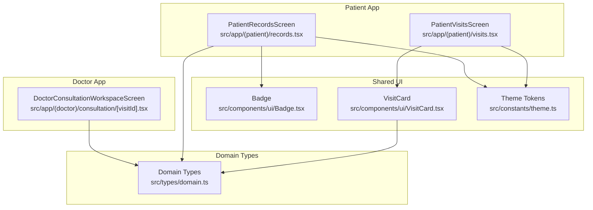
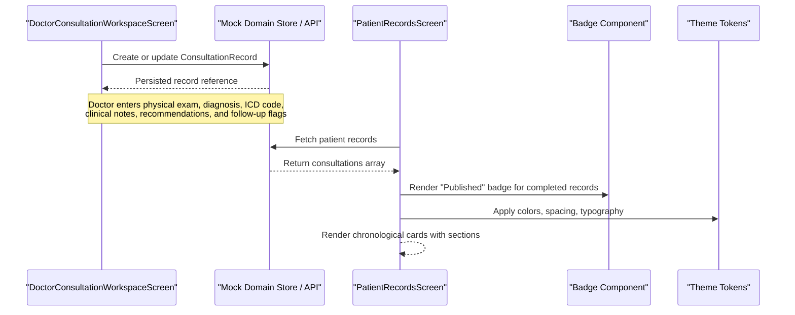
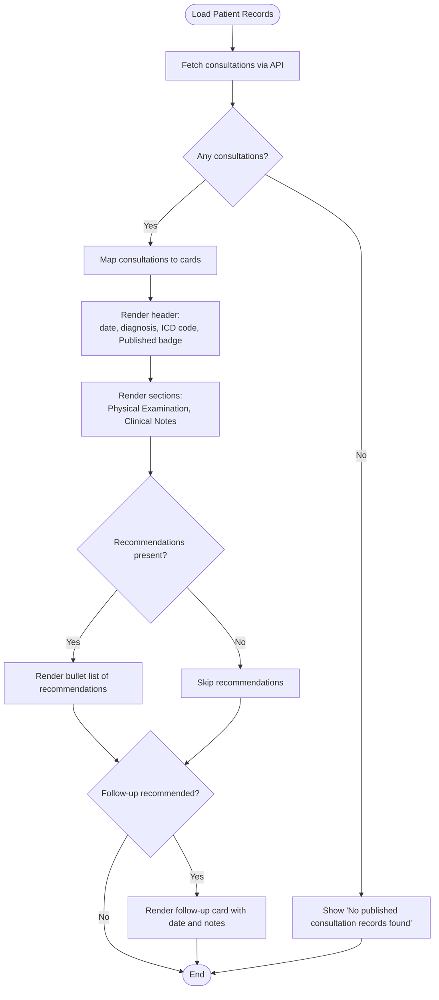
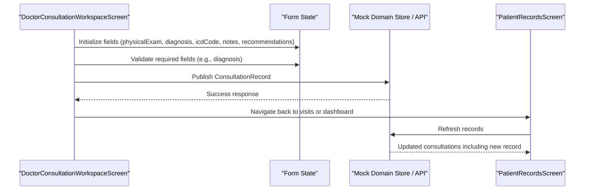
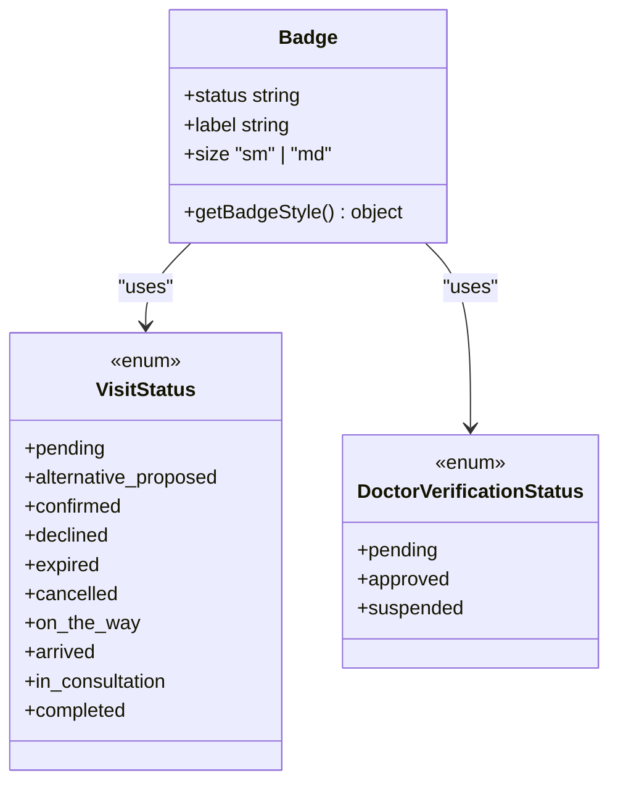
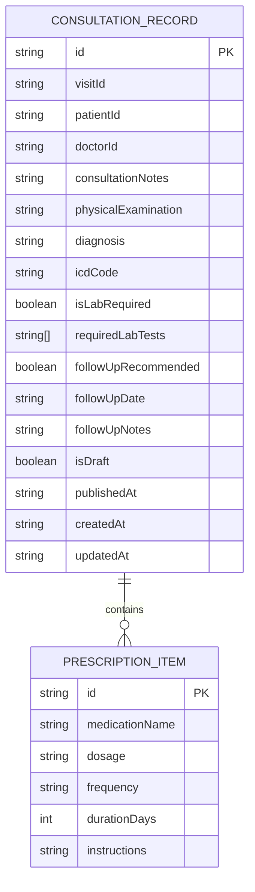
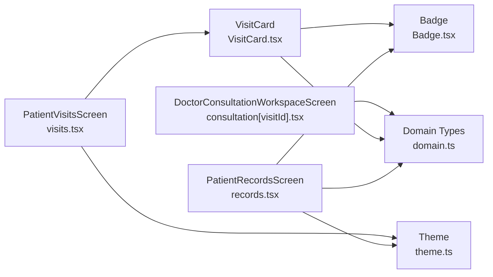

# Consultation Summaries

<cite>
**Referenced Files in This Document**
- [records.tsx](file://src/app/(patient)/records.tsx)
- [domain.ts](file://src/types/domain.ts)
- [Badge.tsx](file://src/components/ui/Badge.tsx)
- [theme.ts](file://src/constants/theme.ts)
- [visits.tsx](file://src/app/(patient)/visits.tsx)
- [VisitCard.tsx](file://src/components/ui/VisitCard.tsx)
- [consultation[visitId].tsx](file://src/app/(doctor)/consultation/[visitId].tsx)
</cite>

## Table of Contents
1. [Introduction](#introduction)
2. [Project Structure](#project-structure)
3. [Core Components](#core-components)
4. [Architecture Overview](#architecture-overview)
5. [Detailed Component Analysis](#detailed-component-analysis)
6. [Dependency Analysis](#dependency-analysis)
7. [Performance Considerations](#performance-considerations)
8. [Troubleshooting Guide](#troubleshooting-guide)
9. [Conclusion](#conclusion)

## Introduction
This document explains the consultation summaries display system used by patients to view chronological clinical consultation records. It covers how diagnosis information, ICD codes, physical examination findings, and clinical notes are presented; how doctor recommendations are displayed with bullet-point formatting; how follow-up appointment scheduling is integrated; and the visual design patterns including color coding, typography hierarchy, and responsive layout considerations. It also documents the status badges for published records and empty state handling when no consultations are available.

## Project Structure
The consultation summaries feature spans a few key screens and components:
- Patient Records screen renders tabbed views for consultations, prescriptions, and lab results.
- The Consultations tab displays each published consultation record chronologically.
- Doctor Consultation Workspace creates and publishes consultation records that later appear in the patient’s records.
- Shared UI components provide consistent styling, badges, and card layouts.
- Centralized theme tokens define colors, spacing, and typography.

**Diagram sources**
- [records.tsx:1-438](file://src/app/(patient)/records.tsx#L1-L438)
- [visits.tsx:1-166](file://src/app/(patient)/visits.tsx#L1-L166)
- [consultation[visitId].tsx:1-224](file://src/app/(doctor)/consultation/[visitId].tsx#L1-L224)
- [Badge.tsx:1-125](file://src/components/ui/Badge.tsx#L1-L125)
- [VisitCard.tsx:1-204](file://src/components/ui/VisitCard.tsx#L1-L204)
- [theme.ts:71-165](file://src/constants/theme.ts#L71-L165)
- [domain.ts:173-194](file://src/types/domain.ts#L173-L194)

**Section sources**
- [records.tsx:1-438](file://src/app/(patient)/records.tsx#L1-L438)
- [visits.tsx:1-166](file://src/app/(patient)/visits.tsx#L1-L166)
- [consultation[visitId].tsx:1-224](file://src/app/(doctor)/consultation/[visitId].tsx#L1-L224)
- [Badge.tsx:1-125](file://src/components/ui/Badge.tsx#L1-L125)
- [VisitCard.tsx:1-204](file://src/components/ui/VisitCard.tsx#L1-L204)
- [theme.ts:71-165](file://src/constants/theme.ts#L71-L165)
- [domain.ts:173-194](file://src/types/domain.ts#L173-L194)

## Core Components
- PatientRecordsScreen: Renders three tabs (Consultations, Prescriptions, Lab Results). The Consultations tab shows chronological cards with diagnosis, ICD code, physical examination, clinical notes, recommendations, and optional follow-up guidance.
- Badge: Displays status labels with semantic colors for visit states and record statuses such as “Published.”
- VisitCard: Shows visit summary details including date/time, person involved, location, symptoms, alternative proposal alerts, fees, and actions.
- DoctorConsultationWorkspaceScreen: Allows doctors to enter physical examination findings, diagnosis, ICD code, clinical notes, and recommendations, then publish the record so it appears in the patient’s records.
- Theme: Provides centralized colors, spacing, border radius, and typography tokens used across all screens.
- Domain Types: Defines data models like ConsultationRecord, PrescriptionItem, ResultDocument, and VisitRequest.

Key responsibilities:
- Data fetching and rendering of consultation records on the patient side.
- Status visualization via Badge component.
- Consistent visual language through Theme tokens.
- Record creation and publishing workflow from the doctor workspace.

**Section sources**
- [records.tsx:19-199](file://src/app/(patient)/records.tsx#L19-L199)
- [Badge.tsx:13-98](file://src/components/ui/Badge.tsx#L13-L98)
- [VisitCard.tsx:17-88](file://src/components/ui/VisitCard.tsx#L17-L88)
- [consultation[visitId].tsx:22-224](file://src/app/(doctor)/consultation/[visitId].tsx#L22-L224)
- [theme.ts:71-165](file://src/constants/theme.ts#L71-L165)
- [domain.ts:131-194](file://src/types/domain.ts#L131-L194)

## Architecture Overview
The consultation summaries flow connects doctor input to patient display:

**Diagram sources**
- [consultation[visitId].tsx:100-205](file://src/app/(doctor)/consultation/[visitId].tsx#L100-L205)
- [records.tsx:23-119](file://src/app/(patient)/records.tsx#L23-L119)
- [Badge.tsx:13-98](file://src/components/ui/Badge.tsx#L13-L98)
- [theme.ts:71-165](file://src/constants/theme.ts#L71-L165)

## Detailed Component Analysis

### Patient Records Screen: Chronological Consultations Display
The Patient Records screen organizes content into tabs. The Consultations tab:
- Loads consultation records using a query hook.
- Iterates through records and renders a Card per record.
- Displays the publication date, diagnosis title, and optional ICD code.
- Shows a “Published” status badge for completed records.
- Presents Physical Examination Findings and Clinical Notes in clearly separated sections.
- Lists Doctor Recommendations as bullet points.
- Optionally shows Follow-up Recommended section with date and notes.

**Diagram sources**
- [records.tsx:23-119](file://src/app/(patient)/records.tsx#L23-L119)

**Section sources**
- [records.tsx:19-119](file://src/app/(patient)/records.tsx#L19-L119)

### Doctor Consultation Workspace: Record Creation and Publishing
The Doctor Consultation Workspace allows clinicians to:
- Enter physical examination findings.
- Set diagnosis and ICD-10 code.
- Add clinical notes.
- Provide recommendations as a multi-line text that is split into an array.
- Mark follow-up requirements and dates.
- Publish the record, which becomes visible to the patient under their records.

**Diagram sources**
- [consultation[visitId].tsx:34-50](file://src/app/(doctor)/consultation/[visitId].tsx#L34-L50)
- [consultation[visitId].tsx:100-205](file://src/app/(doctor)/consultation/[visitId].tsx#L100-L205)

**Section sources**
- [consultation[visitId].tsx:22-224](file://src/app/(doctor)/consultation/[visitId].tsx#L22-L224)

### Status Badges System
The Badge component maps status values to background and text colors, providing consistent visual cues:
- Pending, Confirmed, Alternative Time Proposed, On the Way, Arrived, In Consultation, Completed, Approved, Declined, Cancelled, Suspended, Expired.
- Supports small and medium sizes.
- Used in VisitCard and Patient Records to indicate record and visit states.

**Diagram sources**
- [Badge.tsx:13-98](file://src/components/ui/Badge.tsx#L13-L98)
- [domain.ts:9-19](file://src/types/domain.ts#L9-L19)
- [domain.ts:7-7](file://src/types/domain.ts#L7-L7)

**Section sources**
- [Badge.tsx:1-125](file://src/components/ui/Badge.tsx#L1-125)
- [domain.ts:9-19](file://src/types/domain.ts#L9-L19)
- [domain.ts:7-7](file://src/types/domain.ts#L7-L7)

### Visual Design Patterns
Color coding:
- Primary palette for headings, links, and active states.
- Semantic badge backgrounds and text for status clarity.
- Section-specific backgrounds: recommendations use a green-tinted box; follow-up uses an amber-tinted box; lab results use a teal-tinted card.

Typography hierarchy:
- Headings and titles use bold weights and larger sizes.
- Secondary text uses muted colors and smaller sizes.
- Labels and metadata use uppercase or subdued styles.

Responsive layout considerations:
- FlatList and ScrollView ensure scrollable lists on mobile.
- Flexbox row/column arrangements adapt to screen width.
- Touch targets and spacing follow theme spacing tokens.

**Section sources**
- [theme.ts:71-165](file://src/constants/theme.ts#L71-L165)
- [records.tsx:203-438](file://src/app/(patient)/records.tsx#L203-L438)
- [visits.tsx:106-166](file://src/app/(patient)/visits.tsx#L106-L166)
- [VisitCard.tsx:90-204](file://src/components/ui/VisitCard.tsx#L90-L204)

### Data Model: ConsultationRecord
The ConsultationRecord model defines the structure of consultation summaries:
- Identifiers and relationships: id, visitId, patientId, doctorId.
- Clinical content: consultationNotes, physicalExamination, diagnosis, icdCode.
- Treatment artifacts: prescriptions array.
- Guidance: recommendations array, followUpRecommended flag, followUpDate, followUpNotes.
- Lifecycle: isDraft, publishedAt, createdAt, updatedAt.

**Diagram sources**
- [domain.ts:131-194](file://src/types/domain.ts#L131-L194)

**Section sources**
- [domain.ts:131-194](file://src/types/domain.ts#L131-L194)

### Example: How Consultation Data Is Structured and Rendered
- Data source: PatientRecordsScreen fetches records and maps them to cards.
- Header: Date, diagnosis title, optional ICD code, and “Published” badge.
- Sections: Physical Examination Findings and Clinical Notes rendered as distinct blocks.
- Recommendations: Rendered as bullet items within a styled container.
- Follow-up: Conditional block showing date and optional notes.

Rendering path references:
- Consultations mapping and rendering: [records.tsx:73-119](file://src/app/(patient)/records.tsx#L73-L119)
- Recommendation bullets: [records.tsx:92-101](file://src/app/(patient)/records.tsx#L92-L101)
- Follow-up block: [records.tsx:103-115](file://src/app/(patient)/records.tsx#L103-L115)

**Section sources**
- [records.tsx:73-119](file://src/app/(patient)/records.tsx#L73-L119)

### Empty State Handling
When no consultations are available:
- Patient Records screen shows a simple message indicating no published consultation records.
- Patient Visits screen provides contextual empty messages based on filter tabs (upcoming vs past).

References:
- Consultations empty state: [records.tsx:68-71](file://src/app/(patient)/records.tsx#L68-L71)
- Visits empty state: [visits.tsx:88-100](file://src/app/(patient)/visits.tsx#L88-L100)

**Section sources**
- [records.tsx:68-71](file://src/app/(patient)/records.tsx#L68-L71)
- [visits.tsx:88-100](file://src/app/(patient)/visits.tsx#L88-L100)

## Dependency Analysis
The following diagram highlights dependencies between screens, components, types, and theme:

**Diagram sources**
- [records.tsx:1-438](file://src/app/(patient)/records.tsx#L1-L438)
- [visits.tsx:1-166](file://src/app/(patient)/visits.tsx#L1-L166)
- [VisitCard.tsx:1-204](file://src/components/ui/VisitCard.tsx#L1-L204)
- [Badge.tsx:1-125](file://src/components/ui/Badge.tsx#L1-L125)
- [consultation[visitId].tsx:1-224](file://src/app/(doctor)/consultation/[visitId].tsx#L1-L224)
- [theme.ts:71-165](file://src/constants/theme.ts#L71-L165)
- [domain.ts:131-194](file://src/types/domain.ts#L131-L194)

**Section sources**
- [records.tsx:1-438](file://src/app/(patient)/records.tsx#L1-L438)
- [visits.tsx:1-166](file://src/app/(patient)/visits.tsx#L1-L166)
- [VisitCard.tsx:1-204](file://src/components/ui/VisitCard.tsx#L1-L204)
- [Badge.tsx:1-125](file://src/components/ui/Badge.tsx#L1-L125)
- [consultation[visitId].tsx:1-224](file://src/app/(doctor)/consultation/[visitId].tsx#L1-L224)
- [theme.ts:71-165](file://src/constants/theme.ts#L71-L165)
- [domain.ts:131-194](file://src/types/domain.ts#L131-L194)

## Performance Considerations
- Use FlatList for long lists of visits to optimize rendering performance.
- Avoid unnecessary re-renders by memoizing expensive computations if needed.
- Keep recommendation arrays concise to reduce layout complexity.
- Leverage theme tokens consistently to avoid style recalculations.

[No sources needed since this section provides general guidance]

## Troubleshooting Guide
Common issues and resolutions:
- No consultations shown: Ensure the backend returns at least one published ConsultationRecord; verify the query key includes the current user ID.
- Missing ICD code: Confirm the doctor entered an ICD-10 code during consultation; optional field may be absent.
- Recommendations not appearing: Verify the recommendations array is non-empty; check that the doctor provided at least one line item.
- Follow-up not displayed: Check followUpRecommended flag and presence of followUpDate; both must be set for the follow-up block to render.
- Badge mismatch: Ensure the status value matches one of the supported VisitStatus or DoctorVerificationStatus values.

**Section sources**
- [records.tsx:68-119](file://src/app/(patient)/records.tsx#L68-L119)
- [consultation[visitId].tsx:34-50](file://src/app/(doctor)/consultation/[visitId].tsx#L34-L50)
- [Badge.tsx:13-98](file://src/components/ui/Badge.tsx#L13-L98)

## Conclusion
The consultation summaries display system provides a clear, structured view of clinical consultation records for patients. It emphasizes readability through sectioned content, semantic status badges, and consistent visual design. The doctor workspace ensures accurate capture of clinical data, while the patient interface presents it chronologically with actionable follow-up information. By adhering to the domain model and theme tokens, the system maintains consistency and scalability across features.

[No sources needed since this section summarizes without analyzing specific files]