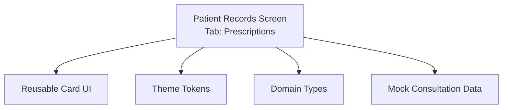
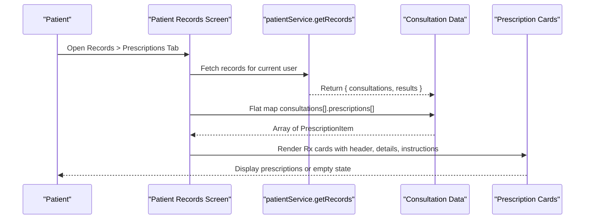
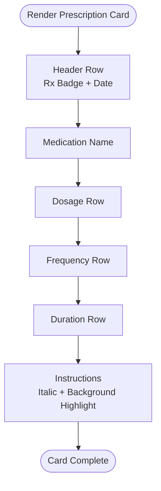
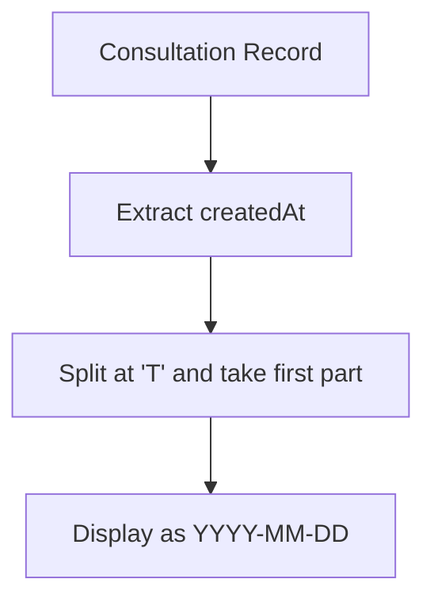
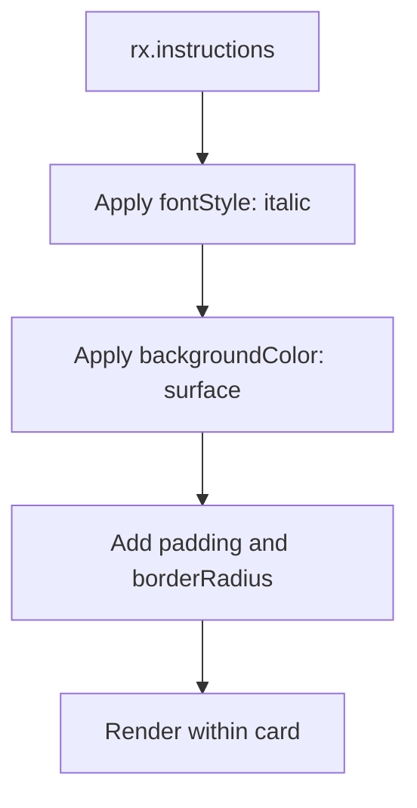
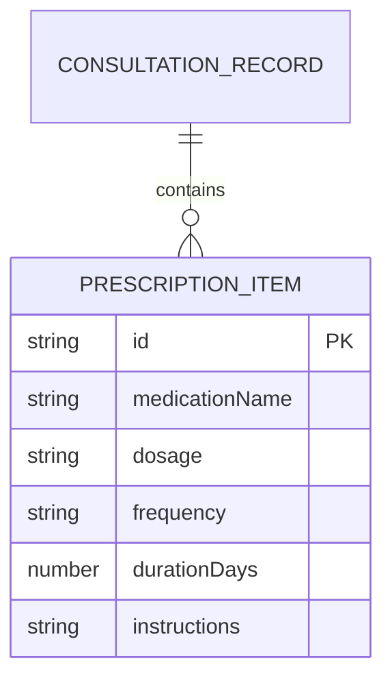
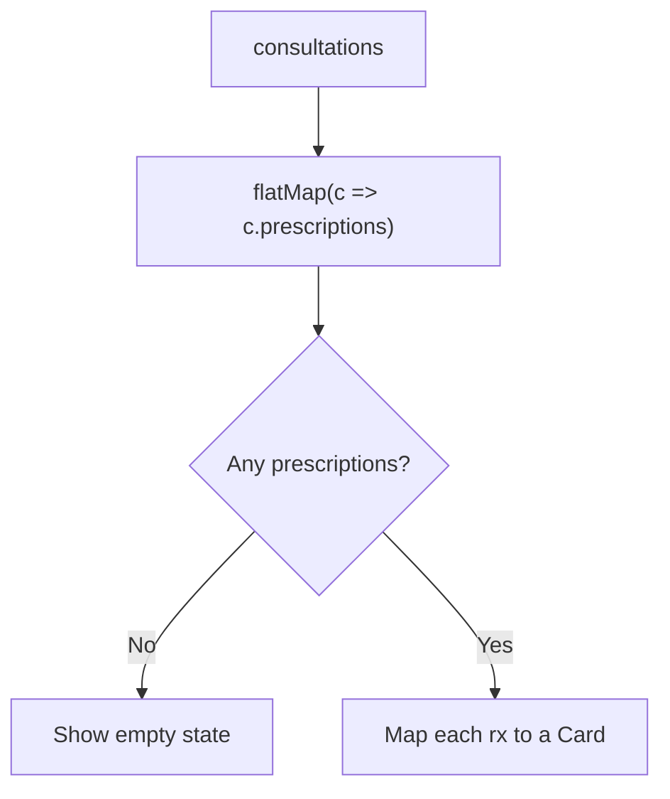
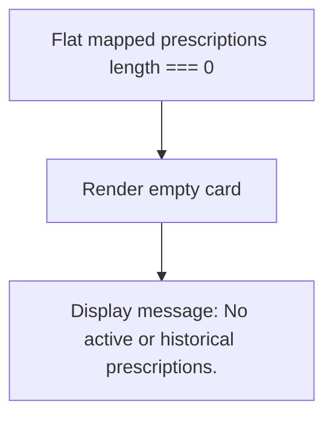
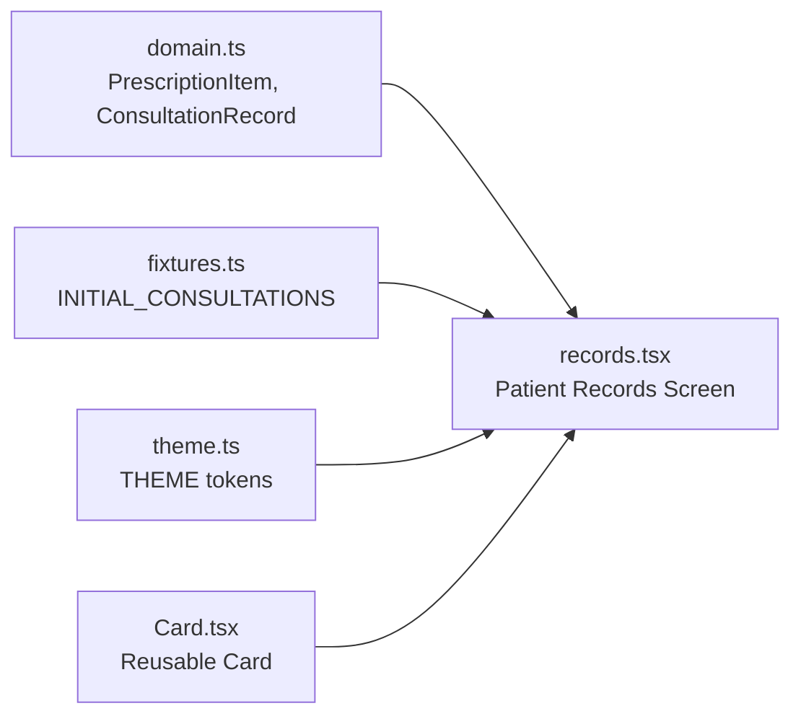

# Electronic Prescriptions

<cite>
**Referenced Files in This Document**
- [records.tsx](file://src/app/(patient)/records.tsx)
- [domain.ts](file://src/types/domain.ts)
- [fixtures.ts](file://src/mock/fixtures.ts)
- [theme.ts](file://src/constants/theme.ts)
- [Card.tsx](file://src/components/ui/Card.tsx)
- [Badge.tsx](file://src/components/ui/Badge.tsx)
</cite>

## Table of Contents
1. [Introduction](#introduction)
2. [Project Structure](#project-structure)
3. [Core Components](#core-components)
4. [Architecture Overview](#architecture-overview)
5. [Detailed Component Analysis](#detailed-component-analysis)
6. [Dependency Analysis](#dependency-analysis)
7. [Performance Considerations](#performance-considerations)
8. [Troubleshooting Guide](#troubleshooting-guide)
9. [Conclusion](#conclusion)

## Introduction
This document explains the electronic prescription viewing system used by patients to review prescribed medications from published consultation records. It covers the prescription card layout, header styling with an Rx badge and date formatting, instruction display with italicized text and background highlighting, data structures for prescriptions, how prescriptions are extracted from consultation records, empty state handling, and visual design patterns including color schemes, spacing, and typography.

## Project Structure
The patient-facing prescription viewer is implemented as a tabbed screen that includes consultations, electronic prescriptions, and lab results. The relevant implementation resides in the patient records screen, which renders a dedicated “Prescriptions (Rx)” tab.

**Diagram sources**
- [records.tsx:122-156](file://src/app/(patient)/records.tsx#L122-L156)
- [Card.tsx:1-56](file://src/components/ui/Card.tsx#L1-L56)
- [theme.ts:71-165](file://src/constants/theme.ts#L71-L165)
- [domain.ts:131-138](file://src/types/domain.ts#L131-L138)
- [fixtures.ts:693-738](file://src/mock/fixtures.ts#L693-L738)

**Section sources**
- [records.tsx:1-201](file://src/app/(patient)/records.tsx#L1-L201)

## Core Components
- Prescription card container: Uses a reusable card component to present each medication entry.
- Header row: Displays an Rx badge label and the consultation date formatted as YYYY-MM-DD.
- Medication details: Shows medication name, dosage, frequency, and duration in days.
- Instructions: Rendered in italics with a subtle background highlight for readability.
- Empty state: When no prescriptions exist across all consultations, a friendly message is shown.

Key responsibilities:
- Extracting prescriptions from consultation records via flat mapping.
- Rendering structured rows for dosage, frequency, and duration.
- Applying consistent theme tokens for colors, spacing, and typography.

**Section sources**
- [records.tsx:122-156](file://src/app/(patient)/records.tsx#L122-L156)
- [records.tsx:331-378](file://src/app/(patient)/records.tsx#L331-L378)

## Architecture Overview
The patient records screen fetches consultation records and displays them under tabs. The “Prescriptions” tab flattens all prescriptions from all consultations and renders one card per prescription.

**Diagram sources**
- [records.tsx:23-30](file://src/app/(patient)/records.tsx#L23-L30)
- [records.tsx:122-156](file://src/app/(patient)/records.tsx#L122-L156)

## Detailed Component Analysis

### Prescription Card Layout
Each prescription is rendered inside a card with:
- Header: An Rx badge label and the consultation date.
- Medication name: Prominent and bold.
- Rows: Dosage, Frequency, Duration (days).
- Instructions: Italicized text with a subtle background highlight.

**Diagram sources**
- [records.tsx:132-151](file://src/app/(patient)/records.tsx#L132-L151)
- [records.tsx:331-378](file://src/app/(patient)/records.tsx#L331-L378)

**Section sources**
- [records.tsx:132-151](file://src/app/(patient)/records.tsx#L132-L151)
- [records.tsx:331-378](file://src/app/(patient)/records.tsx#L331-L378)

### Prescription Header: Rx Badge Styling and Date Formatting
- Rx badge: A styled text element indicating “℞ PRESCRIPTION”.
- Date formatting: The consultation’s createdAt timestamp is truncated to the date portion (YYYY-MM-DD) using string splitting on the time separator.

**Diagram sources**
- [records.tsx:133-136](file://src/app/(patient)/records.tsx#L133-L136)

**Section sources**
- [records.tsx:133-136](file://src/app/(patient)/records.tsx#L133-L136)

### Instruction Display: Italicized Text and Background Highlight
- Instructions are wrapped in quotes and displayed in italics.
- A subtle background color and rounded corners improve readability.

**Diagram sources**
- [records.tsx:150-151](file://src/app/(patient)/records.tsx#L150-L151)
- [records.tsx:370-378](file://src/app/(patient)/records.tsx#L370-L378)

**Section sources**
- [records.tsx:150-151](file://src/app/(patient)/records.tsx#L150-L151)
- [records.tsx:370-378](file://src/app/(patient)/records.tsx#L370-L378)

### Data Structure for Prescriptions
Prescriptions are modeled as an array of items with the following fields:
- id: Unique identifier for the prescription item.
- medicationName: Full medication name and strength.
- dosage: Amount per dose.
- frequency: How often to take the medication.
- durationDays: Number of days to continue the medication.
- instructions: Additional guidance for safe use.

**Diagram sources**
- [domain.ts:131-138](file://src/types/domain.ts#L131-L138)
- [domain.ts:173-194](file://src/types/domain.ts#L173-L194)

**Section sources**
- [domain.ts:131-138](file://src/types/domain.ts#L131-L138)
- [domain.ts:173-194](file://src/types/domain.ts#L173-L194)

### Extraction from Consultation Records
- The screen retrieves consultation records for the current user.
- All prescriptions are extracted by flattening the nested arrays across consultations.
- If no prescriptions exist, the empty state is shown; otherwise, each prescription is rendered as a card.

**Diagram sources**
- [records.tsx:23-30](file://src/app/(patient)/records.tsx#L23-L30)
- [records.tsx:122-156](file://src/app/(patient)/records.tsx#L122-L156)

**Section sources**
- [records.tsx:23-30](file://src/app/(patient)/records.tsx#L23-L30)
- [records.tsx:122-156](file://src/app/(patient)/records.tsx#L122-L156)

### Empty State Handling
When there are no active or historical prescriptions across all consultations, a centered message informs the user.

**Diagram sources**
- [records.tsx:125-128](file://src/app/(patient)/records.tsx#L125-L128)

**Section sources**
- [records.tsx:125-128](file://src/app/(patient)/records.tsx#L125-L128)

### Visual Design Patterns
- Color scheme:
  - Primary teal tones for branding and emphasis.
  - Neutral backgrounds and surfaces for content containers.
  - Muted text for secondary information.
- Spacing:
  - Consistent vertical rhythm using theme spacing tokens.
  - Card-level padding and margins to separate sections.
- Typography:
  - Bold headings for medication names and section titles.
  - Smaller, lighter text for labels and dates.
  - Italic style for instructions to distinguish from factual fields.
- Borders and radius:
  - Rounded corners on cards and highlighted instruction blocks.
  - Subtle borders to define structure without heavy shadows.

These patterns are applied through centralized theme tokens and reusable UI components.

**Section sources**
- [theme.ts:71-165](file://src/constants/theme.ts#L71-L165)
- [Card.tsx:40-55](file://src/components/ui/Card.tsx#L40-L55)
- [records.tsx:203-438](file://src/app/(patient)/records.tsx#L203-L438)

## Dependency Analysis
The prescription view depends on:
- Domain types for strong typing of prescriptions and consultation records.
- Mock fixtures providing sample consultation data with embedded prescriptions.
- Theme tokens for consistent styling.
- Reusable Card component for rendering prescription entries.

**Diagram sources**
- [domain.ts:131-138](file://src/types/domain.ts#L131-L138)
- [domain.ts:173-194](file://src/types/domain.ts#L173-L194)
- [fixtures.ts:693-738](file://src/mock/fixtures.ts#L693-L738)
- [theme.ts:71-165](file://src/constants/theme.ts#L71-L165)
- [Card.tsx:1-56](file://src/components/ui/Card.tsx#L1-L56)
- [records.tsx:1-201](file://src/app/(patient)/records.tsx#L1-L201)

**Section sources**
- [domain.ts:131-138](file://src/types/domain.ts#L131-L138)
- [fixtures.ts:693-738](file://src/mock/fixtures.ts#L693-L738)
- [theme.ts:71-165](file://src/constants/theme.ts#L71-L165)
- [Card.tsx:1-56](file://src/components/ui/Card.tsx#L1-L56)
- [records.tsx:1-201](file://src/app/(patient)/records.tsx#L1-L201)

## Performance Considerations
- Flat mapping prescriptions across consultations is efficient for typical record sizes.
- Avoid unnecessary re-renders by keeping list keys stable (using prescription id).
- Keep styles minimal and rely on theme tokens to reduce runtime overhead.
- For large datasets, consider pagination or virtualization if needed.

[No sources needed since this section provides general guidance]

## Troubleshooting Guide
Common issues and resolutions:
- No prescriptions displayed:
  - Verify that consultations contain non-empty prescriptions arrays.
  - Ensure the flat mapping logic runs and returns items.
- Incorrect date format:
  - Confirm that createdAt timestamps include a time portion to split correctly.
- Instructions not italicized or highlighted:
  - Check that the instruction style applies both fontStyle and backgroundColor.
- Inconsistent styling:
  - Ensure theme tokens are imported and used consistently across styles.

**Section sources**
- [records.tsx:122-156](file://src/app/(patient)/records.tsx#L122-L156)
- [records.tsx:370-378](file://src/app/(patient)/records.tsx#L370-L378)

## Conclusion
The electronic prescription viewer presents clear, accessible medication information through well-structured cards. It uses a consistent design system, robust data modeling, and straightforward extraction logic to render prescriptions from consultation records. The Rx badge header, date formatting, and italicized instruction highlights provide clarity and readability for patients reviewing their medical history.

[No sources needed since this section summarizes without analyzing specific files]