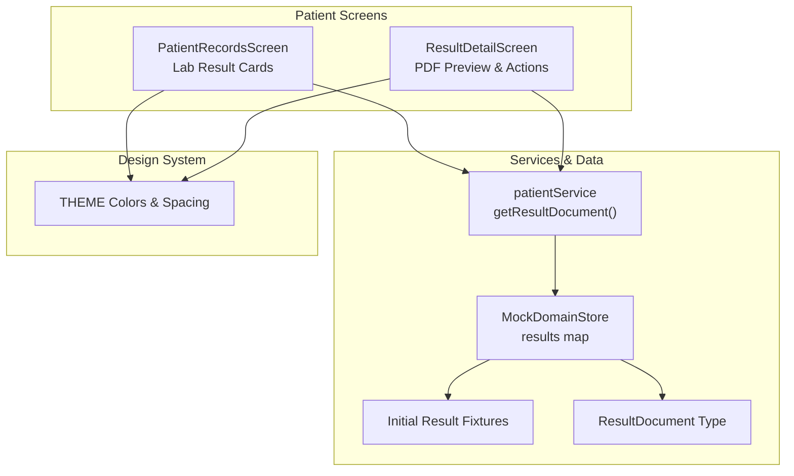
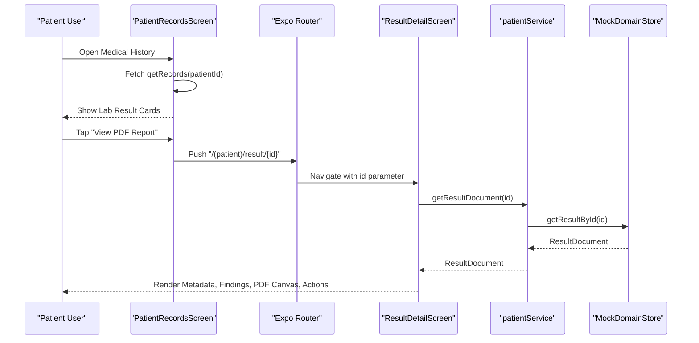
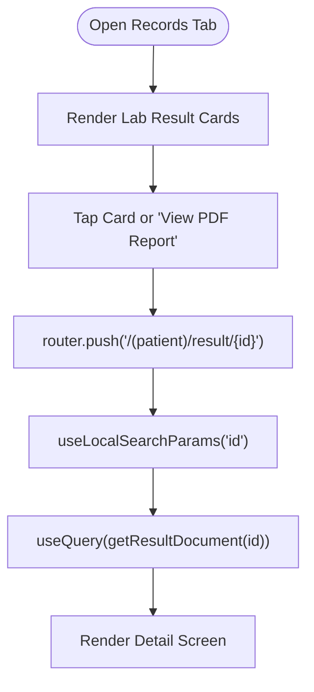
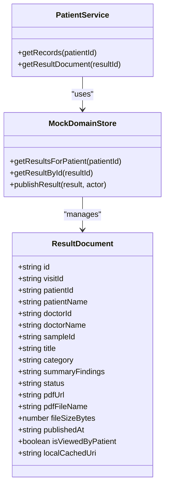
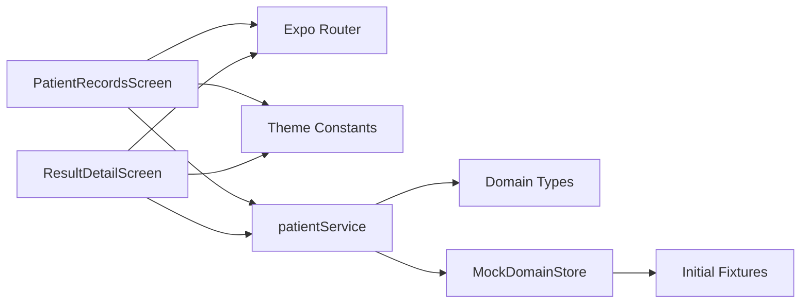

# Lab Results Viewer

<cite>
**Referenced Files in This Document**
- [result/[id].tsx](file://src/app/(patient)/result/[id].tsx)
- [records.tsx](file://src/app/(patient)/records.tsx)
- [domain.ts](file://src/types/domain.ts)
- [api.ts](file://src/services/api.ts)
- [mockDomainStore.ts](file://src/mock/mockDomainStore.ts)
- [fixtures.ts](file://src/mock/fixtures.ts)
- [theme.ts](file://src/constants/theme.ts)
</cite>

## Table of Contents
1. [Introduction](#introduction)
2. [Project Structure](#project-structure)
3. [Core Components](#core-components)
4. [Architecture Overview](#architecture-overview)
5. [Detailed Component Analysis](#detailed-component-analysis)
6. [Dependency Analysis](#dependency-analysis)
7. [Performance Considerations](#performance-considerations)
8. [Troubleshooting Guide](#troubleshooting-guide)
9. [Conclusion](#conclusion)

## Introduction
This document explains the laboratory results viewing system for the patient side of the application. It covers how lab result summary cards are displayed, how navigation to a detailed PDF-style view works through Expo Router parameters, and how the doctor signature and “View PDF Report” actions are implemented. It also documents the data model for lab results, the relationship between summary cards and the detailed viewer, the styling patterns used for lab-specific visuals such as the teal color scheme and specimen tags, error handling for missing results, and the integration with the backend service layer that currently uses an in-memory mock store.

## Project Structure
The lab results feature spans three main areas:
- Patient records list screen showing summary cards for published lab results.
- Detailed result screen rendering metadata, traceability information, findings preview, and a fictional PDF canvas.
- Service and domain layers providing typed data models and fetching logic backed by a mock store.

**Diagram sources**
- [records.tsx:158-197](file://src/app/(patient)/records.tsx#L158-L197)
- [result/[id].tsx:18-136](file://src/app/(patient)/result/[id].tsx#L18-L136)
- [api.ts:247-430](file://src/services/api.ts#L247-L430)
- [mockDomainStore.ts:426-464](file://src/mock/mockDomainStore.ts#L426-L464)
- [fixtures.ts:757-778](file://src/mock/fixtures.ts#L757-L778)
- [domain.ts:140-171](file://src/types/domain.ts#L140-L171)
- [theme.ts:71-114](file://src/constants/theme.ts#L71-L114)

**Section sources**
- [records.tsx:158-197](file://src/app/(patient)/records.tsx#L158-L197)
- [result/[id].tsx:18-136](file://src/app/(patient)/result/[id].tsx#L18-L136)
- [api.ts:247-430](file://src/services/api.ts#L247-L430)
- [mockDomainStore.ts:426-464](file://src/mock/mockDomainStore.ts#L426-L464)
- [fixtures.ts:757-778](file://src/mock/fixtures.ts#L757-L778)
- [domain.ts:140-171](file://src/types/domain.ts#L140-L171)
- [theme.ts:71-114](file://src/constants/theme.ts#L71-L114)

## Core Components
- Patient Records Screen: Displays consultation, prescription, and lab result tabs. The lab results tab shows summary cards with specimen tags, publication dates, titles, and truncated findings previews. Each card navigates to the detailed result screen using Expo Router.
- Result Detail Screen: Loads a single result by ID from query parameters, displays official examination badges, title, validated publication date, specimen traceability metadata, diagnostic findings, a fictional PDF page preview, doctor signature line, and action buttons for downloading or sharing.
- Service Layer: `patientService.getResultDocument` fetches a result by ID, currently backed by the mock store.
- Domain Model: `ResultDocument` defines the shape of lab result data including identifiers, names, sample references, title, category, summary findings, status, PDF metadata, publication timestamp, and offline cache URI.
- Mock Store: Holds initial result fixtures and provides methods to retrieve results by patient or by ID.

**Section sources**
- [records.tsx:19-197](file://src/app/(patient)/records.tsx#L19-L197)
- [result/[id].tsx:18-136](file://src/app/(patient)/result/[id].tsx#L18-L136)
- [api.ts:247-430](file://src/services/api.ts#L247-L430)
- [domain.ts:140-171](file://src/types/domain.ts#L140-L171)
- [mockDomainStore.ts:426-464](file://src/mock/mockDomainStore.ts#L426-L464)

## Architecture Overview
The lab results flow connects UI screens to services and the mock store. Summary cards on the records screen navigate to the detail screen using the result ID. The detail screen queries the service layer to load the full result document and renders it with lab-specific styling.

**Diagram sources**
- [records.tsx:166-191](file://src/app/(patient)/records.tsx#L166-L191)
- [result/[id].tsx:18-27](file://src/app/(patient)/result/[id].tsx#L18-L27)
- [api.ts:412-417](file://src/services/api.ts#L412-L417)
- [mockDomainStore.ts:432-434](file://src/mock/mockDomainStore.ts#L432-L434)

## Detailed Component Analysis

### Lab Result Summary Cards
The records screen lists published lab results under the “Lab Results” tab. Each card includes:
- Specimen tag: A teal badge labeled “LAB SPECIMEN”.
- Publication date: Extracted from the ISO timestamp and shown as a date string.
- Title: The report title field.
- Findings preview: Truncated to two lines for quick scanning.
- Doctor signature line: Shows “Published by {doctorName}”.
- Action button: “View PDF Report ›” navigates to the detailed result screen using the result ID.

Styling highlights:
- Card background uses a soft teal tint (`#F0FDFA`) with a subtle border (`#99F6E4`).
- Tag background uses the theme primary teal color.
- Footer separator uses a light teal border (`#CCFBF1`).

Navigation:
- Both the entire card pressable and the “View PDF Report” link use Expo Router to push the route `/(patient)/result/${res.id}`.

Error handling:
- If no results exist, an empty state message is shown.

**Section sources**
- [records.tsx:158-197](file://src/app/(patient)/records.tsx#L158-L197)
- [records.tsx:379-437](file://src/app/(patient)/records.tsx#L379-L437)

### Detailed PDF View Screen
The detail screen receives the result ID via Expo Router’s local search params and loads the full result document. Key behaviors:
- Loading state: While loading or when no result exists, a centered loading message is shown.
- Metadata banner: Displays an “OFFICIAL MEDICAL EXAMINATION” badge and optionally an “AVAILABLE OFFLINE” badge after download.
- Title and validated publication date: Rendered prominently.
- Traceability card: Shows patient name, attending specialist, visit reference, and optional sample tracking ID.
- Findings card: Renders the diagnostic findings text.
- Fictional PDF canvas: Simulates a PDF page with header watermark, document number, confidential headline, patient ID, collection date, processing location, summary line, separators, and an electronically validated doctor signature line.
- Actions:
  - Download PDF for Offline: Toggles a simulated download state and marks the result as downloaded.
  - Share: Opens a simulated share sheet.

Styling highlights:
- Uses theme colors for backgrounds, text, and spacing.
- Teal accents appear in badges, watermarks, and signature text.
- PDF canvas uses dark slate background with a white page area.

Error handling:
- Missing result IDs are guarded by enabling the query only when an ID exists.
- The service throws an error if the result document is not found; the current detail screen does not explicitly catch this error, so errors will surface at the component level.

**Section sources**
- [result/[id].tsx:18-136](file://src/app/(patient)/result/[id].tsx#L18-L136)
- [result/[id].tsx:138-293](file://src/app/(patient)/result/[id].tsx#L138-L293)

### Data Structure for Lab Results
The `ResultDocument` type defines the complete structure for lab results:
- Identifiers: `id`, `visitId`, `patientId`, `doctorId`, optional `sampleId`.
- Names: `patientName`, `doctorName`.
- Content: `title`, `category`, `summaryFindings`.
- Status: `status` indicating result lifecycle (e.g., available).
- PDF metadata: `pdfUrl`, `pdfFileName`, `fileSizeBytes`.
- Timestamps: `publishedAt`.
- Read state: `isViewedByPatient`.
- Offline cache: Optional `localCachedUri`.

Relationships:
- `visitId` links the result to a clinical visit.
- `sampleId` links to a lab sample record.
- `doctorName` appears both in the summary footer and the detailed PDF signature line.
- `summaryFindings` is previewed in the card and repeated in the PDF canvas summary line.

Complexity considerations:
- Rendering is linear in the number of fields; performance is dominated by layout and text wrapping rather than algorithmic complexity.
- Sorting of results by publication time occurs in the mock store.

**Section sources**
- [domain.ts:140-171](file://src/types/domain.ts#L140-L171)
- [mockDomainStore.ts:426-434](file://src/mock/mockDomainStore.ts#L426-L434)

### Navigation Using Expo Router Parameters
- The records screen pushes `/(patient)/result/${res.id}` when the user taps the card or the “View PDF Report” link.
- The detail screen reads the `id` parameter using `useLocalSearchParams<{ id: string }>()`.
- The query is enabled only when `id` is present, preventing unnecessary service calls.

**Diagram sources**
- [records.tsx:166-191](file://src/app/(patient)/records.tsx#L166-L191)
- [result/[id].tsx:18-27](file://src/app/(patient)/result/[id].tsx#L18-L27)

### Doctor Signature Display
- In the summary card footer, the doctor signature is shown as plain text: “Published by {doctorName}”.
- In the detailed PDF canvas, the signature line is styled distinctly with teal color and italic font weight to simulate an electronic validation signature.

**Section sources**
- [records.tsx:184-191](file://src/app/(patient)/records.tsx#L184-L191)
- [result/[id].tsx:114-115](file://src/app/(patient)/result/[id].tsx#L114-L115)
- [result/[id].tsx:281-287](file://src/app/(patient)/result/[id].tsx#L281-L287)

### “View PDF Report” Action Button Implementation
- Implemented as a Pressable element inside the card footer.
- On press, it navigates to the detailed result screen using the result ID.
- Styled with the theme primary color and bold text to indicate a clear call-to-action.

**Section sources**
- [records.tsx:186-191](file://src/app/(patient)/records.tsx#L186-L191)
- [records.tsx:429-436](file://src/app/(patient)/records.tsx#L429-L436)

### Styling Patterns for Lab-Specific Visual Elements
- Teal color scheme:
  - Primary teal (`#0F766E`) is used for badges and accent elements.
  - Soft teal backgrounds (`#F0FDFA`) and borders (`#99F6E4`, `#CCFBF1`) differentiate lab result cards.
- Specimen tags:
  - Small uppercase labels with high contrast white text on teal background.
- Typography:
  - Titles use bold weights and primary text color.
  - Dates and secondary info use muted text colors.
- PDF canvas:
  - Dark slate background simulating a document viewer.
  - White page area with structured sections and separators.
  - Teal watermark and signature text for authenticity cues.

**Section sources**
- [records.tsx:379-437](file://src/app/(patient)/records.tsx#L379-L437)
- [result/[id].tsx:138-293](file://src/app/(patient)/result/[id].tsx#L138-L293)
- [theme.ts:71-114](file://src/constants/theme.ts#L71-L114)

### Backend Service Integration
- `patientService.getRecords` returns consultations and results for a patient.
- `patientService.getResultDocument` retrieves a single result by ID.
- Under the hood, these methods call the mock store, which holds initial fixtures and supports CRUD-like operations for testing and development.
- When publishing lab results, the doctor service constructs a `ResultDocument` with generated PDF URL and filename, sets status to available, and persists it via the mock store.

**Diagram sources**
- [api.ts:247-430](file://src/services/api.ts#L247-L430)
- [api.ts:468-585](file://src/services/api.ts#L468-L585)
- [mockDomainStore.ts:426-464](file://src/mock/mockDomainStore.ts#L426-L464)
- [domain.ts:140-171](file://src/types/domain.ts#L140-L171)

**Section sources**
- [api.ts:247-430](file://src/services/api.ts#L247-L430)
- [api.ts:468-585](file://src/services/api.ts#L468-L585)
- [mockDomainStore.ts:426-464](file://src/mock/mockDomainStore.ts#L426-L464)
- [fixtures.ts:757-778](file://src/mock/fixtures.ts#L757-L778)

## Dependency Analysis
- UI components depend on:
  - Expo Router for navigation.
  - React Query for data fetching and caching.
  - Theme constants for consistent styling.
  - Services for data access.
- Services depend on:
  - Domain types for strong typing.
  - Mock store for data persistence during development.
- Mock store depends on:
  - Fixtures for initial data.
  - Domain types for entity shapes.

**Diagram sources**
- [records.tsx:1-18](file://src/app/(patient)/records.tsx#L1-L18)
- [result/[id].tsx:1-17](file://src/app/(patient)/result/[id].tsx#L1-L17)
- [api.ts:1-20](file://src/services/api.ts#L1-L20)
- [mockDomainStore.ts:1-33](file://src/mock/mockDomainStore.ts#L1-L33)
- [fixtures.ts:1-16](file://src/mock/fixtures.ts#L1-L16)

**Section sources**
- [records.tsx:1-18](file://src/app/(patient)/records.tsx#L1-L18)
- [result/[id].tsx:1-17](file://src/app/(patient)/result/[id].tsx#L1-L17)
- [api.ts:1-20](file://src/services/api.ts#L1-L20)
- [mockDomainStore.ts:1-33](file://src/mock/mockDomainStore.ts#L1-L33)
- [fixtures.ts:1-16](file://src/mock/fixtures.ts#L1-L16)

## Performance Considerations
- Data fetching:
  - React Query caches results per query key, reducing redundant network/store calls.
  - The detail screen enables queries only when an ID is present, avoiding unnecessary work.
- Rendering:
  - Summary cards truncate findings to two lines to keep lists lightweight.
  - The PDF canvas is a static visual simulation; avoid heavy image assets unless necessary.
- Mock latency:
  - Service methods include simulated delays; production should replace these with real API calls and proper error boundaries.

[No sources needed since this section provides general guidance]

## Troubleshooting Guide
Common issues and resolutions:
- No lab results displayed:
  - Ensure the patient has published results in the mock store or fixtures.
  - Verify `getRecords` returns non-empty results for the current patient.
- Detail screen shows loading indefinitely:
  - Confirm the result ID passed via router params exists.
  - Check that `getResultDocument` resolves successfully.
- Error when opening a result without an ID:
  - The query is disabled when `id` is missing; ensure navigation always includes a valid ID.
- Missing result document error:
  - The service throws an error if the result is not found; consider adding explicit error handling in the detail screen to show a user-friendly message.

**Section sources**
- [records.tsx:161-165](file://src/app/(patient)/records.tsx#L161-L165)
- [result/[id].tsx:23-35](file://src/app/(patient)/result/[id].tsx#L23-L35)
- [api.ts:412-417](file://src/services/api.ts#L412-L417)

## Conclusion
The lab results viewing system provides a clear path from summary cards to a detailed PDF-style view. The implementation leverages Expo Router for navigation, React Query for data fetching, and a consistent teal-based design system for lab-specific visuals. The data model and service layer integrate cleanly with the mock store, enabling robust development and testing. Future enhancements may include real backend integration, explicit error boundaries, and richer PDF rendering capabilities while preserving the current clarity and accessibility of the lab result experience.

[No sources needed since this section summarizes without analyzing specific files]