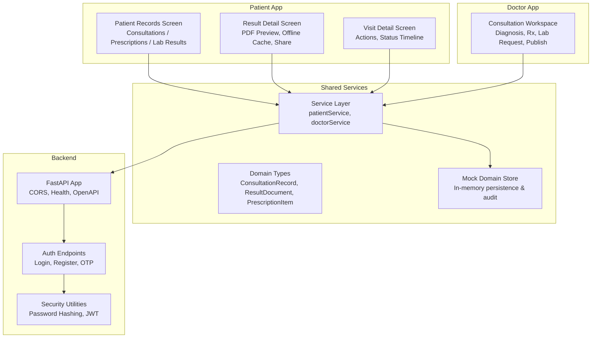
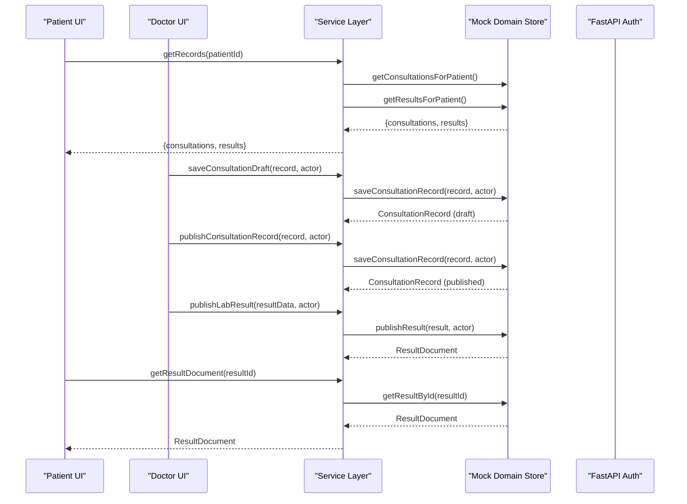
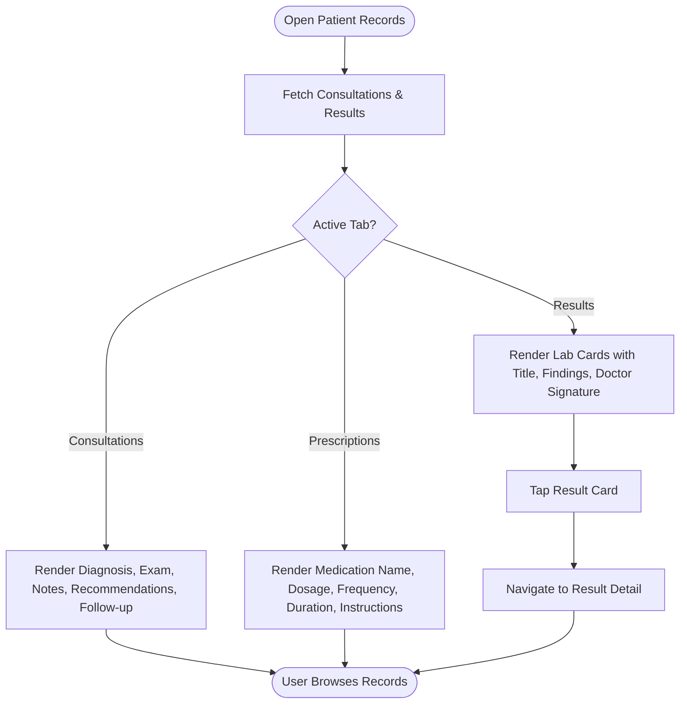
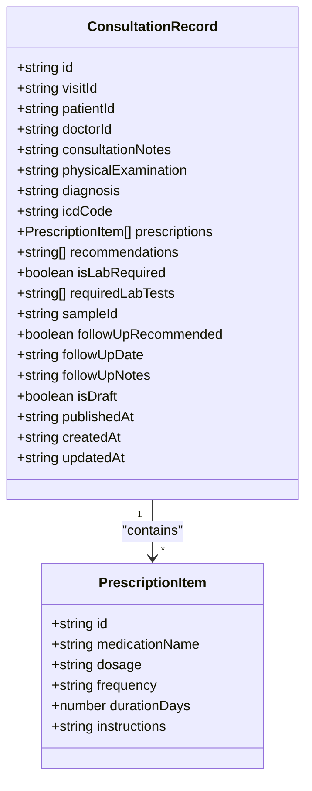
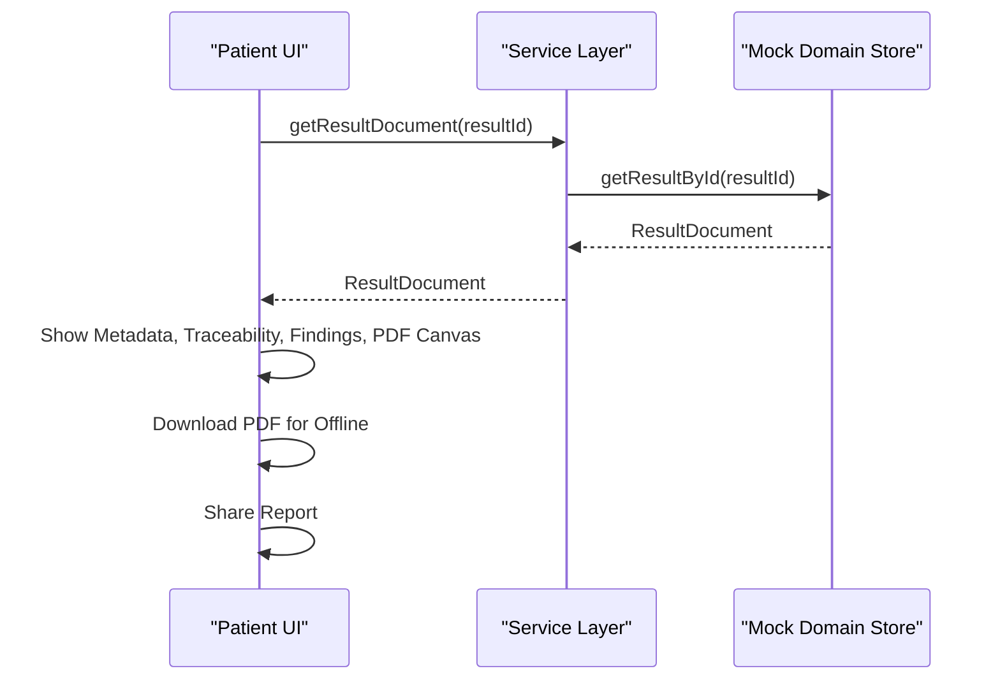
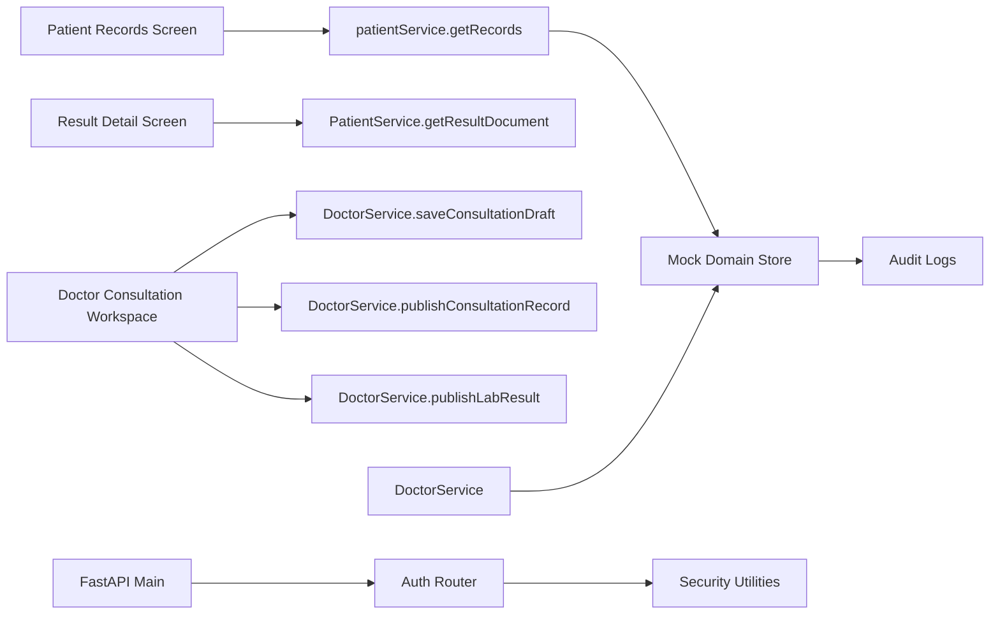

# Medical Records

<cite>
**Referenced Files in This Document**
- [records.tsx](file://src/app/(patient)/records.tsx)
- [result-id.tsx](file://src/app/(patient)/result/[id].tsx)
- [consultation-workspace.tsx](file://src/app/(doctor)/consultation/[visitId].tsx)
- [visit-detail.tsx](file://src/app/(patient)/visit/[id].tsx)
- [api.ts](file://src/services/api.ts)
- [domain.ts](file://src/types/domain.ts)
- [mockDomainStore.ts](file://src/mock/mockDomainStore.ts)
- [main.py](file://backend/app/main.py)
- [auth.py](file://backend/app/api/auth.py)
- [security.py](file://backend/app/core/security.py)
</cite>

## Table of Contents
1. [Introduction](#introduction)
2. [Project Structure](#project-structure)
3. [Core Components](#core-components)
4. [Architecture Overview](#architecture-overview)
5. [Detailed Component Analysis](#detailed-component-analysis)
6. [Dependency Analysis](#dependency-analysis)
7. [Performance Considerations](#performance-considerations)
8. [Troubleshooting Guide](#troubleshooting-guide)
9. [Compliance and Security Notes](#compliance-and-security-notes)
10. [Conclusion](#conclusion)

## Introduction
This document explains the medical records and results management system implemented in the mobile application. It covers:
- Clinical consultation summaries, including diagnosis, treatment plans, follow-up instructions, and electronic prescriptions.
- Laboratory result viewing with PDF preview, offline caching, and sharing capabilities.
- Record organization, search patterns, secure storage considerations, and compliance guidance.
- Integration points between the frontend screens, service layer, mock domain store, and backend authentication API.

The system is designed for home-based clinical visits, where doctors create consultation records and optionally publish laboratory results that patients can view and share securely.

## Project Structure
The medical records functionality spans patient-facing screens, doctor-facing workflows, shared services, domain types, a mock data store, and a minimal backend for authentication.

**Diagram sources**
- [records.tsx:1-438](file://src/app/(patient)/records.tsx#L1-L438)
- [result-id.tsx:1-293](file://src/app/(patient)/result/[id].tsx#L1-L293)
- [consultation-workspace.tsx:1-507](file://src/app/(doctor)/consultation/[visitId].tsx#L1-L507)
- [visit-detail.tsx:1-640](file://src/app/(patient)/visit/[id].tsx#L1-L640)
- [api.ts:1-660](file://src/services/api.ts#L1-L660)
- [domain.ts:1-242](file://src/types/domain.ts#L1-L242)
- [mockDomainStore.ts:1-557](file://src/mock/mockDomainStore.ts#L1-L557)
- [main.py:1-61](file://backend/app/main.py#L1-L61)
- [auth.py:1-182](file://backend/app/api/auth.py#L1-L182)
- [security.py:1-27](file://backend/app/core/security.py#L1-L27)

**Section sources**
- [records.tsx:1-438](file://src/app/(patient)/records.tsx#L1-L438)
- [result-id.tsx:1-293](file://src/app/(patient)/result/[id].tsx#L1-L293)
- [consultation-workspace.tsx:1-507](file://src/app/(doctor)/consultation/[visitId].tsx#L1-L507)
- [visit-detail.tsx:1-640](file://src/app/(patient)/visit/[id].tsx#L1-L640)
- [api.ts:1-660](file://src/services/api.ts#L1-L660)
- [domain.ts:1-242](file://src/types/domain.ts#L1-L242)
- [mockDomainStore.ts:1-557](file://src/mock/mockDomainStore.ts#L1-L557)
- [main.py:1-61](file://backend/app/main.py#L1-L61)
- [auth.py:1-182](file://backend/app/api/auth.py#L1-L182)
- [security.py:1-27](file://backend/app/core/security.py#L1-L27)

## Core Components
- Patient Records Screen: Displays chronological consultations, electronic prescriptions, and lab results with navigation to detailed PDF views.
- Result Detail Screen: Shows metadata, traceability information, findings summary, a fictional PDF canvas preview, download-to-offline, and share actions.
- Doctor Consultation Workspace: Allows clinicians to enter physical exam findings, diagnosis, ICD-10 code, clinical notes, recommendations, add electronic prescriptions, request lab tests, and publish records or results.
- Visit Detail Screen: Provides visit lifecycle tracking, alternative time handling, cancellation/rescheduling restrictions, billing info, and quick links to records and results.
- Service Layer: Encapsulates asynchronous operations for patients and doctors, integrating with the mock domain store and attempting real backend calls when available.
- Domain Types: Defines core entities such as ConsultationRecord, ResultDocument, PrescriptionItem, LabSample, and related enums.
- Mock Domain Store: In-memory persistence with account isolation, notifications, audit logging, and sample/result publishing.
- Backend Authentication: FastAPI app with CORS, health endpoint, and auth routes for login, registration, OTP verification, and password reset utilities.

**Section sources**
- [records.tsx:1-438](file://src/app/(patient)/records.tsx#L1-L438)
- [result-id.tsx:1-293](file://src/app/(patient)/result/[id].tsx#L1-L293)
- [consultation-workspace.tsx:1-507](file://src/app/(doctor)/consultation/[visitId].tsx#L1-L507)
- [visit-detail.tsx:1-640](file://src/app/(patient)/visit/[id].tsx#L1-L640)
- [api.ts:1-660](file://src/services/api.ts#L1-L660)
- [domain.ts:1-242](file://src/types/domain.ts#L1-L242)
- [mockDomainStore.ts:1-557](file://src/mock/mockDomainStore.ts#L1-L557)
- [main.py:1-61](file://backend/app/main.py#L1-L61)
- [auth.py:1-182](file://backend/app/api/auth.py#L1-L182)
- [security.py:1-27](file://backend/app/core/security.py#L1-L27)

## Architecture Overview
The system follows a layered architecture:
- Presentation Layer: React Native screens for patients and doctors.
- Service Layer: Typed APIs for patient and doctor operations.
- Data Layer: Mock domain store for development/demo; optional backend integration via FastAPI endpoints.
- Security Layer: Password hashing and JWT token creation for authentication flows.

**Diagram sources**
- [api.ts:405-417](file://src/services/api.ts#L405-L417)
- [api.ts:545-584](file://src/services/api.ts#L545-L584)
- [mockDomainStore.ts:387-406](file://src/mock/mockDomainStore.ts#L387-L406)
- [mockDomainStore.ts:426-464](file://src/mock/mockDomainStore.ts#L426-L464)

## Detailed Component Analysis

### Clinical Consultation Summaries Display
The patient records screen organizes data into three tabs:
- Consultations: Chronological list showing diagnosis, ICD code, physical examination findings, clinical notes, recommendations, and follow-up details.
- Prescriptions: Electronic prescriptions extracted from published consultations, displaying medication name, dosage, frequency, duration, and instructions.
- Lab Results: Summary cards linking to detailed PDF reports.

Key behaviors:
- Uses query hooks to fetch records by patient ID.
- Renders empty states when no data exists.
- Navigates to result detail screen for PDF viewing.

**Diagram sources**
- [records.tsx:19-199](file://src/app/(patient)/records.tsx#L19-L199)

**Section sources**
- [records.tsx:19-199](file://src/app/(patient)/records.tsx#L19-L199)

### Electronic Prescription Viewing System
Electronic prescriptions are displayed per consultation:
- Medication name prominently shown.
- Dosage, frequency, duration, and instructions presented clearly.
- Prescriptions are derived from published consultation records.

Integration points:
- The service layer aggregates prescriptions within consultation records.
- The mock store persists and retrieves prescription items alongside consultation records.

**Diagram sources**
- [domain.ts:131-194](file://src/types/domain.ts#L131-L194)

**Section sources**
- [records.tsx:122-156](file://src/app/(patient)/records.tsx#L122-L156)
- [domain.ts:131-194](file://src/types/domain.ts#L131-L194)

### Lab Results Viewing Functionality
The lab results section provides:
- Summary cards with title, findings, publication date, and doctor signature.
- Navigation to a detailed result page with metadata, traceability verification, findings summary, and a fictional PDF canvas preview.
- Actions to download the report for offline use and to share it through the device’s share sheet.

Traceability fields include:
- Patient full name, attending specialist, visit reference, and optional sample tracking ID.

**Diagram sources**
- [result-id.tsx:18-135](file://src/app/(patient)/result/[id].tsx#L18-L135)
- [api.ts:412-417](file://src/services/api.ts#L412-L417)
- [mockDomainStore.ts:426-434](file://src/mock/mockDomainStore.ts#L426-L434)

**Section sources**
- [result-id.tsx:18-135](file://src/app/(patient)/result/[id].tsx#L18-L135)
- [api.ts:412-417](file://src/services/api.ts#L412-L417)
- [mockDomainStore.ts:426-434](file://src/mock/mockDomainStore.ts#L426-L434)

### Document Organization System and Search Within Records
Organization:
- Records are grouped by category tabs: Consultations, Prescriptions, Lab Results.
- Consultations are sorted chronologically by creation timestamp.
- Lab results are sorted by publication timestamp.

Search within records:
- The current implementation does not provide an explicit text search input on the records screen.
- Filtering/search patterns exist elsewhere in the service layer for doctor searches, which can be adapted for record search if needed.

Recommendations:
- Add a search input to filter consultations by diagnosis, ICD code, or keywords in clinical notes.
- Add filters for lab results by category, date range, or doctor name.

**Section sources**
- [records.tsx:23-31](file://src/app/(patient)/records.tsx#L23-L31)
- [mockDomainStore.ts:387-391](file://src/mock/mockDomainStore.ts#L387-L391)
- [mockDomainStore.ts:426-430](file://src/mock/mockDomainStore.ts#L426-L430)
- [api.ts:290-323](file://src/services/api.ts#L290-L323)

### Secure Storage Mechanisms for Sensitive Medical Data
Current mechanisms:
- Backend uses bcrypt for password hashing and JWT tokens for access control.
- Frontend simulates local offline caching for PDF reports without implementing persistent encrypted storage.
- Audit logs track READ, CREATE, UPDATE, PUBLISH, EXPORT actions for sensitive entities.

Production recommendations:
- Encrypt sensitive files at rest using platform-provided secure storage (e.g., Keychain/Keystore).
- Enforce access controls at the API level with role-based authorization.
- Implement tamper-evident logs and integrity checks for documents.

**Section sources**
- [security.py:1-27](file://backend/app/core/security.py#L1-L27)
- [auth.py:121-153](file://backend/app/api/auth.py#L121-L153)
- [mockDomainStore.ts:529-552](file://src/mock/mockDomainStore.ts#L529-L552)

### Compliance Requirements for Medical Record Handling
Guidance aligned with the system’s design:
- Maintain confidentiality and integrity of consultation records and lab results.
- Ensure traceability metadata is preserved for each result document.
- Provide clear consent and privacy notices for data collection and sharing.
- Restrict sharing actions to authorized users and log all exports/shares.
- Comply with regional regulations (e.g., Rwanda data protection laws) and international standards (e.g., HIPAA principles for confidentiality, integrity, availability).

Implementation notes:
- Use HTTPS/TLS for all API communications.
- Validate and sanitize inputs before storing or rendering.
- Avoid exposing sensitive identifiers in logs or error messages.

[No sources needed since this section provides general guidance]

### Integration With Laboratory Systems
Current integration:
- Doctors can mark lab tests as required and indicate whether samples were collected on-site.
- Publishing lab results creates a ResultDocument with metadata and a fictional PDF URL.
- Notifications are generated for patients when results become available.

Future enhancements:
- Integrate with external laboratory information systems (LIS) via secure APIs.
- Support HL7/FHIR messaging for standardized result exchange.
- Implement barcode/QR scanning for sample tracking and chain-of-custody.

**Section sources**
- [consultation-workspace.tsx:70-83](file://src/app/(doctor)/consultation/[visitId].tsx#L70-L83)
- [consultation-workspace.tsx:133-205](file://src/app/(doctor)/consultation/[visitId].tsx#L133-L205)
- [api.ts:570-584](file://src/services/api.ts#L570-L584)
- [mockDomainStore.ts:436-464](file://src/mock/mockDomainStore.ts#L436-L464)

## Dependency Analysis
The following diagram shows key dependencies among components involved in medical records and results.

**Diagram sources**
- [records.tsx:23-31](file://src/app/(patient)/records.tsx#L23-L31)
- [result-id.tsx:23-27](file://src/app/(patient)/result/[id].tsx#L23-L27)
- [consultation-workspace.tsx:102-205](file://src/app/(doctor)/consultation/[visitId].tsx#L102-L205)
- [api.ts:405-417](file://src/services/api.ts#L405-L417)
- [api.ts:545-584](file://src/services/api.ts#L545-L584)
- [mockDomainStore.ts:387-406](file://src/mock/mockDomainStore.ts#L387-L406)
- [mockDomainStore.ts:426-464](file://src/mock/mockDomainStore.ts#L426-L464)
- [main.py:31-46](file://backend/app/main.py#L31-L46)
- [auth.py:121-153](file://backend/app/api/auth.py#L121-L153)
- [security.py:10-26](file://backend/app/core/security.py#L10-L26)

**Section sources**
- [records.tsx:23-31](file://src/app/(patient)/records.tsx#L23-L31)
- [result-id.tsx:23-27](file://src/app/(patient)/result/[id].tsx#L23-L27)
- [consultation-workspace.tsx:102-205](file://src/app/(doctor)/consultation/[visitId].tsx#L102-L205)
- [api.ts:405-417](file://src/services/api.ts#L405-L417)
- [api.ts:545-584](file://src/services/api.ts#L545-L584)
- [mockDomainStore.ts:387-406](file://src/mock/mockDomainStore.ts#L387-L406)
- [mockDomainStore.ts:426-464](file://src/mock/mockDomainStore.ts#L426-L464)
- [main.py:31-46](file://backend/app/main.py#L31-L46)
- [auth.py:121-153](file://backend/app/api/auth.py#L121-L153)
- [security.py:10-26](file://backend/app/core/security.py#L10-L26)

## Performance Considerations
- Query Caching: The records screen uses query hooks with keys scoped to patient IDs, enabling efficient caching and refetching.
- Polling: Visit detail screen polls for status transitions; consider debouncing or using websockets for real-time updates.
- List Rendering: Large lists of consultations/results should use virtualization to improve scroll performance.
- PDF Handling: Simulated PDF preview avoids heavy parsing; production should stream PDFs and cache securely.

[No sources needed since this section provides general guidance]

## Troubleshooting Guide
Common issues and resolutions:
- Empty Records: If consultations or results are missing, verify that the doctor has published records and results for the patient.
- Result Not Found: Ensure the result ID is valid and the document exists in the store.
- Unauthorized Actions: Canceling or rescheduling visits may be restricted based on visit status; check state transitions.
- Backend Connectivity: If login fails, confirm the backend is running and credentials are correct; fallback to demo accounts is supported.

Operational tips:
- Check audit logs for actions performed on sensitive entities.
- Validate user roles before performing write operations.
- Inspect network requests to ensure proper headers and payloads.

**Section sources**
- [records.tsx:66-119](file://src/app/(patient)/records.tsx#L66-L119)
- [result-id.tsx:29-35](file://src/app/(patient)/result/[id].tsx#L29-L35)
- [visit-detail.tsx:48-88](file://src/app/(patient)/visit/[id].tsx#L48-L88)
- [api.ts:359-367](file://src/services/api.ts#L359-L367)
- [mockDomainStore.ts:529-552](file://src/mock/mockDomainStore.ts#L529-L552)

## Compliance and Security Notes
- Authentication: Use hashed passwords and short-lived JWT tokens.
- Authorization: Enforce role-based access for creating, publishing, and exporting records.
- Auditability: Log all sensitive operations with actor identity, timestamps, and entity references.
- Data Minimization: Only collect and display necessary fields for clinical decision-making.
- Privacy: Provide clear consent flows and allow patients to control sharing permissions.

[No sources needed since this section provides general guidance]

## Conclusion
The medical records and results management system provides a robust foundation for displaying clinical consultation summaries, electronic prescriptions, and laboratory results. It supports traceability, offline previews, and sharing while maintaining audit trails and basic security measures. Future work should focus on advanced search, secure persistent storage, LIS integration, and comprehensive compliance validation.

[No sources needed since this section summarizes without analyzing specific files]