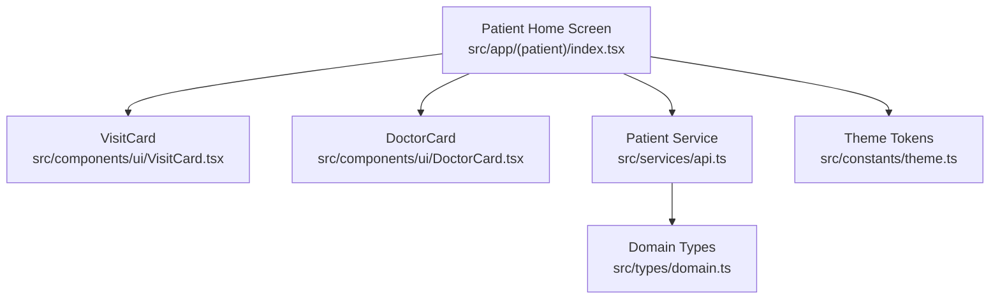
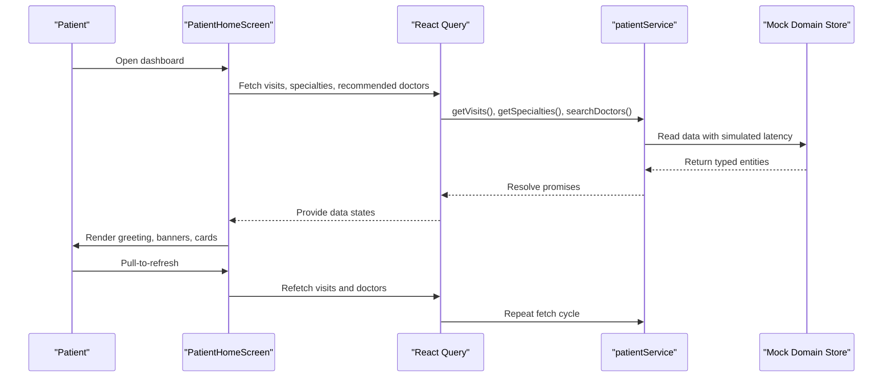
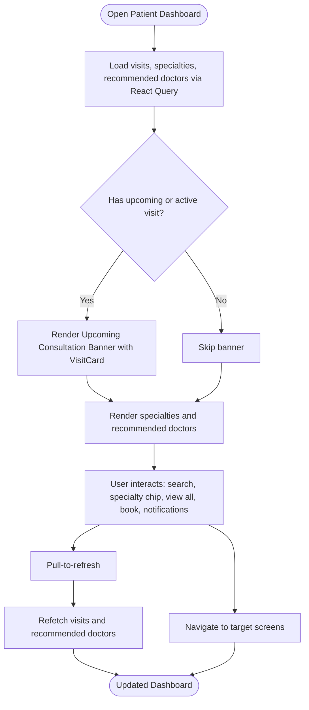
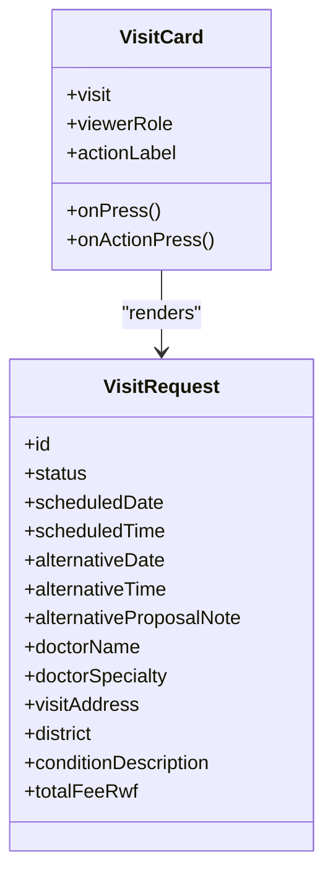
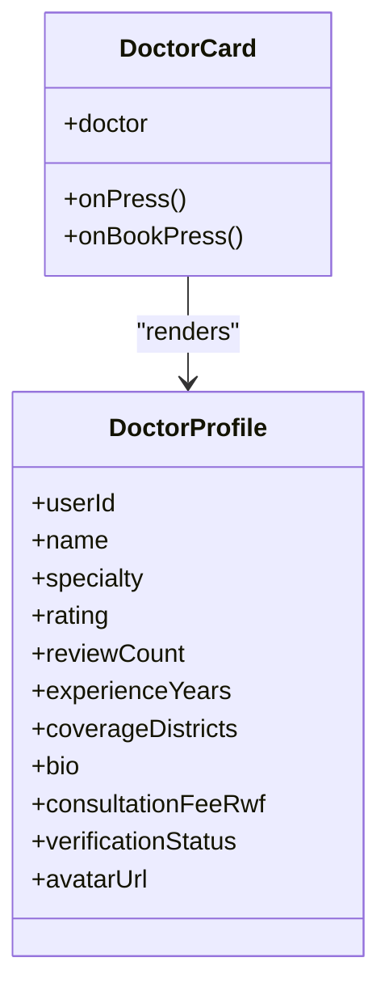
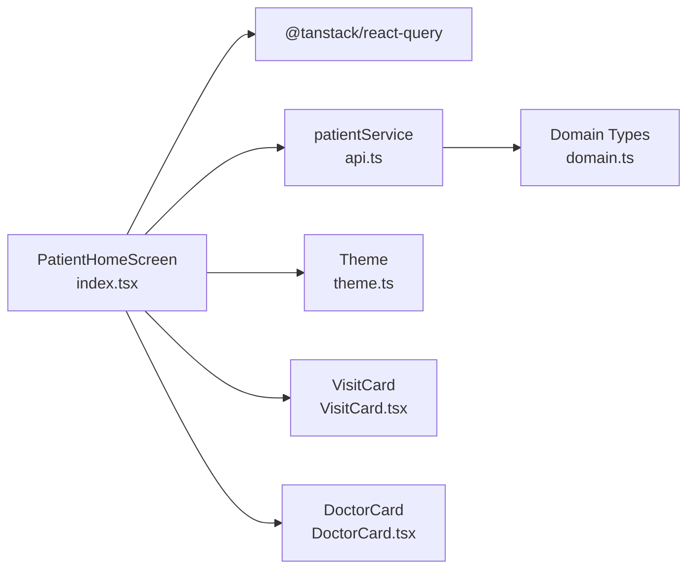

# Patient Dashboard

<cite>
**Referenced Files in This Document**
- [index.tsx](file://src/app/(patient)/index.tsx)
- [api.ts](file://src/services/api.ts)
- [domain.ts](file://src/types/domain.ts)
- [theme.ts](file://src/constants/theme.ts)
- [VisitCard.tsx](file://src/components/ui/VisitCard.tsx)
- [DoctorCard.tsx](file://src/components/ui/DoctorCard.tsx)
</cite>

## Table of Contents
1. [Introduction](#introduction)
2. [Project Structure](#project-structure)
3. [Core Components](#core-components)
4. [Architecture Overview](#architecture-overview)
5. [Detailed Component Analysis](#detailed-component-analysis)
6. [Dependency Analysis](#dependency-analysis)
7. [Performance Considerations](#performance-considerations)
8. [Troubleshooting Guide](#troubleshooting-guide)
9. [Conclusion](#conclusion)

## Introduction
This document explains the patient dashboard screen, which is the main entry point for patients. It covers:
- Personalized greeting and location display
- Active visit banner with real-time consultation status
- Quick search navigation to doctors and specialties
- Recommended verified specialists section
- Emergency contact integration
- Data fetching patterns using React Query for visits, specialties, and doctor recommendations
- Refresh mechanism, navigation flows, and component composition with VisitCard and DoctorCard
- Responsive design considerations, accessibility features, and performance optimizations

The dashboard composes a scrollable layout with sections for discovery, active care, and safety information, while delegating data retrieval to a service layer that currently uses a mock domain store with simulated latency.

## Project Structure
The patient dashboard lives under the patient route group and composes UI components from the shared UI library. Data comes from a typed service layer backed by a mock store, and visual tokens come from a centralized theme.

**Diagram sources**
- [index.tsx:1-340](file://src/app/(patient)/index.tsx#L1-L340)
- [api.ts:247-430](file://src/services/api.ts#L247-L430)
- [domain.ts:97-129](file://src/types/domain.ts#L97-L129)
- [theme.ts:71-165](file://src/constants/theme.ts#L71-L165)

**Section sources**
- [index.tsx:1-340](file://src/app/(patient)/index.tsx#L1-L340)
- [api.ts:247-430](file://src/services/api.ts#L247-L430)
- [domain.ts:97-129](file://src/types/domain.ts#L97-L129)
- [theme.ts:71-165](file://src/constants/theme.ts#L71-L165)

## Core Components
- Patient home screen: Renders greeting, location, quick search, active visit banner, specialty chips, recommended doctors, and emergency footer.
- VisitCard: Displays visit date/time, status badge, attending specialist or patient info, address, symptoms, alternative time proposal, fee, and action buttons.
- DoctorCard: Displays avatar, name, verification badge, specialty, rating, reviews, experience, bio, coverage districts, fee, and booking button.

Key responsibilities:
- Patient home screen orchestrates queries, user interactions, and navigation.
- VisitCard focuses on presentation and status-aware rendering.
- DoctorCard focuses on presentation and booking actions.

**Section sources**
- [index.tsx:22-179](file://src/app/(patient)/index.tsx#L22-L179)
- [VisitCard.tsx:9-88](file://src/components/ui/VisitCard.tsx#L9-L88)
- [DoctorCard.tsx:9-86](file://src/components/ui/DoctorCard.tsx#L9-L86)

## Architecture Overview
The dashboard follows a layered approach:
- Presentation layer: React Native screens and reusable cards.
- State/data layer: React Query hooks manage loading, caching, and refetching.
- Service layer: Typed API contracts abstract backend or mock data access.
- Domain types: Strongly typed entities ensure consistent data flow.
- Theme: Centralized design tokens for colors, typography, spacing, and radii.

**Diagram sources**
- [index.tsx:26-49](file://src/app/(patient)/index.tsx#L26-L49)
- [api.ts:285-323](file://src/services/api.ts#L285-L323)
- [api.ts:347-350](file://src/services/api.ts#L347-L350)

## Detailed Component Analysis

### Patient Home Screen
Responsibilities:
- Greeting system: Uses current user’s first name; falls back to a generic label if unavailable.
- Location display: Shows district plus city when available; otherwise defaults to a regional default.
- Quick search: A pressable search bar navigates to the doctors list with optional preselected specialty.
- Active visit banner: Finds an upcoming or active visit based on status set and renders VisitCard with navigation to visit details.
- Specialties section: Horizontal scroll of top specialties with counts; tapping passes initial specialty to the doctors list.
- Recommended verified specialists: Queries high-rated doctors and renders up to two DoctorCards with profile and booking navigation.
- Emergency footer: Displays emergency helpline number for Rwanda.

Data fetching patterns:
- Visits: Fetched only when a user exists; query key includes user id for isolation.
- Specialties: Fetched once without dependencies.
- Recommended doctors: Fetched with a minimum rating filter.

Refresh mechanism:
- Pull-to-refresh triggers concurrent refetch of visits and recommended doctors.

Navigation flows:
- Notifications: Opens notifications screen.
- Doctors: Opens doctors list; optionally passes initial specialty.
- Visit details: Navigates to visit detail screen using visit id.
- Doctor profile: Navigates to doctor detail screen using doctor id.
- Booking: Navigates to booking screen using doctor id.

Accessibility considerations:
- Pressable elements provide clear tap targets.
- Text truncation prevents overflow.
- Color-coded emergency number emphasizes urgency.

Responsive design:
- SafeAreaView ensures content respects device insets.
- ScrollView with bottom padding avoids content clipping.
- Horizontal scrolling for specialties improves compact discovery.

**Diagram sources**
- [index.tsx:26-49](file://src/app/(patient)/index.tsx#L26-L49)
- [index.tsx:51-118](file://src/app/(patient)/index.tsx#L51-L118)
- [index.tsx:121-168](file://src/app/(patient)/index.tsx#L121-L168)

**Section sources**
- [index.tsx:22-179](file://src/app/(patient)/index.tsx#L22-L179)
- [index.tsx:182-340](file://src/app/(patient)/index.tsx#L182-L340)

### VisitCard Component
Responsibilities:
- Display visit metadata: scheduled date/time, status badge, person details (attending specialist for patients), address, symptoms.
- Alternative proposal handling: When a proposed alternative time exists, show alert with proposed date/time and optional note.
- Footer actions: Show total fee and either a custom action button or a details link.

Props:
- visit: The visit entity.
- onPress: Navigate to visit details.
- viewerRole: Determines displayed person details.
- onActionPress and actionLabel: Optional alternate action behavior.

Status awareness:
- Renders status badge based on visit status.
- Highlights alternative proposals when present.

**Diagram sources**
- [VisitCard.tsx:9-88](file://src/components/ui/VisitCard.tsx#L9-L88)
- [domain.ts:97-129](file://src/types/domain.ts#L97-L129)

**Section sources**
- [VisitCard.tsx:9-88](file://src/components/ui/VisitCard.tsx#L9-L88)
- [VisitCard.tsx:90-204](file://src/components/ui/VisitCard.tsx#L90-L204)

### DoctorCard Component
Responsibilities:
- Display doctor profile summary: avatar, name, verification indicator, specialty, rating, review count, experience years.
- Bio snippet and coverage districts.
- Fee display and booking action.

Props:
- doctor: The doctor entity.
- onPress: Navigate to doctor details.
- onBookPress: Navigate to booking screen; fallback to onPress if not provided.

Verification and metrics:
- Shows verification checkmark when approved.
- Displays rating and review count alongside experience.

**Diagram sources**
- [DoctorCard.tsx:9-86](file://src/components/ui/DoctorCard.tsx#L9-L86)
- [domain.ts:61-85](file://src/types/domain.ts#L61-L85)

**Section sources**
- [DoctorCard.tsx:9-86](file://src/components/ui/DoctorCard.tsx#L9-L86)
- [DoctorCard.tsx:88-213](file://src/components/ui/DoctorCard.tsx#L88-L213)

## Dependency Analysis
The dashboard depends on:
- React Query for declarative data fetching and caching.
- Patient service for typed data operations.
- Domain types for strong typing across layers.
- Theme tokens for consistent styling.
- Navigation via Expo Router for screen transitions.

**Diagram sources**
- [index.tsx:1-20](file://src/app/(patient)/index.tsx#L1-L20)
- [api.ts:247-430](file://src/services/api.ts#L247-L430)
- [domain.ts:61-129](file://src/types/domain.ts#L61-L129)
- [theme.ts:71-165](file://src/constants/theme.ts#L71-L165)

**Section sources**
- [index.tsx:1-20](file://src/app/(patient)/index.tsx#L1-L20)
- [api.ts:247-430](file://src/services/api.ts#L247-L430)
- [domain.ts:61-129](file://src/types/domain.ts#L61-L129)
- [theme.ts:71-165](file://src/constants/theme.ts#L71-L165)

## Performance Considerations
- Declarative data fetching: React Query manages caching, background updates, and deduplication, reducing redundant network calls.
- Conditional query execution: Visits query is enabled only when a user exists, preventing unnecessary requests.
- Concurrent refresh: Pull-to-refresh triggers parallel refetches for visits and recommended doctors, improving perceived responsiveness.
- Minimal re-renders: Sections render only necessary slices of data (e.g., top five specialties, top two recommended doctors).
- Mocked latency: Simulated delays help test UX under realistic conditions without overloading services.

Recommendations:
- Consider enabling stale-while-revalidate strategies for faster perceived loads.
- Add error boundaries around sections to isolate failures.
- Debounce search input when implementing full-text search to reduce processing overhead.
- Use memoization for expensive computations if filtering logic grows.

[No sources needed since this section provides general guidance]

## Troubleshooting Guide
Common issues and resolutions:
- No visits shown: Ensure the authenticated user has visits in the mock store; verify query key includes user id and that the user exists before querying.
- Empty specialties or doctors: Check mock store population and service methods; confirm filters like minRating are appropriate.
- Navigation not working: Verify route paths match Expo Router configuration; ensure params such as doctorId or visitId are correctly passed.
- Refresh not updating: Confirm onRefresh calls refetch functions for both visits and doctors; ensure refreshing state toggles correctly.
- Status not reflecting: Validate visit status values and VisitCard rendering logic for alternative proposals.

**Section sources**
- [index.tsx:26-49](file://src/app/(patient)/index.tsx#L26-L49)
- [index.tsx:51-118](file://src/app/(patient)/index.tsx#L51-L118)
- [VisitCard.tsx:57-66](file://src/components/ui/VisitCard.tsx#L57-L66)

## Conclusion
The patient dashboard provides a focused, accessible, and responsive entry point for patients. It personalizes greetings and location, highlights active consultations, streamlines discovery through search and specialty chips, showcases recommended verified specialists, and integrates emergency contact information. Data fetching is handled declaratively with React Query, ensuring efficient caching and refresh behavior. The VisitCard and DoctorCard components encapsulate complex presentation logic, keeping the dashboard clean and maintainable. With centralized theming and typed domain models, the codebase remains scalable and easy to extend.

[No sources needed since this section summarizes without analyzing specific files]