# Patient Features

<cite>
**Referenced Files in This Document**   
- [README.md](file://README.md)
- [index.tsx](file://src/app/(patient)/index.tsx)
- [doctors.tsx](file://src/app/(patient)/doctors.tsx)
- [book/[doctorId].tsx](file://src/app/(patient)/book/[doctorId].tsx)
- [visits.tsx](file://src/app/(patient)/visits.tsx)
- [visit/[id].tsx](file://src/app/(patient)/visit/[id].tsx)
- [records.tsx](file://src/app/(patient)/records.tsx)
- [result/[id].tsx](file://src/app/(patient)/result/[id].tsx)
- [profile.tsx](file://src/app/(patient)/profile.tsx)
- [notifications.tsx](file://src/app/(patient)/notifications.tsx)
- [api.ts](file://src/services/api.ts)
- [domain.ts](file://src/types/domain.ts)
- [fixtures.ts](file://src/mock/fixtures.ts)
- [mockDomainStore.ts](file://src/mock/mockDomainStore.ts)
</cite>

## Table of Contents
1. [Introduction](#introduction)
2. [Project Structure](#project-structure)
3. [Core Components](#core-components)
4. [Architecture Overview](#architecture-overview)
5. [Detailed Component Analysis](#detailed-component-analysis)
6. [Dependency Analysis](#dependency-analysis)
7. [Performance Considerations](#performance-considerations)
8. [Troubleshooting Guide](#troubleshooting-guide)
9. [Conclusion](#conclusion)

## Introduction
This document explains the patient-facing features of the HomeCare application, focusing on the complete journey from doctor discovery and booking to visit tracking and medical records management. It covers:

- Doctor search with multi-factor filtering by specialty, district, language, and availability.
- The 9-step booking workflow including slot selection, symptom description, address input, fee preview, and payment options.
- Visit lifecycle management with status transitions, alternative time proposal handling, cancellation restrictions, rating, and complaints.
- Medical records including clinical consultation summaries, electronic prescriptions, lab result viewing with PDF support, and result sharing.
- Patient profile management, emergency contact display, privacy controls, and notification center integration.

The implementation is a React Native / Expo Router frontend using TypeScript, Zustand for authentication state, TanStack Query for data fetching, and a mock domain store that simulates backend behavior.

**Section sources**
- [README.md:1-10](file://README.md#L1-L10)
- [README.md:117-137](file://README.md#L117-L137)

## Project Structure
The patient experience lives under `src/app/(patient)` and is supported by shared services, types, and mock fixtures:

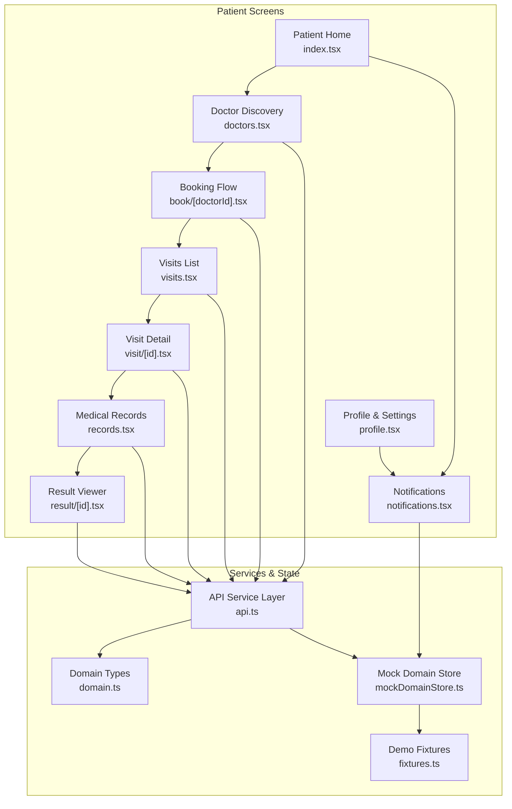

**Diagram sources**
- [index.tsx:1-340](file://src/app/(patient)/index.tsx#L1-L340)
- [doctors.tsx:1-426](file://src/app/(patient)/doctors.tsx#L1-L426)
- [book/[doctorId].tsx:1-608](file://src/app/(patient)/book/[doctorId].tsx#L1-L608)
- [visits.tsx:1-166](file://src/app/(patient)/visits.tsx#L1-L166)
- [visit/[id].tsx:1-640](file://src/app/(patient)/visit/[id].tsx#L1-L640)
- [records.tsx:1-438](file://src/app/(patient)/records.tsx#L1-L438)
- [result/[id].tsx:1-293](file://src/app/(patient)/result/[id].tsx#L1-L293)
- [profile.tsx:1-282](file://src/app/(patient)/profile.tsx#L1-L282)
- [notifications.tsx:1-140](file://src/app/(patient)/notifications.tsx#L1-L140)
- [api.ts:1-660](file://src/services/api.ts#L1-L660)
- [domain.ts:1-242](file://src/types/domain.ts#L1-L242)
- [fixtures.ts:1-904](file://src/mock/fixtures.ts#L1-L904)
- [mockDomainStore.ts:1-557](file://src/mock/mockDomainStore.ts#L1-L557)

**Section sources**
- [README.md:117-147](file://README.md#L117-L147)

## Core Components
The patient feature set is composed of these core screens and supporting layers:

| Component | Responsibility | Key Behaviors |
|---|---|---|
| Patient Home | Entry point, active visit banner, specialty shortcuts, recommended doctors | Shows upcoming visit, quick search, emergency helpline |
| Doctor Discovery | Multi-factor specialist search | Text query, specialty pills, Kigali district filter, language filter, online-only toggle |
| Booking Flow | 9-step home visit booking | Slot selection, symptoms, description, attachments, address, GPS pin, gate notes, fee breakdown, payment method |
| Visits List | Tabbed list of upcoming, past, and all visits | Filters by status groups, navigates to detail screen |
| Visit Detail | Live timeline, actions, ratings, complaints | Status progression, alternative time acceptance/rejection, cancellation lock, review submission |
| Medical Records | Consultations, prescriptions, lab results | Chronological records, Rx details, lab result cards |
| Result Viewer | PDF report viewer | Traceability metadata, offline cache simulation, share action |
| Profile | Health profile editor and settings | Allergies, conditions, medications, emergency contact, export/delete requests |
| Notifications | Deep-linked notification center | Read/unread states, navigation to visit or result |

**Section sources**
- [index.tsx:22-179](file://src/app/(patient)/index.tsx#L22-L179)
- [doctors.tsx:19-223](file://src/app/(patient)/doctors.tsx#L19-L223)
- [book/[doctorId].tsx:32-377](file://src/app/(patient)/book/[doctorId].tsx#L32-L377)
- [visits.tsx:18-103](file://src/app/(patient)/visits.tsx#L18-L103)
- [visit/[id].tsx:22-394](file://src/app/(patient)/visit/[id].tsx#L22-L394)
- [records.tsx:19-200](file://src/app/(patient)/records.tsx#L19-L200)
- [result/[id].tsx:18-135](file://src/app/(patient)/result/[id].tsx#L18-L135)
- [profile.tsx:19-182](file://src/app/(patient)/profile.tsx#L19-L182)
- [notifications.tsx:18-71](file://src/app/(patient)/notifications.tsx#L18-L71)

## Architecture Overview
At runtime, patient screens request data through `patientService`, which delegates to `mockDomainStore`. The store manages users, profiles, doctors, slots, visits, consultations, samples, results, notifications, reviews, complaints, and audit logs.

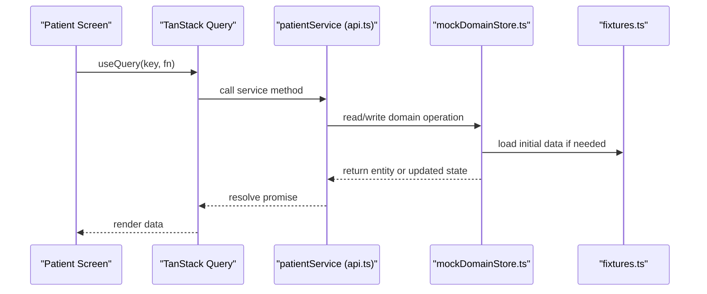

**Diagram sources**
- [api.ts:274-430](file://src/services/api.ts#L274-L430)
- [mockDomainStore.ts:35-557](file://src/mock/mockDomainStore.ts#L35-L557)
- [fixtures.ts:1-904](file://src/mock/fixtures.ts#L1-L904)

**Section sources**
- [api.ts:1-20](file://src/services/api.ts#L1-L20)
- [mockDomainStore.ts:35-66](file://src/mock/mockDomainStore.ts#L35-L66)

## Detailed Component Analysis

### Doctor Discovery and Multi-Factor Filtering
The doctor discovery screen supports:

- Free-text search across doctor name, specialty, and bio.
- Specialty pill carousel.
- Kigali coverage district filter.
- Consultation language filter.
- Online-only availability toggle.
- Real-time re-querying via TanStack Query.

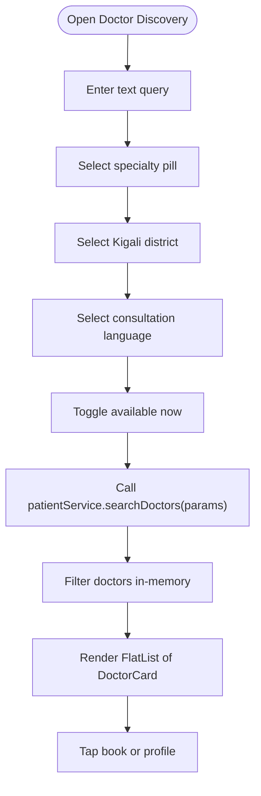

**Diagram sources**
- [doctors.tsx:19-223](file://src/app/(patient)/doctors.tsx#L19-L223)
- [api.ts:290-323](file://src/services/api.ts#L290-L323)

Key behaviors:
- The query key includes all filters so changing any parameter triggers a fresh search.
- Empty results show an empty state with a clear filters button.
- Navigation routes to doctor profile and booking pages.

**Section sources**
- [doctors.tsx:20-54](file://src/app/(patient)/doctors.tsx#L20-L54)
- [doctors.tsx:107-189](file://src/app/(patient)/doctors.tsx#L107-L189)
- [doctors.tsx:191-221](file://src/app/(patient)/doctors.tsx#L191-L221)
- [api.ts:290-323](file://src/services/api.ts#L290-L323)

### 9-Step Booking Workflow
The booking screen implements a comprehensive flow covering:

1. Select date and available time slot.
2. Choose common symptoms.
3. Provide detailed condition description.
4. Optionally attach prior prescription or lab photo.
5. Enter residence address.
6. Select Kigali district.
7. Add gate/landmark access instructions.
8. Review fee breakdown and estimated total.
9. Select payment method and submit visit request.

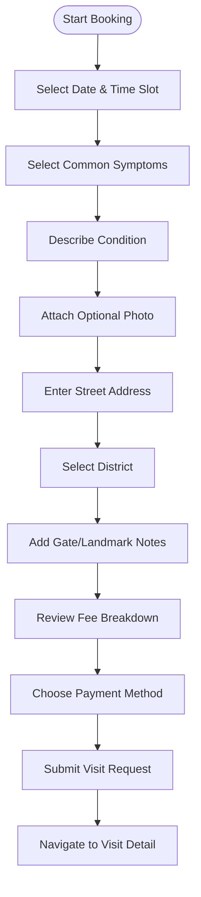

**Diagram sources**
- [book/[doctorId].tsx:156-376](file://src/app/(patient)/book/[doctorId].tsx#L156-L376)
- [api.ts:334-345](file://src/services/api.ts#L334-L345)

Important details:
- Slot selection updates selected date and time.
- Symptom chips toggle selected symptoms.
- GPS pin simulation fills a sample Kigali address.
- Validation requires condition description and address.
- Fee calculation uses consultation fee plus travel fee.
- Payment methods include mobile money, Airtel Money, and cash on visit.
- On success, the app navigates to the visit tracking screen.

**Section sources**
- [book/[doctorId].tsx:45-63](file://src/app/(patient)/book/[doctorId].tsx#L45-L63)
- [book/[doctorId].tsx:72-83](file://src/app/(patient)/book/[doctorId].tsx#L72-L83)
- [book/[doctorId].tsx:85-135](file://src/app/(patient)/book/[doctorId].tsx#L85-L135)
- [book/[doctorId].tsx:156-376](file://src/app/(patient)/book/[doctorId].tsx#L156-L376)

### Visit Lifecycle Management
The visit lifecycle follows this state model:

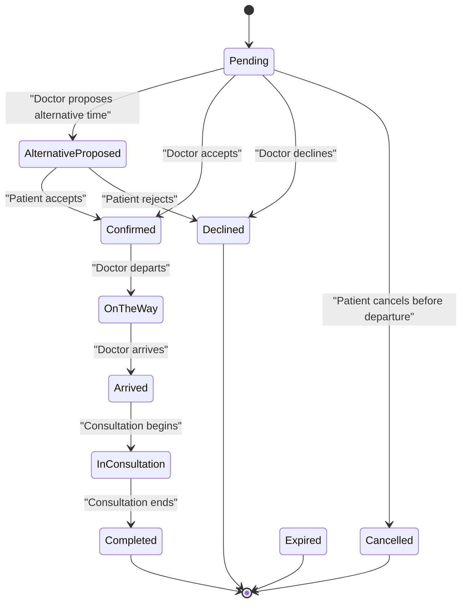

**Diagram sources**
- [domain.ts:9-19](file://src/types/domain.ts#L9-L19)
- [mockDomainStore.ts:283-380](file://src/mock/mockDomainStore.ts#L283-L380)

Cancellation restrictions:
- Cancellation is blocked when the visit status is `on_the_way`, `arrived`, `in_consultation`, or `completed`.
- The UI disables the cancel button and shows a lock notice during those states.

Alternative time handling:
- When a doctor proposes an alternative time, the visit enters `alternative_proposed`.
- The patient can accept or reject the proposed slot.
- Accepting updates the scheduled date/time and moves the visit to `confirmed`.

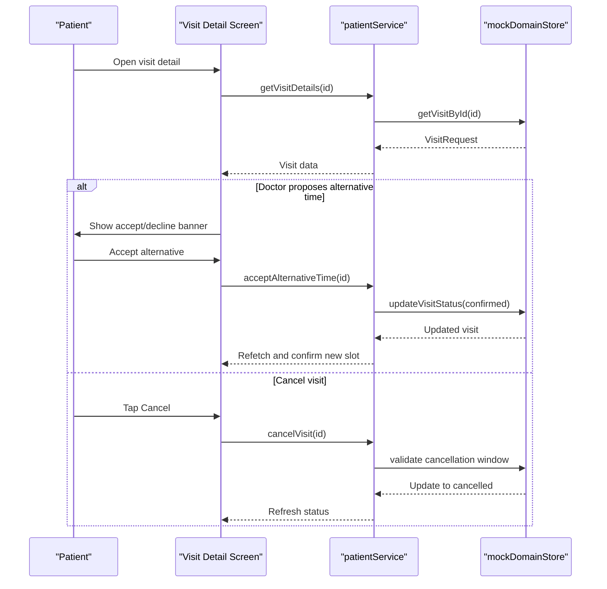

**Diagram sources**
- [visit/[id].tsx:48-127](file://src/app/(patient)/visit/[id].tsx#L48-L127)
- [api.ts:359-403](file://src/services/api.ts#L359-L403)
- [mockDomainStore.ts:283-380](file://src/mock/mockDomainStore.ts#L283-L380)

**Section sources**
- [visit/[id].tsx:125-127](file://src/app/(patient)/visit/[id].tsx#L125-L127)
- [visit/[id].tsx:145-176](file://src/app/(patient)/visit/[id].tsx#L145-L176)
- [visit/[id].tsx:178-230](file://src/app/(patient)/visit/[id].tsx#L178-L230)
- [visit/[id].tsx:276-320](file://src/app/(patient)/visit/[id].tsx#L276-L320)
- [api.ts:359-403](file://src/services/api.ts#L359-L403)

### Medical Records System
The medical records screen provides three tabs:

- **Consultations**: Published clinical consultation summaries with diagnosis, ICD code, physical examination findings, clinical notes, recommendations, and follow-up information.
- **Prescriptions**: Electronic prescriptions extracted from published consultations, showing medication name, dosage, frequency, duration, and instructions.
- **Lab Results**: Laboratory result cards linking to the result viewer.

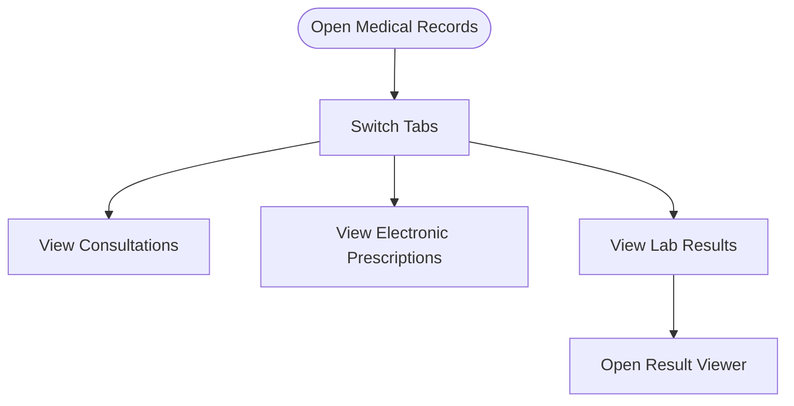

**Diagram sources**
- [records.tsx:32-198](file://src/app/(patient)/records.tsx#L32-L198)

Key behaviors:
- Consultations are filtered to published records only.
- Prescriptions are flattened from consultation records.
- Lab results navigate to the dedicated result detail screen.

**Section sources**
- [records.tsx:19-62](file://src/app/(patient)/records.tsx#L19-L62)
- [records.tsx:66-119](file://src/app/(patient)/records.tsx#L66-L119)
- [records.tsx:122-156](file://src/app/(patient)/records.tsx#L122-L156)
- [records.tsx:158-198](file://src/app/(patient)/records.tsx#L158-L198)

### Result Viewer with PDF Support and Sharing
The result detail screen displays:

- Official medical examination badge and publication timestamp.
- Specimen traceability verification including patient name, attending doctor, visit reference, and optional sample ID.
- Diagnostic findings summary.
- Fictional PDF canvas preview.
- Download for offline cache simulation.
- Share action.

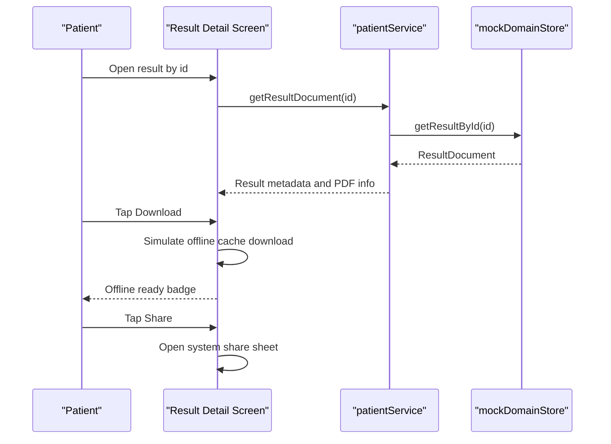

**Diagram sources**
- [result/[id].tsx:18-135](file://src/app/(patient)/result/[id].tsx#L18-L135)
- [api.ts:412-417](file://src/services/api.ts#L412-L417)

**Section sources**
- [result/[id].tsx:50-91](file://src/app/(patient)/result/[id].tsx#L50-L91)
- [result/[id].tsx:93-117](file://src/app/(patient)/result/[id].tsx#L93-L117)
- [result/[id].tsx:119-133](file://src/app/(patient)/result/[id].tsx#L119-L133)

### Patient Profile Management and Emergency Contact
The profile screen allows patients to manage:

- Default residence address and district.
- Known allergies, chronic conditions, and current medications.
- Registered emergency contact display.
- Privacy and health data rights, including export and account deletion requests.
- Demo controls and sign-out.

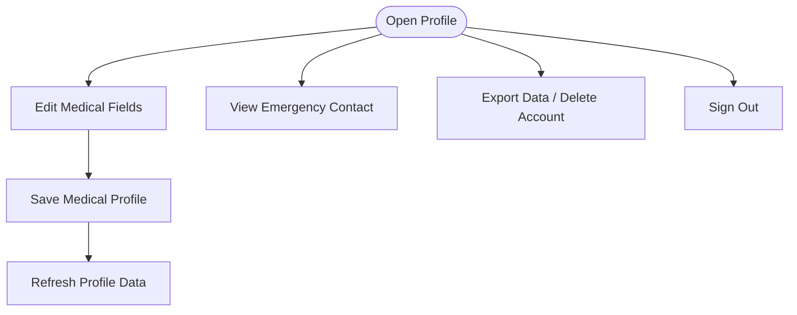

**Diagram sources**
- [profile.tsx:29-59](file://src/app/(patient)/profile.tsx#L29-L59)
- [profile.tsx:61-181](file://src/app/(patient)/profile.tsx#L61-L181)

**Section sources**
- [profile.tsx:22-47](file://src/app/(patient)/profile.tsx#L22-L47)
- [profile.tsx:73-121](file://src/app/(patient)/profile.tsx#L73-L121)
- [profile.tsx:123-135](file://src/app/(patient)/profile.tsx#L123-L135)
- [profile.tsx:137-180](file://src/app/(patient)/profile.tsx#L137-L180)

### Notification System Integration
The notification center:

- Loads notifications for the current user.
- Marks notifications as read on press.
- Deep-links to either a result document or a visit detail based on notification type.
- Supports result-ready and visit-status notifications.

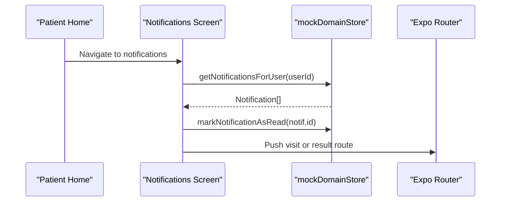

**Diagram sources**
- [notifications.tsx:21-38](file://src/app/(patient)/notifications.tsx#L21-L38)
- [mockDomainStore.ts:467-479](file://src/mock/mockDomainStore.ts#L467-L479)

**Section sources**
- [notifications.tsx:18-71](file://src/app/(patient)/notifications.tsx#L18-L71)
- [mockDomainStore.ts:436-450](file://src/mock/mockDomainStore.ts#L436-L450)

## Dependency Analysis
The patient features depend on shared types, services, and mock data:

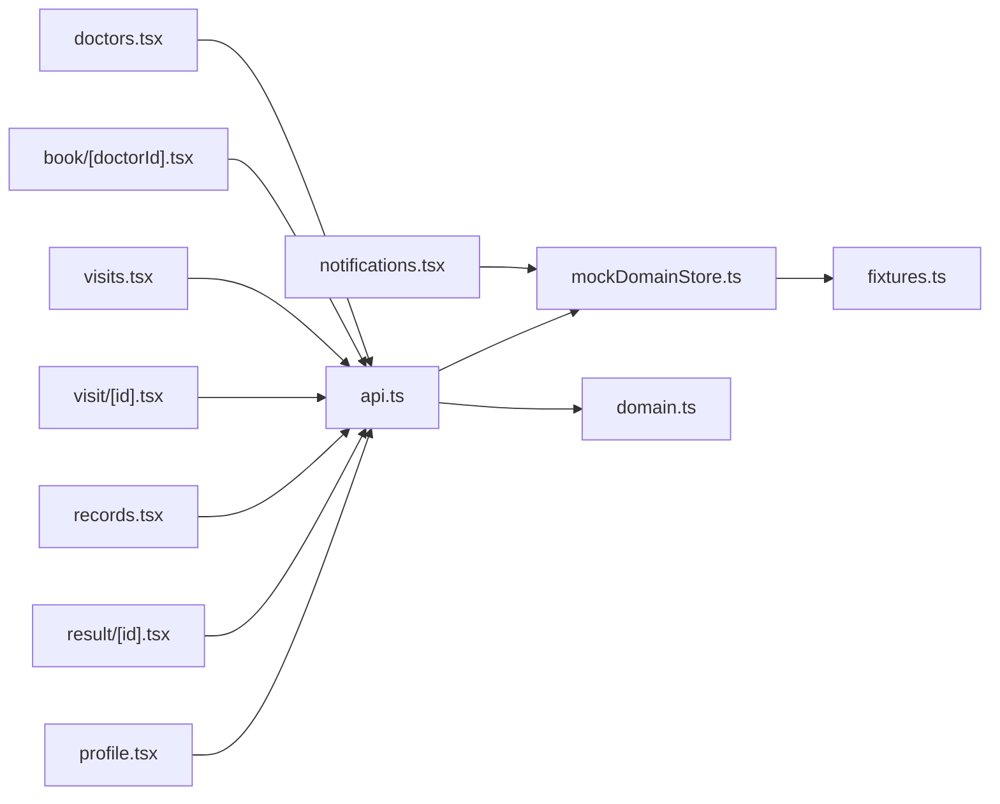

**Diagram sources**
- [doctors.tsx:1-18](file://src/app/(patient)/doctors.tsx#L1-L18)
- [book/[doctorId].tsx:1-20](file://src/app/(patient)/book/[doctorId].tsx#L1-L20)
- [visits.tsx:1-17](file://src/app/(patient)/visits.tsx#L1-L17)
- [visit/[id].tsx:1-21](file://src/app/(patient)/visit/[id].tsx#L1-L21)
- [records.tsx:1-18](file://src/app/(patient)/records.tsx#L1-L18)
- [result/[id].tsx:1-17](file://src/app/(patient)/result/[id].tsx#L1-L17)
- [profile.tsx:1-18](file://src/app/(patient)/profile.tsx#L1-L18)
- [notifications.tsx:1-17](file://src/app/(patient)/notifications.tsx#L1-L17)
- [api.ts:1-20](file://src/services/api.ts#L1-L20)
- [domain.ts:1-242](file://src/types/domain.ts#L1-L242)
- [fixtures.ts:1-33](file://src/mock/fixtures.ts#L1-L33)
- [mockDomainStore.ts:1-33](file://src/mock/mockDomainStore.ts#L1-L33)

Coupling and cohesion:
- Each patient screen is cohesive around its feature area and depends on a small set of service methods.
- `patientService` centralizes domain operations, reducing direct coupling between screens and the mock store.
- `mockDomainStore` encapsulates business rules such as double-booking prevention, cancellation restrictions, and notification generation.

Potential circular dependencies:
- No circular imports are visible; screens import services, services import store and types, store imports fixtures.

External dependencies:
- Expo Router for navigation.
- TanStack Query for caching and refetching.
- Mock store for in-memory persistence during development.

**Section sources**
- [api.ts:247-430](file://src/services/api.ts#L247-L430)
- [mockDomainStore.ts:245-380](file://src/mock/mockDomainStore.ts#L245-L380)

## Performance Considerations
- TanStack Query caches doctor searches, visits, records, and result documents, reducing redundant calls.
- The visit detail screen polls every 3 seconds in demo mode to reflect live status changes.
- Mock service methods add simulated latency to mimic network behavior.
- Filtering is performed in-memory for doctor search, which is acceptable for the demo dataset but should be server-side for production scale.
- Avoid heavy rendering in FlatList by keeping item components lightweight; the current implementation uses simple card components.

[No sources needed since this section provides general guidance]

## Troubleshooting Guide
Common issues and resolutions:

| Issue | Likely Cause | Resolution |
|---|---|---|
| Doctor search returns no results | Overly restrictive filters or no matching specialists | Clear filters or broaden specialty/district/language criteria |
| Booking fails with validation error | Missing symptom description or address | Fill required fields before submitting |
| Cannot cancel visit | Visit already in advanced execution state | Wait until doctor has not departed or arrived; cancellation is locked |
| Alternative time cannot be accepted | No alternative proposed or wrong visit status | Ensure visit is in `alternative_proposed` before accepting |
| Result viewer shows loading indefinitely | Missing result id or unavailable document | Verify result id and ensure result exists in mock store |
| Notifications do not deep-link correctly | Missing reference id or unsupported notification type | Check notification type and reference id mapping |

**Section sources**
- [doctors.tsx:203-221](file://src/app/(patient)/doctors.tsx#L203-L221)
- [book/[doctorId].tsx:85-95](file://src/app/(patient)/book/[doctorId].tsx#L85-L95)
- [visit/[id].tsx:125-127](file://src/app/(patient)/visit/[id].tsx#L125-L127)
- [api.ts:359-403](file://src/services/api.ts#L359-L403)
- [result/[id].tsx:29-35](file://src/app/(patient)/result/[id].tsx#L29-L35)
- [notifications.tsx:27-38](file://src/app/(patient)/notifications.tsx#L27-L38)

## Conclusion
The HomeCare patient features provide a complete residential consultation experience:

- Patients can discover verified specialists using multi-factor filters.
- They can book home visits through a structured 9-step workflow with symptom capture, address input, and payment selection.
- Visit tracking shows a clear lifecycle with cancellation safeguards and alternative time negotiation.
- Medical records present clinical summaries, electronic prescriptions, and lab results with PDF preview and sharing.
- Profiles support health data editing, emergency contacts, and privacy controls.
- Notifications integrate with visit and result workflows.

The architecture separates presentation, service contracts, domain types, and mock persistence, making it straightforward to replace the mock layer with a real backend while preserving the patient user experience.

[No sources needed since this section summarizes without analyzing specific files]