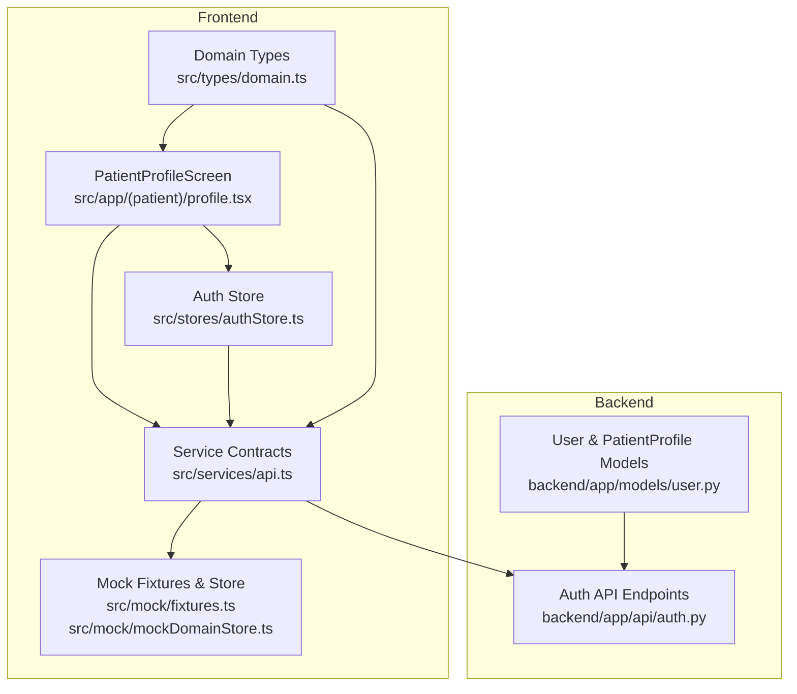
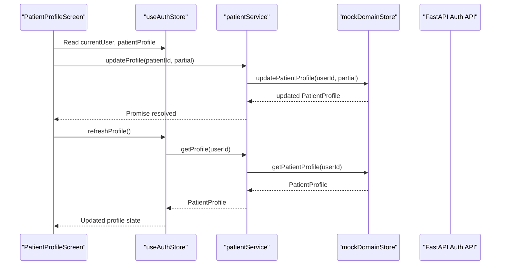
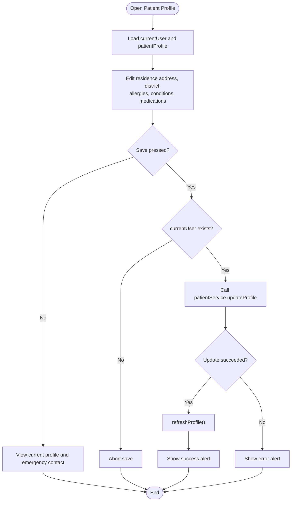
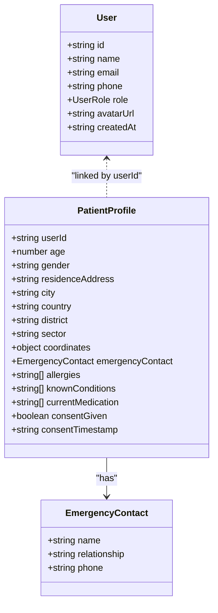
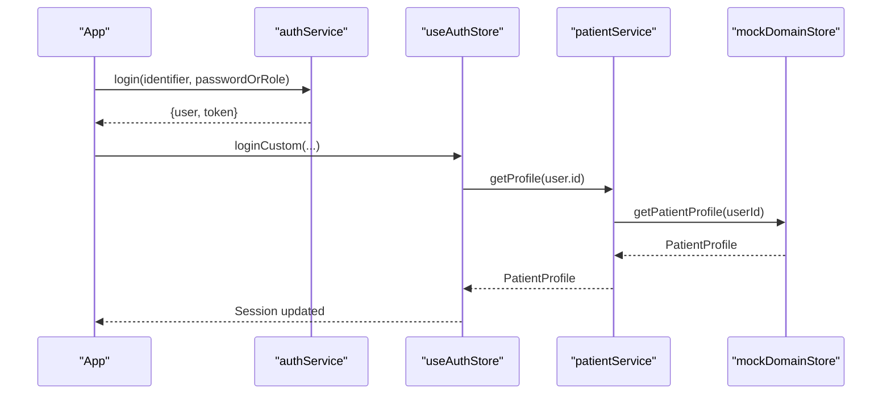
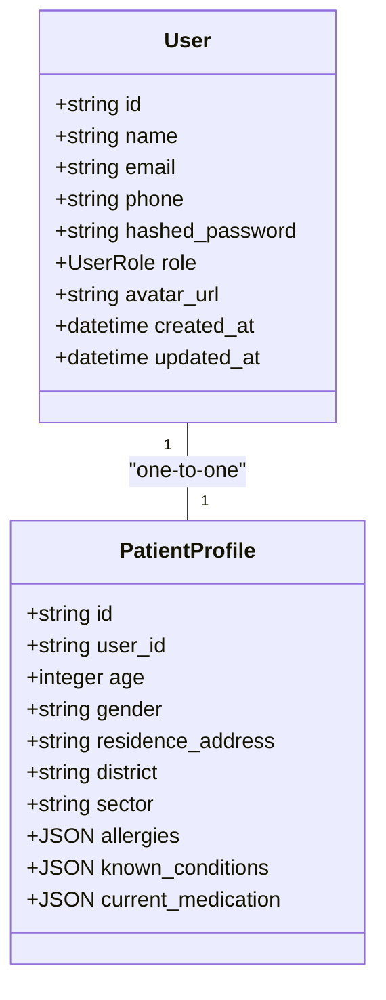
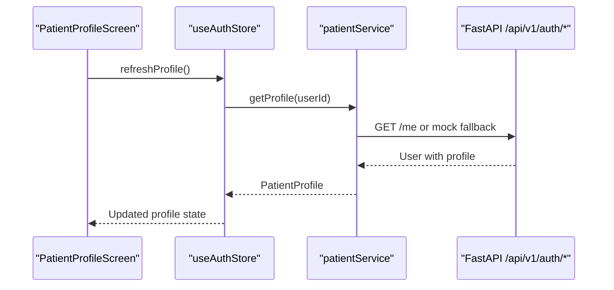
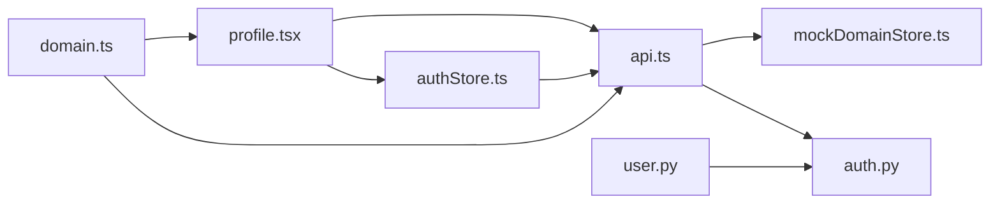

# Patient Profile Management

<cite>
**Referenced Files in This Document**
- [profile.tsx](file://src/app/(patient)/profile.tsx)
- [domain.ts](file://src/types/domain.ts)
- [api.ts](file://src/services/api.ts)
- [authStore.ts](file://src/stores/authStore.ts)
- [fixtures.ts](file://src/mock/fixtures.ts)
- [mockDomainStore.ts](file://src/mock/mockDomainStore.ts)
- [user.py](file://backend/app/models/user.py)
- [auth.py](file://backend/app/api/auth.py)
</cite>

## Table of Contents
1. [Introduction](#introduction)
2. [Project Structure](#project-structure)
3. [Core Components](#core-components)
4. [Architecture Overview](#architecture-overview)
5. [Detailed Component Analysis](#detailed-component-analysis)
6. [Dependency Analysis](#dependency-analysis)
7. [Performance Considerations](#performance-considerations)
8. [Troubleshooting Guide](#troubleshooting-guide)
9. [Conclusion](#conclusion)

## Introduction
This document explains the patient profile management system for the HomeCare application. It covers how patients manage personal and medical information, emergency contacts, residence and delivery-related location data, privacy and account controls, and how these features integrate with authentication and backend models. The current implementation focuses on:

- Personal and demographic fields such as name, email, phone, avatar URL, age, gender, and country/city/district/sector.
- Medical details including allergies, known conditions, and current medications.
- Emergency contact display and default residence address used for home visits.
- Privacy and data rights actions such as exporting health data and requesting account deletion.
- Integration with the authentication layer for login, token handling, and profile refresh.
- Backend user and patient profile models that store core identity and medical/residence attributes.

Where a requested capability is not yet implemented (for example, editing multiple saved addresses or configuring notification preferences), this document clearly marks those areas and suggests safe extension points based on existing code structure.

## Project Structure
The patient profile feature spans frontend screens, domain types, service contracts, state management, mock data, and backend models.

**Diagram sources**
- [profile.tsx:1-282](file://src/app/(patient)/profile.tsx#L1-L282)
- [domain.ts:29-59](file://src/types/domain.ts#L29-L59)
- [api.ts:46-245](file://src/services/api.ts#L46-L245)
- [authStore.ts:1-112](file://src/stores/authStore.ts#L1-L112)
- [fixtures.ts:120-163](file://src/mock/fixtures.ts#L120-L163)
- [mockDomainStore.ts:156-168](file://src/mock/mockDomainStore.ts#L156-L168)
- [user.py:26-59](file://backend/app/models/user.py#L26-L59)
- [auth.py:121-180](file://backend/app/api/auth.py#L121-L180)

**Section sources**
- [profile.tsx:1-282](file://src/app/(patient)/profile.tsx#L1-L282)
- [domain.ts:29-59](file://src/types/domain.ts#L29-L59)
- [api.ts:46-245](file://src/services/api.ts#L46-L245)
- [authStore.ts:1-112](file://src/stores/authStore.ts#L1-L112)
- [user.py:26-59](file://backend/app/models/user.py#L26-L59)
- [auth.py:121-180](file://backend/app/api/auth.py#L121-L180)

## Core Components
The patient profile system is composed of:

- **PatientProfileScreen**: Renders account info, medical and residence details, emergency contact summary, privacy actions, demo controls, and sign out.
- **Domain Types**: Define `User`, `PatientProfile`, and related entities used across the app.
- **Service Layer**: Provides `authService` and `patientService` with live API calls and mock fallbacks.
- **Auth Store**: Manages session state, login flows, profile refresh, and logout.
- **Mock Data**: Supplies initial patient profiles, users, and an in-memory store for development and testing.
- **Backend Models**: Persist user identity and patient profile attributes.
- **Auth API**: Handles registration, login, OTP verification, password reset, and current user retrieval.

Key responsibilities:
- Displaying and updating residence address, district, allergies, chronic conditions, and current medications.
- Showing the registered emergency contact.
- Triggering export and deletion requests for compliance.
- Integrating with authentication to load and refresh profile data.

**Section sources**
- [profile.tsx:19-181](file://src/app/(patient)/profile.tsx#L19-L181)
- [domain.ts:29-59](file://src/types/domain.ts#L29-L59)
- [api.ts:247-283](file://src/services/api.ts#L247-L283)
- [authStore.ts:23-111](file://src/stores/authStore.ts#L23-L111)
- [user.py:26-59](file://backend/app/models/user.py#L26-L59)

## Architecture Overview
The profile update flow connects the UI screen to the service layer, then either to the mock store or the backend API.

**Diagram sources**
- [profile.tsx:29-47](file://src/app/(patient)/profile.tsx#L29-L47)
- [api.ts:274-283](file://src/services/api.ts#L274-L283)
- [mockDomainStore.ts:161-168](file://src/mock/mockDomainStore.ts#L161-L168)
- [authStore.ts:95-105](file://src/stores/authStore.ts#L95-L105)

## Detailed Component Analysis

### Patient Profile Screen
The patient profile screen provides:

- **Account Info Card**: Displays the logged-in patient’s name, role, phone, and email. An avatar placeholder shows the first letter of the name.
- **Medical and Residence Details**: Editable fields for:
  - Default Kigali residence address
  - District
  - Known allergies (comma-separated list)
  - Known chronic conditions (comma-separated list)
  - Current daily medications (comma-separated list)
- **Emergency Contact Summary**: Shows the registered emergency contact name, relationship, and phone number.
- **Privacy and Health Data Rights**: Buttons to export health data and request account deletion.
- **Demo Controls and Sign Out**: Reset demo data and sign out by navigating back to the welcome screen.

The save action:
- Validates that a current user exists.
- Sends a partial profile update containing residence address, district, allergies, known conditions, and current medications.
- Refreshes the profile from the store.
- Shows success or error feedback.

**Diagram sources**
- [profile.tsx:29-47](file://src/app/(patient)/profile.tsx#L29-L47)
- [profile.tsx:61-181](file://src/app/(patient)/profile.tsx#L61-L181)

**Section sources**
- [profile.tsx:19-181](file://src/app/(patient)/profile.tsx#L19-L181)

### Domain Model for Patient Profiles
The domain model defines the shape of patient data used throughout the app.

Important fields include:
- Identity: `userId`, `name`, `email`, `phone`, `role`, `avatarUrl`, `createdAt`.
- Demographics: `age`, `gender`, `country`, `city`, `district`, optional `sector`, optional coordinates.
- Emergency contact: nested object with `name`, `relationship`, and `phone`.
- Medical data: arrays for `allergies`, `knownConditions`, and `currentMedication`.
- Consent: `consentGiven` boolean and `consentTimestamp`.

**Diagram sources**
- [domain.ts:29-59](file://src/types/domain.ts#L29-L59)

**Section sources**
- [domain.ts:29-59](file://src/types/domain.ts#L29-L59)

### Service Layer and Authentication Integration
The service layer exposes:

- `authService`: Login, OTP verification, patient registration, doctor registration, current user lookup, and password reset. It attempts real API calls and falls back to mock data when needed.
- `patientService`: Get and update patient profiles, search doctors, manage visit requests, records, reviews, complaints, and admin operations.

For profile updates:
- `patientService.updateProfile` delegates to the mock store during development.
- After saving, the auth store refreshes the profile using `patientService.getProfile`.

Authentication integration:
- Login returns a user and token.
- For patients, the store fetches the patient profile after login.
- Logout clears session state.
- Refresh profile reloads the latest profile data.

**Diagram sources**
- [api.ts:46-104](file://src/services/api.ts#L46-L104)
- [authStore.ts:31-83](file://src/stores/authStore.ts#L31-L83)
- [api.ts:274-283](file://src/services/api.ts#L274-L283)
- [mockDomainStore.ts:156-168](file://src/mock/mockDomainStore.ts#L156-L168)

**Section sources**
- [api.ts:46-245](file://src/services/api.ts#L46-L245)
- [authStore.ts:1-112](file://src/stores/authStore.ts#L1-L112)

### Backend Models and API
The backend defines:

- `User`: Core identity fields including hashed password, role, avatar URL, and timestamps.
- `PatientProfile`: Linked to `User` via `user_id`, storing age, gender, residence address, district, sector, and JSON arrays for allergies, known conditions, and current medication.
- `DoctorProfile`: Not directly part of patient profile editing but relevant for cross-role data access.

The auth API supports:
- Patient registration with profile creation.
- Doctor registration with verification status.
- Login returning tokens and user data.
- OTP verification and password reset endpoints.
- Current user endpoint protected by dependency injection.

**Diagram sources**
- [user.py:26-59](file://backend/app/models/user.py#L26-L59)

**Section sources**
- [user.py:26-59](file://backend/app/models/user.py#L26-L59)
- [auth.py:24-65](file://backend/app/api/auth.py#L24-L65)
- [auth.py:121-180](file://backend/app/api/auth.py#L121-L180)

### Personal Information Editing Capabilities
Currently supported:
- Name, email, and phone are displayed from the authenticated user.
- Age and gender exist in the domain model and backend model but are not editable in the current profile screen.
- Country, city, sector, and coordinates exist in the domain model and mock fixtures but are not editable in the current profile screen.
- Residence address and district are editable through the profile screen.
- Allergies, known conditions, and current medications are editable as comma-separated lists.

Recommended next steps:
- Add input fields for date of birth or age if required by business rules.
- Add gender selection and country/city/district/sector selectors.
- Add validation for phone numbers and email formats.
- Add structured demographic fields instead of free-text where appropriate.

**Section sources**
- [profile.tsx:61-121](file://src/app/(patient)/profile.tsx#L61-L121)
- [domain.ts:29-59](file://src/types/domain.ts#L29-L59)
- [user.py:26-59](file://backend/app/models/user.py#L26-L59)

### Emergency Contact Management
Current behavior:
- The profile screen displays the registered emergency contact name, relationship, and phone number.
- There is no dedicated UI to add, edit, reorder, or prioritize multiple emergency contacts.

Existing data:
- The domain model includes a single `emergencyContact` object.
- Mock fixtures provide sample emergency contacts per patient.

Recommended next steps:
- Extend `PatientProfile` to support an array of emergency contacts with priority ordering.
- Add an emergency contact management screen with add, edit, delete, and reorder capabilities.
- Persist changes through `patientService.updateProfile`.
- Use the highest-priority contact for urgent notifications and home visit coordination.

**Section sources**
- [profile.tsx:123-135](file://src/app/(patient)/profile.tsx#L123-L135)
- [domain.ts:49-53](file://src/types/domain.ts#L49-L53)
- [fixtures.ts:120-163](file://src/mock/fixtures.ts#L120-L163)

### Address Management System
Current behavior:
- The profile screen allows editing the default residence address and district.
- No saved locations list or delivery preference configuration is present.

Existing data:
- The domain model includes `residenceAddress`, `city`, `country`, `district`, `sector`, and optional coordinates.
- Visit requests include `visitAddress`, `district`, optional `accessInstructions`, and optional coordinates.

Recommended next steps:
- Add a saved locations manager with create, edit, delete, and set-as-default actions.
- Support delivery preferences such as preferred entrance instructions, building codes, and time windows.
- Reuse address data for visit booking and home visit routing.
- Integrate geocoding and map-based location selection if navigation is required.

**Section sources**
- [profile.tsx:80-92](file://src/app/(patient)/profile.tsx#L80-L92)
- [domain.ts:43-48](file://src/types/domain.ts#L43-L48)
- [domain.ts:115-118](file://src/types/domain.ts#L115-L118)

### Notification Preferences Configuration
Current behavior:
- There is no notification preferences configuration screen.
- Notifications exist as domain entities and are managed by the mock store for visit status and result publication events.

Existing data:
- `AppNotification` includes recipient, title, body, type, reference ID, read status, and timestamp.
- The mock store tracks notifications and can mark them as read.

Recommended next steps:
- Add a notification preferences screen allowing patients to toggle channels such as push, SMS, and email.
- Allow toggling categories like visit status, results, reminders, and system messages.
- Persist preferences in the patient profile or a separate settings table.
- Wire preferences into the notification dispatch logic.

**Section sources**
- [domain.ts:196-205](file://src/types/domain.ts#L196-L205)
- [mockDomainStore.ts:466-479](file://src/mock/mockDomainStore.ts#L466-L479)

### Privacy Settings and Account Security Options
Current behavior:
- The profile screen includes privacy and health data rights actions:
  - Export my health data
  - Request account deletion
- These actions currently show informational alerts rather than full workflows.

Existing data:
- The domain model includes consent flags and timestamps for patient consent.
- Audit logs track actions such as reading, creating, updating, publishing, and exporting.

Recommended next steps:
- Implement encrypted export functionality with audit logging.
- Implement secure account deletion with retention policy enforcement.
- Add privacy toggles for data sharing with doctors and third parties.
- Add account security options such as two-factor authentication, password change, and active session management.

**Section sources**
- [profile.tsx:49-59](file://src/app/(patient)/profile.tsx#L49-L59)
- [domain.ts:57-58](file://src/types/domain.ts#L57-L58)
- [domain.ts:230-241](file://src/types/domain.ts#L230-L241)

### Profile Photo Upload Functionality
Current behavior:
- The profile screen shows an avatar placeholder based on the user’s name.
- The domain model includes `avatarUrl` for both `User` and `DoctorProfile`.
- Mock fixtures include sample avatar URLs.

There is no upload UI in the current profile screen.

Recommended next steps:
- Add a profile photo picker component.
- Upload images to a secure storage service.
- Update `User.avatarUrl` through a dedicated profile update endpoint.
- Cache and preview the uploaded image locally before upload.
- Handle errors such as invalid file types and size limits.

**Section sources**
- [profile.tsx:64-71](file://src/app/(patient)/profile.tsx#L64-L71)
- [domain.ts:29-37](file://src/types/domain.ts#L29-L37)
- [fixtures.ts:73-118](file://src/mock/fixtures.ts#L73-L118)

### Medical History Summary Display
Current behavior:
- The profile screen does not display a consolidated medical history summary.
- Doctors’ patient view displays allergies, chronic conditions, current medications, and residence.
- Consultation records and result documents exist in the domain model and mock fixtures.

Recommended next steps:
- Add a medical history summary section showing:
  - Allergies
  - Chronic conditions
  - Current medications
  - Recent consultation summaries
  - Published lab results and imaging reports
- Link to detailed record views for consultations and results.
- Respect consent and privacy constraints when displaying sensitive data.

**Section sources**
- [profile.tsx:73-121](file://src/app/(patient)/profile.tsx#L73-L121)
- [domain.ts:153-194](file://src/types/domain.ts#L153-L194)
- [fixtures.ts:693-778](file://src/mock/fixtures.ts#L693-L778)

### Integration with Authentication System for Profile Updates
Current behavior:
- Login retrieves a user and token from the backend or mock store.
- The auth store loads the patient profile after login.
- Profile updates call `patientService.updateProfile` and then refresh the profile.
- Logout clears session state and navigates to the welcome screen.

Backend integration:
- The auth API validates credentials, creates access tokens, and returns user data.
- Registration endpoints create both `User` and `PatientProfile` records.

**Diagram sources**
- [authStore.ts:95-105](file://src/stores/authStore.ts#L95-L105)
- [api.ts:274-278](file://src/services/api.ts#L274-L278)
- [auth.py:178-180](file://backend/app/api/auth.py#L178-L180)

**Section sources**
- [authStore.ts:31-111](file://src/stores/authStore.ts#L31-L111)
- [api.ts:46-104](file://src/services/api.ts#L46-L104)
- [auth.py:121-180](file://backend/app/api/auth.py#L121-L180)

## Dependency Analysis
The following diagram shows key dependencies between components involved in patient profile management.

**Diagram sources**
- [profile.tsx:1-282](file://src/app/(patient)/profile.tsx#L1-L282)
- [authStore.ts:1-112](file://src/stores/authStore.ts#L1-L112)
- [api.ts:1-660](file://src/services/api.ts#L1-L660)
- [mockDomainStore.ts:1-557](file://src/mock/mockDomainStore.ts#L1-L557)
- [domain.ts:1-242](file://src/types/domain.ts#L1-L242)
- [user.py:1-82](file://backend/app/models/user.py#L1-L82)
- [auth.py:1-182](file://backend/app/api/auth.py#L1-L182)

**Section sources**
- [profile.tsx:1-282](file://src/app/(patient)/profile.tsx#L1-L282)
- [authStore.ts:1-112](file://src/stores/authStore.ts#L1-L112)
- [api.ts:1-660](file://src/services/api.ts#L1-L660)
- [domain.ts:1-242](file://src/types/domain.ts#L1-L242)
- [user.py:1-82](file://backend/app/models/user.py#L1-L82)
- [auth.py:1-182](file://backend/app/api/auth.py#L1-L182)

## Performance Considerations
- Profile updates use short simulated delays in the service layer; production should replace these with efficient API calls and proper caching.
- Profile refresh avoids unnecessary network calls by checking whether the current user exists.
- Mock store operations are in-memory and fast; ensure production persistence layers remain indexed appropriately for user and profile lookups.
- Avoid re-rendering heavy profile sections by memoizing computed values and splitting large components.

[No sources needed since this section provides general guidance]

## Troubleshooting Guide
Common issues and resolutions:

- **Profile update fails silently**: Check that `currentUser` exists before calling `updateProfile`. Verify that the service layer is connected to the correct backend or mock store.
- **Emergency contact not visible**: Ensure the patient profile contains an `emergencyContact` object. If missing, initialize it during registration or profile setup.
- **Export or deletion alerts do nothing**: These are currently placeholders. Implement actual export and deletion workflows with audit logging and compliance checks.
- **Avatar not updating**: Add an upload flow that updates `User.avatarUrl` and refreshes the profile.
- **Medical history not shown**: Add a medical history summary component and wire it to consultation records and result documents.

**Section sources**
- [profile.tsx:29-59](file://src/app/(patient)/profile.tsx#L29-L59)
- [api.ts:274-283](file://src/services/api.ts#L274-L283)
- [mockDomainStore.ts:161-168](file://src/mock/mockDomainStore.ts#L161-L168)

## Conclusion
The patient profile management system currently supports viewing account information, editing residence and medical details, viewing emergency contact information, and triggering privacy-related actions. It integrates with authentication to load and refresh profile data and uses both frontend services and backend models to represent patient data.

To fully meet the documentation objective, future work should implement:
- Structured personal and demographic editing including date of birth.
- A complete emergency contact management interface with add, edit, and prioritization.
- A saved locations and delivery preferences system.
- Notification preferences configuration.
- Enhanced privacy settings and account security options.
- Profile photo upload functionality.
- A comprehensive medical history summary display.

These enhancements should follow the existing architecture patterns, maintain separation between UI, services, state, and backend models, and preserve compliance with data protection requirements.

[No sources needed since this section summarizes without analyzing specific files]