# Visit Detail View

<cite>
**Referenced Files in This Document**
- [src/app/(patient)/visit/[id].tsx](file://src/app/(patient)/visit/[id].tsx)
- [src/app/(doctor)/visit/[id].tsx](file://src/app/(doctor)/visit/[id].tsx)
- [src/types/domain.ts](file://src/types/domain.ts)
- [src/services/api.ts](file://src/services/api.ts)
- [src/mock/mockDomainStore.ts](file://src/mock/mockDomainStore.ts)
- [src/app/(patient)/records.tsx](file://src/app/(patient)/records.tsx)
- [src/app/(patient)/notifications.tsx](file://src/app/(patient)/notifications.tsx)
</cite>

## Table of Contents
1. [Introduction](#introduction)
2. [Project Structure](#project-structure)
3. [Core Components](#core-components)
4. [Architecture Overview](#architecture-overview)
5. [Detailed Component Analysis](#detailed-component-analysis)
6. [Dependency Analysis](#dependency-analysis)
7. [Performance Considerations](#performance-considerations)
8. [Troubleshooting Guide](#troubleshooting-guide)
9. [Conclusion](#conclusion)

## Introduction
This document explains the individual visit detail screen for both patients and doctors. It covers how the screen reads the visit ID from the dynamic route, fetches live visit data, visualizes the visit lifecycle, displays doctor and patient context, renders status-driven action buttons, integrates with push notifications, and connects to medical records and lab result viewing.

The implementation is split into:
- Patient visit detail screen: monitoring, cancellation, alternative time handling, rating, complaints, and navigation to records.
- Doctor visit cockpit: execution state progression, navigation integration, and transition to the clinical consultation workspace.

## Project Structure
The visit detail feature spans several files:
- Patient visit detail screen under the patient role group.
- Doctor visit cockpit under the doctor role group.
- Domain types defining visit states, profiles, and documents.
- API service layer providing mock-backed methods that can be replaced by a real backend.
- Mock domain store implementing visit lifecycle transitions and notification creation.
- Records screen for prescriptions and lab results.
- Notifications screen for status updates and result readiness.

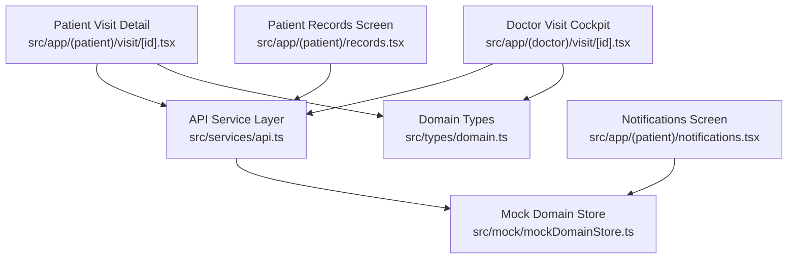

**Diagram sources**
- [src/app/(patient)/visit/[id].tsx:22-38](file://src/app/(patient)/visit/[id].tsx#L22-L38)
- [src/app/(doctor)/visit/[id].tsx:23-35](file://src/app/(doctor)/visit/[id].tsx#L23-L35)
- [src/services/api.ts:247-430](file://src/services/api.ts#L247-L430)
- [src/types/domain.ts:9-19](file://src/types/domain.ts#L9-L19)
- [src/mock/mockDomainStore.ts:283-380](file://src/mock/mockDomainStore.ts#L283-L380)
- [src/app/(patient)/records.tsx:19-27](file://src/app/(patient)/records.tsx#L19-L27)
- [src/app/(patient)/notifications.tsx:18-38](file://src/app/(patient)/notifications.tsx#L18-L38)

**Section sources**
- [src/app/(patient)/visit/[id].tsx:1-640](file://src/app/(patient)/visit/[id].tsx#L1-L640)
- [src/app/(doctor)/visit/[id].tsx:1-298](file://src/app/(doctor)/visit/[id].tsx#L1-L298)
- [src/types/domain.ts:1-242](file://src/types/domain.ts#L1-L242)
- [src/services/api.ts:1-660](file://src/services/api.ts#L1-L660)
- [src/mock/mockDomainStore.ts:1-557](file://src/mock/mockDomainStore.ts#L1-L557)
- [src/app/(patient)/records.tsx:1-438](file://src/app/(patient)/records.tsx#L1-L438)
- [src/app/(patient)/notifications.tsx:1-38](file://src/app/(patient)/notifications.tsx#L1-L38)

## Core Components
- Dynamic route parameter handling: Both screens use the local search params to extract the visit ID and conditionally fetch details only when the ID exists.
- Real-time status tracking: The screens poll visit details every few seconds to reflect status changes without manual refresh.
- Status-driven UI: A badge shows current status; timeline highlights completed, active, and pending steps.
- Action buttons: Cancel, accept/decline alternative time, rate/review, view records, report complaint, and doctor execution controls are shown based on the current visit status.
- Doctor information display: The patient screen shows attending doctor name and specialty; the doctor screen shows patient health summary and residence destination.
- Records and results: After completion, patients can navigate to records to view consultations, prescriptions, and lab result PDFs.
- Push notifications: Visit status changes and result publication create notifications that link back to the visit or result.

**Section sources**
- [src/app/(patient)/visit/[id].tsx:22-38](file://src/app/(patient)/visit/[id].tsx#L22-L38)
- [src/app/(doctor)/visit/[id].tsx:23-35](file://src/app/(doctor)/visit/[id].tsx#L23-L35)
- [src/app/(patient)/visit/[id].tsx:178-230](file://src/app/(patient)/visit/[id].tsx#L178-L230)
- [src/app/(patient)/visit/[id].tsx:286-320](file://src/app/(patient)/visit/[id].tsx#L286-L320)
- [src/app/(doctor)/visit/[id].tsx:131-183](file://src/app/(doctor)/visit/[id].tsx#L131-L183)
- [src/app/(patient)/records.tsx:122-197](file://src/app/(patient)/records.tsx#L122-L197)
- [src/mock/mockDomainStore.ts:322-377](file://src/mock/mockDomainStore.ts#L322-L377)

## Architecture Overview
The visit detail flow combines routing, query-based data fetching, service-layer business rules, and a mock store that simulates backend behavior and notifications.

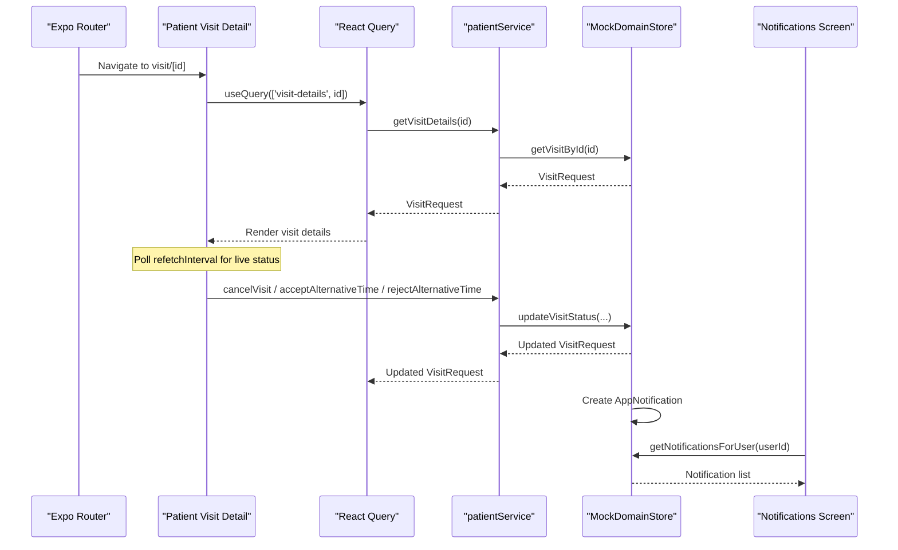

**Diagram sources**
- [src/app/(patient)/visit/[id].tsx:22-38](file://src/app/(patient)/visit/[id].tsx#L22-L38)
- [src/services/api.ts:352-403](file://src/services/api.ts#L352-L403)
- [src/mock/mockDomainStore.ts:283-380](file://src/mock/mockDomainStore.ts#L283-L380)
- [src/app/(patient)/notifications.tsx:18-38](file://src/app/(patient)/notifications.tsx#L18-L38)

## Detailed Component Analysis

### Dynamic Route Parameter Handling for Visit ID Retrieval
Both screens read the visit ID from the dynamic route using local search parameters. The query is enabled only when the ID exists, preventing unnecessary network calls during initial render.

Key behaviors:
- Extract `id` from route parameters.
- Use a query key including the visit ID.
- Enable query only when `id` is present.
- Refetch periodically to reflect status changes.

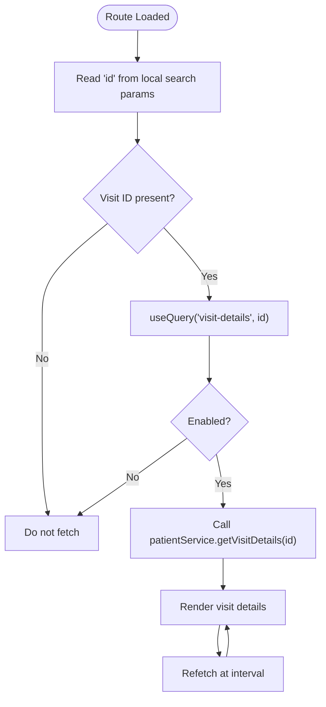

**Diagram sources**
- [src/app/(patient)/visit/[id].tsx:22-38](file://src/app/(patient)/visit/[id].tsx#L22-L38)
- [src/app/(doctor)/visit/[id].tsx:23-35](file://src/app/(doctor)/visit/[id].tsx#L23-L35)

**Section sources**
- [src/app/(patient)/visit/[id].tsx:22-38](file://src/app/(patient)/visit/[id].tsx#L22-L38)
- [src/app/(doctor)/visit/[id].tsx:23-35](file://src/app/(doctor)/visit/[id].tsx#L23-L35)

### Real-Time Status Tracking with Visual Indicators
The patient screen polls visit details every three seconds to detect status transitions. A status badge and a six-step timeline visualize progress through the visit lifecycle.

Timeline steps:
- Request Submitted
- Specialist Accepted
- Doctor On The Way
- Doctor Arrived
- In Consultation
- Visit Completed

Visual indicators:
- Badge reflects current status.
- Timeline dots show completed, active, and pending states.
- Lock notice appears when cancellation/rescheduling is disabled.

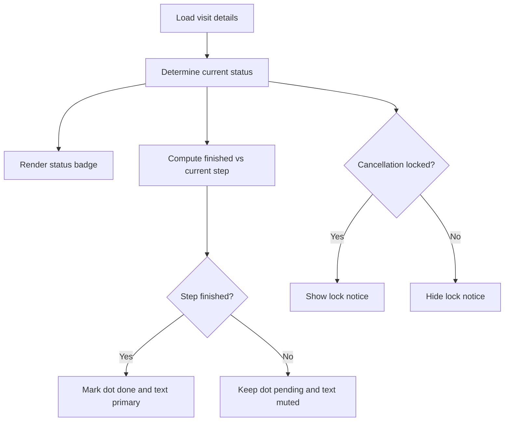

**Diagram sources**
- [src/app/(patient)/visit/[id].tsx:33-38](file://src/app/(patient)/visit/[id].tsx#L33-L38)
- [src/app/(patient)/visit/[id].tsx:178-230](file://src/app/(patient)/visit/[id].tsx#L178-L230)
- [src/app/(patient)/visit/[id].tsx:276-284](file://src/app/(patient)/visit/[id].tsx#L276-L284)

**Section sources**
- [src/app/(patient)/visit/[id].tsx:33-38](file://src/app/(patient)/visit/[id].tsx#L33-L38)
- [src/app/(patient)/visit/[id].tsx:178-230](file://src/app/(patient)/visit/[id].tsx#L178-L230)
- [src/app/(patient)/visit/[id].tsx:276-284](file://src/app/(patient)/visit/[id].tsx#L276-L284)

### Doctor Information Display Including Profile and Contact Details
The patient screen displays the attending doctor’s name and specialty in the header. The doctor screen shows the patient’s health profile, including allergies, chronic conditions, and current medications, sourced from the mock domain store.

Important notes:
- The patient screen uses visit fields such as doctor name and specialty.
- The doctor screen retrieves the patient profile by patient ID and displays health summary.
- Contact details are part of the broader domain model but are not directly rendered in these screens; they are available via the domain types and mock store.

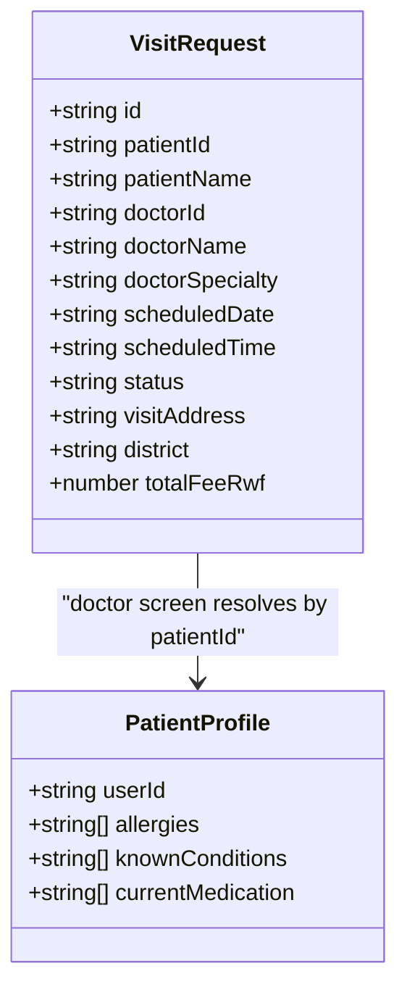

**Diagram sources**
- [src/types/domain.ts:97-129](file://src/types/domain.ts#L97-L129)
- [src/types/domain.ts:39-59](file://src/types/domain.ts#L39-L59)
- [src/app/(doctor)/visit/[id].tsx:35-35](file://src/app/(doctor)/visit/[id].tsx#L35-L35)

**Section sources**
- [src/app/(patient)/visit/[id].tsx:131-143](file://src/app/(patient)/visit/[id].tsx#L131-L143)
- [src/app/(doctor)/visit/[id].tsx:35-35](file://src/app/(doctor)/visit/[id].tsx#L35-L35)
- [src/app/(doctor)/visit/[id].tsx:110-129](file://src/app/(doctor)/visit/[id].tsx#L110-L129)
- [src/types/domain.ts:97-129](file://src/types/domain.ts#L97-L129)
- [src/types/domain.ts:39-59](file://src/types/domain.ts#L39-L59)

### Consultation Timeline Visualization Showing Complete Visit Lifecycle
The timeline component maps the current visit status to a fixed order of steps. Steps before the current status are marked complete; the current step is highlighted; later steps remain pending.

Business rule mapping:
- pending: request submitted
- confirmed: specialist accepted
- on_the_way: doctor en route
- arrived: doctor at residence
- in_consultation: consultation started
- completed: visit finished

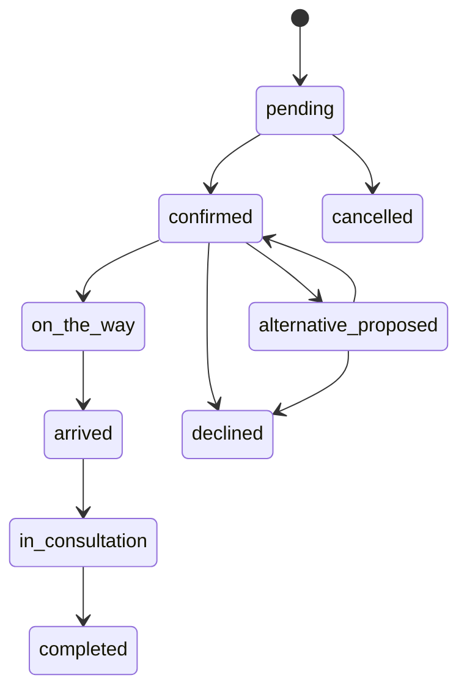

**Diagram sources**
- [src/types/domain.ts:9-19](file://src/types/domain.ts#L9-L19)
- [src/app/(patient)/visit/[id].tsx:178-230](file://src/app/(patient)/visit/[id].tsx#L178-L230)
- [src/mock/mockDomainStore.ts:322-377](file://src/mock/mockDomainStore.ts#L322-L377)

**Section sources**
- [src/app/(patient)/visit/[id].tsx:178-230](file://src/app/(patient)/visit/[id].tsx#L178-L230)
- [src/types/domain.ts:9-19](file://src/types/domain.ts#L9-L19)
- [src/mock/mockDomainStore.ts:322-377](file://src/mock/mockDomainStore.ts#L322-L377)

### Action Buttons Based on Current Visit Status and Business Rule Validations
The patient screen renders different actions depending on the visit status:
- Cancel Visit: Available unless the visit is locked due to advanced stages or already cancelled.
- Accept Alternative Slot: Shown when the doctor proposes an alternative time.
- Decline Alternative Slot: Shown alongside acceptance when an alternative is proposed.
- Rate & Review Doctor: Shown after completion.
- View Consultation Records & Lab Results: Shown after completion.
- Report Issue or Complaint: Always available.

Business validations:
- Cancellation is blocked once the doctor is en route, has arrived, is in consultation, or the visit is completed.
- Alternative time acceptance requires the visit to be in the alternative-proposed state and includes valid alternative date/time.
- Alternative rejection transitions the visit to declined.

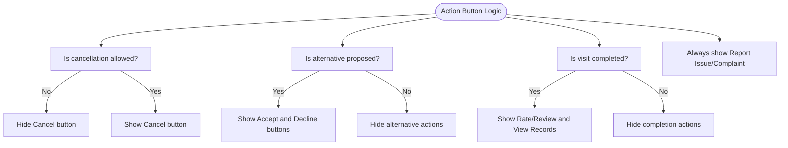

**Diagram sources**
- [src/app/(patient)/visit/[id].tsx:125-127](file://src/app/(patient)/visit/[id].tsx#L125-L127)
- [src/app/(patient)/visit/[id].tsx:145-176](file://src/app/(patient)/visit/[id].tsx#L145-L176)
- [src/app/(patient)/visit/[id].tsx:286-320](file://src/app/(patient)/visit/[id].tsx#L286-L320)
- [src/services/api.ts:359-403](file://src/services/api.ts#L359-L403)

**Section sources**
- [src/app/(patient)/visit/[id].tsx:125-127](file://src/app/(patient)/visit/[id].tsx#L125-L127)
- [src/app/(patient)/visit/[id].tsx:145-176](file://src/app/(patient)/visit/[id].tsx#L145-L176)
- [src/app/(patient)/visit/[id].tsx:286-320](file://src/app/(patient)/visit/[id].tsx#L286-L320)
- [src/services/api.ts:359-403](file://src/services/api.ts#L359-L403)

### Doctor Execution Controls and Navigation to Consultation Workspace
The doctor screen provides step-by-step controls to advance the visit lifecycle:
- From confirmed: mark “On the way”.
- From on the way: mark “Arrived”.
- From arrived: begin consultation.
- From in consultation: open clinical workspace and mark completed.

It also opens external navigation apps to guide the doctor to the patient’s residence.

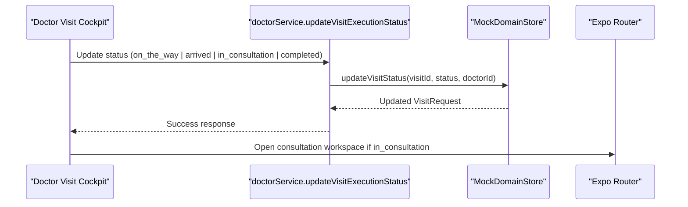

**Diagram sources**
- [src/app/(doctor)/visit/[id].tsx:45-57](file://src/app/(doctor)/visit/[id].tsx#L45-L57)
- [src/app/(doctor)/visit/[id].tsx:138-181](file://src/app/(doctor)/visit/[id].tsx#L138-L181)
- [src/services/api.ts:531-538](file://src/services/api.ts#L531-L538)
- [src/mock/mockDomainStore.ts:283-380](file://src/mock/mockDomainStore.ts#L283-L380)

**Section sources**
- [src/app/(doctor)/visit/[id].tsx:45-57](file://src/app/(doctor)/visit/[id].tsx#L45-L57)
- [src/app/(doctor)/visit/[id].tsx:138-181](file://src/app/(doctor)/visit/[id].tsx#L138-L181)
- [src/services/api.ts:531-538](file://src/services/api.ts#L531-L538)
- [src/mock/mockDomainStore.ts:283-380](file://src/mock/mockDomainStore.ts#L283-L380)

### Integration with Push Notifications for Status Updates
Visit status transitions create notifications in the mock store. These notifications include titles, bodies, recipient user IDs, and reference IDs linking back to the visit or result. The notifications screen lists them and navigates users to the relevant visit or result page.

Key flows:
- Confirming a visit notifies the patient.
- Proposing an alternative time notifies the patient.
- Declining or cancelling notifies the appropriate party.
- Doctor moving to on-the-way, arrived, or completed notifies the patient.
- Publishing a lab result notifies the patient with a result-ready type.

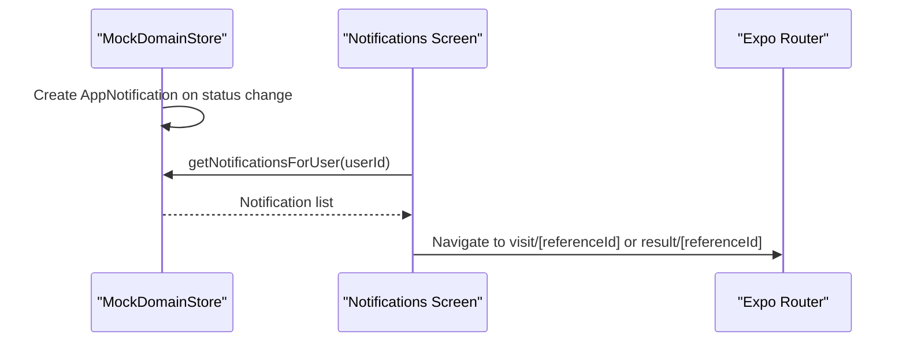

**Diagram sources**
- [src/mock/mockDomainStore.ts:322-377](file://src/mock/mockDomainStore.ts#L322-L377)
- [src/mock/mockDomainStore.ts:436-464](file://src/mock/mockDomainStore.ts#L436-L464)
- [src/app/(patient)/notifications.tsx:18-38](file://src/app/(patient)/notifications.tsx#L18-L38)

**Section sources**
- [src/mock/mockDomainStore.ts:322-377](file://src/mock/mockDomainStore.ts#L322-L377)
- [src/mock/mockDomainStore.ts:436-464](file://src/mock/mockDomainStore.ts#L436-L464)
- [src/app/(patient)/notifications.tsx:18-38](file://src/app/(patient)/notifications.tsx#L18-L38)

### Document Viewing Capabilities for Prescriptions and Lab Results
After a visit is completed, the patient can navigate to the records screen to view:
- Published consultation records with diagnosis, examination findings, clinical notes, recommendations, and follow-up guidance.
- Electronic prescriptions extracted from published consultation records.
- Laboratory results with summaries and links to downloadable PDF reports.

The records screen loads consultations and results for the current patient and routes to the result viewer for each lab result.

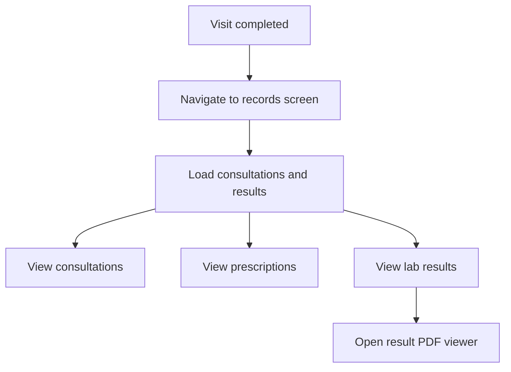

**Diagram sources**
- [src/app/(patient)/visit/[id].tsx:298-313](file://src/app/(patient)/visit/[id].tsx#L298-L313)
- [src/app/(patient)/records.tsx:19-27](file://src/app/(patient)/records.tsx#L19-L27)
- [src/app/(patient)/records.tsx:122-197](file://src/app/(patient)/records.tsx#L122-L197)

**Section sources**
- [src/app/(patient)/visit/[id].tsx:298-313](file://src/app/(patient)/visit/[id].tsx#L298-L313)
- [src/app/(patient)/records.tsx:19-27](file://src/app/(patient)/records.tsx#L19-L27)
- [src/app/(patient)/records.tsx:122-197](file://src/app/(patient)/records.tsx#L122-L197)

### Connection to the Broader Visit Management Workflow
The visit detail screen is part of a larger workflow involving booking, confirmation, alternative scheduling, execution, consultation documentation, and post-visit feedback.

End-to-end connections:
- Booking creates a visit request and triggers a doctor notification.
- Doctor accepts or declines; alternative proposals trigger patient notifications.
- Patient cancels within allowed windows; otherwise cancellation is blocked.
- Doctor advances execution stages; patient sees real-time updates.
- Post-completion, patient rates the doctor and views records/results.
- Complaints and reviews are stored and can affect doctor metrics.

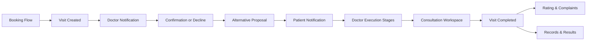

**Diagram sources**
- [src/mock/mockDomainStore.ts:245-281](file://src/mock/mockDomainStore.ts#L245-L281)
- [src/mock/mockDomainStore.ts:283-380](file://src/mock/mockDomainStore.ts#L283-L380)
- [src/app/(patient)/visit/[id].tsx:298-320](file://src/app/(patient)/visit/[id].tsx#L298-L320)
- [src/app/(doctor)/visit/[id].tsx:138-181](file://src/app/(doctor)/visit/[id].tsx#L138-L181)

**Section sources**
- [src/mock/mockDomainStore.ts:245-281](file://src/mock/mockDomainStore.ts#L245-L281)
- [src/mock/mockDomainStore.ts:283-380](file://src/mock/mockDomainStore.ts#L283-L380)
- [src/app/(patient)/visit/[id].tsx:298-320](file://src/app/(patient)/visit/[id].tsx#L298-L320)
- [src/app/(doctor)/visit/[id].tsx:138-181](file://src/app/(doctor)/visit/[id].tsx#L138-L181)

## Dependency Analysis
The visit detail components depend on:
- Expo Router for dynamic route parameters and navigation.
- React Query for data fetching and polling.
- API services for business logic and state transitions.
- Mock domain store for persistence, validation, and notification generation.
- Domain types for consistent shape of visits, profiles, and documents.

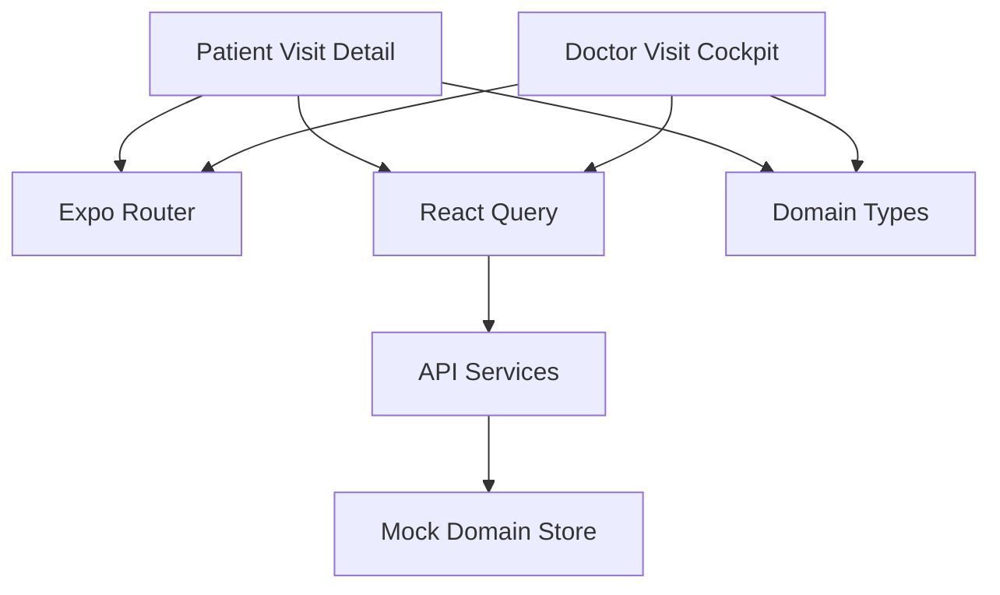

**Diagram sources**
- [src/app/(patient)/visit/[id].tsx:1-21](file://src/app/(patient)/visit/[id].tsx#L1-L21)
- [src/app/(doctor)/visit/[id].tsx:1-21](file://src/app/(doctor)/visit/[id].tsx#L1-L21)
- [src/services/api.ts:1-17](file://src/services/api.ts#L1-L17)
- [src/types/domain.ts:1-242](file://src/types/domain.ts#L1-L242)

**Section sources**
- [src/app/(patient)/visit/[id].tsx:1-21](file://src/app/(patient)/visit/[id].tsx#L1-L21)
- [src/app/(doctor)/visit/[id].tsx:1-21](file://src/app/(doctor)/visit/[id].tsx#L1-L21)
- [src/services/api.ts:1-17](file://src/services/api.ts#L1-L17)
- [src/types/domain.ts:1-242](file://src/types/domain.ts#L1-L242)

## Performance Considerations
- Polling interval: Both screens poll visit details every three seconds. This keeps the UI responsive to status changes but may increase load if many visits are open simultaneously.
- Query caching: React Query caches visit details per ID; refetching ensures freshness without full re-renders.
- Conditional rendering: Actions and banners are conditionally rendered based on status to avoid unnecessary UI work.
- Mock latency: Simulated delays add realism but should be removed or reduced in production.

Recommendations:
- Reduce polling frequency for inactive visits.
- Use WebSocket or server-sent events for real-time updates instead of polling.
- Debounce rapid status changes to prevent excessive re-renders.
- Cache frequently accessed doctor and patient profiles to reduce repeated lookups.

[No sources needed since this section provides general guidance]

## Troubleshooting Guide
Common issues and resolutions:
- Visit not found: Ensure the route parameter `id` matches an existing visit. The API service throws an error if the visit does not exist.
- Unauthorized cancellation: Cancellation is blocked if the visit belongs to another patient or is in a locked state.
- Alternative time errors: Accepting or rejecting alternatives requires the visit to be in the correct state with valid alternative data.
- Status transition failures: Doctor execution status must be one of the allowed states; invalid transitions throw errors.
- Notifications not appearing: Verify that the mock store created notifications and that the notifications screen queries the correct user ID.

Operational checks:
- Validate route parameters before fetching.
- Inspect error messages from API service methods.
- Confirm mock store state transitions and notification creation.
- Ensure the notifications screen navigates correctly to visit or result pages.

**Section sources**
- [src/services/api.ts:352-403](file://src/services/api.ts#L352-L403)
- [src/services/api.ts:531-538](file://src/services/api.ts#L531-L538)
- [src/mock/mockDomainStore.ts:283-380](file://src/mock/mockDomainStore.ts#L283-L380)
- [src/app/(patient)/notifications.tsx:18-38](file://src/app/(patient)/notifications.tsx#L18-L38)

## Conclusion
The visit detail screen provides a comprehensive view of the home visit lifecycle for both patients and doctors. It handles dynamic route parameters, real-time status tracking, status-driven actions, doctor and patient context, and integration with notifications and records. The architecture cleanly separates UI, data fetching, business rules, and mock persistence, making it straightforward to replace the mock store with a real backend while preserving the same user experience.

[No sources needed since this section summarizes without analyzing specific files]