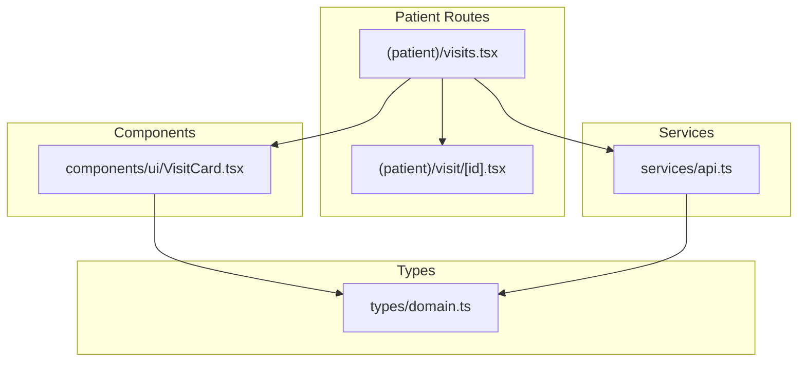
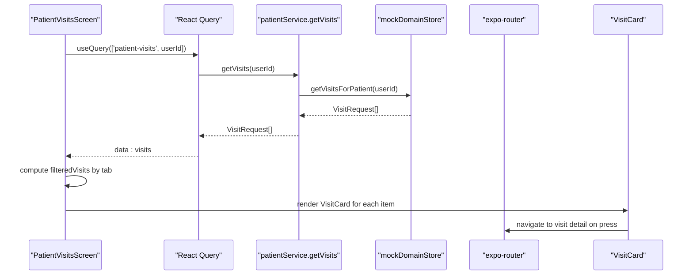
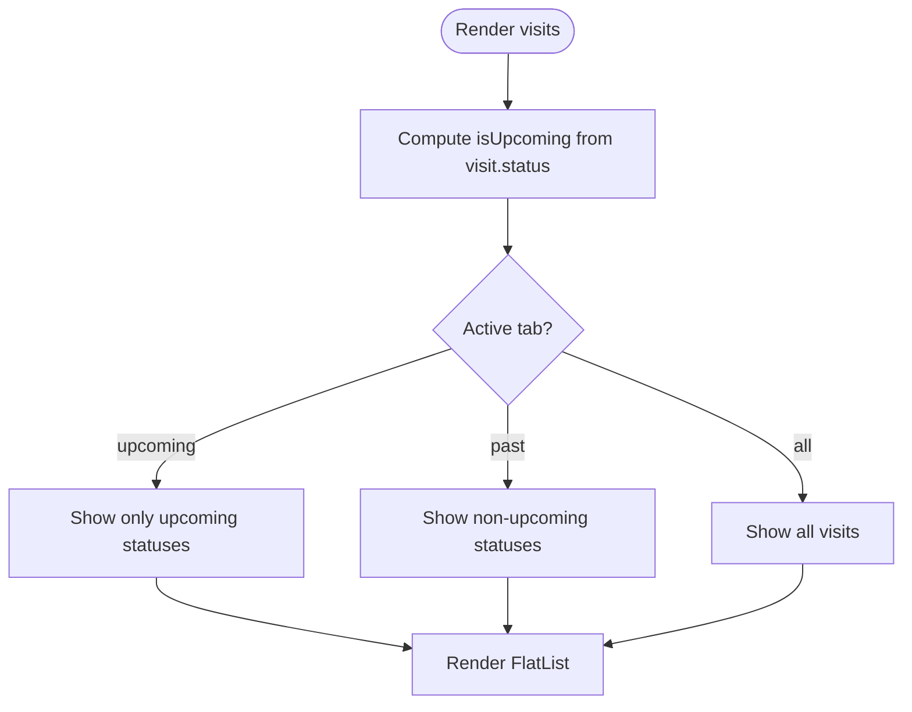
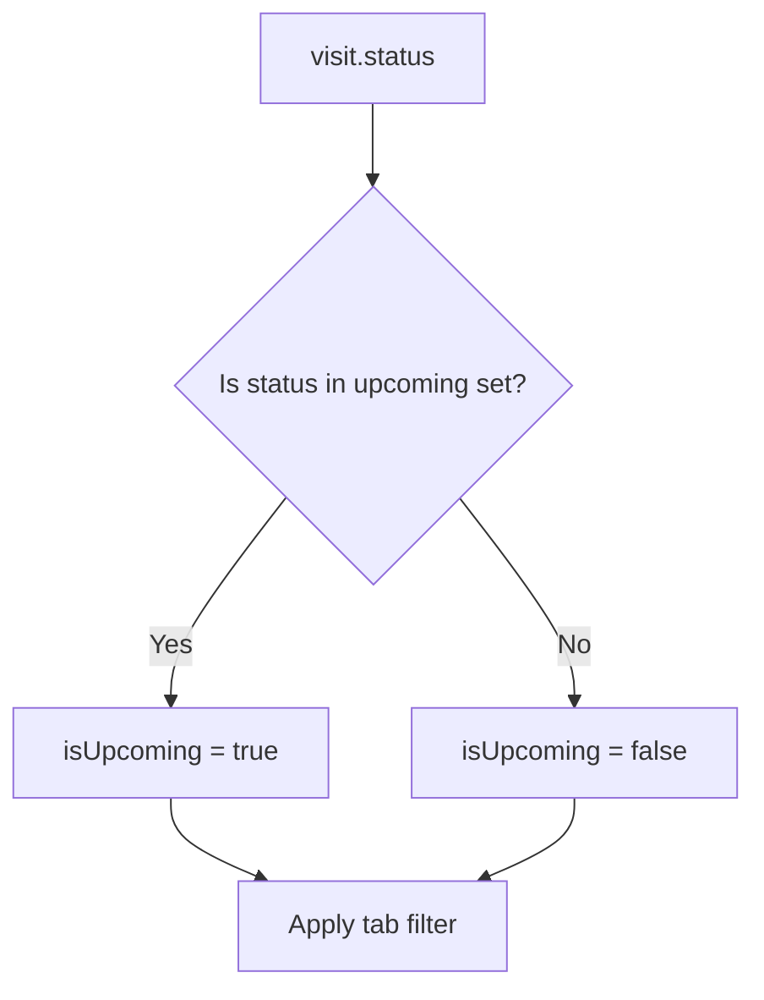
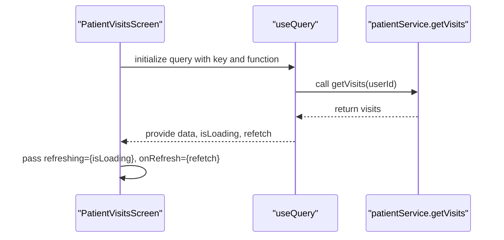
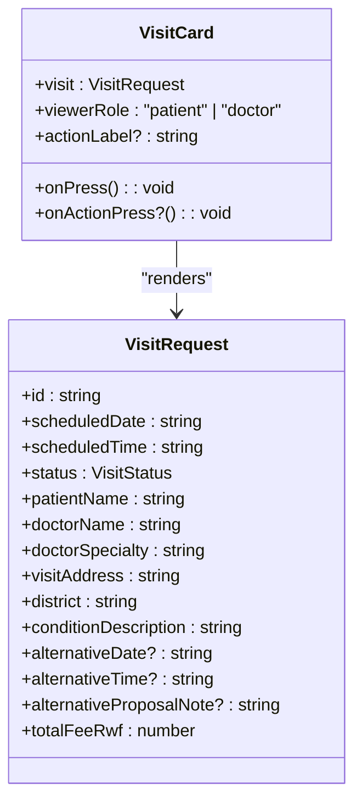
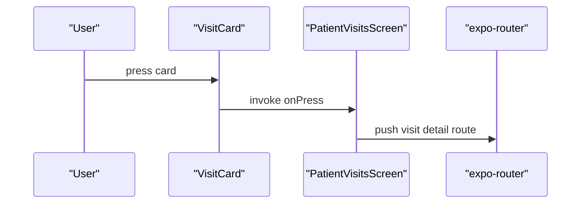
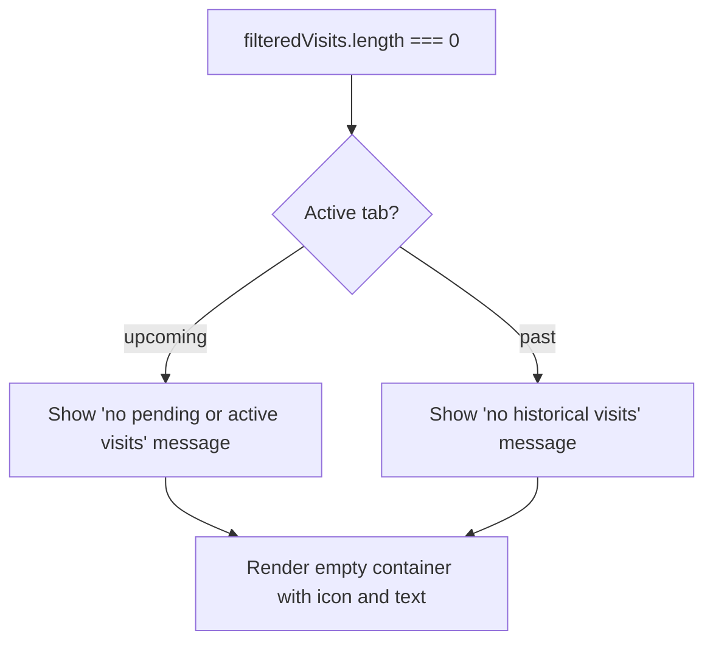
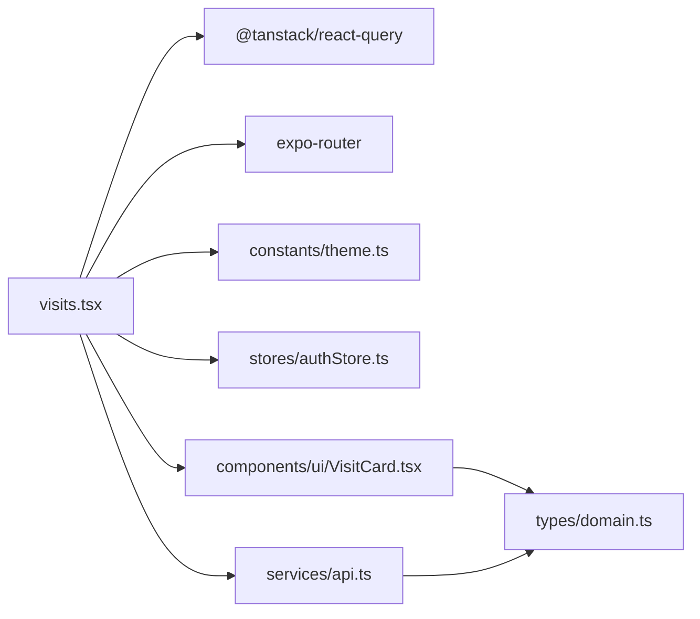

# Visit List View

<cite>
**Referenced Files in This Document**
- [visits.tsx](file://src/app/(patient)/visits.tsx)
- [VisitCard.tsx](file://src/components/ui/VisitCard.tsx)
- [domain.ts](file://src/types/domain.ts)
- [api.ts](file://src/services/api.ts)
</cite>

## Table of Contents
1. [Introduction](#introduction)
2. [Project Structure](#project-structure)
3. [Core Components](#core-components)
4. [Architecture Overview](#architecture-overview)
5. [Detailed Component Analysis](#detailed-component-analysis)
6. [Dependency Analysis](#dependency-analysis)
7. [Performance Considerations](#performance-considerations)
8. [Troubleshooting Guide](#troubleshooting-guide)
9. [Conclusion](#conclusion)

## Introduction
This document explains the patient visit list view implementation, focusing on:
- Tab-based filtering with “Upcoming & Active”, “Past & Completed”, and “All” tabs
- Status-based categorization logic for upcoming versus past visits
- Integration with React Query for data fetching, caching, and refetching
- Usage of the VisitCard component, navigation to individual visit details, and empty state handling
- Visual design patterns, accessibility considerations, and performance optimizations for large visit lists

The implementation is part of the patient-facing screens and uses a service layer that currently delegates to a mock store while being structured for a future REST API.

## Project Structure
The patient visit list screen lives under the patient route group and renders a tabbed list of visits using a reusable card component. Data is fetched via a typed service contract and cached by React Query.

**Diagram sources**
- [visits.tsx:1-166](file://src/app/(patient)/visits.tsx#L1-L166)
- [VisitCard.tsx:1-204](file://src/components/ui/VisitCard.tsx#L1-L204)
- [api.ts:274-430](file://src/services/api.ts#L274-L430)
- [domain.ts:97-129](file://src/types/domain.ts#L97-L129)

**Section sources**
- [visits.tsx:1-166](file://src/app/(patient)/visits.tsx#L1-L166)
- [api.ts:274-430](file://src/services/api.ts#L274-L430)
- [domain.ts:97-129](file://src/types/domain.ts#L97-L129)

## Core Components
- PatientVisitsScreen: Renders the tab bar, fetches visits, filters them, and renders a FlatList of VisitCard items. It also handles empty states and navigation to a visit detail page.
- VisitCard: Displays visit metadata (date/time, status badge, person info, address, symptoms, alternative proposal alert, fee), supports an optional action button, and routes users to visit details.
- Domain types: Define VisitRequest and VisitStatus used across the UI and services.
- Service layer: Provides getVisits and other operations; currently backed by a mock store but designed for a real backend.

Key responsibilities:
- Data fetching and caching via React Query
- Local filtering based on active tab
- Rendering consistent cards with role-aware labels
- Navigation to visit details
- Empty state messaging per tab

**Section sources**
- [visits.tsx:18-104](file://src/app/(patient)/visits.tsx#L18-L104)
- [VisitCard.tsx:9-88](file://src/components/ui/VisitCard.tsx#L9-L88)
- [domain.ts:97-129](file://src/types/domain.ts#L97-L129)
- [api.ts:347-350](file://src/services/api.ts#L347-L350)

## Architecture Overview
The patient visit list follows a simple client-side flow:
- The screen initializes a React Query key scoped to the current user ID.
- On mount (when the user exists), it calls the patient service to fetch visits.
- The service returns visit objects typed as VisitRequest.
- The screen computes filteredVisits based on the selected tab.
- The FlatList renders VisitCard components, each navigating to the visit detail route when pressed.

**Diagram sources**
- [visits.tsx:22-26](file://src/app/(patient)/visits.tsx#L22-L26)
- [visits.tsx:75-87](file://src/app/(patient)/visits.tsx#L75-L87)
- [api.ts:347-350](file://src/services/api.ts#L347-L350)

## Detailed Component Analysis

### Tab-Based Filtering System
The screen maintains a local filterTab state with values 'upcoming', 'past', or 'all'. Three Pressable tabs update this state and visually highlight the active tab.

Filtering logic:
- Upcoming statuses include: pending, alternative_proposed, confirmed, on_the_way, arrived, in_consultation.
- Past statuses are everything else (e.g., declined, expired, cancelled, completed).
- When filterTab is 'upcoming', only upcoming statuses are shown.
- When filterTab is 'past', only non-upcoming statuses are shown.
- When filterTab is 'all', all visits are shown.

**Diagram sources**
- [visits.tsx:28-41](file://src/app/(patient)/visits.tsx#L28-L41)

Accessibility notes:
- Tabs are implemented with Pressable and Text; consider adding accessible roles and labels for screen readers.
- Ensure contrast between active and inactive tab text colors meets accessibility guidelines.

Visual design patterns:
- Horizontal tab bar with equal-width segments.
- Active tab highlighted with a soft background color and bold text.
- Inactive tabs use secondary text color.

**Section sources**
- [visits.tsx:20-73](file://src/app/(patient)/visits.tsx#L20-L73)

### Status-Based Categorization Logic
The code defines a set of upcoming statuses and classifies any other status as past. This approach keeps the list intuitive:
- Upcoming & Active: includes pre-consultation and early consultation phases.
- Past & Completed: includes declined, expired, cancelled, and completed visits.

**Diagram sources**
- [visits.tsx:28-41](file://src/app/(patient)/visits.tsx#L28-L41)
- [domain.ts:9-19](file://src/types/domain.ts#L9-L19)

**Section sources**
- [visits.tsx:28-41](file://src/app/(patient)/visits.tsx#L28-L41)
- [domain.ts:9-19](file://src/types/domain.ts#L9-L19)

### React Query Integration
Data fetching and caching:
- The query key includes ['patient-visits', currentUser?.id], ensuring per-user cache isolation.
- The query function calls patientService.getVisits with the current user’s ID.
- enabled ensures the query runs only when the user exists.
- isLoading reflects the fetching state and is passed to FlatList.refreshing.
- refetch is wired to FlatList.onRefresh for pull-to-refresh behavior.

Real-time updates:
- The current implementation does not configure polling or subscriptions. Real-time updates would require additional configuration such as pollingInterval or manual refetch triggers after mutations.

**Diagram sources**
- [visits.tsx:22-26](file://src/app/(patient)/visits.tsx#L22-L26)
- [visits.tsx:75-80](file://src/app/(patient)/visits.tsx#L75-L80)
- [api.ts:347-350](file://src/services/api.ts#L347-L350)

**Section sources**
- [visits.tsx:22-26](file://src/app/(patient)/visits.tsx#L22-L26)
- [visits.tsx:75-80](file://src/app/(patient)/visits.tsx#L75-L80)
- [api.ts:347-350](file://src/services/api.ts#L347-L350)

### VisitCard Component Usage
The VisitCard displays:
- Scheduled date and time
- Status badge
- Role-aware person information (patient vs doctor)
- Address and district
- Symptoms snippet
- Alternative proposal alert when applicable
- Total fee and either a “View Details” link or an action button

Navigation:
- Each VisitCard receives onPress that navigates to the visit detail route using expo-router.

Role awareness:
- When viewerRole is 'doctor', the card shows patient name and phone; otherwise, it shows doctor name and specialty.

**Diagram sources**
- [VisitCard.tsx:9-88](file://src/components/ui/VisitCard.tsx#L9-L88)
- [domain.ts:97-129](file://src/types/domain.ts#L97-L129)

**Section sources**
- [VisitCard.tsx:9-88](file://src/components/ui/VisitCard.tsx#L9-L88)
- [domain.ts:97-129](file://src/types/domain.ts#L97-L129)

### Navigation to Individual Visit Details
When a VisitCard is pressed, the screen navigates to the visit detail route using expo-router. The route path is constructed dynamically with the visit id.

**Diagram sources**
- [visits.tsx:81-86](file://src/app/(patient)/visits.tsx#L81-L86)

**Section sources**
- [visits.tsx:81-86](file://src/app/(patient)/visits.tsx#L81-L86)

### Empty State Handling
When there are no visits matching the selected tab:
- A custom ListEmptyComponent renders a centered icon circle, title, and contextual message.
- The message differs based on the active tab:
  - Upcoming: indicates no pending or active visits.
  - Past: indicates no historical visits recorded yet.

**Diagram sources**
- [visits.tsx:88-100](file://src/app/(patient)/visits.tsx#L88-L100)

**Section sources**
- [visits.tsx:88-100](file://src/app/(patient)/visits.tsx#L88-L100)

## Dependency Analysis
The patient visit list depends on:
- React Query for data fetching and caching
- Expo Router for navigation
- Theme constants for styling
- Auth store for current user context
- Patient service for data access
- VisitCard component for rendering
- Domain types for type safety

**Diagram sources**
- [visits.tsx:1-16](file://src/app/(patient)/visits.tsx#L1-L16)
- [VisitCard.tsx:1-7](file://src/components/ui/VisitCard.tsx#L1-L7)
- [api.ts:1-17](file://src/services/api.ts#L1-L17)
- [domain.ts:97-129](file://src/types/domain.ts#L97-L129)

**Section sources**
- [visits.tsx:1-16](file://src/app/(patient)/visits.tsx#L1-L16)
- [VisitCard.tsx:1-7](file://src/components/ui/VisitCard.tsx#L1-L7)
- [api.ts:1-17](file://src/services/api.ts#L1-L17)
- [domain.ts:97-129](file://src/types/domain.ts#L97-L129)

## Performance Considerations
- Use stable keys: The FlatList uses item.id as keyExtractor, which is efficient and stable.
- Avoid unnecessary re-renders: Keep filterTab state minimal and avoid recreating functions inside render.
- Memoize expensive computations: If filtering becomes complex, memoize filteredVisits with useMemo.
- Optimize list rendering: Consider windowing for very large lists if needed.
- Reduce network requests: Leverage React Query caching and enable stale-time settings to minimize refetches.
- Pull-to-refresh: Already wired via refetch; ensure it does not trigger excessive network calls.

[No sources needed since this section provides general guidance]

## Troubleshooting Guide
Common issues and resolutions:
- No visits displayed:
  - Verify currentUser exists so the query is enabled.
  - Confirm patientService.getVisits returns data for the given patientId.
- Incorrect filtering:
  - Check that visit.status matches one of the expected upcoming statuses.
  - Ensure the filterTab value is correctly set and not overridden elsewhere.
- Navigation not working:
  - Confirm the visit detail route exists and accepts the visit id parameter.
- Empty state messages:
  - Validate that the conditional message logic aligns with the active tab.

**Section sources**
- [visits.tsx:22-26](file://src/app/(patient)/visits.tsx#L22-L26)
- [visits.tsx:28-41](file://src/app/(patient)/visits.tsx#L28-L41)
- [visits.tsx:81-86](file://src/app/(patient)/visits.tsx#L81-L86)
- [visits.tsx:88-100](file://src/app/(patient)/visits.tsx#L88-L100)
- [api.ts:347-350](file://src/services/api.ts#L347-L350)

## Conclusion
The patient visit list view provides a clear, tab-driven interface for managing upcoming and past visits. It integrates React Query for robust data fetching and caching, uses a reusable VisitCard for consistent presentation, and offers meaningful empty states. With careful attention to accessibility, visual consistency, and performance, the implementation scales well and can be extended with real-time updates and advanced optimizations as needed.

[No sources needed since this section summarizes without analyzing specific files]