# Visit Management

<cite>
**Referenced Files in This Document**
- [visits.tsx](file://src/app/(patient)/visits.tsx)
- [visit/[id].tsx (Patient)](file://src/app/(patient)/visit/[id].tsx)
- [visit/[id].tsx (Doctor)](file://src/app/(doctor)/visit/[id].tsx)
- [VisitCard.tsx](file://src/components/ui/VisitCard.tsx)
- [Badge.tsx](file://src/components/ui/Badge.tsx)
- [domain.ts](file://src/types/domain.ts)
- [api.ts](file://src/services/api.ts)
- [mockDomainStore.ts](file://src/mock/mockDomainStore.ts)
- [notifications.tsx](file://src/app/(patient)/notifications.tsx)
</cite>

## Table of Contents
1. [Introduction](#introduction)
2. [Project Structure](#project-structure)
3. [Core Components](#core-components)
4. [Architecture Overview](#architecture-overview)
5. [Detailed Component Analysis](#detailed-component-analysis)
6. [Dependency Analysis](#dependency-analysis)
7. [Performance Considerations](#performance-considerations)
8. [Troubleshooting Guide](#troubleshooting-guide)
9. [Conclusion](#conclusion)

## Introduction
This document explains the visit lifecycle management system for home-based medical consultations. It covers:
- The complete visit status flow from Pending to Completed, including alternative time proposals and cancellation restrictions.
- The patient visit detail view with real-time status tracking, doctor information display, consultation timeline, and action buttons based on current status.
- The visit list filtering capabilities, status indicators, and integration with push notifications for status updates.
- Cancellation policy enforcement, rescheduling workflows, and connection to the doctor’s schedule management system.

The implementation uses a React Native frontend with role-based screens for patients and doctors, a service layer that simulates backend APIs, and an in-memory domain store that manages entities, state transitions, and notifications.

## Project Structure
The visit lifecycle spans multiple screens and components:
- Patient visits list screen for browsing and filtering visits.
- Patient visit detail screen for tracking progress, viewing details, and performing actions.
- Doctor visit cockpit screen for advancing execution states and navigating to the patient’s residence.
- Shared UI components for cards and status badges.
- Domain types defining statuses and entities.
- Service layer encapsulating API-like operations.
- Mock domain store managing data, transitions, and notifications.

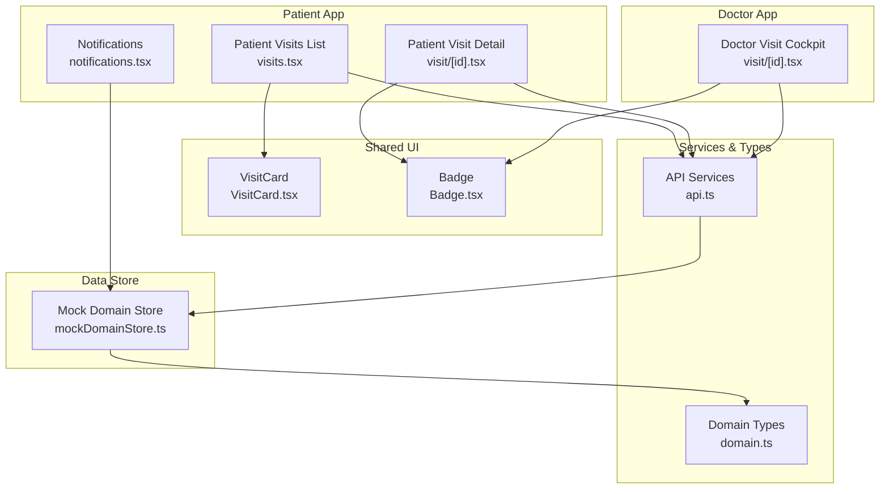

**Diagram sources**
- [visits.tsx:18-87](file://src/app/(patient)/visits.tsx#L18-L87)
- [visit/[id].tsx (Patient):22-129](file://src/app/(patient)/visit/[id].tsx#L22-L129)
- [visit/[id].tsx (Doctor):23-57](file://src/app/(doctor)/visit/[id].tsx#L23-L57)
- [VisitCard.tsx:17-88](file://src/components/ui/VisitCard.tsx#L17-L88)
- [Badge.tsx:13-97](file://src/components/ui/Badge.tsx#L13-L97)
- [api.ts:274-430](file://src/services/api.ts#L274-L430)
- [api.ts:468-585](file://src/services/api.ts#L468-L585)
- [mockDomainStore.ts:283-380](file://src/mock/mockDomainStore.ts#L283-L380)
- [notifications.tsx:18-38](file://src/app/(patient)/notifications.tsx#L18-L38)

**Section sources**
- [visits.tsx:18-87](file://src/app/(patient)/visits.tsx#L18-L87)
- [visit/[id].tsx (Patient):22-129](file://src/app/(patient)/visit/[id].tsx#L22-L129)
- [visit/[id].tsx (Doctor):23-57](file://src/app/(doctor)/visit/[id].tsx#L23-L57)
- [VisitCard.tsx:17-88](file://src/components/ui/VisitCard.tsx#L17-L88)
- [Badge.tsx:13-97](file://src/components/ui/Badge.tsx#L13-L97)
- [api.ts:274-430](file://src/services/api.ts#L274-L430)
- [api.ts:468-585](file://src/services/api.ts#L468-L585)
- [mockDomainStore.ts:283-380](file://src/mock/mockDomainStore.ts#L283-L380)
- [notifications.tsx:18-38](file://src/app/(patient)/notifications.tsx#L18-L38)

## Core Components
- Patient Visits List Screen: Fetches visits for the current patient, filters by upcoming/past/all, and renders VisitCard items.
- Patient Visit Detail Screen: Displays visit metadata, doctor info, address, symptoms, billing, timeline, and status-specific actions like cancel, rate/review, and complaint submission.
- Doctor Visit Cockpit Screen: Shows patient profile, health summary, navigation to residence, and step-by-step controls to advance visit execution states.
- VisitCard Component: Renders compact visit summaries with date/time, status badge, person name/specialty or phone, address snippet, symptoms, and optional action button.
- Badge Component: Visual indicator mapping visit statuses to colors and labels.
- API Services: Encapsulate operations such as fetching visits, updating status, proposing alternatives, accepting/rejecting alternatives, and submitting reviews/complaints.
- Mock Domain Store: Manages entities, enforces constraints, updates statuses, frees slots when needed, and creates notifications.

**Section sources**
- [visits.tsx:18-87](file://src/app/(patient)/visits.tsx#L18-L87)
- [visit/[id].tsx (Patient):22-129](file://src/app/(patient)/visit/[id].tsx#L22-L129)
- [visit/[id].tsx (Doctor):23-57](file://src/app/(doctor)/visit/[id].tsx#L23-L57)
- [VisitCard.tsx:17-88](file://src/components/ui/VisitCard.tsx#L17-L88)
- [Badge.tsx:13-97](file://src/components/ui/Badge.tsx#L13-L97)
- [api.ts:274-430](file://src/services/api.ts#L274-L430)
- [api.ts:468-585](file://src/services/api.ts#L468-L585)
- [mockDomainStore.ts:283-380](file://src/mock/mockDomainStore.ts#L283-L380)

## Architecture Overview
The architecture follows a layered approach:
- Presentation Layer: Role-based screens for patients and doctors.
- Service Layer: API-like functions abstracting data access and business rules.
- Data Layer: In-memory store handling entities, transitions, and notifications.
- Type Definitions: Centralized domain models ensuring consistency across layers.

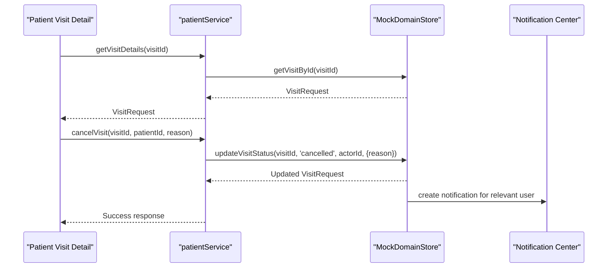

**Diagram sources**
- [visit/[id].tsx (Patient):48-60](file://src/app/(patient)/visit/[id].tsx#L48-L60)
- [api.ts:359-368](file://src/services/api.ts#L359-L368)
- [mockDomainStore.ts:283-380](file://src/mock/mockDomainStore.ts#L283-L380)
- [notifications.tsx:18-38](file://src/app/(patient)/notifications.tsx#L18-L38)

## Detailed Component Analysis

### Visit Status Lifecycle Flow
The supported visit statuses include:
- pending
- alternative_proposed
- confirmed
- declined
- expired
- cancelled
- on_the_way
- arrived
- in_consultation
- completed

Primary flow:
- Patient requests a visit → status becomes pending.
- Doctor accepts → status becomes confirmed.
- Doctor proposes alternative time → status becomes alternative_proposed; patient can accept or reject.
- If accepted → scheduled slot updated and status becomes confirmed.
- If rejected → status becomes declined.
- Doctor advances execution: on_the_way → arrived → in_consultation → completed.
- Cancellation is restricted once doctor is en route or at residence.

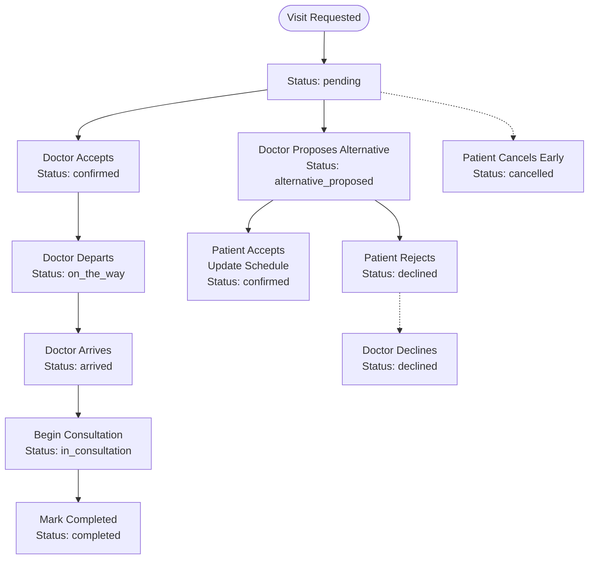

**Diagram sources**
- [domain.ts:9-19](file://src/types/domain.ts#L9-L19)
- [api.ts:384-403](file://src/services/api.ts#L384-L403)
- [api.ts:522-538](file://src/services/api.ts#L522-L538)
- [mockDomainStore.ts:283-380](file://src/mock/mockDomainStore.ts#L283-L380)

**Section sources**
- [domain.ts:9-19](file://src/types/domain.ts#L9-L19)
- [api.ts:384-403](file://src/services/api.ts#L384-L403)
- [api.ts:522-538](file://src/services/api.ts#L522-L538)
- [mockDomainStore.ts:283-380](file://src/mock/mockDomainStore.ts#L283-L380)

### Patient Visit Detail View
Key features:
- Real-time status tracking via periodic refetch.
- Doctor information display: name and specialty.
- Address and district with optional access instructions.
- Reported symptoms and common symptom chips.
- Billing and payment status.
- Timeline visualization showing completed, active, and future steps.
- Action buttons:
  - Cancel visit if not locked.
  - Rate and review after completion.
  - Submit complaint at any time.
  - Accept or decline alternative time proposal.

Cancellation restrictions:
- Locked when status is on_the_way, arrived, in_consultation, or completed.
- A lock notice informs users that cancellation/rescheduling are disabled during these phases.

Alternative time handling:
- When status is alternative_proposed, the UI shows proposed date/time and note.
- Accepting updates scheduled slot and sets status to confirmed.
- Rejecting sets status to declined.

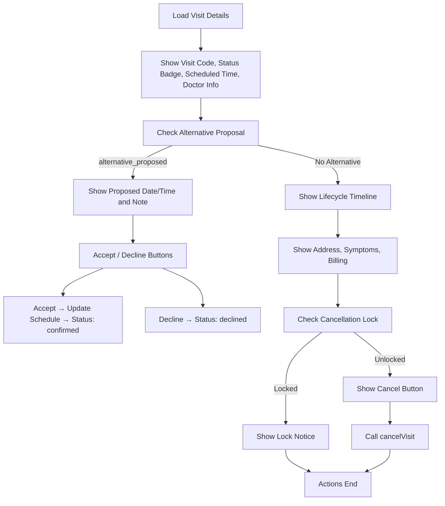

**Diagram sources**
- [visit/[id].tsx (Patient):22-129](file://src/app/(patient)/visit/[id].tsx#L22-L129)
- [visit/[id].tsx (Patient):145-176](file://src/app/(patient)/visit/[id].tsx#L145-L176)
- [visit/[id].tsx (Patient):178-230](file://src/app/(patient)/visit/[id].tsx#L178-L230)
- [visit/[id].tsx (Patient):276-320](file://src/app/(patient)/visit/[id].tsx#L276-L320)
- [api.ts:359-368](file://src/services/api.ts#L359-L368)
- [api.ts:384-403](file://src/services/api.ts#L384-L403)

**Section sources**
- [visit/[id].tsx (Patient):22-129](file://src/app/(patient)/visit/[id].tsx#L22-L129)
- [visit/[id].tsx (Patient):145-176](file://src/app/(patient)/visit/[id].tsx#L145-L176)
- [visit/[id].tsx (Patient):178-230](file://src/app/(patient)/visit/[id].tsx#L178-L230)
- [visit/[id].tsx (Patient):276-320](file://src/app/(patient)/visit/[id].tsx#L276-L320)
- [api.ts:359-368](file://src/services/api.ts#L359-L368)
- [api.ts:384-403](file://src/services/api.ts#L384-L403)

### Doctor Visit Cockpit
Key features:
- Visit header with status badge and scheduled time.
- Residence destination card with address, district, access instructions, and map navigation.
- Patient health summary including allergies, chronic conditions, and medications.
- Step-by-step execution controls:
  - From confirmed to on_the_way.
  - From on_the_way to arrived.
  - From arrived to in_consultation.
  - Open clinical workspace when in_consultation or completed.
  - Mark visit completed from in_consultation.

Navigation integration:
- Opens external maps with coordinates and address.

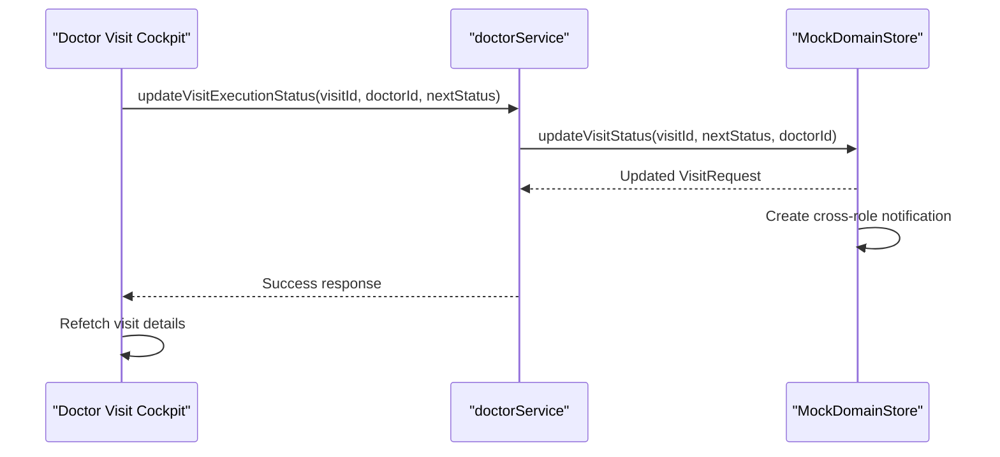

**Diagram sources**
- [visit/[id].tsx (Doctor):45-57](file://src/app/(doctor)/visit/[id].tsx#L45-L57)
- [api.ts:531-538](file://src/services/api.ts#L531-L538)
- [mockDomainStore.ts:283-380](file://src/mock/mockDomainStore.ts#L283-L380)

**Section sources**
- [visit/[id].tsx (Doctor):23-57](file://src/app/(doctor)/visit/[id].tsx#L23-L57)
- [visit/[id].tsx (Doctor):59-71](file://src/app/(doctor)/visit/[id].tsx#L59-L71)
- [visit/[id].tsx (Doctor):131-182](file://src/app/(doctor)/visit/[id].tsx#L131-L182)
- [api.ts:531-538](file://src/services/api.ts#L531-L538)
- [mockDomainStore.ts:283-380](file://src/mock/mockDomainStore.ts#L283-L380)

### Visit List Filtering and Status Indicators
Filtering:
- Upcoming & Active: includes pending, alternative_proposed, confirmed, on_the_way, arrived, in_consultation.
- Past & Completed: excludes the above set.
- All: shows all visits.

Status indicators:
- Badge component maps each status to a color and label.
- VisitCard displays status badge alongside date/time, person name/specialty or phone, address snippet, symptoms, and total fee.

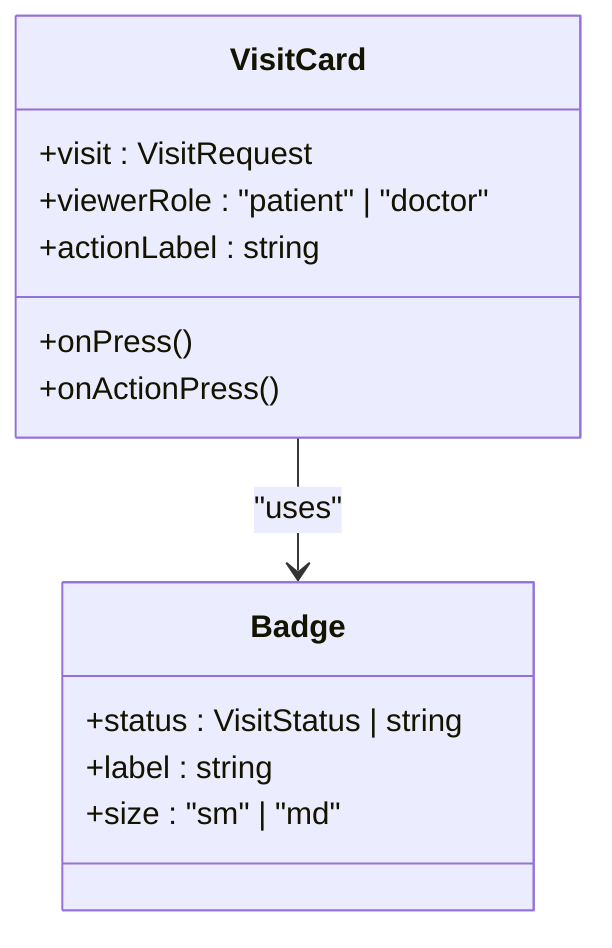

**Diagram sources**
- [VisitCard.tsx:17-88](file://src/components/ui/VisitCard.tsx#L17-L88)
- [Badge.tsx:13-97](file://src/components/ui/Badge.tsx#L13-L97)

**Section sources**
- [visits.tsx:28-41](file://src/app/(patient)/visits.tsx#L28-L41)
- [VisitCard.tsx:17-88](file://src/components/ui/VisitCard.tsx#L17-L88)
- [Badge.tsx:13-97](file://src/components/ui/Badge.tsx#L13-L97)

### Push Notification Integration
Integration points:
- Creating a visit request triggers a notification to the doctor.
- Updating visit status triggers cross-role notifications to the patient or doctor depending on the transition.
- Publishing lab results triggers a result-ready notification to the patient.
- Patient notification center lists notifications and navigates to related visit or result pages.

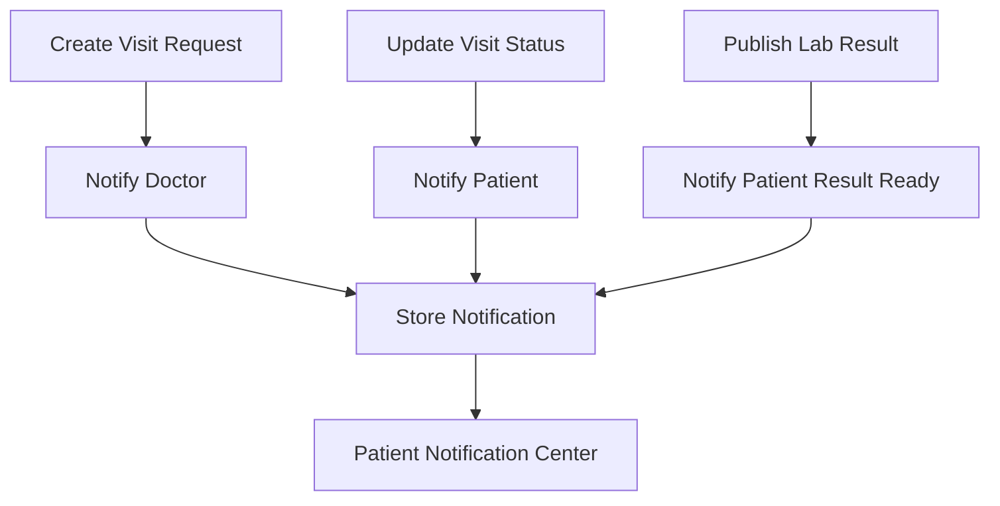

**Diagram sources**
- [mockDomainStore.ts:267-280](file://src/mock/mockDomainStore.ts#L267-L280)
- [mockDomainStore.ts:322-377](file://src/mock/mockDomainStore.ts#L322-L377)
- [mockDomainStore.ts:436-450](file://src/mock/mockDomainStore.ts#L436-L450)
- [notifications.tsx:18-38](file://src/app/(patient)/notifications.tsx#L18-L38)

**Section sources**
- [mockDomainStore.ts:267-280](file://src/mock/mockDomainStore.ts#L267-L280)
- [mockDomainStore.ts:322-377](file://src/mock/mockDomainStore.ts#L322-L377)
- [mockDomainStore.ts:436-450](file://src/mock/mockDomainStore.ts#L436-L450)
- [notifications.tsx:18-38](file://src/app/(patient)/notifications.tsx#L18-L38)

### Cancellation Policy Enforcement
Rules enforced by services and UI:
- Cancellation is blocked when status is on_the_way, arrived, in_consultation, or completed.
- Attempting to cancel under these conditions throws an error message.
- Successful cancellation sets status to cancelled and records the reason.
- Rescheduling is also blocked in the same advanced stages and resets status to pending requiring doctor re-confirmation.

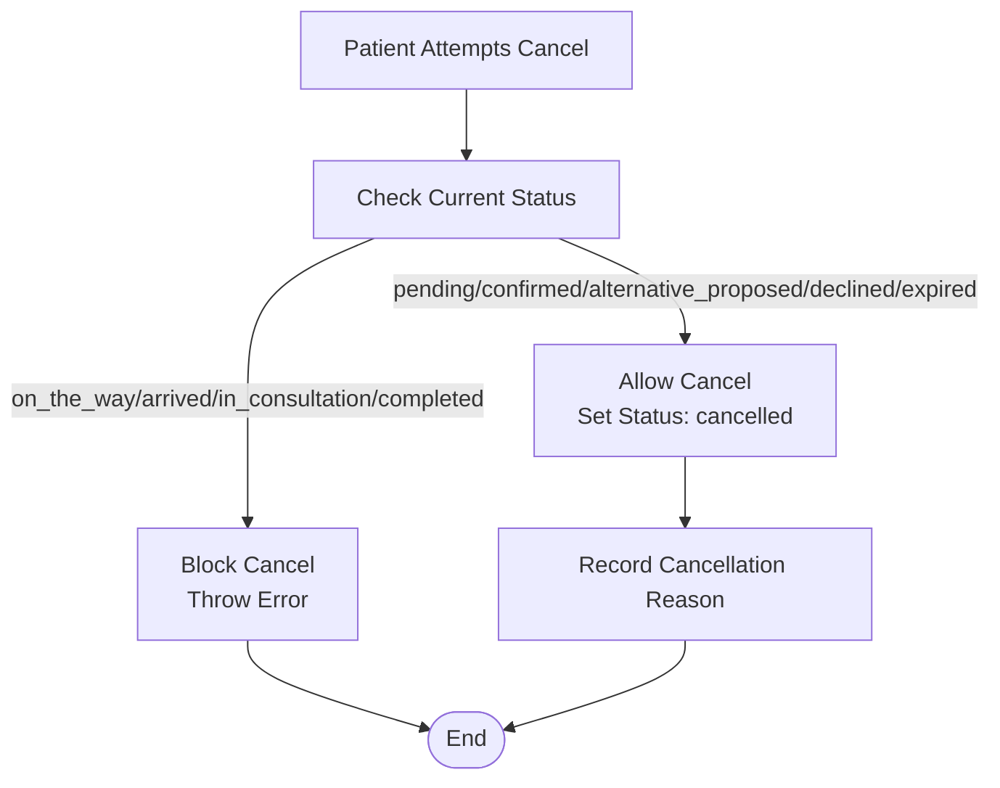

**Diagram sources**
- [api.ts:359-368](file://src/services/api.ts#L359-L368)
- [api.ts:370-382](file://src/services/api.ts#L370-L382)
- [visit/[id].tsx (Patient):125-128](file://src/app/(patient)/visit/[id].tsx#L125-L128)

**Section sources**
- [api.ts:359-368](file://src/services/api.ts#L359-L368)
- [api.ts:370-382](file://src/services/api.ts#L370-L382)
- [visit/[id].tsx (Patient):125-128](file://src/app/(patient)/visit/[id].tsx#L125-L128)

### Rescheduling Workflows
- Patient-initiated reschedule updates scheduledDate and scheduledTime and resets status to pending, requiring doctor re-confirmation.
- Blocked in advanced stages similar to cancellation.
- Alternative time workflow allows doctor to propose a new slot; patient acceptance updates the schedule and confirms the visit.

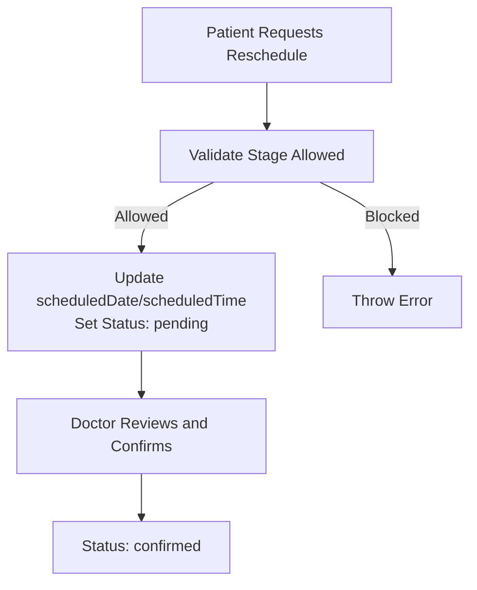

**Diagram sources**
- [api.ts:370-382](file://src/services/api.ts#L370-L382)
- [api.ts:384-403](file://src/services/api.ts#L384-L403)

**Section sources**
- [api.ts:370-382](file://src/services/api.ts#L370-L382)
- [api.ts:384-403](file://src/services/api.ts#L384-L403)

### Connection to Doctor’s Schedule Management System
- Slot creation prevents overlapping availability.
- Booking a visit marks the selected slot as booked.
- Cancellation or decline frees the slot back to availability.
- Doctor profiles include working days and hours, which inform scheduling logic.

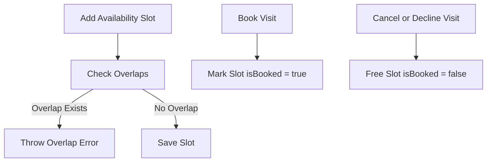

**Diagram sources**
- [mockDomainStore.ts:207-216](file://src/mock/mockDomainStore.ts#L207-L216)
- [mockDomainStore.ts:245-280](file://src/mock/mockDomainStore.ts#L245-L280)
- [mockDomainStore.ts:311-318](file://src/mock/mockDomainStore.ts#L311-L318)

**Section sources**
- [mockDomainStore.ts:207-216](file://src/mock/mockDomainStore.ts#L207-L216)
- [mockDomainStore.ts:245-280](file://src/mock/mockDomainStore.ts#L245-L280)
- [mockDomainStore.ts:311-318](file://src/mock/mockDomainStore.ts#L311-L318)

## Dependency Analysis
Component dependencies:
- Patient screens depend on patientService for data and mutations.
- Doctor screens depend on doctorService for execution state transitions.
- Both screens use Badge and Card components for consistent UI.
- Services rely on mockDomainStore for persistence and business rules.
- Domain types define shared contracts across layers.

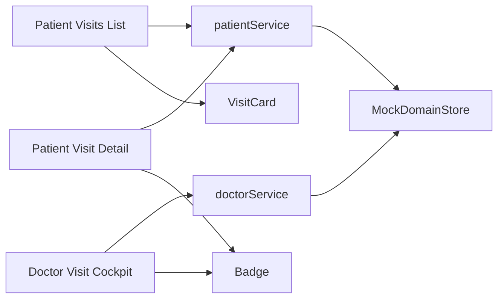

**Diagram sources**
- [visits.tsx:18-87](file://src/app/(patient)/visits.tsx#L18-L87)
- [visit/[id].tsx (Patient):22-129](file://src/app/(patient)/visit/[id].tsx#L22-L129)
- [visit/[id].tsx (Doctor):23-57](file://src/app/(doctor)/visit/[id].tsx#L23-L57)
- [api.ts:274-430](file://src/services/api.ts#L274-L430)
- [api.ts:468-585](file://src/services/api.ts#L468-L585)
- [mockDomainStore.ts:283-380](file://src/mock/mockDomainStore.ts#L283-L380)

**Section sources**
- [visits.tsx:18-87](file://src/app/(patient)/visits.tsx#L18-L87)
- [visit/[id].tsx (Patient):22-129](file://src/app/(patient)/visit/[id].tsx#L22-L129)
- [visit/[id].tsx (Doctor):23-57](file://src/app/(doctor)/visit/[id].tsx#L23-L57)
- [api.ts:274-430](file://src/services/api.ts#L274-L430)
- [api.ts:468-585](file://src/services/api.ts#L468-L585)
- [mockDomainStore.ts:283-380](file://src/mock/mockDomainStore.ts#L283-L380)

## Performance Considerations
- Real-time polling: Patient and doctor detail screens poll every 3 seconds to reflect status changes quickly. Consider using WebSockets or server-sent events for production to reduce network overhead.
- Query caching: Using react-query helps cache and deduplicate requests; tune refetch intervals based on expected activity levels.
- List rendering: FlatList efficiently renders large visit lists; ensure key extraction is stable and avoid unnecessary re-renders.
- Navigation: External map links open native apps; ensure platform-specific URL schemes are handled gracefully.

[No sources needed since this section provides general guidance]

## Troubleshooting Guide
Common issues and resolutions:
- Cannot cancel visit: Occurs when doctor is en route or at residence; wait until visit completes or contact support.
- Failed to accept alternative slot: Ensure visit status is alternative_proposed and fields are present; otherwise throw an error.
- Status transition failed: Verify allowed transitions and actor permissions; check service validation.
- No visits found: Verify user authentication and query parameters; refresh the list.

**Section sources**
- [api.ts:359-368](file://src/services/api.ts#L359-L368)
- [api.ts:384-403](file://src/services/api.ts#L384-L403)
- [api.ts:531-538](file://src/services/api.ts#L531-L538)

## Conclusion
The visit lifecycle management system provides a robust framework for home-based medical consultations. It enforces clear status transitions, restricts cancellations appropriately, supports alternative time proposals, integrates with push notifications, and connects to the doctor’s schedule management. The modular architecture separates presentation, services, and data concerns, enabling maintainability and scalability. Future enhancements may include real-time communication channels and richer analytics for operational insights.

[No sources needed since this section summarizes without analyzing specific files]