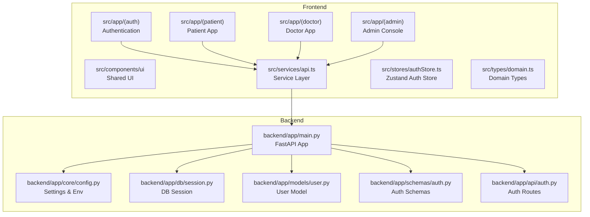
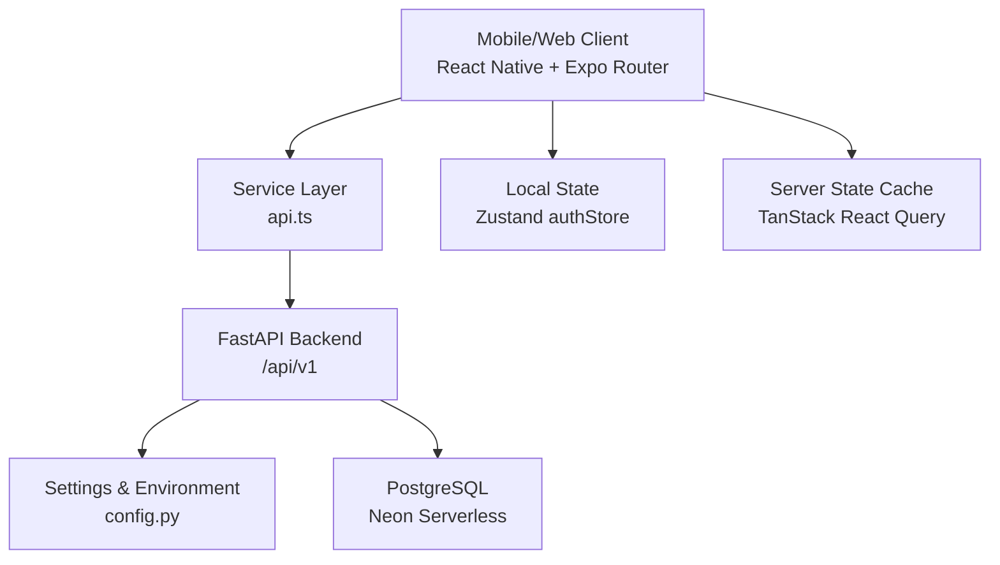
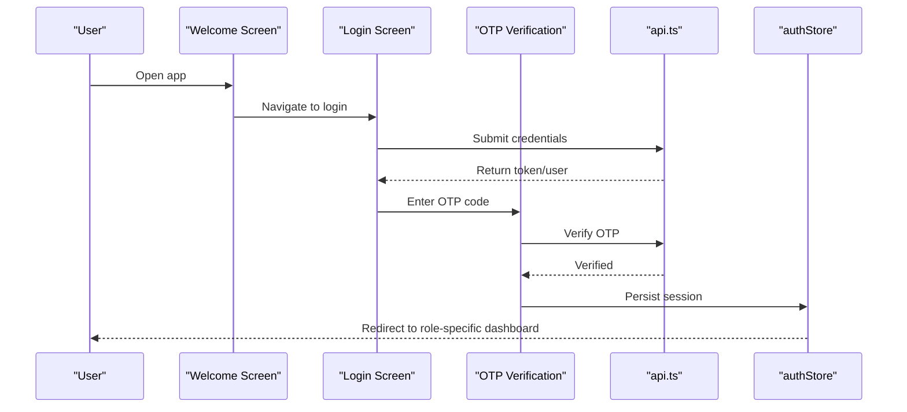
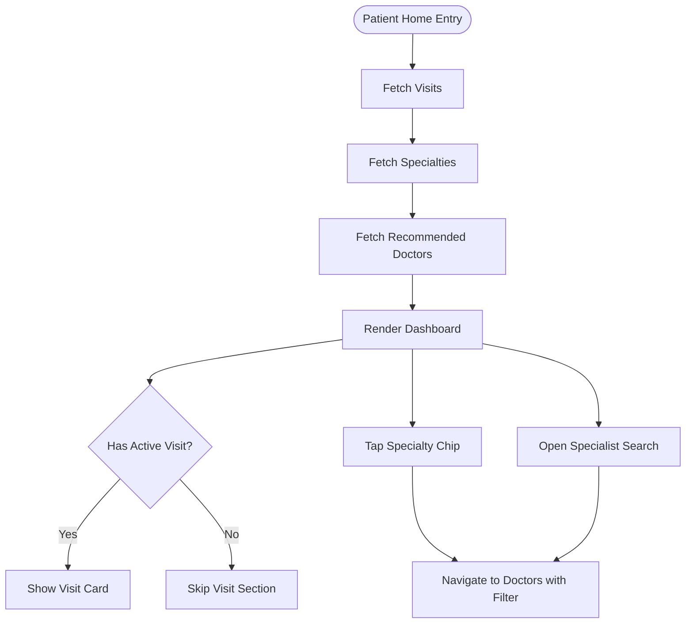
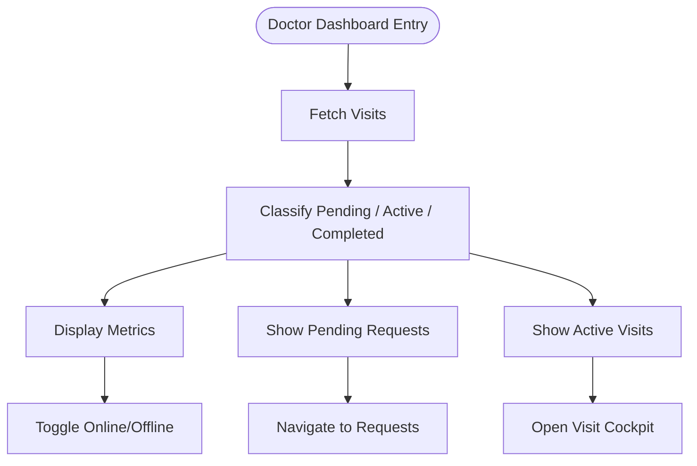
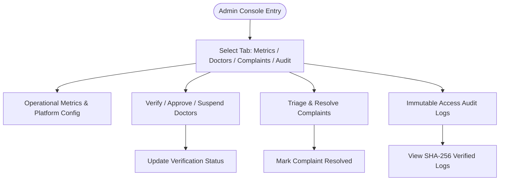
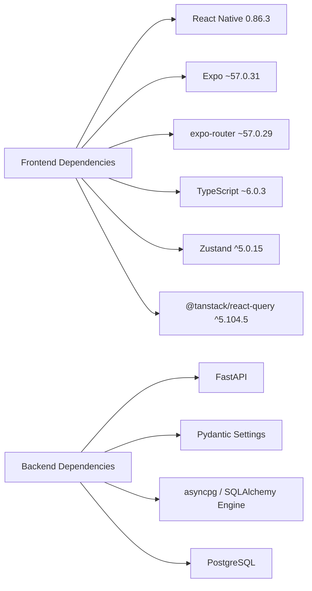

# Project Overview

<cite>
**Referenced Files in This Document**
- [README.md](file://README.md)
- [package.json](file://package.json)
- [architecture.md](file://src/docs/architecture.md)
- [App.tsx](file://App.tsx)
- [welcome.tsx](file://src/app/(auth)/welcome.tsx)
- [patient index.tsx](file://src/app/(patient)/index.tsx)
- [doctor index.tsx](file://src/app/(doctor)/index.tsx)
- [admin index.tsx](file://src/app/(admin)/index.tsx)
- [backend main.py](file://backend/app/main.py)
- [backend config.py](file://backend/app/core/config.py)
</cite>

## Table of Contents
1. [Introduction](#introduction)
2. [Project Structure](#project-structure)
3. [Core Components](#core-components)
4. [Architecture Overview](#architecture-overview)
5. [Detailed Component Analysis](#detailed-component-analysis)
6. [Dependency Analysis](#dependency-analysis)
7. [Performance Considerations](#performance-considerations)
8. [Troubleshooting Guide](#troubleshooting-guide)
9. [Conclusion](#conclusion)

## Introduction
HomeCare is a mobile-first digital healthcare application designed for residential medical consultations in Rwanda, with Kigali as the default operational context and prices expressed in Rwandan Francs (RWF). The platform connects patients with verified medical specialists who travel to the patient’s home to conduct physical examinations, collect laboratory samples, and securely deliver clinical summaries, electronic prescriptions, and lab results.

The project combines:
- A React Native/Expo frontend targeting iOS, Android, and Web.
- A FastAPI backend with PostgreSQL for authentication, configuration, and API routing.
- A multi-role system supporting patients, doctors, and administrators.

Key product goals include doctor discovery, home visit booking, end-to-end consultation workflows, medical records management, and administrative oversight for compliance, quality assurance, and analytics.

**Section sources**
- [README.md:1-8](file://README.md#L1-L8)
- [architecture.md:1-6](file://src/docs/architecture.md#L1-L6)

## Project Structure
At a high level, the repository separates frontend screens by role, shared UI components, services, stores, types, mock data, and documentation, while the backend provides a FastAPI application entry point, configuration, database session setup, models, schemas, and API routes.

**Diagram sources**
- [package.json:1-36](file://package.json#L1-L36)
- [backend main.py:1-61](file://backend/app/main.py#L1-L61)
- [backend config.py:1-33](file://backend/app/core/config.py#L1-L33)

**Section sources**
- [README.md:117-199](file://README.md#L117-L199)
- [architecture.md:36-68](file://src/docs/architecture.md#L36-L68)

## Core Components
This section outlines the primary user roles and their core responsibilities within HomeCare.

- Patient
  - Onboarding, consent, profile setup, specialist discovery, booking, visit tracking, records access, ratings, and complaints.
- Doctor
  - Credential registration, admin verification gate, availability management, request handling, visit execution, clinical workspace, and result publication.
- Administrator
  - Doctor license verification, platform configuration, complaint resolution, analytics dashboards, and immutable audit logs for health record compliance.

These roles are implemented through dedicated route groups under `src/app/(auth)`, `src/app/(patient)`, `src/app/(doctor)`, and `src/app/(admin)`.

**Section sources**
- [architecture.md:9-33](file://src/docs/architecture.md#L9-L33)
- [README.md:117-199](file://README.md#L117-L199)

## Architecture Overview
The HomeCare architecture follows a clear separation between the mobile/web frontend and the backend API:

- Frontend
  - Built with Expo Router, React Native, TypeScript, Zustand for local state, and TanStack React Query for server-state caching and synchronization.
  - Role-based screens implement domain flows such as doctor search, booking, visit lifecycle, records, and administrative oversight.
- Backend
  - FastAPI application exposing `/api/v1` endpoints.
  - Configuration via Pydantic settings, including database URL, JWT parameters, and API versioning.
  - Database connection and table initialization handled during application lifespan.

**Diagram sources**
- [package.json:1-36](file://package.json#L1-L36)
- [backend main.py:1-61](file://backend/app/main.py#L1-L61)
- [backend config.py:1-33](file://backend/app/core/config.py#L1-L33)

**Section sources**
- [README.md:1-8](file://README.md#L1-L8)
- [backend main.py:11-46](file://backend/app/main.py#L11-L46)

## Detailed Component Analysis

### Authentication and Onboarding
The authentication flow begins at the welcome screen, which introduces the brand, emergency disclaimer, and quick actions for patient registration, login, and doctor onboarding. OTP verification supports simulated one-time codes for demo purposes.

**Diagram sources**
- [welcome.tsx:18-83](file://src/app/(auth)/welcome.tsx#L18-L83)
- [README.md:119-125](file://README.md#L119-L125)

**Section sources**
- [welcome.tsx:1-86](file://src/app/(auth)/welcome.tsx#L1-L86)
- [README.md:119-125](file://README.md#L119-L125)

### Patient Experience
The patient home screen greets the user, shows location context, provides a search bar, displays upcoming visits, lists specialties, and recommends verified specialists. It uses TanStack React Query to fetch visits, specialties, and recommended doctors, and integrates with the service layer for data operations.

**Diagram sources**
- [patient index.tsx:22-50](file://src/app/(patient)/index.tsx#L22-L50)
- [patient index.tsx:51-177](file://src/app/(patient)/index.tsx#L51-L177)

**Section sources**
- [patient index.tsx:1-177](file://src/app/(patient)/index.tsx#L1-L177)
- [README.md:127-137](file://README.md#L127-L137)

### Doctor Experience
The doctor dashboard presents today’s metrics, pending requests, active visits, and an online/offline toggle. It filters visits into pending, active, and completed categories and allows navigation to request management and visit execution.

**Diagram sources**
- [doctor index.tsx:25-57](file://src/app/(doctor)/index.tsx#L25-L57)
- [doctor index.tsx:58-181](file://src/app/(doctor)/index.tsx#L58-L181)

**Section sources**
- [doctor index.tsx:1-181](file://src/app/(doctor)/index.tsx#L1-L181)
- [README.md:139-146](file://README.md#L139-L146)

### Administrative Console
The admin console provides tabs for metrics, doctor verification, complaints, and audit logs. It supports filtering, status updates, complaint resolution, and resetting demo data. Compliance references include Law No. 058/2021 and RMDC authority.

**Diagram sources**
- [admin index.tsx:60-121](file://src/app/(admin)/index.tsx#L60-L121)
- [admin index.tsx:339-439](file://src/app/(admin)/index.tsx#L339-L439)
- [admin index.tsx:442-587](file://src/app/(admin)/index.tsx#L442-L587)
- [admin index.tsx:590-735](file://src/app/(admin)/index.tsx#L590-L735)

**Section sources**
- [admin index.tsx:1-121](file://src/app/(admin)/index.tsx#L1-L121)
- [admin index.tsx:339-735](file://src/app/(admin)/index.tsx#L339-L735)
- [README.md:108-114](file://README.md#L108-L114)

## Dependency Analysis
The frontend depends on Expo, React Native, TypeScript, Zustand, and TanStack React Query. The backend depends on FastAPI, Pydantic Settings, SQLAlchemy engine/session, and PostgreSQL.

**Diagram sources**
- [package.json:1-36](file://package.json#L1-L36)
- [backend main.py:1-10](file://backend/app/main.py#L1-L10)
- [backend config.py:1-33](file://backend/app/core/config.py#L1-L33)

**Section sources**
- [package.json:1-36](file://package.json#L1-L36)
- [backend main.py:1-61](file://backend/app/main.py#L1-L61)
- [backend config.py:1-33](file://backend/app/core/config.py#L1-L33)

## Performance Considerations
- Use TanStack React Query for efficient caching, background refetching, and deduplication of network requests across patient, doctor, and admin screens.
- Keep Zustand stores minimal and focused on local UI state and session persistence; offload heavy data to server state.
- Avoid unnecessary re-renders by memoizing expensive computations and using query keys that reflect data dependencies.
- For large lists (doctors, visits, complaints), implement pagination or virtualization when integrating with real APIs.
- Optimize image assets and avoid loading heavy resources on initial render; lazy-load where appropriate.

[No sources needed since this section provides general guidance]

## Troubleshooting Guide
Common issues and checks:
- Frontend typecheck: Run TypeScript checks to ensure all routes, components, and stores adhere to strict typing.
- Backend environment: Ensure `.env` contains correct database URL, secret key, and algorithm settings.
- Database connectivity: Validate that the FastAPI lifespan initializes tables and connects to PostgreSQL successfully.
- Demo accounts: Use provided credentials and quick-fill helpers to validate role-based flows quickly.
- Health check: Confirm the backend health endpoint returns a successful status.

**Section sources**
- [README.md:76-84](file://README.md#L76-L84)
- [README.md:89-107](file://README.md#L89-L107)
- [backend main.py:11-28](file://backend/app/main.py#L11-L28)
- [backend config.py:10-30](file://backend/app/core/config.py#L10-L30)

## Conclusion
HomeCare delivers a comprehensive, mobile-first platform for residential medical consultations in Rwanda. Its architecture cleanly separates role-based frontends from a FastAPI backend, enabling robust doctor discovery, home visit booking, consultation workflows, medical records management, and administrative oversight. With Expo SDK and React Native targeting iOS, Android, and Web, and a backend configured for Neon PostgreSQL, the project is positioned for scalable deployment and regulatory alignment with Rwandan health data requirements.

[No sources needed since this section summarizes without analyzing specific files]